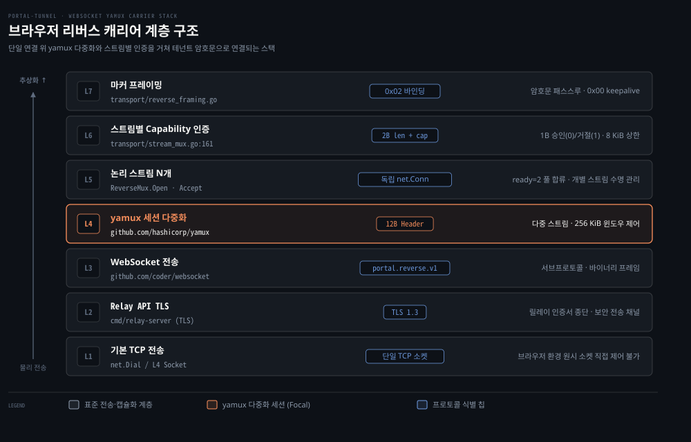
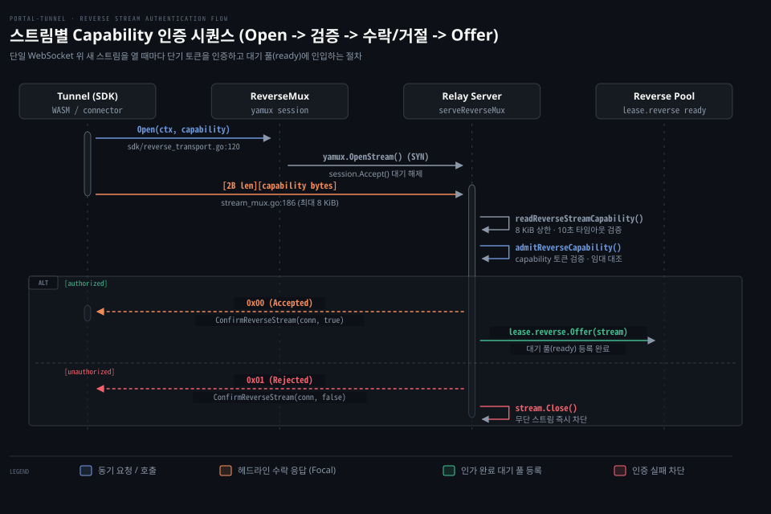

# stream_mux·yamux

---

> 원시 TCP 소켓과 HTTP Upgrade 하이잭을 사용할 수 없는 브라우저 환경에서 WebSocket과 yamux로 다중 스트림을 릴레이에 중계하는 보조 캐리어의 동작 원리와 트레이드오프를 다룹니다.


## 왜 두 번째 carrier 가 필요한가

> 브라우저 보안 샌드박스는 커널 원시 소켓 개설을 차단하므로 네이티브 전송과 다른 웹 표준 보조 캐리어가 필요합니다.

방화벽 안쪽의 터널 에이전트가 공용 릴레이 서버와 리버스 연결을 맺으려면 양방향 통신 파이프가 필요합니다. 네이티브 운영체제(macOS, Linux)에서 실행되는 터널 에이전트는 릴레이의 `/sdk/connect`를 호출합니다. 이후 HTTP/1.1 소켓의 하부 연결 제어권을 넘겨받는 **소켓 하이잭(Socket Hijack)** 기법을 사용합니다(`portal/api_server.go:564`). 하이잭이 성공하면 HTTP 프로토콜 파서는 즉시 물러납니다.

리버스 연결은 릴레이 API TLS 위에서 열립니다(`sdk/reverse_transport.go:62-66`). 릴레이는 32 KB 버퍼로 사용자 공간 복사와 초당 바이트 전송량 제한(BPS 스로틀)을 수행합니다(`portal/proxy.go:100-132`). 바깥 TLS 레코드 오버헤드와 사용자 공간 복사는 거치지만 yamux나 WebSocket 프레이밍 오버헤드 없이 바이트 스트림을 양방향으로 복사합니다.

커널 소켓에 접근하지 못하는 런타임도 있습니다. 브라우저 자바스크립트 엔진과 WebAssembly(WASM) 환경(`cmd/portal-tunnel/wasm/main.go:1`)은 운영체제 시스템 콜을 호출할 권한이 없습니다. 브라우저 보안 모델은 자바스크립트가 임의의 IP와 포트로 직접 TCP 연결(`net.Dial`)을 맺는 것을 금지합니다. 브라우저 내장 HTTP 클라이언트는 101 Switching Protocols 응답을 받더라도 하부 L4 TCP 소켓의 파일 디스크립터를 스크립트에 노출하지 않으므로 소켓 하이잭 자체가 불가능합니다.

WASM 진입점인 `cmd/portal-tunnel/wasm/main.go:25-34`는 브라우저 전역 객체에 `portalTunnel.start`와 `portalTunnel.stop` 함수를 등록합니다. 이 진입점은 브라우저 탭 안에서 `sdk.Expose(ctx, id, []string{relayURL})`를 호출해 원격 릴레이에 도메인을 임대하고 웹 트래픽을 서비스합니다(`cmd/portal-tunnel/wasm/main.go:54,78`). 이 환경에서 브라우저가 외부와 전이중(Full-duplex) 바이너리 스트림을 열 수 있는 표준 프로토콜은 **웹소켓(WebSocket)**뿐입니다.

공식 아키텍처 문서(`docs/src/routes/architecture/+page.md:308-311`)는 이 제약을 명시합니다. 브라우저 런타임은 네이티브 리버스 전송이 쓰는 원시 TCP 소켓을 열 수 없으므로 SDK는 `GOOS=js` 환경에서 등록, 임대 갱신, 리버스 엔드포인트 규약을 그대로 유지합니다. 물리적 캐리어만 WebSocket과 yamux 다중화 계층으로 교체합니다.

포털 터널이 네이티브 환경에서 WebSocket 대신 원시 TCP를 기본 전송으로 쓰는 이유는 아키텍처 불변식(`docs/src/routes/architecture/+page.md:191-192`)에 이렇게 적혀 있습니다.

- 원시 TCP 리버스 연결이 포털의 정본 스트림 전송 규약(Canonical stream transport)입니다.
- 웹소켓이나 레거시 호환 경로를 기본값으로 시스템에 도입하지 않습니다.

네이티브 터널은 원시 TCP 소켓을 표준으로 삼습니다. 이 소켓에는 부가적인 프레이밍 오버헤드도 다중화 지연도 없습니다. WebSocket과 결합한 스트림 다중화는 브라우저 환경이라는 제약을 넘으려고 둔 목적별 대체 캐리어입니다.

기준 커밋 0a3b9c06 (2026-10-14)


## 스트림 다중화 기초와 헤드오브라인 블로킹

> 단일 연결 위에 논리 스트림 여럿을 얹는 기법은 브라우저 연결 제약을 풀지만 TCP 패킷 하나가 유실되면 모든 스트림이 함께 멈추는 HOL(Head-of-Line) 블로킹을 대가로 치릅니다.

네이티브 환경에서 터널 에이전트는 고정된 2개 슬롯(`defaultReadyTarget = 2`)으로 유휴 TCP 리버스 연결을 유지하다가 연결이 소비되면 소비된 만큼 새로 개설해 보충합니다(`sdk/listener.go:588-600`). 반면 브라우저(`GOOS=js`)는 커널 원시 TCP 소켓을 직접 열 수 없습니다(`docs/src/routes/architecture/+page.md:308-315`). 스트림 다중화 없이 요청마다 새 WebSocket 핸드셰이크와 TLS를 맺는다면 왕복 지연 시간이 크게 늘어날 것이라고도 추정할 수 있습니다.

이 제약을 넘으려고 브라우저는 릴레이와 물리적 WebSocket 연결을 단 하나만 맺고 그 파이프 안에서 독립된 논리 스트림을 생성·관리하는 **스트림 다중화(Stream Multiplexing)**를 사용합니다. 브라우저도 네이티브와 똑같이 2개 슬롯(`defaultReadyTarget`)으로 유휴 스트림을 유지하고 소비분만큼 보충합니다(`sdk/listener.go:588-600`, `sdk/reverse_transport.go:34-37,104-125`). 포털은 여기에 HashiCorp가 개발한 경량 다중화 라이브러리 **yamux**를 채택했습니다.

yamux 명세는 모든 데이터를 12바이트 고정 헤더로 감싸 나릅니다.

- **버전 (Version, 1바이트)**: 프로토콜 버전(기본 0)을 나타냅니다.
- **유형 (Type, 1바이트)**: 데이터 전송(`Data`, `0x0`), 윈도우 갱신(`Window Update`, `0x1`), 핑 검사(`Ping`, `0x2`), 세션 종료(`Go Away`, `0x3`) 중 하나를 지정합니다.
- **플래그 (Flags, 2바이트)**: 새 논리 스트림 개설(`SYN`, `0x1`), 스트림 승인(`ACK`, `0x2`), 송신 종료(`FIN`, `0x4`), 비정상 단절(`RST`, `0x8`)을 제어합니다.
- **스트림 식별자 (StreamID, 4바이트)**: 각 가상 채널을 구분하는 번호입니다. 클라이언트가 주도적으로 연 스트림은 1, 3, 5와 같은 홀수를, 서버가 연 스트림은 짝수를 할당받습니다. 0은 전체 세션 제어용으로 예약됩니다.
- **길이 (Length, 4바이트)**: 데이터 프레임에서는 실제 페이로드의 바이트 수이고 윈도우 갱신 프레임에서는 수신 버퍼 윈도우 증가분을 뜻합니다.

yamux는 논리 스트림마다 독립된 256 KiB 초기 윈도우를 두고 수신측이 처리한 만큼 윈도우를 다시 열어 주는 흐름 제어를 수행합니다. 덕분에 애플리케이션이 보기에는 소켓 하나 위에서도 독립된 `net.Conn` 스트림 여러 개가 동시에 흐르는 것처럼 동작합니다.

다만 TCP 위에 계층으로 얹은 다중화에는 피할 수 없는 병목이 있습니다. 바로 **헤드오브라인 블로킹(Head-of-Line Blocking, HOL 블로킹)**입니다.

yamux가 아무리 논리적으로 스트림 ID를 나누어 패킷을 번갈아 실어 보내도 그 밑을 받치는 하부 캐리어는 단 하나의 TCP 스트림입니다. TCP 프로토콜은 전송 계층에서 패킷 순서를 반드시 보장합니다. 네트워크 혼잡이나 전파 오류로 1번 스트림에 속한 TCP 패킷 하나가 유실되면 운영체제 수신 버퍼는 그 세그먼트가 재전송되어 채워질 때까지 기다립니다. 그동안 뒤이어 정상적으로 도착한 2번, 3번 스트림의 패킷까지 애플리케이션에 넘겨주지 않고 대기열에 묶어 둡니다.

네트워크 로드맵 1단계 "스트림 멀티플렉싱과 HOL 블로킹"([네트워크 로드맵](../../../roadmap/network-roadmap.md))에서 다루듯, HOL 블로킹은 HTTP/2와 yamux처럼 TCP 위에서 동작하는 모든 다중화 프로토콜이 공유하는 구조적 한계입니다.

향후 01-07편에서 다룰 QUIC(RFC 9000)은 UDP 위에서 동작하므로 패킷 순서 보장을 커널이 아닌 QUIC 스트림 계층이 직접 맡습니다. 따라서 특정 스트림의 패킷이 유실되더라도 스트림 간 헤드오브라인 블로킹 없이 독립적으로 전달됩니다(다만 혼잡 제어와 연결 수준 흐름 제어는 연결 단위로 공유됩니다). 포털 터널의 WebSocket+yamux는 브라우저 호환성을 얻으려고 이 HOL 블로킹 지연 비용을 명시적으로 감수하는 설계입니다.


## portal 의 구성 — WebSocket 안의 yamux 세션

> WebSocket 연결을 바이너리 net.Conn 소켓으로 감싸고 그 위에서 yamux 클라이언트와 서버를 구동해 단일 세션을 공유합니다.

브라우저의 WebSocket API는 표준 `net.Conn` 소켓 인터페이스와 호환되지 않습니다. 서브프로토콜 협상과 다중화 프레이밍을 정밀하게 통제하지 못하면 릴레이의 기존 제어 평면 규약과 결합할 수 없습니다. 포털 터널은 이 연결 불일치를 풀려고 `portal/transport/stream_mux.go`를 중심으로 브라우저와 릴레이 사이의 세션을 통합합니다.

릴레이 서버의 연결 진입점인 `portal/api_server.go:529`는 클라이언트 요청이 들어오면 가장 먼저 캐리어 종류를 판별합니다.

```go
// portal/transport/stream_mux.go:31-33
func IsReverseMuxRequest(r *http.Request) bool {
	return strings.EqualFold(strings.TrimSpace(r.Header.Get("Upgrade")), "websocket")
}
```

`IsReverseMuxRequest`가 참을 반환하면 릴레이는 일반 TCP 하이잭 분기를 건너뛰고 웹소켓 수락 절차로 진입합니다. 이때 릴레이는 핸드셰이크 헤더에서 리버스 인증 토큰을 추출합니다(`portal/transport/stream_mux.go:39`).

```go
// portal/transport/stream_mux.go:39-55
func ReverseMuxCapability(r *http.Request) string {
	var marked bool
	var capabilities []string
	for _, raw := range strings.Split(strings.Join(r.Header.Values("Sec-WebSocket-Protocol"), ","), ",") {
		switch value := strings.TrimSpace(raw); value {
		case "":
		case types.ReverseSubprotocol:
			marked = true
		default:
			capabilities = append(capabilities, value)
		}
	}
	if !marked || len(capabilities) != 1 {
		return ""
	}
	return capabilities[0]
}
```

브라우저의 표준 `WebSocket` 생성자는 HTTP 요청 헤더를 임의로 추가하는 기능을 지원하지 않습니다. 그렇다고 capability 토큰을 URL 쿼리 스트링(`?capability=...`)에 넣으면 중계 웹 서버나 리버스 프록시(Nginx 등)의 접근 로그에 영구히 기록되는 보안 누출이 발생합니다. 포털은 브라우저 표준이 허용하는 `Sec-WebSocket-Protocol` 서브프로토콜 헤더를 활용합니다. 서브프로토콜 목록에 고정 식별자(`portal.reverse.v1`)와 capability 문자열을 나란히 실어 URL을 오염시키지 않고 핸드셰이크 단계에서 인증 자격을 안전하게 전달합니다.

자격이 검증되면 릴레이는 `AcceptReverseMux`를 호출해 세션을 시작합니다(`portal/transport/stream_mux.go:244`).

```go
// portal/transport/stream_mux.go:244-259
func AcceptReverseMux(w http.ResponseWriter, r *http.Request) (*ReverseMux, error) {
	socket, err := websocket.Accept(w, r, &websocket.AcceptOptions{
		InsecureSkipVerify: true, // the capability is the credential; origin is not
		Subprotocols:       []string{types.ReverseSubprotocol},
	})
	if err != nil {
		return nil, err
	}
	conn := websocket.NetConn(context.Background(), socket, websocket.MessageBinary)
	session, err := yamux.Server(conn, reverseMuxConfig())
	if err != nil {
		_ = conn.Close()
		return nil, err
	}
	return &ReverseMux{session: session}, nil
}
```

릴레이는 `websocket.Accept`를 수행할 때 응답 서브프로토콜로 `portal.reverse.v1`만 지정합니다. 클라이언트가 보낸 capability 값은 응답에 그대로 반사되지 않도록 걸러냅니다. 그다음 `websocket.NetConn` 래퍼가 WebSocket 메시지 프레임을 표준 Go `net.Conn` 인터페이스로 변환하면 그 위에서 `yamux.Server`를 구동합니다.

터널(SDK) 측에서는 `DialReverseMux`(`portal/transport/stream_mux.go:263`)가 반대편 종단을 엽니다. URL 스킴을 `https`는 `wss`로, `http`는 `ws`로 변환한 뒤 `websocket.Dial`로 연결을 맺고 `yamux.Client`를 구동합니다. 양측이 공유하는 yamux 설정(`reverseMuxConfig`, `:290`)은 `yamux.DefaultConfig()`를 기반으로 하고 로그 출력은 버리도록(`io.Discard`) 지정되어 있습니다.

터널 SDK의 전송 관리자(`sdk/reverse_transport.go:104`)는 이 다중화 세션을 효율적으로 재사용합니다.

```go
// sdk/reverse_transport.go:104-125
func (t *leaseReverseTransport) openMux(ctx context.Context) (net.Conn, error) {
	t.mu.Lock()
	defer t.mu.Unlock()
	reverseURL, capability, err := t.listener.reverseTarget()
	if err != nil {
		return nil, err
	}
	if t.mux == nil || reverseMuxEnded(t.mux) {
		handshakeCtx, cancel := context.WithTimeout(ctx, defaultHandshakeTimeout)
		mux, err := transport.DialReverseMux(handshakeCtx, reverseURL, capability)
		cancel()
		if err != nil {
			return nil, err
		}
		t.mux = mux
	}
	stream, err := t.mux.Open(ctx, capability)
	if err != nil {
		return nil, fmt.Errorf("open reverse stream: %w", err)
	}
	return stream, nil
}
```

`openMux`는 세션이 없거나 이미 끊어진 경우(`reverseMuxEnded`)에만 `DialReverseMux`를 호출해 새 WebSocket 연결을 맺습니다. 세션이 살아 있는 동안에는 기존 세션 인스턴스 위에서 `t.mux.Open(ctx, capability)`을 호출해 가벼운 논리 스트림만 바로 뽑아냅니다.



위 도식은 7계층 캡슐화 스택입니다. 단일 TCP 연결에서 시작해 릴레이 API TLS, WebSocket 바이너리 전송, yamux 다중화(L4, 강조), N개의 독립 스트림과 스트림별 인증을 거쳐 최종 테넌트 암호문 마커 프레이밍(`0x02`)에 이릅니다. 물리 연결은 하나지만 논리적으로는 여러 사용자의 접속을 분리합니다.


## 스트림마다 인증 — 무단 스트림 개설 방어

> 웹소켓 핸드셰이크에서 임대를 인증했더라도 개별 스트림마다 단기 capability를 다시 검증해 만료와 도용을 차단합니다.

단일 WebSocket 파이프가 며칠 동안 유지되는 상황에서 초기 연결 시점의 인증에만 의존하면 보안 문제가 생깁니다. 도메인 임대가 취소되거나 만료된 뒤에도 새 스트림을 무단으로 열어 트래픽을 가로챌 수 있기 때문입니다. 포털 터널의 리버스 capability 토큰은 수명이 짧은 단기 자격 증명이므로 연결 생명주기와 분리되어야 합니다.

웹소켓 연결 수립 시점에 1회만 인증하고 이후 열리는 yamux 스트림을 릴레이가 추가 검사 없이 받아들이면 허점이 생깁니다. 임대가 끝난 뒤에도 기존 웹소켓 파이프로 새 스트림을 마구 열어 릴레이 자원을 무단 점유할 수 있습니다.

그래서 포털 터널은 스트림별 상호 검증 규약을 적용합니다. 새 논리 스트림이 열릴 때마다 터널이 첫 바이트들로 capability를 제시하고 릴레이가 1바이트 응답으로 인가를 확정합니다.

터널 에이전트가 새 스트림을 열 때 실행하는 `authenticateReverseStream`(`portal/transport/stream_mux.go:161`)은 이렇게 동작합니다.

1. 스트림에 10초 인증 제한 시간(`reverseStreamAuthTimeout = 10 * time.Second`, `:23`)을 부여합니다.
2. Capability 토큰의 바이트 길이를 상위 바이트를 먼저 쓰는(Big-Endian) 2바이트 부호 없는 정수(`uint16`)로 기록하고 이어서 실제 capability 문자열 바이트를 전송합니다(`:184-188`).
3. 릴레이의 응답 바이트 1개를 기다립니다(`io.ReadFull(conn, status[:])`, `:190`).
4. 응답이 `reverseStreamStatusAccepted(0)`이 아니면 즉시 `403 Forbidden` 에러를 반환하고 스트림을 파기합니다(`:193-199`).

릴레이 서버 측에서는 `readReverseStreamCapability`(`portal/transport/stream_mux.go:203`)가 이 바이트들을 읽어 들입니다.

```go
// portal/transport/stream_mux.go:203-225
func readReverseStreamCapability(conn net.Conn) (string, error) {
	if conn == nil {
		return "", errors.New("reverse stream is required")
	}
	if err := conn.SetDeadline(time.Now().Add(reverseStreamAuthTimeout)); err != nil {
		return "", err
	}

	var size [2]byte
	if _, err := io.ReadFull(conn, size[:]); err != nil {
		return "", err
	}
	length := int(binary.BigEndian.Uint16(size[:]))
	if length == 0 || length > reverseCapabilityLimit {
		_, _ = conn.Write([]byte{reverseStreamStatusRejected})
		return "", errors.New("reverse capability is invalid")
	}
	raw := make([]byte, length)
	if _, err := io.ReadFull(conn, raw); err != nil {
		return "", err
	}
	return string(raw), nil
}
```

릴레이는 2바이트 길이를 읽은 직후 상한선을 검사합니다. 길이가 0이거나 `reverseCapabilityLimit = 8 << 10` (8 KiB, `:24`)를 초과하면 페이로드를 읽지도 않고 즉시 `reverseStreamStatusRejected(1)` 거절 바이트를 회신한 뒤 에러를 반환합니다. 악의적인 클라이언트가 허위 길이 필드를 보내 릴레이 메모리를 고갈시키는 서비스 거부 공격을 이 검사가 막습니다.

길이 검사를 통과하면 릴레이의 다중화 처리 루프(`portal/api_server.go:491` `serveReverseMux`)가 실제 인가를 판정합니다.

```go
// portal/api_server.go:499-515
	for {
		stream, capability, err := session.Accept()
		if err != nil {
			return
		}
		admitted, authErr := s.registry.admitReverseCapability(capability)
		authorized := authErr == nil && admitted == lease
		if err := transport.ConfirmReverseStream(stream, authorized); err != nil || !authorized {
			_ = stream.Close()
			continue
		}
		// Offer closes a stream it turns away, as when the ready queue is full.
		if err := lease.reverse.Offer(stream); err != nil {
			continue
		}
		s.registry.Touch(lease.ServiceKey(), sourceAddr, time.Now())
	}
```

릴레이는 `admitReverseCapability`를 호출해 스트림이 제시한 capability를 검증합니다. 토큰이 릴레이 권한키로 서명된 ES256K JWT인지 확인합니다(`portal/identity/lease_token.go:78-82,133-147`). 이어 현재 웹소켓을 소유한 임대 레코드(`lease`)와 일치하는지 대조합니다(`portal/lease.go:557-567`). 검증 결과(`authorized`)는 `ConfirmReverseStream`(`portal/transport/stream_mux.go:229`)이 1바이트(`0` 또는 `1`)에 담아 터널 에이전트에 전송합니다.

인가를 통과한 스트림은 `lease.reverse.Offer(stream)`으로 들어갑니다. 이 지점에서 중요한 구조적 일치가 일어납니다. 인증을 통과한 yamux 스트림은 네이티브 환경에서 HTTP 소켓 하이잭으로 생성된 raw TCP 연결과 똑같은 `net.Conn` 취급을 받으며 같은 대기 풀(`ready`)로 들어갑니다.



위 도식은 터널이 `Open`으로 새 스트림을 열고 2바이트 길이와 토큰을 전송하는 과정을 보여줍니다. 릴레이는 8 KiB 상한선과 capability JWT 서명을 검증합니다. 이후 `ALT` 분기에 따라 `0x00` 수락과 풀 등록(`Offer`), 또는 `0x01` 거절과 스트림 폐쇄로 이어집니다.


## half-close 와 5분 타이머의 비밀

> 네이티브 TCP는 절반 종료 후에도 무기한 응답을 수신할 수 있지만 yamux 캐리어는 5분 스트림 종료 타이머의 제약을 받습니다.

네트워크 프로그래밍에서 **절반 종료(half-close)**는 연결의 송신 스트림만 닫고 수신 스트림은 열어 두는 기법입니다. 클라이언트가 HTTP POST 요청 바디를 서버로 모두 보낸 뒤 쓰기 방향을 닫아 전송 완료를 알리면서도 서버가 회신하는 응답 데이터는 계속 읽어 들일 때 쓰입니다([listener 소켓과 연결 소켓](../../project/gonet-lab/00-01.listener%20소켓과%20연결%20소켓.md) §3).

포털 터널의 데이터 브리지는 양방향 복사 루프에서 half-close 규약을 보존합니다. 메인테이너 아키텍처 문서(`docs/maintainer/architecture.md:181-182`)는 양방향 복사 루프가 half-close를 보존한다고 밝힙니다. 요청 EOF를 받은 뒤에도 오리진이 응답할 수 있고 요청을 계속 읽으면서 응답을 마칠 수도 있습니다.

네이티브 raw TCP 환경에서는 이 half-close 상태에 아무런 인위적 시간 제약이 붙지 않습니다("Native replies have no new duration limit"). 운영체제 커널의 TCP 스택이 상태를 관리하므로 원본 서버가 요청 바디를 다 받은 뒤 30분이든 1시간이든 응답을 계속 스트리밍해도 소켓은 안정적으로 유지됩니다.

하지만 WebSocket과 yamux를 거치는 보조 캐리어 환경에서는 숨겨진 시간 제약이 작동합니다.

포털 터널의 yamux 스트림 래퍼인 `reverseMuxConn`은 half-close를 지원하려고 `CloseWrite` 메서드를 제공합니다(`portal/transport/stream_mux.go:72`).

```go
// portal/transport/stream_mux.go:72-74
func (c *reverseMuxConn) CloseWrite() error {
	return c.Stream.Close()
}
```

yamux 프로토콜 명세에서 `Stream.Close()`는 송신측 FIN 플래그를 상대방에게 보내는 절반 종료 동작입니다. 그런데 `hashicorp/yamux` 라이브러리의 내부 구현에는 중요한 동작이 하나 들어 있습니다. 송신 방향 `Close()`가 호출되는 순간 yamux는 그 스트림의 **기본 5분의 스트림 종료 타이머(`StreamCloseTimeout = 5 * time.Minute`)**를 시작합니다.

메인테이너 아키텍처 문서(`docs/maintainer/architecture.md:183-186`)는 이 차이를 이렇게 경고합니다.

> On the WebSocket carrier, yamux's send-side close starts its default five-minute stream-close timer: a response still streaming five minutes after request EOF can be reset. This is a carrier limitation, not an unlimited TCP half-close guarantee.

브라우저 기반 터널에서 클라이언트가 요청 EOF를 보낸 뒤 5분이 넘도록 긴 응답을 흘려보내면 문제가 생깁니다. yamux 내부 타이머가 만료되어 스트림에 RST 플래그가 전송되고 연결이 강제로 끊어질 수 있습니다. 이 끊김은 포털 터널 자체의 결함이 아니라 자원 고갈을 방어하려는 yamux 라이브러리 고유의 시간 한계입니다.

완전 종료(`Close`)는 `CloseWrite`와 다르게 동작합니다(`portal/transport/stream_mux.go:76-86`).

```go
// portal/transport/stream_mux.go:76-86
func (c *reverseMuxConn) Close() error {
	c.mu.Lock()
	if c.closed {
		c.mu.Unlock()
		return nil
	}
	c.closed = true
	_ = c.Stream.SetDeadline(time.Now())
	c.mu.Unlock()
	return c.Stream.Close()
}
```

완전 종료할 때는 `c.closed = true`로 상태를 굳히고 곧바로 `SetDeadline(time.Now())`을 호출합니다. 이 호출이 현재 스트림에서 데이터를 읽으려고 블로킹 대기 중이던 모든 Reader 고루틴을 에러로 깨워 중단시킵니다. 이후 `SetDeadline`을 다시 호출하더라도 소켓이 다시 열리지 않고 `net.ErrClosed`를 일관되게 반환하도록 잠금(`c.mu`)으로 통제합니다(`:88-95`).


## 트레이드오프 — raw TCP vs WebSocket+yamux 비교

> 네이티브 원시 TCP에는 프레이밍 오버헤드와 스트림 시간 제한이 없고, WebSocket+yamux는 브라우저에서 쓸 수 있는 대신 다중화 오버헤드를 감수합니다.

포털 터널이 제공하는 두 가지 리버스 캐리어는 성능, 호환성, 제약 사항에서 뚜렷하게 갈립니다.

| 비교 기준 | 원시 TCP 리버스 캐리어 (Raw TCP) | WebSocket + yamux 캐리어 |
|---|---|---|
| 주요 대상 런타임 | 네이티브 CLI, 데몬 서버 (Go Native) | 브라우저 JS, WebAssembly (`GOOS=js`) |
| 기본 연결 모델 | 복수 TCP 소켓 (대기 풀 2개 + 활성 요청당 1개) | 단일 TCP 소켓 (WebSocket 1개 위 N개 논리 스트림) |
| 패킷 캡슐화 비용 | yamux·WebSocket 프레이밍 없음 (릴레이 API TLS 위 직접 전송) | WebSocket 프레임 헤더 + yamux 12B 헤더 추가 |
| HOL 블로킹 | 없음 (각 연결이 커널 L4 수준에서 격리) | 발생 (하부 TCP 단일 패킷 유실 시 모든 스트림 대기) |
| half-close 지속 시간 | 무제한 (운영체제 TCP 스택 수명 보장) | 최대 5분 (yamux 내부 스트림 종료 타이머 제약) |
| 스트림 개설 비용 | 새 TCP 핸드셰이크 + TLS 핸드셰이크 | 기존 세션 위 1 RTT (SYN 전송 및 capability 인증) |
| 아키텍처 위상 | 정본 규약 (Canonical Stream Transport) | 브라우저 전용 보조 캐리어 (기본 도입 금지) |

연결 하나로 여러 스트림을 처리하는 다중화에는 HOL 블로킹으로 인한 꼬리 지연(Tail Latency) 증가, 12바이트 프레이밍 오버헤드, 5분 스트림 타이머라는 비용이 따릅니다.

포털 터널은 네이티브 환경에서 이 비용을 치르지 않으려고 원시 TCP 하이잭을 표준으로 고정했습니다. 반면 브라우저 환경에서는 소켓 개설이 불가능하므로 성능과 시간의 손실을 감수하고서라도 사용자에게 웹 터널링 경험을 전달하려고 WebSocket과 yamux의 결합을 선택했습니다.


## 리뷰 노트

> 소스 코드와 공식 문서를 대조하며 확인한 주의점과 개선 검토 사항입니다.

- 서브프로토콜을 통한 민감 정보 은닉 (`portal/transport/stream_mux.go:39,247`): 브라우저는 `Sec-WebSocket-Protocol`에 식별자와 토큰을 실어 보냅니다. 릴레이의 `AcceptReverseMux`는 응답 협상 시 고정 식별자만 지정합니다. 클라이언트 토큰이 응답 헤더로 반사되지 않게 걸러내 URL 로그 유출을 방지합니다.
- 스트림별 암호학적 서명 재검증 부하 (`portal/transport/stream_mux.go:161`, `portal/api_server.go:504`): 논리 스트림이 열릴 때마다 최대 8 KiB의 토큰을 다시 보냅니다. 릴레이는 `admitReverseCapability`로 JWT 서명 검증을 매번 다시 수행합니다(`identity.VerifyReverseCapability`). 이 토큰은 릴레이 권한키로 서명된 ES256K JWT입니다(`portal/identity/lease_token.go:133-147`, `portal/lease.go:557-567`). 대규모 트래픽이 들어오면 릴레이 CPU의 JWT 서명 검증 연산이 병목이 될 수 있으므로 세션 내부 서명 검증 캐싱 도입을 검토할 가치가 있습니다.
- yamux 5분 스트림 종료 타이머 하드코딩 (`portal/transport/stream_mux.go:290-294`): `reverseMuxConfig()`는 `LogOutput = io.Discard`만 변경합니다. `StreamCloseTimeout`은 라이브러리 기본값(`yamux.DefaultConfig()`) 그대로 둡니다. 메인테이너 문서(`docs/maintainer/architecture.md:184-185`)의 5분 타이머(`5 * time.Minute`)도 여기서 비롯됩니다. 대용량 스트리밍처럼 긴 half-close 수명이 필요한 환경이라면 앞으로 타임아웃을 외부에서 주입할 수 있도록 개선할 필요가 있습니다.


## 검증과 복습

> 이 문서에서 배운 핵심 다중화 원리와 동작 규약을 세 가지 질문으로 점검합니다.

1. **질문 1**: 브라우저 JS와 WebAssembly 환경(`GOOS=js`)에서 네이티브 터널과 동일한 원시 TCP 하이잭 방식을 사용할 수 없는 근본적인 이유 2가지는 무엇입니까?
2. **질문 2**: 단일 WebSocket 핸드셰이크 단계에서 이미 capability를 검증했는데도 왜 yamux 논리 스트림이 열릴 때마다 2바이트 길이와 capability를 다시 전송해 인가받아야 합니까?
3. **질문 3**: 네이티브 raw TCP 캐리어와 달리 WebSocket+yamux 캐리어에서 HTTP 요청 전송 완료(request EOF) 후 5분이 넘는 긴 스트리밍 응답을 수신할 때 어떤 장애가 발생할 수 있으며 그 원인은 무엇입니까?


## 정답 (자답 후 펼치기)

> 위 세 가지 질문에 대한 코드 및 명세 기반 해답입니다.

1. **정답 1**: 브라우저 보안 샌드박스는 L4 TCP 소켓을 여는 시스템 콜(`net.Dial`)을 전면 금지합니다(`docs/src/routes/architecture/+page.md:308`). 또한 브라우저 HTTP 스택은 101 Switching Protocols 업그레이드 응답을 받아도 하부 소켓 파일 디스크립터를 노출하지 않습니다. 소켓 제어권을 넘겨받는 소켓 하이잭(`http.Hijacker`)이 불가능하기 때문입니다.
2. **정답 2**: 단일 WebSocket 연결은 며칠 동안 유지될 수 있지만 리버스 capability는 수명이 짧은 단기 토큰입니다. 웹소켓 수립 시점에만 인증하면 임대 만료 후에도 기존 파이프로 새 스트림을 열어 트래픽을 가로챌 수 있습니다. 그래서 스트림마다 최신 capability 유효성과 ES256K JWT 서명을 재검증합니다(`portal/transport/stream_mux.go:161`). 서명 검증은 토큰 권한키로 확인하고 활성 임대와 대조합니다(`portal/identity/lease_token.go:133-147`, `portal/lease.go:557-567`).
3. **정답 3**: 스트림이 비정상적으로 강제 리셋(RST)되어 응답 수신이 중단될 수 있습니다. 복사 루프가 요청 전송을 마치고 `reverseMuxConn.CloseWrite`(`stream_mux.go:72`)로 송신 FIN을 전송합니다. 이때 하부 `hashicorp/yamux` 라이브러리가 5분의 스트림 종료 타이머(`StreamCloseTimeout`)를 가동하기 때문입니다. 5분이 지나면 스트림이 강제 파기됩니다(`docs/maintainer/architecture.md:184-185`).


## 출처와 관련 문서

- [portal-tunnel 기준 커밋 소스 트리](https://github.com/gosuda/portal-tunnel/tree/0a3b9c06): 기준 커밋 0a3b9c06 소스 코드
- [Portal Public Architecture Guide](https://gosuda.github.io/portal-tunnel/architecture): 공식 아키텍처 가이드 및 Browser reverse transport
- `docs/maintainer/architecture.md`: 메인테이너 아키텍처 문서의 TCP bridge ownership 문단
- `portal/transport/stream_mux.go`: WebSocket 및 yamux 세션 다중화, 스트림별 인증 구현
- `portal/api_server.go`: 릴레이 서버의 `serveReverseMux` 및 `HandleConnect` 캐리어 분기 처리
- `sdk/reverse_transport.go`: 터널 SDK의 다중화 세션 재사용 및 `openMux` 구현
- `cmd/portal-tunnel/wasm/main.go`: 브라우저 WebAssembly 진입점
- [yamux 프로토콜 명세](https://github.com/hashicorp/yamux/blob/master/spec.md): 12바이트 프레임 헤더 및 윈도우 흐름 제어 규칙
- [네트워크 로드맵](../../../roadmap/network-roadmap.md): 1단계 스트림 멀티플렉싱과 HOL 블로킹
- [listener 소켓과 연결 소켓](../../project/gonet-lab/00-01.listener%20소켓과%20연결%20소켓.md): gonet-lab TCP 소켓 수명 및 half-close 실습
