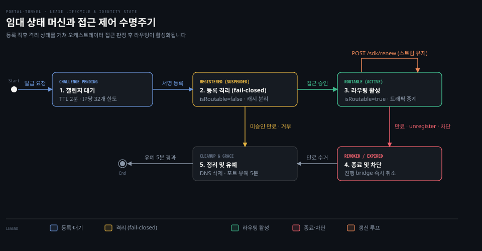
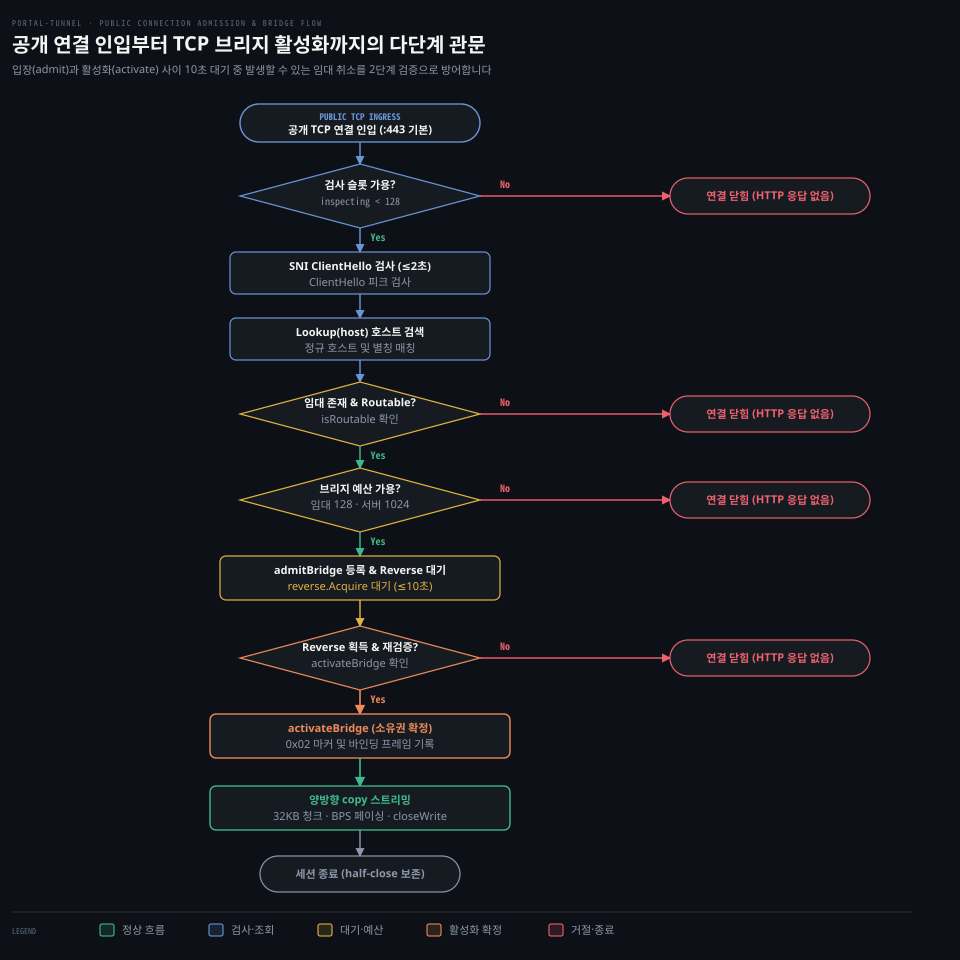

# lease·record

---

> 릴레이가 어떤 호스트 이름을 어느 터널에 연결할지 관리하는 임대 레코드 자료구조와 수명주기, 다단계 연결 인입 관문 및 스트림 취소 전파 규약을 다룹니다.

## 왜 단순한 도메인 맵 대신 lease 레지스트리를 두나

> 호스트명과 연결 소켓을 일대일 맵으로만 관리하면 만료 시각, 동시성 예산, 신원 차단, L4 포트 충돌을 제어하지 못해 시스템이 마비됩니다.

릴레이 서버의 가장 기본적인 임무는 외부 사용자가 요청한 호스트 이름이 방화벽 안쪽의 어떤 터널 에이전트에 속해 있는지 찾아내 둘의 트래픽을 이어주는 일입니다. 릴레이가 이를 도메인을 키로 하고 소켓을 값으로 하는 해시맵(`map[string]net.Conn`) 하나로만 관리하면 여러 문제가 생깁니다.

클라이언트 에이전트가 예기치 않게 강제 종료되거나 네트워크가 끊겼을 때 만료 기한이 없다면 릴레이 메모리에는 쓰레기 소켓이 무한정 쌓입니다. 특정 테넌트에 디도스(DDoS) 공격이 쏟아질 때 동시 연결 수 상한이 없다면 단 하나의 서비스가 릴레이의 모든 파일 디스크립터와 CPU를 독점해 다른 모든 테넌트를 굶깁니다. 미인가 도메인을 가로채려는 공격을 방어하거나 상위 오케스트레이터의 접근 통제 정책을 실시간으로 반영할 방법도 없습니다.

포털 터널은 단순 매핑 대신 임대 레지스트리 `leaseRegistry`(`portal/lease.go:49-75`)를 운용합니다. 이 레지스트리는 엄격한 수명주기와 예산 제약을 강제하며 전역 읽기·쓰기 뮤텍스(`mu sync.RWMutex`, `portal/lease.go:74`) 아래에서 모든 임대 상태를 중앙 집중식으로 동기화합니다.

릴레이를 안정적으로 유지하려고 `portal/lease.go:26-36`은 상수 9개를 선언해 위험 요소를 하나씩 차단합니다.

- `defaultLeaseTTL = 2 * time.Minute` (`portal/lease.go:27`): 기본 임대 수명이며 에이전트 장애나 단절 시 고아 임대가 호스트명을 장시간 무단 점유하는 것을 방지합니다.
- `maxLeaseTTL = 10 * time.Minute` (`portal/lease.go:28`): 최대 임대 수명이며 악의적 클라이언트가 과도하게 긴 TTL을 요청해 릴레이 자원을 반영구 독점하는 남용을 차단합니다.
- `defaultRegisterChallengeTTL = 2 * time.Minute` (`portal/lease.go:29`): 등록 챌린지 수명이며 서명 대기 챌린지가 누적되어 메모리를 잠식하거나 과거 서명이 재사용되는 재전송 공격을 막습니다.
- `defaultRegisterChallengeOutstandingPerIP = 32` (`portal/lease.go:30`): 단일 IP당 미결 챌린지 상한이며 특정 발신지가 대량의 챌린지를 생성해 릴레이 CPU와 메모리를 고갈시키는 단일 소스 공격을 차단합니다.
- `defaultRegisterChallengeOutstanding = 256` (`portal/lease.go:31`): 전체 미결 챌린지 상한이며 다수 IP로부터의 챌린지 쇄도로 릴레이 전체가 응답하지 못하는 서비스 거부를 방지합니다.
- `defaultPortReservationGrace = 5 * time.Minute` (`portal/lease.go:32`): 전용 포트 예약 유예 기간이며 일시적 재접속 시 이전 포트를 복구하도록 보호하고 제3자의 포트 탈취를 방지합니다.
- `defaultIdleKeepalive = 15 * time.Second` (`portal/lease.go:33`): 리버스 풀 유휴 핑 주기이며 중간 NAT 라우터나 방화벽의 타임아웃으로 인한 사일런트 소켓 드롭을 방지합니다.
- `defaultReadyQueueLimit = 8` (`portal/lease.go:34`): 리버스 풀 대기 소켓 상한이며 에이전트가 과도하게 많은 연결을 미리 열어 릴레이 파일 디스크립터를 과점하는 낭비를 방지합니다.
- `defaultLeaseBridgeLimit = 128` (`portal/lease.go:35`): 단일 임대당 동시 브리지 상한이며 특정 테넌트의 트래픽 폭주가 다른 테넌트까지 느리게 만드는 이웃 간섭(noisy neighbor) 문제를 막습니다.

`leaseRegistry`는 이 상수들을 기준으로 활성 임대 슬라이스 `records`(`:50`)와 도메인, L4 전용 포트 풀, 접근 차단 맵을 함께 관리합니다.

기준 커밋 129b6de5 (2026-10-20)


## lease 레코드가 쥐는 연결과 자원

> 임대 레코드는 호스트명 식별자뿐 아니라 L4 리스너, 리버스 연결 풀, 활성 TCP 브리지 집합을 단일 뮤텍스 아래에서 묶어 관리합니다.

터널 에이전트와 통신할 때 소켓 하나만 보관해서는 정규 도메인과 별칭, L4 전용 포트, yamux 다중화 스트림을 함께 관리할 수 없습니다. 릴레이는 검증을 마친 연결을 수명주기가 하나로 묶인 `leaseRecord`(`portal/record.go:19-44`) 구조체로 만듭니다.

`leaseRecord`의 실제 필드는 이렇습니다.

- `types.Identity` (`portal/record.go:20`): 테넌트의 secp256k1 공개키, 고유 주소, 이름을 담은 신원 체계입니다.
- `id string` (`:21`): `lease_` 접두사를 갖는 무작위 고유 임대 식별자입니다.
- `ExpiresAt`, `FirstSeenAt`, `LastSeenAt time.Time` (`:22-24`): 임대 만료 시각 및 활동 시간 추적 타임스탬프입니다.
- `sourceAddr netip.Addr`, `ReportedIP string` (`:25-26`): 진단용 네트워크 발신지 주소 및 에이전트가 보고한 공인 IP입니다.
- `Hostname string`, `CanonicalHostname string` (`:27-28`): 사람이 기억하기 쉬운 별칭 도메인과 신원 주소가 결합된 정규 도메인입니다.
- `Metadata types.LeaseMetadata`, `Overlay bool` (`:29-30`): 부가 설정 및 다중 릴레이 메시 오버레이 참여 여부 플래그입니다.
- `registerChallenge *identity.RegisterChallenge` (`:32`): 챌린지 단계의 미결 레코드인 경우 보관하는 서명 증명 객체입니다.
- `datagram *transport.RelayDatagram` (`:34`): L4 UDP 트래픽 전달 객체입니다.
- `tcpPort int`, `tcpListener net.Listener` (`:35-36`): 전용 L4 TCP 포트 번호 및 시스템 소켓 리스너입니다.
- `reverse *transport.ReversePool` (`:37`): 터널 에이전트가 선제적으로 열어둔 대기 리버스 연결 큐입니다.
- `mu sync.Mutex`, `closed bool`, `closeDone chan struct{}` (`:39-41`): 레코드 단위 상태 락 및 종료 완료 동기화 채널입니다.
- `reverseMux *transport.ReverseMux` (`:42`): WebSocket 연결 위에 얹은 yamux 세션(`portal/transport/stream_mux.go:57-61`)입니다.
- `bridges map[*leaseBridge]struct{}` (`:43`): 진행 중인 활성 TCP 브리지들의 집합입니다.

호스트 이름을 외부 인그레스와 대조할 때 레코드는 `hostnames()`(`portal/record.go:56-65`) 메서드를 사용합니다. `isPublicEntry()`(`:52-54`) 검사로 정규 호스트명이 비어있는 미결 챌린지 레코드를 배제한 뒤 정규 호스트명(`CanonicalHostname`)과 등록된 별칭(`Hostname`)을 합친 문자열 슬라이스를 반환합니다.

레코드의 기동은 `Start()`(`portal/record.go:71-90`)가 맡습니다. 레코드 뮤텍스 아래에서 `closed` 플래그를 검사하고 UDP 데이터그램 전달을 시작합니다. 전용 TCP 포트가 지정되어 있으면 `net.ListenTCP`(`:83`)를 호출해 운영체제 커널에 실제 리스너 소켓을 바인딩합니다.

반대로 임대가 종료될 때 불리는 `Close()`(`portal/record.go:92-134`)는 단계별 동시성 해제 순서를 따릅니다. 이미 종료 절차가 진행 중이면 `closeDone` 채널을 기다려 중복 해제를 막습니다. 이후 `closed = true`로 설정하고 `revokeBridgesLocked()`를 호출해 현재 통신 중인 모든 브리지를 취소합니다.

이 메서드는 뮤텍스를 해제한 상태에서 실제 소켓을 닫습니다(`portal/record.go:115-130`). TCP 소켓 닫기는 보통 I/O 블로킹을 일으키지 않지만 락을 푼 채 닫아야 하는 이유가 두 가지 있습니다. 하나는 `releaseBridge`(`portal/record.go:145-159`)가 내부에서 `r.mu`를 다시 잡는다는 점입니다. 뮤텍스를 쥔 채 소켓을 닫으면 자기 교착(self-deadlock)이 일어납니다.

다른 하나는 `reverse.Close()`(`portal/transport/reverse_pool.go:154-173`)가 예약 해제를 `cond.Wait`로 기다리고 유휴 루프 고루틴 종료(`<-c.done`)까지 대기한다는 점입니다. 소켓 정리는 레지스트리나 레코드 뮤텍스를 쥐지 않은 채 해야 합니다. 동시 Close 호출자들은 레지스트리가 포트를 재사용하기 전에 종료 완료를 대기합니다(`portal/record.go:116-117`). 릴레이는 락을 먼저 풀고 소켓을 닫은 뒤 마지막에 `close(r.closeDone)`으로 종료 완료를 알립니다.


## 임대 수명주기와 fail-closed 접근 제어

> 릴레이는 등록 직후 임대를 일단 차단 상태로 두고 오케스트레이터의 최신 인가 리비전이 도달해야 비로소 라우팅을 활성화합니다.

에이전트가 등록되자마자 검증 없이 트래픽을 열어두면 악의적 노드가 미인가 도메인으로 들어오는 패킷을 가로채는 보안 사고가 납니다. 01-03 편 제어 평면 흐름에서 다루었듯 릴레이는 등록 직후 임대를 일단 격리 상태로 묶어두는 안전 실패(fail-closed) 원칙을 지킵니다.

임대 생명주기를 움직이는 메서드는 5개입니다.

등록을 맡는 `Register`(`portal/lease.go:337`)는 메타데이터를 검증하고 TTL을 산출한 뒤 고유 식별자를 만듭니다. L4 포트를 할당하고 `record.Start()`로 리스너를 띄운 뒤 기존 레코드 중복이나 만료를 점검합니다. 동일 신원의 이전 레코드가 존재하면 새 레코드로 교체하고 이전 레코드는 `closeRecord`로 닫습니다.

갱신을 맡는 `Renew`(`portal/lease.go:593`)는 클라이언트의 액세스 토큰을 검증하고 만료 시각을 현재 시각에 TTL을 더한 미래 시점으로 연장합니다. 캐시 항목도 함께 갱신하며 다음 주기에 사용할 새 토큰을 발급합니다. 일반 갱신은 기존 연결 스트림을 끊지 않고 그대로 보존합니다.

등록 해제를 맡는 `Unregister`(`portal/lease.go:722`)는 클라이언트의 명시적 종료 요청을 인가한 뒤 레지스트리 슬라이스에서 해당 레코드를 즉시 제거합니다. 대역폭 제한자를 초기화하고 `closeRecord`를 호출해 진행 중인 모든 브리지를 즉시 차단합니다.

만료 수거를 맡는 `cleanupExpired`(`portal/lease.go:872`)는 만료 시각이 지난 레코드를 슬라이스에서 잘라내고 반환합니다. 서버의 백그라운드 관리 루프인 `runRegistryJanitor`(`portal/server.go:1054`)는 주기적 티커로 이 메서드를 호출합니다. 만료된 레코드의 외부 DNS 항목을 삭제(`deleteLeaseDNS`, `:1071`)하고 keyless 바인딩 캐시를 함께 정리합니다.

활동 갱신을 맡는 `Touch`(`portal/lease.go:858`)는 데이터 평면 트래픽이 흐를 때마다 불리지 않습니다. 호출처는 터널 연결 등록 시점 세 곳뿐입니다. raw 리버스 연결 Offer(`portal/api_server.go:593`), WebSocket 스트림 Offer(`api_server.go:514`), QUIC 백홀 인증(`portal/server.go:1182`) 성공 시에만 호출됩니다.

공개 트래픽 복사 경로(`proxy.copy`)는 `Touch`를 호출하지 않습니다. 기록되는 `sourceAddr`도 외부 클라이언트가 아니라 터널 주소입니다. 이 호출은 `LastSeenAt` 타임스탬프와 터널 발신지 IP를 최신 상태로 갱신합니다.

이 수명주기 전반에서 테넌트의 라우팅 자격을 통제하는 메커니즘이 세 가지 접근 결정 함수입니다.

```go
// portal/lease.go:152-163 발췌
func (r *leaseRegistry) suspendIdentity(key types.ServiceIdentityKey) {
	r.mu.Lock()
	defer r.mu.Unlock()
	r.applyIdentityRoutableLocked(key, false)
}
```

에이전트가 등록되면 릴레이는 `suspendIdentity`(`portal/lease.go:152`)를 호출해 `blocked[key]` 맵에 현재 시각을 기록합니다. 이 상태에서는 `isRoutable`(`:184`)이 거짓을 반환하므로 외부 브라우저가 접속해도 임대로 트래픽이 라우팅되지 않습니다. 캐시 콘텐츠 역시 즉시 분리(`cache.DetachOwner`, `:180`)됩니다.

오케스트레이터가 접근 인가를 확정하면 `setIdentityRoutable`(`portal/lease.go:136`)이 호출됩니다. 이때 상위 시스템이 보낸 스냅샷 리비전 번호(`revision`)가 레지스트리가 지금까지 반영한 가장 높은 번호(워터마크, `accessRevision`, `:69`)보다 낮으면 오래된 인가 정보가 늦게 도착한 것으로 보고 반영을 거절합니다. 검증을 통과하면 `blocked` 맵에서 키가 삭제되고 임대는 정상 라우팅 상태로 전이됩니다.



위 도식은 임대 상태 머신의 전 과정을 보여줍니다. 챌린지 발급과 격리 등록에서 시작해 승인 후 정상 서비스와 갱신 반복을 거쳐 만료나 차단 시 자원 정리로 끝납니다. 종료 시 활성 브리지는 즉시 취소되고 DNS가 제거되지만 전용 L4 포트는 5분간 유예 보관됩니다.


## 호스트 이름으로 레코드 찾기 (Lookup)

> 릴레이는 정규 호스트명과 사용자 친화적 별칭, 그리고 와일드카드 패턴 매칭의 우선순위를 2단계 선형 탐색으로 명확히 구분합니다.

외부 브라우저의 TLS 연결이 릴레이의 공개 인그레스 포트(기본 443, `portal/server.go:213-230`)로 들어옵니다. 릴레이는 암호화 핸드셰이크의 첫 번째 패킷인 ClientHello에서 SNI(Server Name Indication) 호스트명을 추출합니다. 등록되지 않은 호스트명이면 경고 로그를 남기고 소켓을 즉시 닫습니다(`portal/server.go:1000-1007`). 유효한 호스트라면 어느 터널 에이전트의 임대 레코드에 속하는지 찾아냅니다. 이 탐색을 맡는 함수가 `Lookup`(`portal/lease.go:271-302`)입니다.

호스트 탐색이 잘못되면 테넌트 간 트래픽이 뒤섞이거나 도메인 탈취 공격에 노출될 수 있으므로 릴레이는 엄격한 정규화와 우선순위 분기를 적용합니다.

```go
// portal/lease.go:271-302 발췌
func (r *leaseRegistry) Lookup(host string) (*leaseRecord, bool) {
	host = utils.NormalizeHostname(host)
	if host == "" {
		return nil, false
	}
	r.mu.RLock()
	defer r.mu.RUnlock()
	now := time.Now()
	// 1차 순회: 완전 일치 (Exact Match)
	for _, record := range r.records {
		if record == nil || !record.isPublicEntry() || record.isExpired(now) {
			continue
		}
		for _, hostname := range record.hostnames() {
			if hostname == host {
				return record, true
			}
		}
	}
	// 2차 순회: 와일드카드 패턴 매칭 (Pattern Match)
	for _, record := range r.records {
		if record == nil || !record.isPublicEntry() || record.isExpired(now) {
			continue
		}
		for _, hostname := range record.hostnames() {
			if hostname != host && utils.HostnameMatchesPattern(hostname, host) {
				return record, true
			}
		}
	}
	return nil, false
}
```

탐색의 첫 단계는 `utils.NormalizeHostname`입니다. 영문 대소문자를 소문자로 정규화하고 FQDN 후행 마침표나 비정상 공백을 제거합니다. 문자열이 유효하지 않으면 락을 걸지도 않고 즉시 실패를 반환합니다.

그 뒤 레지스트리 읽기 잠금(`r.mu.RLock`)을 잡고 2단계 순회에 들어갑니다.

1차 순회는 완전 일치(Exact Match) 검사입니다. 등록된 레코드 중 공개 엔트리이고 만료되지 않은 항목을 대상으로 호스트명을 비교합니다. `record.hostnames()`가 반환하는 정규 도메인이나 별칭이 요청 호스트명과 정확히 일치하면 해당 레코드를 즉시 반환합니다.

2차 순회는 와일드카드 패턴 매칭(Pattern Match)입니다. 1차 순회에서 완전 일치하는 레코드가 없었을 때만 실행됩니다. `utils.HostnameMatchesPattern`을 호출해 와일드카드 도메인 규칙에 들어맞는 레코드를 탐색합니다.

탐색 루프를 둘로 쪼개 완전 일치를 항상 패턴 매칭보다 앞세우는 이유는 도메인 모호성을 없애기 위해서입니다. 광범위한 와일드카드를 가진 테넌트가 있는데 구체적인 별칭을 가진 다른 테넌트가 들어왔다고 해 봅시다. 이때 구체적인 이름이 먼저 매칭되어야 의도치 않은 패킷 가로채기를 막을 수 있습니다.


## 공개 연결이 지나는 관문과 2단계 검증

> 연결 폭주를 방어하기 위해 릴레이는 서버 전체의 검사 대기 및 테넌트 예산과, 임대 단위의 동시 브리지 한도를 계층별로 강제합니다.

외부 연결이 폭주할 때 무제한으로 소켓을 이어주면 릴레이와 터널 에이전트 모두 자원이 고갈되어 쓰러집니다. 외부 브라우저 소켓이 임대를 찾아 로컬 터널과 연결되기까지는 서버 전체 관문과 임대별 관문이라는 두 단계 검사를 거쳐야 합니다.

서버 전체 관문은 `portal/server.go:889-926`이 관리합니다.

첫 번째 관문은 `admitIngress(conn, inspecting=true)`(`portal/server.go:889`)입니다. TCP 연결이 맺어지면 릴레이는 먼저 ClientHello 검사 대기 슬롯의 여유를 확인합니다. 검사 대기 슬롯은 서버 전체에서 최대 128개(`publicInspectionLimit = 128`, `:45`)로 한정됩니다. 이 슬롯은 최대 2초(`defaultClientHelloWait`, `:38`) 동안 유지되며 한도를 초과하면 소켓을 즉시 닫습니다.

ClientHello 파싱으로 호스트를 확인한 뒤에는 `promoteIngress()`(`portal/server.go:917`)를 호출합니다. 검사 대기 슬롯을 반납하고 연결을 활성 테넌트 슬롯으로 승격시킵니다. 테넌트 연결 총합은 최대 1024개(`publicIngressLimit = 1024`, `:44`)로 제한됩니다. 루트 API 핸드오프 트래픽은 이 테넌트 예산을 소모하지 않으므로 테넌트 슬롯이 꽉 차더라도 에이전트 등록이나 갱신은 정상 처리됩니다.

테넌트 승격을 통과하면 두 번째 관문인 임대 단위 검증(`portal/lease.go:201-249`)으로 진입합니다.

```go
// portal/lease.go:201-225 발췌
func (r *leaseRegistry) admitBridge(ctx context.Context, record *leaseRecord, inbound net.Conn) (*leaseBridge, error) {
	r.mu.RLock()
	defer r.mu.RUnlock()
	if record == nil || r.recordByLease(record.ServiceKey(), record.id, time.Now()) != record {
		return nil, errLeaseNotFound
	}
	if !r.isRoutableLocked(record.ServiceKey()) {
		return nil, errLeaseRejected
	}
	record.mu.Lock()
	defer record.mu.Unlock()
	if record.closed || ctx.Err() != nil {
		return nil, net.ErrClosed
	}
	if len(record.bridges) >= defaultLeaseBridgeLimit {
		return nil, errLeaseRejected
	}
	ctx, cancel := context.WithCancel(ctx)
	bridge := &leaseBridge{ctx: ctx, cancel: cancel, inbound: inbound}
	if record.bridges == nil {
		record.bridges = make(map[*leaseBridge]struct{})
	}
	record.bridges[bridge] = struct{}{}
	return bridge, nil
}
```

입장 단계인 `admitBridge`(`portal/lease.go:201`)는 먼저 레지스트리 읽기 잠금 아래에서 임대 유효성과 라우팅 자격(`isRoutableLocked`)을 확인합니다. 그 후 레코드 잠금을 걸고 임대당 브리지 상한인 128개(`defaultLeaseBridgeLimit`, `:35`)를 넘지 않았는지 검사합니다. 통과하면 취소 가능한 컨텍스트를 품은 `leaseBridge` 객체를 만들어 `record.bridges` 맵에 등록합니다.

입장을 마친 고루틴은 터널 에이전트가 미리 열어둔 리버스 연결을 풀에서 꺼내려고 `record.reverse.Acquire(ctx)`(`portal/server.go:1037`, raw TCP 경로는 `:672`)를 호출합니다. 이 작업은 최대 10초(`defaultClaimTimeout = 10 * time.Second`, `portal/server.go:37`) 동안 블로킹될 수 있습니다.

리버스 연결을 확보한 뒤 실행되는 마지막 관문인 `activateBridge`(`portal/lease.go:232`)는 입장 때 확인한 상태를 레지스트리 잠금을 다시 걸고 재검증합니다.

리버스 연결을 획득하기 위해 대기하는 최대 10초 동안 네트워크에서는 다양한 상태 변화가 발생할 수 있습니다. 클라이언트가 자발적으로 `Unregister`를 호출했거나 2분의 TTL이 만료되었을 수 있습니다. 오케스트레이터 정책으로 해당 신원의 라우팅이 차단(`SetIdentityRoutable(false)`, `portal/server.go:694-711`)되었을 수도 있습니다.

입장 시점의 판단만 믿고 즉시 트래픽을 흘려보내면 방금 차단된 테넌트의 내부 사설망으로 외부 바이트가 새어 들어가는 보안 결함이 생깁니다. 그래서 릴레이는 `activateBridge`에서 레지스트리 락과 레코드 락을 다시 걸고 임대가 여전히 살아 있는지와 라우팅이 허용되는지를 이중 확인(double-check)합니다. 재검증이 통과되어야만 `bridge.reverse = reverse`로 소유권을 확정하고 바인딩 프레임을 전송합니다.



위 흐름도는 관문 전체를 보여줍니다. 클라이언트 패킷이 들어오면 검사 슬롯(128), 호스트 검색, 테넌트 및 임대 예산(128), 리버스 대기 후 재검증을 거쳐 양방향 스트리밍으로 이어집니다. 어느 분기에서든 거절되면 소켓은 즉시 종료됩니다.


## bridge 와 복사: 고루틴 페어와 대역폭 제어

> 프록시 브리지는 양방향 복사 고루틴 페어를 운용하며 half-close 규약으로 송신 종료를 알리면서도 남은 데이터를 끝까지 안전하게 전달합니다.

소켓 간 바이트를 중계할 때 한쪽 스트림이 끝났다고 양쪽 소켓을 무조건 닫아버리면 버퍼에 남은 응답 데이터가 유실됩니다. 관문을 통과해 바인딩이 완료되면 릴레이의 프록시 엔진인 `bridge`(`portal/proxy.go:27-67`)가 양방향 바이트 복사를 시작합니다. 단순해 보이는 소켓 중계이지만 연결의 우아한 종료와 테넌트별 대역폭 폭주를 막기 위한 제어가 담겨 있습니다.

`bridge` 메서드는 호출 즉시 `p.activeConns.Add(1)`로 전체 활성 브리지 카운터를 원자적으로 증가시키고 함수 종료 시 `Add(-1)`로 차감합니다. 양쪽 소켓의 수명은 `context.AfterFunc`(`portal/proxy.go:37-43`)로 묶입니다. 상위 컨텍스트가 취소되는 순간 양쪽 소켓의 데드라인을 현재 시각(`time.Now()`)으로 설정하고 `Close`를 호출해 블로킹되어 있던 모든 네트워크 I/O를 강제로 중단시킵니다.

데이터 전달은 `errgroup.Group`(`portal/proxy.go:49-66`)으로 묶은 고루틴 두 개가 맡습니다. 하나는 `copy(right, left)`로 외부 요청을 터널로 보내고 다른 하나는 `copy(left, right)`로 터널의 응답을 외부로 보냅니다.

여기서 눈여겨볼 네트워크 프로토콜 규약이 `closeWrite`(`portal/proxy.go:134-141`)입니다.

```go
// portal/proxy.go:134-141 발췌
func closeWrite(conn net.Conn) {
	type closeWriter interface {
		CloseWrite() error
	}
	if cw, ok := conn.(closeWriter); ok {
		_ = cw.CloseWrite()
	}
}
```

한쪽 복사 루프가 정상적으로 끝났을 때 상대방 소켓 전체를 닫아버리면 데이터가 유실됩니다. 예를 들어 브라우저가 HTTP 요청 본문 전송을 모두 마쳤더라도 터널 서버는 아직 응답 데이터를 전송하는 중일 수 있습니다. 릴레이는 `Close()` 대신 `CloseWrite()`를 호출해 연결 유형에 맞는 절반 종료(half-close) 상태를 만듭니다.

공개 쪽 소켓(`keyless_tls` l4 `preloadedConn`)은 `TCPConn.CloseWrite`로 TCP FIN 패킷을 전송합니다. 반면 리버스 쪽은 릴레이 API TLS에서 하이잭한 `*tls.Conn`이므로 TLS `close_notify` 알림만 전송하고 하부 TCP는 절반 종료하지 않습니다. WebSocket 캐리어는 yamux FIN 플래그를 전송(`portal/transport/stream_mux.go:72-74`)합니다. 이렇게 하면 보낼 데이터가 끝났음을 알리면서도 상대방의 마지막 응답까지 안전하게 수신합니다.

실제 바이트를 나르는 `copy`(`portal/proxy.go:100-132`) 루프는 32KB 크기의 고정 버퍼(`make([]byte, 32*1024)`)를 할당해 스트리밍합니다. 이때 대역폭 제한 관리자인 `BPSManager`(`:143-285`)가 매 청크마다 개입합니다.

대역폭 관리는 연결이 이미 수립된 후에도 실시간으로 작동해야 합니다. `copy` 루프는 매 청크를 쓸 때마다 `bpsManager.ThrottleIdentityBPS`(`portal/proxy.go:107`)를 호출합니다. 이 함수는 테넌트 신원의 토큰 버킷 속도 제한자를 확인하고 한도를 초과하면 필요한 대기 시간만큼 타이머를 돌려 송신 속도를 페이싱합니다. 한도 표는 뮤텍스 없이 원자적 포인터로 읽는 스냅샷(`utils.Snapshot`, `atomic.Pointer`)이라, 대역폭 제한이 없는 테넌트는 잠금 경합이나 대기 없이 바로 전송합니다(`portal/proxy.go:144,295-299`).


## 취소 전파: 스트림 단절과 갱신의 차이

> 등록 해제나 만료, 차단이 발생하면 레코드가 보유한 모든 활성 브리지의 컨텍스트를 즉시 취소하고 소켓 데드라인을 당겨 연결을 끊어냅니다.

터널 서비스가 비정상 종료되거나 차단되었을 때 기존 활성 브리지를 즉시 끊지 못하면 보안 침해와 자원 누수로 이어집니다. 반면 정상적인 정기 갱신 과정에서 스트림이 끊어지면 사용자의 웹소켓 세션이 중단되는 불편이 생깁니다.

릴레이는 이 둘을 구분해 취소 전파 정책을 달리 가져갑니다.

진행 중인 모든 연결은 `leaseBridge`(`portal/record.go:138-143`) 구조체로 표현되고 레코드의 `bridges` 맵에 등록되어 있습니다. 임대가 차단되거나 종료되면 레코드의 `revokeBridgesLocked`(`portal/record.go:166-174`)가 즉시 실행됩니다.

```go
// portal/record.go:166-174 발췌
func (r *leaseRecord) revokeBridgesLocked() {
	for bridge := range r.bridges {
		bridge.cancel()
		_ = bridge.inbound.SetDeadline(time.Now())
		if bridge.reverse != nil {
			_ = bridge.reverse.SetDeadline(time.Now())
		}
	}
}
```

이 메서드는 레코드에 속한 모든 브리지 객체를 순회하며 세 가지 조치를 동시에 취합니다. 첫째, 브리지의 전용 `cancel()`을 호출해 컨텍스트를 취소합니다. 둘째, 인바운드 소켓의 데드라인을 현재 시각으로 덮어써 진행 중인 소켓 읽기·쓰기를 즉시 타임아웃시킵니다. 셋째, 리버스 연결 역시 데드라인을 앞당겨 네트워크 I/O 블로킹을 해제합니다.

이런 즉각 단절(hard cut) 취소가 일어나는 조건은 다섯 가지입니다.

1. 클라이언트가 자발적으로 `POST /sdk/unregister`를 호출해 등록을 해제했을 때
2. 동일 신원이 새 임대를 재등록하여 이전 레코드를 교체(`closeRecord(replaced)`, `portal/lease.go:489-502`)할 때
3. 임대 갱신이 누락되어 TTL이 만료되고 백그라운드 janitor가 레코드를 수거했을 때
4. 릴레이 서버 프로세스가 종료되어 `CloseAll`(`portal/lease.go:251`)이 호출되었을 때
5. 오케스트레이터 정책에 의해 신원이 차단되어 `SetIdentityRoutable(false)`(`portal/server.go:694-711`, `lease.go:136-182`)가 실행되었을 때

정기 임대 갱신인 `Renew`(`portal/lease.go:593`)는 정반대로 동작합니다. 메인테이너 아키텍처 문서(`docs/maintainer/architecture.md:175`)가 명시하듯 일반 갱신은 진행 중인 스트림을 그대로 보존합니다. `record.bridges` 맵을 건드리지 않고 백그라운드에서 임대 만료 시각(`ExpiresAt`)만 미래로 밀어두기 때문에 대용량 파일 전송이나 장시간 유지되는 데이터베이스 연결도 끊김 없이 유지됩니다.


## raw TCP 포트 풀과 5분 유예의 이유

> 포트 풀은 큐 기반의 공평한 할당과 롤백을 지원하며 해제 후 5분간의 유예 기간을 두어 원래 소유자의 재할당을 보호합니다.

전용 L4 포트를 제공할 때 터널이 잠시 재시작되었다고 포트를 다른 에이전트에 즉시 넘겨주면 기존 사용자의 트래픽이 엉뚱한 서버로 샙니다. 릴레이는 한정된 L4 TCP 포트 자원을 안전하게 다루려고 `portPool`(`portal/lease.go:1050-1057`) 자료구조를 운용합니다.

`portPool`은 가용 포트 큐 `available`과 현재 사용 중인 매핑 `inUse`로 구성됩니다. 여기에 해제된 포트의 임시 보관소인 `reserved` 맵을 두고 기본 5분의 유예 기간(`defaultPortReservationGrace = 5 * time.Minute`, `portal/lease.go:32`)을 적용합니다.

포트 풀의 상태 전이는 메서드 세 개가 제어합니다.

할당을 맡는 `allocate`(`portal/lease.go:1080`)는 먼저 만료된 예약을 청소한 뒤 요청한 테넌트 신원의 키로 예약된 포트(`reserved`)가 있는지 확인합니다. 예약이 존재하면 그 포트를 즉시 다시 꺼내어 배정합니다. 예약이 없다면 가용 큐(`available`)의 맨 앞 포트를 꺼내어 할당합니다. 큐 순서대로 순환 할당하므로 특정 포트의 바인딩 실패가 다른 후보 포트의 선택을 방해하지 않습니다.

취소를 맡는 `rollback`(`portal/lease.go:1104`)은 등록 과정에서 도메인 충돌이나 네트워크 단절이 발생해 임대 생성이 실패했을 때 호출됩니다. 기존에 유효했던 예약 포트였다면 수명을 연장하지 않고 예약 상태로 복원합니다. 신규 할당된 포트였다면 가용 큐의 맨 뒤(`append`)로 반납해 즉시 재사용되지 않도록 뒤로 미룹니다.

해제를 맡는 `release`(`portal/lease.go:1120`)는 임대가 완전히 종료되었을 때 호출됩니다. 포트를 즉시 가용 큐로 돌려보내지 않고 현재 시각에 5분의 유예를 더한 만료 시각과 함께 `reserved[key]`에 등록합니다.

릴레이가 해제된 포트를 즉시 재사용하지 않고 5분 동안 잠가 두는 이유는 두 가지입니다.

하나는 에이전트의 일시적 재시작 보호입니다. 로컬 업데이트나 일시적인 네트워크 끊김으로 터널 데몬이 재부팅될 수 있습니다. 이때 5분 안에 다시 접속하면 이전에 쓰던 동일한 L4 포트 번호(예: `relay.com:20045`)를 예약 맵(`reserved`)에서 그대로 되찾습니다(`portal/lease.go:1084-1088`). 외부 사용자가 접속 주소나 방화벽 규칙을 매번 바꾸지 않아도 됩니다.

다른 하나로 추정되는 목적은 포트 가로채기 공격 차단입니다. 특정 테넌트가 연결을 끊자마자 해당 포트 번호가 즉시 공용 풀로 돌아간다면 제3자 노드가 대기하다가 같은 포트를 즉시 할당받아 기존 사용자의 트래픽을 가로챌 위험이 있습니다. 5분의 유예는 포트 소유권을 원래 신원 키인 ServiceKey에 묶어 안전하게 격리합니다. 단, 소스 코드나 공식 문서에 이 목적이 직접 적혀 있지는 않은 합리적 추정입니다. 리스너 소켓 재사용 시 충돌 방지는 소켓 닫기를 완전히 마친 뒤 포트를 반환하는 순서(`portal/lease.go:1002-1018` 주석)로 보장합니다.


## 리뷰 노트

> 소스 코드와 공식 문서를 정밀 대조하며 확인한 주의점과 설계상 고려 사항입니다.

- **Lookup 선형 탐색의 규모 한계 (`portal/lease.go:281-300`)**: 현재 `Lookup`은 `r.records` 슬라이스를 처음부터 끝까지 순회하는 O(N) 선형 탐색을 수행합니다. 일반적인 단일 릴레이 환경(수백 개 임대)에서는 읽기 잠금 아래에서 수 마이크로초 안에 끝나므로 전혀 문제가 되지 않습니다. 하지만 수만 개 이상의 활성 도메인을 호스팅하는 초대형 릴레이로 확장할 경우 호스트명 해시맵 색인을 보완해야 CPU 경합을 예방할 수 있습니다.
- **ClientHello 검사 슬롯의 단일 소스 과점 가능성 (`portal/server.go:896`)**: 128개로 한정된 검사 슬롯(`publicInspectionLimit`)은 발신 IP별 쿼터가 없습니다. 악의적인 단일 IP가 128개 연결을 동시에 맺고 2초 동안 버티면 슬롯이 잠식될 수 있습니다. 메인테이너 문서(`docs/maintainer/architecture.md:159-162`)도 이 한계를 언급하며 정상 사용자의 진입 지연 가능성을 지적합니다.
- **포트 풀 고갈 시 유예 예약의 우선순위 (`portal/lease.go:1084-1092`)**: `portPool`은 할당 시 기존 예약을 최우선으로 복구합니다. 가용 포트 범위가 좁게 설정되어 있을 때 많은 테넌트가 해제 후 유예 상태로 포트를 쥐고 있으면 신규 테넌트의 등록이 조기에 `errPortExhausted`로 거절될 수 있으므로 운영 환경에서 포트 범위 크기를 넉넉히 산정해야 합니다.


## 검증과 복습

> 이 문서에서 다룬 임대 레코드와 연결 관문의 핵심 규약을 세 가지 질문으로 스스로 확인합니다.

1. **질문 1**: 릴레이는 왜 에이전트 등록 직후 트래픽을 즉시 개방하지 않고 `suspendIdentity`를 호출해 임대를 격리(fail-closed) 상태로 둡니까?
2. **질문 2**: 외부 브라우저의 연결이 들어왔을 때 릴레이는 왜 입장(`admitBridge`)과 활성화(`activateBridge`)의 2단계로 나누고 각각 레지스트리 락 아래에서 상태를 재확인합니까?
3. **질문 3**: 임대 등록 해제(`POST /sdk/unregister`)가 발생했을 때와 정기 갱신(`POST /sdk/renew`)이 발생했을 때 진행 중이던 기존 TCP 브리지 스트림들은 각각 어떻게 다르게 처리됩니까?


## 정답 (자답 후 펼치기)

> 위 세 가지 질문에 대한 코드 기반의 정확한 해답입니다.

1. **정답 1**: 미인가 도메인 선점을 방지하기 위해 상위 오케스트레이터의 접근 통제 정책이 반영되기 전까지 기본 차단하는 안전 실패 원칙을 지키기 위함입니다. `portal/lease.go:152`의 `suspendIdentity`는 `blocked[key]`에 타임스탬프를 기록해 `isRoutable`을 거짓으로 만들고 캐시를 분리합니다. 이후 최신 리비전 검증(`setIdentityRoutable`)이 완료되어야만 라우팅을 개방합니다.
2. **정답 2**: 리버스 연결을 풀에서 꺼내는 `reverse.Acquire` 작업이 최대 10초(`defaultClaimTimeout`) 동안 대기할 수 있기 때문입니다. 대기 시간 동안 클라이언트가 등록을 취소했거나 TTL이 만료되었을 수 있습니다. 그래서 실제 바인딩 프레임(`0x02`)을 전송하기 직전에 `activateBridge`(`portal/lease.go:232`)에서 상태를 다시 확인해 비인가 트래픽 누출을 방지합니다.
3. **정답 3**: 등록 해제(`Unregister`)는 `revokeBridgesLocked`(`portal/record.go:166`)로 모든 브리지의 컨텍스트를 즉시 취소하고 소켓 데드라인을 당겨 연결을 끊습니다. 반면 정기 갱신(`Renew`)은 기존 브리지를 건드리지 않고 만료 시각만 미래로 연장하므로 활성 TCP 스트림이 끊김 없이 유지됩니다.


## 출처와 관련 문서

> 핵심 주장에 사용한 기준 커밋 1차 자료와 관련 문서 목록입니다.

- [portal-tunnel 기준 커밋 소스 트리](https://github.com/gosuda/portal-tunnel/tree/129b6de5): 기준 커밋 129b6de5 소스 코드
- [Portal Public Architecture Guide](https://gosuda.github.io/portal-tunnel/architecture): 공식 아키텍처 및 임대 생명주기
- `docs/maintainer/architecture.md`: 메인테이너 아키텍처 및 TCP Bridge Ownership 규약
- `portal/lease.go:49-75`: `leaseRegistry` 구조체 선언 및 정책 상수
- `portal/record.go:19-44`: `leaseRecord` 구조체 필드 및 자원 바인딩
- `portal/server.go:889-926`: 서버 레벨 인그레스 관문(`admitIngress`, `promoteIngress`)
- `portal/proxy.go:27-141`: TCP 브리지 스트리밍, half-close 및 BPS 스로틀링
- [01-03.Control Plane Flow.md](./01-03.Control%20Plane%20Flow.md): 제어 평면 등록 및 리버스 연결 규약
