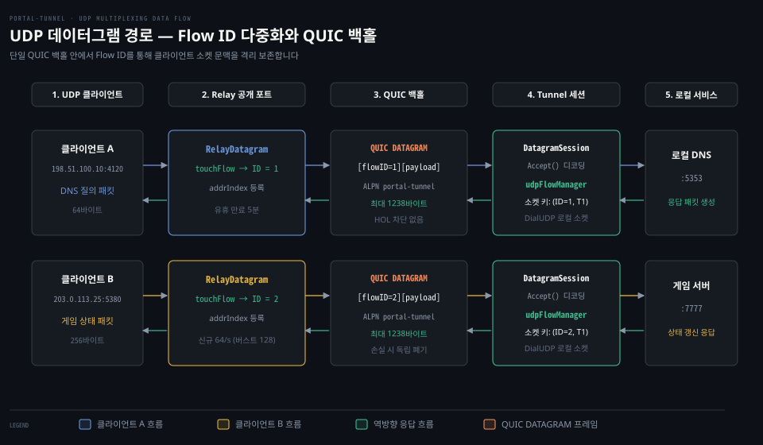
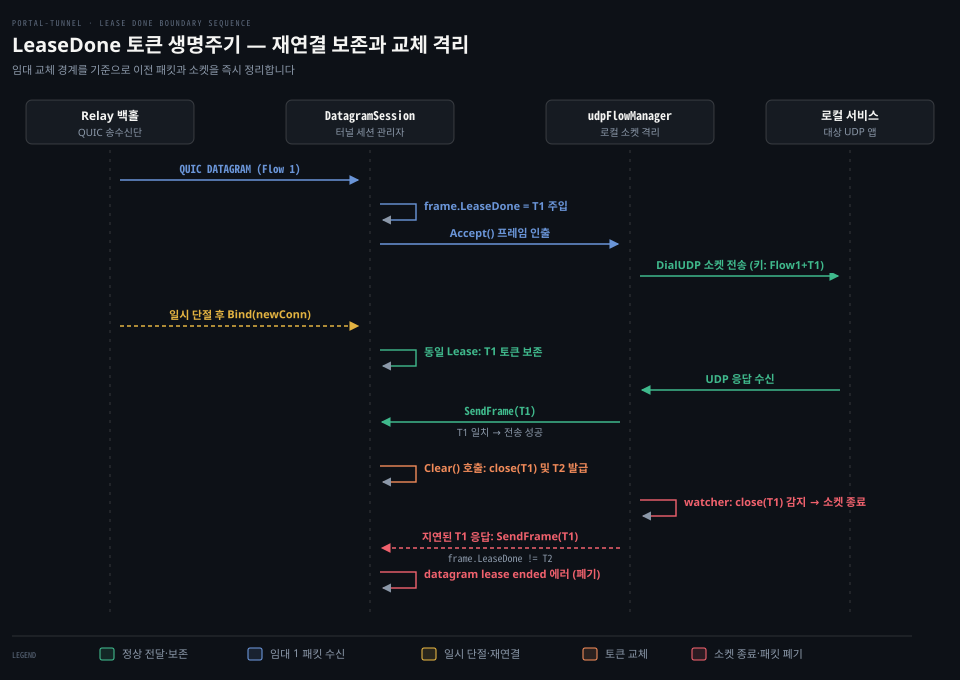

# quic_backhaul·datagram

---

> SNI 라우팅이 불가능한 UDP와 원시 TCP 트래픽을 전용 포트와 QUIC DATAGRAM 백홀을 통해 격리 전달하는 데이터 평면의 전송 규약을 다룹니다.

## 학습 목표와 범위

> 비웹 트래픽의 중계 구조를 이해하고, 패킷 격리와 임대 경계 보호 원리를 설명할 수 있습니다.

- TCP 리버스 연결 위에 UDP를 실을 때 발생하는 헤드오브라인 차단 문제를 지적하고 QUIC DATAGRAM이 이를 회피하는 원리를 설명할 수 있습니다.
- 릴레이가 단일 공개 UDP 포트에서 여러 외부 송신자를 Flow ID로 식별하고 수명주기를 관리하는 절차를 추적할 수 있습니다.
- 터널 세션의 LeaseDone 토큰이 임대 재연결과 임대 교체 상황에서 패킷 혼입을 방어하는 메커니즘을 비교할 수 있습니다.
- 전용 TCP 포트에서 0x01 마커를 통해 TLS 종료 없이 원시 바이트 스트림으로 전환하는 과정을 파악할 수 있습니다.
- 서버 설정과 용량 한계에 따른 실패 코드와 재시도 동작을 판별할 수 있습니다.

이 문서는 웹소켓이나 HTTP 캐시 최적화를 다루지 않습니다. 암호화 SNI를 사용하는 일반 웹 트래픽의 리버스 연결 수립은 01-03 편을 참조합니다.


## 왜 UDP는 TCP 리버스와 분리해야 하나

> 신뢰성 있는 TCP 스트림 위에 UDP를 얹으면 패킷 하나 손실이 뒤따르는 독립 패킷을 모두 멈춰 세웁니다.

웹 브라우저의 HTTPS 요청은 도메인 이름을 담은 TLS ClientHello의 SNI(Server Name Indication, 서버 이름 표시)로 릴레이의 단일 443 포트에서 목적지 터널을 찾아갑니다. 반면 DNS 질의, 게임 트래픽, 음성 스트리밍 같은 UDP 데이터그램과 게임 전용 원시 TCP 트래픽에는 이러한 공통 호스트 헤더가 존재하지 않습니다. 릴레이 인그레스에서 패킷 내용만으로는 어느 테넌트로 보내야 할지 판별할 수 없습니다.

그렇다고 UDP 패킷을 기존의 TCP 리버스 연결 풀(`01-03.Control Plane Flow`) 안으로 직렬화해 밀어 넣으면 전송이 왜곡됩니다. TCP는 엄격한 바이트 순서 보장과 신뢰성 있는 재전송을 기본 전제로 동작합니다. 네트워크 중간에서 단 하나의 TCP 세그먼트가 유실되면 수신 커널은 유실 패킷이 재전송되어 채워질 때까지 뒤이어 도착한 모든 세그먼트를 큐에 가두고 상위 애플리케이션에 올려주지 않습니다. 이를 **헤드오브라인 차단**(Head-of-Line Blocking)이라 부릅니다.

UDP는 본래 패킷 사이의 결합이 없고 독립적입니다. 앞선 음성 프레임이나 이전 게임 좌표 패킷이 유실되어도 뒤따르는 최신 패킷을 즉시 전달받아 처리하는 편이 서비스 품질에 유리합니다. 이를 TCP 리버스 세션에 실어 보내면 앞선 패킷 하나의 재전송 왕복 시간 동안 무관한 뒤쪽 UDP 패킷들이 전부 대기 큐에 묶여 지연 시간이 급증합니다. [gonet-lab 02-01(UDP 경계·손실)](../../project/gonet-lab/02-01.경계를 지키는 UDP, 대신 떠안는 것 - 데이터그램·손실·순서.md) 실습에서 관찰했듯이 UDP의 본질은 경계 보존과 무상태 독립 전송에 있습니다.

포털 터널은 이 문제를 해결하기 위해 표준 RFC 9221 기반의 **QUIC DATAGRAM**(신뢰성 없는 프레임) 백홀을 채택했습니다. QUIC 연결 내부에서 스트림 재전송 흐름과 완전히 분리된 신뢰성 없는 데이터그램 프레임을 사용하므로 네트워크 손실이 발생해도 후속 데이터그램이 멈추지 않고 즉시 목적지에 도달합니다.

기준 커밋 0a3b9c06 (2026-10-14)


## QUIC 백홀 연결과 접근 토큰 인가

> 터널이 릴레이의 SNI 포트에 아웃바운드 QUIC 세션을 맺고 제어 스트림으로 접근 토큰을 검증받아 백홀을 활성화합니다.

NAT나 방화벽 뒤에 있는 터널 에이전트는 외부 릴레이로부터 직접 UDP 패킷을 수신할 수 없으므로 터널이 릴레이 쪽으로 먼저 아웃바운드 QUIC 연결을 수립해야 합니다. 이 전송로를 **QUIC 백홀**(QUIC backhaul)이라고 부릅니다.

### ALPN과 전송 설정

백홀 수립은 `portal/transport/quic_backhaul.go:49`의 `DialQUICBackhaul` 함수에서 시작됩니다. 터널은 TLS 1.3 기반의 QUIC 다이얼을 시도하며 ALPN(Application-Layer Protocol Negotiation, 응용 계층 프로토콜 협상) 식별자로 `portal-tunnel`(`:21`)을 사용합니다.

릴레이 리스너는 `portal/server.go:1077`(`newQUICBackhaulListener`)에서 기존 SNI 주소에 QUIC 리스너(`quic.ListenAddr`)를 바인딩해 단일 IP와 포트에서 TCP SNI와 QUIC 백홀을 함께 수신합니다.

`portal/transport/quic_backhaul.go:300`의 `quicBackhaulConfig` 함수는 백홀 연결의 핵심 매개변수 네 개를 고정합니다.

- `EnableDatagrams: true`: RFC 9221 비신뢰성 데이터그램 프레임 송수신을 활성화합니다.
- `InitialPacketSize: types.QUICInitialPacketSize`: 초기 패킷 크기를 1280바이트로 지정해 경로 MTU 탐색의 기본 기준을 제공합니다.
- `KeepAlivePeriod: 15 * time.Second`: 세션 유지를 위해 15초 주기로 킵얼라이브를 보냅니다.
- `MaxIdleTimeout: 60 * time.Second`: 60초간 트래픽이 없으면 세션을 유휴 상태로 판정하고 정리합니다.

### 제어 스트림 기반 토큰 인증

QUIC 핸드셰이크가 끝나면 터널은 곧바로 양방향 제어 스트림(`conn.OpenStreamSync`, `portal/transport/quic_backhaul.go:60`)을 엽니다. 터널은 등록 시 발급받았던 JWT 접근 토큰을 담은 `quicBackhaulControlMessage`(`:84`)를 JSON으로 인코딩하여 전송합니다. 이어 같은 스트림으로 릴레이의 응답 JSON(`quicBackhaulControlResponse`, `:72`)을 읽어 인가 결과를 확인합니다.

```go
// portal/transport/quic_backhaul.go:21-33 발췌
const (
    quicBackhaulALPN             = "portal-tunnel"
    quicBackhaulControlTimeout   = 10 * time.Second
    quicBackhaulControlBodyLimit = 4096
)

type quicBackhaulControlMessage struct {
    AccessToken string `json:"access_token"`
}
```

릴레이 백홀 인그레스는 사전 인증 자원을 방어합니다. 전체 동시 인증 대기 연결은 64개(`quicBackhaulPendingLimit = 64`, `portal/server.go:41`)로 묶습니다.

출처 IP(/32 및 /64)당 대기 연결은 최대 4개(`quicBackhaulPerSourceLimit = 4`, `portal/server.go:43, 1104-1120`)로 제한합니다.

이 관문을 통과한 연결은 `portal/server.go:1125`의 `handleQUICBackhaulConn`으로 진입하여 `transport.AcceptQUICBackhaulControl`(`:211`)을 호출합니다. 함수 내부 상한은 10초이지만 릴레이가 3초 타임아웃 컨텍스트(`quicBackhaulAuthTimeout = 3 * time.Second`, `portal/server.go:42, 1111`)로 감싸 호출하므로 실효 제한 시간은 3초입니다. 제어 메시지 본문 한도인 4096바이트 내에서 토큰을 읽으며 토큰이 비어 있거나 형식이 어긋나면 즉시 연결을 닫습니다.

토큰이 정상적으로 전달되면 릴레이는 `s.registry.admitLeaseByToken`(`portal/server.go:1143`)을 호출하여 해당 토큰이 유효한 임대인지 검증합니다. 인가에 실패하면 `control.Reject(code, reason)`(`portal/transport/quic_backhaul.go:257`)을 호출합니다. 릴레이는 `APIErrorCodeUnauthorized` 같은 실패 코드를 반환하고 소켓을 끊습니다.

검증을 통과하면 `lease.datagram.BindBackhaul(conn)`(`portal/server.go:1160`)을 호출해 QUIC 연결을 등록합니다. `control.Accept()`(`:249`)로 승인 응답을 보낸 뒤에는 제어 스트림을 닫습니다. 이후 이 QUIC 연결은 데이터그램 전송 전용으로 쓰입니다.

### 터널의 백홀 유지 루프

터널 에이전트는 `sdk/listener.go:782`의 `runDatagramLoop` 안에서 백홀 세션을 지속해서 관리합니다. `l.openQUICBackhaulSession`(`:963`)을 호출해 릴레이와 연결하고 백홀 열기에 실패하면 2초 대기(`:806`) 후 재시도합니다.

연결에 성공하면 `l.datagram.Bind(conn)`(`:819`)을 실행하여 수신 채널(`recvDone`)을 감시합니다. 수립된 백홀이 네트워크 단절로 종료되면 1초 대기(`:851`) 후 재연결을 시도합니다. 임대 만료 에러(`staleLeaseError`, `:797`)를 만나면 임대 자체를 재갱신하도록 상위 루프에 `errLeaseRefreshRequired`를 반환합니다.


## 릴레이의 UDP 인그레스와 Flow ID 다중화

> 릴레이는 임대별 전용 UDP 포트에서 패킷을 읽어 송신자마다 Flow ID를 매핑한 뒤 QUIC DATAGRAM으로 포장합니다.

외부 클라이언트가 전송하는 UDP 데이터그램에는 도메인 이름이나 목적지 터널 정보가 들어 있지 않습니다. 그래서 릴레이는 전용 공용 UDP 포트를 열어 패킷을 맞이하고 각 송신자를 개별 세션으로 분리해야 합니다. 릴레이 내부의 `RelayDatagram`(`portal/transport/datagram_relay.go:29`)이 이 포트를 독점 바인딩하고 송수신 흐름을 주관합니다.

### 수신 루프와 Flow 매핑

`RelayDatagram`은 서버 전역이 아니라 임대 단위로 생성됩니다. 임대를 등록할 때 `record.Start()`(`portal/record.go:77`, `portal/lease.go:418`)가 `RelayDatagram.Start`(`portal/transport/datagram_relay.go:61`)를 호출합니다. 포트가 할당되어 있다면(`d.port > 0`, `:72`) 지정된 포트에서 `net.ListenUDP`로 소켓을 열고 `readLoop`(`:268`)를 구동합니다. 수신 버퍼는 운영체제 절단 오류를 방지하기 위해 65535바이트(`:271`)로 넉넉히 잡습니다.

외부 패킷이 들어오면 릴레이는 발신 클라이언트 주소(`netip.AddrPort`)를 식별해야 합니다. 릴레이는 `touchFlow`(`portal/transport/datagram_relay.go:132`)를 호출하여 각 클라이언트 주소에 32비트 정수인 **Flow ID**를 발급합니다. 발신 주소를 패킷마다 실어 나르는 오버헤드를 줄이려는 의도로 보이며(추정) 터널 쪽에서도 송신자별 로컬 UDP 소켓과 수신 루프를 분기하는 식별 키(`udpFlowKey`, `sdk/proxy.go:443-469`)로 Flow ID를 활용합니다.

```go
// portal/transport/datagram_relay.go:132-152 발췌
func (d *RelayDatagram) touchFlow(addr netip.AddrPort, now time.Time) (id uint32, fresh, admitted bool) {
    d.mu.Lock()
    defer d.mu.Unlock()

    if id, ok := d.addrIndex[addr]; ok {
        if flow, exists := d.flowTable[id]; exists && flow != nil {
            flow.lastSeen = now
            return id, false, true
        }
        delete(d.addrIndex, addr)
    }

    if len(d.flowTable) >= types.DefaultUDPMaxFlows || !d.newFlows.AllowN(now, 1) {
        return 0, false, false
    }
    // ...
```

이미 등록된 클라이언트라면 마지막 관측 시각(`lastSeen`)만 갱신하고 기존 Flow ID를 반환합니다. 새로운 클라이언트라면 테이블 용량 한도(`DefaultUDPMaxFlows = 1024`, `types/transport.go:11`)를 먼저 점검합니다.

신규 흐름 수락 토큰 버킷(`rate.NewLimiter`, `portal/transport/datagram_relay.go:54`)으로는 유입 속도도 제어합니다.

신규 흐름 생성 속도는 초당 64개(`types.DefaultUDPNewFlowsPerSecond = 64`, `types/transport.go:12`)로 제한됩니다. 버스트는 최대 128개(`DefaultUDPNewFlowBurst = 128`, `:13`)까지 허용합니다. 한도를 넘어서면 추가 패킷을 즉시 버려 서비스 거부 공격을 차단합니다.

유휴 상태로 방치된 흐름은 `runCleanupLoop`(`:226`)가 30초 주기로 동작하며 `expireIdleFlows`(`:240`)를 호출해 정리합니다. 5분(`types.DefaultUDPFlowIdleTimeout = 5 * time.Minute`) 동안 패킷 왕복이 없는 Flow ID는 테이블과 인덱스에서 말소됩니다.

### 유선 프레임 인코딩과 디스패치

클라이언트 주소가 Flow ID로 치환되면 `forwardDatagram`(`portal/transport/datagram_relay.go:291`)이 호출됩니다. 프레임의 바이너리 구조는 `types/transport.go:26-38`의 `DatagramFrame` 규약을 따릅니다.

와이어 위에서는 메타데이터 없이 `[flowID uvarint][payload bytes]` 구조로 직렬화됩니다(`EncodeDatagram`, `types/transport.go:41`). 페이로드 상한인 `MaxUDPPayloadSize`는 1238바이트로 제한됩니다(`types/transport.go:18`).

RFC 9221 DATAGRAM 프레임은 복수 패킷으로 분할되지 않고 단일 QUIC 패킷에 온전히 들어가야 합니다. 기본 패킷 크기 1280바이트(`QUICInitialPacketSize = 1280`, `:15`)에서 quic-go 프레임 오버헤드 37바이트와 Flow ID 부호화 최대 5바이트(`binary.MaxVarintLen32`)를 차감한 결과입니다. 이 크기를 초과하는 패킷은 QUIC 데이터그램 프레임에 담을 수 없어 전송 자체가 불가능하므로 백홀 진입 전에 즉시 폐기됩니다.

터널 에이전트에서 역방향 응답 프레임이 도착하면 `runDispatchLoop`(`portal/transport/datagram_relay.go:186`)가 `dispatch`(`:197`)를 호출합니다. 수신 프레임의 Flow ID를 `flowTable`에서 찾아 원래 클라이언트의 `addr`를 복원한 뒤 `conn.WriteToUDPAddrPort`로 실제 패킷을 송출합니다.



위 도식에서 외부 클라이언트 A와 B는 릴레이의 공개 UDP 포트로 들어와 각각 고유한 Flow ID(1과 2)를 부여받습니다. 두 흐름은 단일 QUIC DATAGRAM 백홀을 거쳐 터널의 독립된 로컬 UDP 소켓까지 양방향으로 분기 중계됩니다.


## 터널의 DatagramSession과 LeaseDone 생명주기 격리

> 임대 교체 시 이전 임대의 지연 패킷이 새 임대로 섞이지 않도록 LeaseDone 채널을 통해 소켓과 버퍼를 원자적으로 차단합니다.

임대가 만료되거나 재등록으로 교체되었을 때 지연 패킷이 새 세션으로 섞여 들어가면 데이터가 오염됩니다. 터널은 유효한 임대 범위 내에서만 패킷을 수락하도록 수명주기 경계를 강제해야 합니다. 터널 내부의 수신과 로컬 소켓 관리는 `DatagramSession`(`portal/transport/datagram_session.go:18`)과 SDK의 `udpFlowManager`(`sdk/proxy.go:379`)가 담당합니다.

### DatagramSession 수신 루프

터널 에이전트가 백홀을 맺으면 `DatagramSession.Bind`(`portal/transport/datagram_session.go:43`)가 활성화됩니다. 이때 내부에서는 `receiveLoop`(`:187`) 고루틴이 실행되어 QUIC 연결로부터 데이터그램을 읽어 들입니다.

```go
// portal/transport/datagram_session.go:187-217 발췌
func (s *DatagramSession) receiveLoop(conn *quic.Conn, leaseDone <-chan struct{}, recvDone chan<- error) {
    // ...
    for {
        data, err := conn.ReceiveDatagram(context.Background())
        if err != nil {
            // ...
            return
        }
        frame, err := types.DecodeDatagram(data)
        if err != nil || len(frame.Payload) > types.MaxUDPPayloadSize {
            continue
        }
        frame.LeaseDone = leaseDone
        // s.incoming 채널로 프레임 전달
    }
}
```

디코딩된 프레임에는 현재 세션의 `leaseDone` 채널 포인터가 로컬 전용 메타데이터로 주입됩니다(`frame.LeaseDone = leaseDone`). 이 필드는 유선상으로 인코딩되지 않으며 오직 에이전트 메모리 안에서만 소유권 경계를 식별하는 증표로 사용됩니다.

애플리케이션이 `DatagramSession.Accept`(`:80`)로 프레임을 꺼낼 때 `frame.LeaseDone` 채널이 이미 닫혀 있으면 해당 프레임은 버퍼에서 즉시 무시되고 버려집니다.

### 임대 교체와 토큰 무효화

네트워크 장애로 단순 일시 단절이 발생했을 때는 터널이 동일한 임대 토큰으로 백홀을 재연결합니다(`Bind` 재호출). 백홀이 끊겨 있는 동안 도착한 응답은 버퍼링되지 않고 버려집니다. `SendFrame`이 `s.conn == nil`을 만나 `errNoConnection`(`portal/transport/datagram_session.go:142`)을 반환하기 때문입니다.

하지만 터널 SDK의 `readLoop`(`sdk/proxy.go:528-537`)는 동일 임대인 한 이 회신만 폐기할 뿐 로컬 소켓과 대화 매핑을 닫지 않고 보존합니다. 그래서 `leaseDone` 채널이 유지되는 상태에서 백홀이 재연결되면 후속 패킷은 소켓 재개설 없이 즉시 정상 전송됩니다.

터널 재등록이나 키 교체로 인해 임대(Lease) 인스턴스 자체가 바뀌면 상황이 달라집니다. 이때는 `DatagramSession.Clear`(`portal/transport/datagram_session.go:148`)가 호출됩니다.

```go
// portal/transport/datagram_session.go:148-164 발췌
func (s *DatagramSession) Clear(reason string) {
    s.mu.Lock()
    // ...
    conn := s.conn
    s.conn = nil
    close(s.leaseDone)
    s.leaseDone = make(chan struct{})
    s.mu.Unlock()

    if conn != nil {
        _ = conn.CloseWithError(0, reason)
    }
}
```

`close(s.leaseDone)`이 실행되는 순간 기존의 모든 수신 버퍼와 지연 응답은 무효화됩니다. 애플리케이션이 이전 프레임을 쥐고 있다가 늦게 `DatagramSession.SendFrame`(`:116`)을 호출하더라도 다음 검사에 걸려 즉시 거절됩니다.

```go
// portal/transport/datagram_session.go:116-121 발췌
func (s *DatagramSession) SendFrame(frame types.DatagramFrame) error {
    s.mu.Lock()
    if frame.LeaseDone != s.leaseDone {
        s.mu.Unlock()
        return fmt.Errorf("datagram lease ended: %w", net.ErrClosed)
    }
    // ...
```

메인테이너 아키텍처 문서(`docs/maintainer/architecture.md:138-146`)가 강조하듯 이 장치는 이전 임대의 유령 패킷이나 버퍼에 고여 있던 옛 응답이 새 임대의 클라이언트 세션으로 유출되는 보안 결함을 막습니다.

### SDK udpFlowManager의 소켓 격리

터널 SDK의 `udpFlowManager`(`sdk/proxy.go:379`)는 로컬 UDP 대상 서비스(`target`)와 통신하는 소켓 풀을 관리합니다. 소켓을 캐싱하는 맵의 키(`udpFlowKey`, `sdk/proxy.go:444`)는 Flow ID만이 아니라 `leaseDone` 채널도 함께 포함합니다.

새로운 Flow ID 프레임이 도착하면 `getOrCreate`(`:443`)는 `net.DialUDP`로 로컬 서비스 대상 전용 소켓을 뚫고 감시 고루틴(`readLoop`, `:489`)을 띄웁니다. 감시 루프는 `key.leaseDone` 채널이 닫히는 즉시 로컬 소켓을 `Close`하여 자원을 해제합니다. 따라서 이전 임대의 소켓 리더가 새 임대의 소켓 엔트리를 건드리거나 응답을 엉뚱한 곳으로 쏘아 보낼 수 없습니다.



위 시퀀스에서 동일 임대가 일시 단절되면 T1 토큰과 로컬 소켓 매핑이 유지되어 재연결 후 후속 응답이 안전하게 복구됩니다. 임대 교체 시에는 `Clear()`가 T1을 즉시 무효화하므로 지연 패킷이 거절되고 소켓이 정리되는 경계 방어가 일어납니다.


## 전용 포트 기반의 원시 TCP 중계와 마커 전환

> 원시 TCP는 릴레이가 별도 포트를 열고 연결 유입 시 0x01 마커를 보내 리버스 연결을 즉시 스트림 브리지로 전환합니다.

마인크래프트 같은 게임 서버나 데이터베이스 프로토콜처럼 TLS가 없는 일반 TCP 서비스는 SNI 라우팅을 탈 수 없습니다. 포털 터널은 이러한 서비스를 위해 릴레이의 공용 TCP 포트를 단독 할당하는 원시 TCP 중계를 지원합니다.

### 포트 풀 할당 메커니즘

릴레이는 `portal/lease.go:1050`의 `portPool` 구조체로 TCP와 UDP 전용 포트를 관리합니다. 릴레이 설정에서 `--min-port`와 `--max-port`로 지정된 범위의 포트 번호들이 큐(`available []int`, `:1053`)에 저장됩니다.

새로운 임대가 등록될 때 `a.allocate`(`:1080`)는 사용 가능한 포트를 순서대로 꺼내어 할당합니다. 임대 만료 후에도 일시적 재연결 유예를 위해 유예 시간(`grace: time.Duration`) 동안 기존 서비스 키(`types.ServiceIdentityKey`)에 포트를 예약(`reserved`, `:1055`)해 둡니다. 바인딩 실패 시에는 동일 포트를 계속 재시도하지 않고 큐 맨 뒤로 돌려(`rollback`, `:1104`) 다른 포트들이 고갈되지 않도록 분산합니다.

### 0x01 마커를 통한 원시 브리지 전환

전용 TCP 포트가 열리면 릴레이의 `serveTCP`(`portal/server.go:640`)가 외부 클라이언트의 접속(`Accept`)을 대기합니다. 외부 클라이언트가 해당 포트로 접속하면 릴레이는 `bridgeTCPConn`(`:668`)을 실행합니다.

```go
// portal/server.go:668-687 발췌
func (s *Server) bridgeTCPConn(record *leaseRecord, bridge *leaseBridge, inbound net.Conn) {
    ctx, cancel := context.WithTimeout(bridge.ctx, defaultClaimTimeout)
    defer cancel()
    for {
        reverse, err := record.reverse.Acquire(ctx)
        if err != nil {
            return
        }
        if err := s.registry.activateBridge(record, bridge, reverse); err != nil {
            _ = reverse.Close()
            return
        }
        if err := transport.WriteRawStart(reverse); err != nil {
            _ = reverse.Close()
            continue
        }
        s.proxy.bridge(bridge.ctx, inbound, reverse, record.ServiceKey(), s.registry.bps)
        return
    }
}
```

릴레이는 해당 터널이 미리 맺어 둔 리버스 연결 풀에서 소켓 하나를 꺼내고(`record.reverse.Acquire`) 그 소켓에 `transport.WriteRawStart(reverse)`(`:680`)를 보냅니다. `portal/transport/reverse_framing.go:70`에 정의된 대로 이 함수는 단 1바이트인 `markerRawStart = 0x01`(`:15`)을 유선상으로 기록합니다.

터널 에이전트의 `sdk/listener.go:670`에서는 대기 중이던 리버스 루프가 `transport.ReadStart`(`portal/transport/reverse_framing.go:23`)로 이 마커를 읽습니다.

- `0x02` 마커가 들어오면: 뒤이어 16바이트 바인딩을 읽고 테넌트 TLS 핸드셰이크를 수행합니다(`01-03.Control Plane Flow`).
- `0x01` 마커가 들어오면: TLS 바인딩이 없는 `nil`을 반환합니다.

터널 리스너는 반환된 바인딩이 비어 있으므로 TLS 종료 절차를 생략하고 수신 소켓(`acceptedConn`)을 로컬 수락 채널(`l.accepted`)로 즉시 넘깁니다(`sdk/listener.go:676-690`). 이렇게 릴레이와 터널 사이에는 순수한 양방향 TCP 스트림 브리지가 형성되어 원시 바이트가 지연 없이 흐릅니다.


## 운영 정책과 장애 처리

> UDP와 원시 TCP는 서버 인프라 설정과 관리자 인가가 모두 충족되어야 열리며 실패 시 정해진 오류 규격으로 응답합니다.

공용 포트와 백홀 자원은 한계가 있으므로 무제한으로 할당하면 릴레이 전체가 고갈 공격에 노출됩니다. 릴레이는 인프라 설정과 관리자 인가 조건을 모두 검증하여 안전한 범위 안에서만 포트를 배정합니다.

### 세 가지 필수 활성화 조건

공식 아키텍처 문서(`docs/src/routes/architecture/+page.md:462-463`)에 명시된 대로 터널이 UDP나 원시 TCP 기능을 획득하려면 아래 세 조건이 동시에 만족되어야 합니다.

1. **서버 플래그 활성화**: 릴레이 기동 시 환경변수 `UDP_ENABLED=true` 또는 `TCP_ENABLED=true`(`cmd/relay-server/main.go:112-113`)가 지정되어야 합니다.
2. **유효한 포트 범위 설정**: `--min-port`와 `--max-port`(`cmd/relay-server/main.go:115-116`)로 바인딩 가능한 포트 풀이 선언되어야 합니다. `portal/server.go:368`에서 포트 범위가 없으면 전송 활성화 자체가 거부됩니다.
3. **관리자 런타임 활성화**: 관리자가 API나 정책으로 해당 릴레이의 전송 기능을 켜 두어야 합니다(`s.registry.setUDPPolicy`, `portal/server.go:374`).

### 등록 실패 코드와 클라이언트 처리

UDP나 원시 TCP의 활성화·포트·용량 검사는 등록 챌린지가 아니라 등록(`POST /sdk/register`, `portal/lease.go:364-415`) 시점에만 수행됩니다. 챌린지 발급 단계(`issueRegisterChallenge`, `lease.go:752-801`)는 신원 정규화와 nonce 발급만 다룹니다. 본 등록 요청(`Register`) 시 조건이 충족되지 않으면 정해진 오류를 반환합니다.

| 단계 및 사유 | HTTP 상태 코드 | API 오류 코드 (`types/error.go`) | 원인 및 대응 동작 |
|---|---|---|---|
| UDP 전송 비활성화 | 403 Forbidden | `udp_disabled` (`:21`) | 릴레이에 `UDP_ENABLED=false`이거나 미지원. `sdk/listener.go:69`에 따라 릴레이 영구 실격 |
| UDP 임대 한도 초과 | 503 Service Unavailable | `udp_capacity_exceeded` (`:22`) | 릴레이가 수용 가능한 최대 UDP 임대 수 도달. 같은 릴레이에서 3초(defaultRetryWait) 대기 후 재시도 |
| UDP 포트 고갈 | 503 Service Unavailable | `udp_port_exhausted` (`:20`) | `portPool`에 남은 가용 UDP 포트 없음. 같은 릴레이에서 포트 대기 로그 후 3초(defaultRetryWait) 대기·재시도(`sdk/listener.go:1216-1225`) |
| TCP 전송 비활성화 | 403 Forbidden | `tcp_port_disabled` (`:24`) | 릴레이에 `TCP_ENABLED=false`. 해당 릴레이 영구 실격 |
| TCP 임대 한도 초과 | 503 Service Unavailable | `tcp_port_capacity_exceeded` (`:25`) | 릴레이의 최대 TCP 포트 동시 사용량 초과. 같은 릴레이에서 3초 대기 후 재시도 |
| TCP 포트 고갈 | 503 Service Unavailable | `tcp_port_exhausted` (`:23`) | `portPool` 가용 포트 부족. 같은 릴레이에서 포트 대기 로그 후 3초 대기·재시도(`sdk/listener.go:1214-1225`) |

`sdk/listener.go:66-72`의 `terminalAPIErrorCodes`에는 치명적 거절 코드가 정의되어 있습니다. `udp_disabled`나 `tcp_port_disabled`를 반환한 릴레이는 영구 실격 처리되어 에이전트의 선택 목록에서 제외됩니다. 반면 포트 고갈이나 용량 초과는 치명적 오류가 아니므로 릴레이를 교체하지 않고 3초 대기(`defaultRetryWait = 3 * time.Second`, `sdk/listener.go:38`) 후 같은 릴레이에 재시도합니다.

### 방화벽 차단 환경에서의 동작 특성

기업 방화벽이나 엄격한 인트라넷 환경에서는 UDP 443 포트가 차단되어 아웃바운드 QUIC 백홀 연결이 아예 맺어지지 않을 수 있습니다. 이때 시스템이 어떻게 반응하는지 소스 코드 수준에서 점검했습니다.

터널 에이전트(`sdk/listener.go:782`)는 백홀 연결 실패 시 `quic backhaul unavailable; retrying` 로그를 남기며 2초 간격으로 무한 재시도를 반복합니다. `portal/transport/quic_backhaul.go:95-194`의 `dialQUICBackhaulConnection`은 300ms 해피 아이볼스(Happy Eyeballs) 경쟁을 수행합니다. DNS 주소 목록에서 IPv4와 IPv6 중 먼저 응답하는 주소를 선점합니다. 이는 `e2e/udp_fallback_test.go:15`에서 검증하듯 주소 패밀리 간의 전환을 의미합니다.

그러나 UDP 데이터그램 트래픽을 기존 TCP 리버스 연결로 우회 터널링하는 대체 폴백은 코드상에 존재하지 않습니다. QUIC 연결이 차단되면 터널은 2초 간격 재시도 상태에 머뭅니다. 이때 릴레이 공개 포트로 들어오는 외부 패킷은 `d.session.Connected()`가 거짓이므로 `portal/transport/datagram_relay.go:292`에서 즉시 전량 폐기됩니다.


## 리뷰 노트

> 소스 코드와 공식 문서를 정독하며 확인한 설계 결정과 주의 사항입니다.

- **QUIC 차단망에서의 무조건적인 UDP 패킷 드롭 (`portal/transport/datagram_relay.go:292`)**: 아웃바운드 UDP가 차단된 환경에서 포털 터널은 TCP 폴백을 시도하지 않고 연결 재시도만 반복합니다. 이로 인해 릴레이 공용 포트에 도달한 외부 UDP 패킷은 아무런 ICMP 에러나 통지 없이 사일런트 드롭됩니다. UDP over TCP 터널링이 성능상 배제된 것은 합리적입니다. 다만 백홀 불능 시 릴레이 포트 자체를 일시 닫거나 거절하는 메커니즘이 없다는 점은 운영 관찰 시 유의해야 합니다.
- **MaxUDPPayloadSize 상한과 단일 QUIC 패킷 수용 제약 (`types/transport.go:18`)**: 페이로드 상한이 1238바이트로 고정되어 있습니다. RFC 9221 DATAGRAM 프레임은 단일 QUIC 패킷 안에 온전히 들어가야 합니다. 이 값은 quic-go의 DATAGRAM 프레임 오버헤드 37바이트와 Flow ID 부호화 최대 5바이트를 기본 패킷 크기 1280바이트에서 차감해 도출한 절대 상한입니다. 이 상한을 넘는 데이터그램은 아예 프레임화할 수 없어 즉시 폐기되므로 로컬 환경에서 점보 프레임이나 1238바이트를 초과하는 대형 UDP 패킷을 전송하는 서비스에는 적합하지 않습니다.
- **포트 롤백 설계 (`portal/lease.go:1104-1118`)**: `portPool`에서 바인딩 실패 시(`rollback`), 해당 포트를 즉시 재사용하지 않고 큐 맨 뒤(`available = append(available, port)`)로 보냅니다. 특정 포트 번호가 OS 수준에서 일시 점유되어 있을 수 있습니다. 큐 맨 뒤로 회수하는 방식은 다음 등록 요청이 다른 가용 포트를 정상적으로 할당받도록 돕습니다.


## 검증과 복습

> 이 문서에서 다룬 UDP 백홀과 원시 TCP 전송의 핵심 원리를 세 가지 질문으로 점검합니다.

1. **질문 1**: TCP 리버스 스트림 연결 위에 UDP 패킷을 실어 나르면 어떤 네트워크 현상으로 인해 서비스 품질이 급격히 저하되며 포털 터널은 이를 어떤 전송 기술로 회피합니까?
2. **질문 2**: 릴레이의 공개 UDP 포트로 들어온 수많은 외부 클라이언트 패킷은 어떻게 식별되어 단일 QUIC 백홀로 다중화되며 릴레이는 메모리 고갈 공격을 어떻게 방어합니까?
3. **질문 3**: 임대(Lease)가 갱신되지 못하고 완전히 교체되었을 때, `DatagramSession`의 `LeaseDone` 토큰은 이전 임대의 지연 패킷이 새 임대로 혼입되는 것을 어떻게 차단합니까?


## 정답 (자답 후 펼치기)

> 위 세 가지 질문에 대한 해답과 코드 근거입니다.

1. **정답 1**: TCP의 엄격한 순서 보장과 재전송 메커니즘으로 인해, 패킷 하나만 유실되어도 후속 패킷이 큐에 갇히는 헤드오브라인 차단(Head-of-Line Blocking)이 발생하여 실시간성이 파괴됩니다. 포털 터널은 RFC 9221 기반의 QUIC DATAGRAM 프레임(`portal/transport/quic_backhaul.go:302`)을 사용하여 손실된 패킷을 재전송하지 않고 독립적으로 전달함으로써 이 문제를 회피합니다.
2. **정답 2**: 릴레이는 `touchFlow`(`portal/transport/datagram_relay.go:132`)로 발신 클라이언트 주소마다 Flow ID를 부여합니다. 이를 `[flowID][payload]` 형태로 압축하여 QUIC 백홀로 전송합니다. 메모리 고갈을 막기 위해 전체 흐름 수를 최대 1024개로 제한하고 초당 64개(버스트 128)의 신규 흐름 수락 속도 제한을 둡니다. 30초 주기의 정리 루프로 5분간 유휴 상태인 흐름을 자동으로 제거합니다.
3. **정답 3**: 임대 교체 시 `DatagramSession.Clear`(`portal/transport/datagram_session.go:148`)가 호출되어 기존 `leaseDone` 채널을 닫고 새 채널을 생성합니다. 버퍼에 남은 프레임은 `Accept`(`:89`)에서 `<-frame.LeaseDone` 조건을 만나 즉시 버려집니다. 지연된 응답 프레임이 도착하더라도 `SendFrame`(`:118`)에서 `frame.LeaseDone != s.leaseDone` 검사에 걸려 즉시 폐기됩니다.


## 출처와 관련 문서

> 본문에 인용한 1차 소스 코드와 아키텍처 공식 문서입니다.

- [portal-tunnel 기준 커밋 소스 트리](https://github.com/gosuda/portal-tunnel/tree/0a3b9c06): 기준 커밋 0a3b9c06 소스 코드
- [Portal Public Architecture Guide](https://gosuda.github.io/portal-tunnel/architecture): 공식 아키텍처 가이드 및 Control Plane Flow
- `docs/maintainer/architecture.md`: 메인테이너 아키텍처 문서의 UDP resource ownership 및 TCP bridge ownership
- `portal/transport/quic_backhaul.go`, `portal/transport/datagram_relay.go`, `portal/transport/datagram_session.go`: QUIC 백홀 및 데이터그램 프레이밍 구현체
- `portal/server.go`, `portal/lease.go`, `types/transport.go`: 전용 포트 풀, TCP 브리지, 전송 데이터 구조체
- `sdk/listener.go`, `sdk/proxy.go`: SDK 측 QUIC 백홀 세션 루프 및 UDP 흐름 격리 관리자
- `e2e/udp_fallback_test.go`: 듀얼 스택 주소 경쟁 및 폴백 테스트
- [gonet-lab 02-01(UDP 경계·손실)](../../project/gonet-lab/02-01.경계를 지키는 UDP, 대신 떠안는 것 - 데이터그램·손실·순서.md): UDP 데이터그램 경계와 손실 특성 실습
