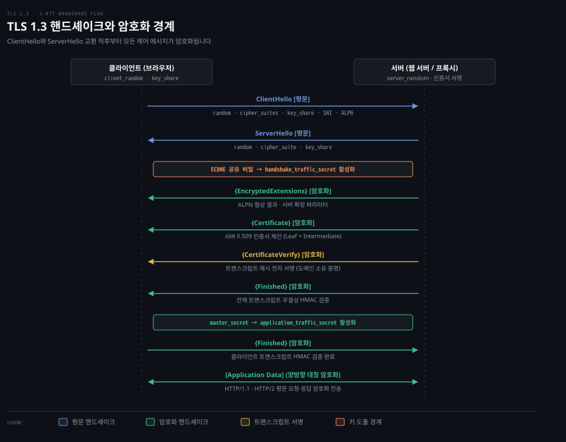
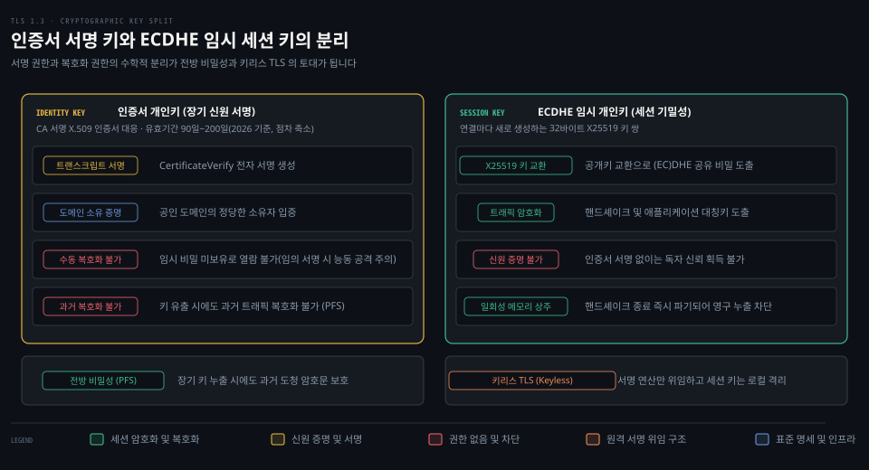

# TLS 1.3 handshake·SNI·ECDHE

---

> 처음 만난 브라우저와 서버가 도청자 앞에서 비밀 키를 안전하게 합의하고 도메인 소유권을 검증하는 TLS 1.3 핸드셰이크의 원리를 다룹니다.

## 학습 목표와 범위

> 암호화 경계 형성과 전자 서명 분리 메커니즘을 이해하고, 현대 전송 계층 보안의 핵심 불변식을 설명할 수 있습니다.

1. TLS 1.3 1-RTT 핸드셰이크에서 평문으로 오가는 정보와 암호화되는 구간의 경계를 구분하여 설명할 수 있습니다.
2. 디피-헬만 기반 타원곡선 임시 키 교환(ECDHE)이 전방 비밀성을 보장하는 원리를 수학적 비유와 함께 제시할 수 있습니다.
3. 핸드셰이크 트랜스크립트 해시와 `CertificateVerify` 전자 서명의 분리 메커니즘이 키리스 TLS를 가능하게 만드는 구조를 비교할 수 있습니다.

이 문서는 웹 보안의 기반인 TLS 1.3 암호화 원리와 핸드셰이크 프로토콜을 다룹니다. 복잡한 타원곡선 대수 기하학 공식 증명이나 대칭키 암호화 알고리즘의 내부 비트 연산 구현은 다루지 않습니다.

기준 커밋 129b6de5 (2026-10-20)


## 1. TLS 가 푸는 세 문제

> 개방된 네트워크에서 도청, 데이터 위조, 사칭을 막는 세 가지 보안 속성을 다룹니다.

암호화가 적용되지 않은 순수 TCP 연결 위에 실린 데이터는 경로 상의 누구라도 손쉽게 들여다보거나 내용을 바꿀 수 있습니다. 공용 인터넷 경로는 수많은 라우터와 중간 스위치를 거치기 때문입니다.

전송 계층 보안(Transport Layer Security, TLS)은 이 물리적 한계를 극복하기 위해 세 가지 근본 문제를 해결합니다.

- **기밀성**(Confidentiality): 데이터를 주고받는 두 당사자 외에는 내용을 알아볼 수 없도록 암호화합니다. 중간에서 패킷을 엿듣더라도 무의미한 난수 바이트열로만 보입니다.
- **무결성**(Integrity): 전송 중 데이터가 한 비트라도 변조되거나 일부가 유실되면 수신자가 이를 감지하고 폐기합니다.
- **서버 인증**(Server Authentication): 접속한 상대방이 실제로 클라이언트가 의도한 도메인의 정당한 소유자인지 암호학적으로 검증합니다.

기존의 HTTP는 TCP 3-way 핸드셰이크 직후 평문 텍스트를 바로 주고받았습니다. HTTPS(HTTP over TLS)는 TCP 연결 직후 TLS 핸드셰이크를 먼저 수행합니다. 양 끝단 사이에 암호화 가상 터널이 수립된 뒤에만 HTTP 요청을 전송하므로 중간자의 도청과 변조를 차단합니다.

기존 학습 노트인 [HTTP에서 TCP·TLS·UDP까지 — Transport 계층 해부](../../../08_cloud/book/networking-and-kubernetes/01-02.HTTP에서%20TCP·TLS·UDP까지%20—%20Transport%20계층%20해부.md)의 4·5절에서 TLS와 SNI 기초를 다루었습니다. 본 문서는 그 토대 위에서 TLS 1.3 키 합의, 핸드셰이크 암호화 경계, 그리고 서명과 세션 키 분리 메커니즘을 상세히 분석합니다.


## 2. 키 합의와 전방 비밀성: Diffie-Hellman 에서 ECDHE 까지

> 도청자가 지켜보는 열린 통신로에서 사전에 공유한 비밀 없이도 양 당사자가 동일한 대칭키를 만들어냅니다.

대칭키 암호화는 빠르고 안전하지만 통신을 시작하기 전에 두 참여자가 같은 키를 미리 나누어 가져야 한다는 문제가 있습니다. 처음 만난 브라우저와 웹 서버는 이전에 비밀을 공유한 적이 없으며 비밀키를 네트워크로 그냥 전송하면 도청자에게 탈취됩니다.

이 문제를 푼 방식이 **디피-헬만**(Diffie-Hellman) 키 교환 알고리즘입니다. 흔히 물감 섞기 비유로 설명됩니다. 앨리스와 밥이 노란색을 기본 공개 색으로 합의합니다. 앨리스는 비밀 빨간색을 섞어 주황색을 만들고 밥은 비밀 파란색을 섞어 초록색을 만듭니다. 두 사람은 각자 섞은 주황색과 초록색을 공개 교환합니다. 도청자는 주황색과 초록색을 보지만 이미 섞인 물감에서 원래 비밀 색을 분리할 수 없습니다. 앨리스는 건네받은 초록색에 빨간색을 더하고 밥은 주황색에 파란색을 더하면 둘 다 똑같은 갈색 공유 비밀에 도달합니다.

물감 비유에는 한계가 있습니다. 실제 물감은 물리적으로 분리가 어려울 뿐 수학적 함수가 아닙니다. 컴퓨터 알고리즘은 소수체 상의 거듭제곱과 나머지 연산을 활용하는 **이산로그 문제**(Discrete Logarithm Problem)라는 수학적 단방향 함수(One-way Function)를 기반으로 동작합니다. $g^a \bmod p$를 계산하기는 쉽지만 결과값만으로 원래 지수 $a$를 역산하기는 계산상 불가능에 가깝습니다. 다만 유한체 방식은 안전성을 확보하려면 2048비트 이상의 긴 키가 필요하여 계산 비용과 패킷 크기가 커지는 문제가 남습니다.

현대 인터넷은 유한체 대신 타원곡선을 활용하는 **타원곡선 디피-헬만**(Elliptic Curve Diffie-Hellman, ECDH)을 표준으로 사용합니다. 유한체 방식이나 RSA에서 128비트 보안 강도를 확보하려면 3072비트 키가 필요합니다. 타원곡선은 256비트 수준의 짧은 키 길이로도 동등한 128비트 보안 강도를 제공해 CPU 연산 비용과 네트워크 전송량을 크게 줄입니다.

여기에 임시성을 뜻하는 **ECDHE**(Elliptic Curve Diffie-Hellman Ephemeral)가 결합됩니다. 고정된 장기 키를 재사용하지 않고 클라이언트와 서버가 연결을 맺을 때마다 메모리에서 새 1회성 임시 개인키를 뽑아 키를 교환합니다.

임시 키 쌍을 매번 새로 생성하면 **완전 전방 비밀성**(Perfect Forward Secrecy)이라는 보안 속성을 얻습니다. DHE나 ECDHE로 키를 교환한 연결에 한해, 통신이 끝나면 임시 개인키는 메모리에서 영구히 소멸합니다. 훗날 서버의 장기 인증서 개인키가 유출되더라도 과거 네트워크 회선에서 도청해 둔 암호문 트래픽을 사후에 복호화할 수 없습니다.

반면 사전 공유 키나 세션 티켓만으로 재개한 세션과 0-RTT 조기 데이터는 디피-헬만이 결합되지 않으면 전방 비밀성을 보장하지 못합니다(RFC 8446 §2.2).

RFC 8446 §4.2.8과 RFC 7748에 명시된 **X25519**는 Curve25519 기반의 표준 타원곡선 키 교환 방식입니다. 공개키가 단 32바이트로 간결하며 타이밍 공격에 취약하지 않은 상수 시간 연산을 보장합니다.

2026년 기준 현대 브라우저와 최신 런타임은 `X25519MLKEM768`과 `X25519` 두 개의 key_share를 함께 보냅니다. `X25519MLKEM768`은 기존 타원곡선 키 교환(`X25519`)에 양자 컴퓨터 공격을 견디도록 설계된 격자 기반 알고리즘(`ML-KEM-768`)을 묶은 양자내성 하이브리드입니다. portal-tunnel의 `t13server`는 그중 X25519 key_share만 수락해 키를 교환합니다(`conn.go:431-432`).


## 3. TLS 1.3 핸드셰이크의 1-RTT 흐름과 암호화 경계

> 단 한 번의 왕복으로 키 교환과 서버 인증을 끝내며 두 번째 메시지부터 모든 트래픽을 암호화합니다.

과거 TLS 1.2는 전체 핸드셰이크(Full Handshake) 과정에서 클라이언트와 서버가 암호 제품군을 조율하고 키를 교환하는 데 2번의 네트워크 왕복(2-RTT)이 소요되었습니다. 세션 재개나 False Start 같은 단축 경로를 제외하면 초기 지연이 길어지는 한계가 있었습니다. 인증서와 확장 파라미터도 평문으로 노출되어 감시자에게 통신 주체 정보가 쉽게 드러났습니다.

TLS 1.3은 핸드셰이크 과정을 **1-RTT**(One Round-Trip Time)로 단축했습니다. 클라이언트가 첫 패킷을 보낼 때 `key_share` 공개키를 미리 제시하기 때문입니다. 표준 명세는 RFC 8446 §2를 따릅니다. 현대 브라우저는 보통 X25519MLKEM768과 X25519 share를 함께 동봉합니다.

1. **ClientHello** (평문 전송): 클라이언트가 핸드셰이크를 시작하며 전송합니다(RFC 8446 §4.1.2).
   - `random`: 클라이언트가 생성한 32바이트 난수(키 스케줄과 트랜스크립트에 주입)입니다.
   - `cipher_suites`: 클라이언트 지원 대칭 암호 알고리즘 목록(예: `TLS_AES_128_GCM_SHA256`)입니다.
   - `supported_versions`: TLS 1.3 프로토콜 협상을 알리는 필수 확장(`0x0304`)입니다.
   - `key_share`: 클라이언트의 임시 공개키 목록입니다.
   - `server_name`: 접속 대상 호스트명을 알리는 SNI 확장입니다.
   - `alpn`: 애플리케이션 프로토콜 협상 목록(예: `h2`, `http/1.1`)입니다.
2. **ServerHello** (평문 전송): 서버가 클라이언트 제안을 수락하며 전송합니다(RFC 8446 §4.1.3).
   - `random`: 서버 측 32바이트 난수입니다.
   - `cipher_suite`: 서버가 선택한 단 하나의 암호 제품군입니다.
   - `key_share`: 서버의 즉석 임시 공개키입니다.

ServerHello가 전송되는 즉시 양 끝단은 상대방 `key_share` 공개키와 자신의 임시 비밀키를 조합하여 동일한 **공유 비밀**(Shared Secret)을 도출합니다. 이어서 HKDF를 거쳐 `handshake_traffic_secret` 대칭키를 바로 활성화합니다. HKDF(HMAC-based Key Derivation Function, RFC 5869)는 공유 비밀 하나에서 용도별 대칭키를 뽑아내는 표준 키 유도 함수입니다.

ServerHello 바로 뒤에 이어지는 서버의 후속 핸드셰이크 메시지는 모두 암호화되어 전송됩니다. 단, 미들박스 호환 모드(RFC 8446 Appendix D.4)의 더미 `ChangeCipherSpec` 레코드는 평문으로 오갈 수 있습니다. 이 모드는 TLS 1.3 핸드셰이크를 TLS 1.2 세션 재개처럼 보이게 해서, 낯선 형식을 막아 버리는 구형 네트워크 장비(미들박스)를 통과시킵니다. portal-tunnel의 `t13server`도 미들박스 호환을 위해 ServerHello 직후 평문 ChangeCipherSpec을 송신합니다(`conn.go:468`).

3. **EncryptedExtensions** (암호화): ALPN 협상 결과나 서버 파라미터를 암호화하여 담습니다.
4. **Certificate** (암호화): 서버의 X.509 공개 인증서 체인을 전송합니다. 중간 감시자가 인증서 정보를 열람할 수 없습니다.
5. **CertificateVerify** (암호화): 지금까지 오간 전체 핸드셰이크 기록 위에 서버 인증서의 개인키로 생성한 전자 서명입니다. 서버가 해당 인증서의 진짜 주인임을 증명합니다.
6. **Finished** (암호화): 지금까지 오간 핸드셰이크 트랜스크립트 전체에 대한 HMAC 무결성 검증 값입니다. HMAC은 비밀 키와 해시 함수로 만드는 메시지 인증 코드로, 키를 모르는 쪽은 같은 값을 만들 수 없습니다.
7. **Client Finished** (암호화): 클라이언트가 서버 인증서와 서명을 검증한 뒤, 자신의 트랜스크립트 HMAC을 보내며 핸드셰이크를 완료합니다.

이후 양측은 `application_traffic_secret`을 활성화하고 실제 HTTP 요청과 응답을 담은 **Application Data**를 양방향으로 안전하게 전송합니다.



위 시퀀스 도식은 클라이언트와 서버 간의 메시지 교환 순서와 암호화 경계를 보여줍니다. 상단의 파란색 화살표(`ClientHello`, `ServerHello`)만 평문으로 노출됩니다. 중간의 주황색 키 도출 경계를 지나면 서버의 인증서와 서명을 포함한 모든 제어 메시지가 초록색 암호문으로 보호됩니다.


## 4. 트랜스크립트와 CertificateVerify 의 서명 분리

> 오간 모든 대화 기록의 해시에 서명함으로써 도메인 소유권 증명과 세션 암호화의 책임을 독립적으로 분리합니다.

도청자가 중간에서 `ServerHello`의 `key_share`를 가로채 자신의 임시 공개키로 바꿔치기하는 중간자 공격을 시도할 수 있습니다. 상대가 진짜 도메인 소유자인지와 오간 메시지가 위조되지 않았는지는 **트랜스크립트**(Transcript) 해시와 그에 대한 서명으로 검증합니다. 트랜스크립트란 핸드셰이크 시작인 `ClientHello`부터 현재 메시지 직전까지 핸드셰이크 프로토콜 메시지(Handshake 구조체) 바이트열의 누적 암호학적 해시를 뜻합니다. 표준 명세는 RFC 8446 §4.4.1에 정의되어 있습니다.

하위 레코드 헤더, 암호문, 더미 ChangeCipherSpec 레코드는 해시 계산에서 제외됩니다. 재협상(HelloRetryRequest)이 발생하면 첫 번째 `ClientHello1`은 4바이트 `message_hash`로 대체되어 누적됩니다. 중간자가 패킷의 단 1비트라도 조작하거나 순서를 바꾸면 양 끝단이 계산한 트랜스크립트 해시값이 서로 달라집니다.

트랜스크립트 해시에는 `ClientHello`와 `ServerHello`에 담긴 양측의 `key_share` 공개키가 그대로 포함됩니다. 서버는 Certificate 메시지까지 누적된 트랜스크립트 해시값 위에 자신의 장기 **인증서 개인키**로 전자 서명을 생성하여 **CertificateVerify** 메시지에 담아 보냅니다. 이 전자 서명은 도메인 신원을 증명하는 데 그치지 않고 지금 세션에서 교환된 임시 공개키(`key_share`)를 서버의 공인 신원에 묶어(bind) 주는 역할을 합니다. 중간자가 임시 공개키를 바꿔치기하면 트랜스크립트 해시가 어긋나 클라이언트의 서명 검증이 실패합니다.

RFC 8446 §4.4.3에 따르면 서명 입력 데이터는 고정된 네 가지 요소로 조립됩니다. `0x20` 64바이트 패딩, `TLS 1.3, server CertificateVerify` 컨텍스트 문자열, `0x00` 구분자 1바이트, 그리고 Certificate 메시지까지의 누적 Transcript-Hash가 순서대로 결합됩니다.

64바이트 패딩은 TLS 1.2 시절의 chosen-prefix 공격을 차단합니다. 컨텍스트 문자열과 구분자는 서버 서명과 클라이언트 서명을 분리하며 다른 프로토콜로 서명을 전용하는 크로스 프로토콜 공격도 방어합니다.

여기서 세션 키와 신원 증명의 출처가 갈립니다.

- **세션 암호화 키의 출처**: 클라이언트와 서버가 메모리에서 실시간으로 생성한 ECDHE 임시 공개키 쌍의 결합에서 나옵니다.
- **신원 증명의 출처**: 인증 기관(CA)에서 발급받은 공인 인증서의 개인키로 트랜스크립트 해시에 서명하는 연산에서 나옵니다.

두 연산은 수학적으로 분리되어 있습니다. 인증서 개인키는 세션 데이터를 암호화하거나 복호화하는 기능이 없고 트랜스크립트 서명 생성에만 쓰입니다. 반대로 ECDHE 임시 키는 트래픽을 암호화하지만 스스로가 도메인의 주인임을 증명하지는 못합니다.

서명 키 보유자는 수동 도청 복호화는 할 수 없지만 임의의 트랜스크립트에 서명해 줄 수 있다면 자신이 원하는 임시 키로 능동적 중간자 공격(active MITM)을 감행할 수 있습니다.

이 때문에 portal-tunnel 시스템은 서명 요청을 테넌트가 임의로 조작하지 못하도록 막습니다. 인입 연결의 lease와 바인딩에 대조하여 서명 요청을 검증하고 소모합니다(`portal/keyless/signer.go:52-57` `TranscriptValidator` → `bindings.ValidateAndConsume`).

이러한 암호학적 분리와 바인딩 검증 덕분에 서명 키를 보관하고 연산하는 주체와 세션 키를 생성해 트래픽을 종단하는 주체가 네트워크를 사이에 두고 물리적으로 격리될 수 있습니다.



위 아키텍처 도식은 인증서 개인키와 ECDHE 임시 키가 각각 소유하는 자원과 권한의 한계를 대비하여 보여줍니다. 좌측의 인증서 키는 장기 신원 서명만을 소유해 세션 복호화 권한이 없습니다(임의 서명 시 능동 공격 주의). 우측의 ECDHE 임시 키는 세션 기밀성을 전담하지만 신원 증명 권한이 없습니다. 이 분리 구조가 전방 비밀성을 보장하고 키리스 TLS의 토대를 형성합니다.


## 5. 인증서 체인과 이름 검증

> 루트 인증 기관에서 시작되는 신뢰의 사슬과 주체 대체 이름 필드로 도메인 소유권을 엄격히 대조합니다.

브라우저는 전 세계의 웹 서버를 하나하나 신뢰할 수 없으므로, 서버 인증서의 진위를 확인할 때 신뢰를 중계하는 제3자인 **인증 기관**(Certificate Authority, CA)의 계층적 구조를 이용합니다.

이를 **인증서 체인**(Certificate Chain)이라고 부릅니다.

1. **루트 CA**(Root CA): 운영체제와 브라우저 내부 트러스트 스토어에 기본 탑재된 최상위 인증 기관입니다. 자체 서명(Self-signed) 인증서를 갖습니다.
2. **중간 CA**(Intermediate CA): 루트 CA의 서명을 받은 중간 기관입니다. 루트 CA 개인키를 안전하게 보호하기 위해 실무 발급을 전담합니다.
3. **리프 인증서**(Leaf / End-Entity Certificate): 실제 웹 서버에 설치되는 최종 도메인 인증서입니다. 중간 CA의 서명을 받습니다.

클라이언트는 리프에서 루트까지 전자 서명을 역추적하여 신뢰 체인을 검증합니다.

신뢰 체인이 유효하더라도 인증서 도메인이 접속 주소와 다르면 연결이 차단됩니다. 과거의 일반 이름(Common Name, CN) 필드는 이름 형식이 비정형이고 SAN과의 이중 검증 혼선을 초래했습니다. 그래서 RFC 6125를 대체한 현대 표준인 RFC 9525 §2는 이 필드를 "Common Name RDN MUST NOT be used"로 명시적으로 폐지했습니다.

현대 브라우저와 TLS 스택은 **주체 대체 이름**(Subject Alternative Name, SAN) 확장에 명시된 DNS 이름 목록만 검증의 정본으로 채택합니다.

여러 서브도메인을 수용하기 위해 와일드카드 인증서(`*.example.com`)를 자주 사용합니다. 과거 RFC 6125는 부분 레이블 와일드카드(`baz*.example.net`)를 허용했습니다. RFC 9525 §6.3 규칙에 따르면 이제 별표(`*`)는 레이블 전체가 단독 `*` 하나여야 하며 호스트명의 가장 왼쪽 단일 레이블(label) 하나만 대체합니다.

- `api.example.com`: 일치 (단일 레이블 매칭)
- `service.example.com`: 일치 (단일 레이블 매칭)
- `dev.api.example.com`: 불일치 (다중 레이블 매칭 불가)
- `example.com`: 불일치 (와일드카드 영역 제외)

단, RFC 일반 원칙 외에 세부 와일드카드 정책은 구현체마다 다를 수 있습니다. 브라우저 및 TLS 라이브러리(OpenSSL, LibreSSL, Go `crypto/x509`)마다 공용 접미사 목록(PSL, Public Suffix List) 처리나 다중 와일드카드 검증에 차이가 있으므로 환경별 정책을 확인해야 합니다. PSL은 `.com`·`.co.kr`·`github.io`처럼 그 아래에 누구나 이름을 등록할 수 있는 접미사 목록이며, 브라우저는 `*.co.kr` 같은 와일드카드를 막을 때 이 목록을 씁니다.


## 6. SNI 와 평문 노출의 한계

> 단일 IP 주소에서 수많은 가상 호스팅 도메인을 구분하지만 연결 목적지가 네트워크에 노출되는 한계를 가집니다.

클라우드 환경에서는 단일 물리 IP 주소와 443 포트에서 수백 개의 서로 다른 도메인을 호스팅하는 가상 호스팅이 일반적입니다.

그런데 TLS 핸드셰이크에서는 암호화 통로를 열기 전에 서버가 인증서를 먼저 보내야 합니다. 클라이언트가 어떤 도메인을 원하는지 모르는 서버는 올바른 인증서를 고를 수 없습니다.

이 문제를 해결하기 위해 도입된 표준이 **SNI**(Server Name Indication, RFC 6066 §3)입니다. 클라이언트는 `ClientHello`의 `server_name` 확장에 자신이 방문하고자 하는 호스트명을 기재하여 보냅니다. 서버는 이 이름을 확인하고 일치하는 도메인의 인증서 체인을 선택하여 응답합니다.

다만 SNI에는 보안상 한계가 있습니다. `ClientHello`는 암호화 전에 전송되므로 SNI 호스트명이 네트워크 상에 **평문**(Plaintext)으로 노출됩니다. 경로 상의 ISP나 검열 방화벽은 본문은 몰라도 사용자가 어떤 도메인에 방문하는지 식별할 수 있습니다.

이 평문 노출을 방어하기 위해 고안된 표준이 **ECH**(Encrypted Client Hello, RFC 9849)입니다. `ClientHello`를 공개 외부 껍데기(`ClientHelloOuter`)와 실제 민감한 SNI를 암호화한 내부 알맹이(`ClientHelloInner`)로 분리합니다.

ECH를 적용하더라도 `ClientHelloOuter`에는 접속을 중계하는 외부 프록시·CDN·릴레이의 공개 호스트명(`public_name`) SNI가 평문으로 남으므로 네트워크 감시자에게 최종 목적지 인프라 식별자까지 숨길 수는 없습니다. 클라이언트는 첫 연결 전에 서버의 암호화 공개키와 설정 파라미터(`ECHConfig`)도 미리 확보해야 합니다. RFC 9849 §3.2는 DNS의 HTTPS/SVCB 리소스 레코드(RFC 9460, RFC 9848) 조회를 주된 게시 메커니즘으로 위임하며 아웃오브밴드(out-of-band)를 포함한 다른 전달 방식도 함께 허용합니다.


## 7. TLS Exporter: 동일 세션에서 독립 키 유도

> 확립된 핸드셰이크 비밀을 공유하는 양 끝단이 동일한 상위 보안 검증 키를 안전하게 추출합니다.

TLS 세션이 맺어진 뒤 터널 내부 프로토콜이 핸드셰이크 비밀을 재사용해 채널 바인딩 값을 만들 때는 RFC 8446 §7.5에 정의된 **키 재료 내보내기**(Keying Material Exporter)를 씁니다. 핸드셰이크 비밀로부터 독립 키를 도출하는 기능입니다. 세션을 맺은 클라이언트와 서버가 마스터 시크릿에 고유 라벨과 컨텍스트 바이트열을 주입하여 양 끝단에서 일치하는 비밀 바이트열을 산출합니다.

추출된 값은 주 트래픽 대칭 암호화 키와 수학적으로 격리되어 데이터 기밀성에 영향을 주지 않습니다. 그러면서도 그 세션에 참여한 당사자만 동일한 값을 산출할 수 있습니다. 이 특성은 애플리케이션 계층의 채널 바인딩이나 중간 프록시의 변조 여부를 교차 검증하는 자가 진단 체계의 암호학적 기반으로 활용됩니다.


## 8. CLI 로 직접 확인하는 TLS 핸드셰이크

> 명령줄 도구를 활용해 협상된 암호 제품군, 인증서 서명 알고리즘, 프로토콜 상태 전이를 직접 관찰합니다.

실제 네트워크 통신에서 핸드셰이크가 어떻게 전개되는지 확인하려면 진단 도구가 필요합니다. 웹 서버를 대상으로 TLS 1.3 연결을 관찰할 때는 OpenSSL 유틸리티와 curl 상세 로그를 활용합니다.

OpenSSL로는 이렇게 연결합니다.

```bash
openssl s_client -connect example.com:443 -servername example.com -tls1_3
```

이 명령의 터미널 출력(OpenSSL 3.6 실측 예시)에서 확인할 핵심 항목입니다.

- `CONNECTED(00000005)`: TCP 연결이 수립되었음을 나타냅니다(괄호 안의 숫자는 생성된 소켓 파일 디스크립터 번호입니다).
- `depth=...`: 서버가 전송한 인증서 체인의 계층 깊이와 각 계층 신원입니다.
- `Peer signing digest` 및 `Peer signature type`: 서버가 `CertificateVerify`에서 사용한 서명 알고리즘입니다(실측 `SHA256`, `ecdsa_secp256r1_sha256`).
- `Negotiated TLS1.3 group: X25519MLKEM768`: 협상된 키 교환 그룹입니다(최신 클라이언트의 양자내성 하이브리드 지원 관측).
- `New, TLSv1.3, Cipher is TLS_AES_256_GCM_SHA384`: 협상된 프로토콜 버전(TLS 1.3)과 대칭키 암호 제품군입니다.
- `Post-Handshake New Session Ticket arrived:`: 핸드셰이크 완료 후 서버가 전달한 세션 재개용 티켓입니다(단, 표준 입력을 즉시 닫으면 수신 전에 종료되어 출력되지 않을 수 있습니다).

curl로 상세하게 관찰할 때는 아래 명령을 씁니다.

```bash
curl -v https://example.com
```

curl의 핸드셰이크 로그는 내장된 TLS 백엔드 라이브러리에 따라 출력 형식이 달라집니다.

- **OpenSSL 백엔드 curl**: 핸드셰이크 단계를 세분화하여 기록합니다. `Client hello (1):`과 `Server hello (2):`에 이어 암호화 구간이 시작됩니다. 이후 `Encrypted Extensions (8):`, `Certificate (11):`, `CERT verify (15):`, `Finished (20):` 행을 차례로 남깁니다.
- **macOS 기본 curl (LibreSSL/SecureTransport)**: `* (304) (OUT), TLS handshake, Client hello (1):` 형태로 기록합니다. 이어서 `Server hello (2):`, `Unknown (8):`, `Certificate (11):`, `CERT verify (15):`, `Finished (20):`를 출력합니다. 최종 줄은 `* SSL connection using TLSv1.3 / AEAD-CHACHA20-POLY1305-SHA256 / [blank] / UNDEF`로 표시됩니다.
- **공통 확인 항목**: `* ALPN: offers h2, http/1.1`(제안)과 `* ALPN: server accepted h2`(협상 결과)를 확인합니다. `* Server certificate:`의 SAN 도메인 일치 행으로는 전송 계층과 응용 계층의 연결 경계를 직접 점검할 수 있습니다.


## 9. portal 에서는: 릴레이 중계와 키리스 종단

> 평문 SNI 라우팅, 원격 트랜스크립트 서명, TLS Exporter 자가 검증을 결합해 비신뢰 중계 서버를 관통하는 종단 암호화를 완성합니다.

`gosuda/portal-tunnel` 시스템은 본 편에서 살펴본 TLS 1.3의 핵심 메커니즘들을 조합하여 무신뢰 역방향 터널을 구축합니다. 이 터널에서 공용 릴레이는 사용자 트래픽 평문을 열람할 수 없습니다.

1. **평문 ClientHello와 SNI 기반 역방향 라우팅**:
   릴레이 서버의 인그레스 리스너는 443 포트로 들어오는 외부 연결에서 `ClientHello`를 읽습니다 (`l4.InspectClientHello`, `portal/server.go:968`). 평문으로 노출되는 SNI 호스트명을 추출하여 등록된 임대 레코드를 조회합니다 (`portal/server.go:1000`). 이후 연결을 복호화하지 않고 테넌트 터널로 이어진 리버스 연결과 투명하게 이어줍니다 (`portal/server.go:1049`). 세부 패킷 파싱과 풀 선점 과정은 `02-02.SNI routing·ClientHello` 편에서 다룹니다.
2. **트랜스크립트 서명 위임과 키리스 종단**:
   이 구조는 인증서 서명 키와 세션용 임시 키가 분리되어 있어서 가능합니다. 실제 브라우저와의 TLS 1.3 핸드셰이크와 대칭 세션 키 도출은 로컬 터널 내부 `t13server`에서 완주됩니다. 터널은 인증서 개인키를 쥐지 않습니다. 릴레이 인그레스는 연결 인입 시 ClientHello 바인딩을 발급합니다(`portal/server.go:1034`). 터널 에이전트는 릴레이의 `/v1/sign` 엔드포인트로 서명을 요청하고(`portal/keyless/client.go:3, 57`) 릴레이는 이를 바인딩과 대조 검증합니다(`portal/keyless/signer.go:52-57`). 릴레이는 세션 키를 알지 못하므로 L4 전달자로 격리됩니다. 상세 동작은 `02-03.keyless TLS` 편에서 다룹니다.
3. **TLS Exporter 기반 중간자 개입 자가 검증**:
   릴레이가 세션을 가로채 종단하는 공격을 감시하기 위해 SDK는 RFC 8446 §7.5의 TLS Exporter를 사용합니다(`sdk/mitm.go:38`). 터널 에이전트는 임대마다 백그라운드 워커를 두어 리버스 연결 준비 후 평균 45초 지수분포 간격(상한 120초)으로 주기적 자가 프로브를 실행합니다(`sdk/mitm.go:262-305`). 이후 `Portal-MITM-Probe-v1` 라벨(`sdk/mitm.go:61`)로 내보낸 키 재료 값을 대조하여 릴레이의 복호화 여부를 탐지합니다. 상세 동작은 [02-04.MITM self-probe.md](02-04.MITM%20self-probe.md) 편에서 다룹니다.
4. **와일드카드 인증서와 단일 체인 수용**:
   릴레이의 ACME 관리자는 Let's Encrypt에서 루트 도메인과 와일드카드 도메인(`*.domain`)이 묶인 단일 인증서를 발급받아 유지합니다 (`portal/acme/certificate.go:42`). 테넌트가 새 서브도메인을 임대할 때마다 인증서를 재발급받지 않고 기존 와일드카드 체인으로 즉시 키리스 서명을 제공합니다. 이 수명주기는 `02-05.ACME·DNS-01·ENS` 편에서 다룹니다.


## 리뷰 노트

> 소스 코드 분석과 표준 명세 대조 과정에서 도출된 기술적 고려사항과 설계상 한계를 정리합니다.

- 상호 인증(mTLS)의 부재와 서버 단방향 인증 모델: 표준 RFC 8446은 클라이언트도 자신의 인증서와 `CertificateVerify`를 전송하는 mTLS를 정의하지만 웹 브라우저 환경과 Portal의 공개 진입점은 전형적인 서버 단방향 인증만을 수행합니다. 클라이언트의 신원은 전송 계층이 아닌 애플리케이션 계층의 비대칭키 서명(SIWE)으로 검증됩니다.
- 양자내성 하이브리드 키 교환과 Portal의 단일 X25519 수용: Go 1.24+ 런타임과 현대 브라우저는 키 교환 1순위로 양자내성 하이브리드인 `X25519MLKEM768`을 제안하며 하위 호환을 위해 `X25519` share를 함께 보냅니다. 반면 Portal의 `t13server`는 X25519 key_share만을 수락하도록 고정되어 있습니다(`conn.go:431-432`).
- 와일드카드 인증서의 단일 레이블 제약과 다중 서브도메인 한계: RFC 9525 §6.3에 따라 와일드카드 인증서는 단 하나의 하위 레이블만을 커버합니다. Portal의 ACME 발급기는 `{base, "*."+base}` 단일 와일드카드 체인만을 유지합니다(`portal/acme/certificate.go:42`). 그래서 `user.service.domain.com`처럼 2단계 이상의 서브도메인을 사용하는 테넌트는 기본 와일드카드 인증서로 보호받을 수 없습니다.
- 0-RTT 조기 데이터(Early Data)의 미구현과 1-RTT 고정: TLS 1.3은 첫 비행에 애플리케이션 데이터를 싣는 0-RTT 핸드셰이크를 정의하지만 전방 비밀성이 제공되지 않고 네트워크 재생 공격(Replay Attack)에 취약합니다. Portal이 채택한 `keyless_tls`의 `t13server` 구현체는 PSK, 세션 티켓, `early_data` 자체를 구현하지 않으므로 완전한 1-RTT 핸드셰이크만을 수행합니다.


## 자가 점검 질문

> 본문에서 다룬 TLS 1.3의 암호학적 원리와 핸드셰이크 과정을 스스로 검증하기 위한 질문입니다.

1. TLS 1.3 1-RTT 핸드셰이크에서 외부 도청자가 패킷 스니핑으로 평문 관찰할 수 있는 메시지와, 암호화되어 열람할 수 없는 메시지는 각각 무엇입니까?
2. Diffie-Hellman 키 교환에서 매 연결마다 새로운 임시 키 쌍(ECDHE)을 생성하는 이유와, 이것이 보장하는 전방 비밀성(PFS)의 의미는 무엇입니까?
3. TLS 1.3 핸드셰이크에서 서버 인증서 개인키와 세션 대칭키가 수학적으로 분리될 수 있는 근거는 무엇이며, 이 분리가 portal-tunnel의 키리스 TLS에서 어떻게 응용됩니까?
4. SNI(Server Name Indication)가 하나의 공용 IP 주소에서 수많은 가상 호스팅 도메인을 운영하기 위해 필수적인 이유와, SNI의 평문 노출 문제를 해결하기 위해 ECH가 요구하는 전제 조건 및 외부 노출 한계는 무엇입니까?


## 정답 (자답 후 펼치기)

> 위 자가 점검 질문에 대한 핵심 답변입니다.

1. 평문으로 노출되는 핸드셰이크 메시지는 클라이언트의 `ClientHello`(랜덤값, 암호 제품군 목록, 임시 공개키 목록, SNI, ALPN 등)와 서버의 `ServerHello`(랜덤값, 선택된 제품군, 서버 임시 공개키)입니다. 미들박스 호환 모드에서는 더미 `ChangeCipherSpec` 레코드도 평문으로 오갈 수 있지만 핸드셰이크 메시지는 아닙니다. `ServerHello` 교환 즉시 도출된 핸드셰이크 대칭키로 후속 메시지를 보호합니다. 그 뒤의 `EncryptedExtensions`, `Certificate`, `CertificateVerify`, `Finished`, 그리고 모든 `Application Data`는 암호화되어 도청자에게 노출되지 않습니다.
2. 연결마다 메모리에서 새 1회성 임시 키 쌍을 생성하고 핸드셰이크 종료 즉시 메모리에서 영구히 폐기하기 위함입니다. 그러면 (EC)DHE로 키를 교환한 연결에 한해, 훗날 서버의 장기 인증서 개인키가 침해당하더라도 과거 네트워크 구간에서 도청자가 수집해 둔 암호문 트래픽을 사후에 복호화하는 것은 수학적으로 불가능합니다. 이 성질이 완전 전방 비밀성(PFS)입니다.
3. 세션 대칭키는 양 끝단이 교환한 임시 공개키(`key_share`) 간의 타원곡선 점 곱셈에서 도출되는 반면 인증서 개인키는 지금까지 오간 전체 대화의 누적 해시(트랜스크립트)에 전자 서명을 생성하는 용도로만 쓰이기 때문입니다. portal-tunnel은 이 원리로 키리스 TLS를 구현합니다. 세션 대칭키 도출과 트래픽 복호화는 로컬 터널 내부에서 완주하고 인증서 개인키가 필요한 트랜스크립트 서명 연산만 원격 릴레이 서버(`/v1/sign`)에 RPC로 위임합니다.
4. TLS는 암호화 통신을 시작하기 전에 서버가 인증서를 먼저 보내야 합니다. 단일 IP 환경에서는 클라이언트가 어느 도메인을 원하는지 알 수 없으므로 `ClientHello`의 `server_name` 확장에 접속 대상 도메인을 미리 적어 보내야만 올바른 인증서를 선택할 수 있습니다. ECH(RFC 9849)로 SNI 평문 노출을 막으려면 클라이언트가 첫 패킷 전에 서버의 암호화 설정(`ECHConfig`)을 알아야 합니다. 그래서 사전에 DNS(HTTPS/SVCB 레코드)나 아웃오브밴드 방식으로 설정을 배포해 두어야 합니다. ECH를 적용하더라도 외부 껍데기(`ClientHelloOuter`)에는 접속을 중계하는 서버의 공개 호스트명(`public_name`) SNI가 평문으로 남으므로 목적지 인프라 사업자 정보까지 은폐되지는 않습니다.


## 출처와 관련 문서

> 본문 작성에 참고한 1차 공식 명세와 저장소 내부의 연관 문서 목록입니다.

- [RFC 8446: The Transport Layer Security (TLS) Protocol Version 1.3](https://datatracker.ietf.org/doc/html/rfc8446): 핸드셰이크 흐름(§2), 키 스케줄(§7.1), 트랜스크립트 서명(§4.4.1·§4.4.3), Exporter(§7.5) 표준 명세
- [RFC 7748: Elliptic Curves for Security](https://datatracker.ietf.org/doc/html/rfc7748): Curve25519 및 X25519 타원곡선 키 교환 표준 명세
- [RFC 6066: Transport Layer Security (TLS) Extensions: Extension Definitions](https://datatracker.ietf.org/doc/html/rfc6066): Server Name Indication(SNI, §3) 표준 명세
- [RFC 9525: Service Identity in TLS](https://datatracker.ietf.org/doc/html/rfc9525): 주체 대체 이름(SAN) 및 와일드카드 인증서 이름 매칭 표준 규칙(RFC 6125 대체, CN 폐지)
- [RFC 9849: Encrypted Client Hello for TLS](https://datatracker.ietf.org/doc/html/rfc9849): SNI 평문 노출 방지를 위한 ECH 표준 명세
- [gosuda/portal-tunnel 공식 저장소](https://github.com/gosuda/portal-tunnel/tree/129b6de5): 기준 커밋 129b6de5 소스 코드
- [HTTP에서 TCP·TLS·UDP까지 — Transport 계층 해부](../../../08_cloud/book/networking-and-kubernetes/01-02.HTTP에서%20TCP·TLS·UDP까지%20—%20Transport%20계층%20해부.md): 4·5절에서 다룬 전송 계층 기본 및 TLS/SNI 개괄
- [00-02.Concepts.md](00-02.Concepts.md): 기본 스트림 경로와 키리스 종단의 전반적 개념 지도
- [02-02.SNI routing·ClientHello.md](02-02.SNI routing·ClientHello.md): 릴레이 인그레스의 평문 ClientHello 스누핑 및 라우팅 상세
- [02-03.keyless TLS.md](02-03.keyless TLS.md): 단일 연결 바인딩과 `/v1/sign` 원격 서명 상세 구현
- [02-04.MITM self-probe.md](02-04.MITM self-probe.md): TLS Exporter 기반 릴레이 복호화 자가 진단 프로브
- [02-05.ACME·DNS-01·ENS.md](02-05.ACME·DNS-01·ENS.md): 와일드카드 인증서 발급과 DNS 검증 생명주기
