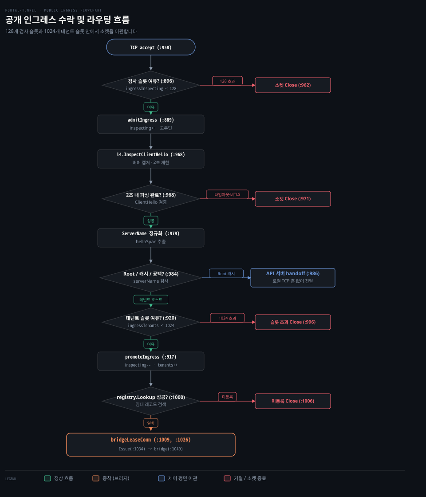

# SNI routing·ClientHello

---

> 릴레이가 TLS 핸드셰이크를 복호화하지 않고 ClientHello의 SNI 확장을 읽어 목적지 터널로 소켓을 연결하는 인그레스 라우팅과 버퍼링 원리를 다룹니다.


## 왜 암호화를 풀지 않고 목적지 터널을 찾을 수 있나

> TLS 첫 메시지는 암호화 협상 전이므로 평문으로 전달되는 SNI 확장을 통해 목적지 도메인을 식별할 수 있습니다.

릴레이는 방화벽 내부의 웹 서버를 외부에 공개하면서 수많은 사용자의 접속 요청을 맞이합니다. 릴레이가 모든 도메인의 TLS 인증서와 개인키를 쥐고 트래픽을 직접 복호화하면 보안 문제가 커집니다. 테넌트의 평문 데이터가 중계 서버 메모리에 노출되고 중계 노드는 수많은 서브도메인 인증서를 중앙에서 관리해야 합니다.

포털 터널은 종단간 암호화를 보존하려고 릴레이에서 TLS 세션을 종단하지 않습니다. 암호문을 풀지 않고도 수신한 TCP 연결을 올바른 터널 에이전트로 보내는 방법이 **SNI 라우팅**(Server Name Indication Routing)입니다.

TLS 1.3 규격(RFC 8446 §4.1.2)에서 클라이언트는 TCP 연결 직후 서버로 **ClientHello** 메시지를 가장 먼저 전송합니다. 아직 암호화 키를 교환하기 전이라 TLS 레코드 헤더, 지원 암호 스위트, RFC 6066 §3의 `server_name`(SNI) 확장이 모두 평문으로 오갑니다. 그 뒤의 서버 인증서와 애플리케이션 데이터는 암호문으로 보호되므로, 릴레이는 첫 메시지의 SNI 확장만 읽고 연결을 목적지 터널로 넘깁니다.

다만 ECH(Encrypted Client Hello) 규격을 도입할 때는 키 운영과 라우팅 구조를 새로 따져야 합니다. 클라이언트는 서버가 DNS HTTPS RR(RFC 9460)로 ECHConfig를 공개할 때만 내부 SNI(`ClientHelloInner`)를 암호화합니다. 포털 릴레이는 자체 존에 ECHConfig를 게시하지 않으므로 브라우저가 ECH를 시도하더라도 공개 외부 SNI에 실제 테넌트 호스트명이 그대로 실려 라우팅이 끊기지 않습니다.

L4 검사기(`keyless_tls/relay/l4/clienthello.go:38-41`)의 `ECHOffered` 필드는 더미 ECH 수신 시에도 참이 되며 현재 릴레이 코드 어디에서도 참조하지 않습니다. 향후 릴레이 차원에서 테넌트 도메인을 숨기려고 ECH를 직접 지원한다면 릴레이가 외부 복호화용 ECH 개인키를 보유하고 운영해야 합니다.

기준 커밋 0a3b9c06 (2026-10-14)


## 공개 인그레스 루프와 소켓 이관

> 인그레스 루프는 전역 검사 예산 안에서 패킷을 엿본 뒤 루트 호스트는 API 서버로, 테넌트 요청은 브리지로 넘깁니다.

외부에서 들어오는 소켓을 제한 없이 받아서 처리하면 연결이 폭주할 때 릴레이의 메모리와 고루틴이 고갈됩니다. 릴레이는 서버 자원을 지키려고 검사 슬롯 예산 안에서만 연결을 수락하고 소켓을 목적지에 맞게 분기합니다. 단일 포트(기본 443)에서 유입되는 모든 암호화 트래픽은 `portal/server.go:956`의 `runPublicIngress` 루프를 거칩니다. 리스너가 연결을 수락하면 가장 먼저 검사 슬롯 여유를 확인합니다.

```go
// portal/server.go:958-968 발췌
conn, err := s.sniListener.Accept()
// ...
if !s.admitIngress(conn, true) {
    _ = conn.Close()
    continue
}
go func(conn net.Conn) {
    inspecting := true
    defer func() { s.releaseIngress(conn, inspecting) }()
    clientHello, wrappedConn, err := l4.InspectClientHello(conn, defaultClientHelloWait)
```

`portal/server.go:961`은 `s.admitIngress(conn, true)`를 호출해 검사 정원을 확인합니다. `portal/server.go:889`의 `admitIngress`는 현재 검사 중인 소켓 수(`ingressInspecting`)가 한도(128)에 도달했는지 검사합니다. 여유가 없으면 연결을 즉시 닫아 서버 자원을 보호합니다.

슬롯을 확보하면 고루틴을 띄우고 `l4.InspectClientHello`(`:968`)를 실행합니다. 검사 제한 시간은 `defaultClientHelloWait`(2초, `portal/server.go:38`)입니다. 2초 안에 올바른 TLS 메시지가 도착하지 않으면 소켓을 닫고 종료합니다.

검사가 끝나면 호스트명을 소문자로 정규화하고(`portal/server.go:979`) 목적지가 릴레이 자체인지 테넌트인지 판별합니다. 호스트명이 비어 있거나 릴레이 루트 도메인 또는 정적 캐시 호스트와 일치하면(`portal/server.go:984`) API 서버로 소켓을 넘깁니다.

Go 표준 라이브러리는 IP 주소로 직접 접속할 때 SNI 확장을 생략합니다. 릴레이는 빈 호스트명도 루트 오리진 접속으로 간주해 핸드셰이크 실패 대신 API 서버로 전달합니다(`portal/server.go:980-983`). 메인테이너 아키텍처 문서(`docs/maintainer/architecture.md:101-102`)가 설명하듯 소켓을 `apiHandoff.conns` 채널로 직접 넘기므로 로컬 TCP 홉 없이 원본 피어 주소가 유지됩니다.

테넌트 호스트명인 경우 `s.promoteIngress()`(`portal/server.go:995`)를 호출합니다. 테넌트 한도(1024)를 넘지 않으면 검사 카운터를 줄이고 테넌트 카운터를 늘립니다(`:917-925`). 그 뒤 `s.registry.Lookup`(`:1000`)으로 등록된 터널 레코드를 찾아 `bridgeLeaseConn`(`:1009`, `:1026`)으로 세션을 이어붙입니다.



위 도식은 TCP 소켓 하나가 들어온 뒤의 전 과정을 보여줍니다. 소켓은 검사 슬롯과 ClientHello 파싱을 거쳐 API 핸드오프 또는 테넌트 브리지로 이어집니다. 용량을 초과하거나 등록되지 않은 호스트명이면 연결을 닫아 고아 소켓을 남기지 않습니다.


## 엿보되 소비하지 않는 프리픽스 버퍼링

> 검사기가 소켓에서 읽어 들인 바이트는 프리픽스 리더로 복원되어 후속 핸들러에 원본 그대로 전달됩니다.

TCP 스트림은 한 번 읽으면 커널 수신 버퍼에서 제거됩니다. 릴레이가 SNI를 확인하려고 수백 바이트의 ClientHello를 읽어 버리면 뒤이어 소켓을 넘겨받은 API 서버나 터널 에이전트는 첫 머리가 잘린 비정상 패킷을 받습니다. TLS 핸드셰이크는 레코드 헤더가 1바이트라도 빠지면 즉시 실패합니다.

검사 패키지(`keyless_tls/relay/l4/clienthello.go`)는 읽은 바이트를 잃지 않도록 모두 버퍼에 캡처합니다. 파싱이 끝나면 소켓을 원본 상태처럼 흉내 내는 래퍼 연결로 감싸 반환합니다.

```go
// keyless_tls/relay/l4/clienthello.go:293-310 발췌
type preloadedConn struct {
    net.Conn
    prefix *bytes.Reader
}

func (c *preloadedConn) Read(p []byte) (int, error) {
    if c.prefix != nil && c.prefix.Len() > 0 {
        return c.prefix.Read(p)
    }
    return c.Conn.Read(p)
}
```

`clienthello.go:298`의 `prependConn`은 캡처한 바이트 슬라이스를 `bytes.NewReader`로 감싸 `preloadedConn`을 만듭니다. 이후 API 서버나 프록시 브리지가 이 소켓에서 `Read()`를 호출하면 메모리에 저장된 앞부분 바이트가 먼저 흘러나옵니다.

프리픽스 버퍼를 전부 비우면 투명하게 실제 TCP 소켓 읽기로 넘어갑니다. 소켓을 넘겨받은 수신자는 중간 검사기가 개입했다는 사실을 모른 채 ClientHello 전체를 처음부터 수신합니다.

파싱된 핸드셰이크 원문(`helloSpan`)은 바인딩 발급에 쓰이도록 보존됩니다(`portal/server.go:1034`). 릴레이는 `s.registry.bindings.Issue(record.id, helloSpan)`을 호출해 세션 바인딩을 생성합니다. 키리스 TLS 환경에서 터널 노드가 서명을 증명할 때는 ClientHello 원문 바이트와의 일치가 요구됩니다. 구체적인 서명 흐름은 02-03 편에서 다룹니다.


## 슬롯 예산과 Slowloris 공격 표면

> 검사 단계와 브리지 단계의 정원을 나누어 메모리를 지키지만 출발지별 할당량 부재로 인한 지연 공격에 노출됩니다.

릴레이는 공개 인터넷에 포트를 열어 두므로 악의적인 연결 폭주 공격을 상시 방어해야 합니다. 자원 고갈을 막으려고 검사와 테넌트 단계에 각각 독립된 전역 정원을 둡니다.

```go
// portal/server.go:37-46 발췌
const (
    defaultClaimTimeout    = 10 * time.Second
    defaultClientHelloWait = 2 * time.Second
    publicIngressLimit     = 1024
    publicInspectionLimit  = 128
)
```

`portal/server.go:44-45`에 정의된 대로 검사 대기 슬롯은 최대 128개, 활성 테넌트 연결은 최대 1024개로 제한됩니다. 메인테이너 아키텍처 문서는 이 경계의 설계 특성과 명백한 한계를 이렇게 명시합니다.

> "ClientHello inspection and tenant bridges have separate server-wide budgets: at most 128 sockets may await inspection, and at most 1024 tenant connections may be pending or active. Root API and reverse-connect handoff does not consume the tenant budget, so tenant saturation does not prevent a fresh root connection. The inspection budget is shared across source addresses and the root API; a single source can occupy all 128 slots until their two-second deadlines expire. It bounds memory and workers but does not guarantee source fairness or root availability during a sustained ClientHello flood."
> (docs/maintainer/architecture.md:153-160)

인용문에 따르면 검사 슬롯 128개는 모든 출발지 IP와 루트 API가 공유합니다. 단일 공격자가 128개의 TCP 소켓을 한 번에 열고 2초 데드라인이 지날 때까지 바이트를 보내지 않으면 검사 풀이 포화됩니다.

이 취약점은 불완전한 HTTP 요청을 길게 늘어뜨려 스레드를 말리는 Slowloris 공격과 유사합니다. Slowloris와 달리 HTTP 계층까지 도달할 필요도 없이 TCP 핸드셰이크 직후 침묵하기만 해도 128개 슬롯을 잠글 수 있습니다. 128 슬롯이 잠긴 2초 동안 유입되는 다른 정상 사용자의 연결은 `admitIngress`에서 즉시 거절됩니다. 릴레이는 총 고루틴 수와 메모리 상한을 보장하지만 L4 검사 진입점의 출발지 공정성은 보장하지 않습니다.


## 출발지 IP 결정과 프록시 헤더 신뢰 경계

> 릴레이는 인그레스 진입 시점에 클라이언트 주소를 단 한 번 확정하며 신뢰 목록에 든 프록시 헤더만 수용합니다.

릴레이 내부 핸들러가 속도 제한과 접근 제어를 일관되게 수행하려면 클라이언트의 실제 IP 주소가 정확해야 합니다. `cmd/relay-server/policy/ingress.go`의 `Ingress` 정책 객체는 요청이 들어오는 관문에서 이 주소를 결정합니다.

```go
// cmd/relay-server/policy/ingress.go:29-55 발췌
func (i *Ingress) SourceAddr(req *http.Request) netip.Addr {
    if req == nil {
        return netip.Addr{}
    }
    if i != nil && i.trustProxyHeaders && isTrustedProxyRemoteAddr(req.RemoteAddr, i.trustedProxyCIDRs) {
        if xff := req.Header.Get("X-Forwarded-For"); xff != "" {
            if before, _, ok := strings.Cut(xff, ","); ok {
                if ip := parseSourceAddr(before); ip.IsValid() {
                    return ip
                }
            } else if ip := parseSourceAddr(xff); ip.IsValid() {
                return ip
            }
        }
        if xri := req.Header.Get("X-Real-IP"); xri != "" {
            if ip := parseSourceAddr(xri); ip.IsValid() {
                return ip
            }
        }
    }
    host, _, err := net.SplitHostPort(req.RemoteAddr)
    if err != nil {
        return parseSourceAddr(req.RemoteAddr)
    }
    return parseSourceAddr(host)
}
```

`SourceAddr` 메서드는 `trustProxyHeaders`가 켜져 있고 직전 홉 소켓 주소가 `trustedProxyCIDRs` 목록에 포함될 때만 프록시 헤더를 신뢰합니다(`cmd/relay-server/policy/ingress.go:33`). 대상 헤더는 `X-Forwarded-For`와 `X-Real-IP`입니다. 다중 프록시를 거친 `X-Forwarded-For` 헤더에서는 맨 왼쪽(첫 번째) 값을 파싱해 채택합니다(`:35-41`).

외부 클라이언트의 IP 위장을 막는 일은 앞단 프록시 구성에 달려 있습니다. 앞단 프록시가 `$proxy_add_x_forwarded_for` 설정을 써서 방문자가 보낸 헤더 뒤에 주소를 덧붙이면 방문자가 임의로 위조한 첫 번째 값이 그대로 채택되어 속도 제한 우회로 이어집니다.

우회를 막으려면 공식 배포 문서(`docs/src/routes/deployment/+page.md:269-280`) 규격대로 동작해야 합니다. 앞단 리버스 프록시가 기존 헤더에 덧붙이지 않고 복원된 실제 클라이언트 주소로 `X-Forwarded-For`를 덮어써야(`proxy_set_header X-Forwarded-For $remote_addr;`) 외부 조작을 차단할 수 있습니다.

메인테이너 아키텍처 문서(`docs/maintainer/architecture.md:103-105`)에 명시된 대로 릴레이는 인그레스 단계에서 클라이언트 출발지를 한 번만 계산해 핸들러에 불변 값(`netip.Addr`)으로 전달합니다.

공식 배포 문서(`docs/src/routes/deployment/+page.md:241-244`)에 따르면 릴레이는 L4 인그레스에서 PROXY 프로토콜을 지원하지 않습니다. PROXY 프로토콜은 로드밸런서가 원래 클라이언트의 IP와 포트를 TCP 스트림 맨 앞에 헤더로 덧붙여 뒤쪽 서버에 알려 주는 규약입니다(HAProxy가 제안). 릴레이 앞단에 로드밸런서를 둘 때 `proxy_protocol on` 설정을 그대로 전달하면 안 됩니다.

검사기(`l4/clienthello.go:79`)는 소켓 첫 바이트가 TLS 핸드셰이크 타입(`0x16`, 22)인지 확인합니다. PROXY 프로토콜 헤더(`PROXY TCP4 ...`)가 먼저 들어오면 첫 글자 `'P'`(`0x50`)를 마주치고 `ErrNotTLSRecord` 오류를 내며 소켓을 끊습니다. 앞단 리버스 프록시에서 PROXY 헤더를 반드시 소비한 뒤 순수 TLS 패킷만 릴레이로 전달해야 하는 이유입니다.


## 실패 지도

> 인그레스 파이프라인의 각 단계는 엄격한 용량과 시간 제약을 검증하며 조건 미달 시 정해진 방식으로 소켓을 정리합니다.

아래 표는 인그레스 진입부터 브리지 연결까지 일어날 수 있는 주요 실패 분기와 처리 방식입니다.

| 단계 | 발생 조건 | 반환 오류 또는 로그 | 소켓 처리 동작 |
|---|---|---|---|
| 소켓 수락 | 검사 슬롯 포화 (`ingressInspecting >= 128`) | 별도 오류 반환 없음 | `portal/server.go:962`, 소켓 즉시 `Close` 후 루프 계속 |
| 검사 대기 | ClientHello 수신 2초 초과 | `InspectClientHello` 오류 (`read TLS record header: …` 또는 `body: …`의 `i/o timeout`) | `portal/server.go:969-976`, 로그 없이 소켓 `Close` 후 고루틴 종료 |
| 레코드 판별 | 첫 바이트가 TLS 핸드셰이크(22)가 아님 | `l4.ErrNotTLSRecord` 반환 | `portal/server.go:969-976`, 로그 없이 소켓 `Close` 후 종료 |
| 레코드 크기 | 단일 레코드 크기가 16,384바이트 초과 | `l4.ErrTLSRecordTooLarge` 반환 | `portal/server.go:969-976`, 로그 없이 소켓 `Close` 후 종료 |
| 메시지 크기 | 핸드셰이크 크기가 64KB 한도 초과 | `l4.ErrClientHelloTooLarge` 반환 | `portal/server.go:969-976`, 로그 없이 소켓 `Close` 후 종료 |
| API 이관 | 릴레이 종료 또는 핸드오프 채널 대기 실패 | `ctx.Done()` 또는 `apiHandoff.done` | `portal/server.go:988`, 전달 대기 소켓 안전 종료 |
| 테넌트 승격 | 테넌트 활성 정원 초과 (`ingressTenants >= 1024`) | `promoteIngress() == false` | `portal/server.go:996`, 연결 정원 초과로 소켓 `Close` |
| 호스트 검색 | 도메인 레지스트리에 미등록된 호스트 | `unknown public ingress hostname` 경고 로그 | `portal/server.go:1006`, 소켓 `Close` 후 경고 로그 기록 |
| 리버스 인출 | 터널 리버스 연결 부족으로 10초 대기 초과 | `acquire lease connection: context deadline exceeded` 오류 로그 | `portal/server.go:1011`, 브리지 실패 로그 후 소켓 `Close` |


## 리뷰 노트

> 소스 코드와 공식 문서를 비교 분석하며 확인한 설계 주의점과 한계입니다.

- **L4 검사 슬롯의 IP 공정성 부재 (`portal/server.go:889,961`)**: `admitIngress`는 연결을 수락할 때 IP 주소를 확인하지 않고 전역 카운터(`publicInspectionLimit = 128`)만 검사합니다. 단일 IP가 128개 소켓을 열어 2초 동안 유지하면 전체 서버의 신규 접속이 마비됩니다. 이 공격은 TCP 3-way 핸드셰이크를 끝낸 뒤 패킷을 보내지 않고 대기하므로, 핸드셰이크를 끝내지 않는 SYN 패킷 폭주(SYN flood)만 걸러 내는 SYN 프록시로는 방어할 수 없습니다. 코드베이스 내부에는 L4 단계의 IP별 슬롯 할당량이 없습니다. 상용 배포 시에는 외곽 방화벽이나 앞단 인프라 수준에서 출발지 IP별 동시 연결 수도 함께 제한해야 합니다.
- **PROXY 프로토콜 미지원으로 인한 출발지 정보 유실 (`docs/src/routes/deployment/+page.md:243`)**: 릴레이 L4 인그레스는 PROXY 프로토콜을 파싱하지 못하므로 앞단 Nginx가 이를 반드시 제거해야 합니다. 그 결과 테넌트 리버스 패스스루 연결은 클라이언트의 실제 IP 대신 앞단 프록시의 로컬 주소를 수신합니다. HTTP 요청은 신뢰 프록시 헤더로 복원할 수 있으나 순수 L4 TCP 프록시로 구성하면 클라이언트 식별이 제한됩니다.
- **향후 ECH 도입 시 키 운영 과제 (`keyless_tls/relay/l4/clienthello.go:38-41`)**: 클라이언트는 서버가 DNS HTTPS RR(RFC 9460)로 ECHConfig를 공개할 때만 내부 SNI를 암호화합니다. 포털 릴레이는 ECHConfig를 게시하지 않으므로 브라우저가 ECH를 강제하더라도 실제 목적지 호스트명이 바깥 SNI에 남아 현재 라우팅이 끊기지 않습니다. 검사기의 `ECHOffered` 필드 역시 GREASE ECH 수신 시에도 참이 되며(GREASE는 확장 지점이 굳지 않도록 브라우저가 일부러 섞어 보내는 가짜 확장값입니다) 릴레이 본체에서 참조하지 않습니다(grep 0건). 다만 향후 릴레이가 트래픽을 숨기려고 ECH를 능동 지원한다면 구조적 과제가 남습니다. 외부 계층 복호화용 ECH 개인키를 릴레이가 직접 운영해야 하기 때문입니다.


## 검증과 복습

> 이 문서에서 설명한 인그레스 라우팅의 핵심 메커니즘을 세 가지 질문으로 점검합니다.

1. **질문 1**: 릴레이는 종단간 암호화를 깨뜨리지 않고 어떻게 외부 브라우저의 접속 목적지가 어느 테넌트인지 판별하며 ECH 환경에서 라우팅이 유지되는 조건과 향후 과제는 무엇입니까?
2. **질문 2**: `l4.InspectClientHello`가 소켓에서 수백 바이트를 먼저 읽어 검사했음에도 뒤이어 소켓을 넘겨받은 API 서버나 터널 에이전트가 정상적으로 TLS 핸드셰이크를 이어갈 수 있는 원리는 무엇입니까?
3. **질문 3**: 릴레이 검사 슬롯 예산(128개)과 검사 타임아웃(2초)의 조합이 어째서 Slowloris 형태의 공격 표면이 되는지 분석하고 서버는 무엇을 보장합니까?


## 정답 (자답 후 펼치기)

> 위 세 가지 질문에 대한 답변과 코드 근거입니다.

1. **정답 1**: TLS 1.3 ClientHello와 RFC 6066 SNI 확장은 키 교환 전에 평문으로 전송되므로 패킷 머리를 읽어 호스트명을 식별합니다(`portal/server.go:968,979`). 클라이언트는 DNS HTTPS RR(RFC 9460)로 ECHConfig가 제공될 때만 SNI를 암호화합니다. 포털 릴레이는 ECHConfig를 게시하지 않으므로 브라우저가 ECH를 시도해도 바깥 SNI에 실제 호스트명이 남아 라우팅이 끊기지 않습니다(`keyless_tls/relay/l4/clienthello.go:38-41`). 복호화용 개인키를 운영해야 하는 부담은 향후 릴레이가 ECH를 직접 지원할 때만 생깁니다.
2. **정답 2**: 검사기가 읽은 바이트를 버리지 않고 내부 버퍼(`captured`)에 보관한 뒤 `preloadedConn` 래퍼로 감싸 반환하기 때문입니다(`keyless_tls/relay/l4/clienthello.go:293-310`). 새 핸들러가 `Read()`를 호출하면 메모리의 프리픽스 버퍼에서 앞부분을 먼저 꺼내 줍니다. 버퍼가 소진되면 실제 TCP 소켓 읽기로 투명하게 전환하므로 잘림 없이 원본 ClientHello를 복원합니다.
3. **정답 3**: 검사 슬롯 128개는 모든 IP가 공유하며 수락 시점에 IP별 쿼터를 두지 않기 때문입니다(`portal/server.go:896`). 공격자 한 곳이 128개 소켓을 열고 2초 동안 침묵하면 검사 정원이 포화됩니다. 그동안 유입되는 정상 연결은 `admitIngress`에서 즉시 거절됩니다. 릴레이는 총 워커 수와 메모리 상한은 보장하지만 L4 검사 단계의 출발지 공정성은 보장하지 못합니다(`docs/maintainer/architecture.md:157-160`).


## 출처와 관련 문서

- [portal-tunnel 기준 커밋 소스 트리](https://github.com/gosuda/portal-tunnel/tree/0a3b9c06): 기준 커밋 0a3b9c06 소스 코드
- [RFC 8446 - The Transport Layer Security (TLS) Protocol Version 1.3](https://datatracker.ietf.org/doc/html/rfc8446#section-4.1.2): TLS 1.3 핸드셰이크 프로토콜 및 ClientHello 구조 규격
- [RFC 6066 - Transport Layer Security (TLS) Extensions: Extension Definitions](https://datatracker.ietf.org/doc/html/rfc6066#section-3): Server Name Indication(SNI) 확장 명세
- [RFC 9460 - Service Binding and Parameter Specification via the DNS (SVCB and HTTPS Resource Records)](https://datatracker.ietf.org/doc/html/rfc9460): DNS HTTPS RR 및 ECH 설정 규격
- `portal/server.go`: 인그레스 루프(`runPublicIngress`), 예산 제어(`admitIngress`, `promoteIngress`), 브리지(`bridgeLeaseConn`) 구현
- `keyless_tls/relay/l4/clienthello.go`: ClientHello 패킷 엿보기(`InspectClientHello`) 및 프리픽스 버퍼 복원(`preloadedConn`) 구현
- `cmd/relay-server/policy/ingress.go`: 신뢰 프록시 기반 클라이언트 출발지 IP 결정 로직
- `docs/maintainer/architecture.md`: 메인테이너 아키텍처 문서의 소켓 이관 및 TCP 브리지 소유권 규약
