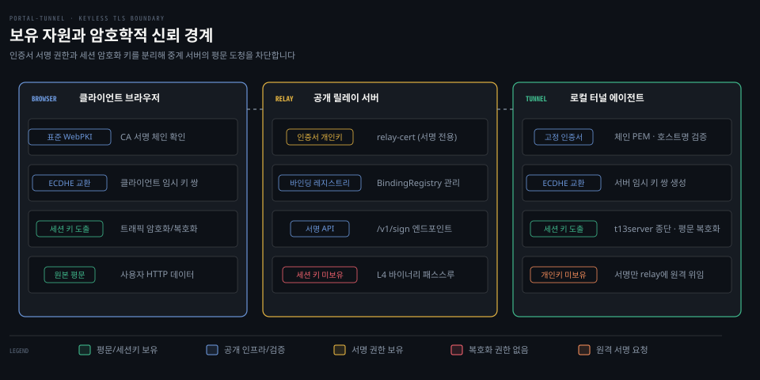
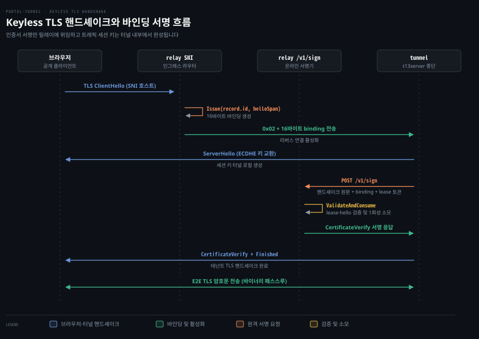

# keyless TLS

---

> 공개 중계 서버가 인증서 개인키를 쥐고 있으면서도 트래픽 평문을 보지 못하도록 핸드셰이크 서명과 세션 암호화를 분리하는 키리스 규약을 다룹니다.


## 평범한 에지 터널이 평문을 보게 되는 문제

> 공개 진입 프록시가 브라우저 TLS 세션을 직접 끝내면 내부망 터널을 아무리 암호화해도 중계 서버 메모리에 평문이 노출됩니다.

방화벽 안쪽의 사설 웹 서버를 외부에 공개할 때 ngrok이나 Cloudflare Tunnel 같은 일반적인 역방향 터널을 사용하면 네트워크 구간은 모두 암호화되어 전송됩니다. 하지만 이 구조에는 피하기 어려운 보안 경계의 취약점이 있습니다.

전형적인 에지 프록시는 인터넷 공개 접점(:443)에서 브라우저의 TLS 핸드셰이크를 직접 종료합니다. 그런 다음 HTTP 헤더와 본문을 파싱하여 어떤 내부 테넌트로 보낼지 확인하고 터널 에이전트와 미리 맺어 둔 별도의 암호화 세션으로 데이터를 다시 전달합니다.

네트워크 선로상에서는 두 구간 모두 암호문이지만 두 연결이 맞물리는 중계 서버의 프로세스 메모리에서는 사용자의 HTTP 요청 전체가 평문으로 노출됩니다. 중계 서버 운영자나 같은 인프라를 공유하는 악의적인 프로세스가 인증 토큰, 쿠키, 결제 데이터 같은 기밀 정보를 그대로 들여다보거나 변조할 수 있습니다.

포털 터널은 이 신뢰 문제를 해결하기 위해 릴레이가 브라우저의 암호문을 복호화하지 않고 순수 L4 바이너리 스트림으로 통과시키는 것을 기본 목표로 삼습니다. 브라우저와 로컬 터널 에이전트 사이에 직접 종단간 TLS 세션을 맺는 구조입니다.

여기서 어려운 문제가 생깁니다. 공용 웹 브라우저는 릴레이 도메인의 정식 인증서를 검증해야만 연결을 허용합니다. 그렇다고 릴레이의 와일드카드 인증서 개인키를 모든 로컬 터널 머신에 복제해 배포하면 터널 에이전트 하나만 침해당해도 전체 도메인의 인증서 개인키가 유출됩니다.

기준 커밋 0a3b9c06 (2026-10-14)


## 서명 키가 있어도 세션 키를 복호화하지 못하는 원리

> TLS 1.3의 암호화 키는 임시 키 교환에서 유도되므로 인증서 개인키로 서명만 해 주는 중계자는 트래픽 세션 키를 얻을 수 없습니다.

릴레이가 인증서 개인키로 서명을 대신 만들어 주면 릴레이가 사용자 통신까지 풀 수 있을 것처럼 보입니다. RSA 키 교환을 쓰던 TLS 1.2 이하에서는 실제로 서버 개인키로 사전 마스터 비밀(pre-master secret)을 직접 복호화할 수 있었습니다.

TLS 1.3(RFC 8446 §4.4.3)에서는 이 구조가 완전히 달라졌습니다. 서버 신원을 증명하는 `CertificateVerify` 메시지는 사전 마스터 비밀을 암호화하지 않습니다. 오직 그때까지 오간 핸드셰이크 트랜스크립트 전체의 암호학적 해시를 디지털 서명한 값만 담습니다.

RFC 8446 §4.4.1에 따르면 트랜스크립트 해시는 협상된 암호군의 해시 알고리즘을 따릅니다. `keyless_tls` 구현(`relay/signer/service.go:172-175`)은 지원 암호군을 `TLS_AES_128_GCM_SHA256`으로 고정하여 SHA-256으로 트랜스크립트 해시를 계산합니다.

```bash
# 디지털 서명 대상 = 64개 공백(0x20) + "TLS 1.3, server CertificateVerify" + 0x00 + SHA256(트랜스크립트)
```

반면 실제 트래픽을 암호화하고 복호화하는 세션 키는 ECDHE 임시 키 교환에서 독립적으로 유도됩니다. RFC 8446 §7.1의 키 스케줄에 따라 클라이언트와 서버가 각자의 임시 키 쌍으로 공유 비밀을 도출하고 HKDF 함수를 거쳐 트래픽 비밀키를 확정합니다.

서버 인증서 개인키는 이 키 유도 스케줄에 관여하지 않습니다. 인증서 개인키의 역할은 "지금 이 임시 공개키를 내놓으며 대화하고 있는 주체가 이 도메인의 진짜 소유자가 맞다"는 사실을 트랜스크립트에 서명하여 보증하는 데 그칩니다.

그래서 터널 에이전트는 로컬에서 생성한 ECDHE 비밀키를 외부에 유출하지 않고 간직합니다. 핸드셰이크 트랜스크립트 메시지 원문만 릴레이에 전달해 서명을 원격 요청하면 릴레이는 세션 키를 전혀 계산할 수 없습니다. 이것이 **키리스 TLS**(Keyless TLS)가 중계자에게 평문을 숨길 수 있는 암호학적 기초입니다.



위 도식에는 시스템 참여자들이 나누어 쥐는 자원과 암호학적 경계가 나와 있습니다. 브라우저와 터널 에이전트만이 ECDHE 임시 비밀과 트래픽 세션 키, 원본 평문을 보유합니다. 중앙의 릴레이는 와일드카드 인증서 개인키와 바인딩 검증 테이블만 관리할 뿐 세션 키를 생성할 수 없어 암호화된 바이너리 바이트 스트림만 통과시킵니다.


## 터널 에이전트의 로컬 TLS 종단과 인증서 고정

> 터널은 릴레이로부터 인증서 체인을 내려받아 도메인을 검증한 뒤 로컬 t13server 엔진으로 브라우저 TLS 세션을 종단합니다.

터널 에이전트는 인증서 개인키 없이 브라우저의 TLS 핸드셰이크를 로컬에서 종단합니다. 이 일은 `portal/keyless/client.go`에 구현된 전담 클라이언트가 맡습니다.

터널이 시작되면 `NewClient`(`portal/keyless/client.go:58`)는 먼저 릴레이 엔드포인트에서 인증서 체인을 받아 옵니다. `resolveMaterials`(`:189`)는 `utils.FetchEndpointCertificateChain`을 호출하여 릴레이가 제시하는 공용 인증서 체인 PEM을 가져옵니다. 네이티브 환경에서는 릴레이와 맺은 TLS 연결에서 상대방이 제시한 인증서(피어 인증서)를 읽어 오며 브라우저 환경에서는 `/sdk/certificate-chain` API 경로로 전달받습니다.

다운로드한 인증서 체인은 곧바로 검증을 거칩니다. `verifyCertificateHostname`(`:200`)은 리프 인증서가 자신이 임대한 호스트명(`config.Hostname`)을 올바르게 포함하는지 `leaf.VerifyHostname(hostname)`으로 확인합니다. 리프 인증서는 체인에서 CA 인증서가 아닌 실제 서버 인증서입니다. 릴레이가 엉뚱한 도메인의 인증서를 전달했다면 터널은 즉시 시작을 중단하고 실패합니다.

호스트명 검증을 통과한 인증서 체인은 클라이언트의 `relayCertPool`(`:85-89`)에 고정(Pinning)됩니다. 이후 터널 내부의 자체 검증 프로브나 후속 연결은 시스템 전역 신뢰 저장소가 아니라 이 고정된 풀을 기준으로 동작합니다.

인증서 체인이 준비되면 터널은 `t13server.NewServer`(`:102`)를 초기화합니다. Go 표준 라이브러리 `crypto/tls`도 `tls.Certificate.PrivateKey`에 커스텀 `crypto.Signer`를 주입하면 원격 서명이 가능하지만 표준 서명 인터페이스는 이미 계산된 다이제스트만 넘겨받습니다.

다이제스트만 받아서는 릴레이가 트랜스크립트 원문과 `ClientHello`를 대조하여 연결 바인딩을 검증할 수 없습니다. 그래서 포털 터널은 임의 다이제스트 서명 엔드포인트를 두지 않습니다. 대신 핸드셰이크 원문 메시지를 릴레이로 보내 트랜스크립트 바인딩을 직접 검증하는 전용 `t13server` 엔진을 사용합니다(`keyless_tls README:497,516,550`).

외부 브라우저의 요청이 들어와 역방향 소켓이 전달되면 터널은 `TerminateConn`(`portal/keyless/client.go:143`)을 호출합니다.

```go
func (c *Client) TerminateConn(ctx context.Context, raw net.Conn, binding []byte) (net.Conn, error) {
	if c == nil || c.server == nil {
		return nil, errors.New("keyless client is unavailable")
	}
	conn := c.server.NewConn(raw, binding)
	if err := conn.HandshakeContext(ctx); err != nil {
		_ = conn.Close()
		return nil, fmt.Errorf("tenant tls handshake: %w", err)
	}
	return conn, nil
}
```

`t13server.Server`는 원시 소켓과 16바이트 바인딩 값을 받아 TLS 핸드셰이크를 주도합니다. 서버 임시 ECDHE 키를 만들어 브라우저에 보내고 암호화 확장을 전달합니다. 서명이 필요한 시점에 도달하면 `remoteSigner`(`portal/keyless/client.go:91`)로 릴레이의 `/v1/sign` 엔드포인트에 서명을 요청합니다. 서명이 도착하면 핸드셰이크를 마무리하고 복호화된 스트림을 로컬 앱으로 넘깁니다.


## Relay 서명 API를 단일 활성 연결에 묶는 바인딩 메커니즘

> 릴레이가 임의의 데이터에 서명해 주지 않도록 인그레스에서 수신한 ClientHello와 1회용 바인딩으로 서명 권한을 제한합니다.

릴레이에 `/v1/sign` 서명 API가 열려 있으면 보안 위험이 따릅니다. 유효한 토큰을 쥔 터널 에이전트가 임의의 데이터를 보내 무조건 서명을 받아낸다면 릴레이는 다른 고객의 도메인을 사칭하거나 공격용 인증 토큰을 만들어 주는 서명 오라클(요청하면 무엇에든 서명해 주는 장치)이 됩니다.

포털 터널은 이 문제를 막기 위해 **연결 바인딩**(Connection Binding)이라는 상태 제약 메커니즘을 둡니다. 서명 요청이 인바운드 TCP 연결 하나에 묶여 있을 때만 서명을 허용하는 규약인데, 그 연결은 릴레이 인그레스에 실제로 들어와 지금 살아 있는 연결이어야 합니다.

### 바인딩의 발급과 전달

외부 브라우저가 도메인 접점(:443)으로 접속하여 TLS `ClientHello`를 전송하면 릴레이의 SNI 핸들러(`portal/server.go:1026-1050` `bridgeLeaseConn`)가 가동됩니다.

릴레이는 인그레스 버퍼에서 TLS 레코드 헤더를 빼고 브라우저 핸드셰이크 메시지를 재조립합니다. 이렇게 확보한 메시지(`helloSpan`, `keyless_tls relay/l4/clienthello.go:42-45`)는 4바이트 핸드셰이크 헤더를 포함합니다. 릴레이는 이 바이트열로 레지스트리에 바인딩을 발급합니다(`portal/server.go:1034`).

```go
binding := s.registry.bindings.Issue(record.id, helloSpan)
```

`BindingRegistry.Issue`(`portal/keyless/bindings.go:32`)는 난수로 16바이트 식별자를 생성한 뒤 수신한 `helloSpan`의 SHA-256 해시와 임대 ID, 만료 시각을 묶어 메모리 테이블에 저장합니다.

릴레이는 대기 중이던 터널의 리버스 연결을 확보한 뒤 `portal/transport/reverse_framing.go:16,64` 규약에 따라 `0x02`(`markerTLSStart`) 마커 뒤에 16바이트 바인딩을 실어 터널로 전송합니다. 터널은 역방향 소켓에서 이 값을 읽어 `TerminateConn`에 전달합니다.

외부 브라우저 인그레스가 아닌 캐시 미스 폴백(`portal/api_server.go:656-660,683`)에서는 릴레이 자신이 직접 TLS 클라이언트가 되어 터널에 접속합니다. 이때는 발급 시점에 라우팅된 브라우저 ClientHello가 없으므로 `Issue(record.id, nil)`로 바인딩을 보류 상태로 둡니다. 이후 릴레이가 첫 TLS 레코드를 쓰는 시점에 `FixHelloOnWrite`(`portal/keyless/bindings.go:48,183`)로 자신이 생성한 ClientHello 해시를 바인딩에 고정합니다.

### 서명 요청 검증과 ValidateAndConsume의 방어 조건

터널이 `POST /v1/sign`(`portal/api_server.go:620`)으로 서명을 청구하면 요청은 릴레이 서명기(`portal/keyless/signer.go:66`)로 전달됩니다.

서명 서비스(`keyless_tls relay/signer/service.go:109-116`)는 먼저 요청 메타데이터와 타임스탬프를 확인합니다. 타임스탬프는 허용 오차인 ±30초(`portal/keyless/signer.go:21`) 범위 안에 있어야 합니다.

서명기는 이어서 `TranscriptValidator`로 핵심 방어 함수인 `ValidateAndConsume`(`portal/keyless/bindings.go:69-96`)을 실행합니다. 이 함수가 대조하는 조건은 일곱 가지입니다.

1. **바인딩 길이 검증**: 전달된 바인딩 슬라이스가 정확히 16바이트인지 확인합니다(`:70-72`).
2. **ClientHello 본문 존재**: 서명 요청에 `clientHello` 슬라이스가 비어 있지 않은지 검사합니다(`:73-75`).
3. **존재 및 만료 여부 확인**: 테이블에 등록된 바인딩이어야 하며 `time.Now().Before(entry.expiresAt)` 조건을 만족해야 합니다(`:81-84`). 만료되었거나 등록되지 않은 바인딩은 즉시 거절합니다.
4. **임대 소유권 일치**: 서명 요청을 보낸 HTTP 인증 토큰의 `leaseID`와 바인딩 발급 당시의 `entry.leaseID`가 일치하는지 대조합니다(`:85-87`). 테넌트 A가 테넌트 B의 연결 바인딩을 도용할 수 없습니다.
5. **hello 사전 고정 확인**: 인그레스 또는 첫 기록 시점에 `entry.helloHash`가 정상적으로 고정되었는지 확인합니다(`:88-90`). 고정되지 않은 바인딩은 거절합니다.
6. **ClientHello 해시 일치**: 터널이 보낸 `req.ClientHello`(재조립된 핸드셰이크 메시지)의 SHA-256 해시를 계산하여 릴레이가 보관 중인 `entry.helloHash`와 정확히 같은지 대조합니다(`:91-93`).
7. **1회성 소모(`delete`)**: 검증이 끝나는 즉시 메모리 테이블에서 해당 바인딩 키를 영구 삭제합니다(`:94`).

이 제약 아래서 터널은 릴레이 인그레스에 실제로 들어오지 않은 연결에 쓸 서명을 요구할 수 없습니다. 터널이 ClientHello의 SNI, 지원 암호군, 클라이언트 난수 등을 임의로 조작하면 해시 불일치로 서명이 거절됩니다. 한 번 발급된 바인딩은 단 한 번의 서명에만 쓰이고 파기되므로 핸드셰이크 재생 공격도 불가능합니다. 만료되었으나 사용되지 않은 고아 바인딩은 백그라운드 타이머가 `SweepExpired`(`portal/keyless/bindings.go:106`)로 주기적으로 회수합니다.



위 시퀀스 다이어그램에는 브라우저 접속부터 종단간 패스스루 완성까지의 9단계가 담겨 있습니다. ClientHello가 들어오면 릴레이가 바인딩을 발급해 리버스 연결(`0x02`)로 보냅니다. 터널은 로컬에서 세션 키를 생성한 뒤 `/v1/sign`에서 단일 활성 연결 검증을 통과하여 서명을 획득합니다.

### 동기 원격 서명이 핸드셰이크에 더하는 지연 비용

키리스 구조에서 개인키를 격리하는 대가는 지연 비용입니다. 핸드셰이크 구간에 동기 네트워크 왕복이 추가되기 때문입니다. 표준 TLS 1.3 핸드셰이크에서는 서버가 로컬 개인키로 직접 서명하므로 내부 연산 지연만 발생합니다. 하지만 포털 터널의 테넌트 TLS는 원격 서명에 동기적으로 의존합니다.

패키지 주석(`portal/keyless/client.go:3,43,141`)이 명시하듯 터널 에이전트는 테넌트 TLS 핸드셰이크마다 릴레이의 `/v1/sign` 엔드포인트를 HTTP로 호출합니다. 터널은 릴레이로부터 원격 서명 응답을 먼저 받아야만 브라우저에 CertificateVerify 메시지를 전송하고 핸드셰이크를 계속 진행할 수 있습니다.

이 동기 의존 때문에 핸드셰이크 시간에 추가되는 지연은 터널과 릴레이 간의 네트워크 왕복 1회와 릴레이 측 서명 연산 시간의 합입니다. 브라우저와 릴레이와 터널을 잇는 통신 경로 자체가 이미 릴레이를 통과하므로 순수하게 늘어나는 지연분은 터널과 릴레이 사이의 왕복 1회와 서명 시간뿐입니다. 중앙 키 서버에 동기적으로 서명을 위임할 때 생기는 이 지연 특성은 [Cloudflare Keyless SSL 기술 분석](https://blog.cloudflare.com/keyless-ssl-the-nitty-gritty-technical-details/)에서도 핵심 상충 관계로 다룹니다.


## Delegated Credentials와 Merkle Tree Certificates의 한계

> 위임 자격증명은 릴레이의 사칭 권한을 박탈하지 못하고 양자 내성 암호 크기 부담으로 표준 도입이 지연되었으며 MTC는 다른 계층의 문제입니다.

웹 표준 진영에서도 중앙 인증서와 에지 간의 키 분리를 다루는 표준 규약들이 논의되어 왔습니다. 포털 터널이 그러한 표준안 대신 연결 바인딩 기반의 키리스 방식을 채택한 이유는 두 기술의 한계에서 드러납니다.

### Delegated Credentials의 한계

첫 번째 후보는 **위임 자격증명**(Delegated Credentials, RFC 9345)입니다. 부모 인증서 소유자가 단기 유효 공개키를 담은 자격증명(credential)에 서명해 주면 터널은 그에 대응하는 단기 개인키를 들고 브라우저와 핸드셰이크할 수 있습니다. 이때는 릴레이의 온라인 `/v1/sign` 호출 없이도 독립된 TLS 인증이 가능합니다.

그러나 위임 자격증명은 신뢰 경계를 근본적으로 좁히지 못합니다. 부모 인증서 개인키는 여전히 릴레이가 쥐고 있습니다. 그래서 악의적인 릴레이는 언제든지 스스로 또 다른 위임 자격증명을 찍어내거나 원본 인증서로 직접 브라우저를 맞이하여 테넌트를 사칭할 수 있습니다. 즉 '온라인 서명 통신'을 없애 줄 뿐 '릴레이에 대한 신뢰'를 없애지는 못합니다.

실무적으로는 브라우저 지원도 가로막혀 있습니다. 공식 프로젝트 537번 이슈에 따르면 크로미움 이슈 557778448에서 이 규약의 구현이 미계획인 P4 우선순위로 분류되었습니다. 포스트 양자 암호 체계로 넘어가면서 자격증명 크기 부담이 커졌기 때문입니다. 이슈 #537이 인용한 크로미움 이슈 557778448 피드백에 따르면 양자 내성 서명인 ML-DSA-44 적용 시 공개키 1,312바이트와 서명 2,420바이트가 더해져 핸드셰이크마다 약 3.7KB(3,732바이트)의 오버헤드가 발생합니다.

### Merkle Tree Certificates의 한계

두 번째로 거론되는 기술은 머클 트리 인증서(Merkle Tree Certificates, MTC)입니다. 이슈 #541에서 참조된 Cloudflare의 Chrome 연동 실험 등에 따르면 MTC는 CA가 서명한 머클 트리의 간결한 포함 증명(Inclusion Proof)으로 양자 내성 인증서 체인의 큰 크기를 줄이고 투명성을 높이는 기술입니다.

하지만 MTC는 인증서의 표현 및 배포 최적화 기술일 뿐 개인키 소유권 문제와는 무관합니다. 인증서 포맷이 아무리 가벼워지고 투명해지더라도 "인증서에 대응하는 비밀키를 릴레이가 쥐고 있는가, 터널이 쥐고 있는가"라는 아키텍처 경계는 그대로 남습니다. MTC를 도입한다고 해서 터널이 릴레이의 개입 없이 신뢰를 완전히 제거할 수는 없습니다.


## 여전히 Relay에 남는 신뢰와 ACME 로드맵

> 릴레이가 와일드카드 인증서 개인키를 소유하는 한 능동적 사칭 공격의 위험은 남으며 이를 궁극적으로 해결하는 길은 호스트별 직접 ACME 발급입니다.

포털 터널의 키리스 TLS는 중계 서버의 수동적 도청을 막습니다. 릴레이가 정직하게 소프트웨어를 실행하고 패스스루를 유지하는 한 어떤 암호문도 해독할 수 없습니다.

하지만 공식 보안 모델(`security-model.md` "Keyless Signing")과 README가 강조하듯 포털 터널은 릴레이 신뢰를 최소화했을 뿐 완전히 제거하지는 못했습니다. 인증서 개인키를 쥐고 있는 주체가 여전히 릴레이이기 때문입니다.

악의적인 릴레이 운영자가 시스템 코드를 수정하면 중간자 공격(MITM)을 감행할 수 있습니다. 들어오는 브라우저의 TLS 세션을 자신이 직접 종단하여 복호화한 뒤 터널로 새 연결을 열어 보내는 방식입니다. 브라우저는 릴레이가 제시하는 인증서가 유효하므로 경고 없이 통과합니다. 앞서 살펴본 연결 바인딩은 정직한 릴레이 코드가 터널 에이전트의 남용을 막는 장치일 뿐 개인키를 쥔 릴레이 운영자 자신의 악의적 변조까지 봉쇄하지는 못합니다.

### 능동적 방어: TLS Exporter 기반 자가 프로브

포털 터널 SDK는 이 사칭 위험을 감지하기 위해 **자가 프로브**(Self-Probe, `sdk/mitm.go`) 메커니즘을 내장합니다. 애플리케이션 트래픽이 시작되면 터널은 릴레이를 거쳐 자기 자신의 공개 호스트명으로 별도의 TLS 연결을 스스로 맺어 봅니다(`probeTLSPassthrough`, `sdk/mitm.go:125`).

이때 양 끝단은 RFC 8446 §7.5에 정의된 TLS 키 추출기(Exporter)를 사용하여 동일한 라벨과 문맥으로 키 값을 도출합니다(`probeExporter`, `sdk/mitm.go:44`). 릴레이가 트래픽을 있는 그대로 바이너리 중계했다면 양쪽은 동일한 단일 TLS 세션에 속하므로 도출된 Exporter 해시값이 일치합니다.

릴레이가 중간에서 TLS를 가로채 종단했다면 두 세션의 공유 비밀이 서로 다르므로 Exporter 값이 어긋납니다. 불일치가 감지되면 터널은 경고를 출력합니다.

`--ban-mitm` 옵션이 켜져 있다면 터널은 해당 릴레이 리스너를 즉각 닫습니다. 현재 노출 수명 동안에는 디스커버리 컨트롤러의 메모리 상태에서도 해당 릴레이 URL을 차단합니다(`portal/discovery/controller.go:78-79`, `docs/src/routes/security-model/+page.md:176-181`). 이 차단은 노출이 교체되거나 프로세스가 재시작되면 유지되지 않습니다. 표본 검사 특성상 모든 연결의 실시간 차단을 보장하지는 못합니다.

### 릴레이 신뢰 축소: 이슈 #541 호스트별 ACME 로드맵

릴레이에 남겨진 서명 신뢰를 대폭 줄이는 해결책은 호스트명별 인증서 발급과 개인키 소유권을 터널 머신 안으로 옮기는 것입니다.

이 방향성은 공개 이슈 [Portal #541](https://github.com/gosuda/portal-tunnel/issues/541) ("Roadmap: move tenant TLS toward per-hostname ACME identity and reduce relay-owned signing trust")에 구체적으로 제안되어 있습니다. Cloudflare CA나 Let's Encrypt 같은 자동화된 ACME 프로토콜을 활용하여 터널 에이전트가 로컬에서 자체 키 쌍을 생성하고 자신의 테넌트 서브도메인용 정식 WebPKI 인증서를 직접 발급받는 로드맵입니다.

이 로드맵이 실현되면 릴레이는 와일드카드 인증서나 서명 개인키를 보관하지 않게 되며 `/v1/sign` 엔드포인트 자체가 필요 없어집니다. 이슈 #541의 목표대로 릴레이는 외부 SNI를 읽어 역방향 소켓으로 연결해 주는 라우팅 및 데이터플레인 컴포넌트로 축소됩니다. 다만 이슈 #645와 #541이 짚듯 릴레이(Portal DNS)가 계속 도메인 존을 운영하는 한 DNS-01 방식의 발급 권한 신뢰는 여전히 별도의 고려 사항으로 남습니다. 이 전환은 릴레이의 서명 키 소유 신뢰를 제거하는 조치이지 모든 신뢰 요소를 일거에 소멸시키는 것은 아닙니다.


## 리뷰 노트

> 소스 코드와 공식 문서를 검토하며 확인한 설계상의 주의점과 개선 검토 사항입니다.

- **바인딩 메모리 생명주기와 폐기 누락 방지 (`portal/server.go:1034-1035`)**: 릴레이 인그레스는 `Issue` 직후 `defer s.registry.bindings.Discard(binding)`를 선언해 둡니다. 리버스 연결 획득 실패나 클레임 타임아웃(10초)으로 브리지가 중단되더라도 생성된 바인딩이 고아 메모리로 누수되지 않도록 설계되어 있습니다. 정상적인 핸드셰이크에서는 `ValidateAndConsume`이 먼저 바인딩을 소모(`delete`)하므로 `Discard`는 아무 일도 하지 않고 넘어갑니다(여러 번 불러도 결과가 같은 멱등 동작).
- **서명 본문 최대 용량 제한 (`portal/keyless/signer.go:24`)**: `/v1/sign` 핸들러는 `maxSignRequestBody = 512 << 10`(512 KiB)으로 바디 크기를 제한합니다. 트랜스크립트에 전체 인증서 체인 PEM이 포함되므로 넉넉한 예산을 배정하되 과도하게 큰 악의적 JSON 바디로 서명기 메모리를 고갈시키는 서비스 거부(DoS) 공격은 막습니다.
- **자가 프로브의 비동기성 한계 (`sdk/mitm.go:254`)**: 터널의 MITM Self-Probe는 초기 연결 수립 직후 백그라운드 고루틴(`maybeStart`)에서 비동기로 실행됩니다. 첫 번째 실제 사용자 트래픽은 프로브 결과가 나오기 전에 이미 흐르기 시작합니다. 그래서 `--ban-mitm`은 사후 차단 및 조기 경보 메커니즘이지 첫 패킷부터 중간자를 선제 방어하는 관문(Gate) 역할을 하지는 못하므로 릴레이 신뢰 모델을 이해하고 배포해야 합니다.


## 검증과 복습

> 이 문서에서 다룬 키리스 TLS의 핵심 원리와 보안 경계를 세 가지 질문으로 스스로 확인합니다.

1. **질문 1**: 릴레이 서버가 와일드카드 인증서의 개인키를 보유하고 터널 대신 서명을 만들어 주는데도 브라우저와 터널 사이의 애플리케이션 평문 트래픽을 복호화하지 못하는 암호학적 이유는 무엇입니까?
2. **질문 2**: 릴레이의 `/v1/sign` API가 아무 데이터나 마구 서명해 주는 기계로 오용되는 것을 방지하기 위해 `ValidateAndConsume`이 확인하는 조건들은 무엇이며, 이 값은 어떤 경로로 터널에 전달됩니까?
3. **질문 3**: 현재 구조에서 악의적인 릴레이 운영자가 감행할 수 있는 공격은 무엇이며, 터널 에이전트는 이를 어떻게 탐지하고 향후 이슈 #541 로드맵은 이를 어떻게 축소합니까?


## 정답 (자답 후 펼치기)

> 위 세 가지 질문에 대한 해답과 코드 근거입니다.

1. **정답 1**: TLS 1.3에서 실제 트래픽을 암호화하는 세션 키는 ECDHE 키 교환으로 유도됩니다. 인증서 개인키는 오직 트랜스크립트 서명(`CertificateVerify`)에만 사용됩니다(RFC 8446 §4.4.3, §7.1). 터널이 ECDHE 비밀키를 외부에 유출하지 않고 핸드셰이크 원문 메시지만 전달하는 한 릴레이는 서명을 제공하더라도 세션 키를 계산할 수 없습니다.
2. **정답 2**: 릴레이는 인그레스의 ClientHello 핸드셰이크 메시지(`helloSpan`)를 해시해 16바이트 바인딩을 발급하고 리버스 연결의 `0x02` 뒤에 실어 보냅니다(`portal/transport/reverse_framing.go:16,64`). 터널이 `/v1/sign`으로 핸드셰이크 원문 메시지들을 전달하면 `ValidateAndConsume`(`portal/keyless/bindings.go:69`)이 일곱 가지 조건을 검증합니다. 16바이트 규격, 본문 존재, 만료 여부, 임대 ID, hello 고정 여부, 해시 일치, 1회성 소모를 확인해 활성 연결에 묶인 서명만 허가합니다.
3. **정답 3**: 릴레이가 인증서 개인키를 쥐고 있으므로 릴레이 운영자가 코드를 변조하여 브라우저의 TLS를 직접 종단하고 터널로 재연결하는 중간자(MITM) 공격을 감행할 수 있습니다. 터널은 이를 감지하기 위해 비동기 Self-Probe(`sdk/mitm.go`)를 띄워 양 끝단의 TLS Exporter(RFC 8446 §7.5) 값을 대조합니다. 향후 이슈 #541 로드맵은 ACME 프로토콜로 호스트별 인증서와 개인키를 터널 머신에서 직접 발급·소유하게 만듭니다. 이렇게 해서 릴레이의 서명 키 보유 신뢰를 제거하고 릴레이를 주로 L4 라우팅 데이터플레인으로 축소합니다(단, 릴레이가 DNS 존을 운영하는 한 발급 권한 신뢰는 별도로 남습니다).


## 출처와 관련 문서

- [portal-tunnel 기준 커밋 소스 트리](https://github.com/gosuda/portal-tunnel/tree/0a3b9c06): 기준 커밋 0a3b9c06 소스 코드
- [Portal Keyless TLS 가이드](https://gosuda.github.io/portal-tunnel/keyless-tls): 공식 키리스 TLS 아키텍처 및 핸드셰이크 다이어그램
- [Portal 보안 모델 문서](https://gosuda.github.io/portal-tunnel/security-model): 릴레이 신뢰 축소 및 모드별 보안 경계
- [gosuda/keyless_tls 저장소](https://github.com/gosuda/keyless_tls): Go 기반 키리스 TLS 1.3 엔진(`t13server`) 및 원격 서명 SDK
- [Portal GitHub 이슈 #541](https://github.com/gosuda/portal-tunnel/issues/541): 호스트별 ACME identity 도입 및 릴레이 서명 신뢰 제거 로드맵
- [Cloudflare Keyless SSL 기술 분석](https://blog.cloudflare.com/keyless-ssl-the-nitty-gritty-technical-details/): 원격 키 서버 동기 서명 및 핸드셰이크 지연 분석
- `portal/keyless/client.go`: 터널 측 TLS 종단 및 인증서 고정 구현
- `portal/keyless/bindings.go`: 연결 바인딩 발급, 해시 고정, 단일 소모 레지스트리 구현
- `portal/keyless/signer.go`: 릴레이 측 트랜스크립트 서명 핸들러 및 정책 검증기
- `sdk/mitm.go`: RFC 8446 §7.5 TLS Exporter 기반 중간자 탐지 프로브 구현
