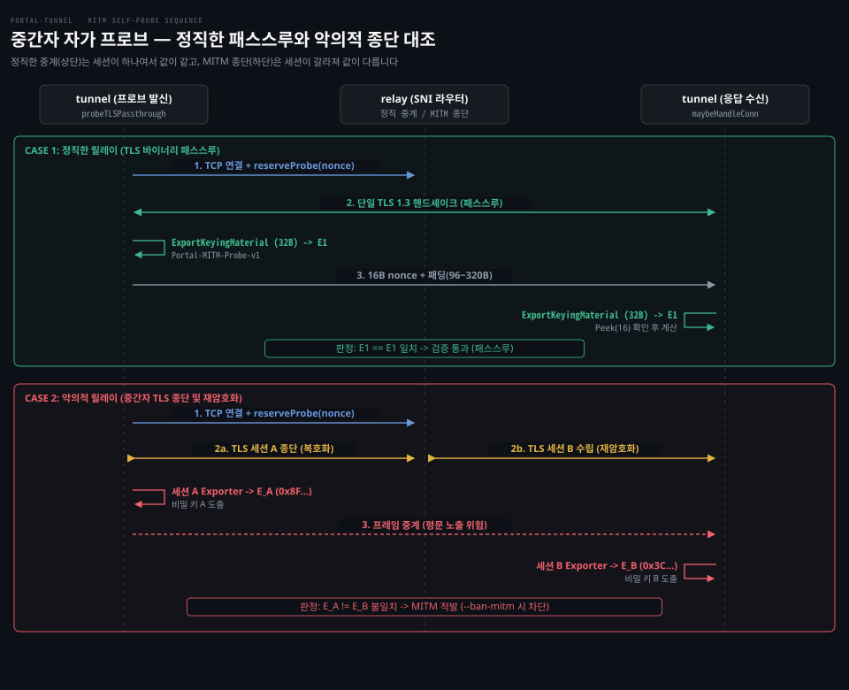

# MITM self-probe

---

> 릴레이의 악의적인 TLS 가로채기(종단 후 재암호화)를 런타임에 능동적으로 감지하는 자가 프로브 메커니즘과 TLS exporter의 검증 원리를 다룹니다.


## 릴레이의 TLS 종단 의혹과 TLS Exporter

> 릴레이가 패스스루 약속을 어기고 세션을 중간에서 가로채면 같은 암호학적 비밀에서 도출되는 TLS 키 재료 추출기 값이 어긋납니다.

터널 에이전트와 외부 브라우저는 릴레이를 거쳐 종단간 암호화 통신을 한다고 가정합니다. 그런데 릴레이 서버는 네트워크 중간에서 패킷을 직접 전달하는 물리적 위치에 있습니다. 악의적인 릴레이 운영자가 자체 인증서를 끼워 넣어 클라이언트 연결을 가로채는 상황을 가정해 봅니다. 릴레이가 앞뒤로 별도의 TLS 연결을 맺고 평문을 보거나 바꾸는 중간자 공격(MITM)을 해도, 터널 에이전트가 받은 HTTP 평문이나 TCP 페이로드만으로는 중간에서 재암호화가 일어났는지 판별할 수 없습니다. 터널이 받는 바이트 스트림은 겉보기에 정상적인 요청과 똑같기 때문입니다.

표준 TLS는 이 문제를 풀 수단으로 **키 재료 추출기**(TLS Exporter) 규약을 제공합니다. TLS 1.2는 RFC 5705, TLS 1.3은 RFC 8446 §7.5에 정의되어 있습니다. TLS 핸드셰이크가 성공하면 양 끝단(클라이언트와 서버)은 동일한 마스터 비밀을 공유합니다. Exporter 인터페이스는 이 비밀과 애플리케이션 식별 라벨, 컨텍스트 값, 원하는 바이트 길이를 입력받아 의사난수 바이트열을 도출합니다.

동일한 TLS 세션을 공유하는 양 끝단은 같은 마스터 비밀과 라벨을 입력받아 결정론적인 HKDF 도출(RFC 8446 §7.5)을 거치므로 언제나 같은 바이트열을 추출합니다. 반면 중간에서 릴레이가 연결을 종단하고 재암호화했다면 클라이언트와 릴레이 사이의 세션과 릴레이와 터널 사이의 세션은 독립적인 Diffie-Hellman 키 교환을 거쳐 서로 다른 비밀을 가집니다. 두 세션에서 각각 추출한 32바이트 Exporter 값이 우연히 일치할 확률은 암호학적으로 무시할 수 있을 만큼 작습니다.

Go 언어 표준 라이브러리 `crypto/tls`는 `tls.ConnectionState.ExportKeyingMaterial` 메서드를 제공합니다. 포털 터널은 소스코드 `sdk/mitm.go:38-40`에서 이를 추상화한 `keyingMaterialExporter` 인터페이스를 선언합니다.

```go
type keyingMaterialExporter interface {
	ExportKeyingMaterial(label string, context []byte, length int) ([]byte, error)
}
```

포털 터널의 커스텀 TLS 스택은 `keyless_tls` 패키지입니다. 이 패키지의 연결은 RFC 8446 §7.5를 직접 만족해 이 인터페이스를 구현합니다. Go 표준 `crypto/tls.Conn`은 내부 콜백 필드가 비공개(unexported)라서 외부에서 직접 채울 수 없습니다. 그래서 `sdk/mitm.go:47-58`의 `probeExporter` 함수가 연결 타입을 판별해 `ConnectionState().ExportKeyingMaterial`을 호출하도록 분기합니다.

기준 커밋 129b6de5 (2026-10-20)


## 자가 프로브의 발화와 수신 대조 흐름

> 터널이 자기 공개 도메인으로 직접 시험 연결을 걸고 양 끝단에서 32바이트 키 재료를 추출하여 패스스루 여부를 대조합니다.

외부 사용자의 연결에 임의의 시험용 암호 데이터를 주입하면 사용자 웹 트래픽이 손상됩니다. 그래서 터널 에이전트가 스스로 클라이언트 역할을 맡아야 합니다. 릴레이를 거쳐 자기 자신에게 돌아오는 가상 연결을 시험하면 일반 사용자 트래픽에는 영향을 주지 않습니다. 이것이 포털 터널의 **중간자 자가 프로브**(MITM Self-Probe)입니다.

주요 상수는 `sdk/mitm.go:60-71`에 선언되어 있습니다.

| 상수 이름 | 설정값 | 코드 위치 | 주 목적 |
|---|---|---|---|
| `mitmProbeExporterLabel` | `"Portal-MITM-Probe-v1"` | `sdk/mitm.go:61` | 키 재료 도출용 전용 라벨 문자열 |
| `mitmProbePeekTimeout` | `100 * time.Millisecond` | `sdk/mitm.go:62` | 수신 측 16바이트 논스 엿보기 타임아웃 |
| `mitmProbePaddingMin` | `96` | `sdk/mitm.go:63` | 프로브 프레임 최소 난수 패딩 바이트 |
| `mitmProbePaddingMax` | `320` | `sdk/mitm.go:64` | 프로브 프레임 최대 난수 패딩 바이트 |
| `defaultMITMProbeInterval` | `45 * time.Second` | `sdk/mitm.go:66` | 프로브 시도 평균 간격 및 토큰 보충 주기 |
| `defaultMITMProbeMaxDelay` | `120 * time.Second` | `sdk/mitm.go:67` | 지수 난수 지연 및 실패 백오프 최대 상한 |
| `defaultMITMProbeRetryDelay` | `30 * time.Second` | `sdk/mitm.go:68` | 결론 미도달 시 초기 재시도 백오프 지연 |
| `defaultMITMProbeTimeout` | `30 * time.Second` | `sdk/mitm.go:69` | 프로브 소켓 연결 및 핸드셰이크 전체 제한 시간 |
| `mitmProbeBurst` | `3` | `sdk/mitm.go:70` | 토큰 버킷 최대 버스트 허용 횟수 |

자가 프로브는 외부 방문자 트래픽 유입을 기다리지 않고 독립된 백그라운드 루프로 동작합니다. 활성 임대마다 워커 고루틴 하나가 배정됩니다. `runLease`는 `probeReady := make(chan struct{}, 1)` 채널을 생성한 뒤 `l.mitmManager.run(leaseCtx, probeReady)`를 백그라운드 워커로 실행합니다(`sdk/listener.go:577-582`).

리버스 세션 루프(`runReverseSessionLoop`)가 스트림 준비를 보고한 직후 `probeReady` 채널로 비차단 신호를 전송합니다(`sdk/listener.go:674-677`). 임대가 종료되면 `runLease`가 컨텍스트를 취소하고 워커 종료를 대기(`workers.Wait()`)한 뒤 다음 임대로 진입하므로 시도와 결과가 임대 수명을 넘나들지 않습니다(`sdk/mitm.go:260-261`).

리스너의 연결 수락(`Accept`, `sdk/listener.go:430-458`)은 0a3b9c06 까지의 구현과 달리 연결을 `mitmProbeConn`으로 감싸 I/O 시점에 프로브를 트리거하지 않습니다. `maybeHandleConn`으로 프로브 여부만 판별한 뒤 상위 애플리케이션 연결을 반환합니다(`sdk/listener.go:445-456`).

`run` 워커 루프(`sdk/mitm.go:262-305`)는 다음 순서로 검사와 스케줄링을 수행합니다.

1. `responderCapable`이 거짓이거나 정적 캐시 모드(`l.cache != nil`) 또는 브라우저/WASM 환경(`runtime.GOOS == "js"`)이면 즉시 루프를 마칩니다(`sdk/mitm.go:266`). 정적 캐시는 릴레이의 TLS 종단을 명시적으로 허용하는 모드이므로 검증하지 않습니다.
2. 최초 기동 시 리버스 세션 슬롯이 준비되어 `ready` 신호가 도착할 때까지 대기합니다(`sdk/mitm.go:268-272`).
3. 토큰 버킷 `rate.NewLimiter(rate.Every(45 * time.Second), 3)`으로 시도 속도를 제어합니다(`sdk/mitm.go:274`).
4. 준비된 리버스 연결 수(`l.readySessions.Load() > 0`)를 확인합니다(`sdk/mitm.go:277`). 리버스 연결이 하나도 없으면 시도를 건너뜁니다.
5. 토큰 예산을 기다린 뒤(`budget.Wait(ctx)`, `sdk/mitm.go:278`) `probeTLSPassthrough(ctx)`를 직렬로 실행합니다(`sdk/mitm.go:281`).
6. 결과를 기록합니다(`logResult`, `sdk/mitm.go:285`). 에러나 타임아웃(`MITMProbeReasonProbeTimeout`) 등 결론이 나지 않으면 30초부터 시작해 2배씩 늘어나는 백오프(최대 120초)를 둡니다(`sdk/mitm.go:286-291`). 비교가 완료되면 백오프를 0으로 되돌립니다.
7. 다음 간격은 평균 45초의 지수분포 난수를 120초 상한으로 자른 값과 실패 백오프 중 더 큰 쪽을 택해 대기합니다(`sdk/mitm.go:299-301`).

공식 보안 모델 문서(`docs/src/routes/security-model/+page.md:205-209`)는 이 스케줄을 상한·토큰 예산·실패 백오프·프로브 실행 시간이 결합된 **유계 갱신 일정**(bounded renewal schedule)으로 규정합니다. 순수 포아송 과정이 아니므로 실제 시도 간 평균이 정확히 45초로 떨어지지 않습니다. 또한 무작위 간격을 주더라도 터널의 출발지 IP나 Go 언어 TLS 핑거프린트 자체를 숨길 수는 없습니다.

워커가 프로브를 시작하면 `probeTLSPassthrough`(`sdk/mitm.go:125-237`)가 동작합니다. 먼저 암호학적 난수로 16바이트 논스(`mitmProbeNonce`, 한 번만 쓰고 버리는 값)를 생성하고(`sdk/mitm.go:153-156`) 릴레이로 TCP 연결을 수립합니다(`sdk/mitm.go:177`). 연결 직후 소켓 데드라인을 프로브 데드라인과 연동하고(`sdk/mitm.go:183-186`) 취소 콜백(`context.AfterFunc`, `sdk/mitm.go:187-188`)을 등록해 타임아웃 시 소켓 I/O를 즉시 종료합니다.

TCP 연결이 맺어지면 TLS 핸드셰이크 전에 `m.reserveProbe(nonce)`를 호출해 논스를 등록합니다 (`sdk/mitm.go:195`). 역방향 수신 리스너는 핸드셰이크 직후 연결을 수락해 패킷을 읽습니다. 논스를 미리 등록하지 않으면 이 읽기가 클라이언트 측의 Exporter 계산보다 앞서는 경합이 생길 수 있습니다 (`sdk/mitm.go:190-194`).

핸드셰이크가 끝나면 클라이언트 측에서 32바이트 Exporter 값을 도출합니다 (`sdk/mitm.go:202`). 이 값을 `m.attachExpected(nonce, expected)`로 예약 엔트리에 연결합니다. 이어 96바이트에서 320바이트 사이의 무작위 패딩을 생성해 `[16바이트 nonce] + [패딩]` 형태의 프레임을 만들고 TLS 스트림으로 전송합니다.

패딩을 붙이는 것은 릴레이가 고정된 크기의 프로브 패킷 메타데이터를 식별하지 못하게 하려는 것입니다. 릴레이가 16바이트 크기만 보고 프로브 연결을 눈치채면 그 연결만 정직하게 통과시키고 실제 사용자 트래픽만 가로챌 수 있는데, 패딩은 이런 기만을 억제합니다. 다만 공식 보안 모델 문서(`docs/src/routes/security-model/+page.md:200-203`)에서 밝히듯 난수 패딩이 프로브와 일반 트래픽의 완전한 구별 불가능성을 보장하는 것은 아닙니다.

릴레이를 거쳐 돌아온 연결은 터널 리스너의 `maybeHandleConn`(`sdk/mitm.go:363-412`)이 판별합니다. 100밀리초 이내에 앞부분 16바이트를 엿봅니다(`reader.Peek(16)`). 읽은 바이트가 대기 중인 논스와 다르면 일반 사용자 트래픽이므로 버퍼된 리더와 함께 상위 애플리케이션으로 넘깁니다.

등록된 논스와 일치하면 프로브 연결로 확정합니다. 수신 측도 똑같이 32바이트 Exporter 값을 추출하고 `m.completeProbe(nonce, actual)`를 호출해 기대값과 일치하는지 비교합니다. 대조를 마친 프로브 소켓은 즉시 닫히며 상위 애플리케이션에는 노출되지 않습니다.



위 시퀀스 도식은 정직한 릴레이와 악의적인 릴레이가 프로브를 처리하는 경로를 위아래 두 경우로 나눠 대조합니다. 상단의 정직한 릴레이는 암호화 패킷을 그대로 전달하므로 클라이언트와 서버가 단일 TLS 1.3 세션을 공유하고 동일한 32바이트 키 재료를 도출합니다. 하단의 악의적인 릴레이는 세션을 중간에서 종단하고 재암호화하므로 세션 A와 세션 B의 암호학적 비밀이 갈라집니다. 양 끝단의 키 재료가 어긋나므로 릴레이가 프로브 연결을 종단하면 무단 감청이 곧바로 적발됩니다.


## 판정 결과 기록과 릴레이 차단 정책

> 단순 통신 장애와 악의적인 암호학적 불일치를 분리하여 처리하며 차단 옵션 활성화 시 해당 릴레이를 즉시 격리합니다.

프로브가 끝나면 `sdk/mitm.go:307-361`의 `logResult` 메서드가 결과를 세 가지 유형으로 나누어 처리합니다.

```go
switch {
case closed:
	return
case err != nil:
	// 에러 처리 및 경고 로그
case report.Reason == types.MITMProbeReasonProbeTimeout:
	// 타임아웃 경고 로그
case report.Detected:
	// MITM 의혹 적발 및 차단 처리
default:
	// 검증 통과 디버그 로그
}
```

첫 번째 유형은 타임아웃(`types.MITMProbeReasonProbeTimeout`) 또는 일시적 네트워크 장애입니다. 패킷 유실이나 지연은 중간자 공격의 결정적 증거가 될 수 없습니다. 그래서 공식 보안 모델 문서(`docs/src/routes/security-model/+page.md:185-186`)에 명시된 대로 경고 로그(`log.Warn()`)만 기록하고 릴레이를 차단하지 않습니다(`sdk/mitm.go:325-339`).

정상 통과(`!report.Detected`)라면 디버그 로그(`log.Debug()`, `"tls passthrough self-probe passed"`)를 남깁니다(`sdk/mitm.go:354-359`). 비교가 완료되면 재시도 백오프를 0으로 초기화하고 평균 45초의 지수분포 표본(최대 120초 상한)으로 다음 대기 간격을 결정합니다(`sdk/mitm.go:293, 299-300`).

Exporter 불일치가 적발된 경우(`report.Detected`)에는 릴레이의 무단 TLS 종단 의혹을 경고 로그로 기록합니다. 이때 `--ban-mitm` (환경 변수 `BAN_MITM`) 플래그가 설정되어 있다면 터널은 해당 릴레이를 격리합니다(`sdk/mitm.go:347-351`).

터널 리스너는 `RelayFailed` 상태와 `RelayFailureMITM` 실패 코드를 발행하고 소켓을 즉시 닫습니다 (`l.Close()`). 이 조치로 현재 노출(Exposure) 범위 안에서 해당 릴레이와의 리버스 연결이 모두 종료됩니다.

동적 릴레이 탐색(Discovery)이 활성화되어 있다면 격리 범위가 탐색 풀 전체로 넓어집니다. SDK의 `Exposure`는 `RelayFailureMITM`을 디스커버리 전용 실패 유형인 `discovery.FailureMITM`으로 변환해 보고합니다 (`sdk/expose.go:689-690`). 디스커버리 컨트롤러(`portal/discovery/controller.go:78-79`)는 `c.relaySet.BanRelayURL(relayURL)`을 호출해 해당 릴레이를 영구 차단 목록에 등록합니다.

일반 런타임 오류는 일시적 백오프 후 재시도 기회를 얻지만 MITM 차단에는 백오프 유효기간이 없습니다. 주기적 새로고침이나 재탐색이 일어나도 배제 상태가 유지됩니다 (`docs/src/routes/security-model/+page.md:179-182`). 사용자가 `AddRelay()`를 수동 호출하기 전까지 복구되지 않습니다. 또한 두 차단 모두 exposure가 교체되거나 프로세스가 재시작되면 사라집니다.

터널을 기동할 때도 엄격한 방어 검사가 동작합니다. 사용자가 `--ban-mitm`을 켰는데 테넌트 TLS 스택이 Exporter를 지원하지 않으면 `sdk/listener.go:1155`(`ensureMITMProbeSupport`, `sdk/mitm_test.go:197-240`)에서 기동이 거부됩니다. 정적 캐시 모드(`--cache`)와 함께 지정한 경우에도 기동 단계(`sdk/expose.go:226`, `cmd/portal-tunnel/tunnel/runtime.go:102`)에서 에러를 내며 종료됩니다. 검증할 수 없는 보호를 약속하지 않으려는 설계입니다.


## 표본 검증의 본질적 한계와 적응형 회피

> 주기적 표본 검사 방식은 다른 연결의 무결성을 증명하지 못하며 지능적인 릴레이의 선별적 감청을 완벽히 차단하기 어렵습니다.

자가 프로브가 성공했다고 해서 릴레이가 앞으로 중계할 모든 사용자 트래픽을 정직하게 다룬다고 확신할 수는 없습니다. 공식 보안 모델 문서(`docs/src/routes/security-model/+page.md:188-226`)와 오픈소스 이슈 토론에서 확인된 주요 한계는 다음과 같습니다.

### 표본 연결 검증의 국소성

프로브의 성공은 방금 실행된 그 단 하나의 표본 연결이 암호학적으로 통과했다는 증거일 뿐입니다. 실제 사용자 트래픽은 프로브 통과를 기다리지 않고 비동기로 처리됩니다. 그래서 선택적 중간자 공격(Selective MITM)은 즉시 감지하기 어렵습니다. 릴레이가 대부분의 일반 사용자 연결은 복호화하면서 간헐적으로 유입되는 연결만 그대로 통과시키는 공격입니다.

### 적응형 릴레이 회피 한계 (이슈 #645)

악의적인 릴레이가 프로브 연결의 특성을 학습하여 회피할 가능성을 다룬 이슈 #645("adaptive relay evasion")는 2026-10-19 "not planned"로 닫혔습니다. 메인테이너는 적응형·선택적 회피를 시스템의 알려진 한계로 남기기로 결정했습니다. 추가 위장(camouflage) 실험 PR #663도 충분한 효과가 입증되지 않아 병합하지 않았습니다.

프레임을 통과시키는 릴레이는 TLS 암호문만 보므로 복호화 전에는 내부 페이로드 구조를 볼 수 없습니다. 하지만 릴레이는 종단 여부를 결정하기 전에 에이전트 출발지 IP, ClientHello 핑거프린트, 트래픽 유입 타이밍과 빈도, 난수 패딩에도 불구하고 노출되는 초기 레코드 크기 등의 외부 메타데이터를 관찰할 수 있습니다.

ClientHello 핑거프린트는 암호 스위트와 확장 목록 순서로 클라이언트 종류를 가려내는 지문입니다. 릴레이가 이러한 메타데이터를 학습하면 프로브 연결만 정상 패스스루하고 일반 트래픽만 가로챌 수 있습니다. 무작위 간격과 패딩도 네트워크 지문을 완전히 가리지 못하므로 적응형 회피가 구조적 한계로 남습니다.

### 임대별 백그라운드 프로브 도입과 검증 (PR #647 병합)

0a3b9c06까지의 구현에서는 연결 수락 시 첫 읽기나 쓰기가 일어날 때만 프로브를 시작했습니다. 따라서 방문자 유입이 없거나 장기 연결만 유지되는 유휴 노출 상태에서는 프로브가 돌지 않아 점검 사각지대가 생겼습니다. 커밋 11654823(PR #647)은 임대마다 독립된 백그라운드 워커를 두어 방문자 요청 없이도 리버스 세션 준비 직후 첫 프로브를 보내고 유계 갱신 일정으로 정기 검증을 지속하도록 개편했습니다.

엔드투엔드(e2e) 테스트 스위트도 이 동작 변경을 확인합니다. 과거 `TestMITMSelfProbeRunsOnTenantTraffic`은 방문자 트래픽이 필수였습니다. 이 테스트는 방문자 요청 없이도 판정이 나오는 `TestMITMSelfProbeRunsWithoutTenantTraffic`(`e2e/mitm_test.go:60`)으로 대체되었습니다. 또한 새 테스트 파일 `e2e/mitm_relay_test.go`를 통해 두 가지 핵심 불변식을 검증합니다.

1. `TestMITMTerminationExcludesRelay`(`:138`): 방문자 요청이 없는 상태에서도 무단 TLS 종단을 자가 프로브가 적발하는지 검증합니다. 적발 시 `RelayFailed` 상태와 `RelayFailureMITM` 코드로 해당 릴레이를 배제합니다.
2. `TestMITMProbeFailureBudget`(`:160`): 프로브 핸드셰이크를 거부하는 릴레이를 검증합니다. 방문자 요청 10개가 연속 유입되어도 실패 재시도 예산이 초과되지 않고 1회로 제한되며 MITM 오판정 없이 서비스가 정상 유지되는지 확인합니다.

### 호스트명 잔존과 독립된 신원 검증 한계

공식 보안 모델 문서(`docs/src/routes/security-model/+page.md:183-184, 221-225`)는 프로브 메커니즘 밖에서 발생하는 두 가지 보안 한계를 명시합니다.

첫째, 터널 프로세스를 닫아 연결을 종료하더라도 릴레이가 발급받은 인증서를 폐기하거나 공개 호스트명을 회수하지 않습니다(`:183-184`). 악의적인 릴레이 운영자는 터널이 내려간 뒤에도 공개 URL에서 위조된 웹 페이지를 계속 제공할 수 있습니다.

둘째, 프로브 회피 공격에 맞서 엔드포인트를 안전하게 보호하려면 릴레이 통제권 밖의 독립적인 경로로 획득한 서버 신원과 검증 코드가 필수적입니다(`:221-225`). 만약 릴레이가 해당 호스트명의 유효한 인증서를 독자적으로 발급받거나 보유할 수 있다면, 터널 소유의 키만으로는 중간자 공격을 완벽히 방어할 수 없습니다(열린 이슈 #541).

### 환경적 제약

브라우저 및 WASM 환경에서는 운영체제 수준의 네이티브 소켓 기반 자가 프로브를 실행할 수 없어 이 옵션을 요청할 수 없습니다 (`docs/src/routes/security-model/+page.md:213-214`).


## 리뷰 노트

> 소스 코드와 공식 문서를 대조하며 확인한 주의점과 개선 검토 사항입니다.

- **방문자 유휴 시 프로브 미동작 문제 (129b6de5 에서 해결(#647))**: 이전(0a3b9c06)에는 수락된 연결의 첫 I/O 시점에만 프로브를 시작하여 방문자 트래픽이 없으면 검증 사각지대가 생겼습니다. 커밋 11654823(PR #647)에서 임대별 독립 백그라운드 루프(`sdk/listener.go:577-582`, `sdk/mitm.go:262-305`)로 개편되었습니다. 리버스 세션 준비 신호를 받으면 방문자 유입 없이도 유계 갱신 일정에 따라 프로브가 주기적으로 동작합니다.
- **Peek 타임아웃 100ms와 비정상 프레임 유입 추정 (`sdk/mitm.go:62, 382-383`)**: `maybeHandleConn`은 16바이트 논스 확인에 100ms 데드라인을 둡니다. 클라이언트는 Finished 직후 프레임을 바로 쓰므로(`sdk/mitm.go:197-224`) 100ms 안에 오지 않을 가능성은 드뭅니다. 하지만 극단적인 WAN 지연이 발생하면 프로브 연결임에도 일반 연결(`wrapBufferedConn`)로 오인되어 상위 핸들러로 전달될 수 있습니다. 이때 상위 애플리케이션이 HTTP 서버라면 규격에 맞지 않는 바이트열로 인해 400 Bad Request 등의 에러를 낼 수 있습니다. 프로브 클라이언트 쪽은 30초 타임아웃 경고를 유발할 것으로 추정됩니다.
- **프로브 완료 직후 즉시 연결 폐쇄와 TCP RST 우려 (`sdk/mitm.go:398`)**: `maybeHandleConn`은 논스 매칭과 Exporter 계산을 마친 직후 `defer conn.Close()`로 연결을 즉시 닫습니다. 프로브 클라이언트가 아직 패딩을 마저 전송 중이거나 소켓 버퍼에 잔여 데이터가 남아 있을 때 즉시 소켓을 닫으면 TCP 연결이 FIN이 아닌 RST로 끊어질 수 있습니다. 그러면 클라이언트 측에 비정상적인 전송 오류가 생길 수 있으므로 그레이스풀 셧다운 점검이 필요합니다.
- **미무장 상태의 fail-closed 검증 (`sdk/mitm.go:195, 206`, `sdk/mitm_test.go:61`)**: 논스 예약은 TCP 연결 직후 일어나고 `attachExpected`는 핸드셰이크 후에 호출됩니다. 정상 경로에서는 클라이언트가 `attachExpected`(:206)를 마친 뒤에야 논스 프레임을 쓰고(:224), 수신 측은 그 난수 논스를 읽어야만 `completeProbe`(:410)를 호출하므로 인과 순서가 보장되어 레이스가 일어나지 않습니다. 미무장 테스트는 레이스 증거가 아니라 기대값이 채워지지 않은 상태에서 프로브가 완료되더라도 통과되지 않고 불일치로 처리되도록 강제하는 fail-closed 검증입니다.


## 검증과 복습

> 이 문서에서 배운 핵심 동작 규약을 세 가지 질문으로 스스로 확인합니다.

1. **질문 1**: 릴레이가 클라이언트와의 연결을 중간에서 가로채 종단(MITM)하고 터널과 새 TLS 연결을 맺었을 때, 터널의 프로브 클라이언트와 수신 리스너가 호출한 TLS Exporter 값은 왜 암호학적으로 일치할 수 없습니까?
2. **질문 2**: 터널 에이전트는 프로브 프레임에 왜 96~320바이트의 무작위 패딩을 붙입니까? 그리고 논스 예약(`reserveProbe`)을 TLS 핸드셰이크 전에 미리 수행하는 이유는 무엇입니까?
3. **질문 3**: 프로브 타임아웃과 Exporter 불일치 발생 시 `--ban-mitm` 옵션의 대응 동작은 어떻게 다릅니까? 그리고 discovery 컨트롤러의 영구 차단 동작은 어떻게 이어집니까?


## 정답 (자답 후 펼치기)

> 위 세 가지 질문에 대한 해답과 코드 근거입니다.

1. **정답 1**: RFC 8446 §7.5(TLS 1.3) 규약에 따라 Exporter 값은 해당 TLS 세션의 `exporter_master_secret`에서 결정론적 HKDF로 도출되기 때문입니다. 릴레이가 중간에서 종단 및 재암호화하면 앞뒤 두 세션은 독립적인 키 교환을 거쳐 서로 다른 마스터 비밀을 갖게 됩니다. 동일한 라벨(`"Portal-MITM-Probe-v1"`)과 길이를 넣더라도 서로 다른 비밀에서 유도된 의사난수 바이트열이 일치할 확률은 암호학적으로 무시할 수 있을 만큼 낮습니다.
2. **정답 2**: 무작위 패딩을 붙이는 것은 악의적인 릴레이가 패킷 크기 메타데이터로 16바이트 프로브 프레임을 쉽게 식별하지 못하게 하려는 것입니다. 논스를 TCP 연결 직후 예약해 두면 역방향 리스너의 수락 속도가 클라이언트의 Exporter 계산보다 앞서는 경합(Race)을 막을 수 있습니다 (`sdk/mitm.go:190-194`).
3. **정답 3**: 타임아웃은 일시적인 네트워크 지연이나 유실일 수 있으므로 `logResult`(`sdk/mitm.go:325-339`)에서 경고 로그만 남기고 릴레이를 차단하지 않습니다. 반면 Exporter 불일치가 적발되면 `--ban-mitm` 설정 시 리스너를 즉시 닫아(`l.Close()`) 리버스 연결을 종료합니다(`sdk/mitm.go:347-351`). discovery 컨트롤러(`portal/discovery/controller.go:78-79`)에도 `FailureMITM`을 보고해 인메모리 릴레이 집합에서 해당 릴레이 URL을 영구 차단(`c.relaySet.BanRelayURL`)합니다.


## 출처와 관련 문서

- [portal-tunnel 기준 커밋 소스 트리](https://github.com/gosuda/portal-tunnel/tree/129b6de5): 기준 커밋 129b6de5 소스 코드
- [Portal Public Security Model](https://gosuda.github.io/portal-tunnel/security-model): 공식 보안 모델 및 MITM Self-Probe 원칙
- [Portal Public Keyless TLS Guide](https://gosuda.github.io/portal-tunnel/keyless-tls): 키리스 TLS와 원격 서명 모델
- `sdk/mitm.go`: 자가 프로브 클라이언트, 논스 예약 및 수신 핸들러 구현
- `sdk/listener.go`: 역방향 리스너의 Accept 수신, 임대별 프로브 백그라운드 워커 실행 및 준비 신호 송신
- `sdk/expose.go`, `portal/discovery/controller.go`: 릴레이 실패 상태 분류 및 `FailureMITM` 영구 차단
- [RFC 5705: Keying Material Exporters for TLS](https://datatracker.ietf.org/doc/html/rfc5705): TLS 키 재료 추출 규약
- [RFC 8446: The Transport Layer Security (TLS) Protocol Version 1.3](https://datatracker.ietf.org/doc/html/rfc8446#section-7.5): TLS 1.3 Exporter Interface (§7.5)
- [Issue #645: adaptive relay evasion](https://github.com/gosuda/portal-tunnel/issues/645): 적응형 릴레이 회피 기법 한계 논의 (닫힘, not planned)
- [PR #647: run bounded background probes for each active lease](https://github.com/gosuda/portal-tunnel/pull/647): 임대별 백그라운드 자가 프로브 루프 도입 (병합, 커밋 11654823)
