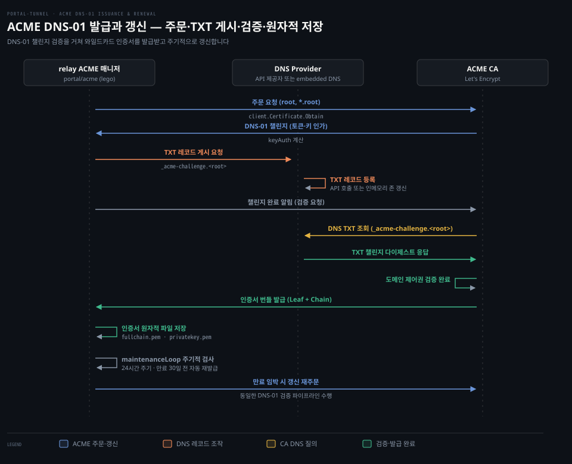

# ACME·DNS-01·ENS

---

> 릴레이가 와일드카드 인증서를 발급·갱신하기 위해 DNS-01 방식을 택한 이유와 다중 DNS 공급자 구조, 내장 권한 DNS 서버 및 ENS 가스리스 연동 원리를 다룹니다.

## 학습 목표와 범위

> 와일드카드 인증서 발급 규약과 릴레이의 DNS 자동화 서브시스템 동작 방식을 이해하고 장애 원인을 진단할 수 있습니다.

1. HTTP-01과 DNS-01의 보안 검증 경계를 비교하고 와일드카드 도메인에 DNS-01이 필수적인 이유를 설명할 수 있습니다.
2. `portal/acme` 패키지가 lego 라이브러리로 인증서를 발급받고 백그라운드 루프로 갱신하는 전 과정을 추적할 수 있습니다.
3. 외부 클라우드 API를 쓰지 않는 내장 DNS(`embedded`)의 동작 구조와 ENS 가스리스 TXT 레코드 연동 방식을 제시할 수 있습니다.

이 문서는 릴레이 서버의 인증서 발급과 DNS 제어 평면을 다룹니다. 터널 에이전트와 릴레이 간의 개별 세션 리버스 연결과 암호화 프레이밍은 [01-03.Control Plane Flow.md](01-03.Control%20Plane%20Flow.md)를 참조하십시오.

기준 커밋 129b6de5 (2026-10-20)


## 와일드카드 인증서와 DNS-01의 필요성

> 동적으로 생성되는 수많은 테넌트 호스트를 단일 인증서로 즉시 수용하려면 DNS-01 기반 와일드카드 발급이 필수적입니다.

임대 요청마다 인증 기관(CA)에 새 인증서를 요청하면 지연이 심해지고 발급 한도도 넘게 됩니다. 포털 터널에서는 클라이언트가 서비스를 노출할 때마다 고유한 임대 호스트명이 실시간으로 생성됩니다.

[00-02.Concepts.md](00-02.Concepts.md)에서 살폈듯 호스트는 `demo.root` 같은 친화적 별칭과 `demo-<주소40hex>.root` 형태의 정식 식별자로 구성됩니다. 만약 릴레이가 서비스를 등록할 때마다 단일 호스트 인증서를 새로 발급받아야 한다면 등록마다 수십 초씩 기다려야 합니다. 공용 CA의 도메인당 주간 발급 횟수 제한에도 금세 걸립니다.

그래서 릴레이는 루트 도메인(`root`)과 모든 1차 서브도메인을 포괄하는 `*.root` 형태의 **와일드카드 인증서**를 미리 보유해야 합니다.

### HTTP-01이 와일드카드를 발급하지 못하는 이유

인증 기관이 특정 서버에 도메인 인증서를 발급하려면 신청자가 해당 도메인의 실소유자인지 검증해야 합니다. ACME 규약(RFC 8555)은 이를 위해 여러 **챌린지**(Challenge) 유형을 정의합니다.

가장 흔히 쓰이는 HTTP-01 챌린지(RFC 8555 §8.3)는 대상 호스트의 80번 포트로 HTTP 요청을 보내 특정 토큰 파일을 검증합니다. 이 방식으로는 와일드카드 도메인을 증명할 수 없습니다.

특정 서브도메인의 웹 서버를 장악한 공격자가 80번 포트 응답을 조작하더라도 도메인 전체 네임스페이스의 권한을 증명한 것은 아니기 때문입니다. RFC 8555 §7.1.3·§7.1.4는 와일드카드 식별자 규격을 정의할 뿐 챌린지 유형을 직접 제한하지 않습니다. 하지만 CA/Browser Forum 베이스라인 요구사항(BR)과 Let's Encrypt 정책은 웹 서버 단위 검증인 HTTP-01을 불허합니다. 이들이 허용하는 것은 네임스페이스 전체 권한을 증명하는 DNS-01 챌린지뿐입니다.

### DNS-01이 증명하는 소유권 경계

DNS-01 챌린지는 대상 영역의 권한 네임서버에 `_acme-challenge.<root>` 이름으로 TXT 레코드를 게시하도록 요구합니다.

DNS 영역에 레코드를 쓸 수 있다는 것은 도메인 네임스페이스 전체를 제어하고 있음을 의미합니다. CA는 권한 DNS에 질의하여 계산된 다이제스트 값을 확인한 뒤에만 와일드카드 인증서를 발급합니다. 릴레이는 이 원리에 기대어 와일드카드 인증서 단 한 장으로 임의의 서브도메인을 보호합니다.

### Certificate Transparency 로그와 와일드카드 발급의 상충 관계

공인 CA가 발급한 모든 인증서 내역이 공개 로그에 기록되면 사설 호스트 이름이 외부에 노출됩니다. RFC 6962에 규정된 인증서 투명성(Certificate Transparency, CT) 규약에 따라 공인 CA는 인증서를 발급할 때마다 해당 인증서와 도메인 목록을 변조 불가능한 공개 CT 로그에 등록합니다. 누구나 이 로그를 검색할 수 있기 때문에 개별 호스트 이름마다 인증서를 새로 발급받으면 사설 서비스 식별자가 외부에 드러납니다.

포털 릴레이는 와일드카드 인증서로 이 노출을 막아 호스트 이름을 숨깁니다. 릴레이의 `certificateDomains`(`portal/acme/certificate.go:41-43`)는 오직 루트 도메인 `<root>`와 `*.<root>` 와일드카드 두 개만 묶어 인증서를 신청합니다. 이렇게 하면 Let's Encrypt가 발급하는 인증서는 단 한 장이고 공개 CT 로그에도 `*.<root>` 형태만 기록됩니다. 개별 테넌트의 정식 식별자(`demo-<주소40hex>.root`)나 별칭(`demo.root`) 같은 호스트 이름은 CT 로그에 따로 남지 않습니다.

반면 [02-03.keyless TLS.md](02-03.keyless%20TLS.md)에서 다룬 호스트별 ACME 발급 로드맵(GitHub 열린 이슈 #541)으로 나아갈 때는 새로운 상충 관계가 생깁니다. 터널이 자체 호스트 이름으로 공인 인증서를 직접 발급받으면 릴레이의 서명 키 소유 신뢰를 줄일 수 있습니다. 대신 발급받은 테넌트의 구체적 호스트 이름이 매번 공개 CT 로그에 기록되어 노출됩니다. 와일드카드 기반 중앙 발급과 호스트별 직접 발급 사이에는 릴레이 신뢰 축소와 호스트 식별자 은닉이라는 트레이드오프가 있습니다.


## ACME 매니저와 자동 갱신 생명주기

> 릴레이의 ACME 매니저는 lego 라이브러리를 감싸 인증서를 원자적으로 파일에 저장하고 백그라운드에서 만료 30일 전 자동 갱신합니다.

인증서 발급과 파일 저장이 원자적으로 이루어지지 않거나 갱신 주기를 놓치면 서비스 전체의 TLS 연결이 중단됩니다. 릴레이는 `portal/acme/acme.go`의 `Manager` 타입으로 이 수명주기를 제어합니다.

`NewManager`(`portal/acme/acme.go:66`)는 설정을 정규화하고 DNS 제공자 인스턴스를 초기화합니다. 루트 도메인이 로컬 호스트인 경우에는 외부 ACME 통신을 생략하는 경량 매니저를 반환합니다(`:103`).

### 인증서 확보와 수동 인증서 우선 원칙

릴레이 프로세스가 부팅되면 `EnsureCertificate`(`portal/acme/acme.go:127`)가 가장 먼저 실행됩니다. 이 함수는 인증서 적합성을 다섯 단계로 판단합니다.

1. 로컬 환경 검사: `utils.IsLocalRelayHost`가 참이면 기존 로컬 인증서가 도메인을 모두 포함하는지 확인하고 인증서가 없거나 부족할 때만 자체 서명 인증서를 생성합니다(`:132, 170-175`).
2. 수동 인증서 확인: `manualCertificateOverride`(`:238`)를 호출하여 관리자가 직접 배치한 인증서가 있는지 검사합니다.
3. DNS 레코드 동기화: `m.syncDNS`(`:148`)가 릴레이의 공인 IP 주소를 A 레코드로 게시합니다.
4. 기존 인증서 검증: 기존 인증서가 루트 도메인과 와일드카드 도메인을 모두 포함하는지 확인합니다(`:157`).
5. 신규 발급: 기존 인증서가 없거나 범위를 만족하지 못하면 `m.provision`(`:163`)을 실행합니다.

관리자가 상용 CA에서 직접 구매한 인증서를 디렉터리에 넣었을 때 ACME가 이를 덮어쓰면 안 됩니다. `manualCertificateOverride`(`:238`)는 `fullchain.pem`과 `privatekey.pem`이 존재하고 유효할 때 동작합니다.

이때 디렉터리에 `acme-account.key`나 `acme-registration.json` 같은 ACME 상태 파일이 전혀 없을 때만 수동 인증서로 인정합니다(`:251-260`). ACME 상태가 남아 있다면 과거 자동 발급 이력이 있는 것으로 보아 덮어쓰기 위험을 방지합니다.

### 프로비저닝과 원자적 파일 쓰기

인증서가 없거나 갱신이 필요하면 `provision`(`portal/acme/acme.go:264`)이 동작합니다. 릴레이는 ACME 클라이언트 구현체로 `go-acme/lego/v4` 라이브러리를 사용합니다(`portal/acme/certificate.go:21,84`).

`newClient`(`portal/acme/certificate.go:84`)는 ECDSA P-256 계정 키를 읽거나 생성하고 Let's Encrypt 운영 디렉터리(`lego.LEDirectoryProduction`)에 접속합니다. 서버 인증서 키 유형은 RSA 2048 비트를 선택합니다(`:108`).

클라이언트는 `certificateDomains`(`:41`)가 반환하는 `[baseDomain, *.baseDomain]` 두 호스트명을 묶어 발급을 요청합니다(`acme.go:285`). CA에서 인증서 번들을 받으면 `utils.WriteFileAtomic`으로 임시 파일을 먼저 쓰고 교체하는 방식으로 `fullchain.pem`(0644)과 `privatekey.pem`(0600)을 기록합니다(`:296-300`).



위 시퀀스 도식은 릴레이 부팅 시점부터 DNS-01 인증을 거쳐 인증서를 발급받고 백그라운드 유지보수 루프로 진입하는 전체 제어 흐름을 나타냅니다. DNS 제공자가 TXT 레코드를 반영하면 곧바로 Let's Encrypt의 검증 질의가 처리되고 발급된 인증서가 파일 시스템에 원자적으로 안착합니다.

### 유지보수 루프와 실패 백오프

릴레이가 기동을 마치면 `Start`(`portal/acme/acme.go:186`)가 호출되어 백그라운드 고루틴인 `maintenanceLoop`(`portal/acme/maintenance.go:44`)를 실행합니다. 이 루프는 세 가지 타이머를 다룹니다.

인증서 갱신 티커는 24시간 주기로 동작합니다(`defaultRenewInterval = 24 * time.Hour`, `:16,90`). 티커가 울릴 때마다 `certNeedsRenewal`(`portal/acme/certificate.go:45`)을 검사합니다.

인증서 만료일까지 남은 시간이 30일 미만(`time.Until(cert.NotAfter) < 30*24*time.Hour`)이거나 포함 도메인이 일치하지 않으면 재발급 절차를 시작합니다(`:50-53`).

IP 동기화 티커는 3시간 주기로 릴레이의 공인 IP 변경을 감지하여 DNS A/AAAA 레코드를 동기화합니다(`:17,91`).

마지막 재시도 타이머는 DNS 주소 등록이 지연될 때 동작합니다. `dnsRetryBackoffs`(`:25-32`)에 따라 `5초, 15초, 30초, 1분, 2분, 5분` 순으로 지연을 늘려가며 공인 IP가 확인될 때까지 빠르게 재시도합니다(`nextSyncDelay`, `:37`).


## 다중 DNS 공급자 추상화와 Cloudflare 연동

> 릴레이는 DNS 제어 인터페이스를 단일하게 추상화하여 다양한 클라우드 네임서버와 로컬 네임서버를 투명하게 교체할 수 있습니다.

운영 환경마다 네임서버 인프라가 다르면 ACME 코드베이스 전체를 고쳐야 하는 결합이 생깁니다. 릴레이는 `DNSProvider` 인터페이스(`portal/acme/provider.go:33-42`)로 레코드 조작과 챌린지 핸들러를 표준화했습니다.

이 인터페이스는 ACME 챌린지용 `ChallengeProvider` 외에도 A/AAAA 레코드 등록, TXT 레코드 생성 및 삭제, DNSSEC 상태 조회를 정의합니다. DNSSEC는 DNS 응답에 전자 서명을 붙여 받는 쪽이 위조 여부를 검증하게 하는 DNS 확장입니다.

```go
type DNSProvider interface {
	Name() string
	ChallengeProvider(ctx context.Context) (challenge.Provider, error)
	EnsureAddressRecords(ctx context.Context, baseDomain, publicIP string) error
	EnsureAddressRecord(ctx context.Context, name, publicIP string) error
	DeleteAddressRecords(ctx context.Context, name string) error
	EnsureTXTRecord(ctx context.Context, name, value string) error
	DeleteTXTRecords(ctx context.Context, name, matchPrefix string) error
	EnsureDNSSEC(ctx context.Context, baseDomain string) (state, dsRecord, message string, err error)
}
```

### Cloudflare 공급자 구현 심층 분석

대표적 구현체인 `portal/acme/cloudflare/provider.go`는 Cloudflare v4 REST API와 lego 제공자를 결합하여 동작합니다.

`ChallengeProvider`(`:87`)는 설정된 API 토큰을 lego의 `cloudflare.NewDNSProviderConfig`에 전달하여 ACME DNS-01 챌린지 공급자를 만듭니다.

릴레이 공인 IP가 결정되면 `EnsureAddressRecords`(`:105`)가 호출됩니다. 이 메서드는 루트 도메인과 `*.root` 와일드카드 이름을 모두 도출한 뒤(`dnsrecord.ApexWildcard`, `:122`) Cloudflare API를 호출하여 프록시가 꺼진(`proxied: false`) 순수 DNS A 레코드를 설정합니다.

`EnsureDNSSEC`(`:242`)는 도메인의 DNSSEC 서명 상태를 검사합니다. 상태가 활성화되어 있지 않으면 Cloudflare API로 DNSSEC 활성화를 요청하고 상위 레지스트라에 등록할 DS 레코드 값을 추출하여 반환합니다(`:267,277`).

### 지원 공급자 및 환경 설정 목록

`cmd/relay-server/main.go:125-139`에 정의된 공급자 7개와 주요 환경 변수를 표로 정리합니다.

| 공급자 식별자 | CLI 플래그 (`main.go`) | 환경 변수 (`main.go`) | 필수 권한 및 특이사항 |
|---|---|---|---|
| `embedded` | `--embedded-dns-port` | `EMBEDDED_DNS_PORT` | 상위 도메인의 NS 위임 필요. API 자격증명 없을 때의 기본값 |
| `cloudflare` | `--cloudflare-token` | `CLOUDFLARE_TOKEN` | DNS Zone 읽기/쓰기 및 DNSSEC 편집 권한 토큰 |
| `gcloud` | `--gcp-project-id`, `--gcp-managed-zone` | `GCP_PROJECT_ID`, `GCP_MANAGED_ZONE` | Google Cloud DNS 쓰기 권한. 생략 시 ADC(Application Default Credentials, 환경에서 구글 자격증명을 자동으로 찾는 방식) 또는 GCE(Compute Engine) VM 메타데이터 서버로 자동 감지 |
| `hetzner` | `--hetzner-api-token` | `HETZNER_API_TOKEN`, `HCLOUD_TOKEN` | Hetzner Cloud API 토큰(`cmd/relay-server/main.go:131`). ENS DNSSEC 자동화는 미지원 |
| `njalla` | `--njalla-token` | `NJALLA_TOKEN` | Njalla 도메인 API 토큰. ENS DNSSEC 자동화는 미지원 |
| `route53` | `--aws-access-key-id`, `--aws-region`, `--aws-dnssec-kms-key-arn` 등 | `AWS_ACCESS_KEY_ID`, `AWS_REGION`, `AWS_DNSSEC_KMS_KEY_ARN` | Route53 호스팅 영역 수정 권한. KSK 자동 생성 시 AWS KMS 키의 리소스 식별자(KMS Key ARN) 필요 |
| `vultr` | `--vultr-api-key` | `VULTR_API_KEY` | Vultr DNS 레코드 및 DNSSEC 제어 API 키 |


## 내장 권한 DNS(Embedded DNS) 서버

> 외부 클라우드 계정이나 API 토큰 없이도 릴레이 프로세스 내부의 경량 DNS 서버를 통해 인증서 발급과 이름 풀이를 자립적으로 완결합니다.

폐쇄망이나 온프레미스 환경에서는 외부 클라우드 DNS API를 사용할 수 없거나 외부 의존성을 최소화해야 합니다. 포털 릴레이는 외부 API 없이 스스로 권한 DNS 서버가 되는 `embedded` 제공자(`portal/acme/embedded/`)를 내장합니다.

CLI 도움말(`cmd/relay-server/main.go:125`)에 명시되었듯 API 자격증명이 전달되지 않았을 때의 기본 선택지입니다.

### 동작 원리와 요구 사항

내장 DNS를 사용하려면 상위 도메인 네임서버에서 릴레이 도메인의 관할 네임서버를 릴레이 공인 IP로 위임해야 합니다.

예를 들어 베이스 도메인이 `tunnel.example.com`이라면 상위 `example.com` 네임서버에 `tunnel.example.com IN NS ns.tunnel.example.com`과 글루(glue) 레코드를 설정해야 합니다. 글루 레코드는 하위 영역 네임서버(`ns.tunnel.example.com`)의 IP 주소를 상위 영역에 함께 적어 두는 레코드로, 없으면 그 네임서버 이름을 풀려고 다시 같은 영역에 묻는 순환이 생깁니다.

릴레이는 53번 포트(UDP/TCP)를 열고(`portal/acme/embedded/provider.go:32,123`) 베이스 도메인 영역의 질의에 권한 서버로서 직접 응답합니다. 재귀 질의는 지원하지 않으며 오직 자기 영역 질의에만 답합니다(`portal/acme/embedded/server.go:13`).

### 인메모리 존과 DNS-01 챌린지 직접 응답

내장 DNS는 `challenge.Provider` 인터페이스의 `Present`와 `CleanUp`을 직접 구현합니다(`portal/acme/embedded/provider.go:194,203`).

```go
func (p *Provider) Present(domain, _, keyAuth string) error {
	info := dns01.GetChallengeInfo(domain, keyAuth)
	name, err := p.zoneHostname(info.EffectiveFQDN)
	if err != nil {
		return err
	}
	return p.EnsureTXTRecord(context.Background(), name, info.Value)
}
```

ACME 발급 과정에서 챌린지 토큰이 전달되어도 외부 API는 호출하지 않습니다. 대신 `Present`(`portal/acme/embedded/provider.go:194`)가 `EnsureTXTRecord`(`:340-345`)를 호출합니다. 이 호출이 인메모리 맵(`p.txt`)에 `_acme-challenge` TXT 레코드를 바로 추가하고 시리얼 번호를 올립니다. 검증이 끝난 뒤에는 `CleanUp`(`:211,222`) 경로에서 레코드를 삭제합니다.

외부 클라우드 DNS API 반영이나 네임서버 간 전파 지연이 없으므로 CA 검증기가 53번 포트로 질의해 오면 인메모리 존에서 바로 검증 다이제스트를 응답할 수 있습니다. (다만 전체 ACME 검증 완료까지는 lego 라이브러리의 자체 전파 확인이나 CA의 다중 관점 검증 지연이 수반됩니다.)

### 내장 DNSSEC 서명 파이프라인

내장 DNS는 DNSSEC 서명 기능도 프로세스 내부에서 직접 수행합니다(`portal/acme/embedded/dnssec.go`).

기동 시 `types.DNSSECKeyFileName`(`dnssec-csk.json`)에서 ECDSA P-256 결합 서명 키(CSK)를 로드하거나 새로 생성합니다(`:28,38`). 존 데이터가 갱신될 때마다 NSEC 체인과 RRSIG 레코드를 인메모리에서 실시간으로 서명합니다(`:105-180`). RRSIG는 레코드 집합에 붙는 DNSSEC 서명이고, NSEC 체인은 존 안의 이름을 정렬해 이어 둔 레코드로 "이 이름은 없다"는 응답을 증명하는 데 씁니다.

서버가 뜨면 상위 레지스트라에 등록할 DS 레코드를 로그로 출력하여 운영자가 상위 DNS에 신뢰 체인을 연결할 수 있게 돕습니다(`portal/acme/embedded/provider.go:153`).


## 로컬 개발 환경 인증서와 호환성 마찰

> 로컬 루프백 도메인은 공용 CA 발급이 불가능하므로 릴레이가 장기 유효 자체 서명 인증서를 생성하여 개발 편의성을 확보합니다.

로컬 개발 환경에서는 `localhost` 도메인의 인증서를 공용 ACME로 발급받을 수 없습니다. Let's Encrypt는 사설 도메인이나 공인 네임서버가 없는 로컬 영역에는 인증서를 발급하지 않기 때문입니다.

릴레이는 루트 도메인이 로컬 호스트일 때 ACME 발급을 우회하고 자체 서명 인증서를 바로 생성합니다(`portal/acme/certificate.go:165`).

### 로컬 인증서 생성 스펙

`ensureLocalDevelopmentCertificate`(`portal/acme/certificate.go:165`)는 ECDSA P-256 키 쌍을 만들고 아래 X.509 속성을 부여합니다.

- 조직 이름(O): `Portal Local Development` (`:197`)
- 일반 이름(CN): 설정된 베이스 호스트 (기본 `localhost`)
- 유효기간: 10년 (`localDevelopmentCertificateTTL = 3650 * 24 * time.Hour`, `:27,200`)
- 주체 대체 이름(SAN): 기본 `localhost`, `*.localhost`, `127.0.0.1`, `::1`에 더해 설정된 베이스 호스트가 `localhost`가 아니면 해당 호스트와 `*.<baseHost>`도 추가됩니다(`:238-244`). 기존 인증서가 이들을 모두 포괄하면 새로 만들지 않고 재사용합니다(`:170-175`).

릴레이는 이 인증서를 `fullchain.pem`과 `privatekey.pem`에 저장하고 SNI 라우터와 제어 평면 API 서빙에 그대로 사용합니다.

### 클라이언트 검증기와의 호환성 마찰

실제로 로컬에서 실행해 보면 클라이언트 라이브러리마다 와일드카드 인증서를 받아들이는지가 갈립니다.

로컬 실측(2026-10-17, README 「직접 띄워 보기」) 당시 Go 표준 라이브러리의 `crypto/x509` 검증기는 `demo-<hex>.localhost` 호스트명에 쓰인 `*.localhost` 인증서를 정상적으로 통과시켰습니다.

반면 macOS 내장 curl(LibreSSL 기반)과 OpenSSL 3.6 환경에서는 연결이 거부되었습니다(`SSL: no alternative certificate subject name matches target host name`).

이 마찰은 RFC 6125(현재 RFC 9525로 대체) 규약 자체의 직접적 제한이라기보다는 클라이언트 라이브러리의 구현 정책 차이에서 비롯됩니다. OpenSSL과 LibreSSL은 점이 두 개 미만인 패턴을 와일드카드로 취급하지 않습니다. 최상위 도메인(TLD) 바로 아래의 단일 라벨 와일드카드(`*.localhost`)는 보안상 유효하지 않은 패턴으로 간주하여 매칭을 거절합니다.

Go 검증기는 도메인 접미사 트리를 엄격히 따지지 않고 단순 레이블 와일드카드로 매칭을 허용합니다. 따라서 로컬 개발 환경에서 curl을 쓸 때는 `-k`(--insecure) 옵션을 붙여야 통신할 수 있습니다.


## ENS 가스리스 DNS 연동 원리

> 릴레이 운영자가 온체인 트랜잭션 수수료(가스비) 없이 DNSSEC 서명된 TXT 레코드를 통해 릴레이 도메인 및 임대 호스트를 이더리움 신원과 매핑할 수 있습니다.

릴레이 도메인과 임대 호스트명을 이더리움 지갑 주소와 연동할 때 온체인 등록을 거치면 트랜잭션 수수료(가스비)를 내야 합니다. ENS(Ethereum Name Service)는 사람이 읽는 이름을 이더리움 주소에 연결하는 이름 체계입니다.

포털 릴레이는 온체인 ENS 클레임 트랜잭션을 보내지 않습니다(`docs/src/routes/wallet-and-ens/+page.md:150-176`).

대신 관리 대상 DNS 이름에 DNSSEC 서명된 `ENS1` TXT 레코드를 게시하는 가스리스 DNS 연동(ENS Gasless DNS Import)을 지원합니다(`portal/acme/ens.go`).

릴레이가 DNSSEC 기반 DNS 레코드를 구성해 두면 ENS를 인식하는 클라이언트(ENS-aware clients)가 해당 DNS 이름을 포털의 이더리움 신원으로 해석합니다.

### ENS1 TXT 레코드 규약

릴레이 설정에서 `ENS_GASLESS_ENABLED=true`가 활성화되면 릴레이는 도메인과 임대 호스트에 특수한 TXT 레코드를 게시합니다.

레코드 값은 `portal/acme/ens.go:196`에 정의된 규격을 따릅니다.

```bash
ENS1 0x238A8F792dFA6033814B18618aD4100654aeef01 <이더리움_지갑_주소>
```

앞부분의 `0x238A8F79...`는 ENS 표준 오프체인 가스리스 리졸버 계약 주소(`defaultENSGaslessResolver`, `:20`)입니다. 뒷부분에는 루트 도메인이면 릴레이 자신의 지갑 주소(`ENSGaslessAddress`)가, 임대 호스트이면 터널 에이전트가 SIWE로 서명 증명한 계정 주소가 기록됩니다(`:196`, `wallet-and-ens/+page.md:172`).

### 큐 기반 비동기 레코드 관리

임대 등록과 해제는 짧은 시간에 몰려 빈번하게 일어날 수 있습니다. 이때 DNS 레코드 변경을 동기식으로 처리하면 제어 평면이 지연됩니다.

`Manager`는 내부 채널(`ensCommands chan ensDNSCommand`, `portal/acme/acme.go:60,114`)을 두고 백그라운드 워커에서 비동기로 명령을 소비합니다. 새로운 임대가 생성되면 `SyncENSGaslessHostname`(`portal/acme/ens.go:113`)이 큐에 레코드 생성을 요청합니다. 임대가 해제되면 `DeleteENSGaslessHostname`(`:133`)이 TXT 및 A 레코드를 삭제합니다.

등록된 호스트 목록은 `ens-gasless-hostnames.json` 파일에 원자적으로 기록되어 릴레이 재기동 후에도 누락 없이 관리됩니다(`:262,289`).

상태 확인 API인 `/sdk/domain`은 `ens.enabled`, `ens.provider`, `ens.dnssec_state`, `ens.ds_record` 필드를 반환합니다(`wallet-and-ens/+page.md:239-250`).

다만 `ens.verified` 필드는 상위 등록 기관의 부모 체인이나 실제 온체인 ENS 해석 가능 여부를 검증한 결과가 아닙니다. 외부 공급자 상태 문자열(active/on/signing/transfer)과 마지막 동기화 성공 여부만 반영하는 진단용 플래그입니다(`portal/acme/ens.go:63,75-81`, `wallet-and-ens/+page.md:170`).

내장 DNS(`embedded`)는 로컬 서명만 수행하고 상태값으로 `pending`을 반환하므로(`portal/acme/embedded/provider.go:390`) `ens.verified`는 항상 false로 유지됩니다. 상위 체인의 정상 연결 여부는 외부 ENS 클라이언트나 dig 도구로 직접 확인해야 합니다.


## 리뷰 노트

> 소스 코드 분석과 로컬 실측 중 확인한 설계 특이점과 운영상 주의점입니다.

- **로컬 개발 환경의 와일드카드 호환성 격차 (`portal/acme/certificate.go:238`)**: 로컬 실측(2026-10-17, README 「직접 띄워 보기」)에서 Go 클라이언트는 통과했습니다. 반면 macOS curl은 `*.localhost` 인증서 검증을 거부했습니다. 단일 라벨 TLD 아래 와일드카드를 불허하는 정책 때문으로 추정됩니다. 로컬 개발 시에는 `-k` 옵션이 필요합니다.
- **수동 인증서 전환 시 ACME 파일 간섭 (`portal/acme/acme.go:251-260`)**: 인증서 파일을 직접 배치해도 기존 ACME 파일이 남으면 수동 모드로 진입하지 못합니다. `acme-account.key`나 `acme-registration.json`이 있으면 재발급을 시도합니다. 수동 인증서로 전환할 때는 기존 ACME 상태 파일을 반드시 정리해야 합니다.
- **내장 DNS의 53번 포트 바인딩 권한 제약 (`portal/acme/embedded/provider.go:32,123`)**: 내장 DNS 기본 포트는 53번입니다. Linux에서 비루트 사용자로 실행할 때 `CAP_NET_BIND_SERVICE` 권한이 없으면 바인딩 오류가 납니다. 포트 변경은 가능하나 상위 위임은 53번만 사용합니다. 컨테이너 배포 시 포트 포워딩이나 권한 부여가 필요합니다.
- **내장 DNS의 `ens.verified` 영구 미검증 상태 (`portal/acme/ens.go:75-81`, `wallet-and-ens/+page.md:170`)**: `ens.verified`는 부모 존 체인을 검증하는 플래그가 아닙니다. 외부 제공자의 활성 상태 문자열을 확인하는 진단값입니다. 내장 DNS는 provider 상태가 `pending`으로 고정되어 상위 기관에 DS 레코드를 등록해도 `ens.verified`는 항상 false로 남습니다. 운영자가 이를 장애 상태로 오인하지 않도록 명확한 안내가 필요합니다.


## 검증과 복습

> 이 편에서 학습한 핵심 개념과 코드를 세 가지 질문으로 스스로 확인합니다.

1. **질문 1**: 릴레이가 수많은 테넌트 서브도메인을 수용할 때 HTTP-01 챌린지를 사용할 수 없고 반드시 DNS-01 챌린지를 거쳐 와일드카드 인증서를 발급받아야 하는 구조적 이유는 무엇입니까?
2. **질문 2**: 릴레이 부팅 시 `manualCertificateOverride`가 수동 마운트 인증서를 우선 채택하기 위해 요구하는 두 가지 조건은 무엇이며, ACME 상태 파일은 이 판정에 어떤 영향을 줍니까?
3. **질문 3**: `embedded` DNS 제공자는 외부 DNS API 없이 어떻게 Let's Encrypt의 DNS-01 검증을 통과하며, 상위 도메인 네임서버에는 사전에 어떤 설정이 완료되어 있어야 합니까?


## 정답 (자답 후 펼치기)

> 질문에 대한 답변과 관련 소스 코드 근거입니다.

1. **정답 1**: 테넌트 등록마다 개별 인증서를 요청하면 지연이 생기고 발급 한도도 넘기 때문에 루트와 모든 1차 서브도메인을 포괄하는 와일드카드(`*.root`) 인증서가 필수적입니다. RFC 8555는 와일드카드 식별자 규격을 정의할 뿐 챌린지 유형을 직접 제한하지 않습니다. 하지만 CA/Browser Forum 베이스라인 요구사항(BR)과 Let's Encrypt 정책상 HTTP-01은 네임스페이스 전체 권한을 증명하지 못해 와일드카드 발급에 쓸 수 없습니다. 그래서 전체 도메인 영역 제어를 입증하는 DNS-01 챌린지만 허용됩니다.
2. **정답 2**: `portal/acme/acme.go:238-261`에 따라 두 가지가 요구됩니다. 첫째, `fullchain.pem`과 `privatekey.pem`이 루트 및 와일드카드 도메인을 모두 포함해야 합니다. 둘째, 디렉터리에 `acme-account.key`와 `acme-registration.json` 파일이 없어야 합니다. 상태 파일이 하나라도 남아 있으면 과거 자동 발급 이력으로 보아 수동 우선 모드가 해제됩니다.
3. **정답 3**: 릴레이 자신이 53번 포트를 열고 직접 권한 DNS 서버로 동작합니다(`portal/acme/embedded/server.go:14`). DNS-01 토큰이 발급되면 내부 메모리 존(`p.txt`)에 `_acme-challenge` TXT 레코드를 삽입하여 CA 질의에 지연 없이 응답합니다(`portal/acme/embedded/provider.go:194`). 이를 위해 상위 등록 기관에서 릴레이 도메인의 NS와 glue 레코드를 릴레이 공인 IP로 위임해 두어야 합니다.


## 출처와 관련 문서

- [portal-tunnel 기준 커밋 소스 트리](https://github.com/gosuda/portal-tunnel/tree/129b6de5): 기준 커밋 129b6de5 소스 코드
- [RFC 8555 - Automatic Certificate Management Environment (ACME)](https://datatracker.ietf.org/doc/html/rfc8555): ACME 규약 및 §8.4 DNS-01 챌린지
- [RFC 6962 - Certificate Transparency](https://datatracker.ietf.org/doc/html/rfc6962): 공개 로그 기반 인증서 발급 감시 규약
- [Let's Encrypt Challenge Types](https://letsencrypt.org/docs/challenge-types/): HTTP-01 및 DNS-01 챌린지 공식 가이드
- [Portal Wallet and ENS 가이드](https://gosuda.github.io/portal-tunnel/wallet-and-ens): ENS 가스리스 DNS 연동 및 식별자 구조
- `portal/acme/acme.go`, `portal/acme/certificate.go`, `portal/acme/maintenance.go`: ACME 매니저 및 수명주기 구현
- `portal/acme/provider.go`, `portal/acme/cloudflare/provider.go`, `portal/acme/embedded/`: DNS 공급자 및 내장 권한 DNS 구현
