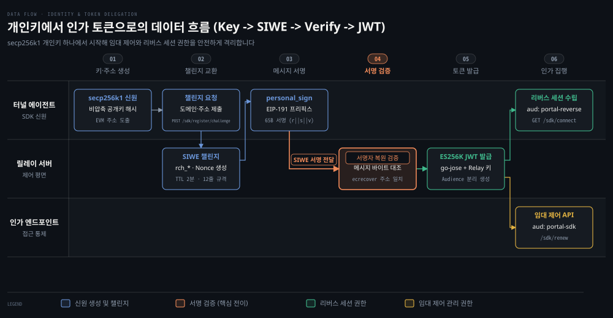

# identity·SIWE·lease token

---

> 계정과 비밀번호 없이 secp256k1 개인키와 SIWE 서명으로 신원을 증명하고, 최소 권한의 ES256K JWT 토큰 두 종류로 임대 제어와 리버스 연결을 격리하는 보안 인가 규약을 다룹니다.


## 학습 목표와 범위

> 이 문서를 읽고 나면 포털 터널의 암호학적 신원 체계와 토큰 분리 원리를 설명할 수 있습니다.

- secp256k1 개인키에서 EVM 주소가 도출되는 수학적 과정과 EIP-55 체크섬 정규화 이유를 설명할 수 있습니다.
- 릴레이가 단일 등록 요청 대신 2단계 SIWE 챌린지를 강제하고 서버 생성 메시지를 되파싱하지 않는 보안 이유를 제시할 수 있습니다.
- 임대 접근 토큰(Access Token)과 리버스 권한 토큰(Reverse Capability)의 대상자(Audience) 분리 설계가 공격 표면을 줄이는 방식을 비교할 수 있습니다.
- 이더리움 EOA 서명 검증 규약이 지닌 현실적 한계와 스마트 컨트랙트 지갑이 제외된 경계를 판단할 수 있습니다.

이 문서는 터널 에이전트와 릴레이 간의 제어 평면 인증 규약에 집중합니다. 데이터 평면의 종단간 TLS 암호화(`portal/keyless`)와 yamux 스트림 다중화는 앞선 편에서 다루었으므로 여기서는 신원과 인가 토큰에 초점을 맞춥니다.


## 1. 공개키 identity와 EVM 주소 도출

> 중앙 데이터베이스나 비밀번호 없이 secp256k1 타원곡선 개인키 하나로 고유한 주소를 계산하고 파일로 영속화합니다.

공개 중계 서버(Relay)에 로컬 터널을 등록할 때 사용자 이름과 비밀번호를 요구하면 중앙 데이터베이스가 필요해집니다. 비밀번호 해시 저장소, 이메일 확인, 계정 복구 체계를 서버마다 구축해야 합니다. 릴레이 운영자 역시 사용자 개인정보를 보관하는 법적·운영적 부담을 떠안게 됩니다. 반대로 아무런 인증 없이 도메인을 내어주면 다른 사용자가 이미 점유 중인 도메인을 가로채는 도메인 탈취 공격에 무방비로 노출됩니다.

포털 터널은 이 문제를 풀기 위해 이더리움 블록체인에서 검증된 **공개키 암호학**(Public-Key Cryptography)의 전자서명 체계를 신원의 기반으로 삼습니다. 터널 에이전트는 기동할 때 계정을 생성하는 대신 로컬에서 타원곡선 개인키를 생성합니다. 이 키에서 수학적으로 유일하게 도출되는 20바이트 주소를 자신의 영구적인 식별자로 사용합니다.

```bash
+-------------------+      압축 해제 (0x04 접두사)      +-------------------------+
| secp256k1 개인키   | ----------------------------> | 65바이트 비압축 공개키    |
| (32바이트 비밀값)  |                               | (0x04 || X 32B || Y 32B)|
+-------------------+                               +-------------------------+
                                                                 |
                                                                 | 접두사 0x04 제외 (64B)
                                                                 v
+-------------------+       뒤 20바이트 추출           +-------------------------+
| EVM 체크섬 주소   | <---------------------------- | Keccak-256 해시 digest  |
| (0x + 40자리 Hex)  |   NormalizeEVMAddress (EIP-55)| (32바이트 해시 결과)    |
+-------------------+                               +-------------------------+
```

주소 도출 로직은 `portal/identity/secp256k1.go`에 있습니다.

- `AddressFromCompressedPublicKeyHex` (`portal/identity/secp256k1.go:107`): 33바이트 압축 공개키를 65바이트 비압축 공개키(`publicKey.SerializeUncompressed()`)로 복원합니다. 비압축 공개키의 첫 1바이트인 `0x04` 마커를 제외한 64바이트(타원곡선 위의 X, Y 좌표 각 32바이트)를 취해 `sha3.NewLegacyKeccak256()`으로 해시합니다. 해시 결과 32바이트 중 마지막 20바이트(`hash[len(hash)-20:]`)를 취해 16진수로 인코딩합니다.
- `NormalizeEVMAddress` (`portal/identity/secp256k1.go:58`): 20바이트 16진수 주소를 EIP-55 규격의 체크섬 주소로 변환합니다. 주소 문자열의 Keccak-256 해시 니블(nibble) 값이 7보다 큰 위치의 영문자를 대문자로 변환하여 오타로 인한 주소 오염을 방지합니다.
- `ResolveSecp256k1Identity` (`portal/identity/secp256k1.go:181`): 전달된 개인키 문자열을 검증합니다. 비어 있으면 `secp256k1.GeneratePrivateKey()`를 호출해 새 키 쌍을 만듭니다. 주소와 공개키가 담긴 `types.Identity` 구조체를 구성합니다.

신원의 영속화는 `portal/identity/client_identity.go:41`의 `LoadOrCreate` 함수가 전담합니다. 실행 인자로 raw JSON이 전달되면 인메모리 소스로 우선 파싱합니다. 파일 경로가 지정되어 있으면 파일의 존재 여부를 검사하여 기존 신원을 읽어옵니다. 파일이 없을 때만 `Generate`(`portal/identity/identity.go:73`)를 호출해 새 개인키를 만듭니다. 새 키는 부모 디렉터리를 만든 뒤 파일 권한을 `0600`으로 제한하는 비공개 파일(`utils.CreatePrivateFile`)로 저장합니다.

`portal/identity/mnemonic.go`는 `bip39.NewSeedWithErrorChecking`(`:47`)으로 유효한 BIP-39 길이(12/15/18/21/24단어)의 니모닉을 모두 지원합니다. 기본 파생 경로(`DefaultEVMIdentityDerivationPath = "m/44'/60'/0'/0/0"`, `portal/identity/mnemonic.go:20`)로부터 개인키를 유도하는 표준 파이프라인도 갖추고 있습니다.

로컬 실측(2026-10-17, README 「직접 띄워 보기」)에서도 터널 에이전트를 처음 실행할 때 identity 파일이 없으면 새 키를 자동 생성했습니다. 도출된 EVM 주소 `0xF7DC…`의 소문자 40자리 16진수 값이 정규(canonical) 호스트명 `demo-f7dc…localhost:18443`의 서브도메인에 그대로 붙었습니다.

기준 커밋 0a3b9c06 (2026-10-14)


## 2. EIP-191 personal_sign과 EIP-4361(SIWE)

> 임의 서명 혼동 공격을 방어하는 EIP-191 규격과 사람이 읽을 수 있는 표준 로그인 형식인 SIWE로 소유권을 증명합니다.

공개키와 주소는 외부에 공개되는 식별자입니다. 누구나 특정 노드의 EVM 주소를 알고 있으므로 단순히 주소를 전달하는 것만으로는 자신이 그 주소의 진짜 주인임을 증명할 수 없습니다. 에이전트는 "내가 이 주소에 대응하는 개인키를 소유하고 있다"는 사실을 암호학적으로 증명해야 합니다.

하지만 아무런 규칙 없이 임의의 바이트 스트림에 서명하게 하면, 공격자가 실제 이더리움 자산 전송 트랜잭션의 직렬화 바이트(RLP 인코딩)를 인증 메시지인 것처럼 속여 서명받는 혼동 공격(Confusion Attack)이 가능해집니다.

이더리움 생태계는 이를 막기 위해 **개인 서명 표준**(EIP-191 personal_sign)을 제정했습니다. 포털 터널의 `portal/identity/secp256k1.go:145` `ethereumPersonalMessageHash` 함수는 서명할 메시지 앞에 아래 고정 접두사를 강제로 결합합니다.

```go
// portal/identity/secp256k1.go:145-150 발췌
func ethereumPersonalMessageHash(message string) []byte {
	hasher := sha3.NewLegacyKeccak256()
	_, _ = fmt.Fprintf(hasher, "\x19Ethereum Signed Message:\n%d", len(message))
	_, _ = hasher.Write([]byte(message))
	return hasher.Sum(nil)
}
```

접두사 첫 바이트 `0x19`는 이더리움 트랜잭션 RLP 인코딩의 첫 바이트와 겹치지 않도록 설계된 특수 바이트입니다. 접두사에 포함되는 길이는 문자 개수가 아니라 메시지의 실제 UTF-8 바이트 수(`len(message)`)입니다.

서명 생성과 검증은 다음 두 함수가 처리합니다.

- `signEthereumPersonalMessage` (`portal/identity/secp256k1.go:125`): `ecdsa.SignCompact`를 호출하여 65바이트 서명을 만듭니다. `compactSignature`의 `[1:33]`을 `r`, `[33:65]`를 `s`, 첫 바이트 `compactSignature[0]`을 recovery id인 `v`로 정렬합니다. 결과는 `r || s || v` 형태의 65바이트 16진수 문자열(`0x...`)로 반환합니다.
- `recoverEthereumPersonalMessage` (`portal/identity/secp256k1.go:152`): 전달받은 서명의 마지막 바이트인 `v`를 검사합니다. personal_sign의 표준 recovery 값인 `27`, `28`과 정규화된 `0`, `1`만을 허용하며 트랜잭션 체인 ID가 섞인 값은 즉시 거절합니다. `ecdsa.RecoverCompact`를 호출해 타원곡선 상에서 공개키를 복원하고 `AddressFromCompressedPublicKeyHex`를 거쳐 서명자의 주소를 계산합니다.

서명할 본문에는 **이더리움 로그인 표준**(SIWE, Sign-In with Ethereum, EIP-4361)을 사용합니다. 포털 터널의 메시지 규약은 메인테이너 아키텍처 문서(`docs/maintainer/architecture.md:71-77`)에 엄격히 정의되어 있습니다.

- Version: `1`
- Chain ID: `1`
- 개행 구분자: 라인 피드(`\n`, LF) 단독 사용
- Nonce: `crypto/rand` 기반 암호학적 난수
- 서명 구조: `r || s || v` (65바이트, `v`는 `0/1` 또는 `27/28`)

`portal/identity/siwe.go:29`의 `FormatSIWEMessage`는 도메인, EVM 주소, Statement, URI를 포함한 필드를 조합하여 서명 메시지를 구성합니다(`:65-70`). 여기에 8자 이상의 Nonce, RFC3339 타임스탬프, Request ID가 결합합니다. Statement가 포함되면 12줄, 생략되면 11줄 구조를 갖춥니다.

```bash
localhost:18443 wants you to sign in with your Ethereum account:
0xF7DC9a9730292fB2DF94A95E9FbDe9e993B1e658

Register a portal lease

URI: https://localhost:18443/sdk/register
Version: 1
Chain ID: 1
Nonce: 24MFX7ZKYW3N6QVR9B8D5CHTPJ
Issued At: 2026-10-17T13:00:00Z
Expiration Time: 2026-10-17T13:02:00Z
Request ID: rch_9f8e7d6c5b4a3210
```

`portal/identity/siwe.go:76`의 `VerifySIWEMessage`는 만료 시각을 초 단위로 절삭(`expiresAt.Truncate(time.Second)`)하여 검사 시점과 비교합니다. 초 정밀도로 절삭해서 서명 메시지와 내부 타임스탬프 간의 나노초 불일치 오차를 방지합니다. 만료 검사 다음에는 `recoverEthereumPersonalMessage`로 복원한 서명자 주소와 기대 주소를 `strings.EqualFold`로 대조하여 최종 유효성을 확인합니다.


## 3. 2단계 등록 챌린지와 릴레이의 위조 방어

> 릴레이가 발급한 원본 메시지를 되파싱 없이 바이트 단위로 대조하고 소비형 챌린지로 재생 공격을 차단합니다.

클라이언트가 임의의 메시지를 스스로 작성해 제출할 수 있다면 공격자가 과거 서명을 가로채 재전송(Replay Attack)하는 보안 문제가 발생합니다. 다른 노드의 도메인 설정을 덮어쓰거나 위조 서명으로 무차별 등록을 시도할 수 있습니다. 서명 검증은 CPU 연산 비용이 높기 때문에 위조 서명을 대량으로 보내 릴레이를 마비시키는 서비스 거부 공격도 일어납니다.

이를 방어하기 위해 릴레이는 `POST /sdk/register/challenge`로 먼저 서버 챌린지를 발급받고 그 챌린지에 서명하여 `POST /sdk/register`로 등록을 완료하는 2단계 등록을 강제합니다.

규약의 한도와 수명은 클라이언트의 안전 검증과 릴레이 발급 정책으로 나뉩니다. 릴레이가 실제로 발급하는 챌린지 수명은 `defaultRegisterChallengeTTL = 2 * time.Minute`(`portal/lease.go:29`, 사용 `:761`)로 2분입니다. 반면 `portal/identity/register_challenge.go`의 상수들은 클라이언트가 릴레이 챌린지를 받아들일지 검증하는 상한(`ValidateRegisterSIWEChallenge`, `:95, :117-121`)입니다.

- 클라이언트 허용 메시지 크기 상한: 최대 4KiB (`maxRegisterSIWEMessageBytes = 4 << 10`, `portal/identity/register_challenge.go:16`)
- 클라이언트 허용 미래 시계 오차: 최대 1분 (`maxRegisterSIWETimeSkew = time.Minute`, `portal/identity/register_challenge.go:17`)
- 클라이언트 허용 챌린지 수명 상한: 최대 5분 (`maxRegisterSIWELifetime = 5 * time.Minute`, `portal/identity/register_challenge.go:18`)
- 릴레이 실제 챌린지 발급 수명: 2분 (`defaultRegisterChallengeTTL = 2 * time.Minute`, `portal/lease.go:29`)

`NewRegisterChallenge`(`portal/identity/register_challenge.go:35`)는 클라이언트 요청을 검증합니다. `rch_` 접두사를 갖는 무작위 ID(`utils.RandomID("rch_")`)와 Nonce를 만든 뒤 만료 시각이 지정된 12줄의 SIWE 메시지를 구성합니다.

서버 측 검증인 `Verify`(`portal/identity/register_challenge.go:75`)에는 중요한 보안 설계가 담겨 있습니다. 서버는 자신이 보관해 둔 원본 메시지(`c.SIWEMessage`)와 클라이언트가 제출한 메시지(`req.SIWEMessage`)가 바이트 단위로 정확히 일치하는지(`req.SIWEMessage != c.SIWEMessage`)만 확인합니다. 그 밖에는 만료 시각 전인지와 복원 주소가 일치하는지만 대조합니다.

메인테이너 아키텍처 문서(`docs/maintainer/architecture.md:80-81`)는 서버가 생성한 메시지를 다시 파싱하지 않는다고 규정합니다. 도메인이나 Nonce 필드의 이중 집합 생성을 방지하기 위함입니다. 파서 간 공백이나 인코딩 처리 차이로 인한 우회 경로를 차단하려는 의도로 풀이됩니다.

클라이언트(SDK) 역시 릴레이를 맹목적으로 신뢰하지 않습니다. `ValidateRegisterSIWEChallenge`(`portal/identity/register_challenge.go:91`)는 릴레이가 응답한 챌린지가 신뢰할 수 있는지를 서명 전에 스스로 검증합니다.

```bash
[Relay Server]                                            [Tunnel Client]
      |                                                          |
      | <--- 1. POST /sdk/register/challenge (Identity 전달) --- |
      |                                                          |
      | --- 2. RegisterChallengeResponse (SIWE 12줄 반환) -----> |
      |                                                          |
      |                                              +-------------------------+
      |                                              | ValidateRegisterSIWE    |
      |                                              | - 4KiB 및 12줄 규격 검증 |
      |                                              | - Nonce·시각 추출       |
      |                                              | - 자체 컨텍스트와 대조  |
      |                                              +-------------------------+
      |                                                          |
      |                                              +-------------------------+
      |                                              | personal_sign 서명 수행  |
      |                                              +-------------------------+
      |                                                          |
      | <--- 3. POST /sdk/register (서명 및 메시지 전송) ------- |
      |                                                          |
+------------------------------------+                           |
| consumeVerifiedRegisterChallenge   |                           |
| - 바이트 완전 일치 확인            |                           |
| - ecrecover 복원 주소 대조         |                           |
| - 챌린지 즉시 삭제(소비)           |                           |
+------------------------------------+                           |
      |                                                          |
      | --- 4. JWT 토큰 2종 발급 (Access Token & Capability) --> |
```

클라이언트는 릴레이 URL의 스키마와 호스트 유효성, 4KiB 크기 한도, 정확한 12줄 구조를 확인한 뒤 시각 검사(`portal/identity/register_challenge.go:117-123`)를 수행합니다. Issued At이 1분 이내 미래인지 확인하고 ExpiresAt이 Issued At 이전이 아니며 수명이 5분 이내인지 검증합니다.

검증을 통과하면 릴레이 메시지 줄에서 Nonce와 Issued At을 추출합니다. 응답 JSON에서는 Request ID와 Expiration을 가져옵니다(`:90`). 클라이언트는 자신의 주소, 릴레이 호스트명, `/sdk/register` 경로, Statement로 메시지를 독립 재구성합니다(`:126-135`). 재구성 결과가 릴레이 문자열과 바이트 단위로 정확히 같을 때만 서명합니다.

재생 공격을 막기 위해 챌린지는 일회용으로 소비됩니다. `portal/lease.go:803`의 `consumeVerifiedRegisterChallenge`는 서명 검증 성공 즉시 해당 레코드를 삭제(`r.deleteRecord(i)`)합니다. 한 번 사용된 챌린지는 레지스트리에서 사라집니다. 동일한 서명을 재전송하면 `ErrRegisterChallengeNotFound`가 반환되어 HTTP 400 오류로 거절됩니다(`portal/api_server.go:332-337`, `utils/api.go:71-76`). 서명 불일치 시에만 HTTP 403 Forbidden을 응답합니다.

미결(outstanding) 챌린지 수도 제한하여 자원을 보호합니다. 미결 챌린지 수는 IP당 32개(`defaultRegisterChallengeOutstandingPerIP = 32`)로 묶습니다. 릴레이 전체는 256개(`defaultRegisterChallengeOutstanding = 256`)로 제한합니다(`portal/lease.go:30-31`). 이 한도를 넘어서면 새로운 챌린지 발급을 즉시 거절합니다.


## 4. 토큰 두 종류 — Access Token과 Reverse Capability

> 매 요청마다 SIWE 챌린지 왕복과 클라이언트 개인키 서명을 반복하지 않도록 목적이 분리된 두 종류의 ES256K JWT를 발급합니다.

터널 에이전트가 통신할 때마다 SIWE 챌린지를 주고받고 개인키로 EIP-191 서명을 생성해야 한다면 제어 평면에 왕복 지연과 서명 오버헤드가 누적됩니다. 리버스 연결이나 임대 갱신마다 챌린지 교환을 강제할 수는 없습니다. 토큰을 도입하더라도 릴레이 측의 JWT 검증은 secp256k1 ECDSA 검증(`ES256K`, `portal/identity/lease_token.go:58-71`)을 거칩니다(`VerifySHA256Secp256k1Raw64`). 하지만 매번의 챌린지 왕복과 클라이언트 서명 비용을 완전히 생략할 수 있습니다.

반대로 한 번 발급한 단 하나의 만능 토큰으로 모든 작업을 처리하게 만들면 또 다른 보안 위협이 발생합니다. 터널 에이전트는 리버스 TCP 연결을 풀(Pool) 형태로 유지하기 위해 수시로 아웃바운드 소켓을 엽니다. 그래서 리버스 연결용 토큰이 유출되더라도 그 토큰으로 임대 도메인을 삭제하거나 갱신 주기를 조작할 수 없어야 합니다.

포털 터널은 이를 해결하기 위해 **최소 권한 원칙**(Principle of Least Privilege)에 따라 권한의 범위(Audience)를 엄격히 좁힌 두 가지 ES256K JWT를 발급합니다(`portal/identity/lease_token.go`).

토큰 서명 알고리즘으로는 secp256k1 타원곡선 기반의 ECDSA 서명 규격인 `ES256K`를 사용합니다. Go 표준 라이브러리에는 secp256k1 지원이 없으므로 `go-jose` 라이브러리에 사용자 정의 서명기인 `es256kOpaqueSigner`(`portal/identity/lease_token.go:28`)를 결합했습니다. 릴레이는 `portal/identity/relay_identity.go:38`의 `LoadOrCreateRelayIdentity`로 기동 시 자체 생성한 릴레이 전용 secp256k1 개인키로 토큰에 서명합니다.

발급되는 두 토큰의 권한 경계는 다음과 같습니다.

- **임대 접근 토큰**(Lease Access Token): `portal/identity/lease_token.go:74`의 `IssueLeaseAccessToken`이 발행합니다. Audience 클레임이 `portal-sdk`(`leaseAccessTokenAudience = "portal-sdk"`, `:17`)로 고정됩니다. 임대 갱신(`POST /sdk/renew`)과 등록 해제(`POST /sdk/unregister`)뿐만 아니라 `/sdk/reverse` 엔드포인트 재발급(`portal/lease.go:690-698`)을 인가합니다. `/v1/sign` 원격 서명(`:832-837`)과 QUIC 데이터그램 백홀(`portal/server.go:1143` `admitLeaseByToken`)도 인가합니다. `/sdk/cache` 정적 캐시(`portal/api_server.go:602-603`)까지 제어 평면 전반의 권한을 전담합니다.
- **리버스 권한 토큰**(Reverse Capability): `portal/identity/lease_token.go:80`의 `IssueReverseCapability`가 발행합니다. Audience 클레임이 `portal-reverse`(`reverseCapabilityAudience = "portal-reverse"`, `:18`)로 한정됩니다. 릴레이로 아웃바운드 TCP 연결을 개설하는 엔드포인트(`GET /sdk/connect`) 전용입니다. 코드 주석(`:78-79`)에 명시되었듯이 이 토큰은 인그레스 리버스 리스너로 연결을 다이얼할 권한만 가질 뿐 임대 갱신·삭제는 물론 Access Token이 수행하는 원격 서명(`/v1/sign`)이나 백홀 수용 권한을 일체 갖지 못합니다.

공통 발행 함수인 `issueIdentityToken`(`portal/identity/lease_token.go:84`)은 표준 JWT 클레임을 조립합니다. `iss`, `sub`, `aud`, `exp`, `nbf`, `iat`, `jti`와 함께 등록된 에이전트의 `identity`와 `lease_id`를 페이로드에 담아 직렬화합니다.

토큰 검증 시에는 `VerifyLeaseAccessToken`(`:128`)과 `VerifyReverseCapability`(`:133`)를 사용합니다. 릴레이 공개키로 `ES256K` 서명을 확인한 뒤 `claims.ValidateWithLeeway`로 요청된 엔드포인트에 맞는 정확한 대상자(`portal-sdk` vs `portal-reverse`) 클레임을 검사합니다.



위 도식은 secp256k1 개인키 생성부터 두 종류의 토큰으로 인가 범위가 분기되기까지의 데이터 흐름을 보여줍니다. 에이전트가 챌린지에 서명하여 제출하면 릴레이가 서명자를 검증하고 목적별 토큰을 발행합니다. 임대 제어 API(`/sdk/renew`)와 리버스 연결 API(`/sdk/connect`)는 서로 다른 Audience를 요구하므로 토큰 권한이 서로 섞이지 않습니다.


## 5. 같은 SIWE 메커니즘의 재사용 — siweauth와 Agent 지갑 로그인

> 터널 등록에 쓰인 동일한 EIP-4361 포맷팅을 웹 애플리케이션 접근 제어와 브라우저 지갑 로그인으로 확장합니다.

SIWE 기반의 챌린지 서명 인증은 터널 에이전트와 릴레이 간의 등록 규약에만 국한되지 않습니다. 로컬 서버에서 실행 중인 비공개 웹 애플리케이션을 인터넷에 노출할 때 특정 이더리움 지갑 주소를 가진 사용자만 접근하도록 제한하거나, 브라우저 대시보드(Agent)에 관리자가 로그인할 때도 동일한 탈중앙화 신원 증명이 필요합니다.

포털 터널은 `portal/identity/siwe.go`의 메시지 포맷팅 엔진을 그대로 재사용합니다. 애플리케이션 계층의 인증 모듈인 `siweauth`(`cmd/portal-tunnel/siweauth/siwe.go`)와 에이전트 지갑 로그인(`cmd/portal-tunnel/agent/wallet_auth.go`)이 그 예입니다.

`siweauth.Authenticator`의 핵심 특징은 **무상태**(Stateless) 챌린지 발급입니다. 챌린지를 서버 메모리에 보관하면 악의적인 사용자가 챌린지 요청을 쏟아부어 메모리를 고갈시킬 수 있습니다(issue #530). 이를 방지하기 위해 `Issue`(`cmd/portal-tunnel/siweauth/siwe.go:146`)는 챌린지 페이로드에 서버 비밀키로 HMAC-SHA256 서명을 결합한 독립 토큰(`payload.signature`)을 반환합니다.

검증 함수인 `Verify`(`cmd/portal-tunnel/siweauth/siwe.go:192`)는 전달받은 토큰의 HMAC 서명을 검증합니다. 페이로드가 변조되지 않았음을 확인한 뒤 SIWE 서명을 복원하여 화이트리스트 주소 목록(`AddressAllowed`, `:259`)과 대조합니다.

에이전트 지갑 인증기(`cmd/portal-tunnel/agent/wallet_auth.go:83`)는 검증된 주소에 24시간 세션을 발급합니다(`defaultWalletAuthSessionTTL = 24 * time.Hour`, `:14`). 최대 128개 세션을 보관하며 세션 풀을 관리합니다(`maxWalletAuthSessions = 128`, `:15`).


## 6. 암호학적 신원의 한계와 보안 경계

> 중앙에서 키를 복구해 줄 수 없고 스마트 컨트랙트 지갑을 검증하지 않는다는 트레이드오프를 받아들입니다.

중앙 계정 관리자를 두지 않고 공개키 암호학에만 기대는 신원 모델은 운영자 없이도 신원을 만들 수 있게 해 주지만 그에 따른 비용과 한계가 따릅니다.

첫째는 **중앙 복구 체계의 부재**입니다. 비밀번호 기반 시스템에서는 관리자가 본인 확인을 거쳐 계정 비밀번호를 재설정해 줄 수 있습니다. 포털 터널에는 그런 중앙 복구 수단이 없습니다. 복구 수단은 사용자가 직접 보관한 키 파일이나 BIP-39 니모닉뿐입니다(`portal/identity/mnemonic.go:34-56`, `docs/src/routes/wallet-and-ens/+page.md:15,37-38`).

사용자가 개인키 파일(`identity.json`)이나 니모닉을 분실하면 과거의 고유 호스트명(`demo-<주소 40자리 hex>.localhost`)을 되찾을 방법이 없습니다. 릴레이 운영자라 할지라도 개인키나 니모닉이 없는 사용자에게 동일 주소의 임대 권한을 복구해 줄 암호학적 수단이 없습니다.

둘째는 **스마트 컨트랙트 지갑 검증의 제외**입니다. 메인테이너 아키텍처 문서의 Identity Challenges 절 마지막 문장(`docs/maintainer/architecture.md:86-87`)은 지원 범위를 다음과 같이 못 박고 있습니다.

> This supports Portal-issued EOA challenges. Arbitrary SIWE messages and contract-wallet verification are outside this contract.

포털 터널의 서명 검증은 타원곡선 서명 복원(`ecdsa.RecoverCompact`)으로 서명자의 공개키를 수학적으로 복원하는 **외부 소유 계정**(EOA, Externally Owned Account)만을 지원합니다. 개인키가 존재하지 않고 스마트 컨트랙트 코드 실행으로만 서명을 검증하는 다중 서명 지갑(Safe)이나 ERC-4337 계정 추상화 지갑은 EIP-1271 `isValidSignature` 규격에 따라 블록체인 노드에 온체인 RPC 질의를 보내야 합니다.

문서 원문(`docs/maintainer/architecture.md:86-87`)은 계약 범위 밖이라는 사실만을 명시하고 구체적인 이유는 밝히지 않습니다. 다만 외부 이더리움 RPC 노드 조회에 의존하지 않고 완전한 오프체인(Off-Chain) 고성능 중계 구조를 유지하기 위한 의도적 설계로 추론됩니다.


## 리뷰 노트

> 소스 코드와 공식 아키텍처 문서를 대조하며 확인한 설계 특징과 검토 사항입니다.

- **대소문자 검증 계층 차이 (`portal/identity/siwe.go:86`)**: `VerifySIWEMessage`(`siwe.go:86`)의 서명자 비교는 `strings.EqualFold`를 사용합니다. 릴레이 측에서 기대 주소는 이미 `NormalizeIdentity`(`portal/identity/register_challenge.go:44`)를 거칩니다. 복원 주소 역시 `AddressFromCompressedPublicKeyHex`(`portal/identity/secp256k1.go:122`) 내부에서 `NormalizeEVMAddress`로 정규화됩니다. 즉 릴레이가 이미 EIP-55 체크섬으로 검증된 두 문자열을 비교하므로 보안 누수는 발생하지 않습니다. 다만 대조 시에도 `EqualFold` 대신 정규화 일치를 강제하는 편이 더 직관적입니다.
- **서명 실패 시 챌린지 레코드 잔류 (`portal/lease.go:822-824`)**: `consumeVerifiedRegisterChallenge`는 서명 검증(`challenge.Verify`)이 실패했을 때 레코드를 즉시 삭제하지 않고 에러만 반환합니다. 코드에 명시적인 의도 주석은 없으나 챌린지가 만료되기 전까지 클라이언트의 일시적 오류에 따른 재시도를 허용하려는 설계로 추론됩니다. 서명 실패 시에도 레코드가 남아 무차별 대입 위험이 생길 수 있습니다. 짧은 챌린지 수명(2분, `portal/lease.go:29`)과 높은 등록 비용(`RegisterCost = 5`, `cmd/relay-server/policy/preauth.go:13`)이 이를 방어합니다. 앞단의 IP별 사전 인가 속도 제한(`mux.go`의 `admit` 래퍼)도 함께 이 위험을 억제합니다.
- **계정 추상화 미지원에 따른 기업 환경 도입 마찰 (`docs/maintainer/architecture.md:86-87`)**: EOA 개인키만을 신원으로 인정합니다. 사내 보안 규정상 하드웨어 보안 모듈(HSM) 기반 다중 서명이나 컨트랙트 지갑을 강제하는 기업 환경에서는 에이전트 신원을 직접 연결하기 어렵습니다. 터널 에이전트 전용 단독 EOA 키를 생성하여 에이전트 머신에 주입하는 운영 우회책이 요구됩니다.


## 검증과 복습

> 이 문서에서 다룬 핵심 원리와 보안 경계를 세 가지 질문으로 스스로 점검합니다.

1. **질문 1**: 릴레이는 왜 단일 등록 요청 대신 2단계 등록 챌린지를 요구하며 수신된 서명 메시지를 다시 파싱(re-parse)하지 않고 바이트 완전 일치로만 검증하는 이유는 무엇입니까?
2. **질문 2**: 릴레이가 발급하는 JWT 토큰 두 종류(Access Token과 Reverse Capability)는 각각 어떤 Audience를 가지며 둘의 권한을 나눈 보안 목적은 무엇입니까?
3. **질문 3**: Safe나 ERC-4337 같은 스마트 컨트랙트 지갑으로 포털 터널의 릴레이 등록 서명을 수행할 수 없는 이유는 무엇입니까?


## 정답 (자답 후 펼치기)

> 위 세 가지 질문에 대한 해답과 코드 근거입니다.

1. **정답 1**: 과거 서명의 재전송(재생 공격)을 방지하고 서명 요청 DoS 공격을 방어하기 위해 일회용 Nonce와 짧은 수명(2분, `portal/lease.go:29`)을 가진 챌린지를 먼저 발급받도록 강제합니다. 수신된 메시지를 다시 파싱하지 않는 이유는 서버가 생성한 챌린지에서 이중 필드 집합을 만들지 않고 파서의 공백이나 특수문자 처리 차이로 인한 제2의 검증 우회 경로를 차단하기 위함입니다(`docs/maintainer/architecture.md:80-81`).
2. **정답 2**: 임대 접근 토큰은 `portal-sdk`(`portal/identity/lease_token.go:17`), 리버스 권한 토큰은 `portal-reverse`(`:18`)를 대상자로 가집니다. 리버스 연결 풀을 유지하기 위해 소켓을 자주 여는 작업 루프에서 토큰이 유출될 수 있습니다. 이때 공격자가 임대 갱신(`POST /sdk/renew`)이나 등록 취소(`POST /sdk/unregister`) 같은 제어 평면 권한을 남용하지 못하도록 권한을 최소화하기 위함입니다 (`:78-82`).
3. **정답 3**: 포털 터널의 서명 검증은 EOA 개인키 서명에서 공개키와 주소를 오프체인 타원곡선 연산으로 복원하는 `ecdsa.RecoverCompact`에만 의존하기 때문입니다 (`portal/identity/secp256k1.go:174`). 스마트 컨트랙트 지갑은 개인키가 없고 온체인 EIP-1271 컨트랙트 함수(`isValidSignature`) 호출로만 서명을 검증할 수 있습니다. 아키텍처 문서는 계약 범위 밖이라는 사실만을 명시하고 있으며(`docs/maintainer/architecture.md:86-87`) 외부 블록체인 RPC 노드 질의를 배제하고 오프체인 고성능 중계 구조를 유지하려는 의도로 추론됩니다.


## 출처와 관련 문서

- [portal-tunnel 기준 커밋 소스 트리](https://github.com/gosuda/portal-tunnel/tree/0a3b9c06): 기준 커밋 0a3b9c06
- `docs/maintainer/architecture.md`: Identity Challenges 및 EOA 규약 문서
- `portal/identity/secp256k1.go`: secp256k1 공개키 해시 및 EIP-191 personal_sign 구현
- `portal/identity/siwe.go`: EIP-4361 SIWE 메시지 포맷팅 및 서명 검증
- `portal/identity/register_challenge.go`: 2단계 등록 챌린지 발급 및 사전 검증
- `portal/identity/lease_token.go`: ES256K JWT 서명기 및 목적별 토큰 발행
- `cmd/portal-tunnel/siweauth/siwe.go`: 무상태 HMAC 챌린지 기반 애플리케이션 인증
- `cmd/portal-tunnel/agent/wallet_auth.go`: 대시보드 지갑 로그인 및 세션 관리
