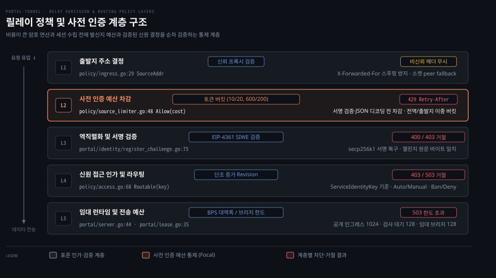

# relay policy

---

> 공개 릴레이가 익명 발신자의 사전 인증 예산과 검증된 서비스 신원을 기준으로 연산 자원과 라우팅을 통제하는 정책 계층을 다룹니다.

## 정책 계층 지도

> 릴레이는 HTTP 요청을 수신했을 때 암호 연산과 역직렬화 이전에 발신지 예산과 라우팅 인가를 단계별로 검증합니다.

누구나 터널을 등록할 수 있는 공개 릴레이를 운영하면 서비스 거부 공격이라는 위험에 직면합니다. 악의적 발신자가 위조된 등록이나 무효한 서명을 대량으로 보내 서버 연산 자원을 고갈시키는 공격입니다. 도메인 소유권을 확인하는 EIP-4361 SIWE 서명 검증은 타원곡선 공개키 복구를 수반하는 무거운 연산입니다. 릴레이가 발신자의 신뢰도를 확인하기 전에 모든 요청의 본문을 메모리에 풀고 암호학적 서명을 검증한다면 소수의 공격자만으로도 제어 평면 전체가 마비됩니다.

릴레이는 `cmd/relay-server/policy/mux.go`에서 제어 평면 라우트를 정책 래퍼로 감싸 이 문제를 막습니다. 무거운 연산을 요구하는 `POST /sdk/register/challenge`, `POST /sdk/register`, `POST /discovery/announce`(`:98, 110, 140`) 세 경로가 대상입니다. 여기서 announce는 `/sdk/*`가 아닌 디스커버리 경로입니다. 이 세 라우트는 `admit(cost, ...)`(`:60-71`) 래퍼를 거쳐 본문 파싱 전 사전 인증 예산을 먼저 차감합니다.

위 도식은 5단계 정책 계층을 보여줍니다. 외부 요청은 릴레이에 유입된 뒤 이 계층을 거쳐야 실제 터널 데이터로 연결됩니다. 직전 홉이 신뢰 프록시인지 판별해 실제 출발지 주소를 확정한 뒤 무거운 연산 전에 토큰 버킷에서 비용을 차감합니다. 그 후 EIP-4361 서명 검증과 신원 접근 결정을 통과한 요청만 임대 레지스트리와 데이터 평면으로 진입합니다.

기준 커밋 129b6de5 (2026-10-20)

## 사전 인증 예산과 작업 비용

> 익명 출발지가 유발하는 암호 검증 부하를 막기 위해 서명 검증과 본문 디코딩 전에 토큰 버킷으로 비용을 선차감합니다.

등록 챌린지 발급과 서명 등록 요청이 동시에 쏟아질 때 릴레이가 정상 요청과 남용 트래픽을 구분하지 못하면 정상 터널 에이전트까지 타임아웃에 빠집니다. 특히 공격자가 서명이 어긋난 가짜 요청을 초당 수백 건씩 퍼부으면 서명 검증 함수를 실행하는 것만으로 코어 CPU가 포화 상태에 이릅니다.

릴레이는 이 부하를 `cmd/relay-server/policy/source_limiter.go`의 `SourceLimiter`로 막습니다. `NewSourceLimiter(ratePerMinute, burst, globalRate, globalBurst)`(`cmd/relay-server/policy/source_limiter.go:38-44`)는 출발지별 버킷과 전역 버킷을 동시에 관리합니다. 기본 설정값은 `cmd/relay-server/policy/preauth.go:9-14`의 `DefaultPreAuthConfig`에 정의되어 있습니다.

| 설정 항목 | 기본 수치 | 적용 대상 및 목적 |
|---|---|---|
| `SourcePerMinute` | 10 토큰 | 출발지 IP별 분당 보충 토큰 수 |
| `SourceBurst` | 20 토큰 | 출발지 IP별 최대 토큰 버킷 용량 |
| `GlobalPerMinute` | 600 토큰 | 릴레이 전체 분당 보충 토큰 수 |
| `GlobalBurst` | 200 토큰 | 릴레이 전체 최대 토큰 버킷 용량 |
| `ChallengeCost` | 1 토큰 | `POST /sdk/register/challenge` 챌린지 발급 비용 |
| `AnnounceCost` | 2 토큰 | `POST /discovery/announce` 릴레이 디스커버리 공표 비용 |
| `RegisterCost` | 5 토큰 | `POST /sdk/register` 서명 검증 및 임대 등록 비용 |

`cmd/relay-server/policy/mux.go:60-71`의 `admit` 핸들러는 `admission.Allow(source, cost)`를 본문 역직렬화나 서명 검증 전에 즉시 호출합니다. 토큰이 부족하면 필요한 대기 시간을 계산해 돌려줍니다. 릴레이는 본문을 읽지도 않은 채 즉시 429 응답과 `Retry-After` 헤더를 반환합니다(`cmd/relay-server/policy/mux.go:64-67,181-184`).

메모리를 아끼려고 비활성 출발지 버킷은 30분 유휴 시 정리됩니다(`sourceLimiterIdleTTL = 30 * time.Minute`, `cmd/relay-server/policy/source_limiter.go:14`). 최대 버킷 개수(`maxBucketCount: 65536`, `:42`)를 넘어서면 새로운 IP 할당을 거절합니다.

공식 메인테이너 문서(`docs/maintainer/architecture.md:137-138`)에 명시된 대로 인증된 임대 작업은 출발지 예산을 쓰지 않습니다. 임대 갱신(`POST /sdk/renew`), 리버스 연결 수립(`GET /sdk/connect`), 등록 해제(`POST /sdk/unregister`) 같은 작업은 이미 자격 증명을 획득한 에이전트의 정상 요청입니다.

이들 경로에는 `admit` 래퍼가 걸려 있지 않습니다. 그래서 출발지 IP 예산이 고갈되더라도 정상적인 임대 갱신과 데이터 연결은 중단되지 않습니다.

## 출발지 주소 결정과 프록시 신뢰

> 클라이언트가 위조할 수 있는 프록시 헤더를 방어하기 위해 명시적으로 지정한 CIDR 대역의 직전 홉만 신뢰합니다.

속도 제한기가 아무리 정교해도 요청을 보낸 출발지 IP를 정확히 판별하지 못하면 방어 체계가 무력화됩니다. 인터넷 클라이언트는 HTTP 요청 헤더에 임의의 IP를 적어 보낼 수 있습니다. 공격자가 신뢰할 수 없는 프록시 헤더를 위조하면 스푸핑 공격이 가능해집니다. 이 공격으로 속도 제한을 회피하거나 무고한 사용자의 예산을 대신 소진시킬 수 있습니다.

출발지 주소 결정 모듈(`cmd/relay-server/policy/ingress.go:21-55`)은 이 스푸핑을 차단합니다. 직전 연결 주소 `req.RemoteAddr`가 신뢰 프록시 대역 `i.trustedProxyCIDRs`에 속할 때만 프록시 헤더를 검사합니다(`:33-48`). 먼저 `X-Forwarded-For`의 가장 왼쪽 IP를 취합니다. 이 값이 없거나 무효하면 `X-Real-IP`를 확인합니다.

직전 홉이 신뢰 대역에 속하지 않거나 두 헤더 모두 유효하지 않으면 클라이언트가 보낸 헤더를 무시하고 원시 소켓 피어 주소를 그대로 출발지로 사용합니다(`:50-54`).

이런 IP 기반 사전 인증 예산에는 설계상 한계가 있습니다. 대규모 회사나 통신망 환경에서는 여러 사용자가 단일 공인 NAT 게이트웨이를 공유합니다.

같은 NAT 뒤에 있는 여러 독립 에이전트는 단 하나의 출발지 토큰 버킷(분당 10개, 버스트 20개)을 공유합니다. 한 에이전트가 짧은 시간에 재등록을 반복해 버킷을 모두 소모하면 같은 망의 다른 에이전트는 챌린지를 요청할 때 일시적인 429 오류를 겪습니다.

## 접근 결정과 단조 증가 리비전

> 릴레이는 영구 정책을 IP가 아닌 검증된 신원에 귀속시키며 단조 증가 리비전으로 동시성 경합을 방지합니다.

사전 인증 예산은 일시적인 과부하를 늦추는 완충 장치일 뿐입니다. 악의적인 서비스나 비인가 도메인을 영구적으로 차단하는 보안 경계는 될 수 없습니다. IP는 동적으로 변하고 NAT 뒤에서 공유되기 때문에 특정 IP를 영구 차단하면 무고한 제3자가 피해를 입습니다.

포털 릴레이는 영구 인가 결정을 IP가 아니라 서명 검증으로 증명된 포털 신원(`types.ServiceIdentityKey`, `name:address`)에 귀속시킵니다(`docs/maintainer/architecture.md:109-118`). `cmd/relay-server/policy/access.go`의 `AccessState`는 승인 모드, 승인 신원 집합, 거절 신원 집합, 차단 신원 집합을 관리합니다.

- `auto` 모드: 차단되거나 거절되지 않은 모든 유효 신원이 즉시 라우팅 가능합니다(`cmd/relay-server/policy/access.go:75-80, 90-96`).
- `manual` 모드: 관리자의 명시적 승인을 받은 신원만 라우팅 가능합니다.

신원의 라우팅 가능 여부는 `Routable(key)`(`:68-73`)로 계산됩니다. 라우팅되려면 차단이나 거절 목록에 없고 유효 승인 조건을 만족해야 합니다.

관리자가 정책을 변경하면 `Access.Commit(next)`(`:57-62`)은 이전 리비전에 1을 더해 단조 증가 리비전을 부여합니다. 등록 요청 핸들러 `publishAccess`(`cmd/relay-server/policy/mux.go:40-54`)는 챌린지와 등록 완료 시점에 호출됩니다. 이 핸들러는 `s.SetServiceIdentityRoutable(key, state.Routable(key), state.Revision())`을 실행합니다.

포털 레지스트리(`portal/lease.go:136-148` `setIdentityRoutable`, 01-06 편 연계)는 전달받은 리비전이 자신이 유지하는 리비전보다 과거이면 적용을 거부합니다. 단조 증가 리비전이 보장되지 않으면 동시성 결함이 생깁니다. 관리자가 방금 특정 신원을 차단했더라도 지연된 이전 등록 스냅샷이 뒤늦게 도착해 최신 결정을 덮어씁니다.

리비전 충돌로 상태 전달이 8회 재시도(`accessPublishAttempts = 8`, `cmd/relay-server/policy/mux.go:17,47-53`) 후에도 실패하면 릴레이는 503 오류로 안전하게 실패 폐쇄합니다.

## 서비스 평판과 투표 자격 증명

> 릴레이는 쿠키와 IP 기반 자격 증명으로 투표를 수집하되 상태 파일 크기와 조작을 방어하기 위해 상한을 둡니다.

인터넷의 익명 사용자가 릴레이 디렉토리의 서비스에 허위 추천이나 비추천을 무제한으로 조작하면 평판 시스템의 신뢰도가 무너집니다. 단일 공격자가 스크립트로 추천 투표를 무한히 발행하거나 악성 호스트를 대량 등록해 평판 데이터베이스를 폭증시킬 수 있습니다.

`cmd/relay-server/policy/reputation.go`의 `ReputationStore`는 추천과 비추천 투표를 관리합니다. 투표 원장은 호스트네임이 아니라 서비스 신원 키 단위(`s.state.Identities[identity]`, `:126, 168`)로 저장됩니다. 투표 값은 `VoteUp`과 `VoteDown` 상수를 사용합니다(`:30-33`).

단순 조회 시에는 쿠키를 발급하지 않고 익명으로 취급합니다(`ViewerHashFor`, `:173-175`). 투표 제출 시점에 유효 쿠키가 없을 때만 `CastVote`(`:111-114`)에서 서명된 voter 쿠키를 새로 발급합니다. 발급된 쿠키는 32바이트 시크릿과 HMAC-SHA256으로 검증합니다.

쿠키가 없는 클라이언트라면 출발지 IP로부터 결정론적 식별자를 HMAC으로 파생합니다(`resolveVoterLocked`, `:191-207`).

평판 상태 파일인 `reputation.json`은 투표가 변경될 때마다 전체가 원자적으로 다시 쓰입니다. 이 파일 I/O 부하를 제한하려고 고정 상한을 둡니다. 서비스 신원당 최대 투표자 수는 1,024명(`reputationMaxVoters = 1024`, `:41, 134`)으로 제한됩니다. 평판 원장에 투표가 누적될 수 있는 최대 서비스 신원 수는 4,096개(`reputationMaxIdentities = 4096`, `:42, 130`)입니다.

이 투표 속도 제한은 평판 전용 제한기(`store.limiter = NewSourceLimiter(10, 20, 120, 40)`, `:100`)에서 차감됩니다. 이 제한기는 앞서 살펴본 사전 인증 예산과 별개로 동작합니다. 투표 요청은 `AllowVote` 핸들러에서 1 토큰을 소비합니다. 쿠키 없는 신규 voter 생성 시에는 10 토큰을 추가 차감해(`Allow(source, 10)`, `:139-143`) 무차별 투표를 억제합니다.

공식 메인테이너 문서(`docs/maintainer/architecture.md:100-101`)는 이 시스템의 한계를 이렇게 적어 두었습니다.

> "This counts voter credentials, not authenticated people, and preserves existing signed cookies and the persisted ledger format."

릴레이 평판 시스템은 인증된 사람의 수를 세는 것이 아니라 발급된 투표 자격 증명을 셀 뿐입니다. 같은 NAT 뒤에 있는 방문자들은 동일한 IP voter 식별자를 공유합니다. 독립된 네트워크를 동원하는 대규모 투표 조작은 막지 못합니다.

### 무제한 신원 생성과 시빌 공격 방어의 한계

중앙 계정 인증이 없는 개방형 네트워크는 시빌(Sybil) 공격 위험에 노출됩니다. 공격자가 가짜 신원을 대량으로 만들어 자원 제한을 우회하는 공격입니다. 클라이언트는 계정 등록 없이도 로컬에서 secp256k1 개인키 쌍을 자유롭게 생성할 수 있습니다. 임대(lease) 단위나 특정 서비스 신원 키에만 예산과 요청 한도를 묶어 두면 공격자는 새로운 키 쌍을 계속 생성해 신원을 바꾸는 것만으로 단위별 제한을 우회하게 됩니다.

포털 릴레이는 단일 신원 키에만 의존하지 않고 앞서 살펴본 여러 계층의 정책을 결합해 대응합니다. 무거운 암호 검증에 들어가기 전에 IP 출발지 및 전역 토큰 버킷으로 사전 인증 예산을 먼저 차감하여 무차별 신원 생성이 유발하는 연산 부하를 차단합니다. 영구 라우팅 단계에서는 승인 모드(`manual` 모드)를 두어 관리자가 승인하지 않은 신원의 데이터 경로 진입을 통제합니다.

평판 시스템도 앞에서 본 대로 사람이 아니라 투표 자격 증명을 셉니다. 그래서 여러 네트워크 출발지를 동원해 자격 증명을 대량으로 얻는 분산 공격은 평판 점수만으로 막기 어렵습니다. 릴레이 정책은 신원 하나를 온전히 믿지 않고, 출발지 사전 인증 비용과 관리자 승인 경계를 겹쳐 피해 반경을 줄입니다.

## 관리자 API 표면과 운영 정책

> 릴레이 운영자는 전용 토큰으로 인증된 관리자 API를 통해 실시간 임대 상태를 감시하고 신원별 접근 정책을 영구 반영합니다.

악의적인 스팸 터널이나 대역폭 남용 노드가 발생했을 때 운영자가 프로세스 재시작 없이 즉시 차단하지 못하면 릴레이 전체가 마비될 수 있습니다. 관리자 기능이 일반 터널 제어 API와 같은 인증 공간을 공유하면 토큰 하나가 유출될 때 관리자 기능까지 함께 열립니다.

포털 릴레이는 운영자 엔드포인트를 `/api/admin` 및 `/api/policy` 하위로 격리합니다. 이 엔드포인트는 전용 토큰(`ADMIN_TOKEN`) 기반의 독립된 Bearer 토큰 인증 체계를 요구합니다(`docs/src/routes/api-reference/admin/+page.md:15-22`). 관리자 토큰은 일반 SDK 클라이언트의 임대 토큰과 따로 분리되어 관리됩니다.

| HTTP 메서드 | 경로 | 인증 요구 | 요청 본문 | 응답 데이터 | 주요 역할 |
|---|---|---|---|---|---|
| `POST` | `/api/admin/auth/login` | 없음 | `AdminAuthLoginRequest` | `AdminAuthLoginResponse` | `ADMIN_TOKEN` 검증 및 세션 Bearer 토큰 발급 |
| `GET` | `/api/admin/auth/status` | 선택적 Bearer | 없음 | `AdminAuthStatusResponse` | 현재 세션의 관리자 인증 유효 여부 확인 |
| `POST` | `/api/admin/auth/logout` | Bearer | 없음 | `{}` | 관리자 로그아웃 처리 |
| `GET` | `/api/policy` | Bearer | 없음 | `PolicySettings` | 승인 모드 및 포트와 랜딩페이지 정책 조회 |
| `POST` | `/api/policy` | Bearer | `PolicySettings` | `PolicySettings` | 릴레이 전체 정책 설정 갱신 및 파일 저장 |
| `GET` | `/api/policy/state` | Bearer | 없음 | `PolicyStateResponse` | 활성 임대 목록과 신원별 승인 및 차단 현황 조회 |
| `POST` | `/api/policy/leases` | Bearer | `LeasePolicyUpdate` | `{}` | 특정 신원(`identity_key`)의 승인, 차단, 대역폭 한도 갱신 |

`POST /api/policy/leases`로 전달된 신원별 정책(`is_approved`, `is_banned`, `is_denied`, `bps`)은 `policy.json` 파일에 원자적으로 영구 기록되며 즉시 활성 레지스트리에 반영됩니다. 차단된 신원은 다음 임대 요청이 거부될 뿐만 아니라 현재 연결 중인 세션과 캐시된 정적 데이터까지 즉시 무효화됩니다.

## 리뷰 노트

> 소스 코드와 공식 아키텍처 문서를 대조하며 확인한 주의점과 개선 검토 사항입니다.

- `cmd/relay-server/policy/mux.go:47-53` 리비전 충돌 재시도 상한: `publishAccess`는 리비전 경합 발생 시 최대 8회(`accessPublishAttempts = 8`) 재시도 후 실패하면 503 오류를 반환합니다. 관리자 정책 수정이 몰릴 경우 정상 등록 요청이 일시적으로 거절될 수 있으므로 클라이언트의 지수 백오프 재시도 전략이 필요합니다.
- `cmd/relay-server/policy/ingress.go:34-41` X-Forwarded-For 체인의 첫 번째 IP 추출: 헤더에 쉼표로 연결된 IP 목록이 있을 때 가장 왼쪽 IP를 사용합니다. 신뢰 대역 설정이 올바르더라도 앞단 프록시가 `X-Forwarded-For` 헤더를 재작성(덮어쓰기)하지 않고 뒤에 덧붙이기만 하면 공격자가 직접 주입한 가장 왼쪽의 가짜 클라이언트 IP가 채택될 위험이 있습니다.
- `cmd/relay-server/policy/reputation.go:41-42, 134` 고정 상한에 따른 투표 용량 한계: 서비스 신원당 1,024명과 전체 신원 4,096개 상한은 단일 파일 I/O 부하를 억제합니다. 서비스 인기가 급증하거나 장기 운영 시 `len(previous) >= 1024` 조건에 의해 1,025번째부터의 신규 투표자는 `ErrReputationCapacity`로 거부되므로 주기적인 아카이빙이나 확장 설계가 필요합니다.

## 자가 점검 질문

1. 왜 릴레이는 HTTP 요청 본문을 역직렬화하거나 암호학적 서명을 검증하기 전에 사전 인증 예산을 먼저 차감하나요?
2. 신뢰 프록시 CIDR(`trustedProxyCIDRs`) 설정 없이 `X-Forwarded-For` 헤더를 그대로 믿을 때 어떤 보안 위험이 발생하나요?
3. 관리자의 접근 정책 커밋에서 리비전 번호를 단조 증가로 관리하고 오래된 스냅샷을 거부해야 하는 이유는 무엇인가요?

## 정답 (자답 후 펼치기)

1. EIP-4361 SIWE 서명 검증은 타원곡선 공개키 복구를 수반하는 무거운 CPU 연산이며 JSON 언마샬링은 메모리를 할당합니다. 악의적 발신자가 무효한 서명을 대량으로 퍼부을 때 이를 먼저 검증하면 코어 CPU와 메모리가 고갈되므로 릴레이는 무거운 연산에 진입하기 전에 토큰 버킷에서 비용을 차감해 초과 요청을 429로 즉시 차단합니다.
2. 클라이언트는 임의의 IP를 담은 `X-Forwarded-For` 헤더를 조작해 보낼 수 있습니다. 신뢰 프록시 검증 없이 헤더를 신뢰하면 공격자가 IP를 계속 바꾸며 속도 제한을 회피하거나 다른 무고한 사용자의 공인 IP를 사칭해 그 사용자의 사전 인증 예산을 고갈시킬 수 있습니다.
3. 관리자 API와 등록 핸들러는 비동기적으로 동시 실행될 수 있습니다. 단조 증가 리비전과 과거 스냅샷 거부가 없다면 요청 고루틴이 멈춘 사이 더 새로운 관리자 커밋 스냅샷이 먼저 반영될 수 있습니다. 이때 뒤늦게 전달된 과거의 허용 스냅샷이 최신 결정을 덮어쓰는 동시성 취약점을 방지하기 위함입니다(`cmd/relay-server/policy/mux.go:36-39`).

## 출처와 관련 문서

- [portal-tunnel GitHub Repository (129b6de5)](https://github.com/gosuda/portal-tunnel/tree/129b6de5): 릴레이 서버 소스 코드 및 정책 패키지 기준 커밋
- [01-03.Control Plane Flow.md](01-03.Control%20Plane%20Flow.md): 제어 평면의 4단계 생명주기 및 `/sdk/*` 전체 라우트 맵
- [00-02.Concepts.md](00-02.Concepts.md): 포털 터널의 핵심 용어와 패키지 경계 구조
- `cmd/relay-server/policy/mux.go`: 사전 인증 예산 및 정책 래퍼 라우터
- `cmd/relay-server/policy/source_limiter.go`: 출발지별 및 전역 이중 토큰 버킷 속도 제한기
- `cmd/relay-server/policy/preauth.go`: 사전 인증 기본 설정값 및 비용 정의
- `cmd/relay-server/policy/ingress.go`: 신뢰 프록시 기반 클라이언트 IP 결정 모듈
- `cmd/relay-server/policy/access.go`: 단조 증가 리비전 기반 신원 승인 및 차단 상태 머신
- `cmd/relay-server/policy/reputation.go`: voter 쿠키 및 자격 증명 기반 평판 투표 저장소
- `docs/maintainer/architecture.md`: 공식 메인테이너 아키텍처 및 정책 경계 규약
- `docs/src/routes/api-reference/admin/+page.md`: 관리자 인증 및 정책 제어 API 레퍼런스
