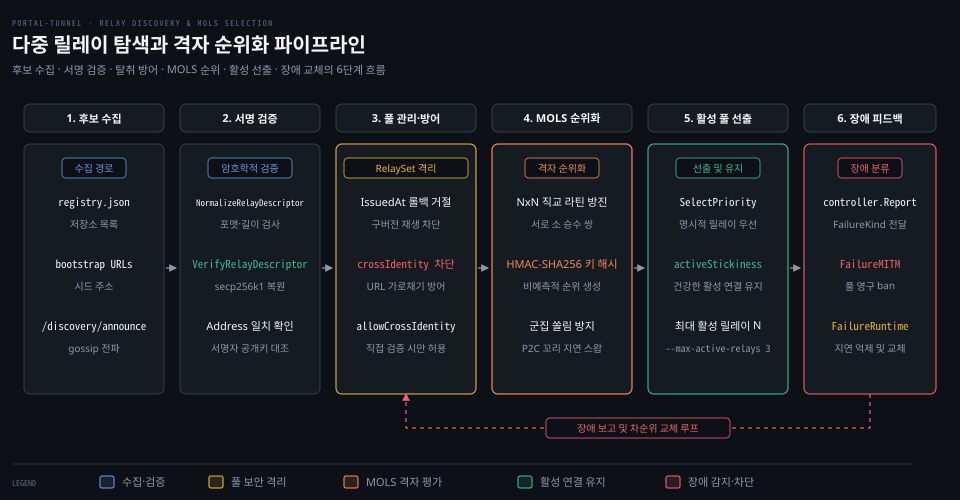
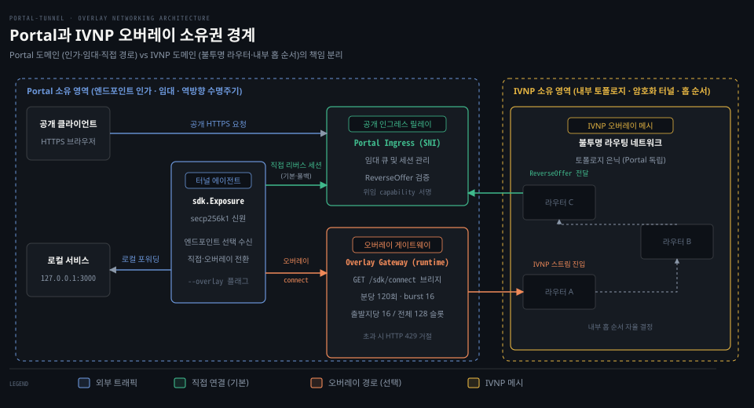

# discovery·overlay

---

> 터널이 다중 릴레이 후보를 발견하고 MOLS 격자로 우선순위를 매겨 장애를 견디는 탐색 메커니즘과, 엔드포인트 정책과 네트워크 경로를 분리하는 IVNP 오버레이의 소유권 경계를 다룹니다.

## 왜 다중 릴레이 풀이 필요한가

> 단일 공개 릴레이에 의존하면 릴레이의 일시적 장애나 악의적 행위가 곧 로컬 서비스의 전면 중단으로 이어집니다.

로컬 네트워크 방화벽 뒤의 서비스를 외부에 노출할 때 공개 릴레이 하나에만 연결을 위임하면 심각한 가용성 위기에 직면합니다. 해당 릴레이 서버가 재부팅되거나 네트워크 단절을 겪으면 외부 사용자는 서비스에 즉시 접근할 수 없게 됩니다. 악의적으로 변질된 단일 릴레이가 트래픽을 가로채거나 서비스를 고의로 차단할 경우 클라이언트는 무방비 상태가 됩니다.

포털 터널은 이 문제를 방어하기 위해 **다중 릴레이 장애 극복**(multi-relay failover) 구조를 기본 제공합니다(`README.md:23`). 터널 에이전트는 하나의 릴레이에 종속되지 않고 여러 공인 릴레이와 사설 릴레이를 하나의 복원력 있는 풀로 묶어 관리합니다.

터널 프로세스는 실행 시 `--max-active-relays` 플래그(`cmd/portal-tunnel/main.go:126`, `portal expose --help`)로 동시에 연결을 유지할 활성 릴레이 개수를 지정합니다. 기본값은 3입니다. 터널은 감지된 후보 풀에서 3개의 릴레이를 선출하여 상시 역방향 연결을 유지합니다. 그중 하나가 무너지면 즉시 차순위 릴레이로 전환합니다.

기준 커밋 0a3b9c06 (2026-10-14)


## 후보 알기: 레지스트리와 가십 전파

> 신뢰할 수 없는 분산 환경에서 제3자의 URL 가로채기와 구버전 재생 공격을 막으려면 암호학적 서명과 엄격한 상태 갱신 규칙이 필요합니다.

### 세 가지 후보 수집 경로

터널은 전 세계에 분산된 릴레이들을 세 가지 경로로 학습합니다.

1. 공식 레지스트리: 저장소 루트의 `registry.json:1-12`에 하드코딩된 신뢰 시드 목록입니다. 기본 운영 중인 8개의 공식 릴레이 URL을 제공합니다.
2. 부트스트랩 URL: 사용자가 CLI 플래그나 환경변수로 직접 주입하는 초기 진입점 목록입니다.
3. 가십 전파: 릴레이들이 서로의 존재를 알리는 `/discovery/announce` 엔드포인트(`types/paths.go:40`, `portal/api_server.go:222`)를 통한 동적 학습입니다.

### 서명된 릴레이 디스크립터 검증

임의의 노드가 거짓 정보로 트래픽을 유도하지 못하도록 모든 릴레이 정보는 서명된 **릴레이 디스크립터**(Relay Descriptor) 형태로만 유통됩니다. 릴레이는 `portal/discovery/relay_descriptor.go:22`의 `SignRelayDescriptor` 함수를 사용해 자신의 secp256k1 개인키로 디스크립터에 서명합니다.

디스크립터 정규화 바이트는 `canonicalRelayDescriptorBytes`(`:164`)로 생성됩니다. 여기에는 EVM 주소, 버전(`Version`), 발급 시각(`IssuedAt`), 만료 시각(`ExpiresAt`), API 주소, 지원 전송 프로토콜(TCP·UDP), 활성 연결 수, 관측 대역폭, IVNP 목적지(`IVNPDestination`)가 포함됩니다. 서명은 복원 가능한 컴팩트 포맷(`signature.Compact`, `:49`)으로 첨부됩니다.

수신 측은 `VerifyRelayDescriptor`(`:62`)를 호출하여 서명을 검증합니다. 서명 바이트에서 공개키를 복원(`identity.RecoverSHA256Secp256k1Compact`, `:81`)하고 EVM 주소를 도출(`AddressFromCompressedPublicKeyHex`, `:87`)합니다. 이후 디스크립터에 적힌 `Address`와 대조하여 일치하지 않으면 즉시 오류를 반환하며 버립니다.

`NormalizeRelayDescriptor`(`:101`, `:155-158`) 단계에서는 `ExpiresAt` 존재와 `IssuedAt <= ExpiresAt` 정합성만 검사합니다. 만료 시각 경과 여부는 이 검증 함수가 아니라 이후 풀 등록 시점에 판단합니다.

### 제3자 URL 가로채기 방어와 롤백 방어

가십 프로토콜은 릴레이 간의 전파를 돕지만 악의적 노드가 타인의 URL을 가로채거나 과거 디스크립터를 재생하는 공격 벡터를 엽니다. `portal/discovery/relayset.go`는 두 가지 핵심 규칙으로 이를 방어합니다.

첫째로 롤백을 방어합니다. `descriptorRollbackResultLocked`(`:222-252`)는 서명 주소별 앵커(`keyIndex[address]`)를 기준으로 판정합니다. 과거 툼스톤이 만료된 주소는 첫 관측처럼 새 디스크립터를 받아들입니다.

반면 유효 앵커의 `IssuedAt`보다 오래된 디스크립터는 배제합니다. 이때 동일 URL·동일 identity의 최신 디스크립터가 이미 등록되어 있다면 단순 무시(`upsertIgnored`)합니다. 그 외에는 거부(`upsertRejected`)하여 리플레이 공격을 차단합니다.

둘째, 제3자 URL 가로채기 차단입니다. `crossIdentityTakeoverBlockedLocked`(`:255`, `:277-282`)는 특정 URL 슬롯을 아직 만료되지 않은 다른 identity가 선점하고 있다면 제3자가 보낸 announce나 가십을 통한 갱신을 거부합니다.

```go
// portal/discovery/relayset.go:255-264 발췌
func (s *RelaySet) crossIdentityTakeoverBlockedLocked(relayURL, address string, now time.Time) bool {
    existing, ok := s.relays[relayURL]
    if !ok {
        return false
    }
    existingAddress := strings.ToLower(strings.TrimSpace(existing.Descriptor.Address))
    differentIdentity := existingAddress != "" && address != "" && existingAddress != address
    unexpired := !existing.Descriptor.ExpiresAt.IsZero() && existing.Descriptor.ExpiresAt.After(now)
    return differentIdentity && unexpired
}
```

주석(`:280-282`)이 명시하듯 `allowCrossIdentityTakeover` 플래그는 터널이나 릴레이가 해당 URL에 직접 연결해 권위 있는 응답을 직접 검증했을 때만 허용됩니다. 가십 전파와 announce 수신 경로에서는 이 플래그가 항상 false로 강제되므로 기존 디스크립터가 만료되지 않은 동안 제3자의 URL 탈취가 차단됩니다. 만약 기존 디스크립터가 만료된 뒤 다른 identity가 해당 URL을 차지하면 등록은 허용되지만 이전 신뢰도(`Trust`)는 승계되지 않고 후보 상태로 초기화됩니다(`:186-188`).


## 고르기: MOLS 격자 순위화와 쏠림 방지

> 모든 클라이언트가 지연 시간이 가장 짧은 특정 릴레이로 동시에 몰리면 해당 노드가 즉시 과부하로 마비됩니다.

### 군집 쏠림 현상과 분산의 필요성

단순 지연 시간 순으로 릴레이를 고르면 모든 터널이 동일한 1위 릴레이로 집중되는 군집 쏠림(herd effect) 현상이 발생합니다. 특정 릴레이가 장애로 탈락했을 때 모든 터널이 약속이라도 한 듯 동일한 차순위 노드로 몰려 연쇄 붕괴를 일으키기도 합니다.

포털 터널은 이 문제를 해결하기 위해 수학적 라틴 방진 이론에 기반한 **MOLS**(Mutually Orthogonal Latin Squares, 서로 직교하는 라틴 방진) 격자 순위화 알고리즘(`portal/discovery/mols.go`)을 채택했습니다. 소스 코드 첫머리 주석(`:1-25`)은 이 설계의 원리를 명확히 설명합니다.

MOLS 선택 알고리즘은 현재 유효 풀 크기에 맞추어 동적으로 `N x N` 격자를 생성합니다. 승수 `m1`, `m2`, 그리고 `m1 - m2`가 격자 차수 N과 서로 소(coprime)가 되도록 선택합니다. 짝수 차수에서는 선형 직교 쌍이 존재하지 않으므로 행별 중복이 없는 단일 방진 `(1, 1)` 점수로 안전하게 폴백합니다. 노드가 탈락하거나 필터링되면 격자는 `N+1 -> N`으로 즉시 축소되며 남은 인덱스가 기계적으로 재계산되므로 낡은 엔트리가 남지 않습니다.

### 비예측성과 결정적 균등 분할

모든 순위 계산에는 HMAC-SHA256 함수 `molsDigest`(`portal/discovery/mols.go:155`, 호출 :248)가 결합됩니다. 이 함수의 비밀 키는 SDK가 클라이언트의 영속 신원 개인키에서 유도한 `SelectionKey`(:150-155, 373)입니다.

외부 관찰자는 특정 클라이언트가 어떤 순위표를 얻을지 미리 예측할 수 없으며 인위적인 URL 채굴 공격도 무력화됩니다. 동일 클라이언트는 프로세스를 재시작해도 저장소 추가 없이 항상 일관된 순위를 재현합니다.

`molsScore`(`:52-80`)는 두 직교 방진 상에서 주 목표 지점 `t1`과 보조 목표 지점 `t2`를 계산합니다. 릴레이는 두 목표 지점과의 거리에 따라 점수를 부여받습니다. 이 메커니즘 덕분에 특정 릴레이에서 이탈한 클라이언트들이 단일 후속 노드로 몰리지 않고 다양한 보조 노드로 고르게 흩어집니다(`:59-61`, herd elimination).

### 순위 산출 파이프라인

`portal/discovery/mols.go:24-27`에 정의된 순위 산출 파이프라인은 3단계로 동작합니다.

1. 필터링(Filter): 차단(ban), 비활성(dead), 만료, 프로토콜 비호환 릴레이를 선별 제외합니다.
2. 순위화(Rank): `RankRelayPool`(`:239`)이 남은 후보들을 MOLS 격자로 결정적 정렬합니다.
3. 강등(Demote): 1위 노드의 꼬리 지연 압력(`Pressure`)이 2위 노드보다 0.3(`molsP2CPressureDelta`, `:49`) 이상 높으면 두 노드의 자리를 맞바꿉니다.

최종 선택을 수행하는 `SelectPriority`(`:352`)는 명시적으로 지정된 릴레이를 최우선 배치한 뒤 MOLS 순위 풀에서 선출한 후보를 덧붙입니다. 이때 `applyActiveStickiness`(`:387`)가 개입하여 이미 건강하게 연결된 활성 릴레이를 우선 보존합니다.

자동 선택 후보(`auto`)는 `--max-active-relays`(`cmd/portal-tunnel/main.go:126`, 기본 3) 개수만큼 잘라냅니다. 플래그 설명대로 이는 자동 선택 공개 릴레이의 상한입니다. 사용자가 명시한 릴레이 목록(`explicit`)은 이 상한과 무관하게 항상 앞에 붙여 반환합니다(`mols.go:379-382`). 격자가 재구성되어 순위가 요동치더라도 기존 활성 리스너가 불필요하게 끊어지지 않도록 보호하는 장치입니다.




## 실패 반영: 컨트롤러와 맹목적 협력자

> 릴레이의 일시적 통신 지연과 고의적인 패킷 변조를 동일한 수위로 처벌하면 가용 풀이 순식간에 고갈되거나 보안 구멍이 뚫립니다.

### 장애 유형의 삼분류와 제재 수위

`portal/discovery/controller.go:21-27`은 릴레이 장애를 세 가지 `FailureKind`로 엄격히 분류합니다.

1. `FailureRuntime`: 일시적 네트워크 단절, 핸드셰이크 타임아웃, 소켓 비정상 종료 등 일반 런타임 오류입니다.
2. `FailureTerminal`: 프로토콜 버전 불일치, 지원하지 않는 기능 요구 등 설정상 회복 불가능한 오류입니다.
3. `FailureMITM`: 클라이언트 자체 TLS 키 익스포터 프로브에서 패스스루 위조가 감지된 중간자 공격 의심 사례입니다.

장애 피드백을 수신하는 `controller.Report`(`:73`)는 실패 유형에 따라 전혀 다른 정책을 적용합니다.

```go
// portal/discovery/controller.go:73-86 발췌
func (c *Controller) Report(relayURL string, kind FailureKind) {
    if c == nil || relayURL == "" {
        return
    }
    switch kind {
    case FailureMITM:
        c.relaySet.BanRelayURL(relayURL)
    default:
        if !c.relaySet.IsSuppressed(relayURL, time.Now().UTC()) {
            c.relaySet.RecordActiveFailure(relayURL, 1)
        }
    }
    c.signal()
}
```

`FailureMITM`이 접수되면 릴레이는 풀에서 즉시 영구 차단(`c.relaySet.BanRelayURL`)됩니다. 반면 `FailureRuntime`이나 `FailureTerminal`은 `RecordActiveFailure`를 호출하여 점진적 백오프 억제(`suppressActiveUntil`)를 적용합니다. 일시적 순단 노드는 일정 시간 대기열에서 배제되었다가 회복 후 다시 기회를 얻지만 보안 위반 노드는 완전히 퇴출당합니다.

### 풀 차단 상태의 영향

디스커버리 갱신 장애가 `AnnounceMaxValidity`를 초과하면 `banFromPoolLocked`(`relayset.go:162, 986-988`)가 호출됩니다. 해당 릴레이를 `Banned=true`로 마킹하고 72시간(`relayPoolBanTTL`, `relaystate.go:14`) 동안 활성화를 억제합니다. 반면 앞서 본 `FailureMITM` 보고 시에는 `BanRelayURL`(`:448-458`)이 직접 호출되어 만료 시각 없이 즉시 영구 차단됩니다.

차단된 릴레이 중 부트스트랩 릴레이가 아닌 가십 릴레이는 차단 즉시 삭제되지 않습니다. 72시간 차단 기간이 만료되어 정리되는 시점(`clearExpiredPoolBansLocked`, `:145-153`)에 풀에서 비로소 삭제됩니다.

### SDK와 디스커버리의 경계: 맹목적 협력자

메인테이너 아키텍처 문서(`docs/maintainer/architecture.md:26-54`)는 `portal/discovery`와 `sdk.Exposure` 사이의 책임을 명확히 규정합니다.

`portal/discovery`는 `sdk.Exposure`를 위한 **맹목적 협력자**(blind collaborator)로 동작합니다. 디스커버리 계층은 오직 공개 릴레이의 우선순위 목록만 계산하여 반환할 뿐 중간 릴레이 연결 체인을 직접 구성하거나 소켓 런타임 상태를 알지 못합니다.

반대로 `sdk.Exposure`는 애플리케이션과 디스커버리 컨트롤러 사이의 완충 계층입니다. 상위 애플리케이션은 오직 사용자 의도만 제공합니다. 명시적 릴레이, 디스커버리 활성화(`sdk.WithDiscovery`), 최대 활성 릴레이 수, 전송 요구조건만 설정하며 컨트롤러나 실패 피드백에 직접 관여하지 않습니다(`docs/maintainer/architecture.md:50-53`).

`Exposure`는 리스너 이벤트에서 관측된 장애를 세 가지 `FailureKind`로 분류하여 디스커버리 컨트롤러에 피드백합니다(`:43-45`). 이후 디스커버리가 내려주는 멤버십 결정 콜백에 따라 실제 리버스 연결 풀을 동적으로 조정합니다.


## IVNP 오버레이: 프라이버시 백홀과 소유권 경계

> 공개 인그레스 릴레이가 백엔드 네트워크 경로까지 관리하게 되면 엔드포인트 정책과 오버레이 라우팅이 결합되어 유연성이 저하됩니다.

### IVNP 오버레이 네트워크의 도입

포털 터널은 공개 인그레스 뒤편의 라우팅 프라이버시를 향상(`README.md:25`)하고 경로 관리를 독립시키기 위해 패킷 오버레이 네트워크인 **IVNP** 연동을 지원합니다(`docs/src/routes/architecture/+page.md:363-368`).

단 터널은 선택된 오버레이 게이트웨이로 직접 아웃바운드 역방향 연결을 수립합니다(`:372-374`). 게이트웨이 운영자에게는 터널의 출발지 IP가 보이므로 경로 익명성을 완전 보장하는 것은 아닙니다. 핵심 동기는 엔드포인트 정책과 네트워크 경로의 분리입니다.

인그레스 릴레이에 `IVNP_CONFIG` 환경변수(`cmd/relay-server/main.go:103`)가 설정되어야 게이트웨이 엔드포인트를 반환할 수 있습니다(`docs/src/routes/architecture/+page.md:393-397`). 터널 클라이언트의 `--overlay` 플래그(`cmd/portal-tunnel/main.go:99`)는 가능한 경우 오버레이 게이트웨이를 선호한다는 선호 표시일 뿐 단독 활성화 스위치가 아닙니다.

공식 아키텍처 가이드(`:368`)는 핵심 원칙을 한 문장으로 정의합니다. 포털의 엔드포인트 정책은 엔드포인트 선택에서 끝나며 그 뒤의 네트워크 경로는 IVNP가 전적으로 소유합니다.

### 포털 소유 vs IVNP 소유의 책임 분리

메인테이너 문서(`docs/maintainer/architecture.md:31-37`)와 공개 아키텍처 가이드는 두 시스템의 책임을 엄격히 구분합니다.

포털이 소유하는 영역:
- 공개 인그레스 릴레이 및 적격 오버레이 게이트웨이의 선택과 인가
- secp256k1 신원 증명, 임대(Lease) 등록 및 유효기간 관리
- 위임 reverse capability(`docs/src/routes/architecture/+page.md:380`) 발급과 서명 검증
- 직접 리버스 연결의 기본 유지 및 오버레이 실패 시의 폴백 보장

IVNP가 소유하는 영역:
- 게이트웨이에서 인그레스 릴레이로 향하는 실제 네트워크 경로
- 내부 독립 라우터 선택, 암호화 터널 구축, 다중 홉 순서 결정
- 목적지 도달성 보장 및 내부 네트워크 복원력

포털과 SDK 입장에서 `Gateway -> Ingress` 구간은 하나의 논리적인 전송 엣지일 뿐입니다. 그 내부가 3개의 홉을 거치든 5개의 터널을 지나든 포털은 그 토폴로지를 알 수도 없고 보관하지도 않습니다. 직접 리버스 전송(`direct reverse transport`)은 항상 기본이자 최후의 폴백으로 유지됩니다.

### 게이트웨이 런타임과 사전 인가 슬롯 예산

오버레이 연결은 `portal/overlay/runtime.go`가 제어합니다. 터널이 게이트웨이에 연결할 때는 게이트웨이의 `HandleConnect`(`:245`) 경로에서 위임 capability를 검증합니다.

게이트웨이가 인그레스로 개설한 IVNP 백홀 스트림이 도착하면 인그레스 측 오버레이 런타임이 `acceptReverse`(`:570-599`)에서 capability를 재검증합니다. 검증을 통과하면 `ReverseOffer`(`:76`) 구조체를 생성하여 Portal 서버의 임대 수용 로직(`portal/server.go:612-614 admitReverseOffer`)에 소켓 소유권을 넘깁니다.

공개 아키텍처 가이드(Control Plane Flow §2)와 `portal/overlay/runtime.go:36-46`에 명시된 대로 게이트웨이는 엄격한 속도 제한과 슬롯 예산을 강제합니다.

- 발신 IP당 요청 수: 분당 120회(`sourceRequestsPerMinute = 120`), 최대 버스트 16회(`sourceRequestBurst = 16`). 서명 검증 연산 시작 전에 차감됩니다.
- 동시 세션 한도: 발신 IP당 최대 16개(`sourceConnectionLimit = 16`)의 연결이 게이트웨이 전체 128개 아웃바운드 슬롯(`connectionLimit = 128`)을 공유합니다.
- 예산 초과 시 즉시 HTTP 429(Too Many Requests)를 반환하여 게이트웨이 자원 고갈을 방어합니다.




## 열린 이슈: 악의적 릴레이와 서명 충돌

> 분산 디스커버리 환경에서 릴레이의 잠재적 배반과 디스크립터 위조를 완전히 차단하기 위한 설계 논의가 깃허브 이슈에서 활발히 진행 중입니다.

### 이슈 #646: 악의적 relay 행동 카탈로그

이슈 #646은 공인 릴레이가 취할 수 있는 다양한 악의적·이상 행동(malicious relay behaviors)을 체계적으로 분류하고 비례적 로컬 대응(proportionate local responses) 및 거버넌스 모델을 수립하는 논의입니다.

릴레이가 고의로 트래픽을 지연시키거나 버리는 행위, 허위 성능 메트릭을 디스크립터에 담아 순위를 왜곡하는 행위 등을 행위 기반 위협 카탈로그로 정리합니다. TLS 자체 프로브 강화는 관련 이슈인 #645의 소관으로 분리되어 있습니다. #646의 논의는 후속 PR #648에서 `docs/maintainer/relay-behavior.md` 카탈로그 초안 작성으로 이어졌으나 런타임 측정 및 자동 제재는 미완 상태입니다.

### PR #648: 충돌하는 서명 descriptor 거부 (미병합)

PR #648(기준 커밋 0a3b9c06 시점 열린 PR)은 충돌 디스크립터 거부 규약(rejecting conflicting signed descriptors)을 다룹니다. 동일한 URL, 동일한 서명 키, 동일한 `IssuedAt`을 가지면서 페이로드 내용만 다른 경우가 대상입니다.

이 PR의 처리 방식은 악의 판정이나 풀 차단(ban)을 부과하지 않고 로컬에 이미 저장된 기존 디스크립터를 보존하면서 새로 수신된 상충 디스크립터만 안전하게 거부하는 것입니다. 키 유출이나 복수 서명자가 관여하는 복합 시나리오는 해당 PR의 범위 밖으로 규정되어 있습니다.


## 리뷰 노트

> 소스 코드와 공식 아키텍처 문서를 대조하며 확인한 의문점과 검토 사항입니다.

- **MOLS 짝수 order 폴백 시의 공정성 편차 (`portal/discovery/mols.go:104-106`)**: 격자 크기 N이 짝수일 때는 서로 소인 선형 직교 승수 쌍이 수학적으로 존재하지 않아 단일 방진 `(1, 1)` 순위로 폴백합니다. 이 경우 결정적 정렬과 행별 고유성은 유지되지만 완전한 MOLS 직교 분산이 일시적으로 제한됩니다. 프로덕션 배포 시 후보 풀 노드 개수를 홀수로 유지하는 것이 최적의 분산 공정성을 얻는 데 유리한지 추가 실측이 필요합니다.
- **crossIdentity 차단 조건의 만료 시각 의존성 (`portal/discovery/relayset.go:262-263`)**: 제3자 URL 가로채기 차단은 기존 디스크립터의 `ExpiresAt`이 만료되지 않았음을 전제로 합니다. 만약 특정 릴레이가 일시적 장애로 디스크립터 갱신을 제때 수행하지 못해 만료 시각이 지나버리면 악의적 노드가 가십 announce를 통해 해당 URL 슬롯을 탈취할 이론적 가능성이 열립니다. 릴레이 재시작 주기와 TTL 버퍼 간의 마진 설계가 중요합니다.
- **오버레이 장애 시 임대 보존 회전 (`docs/src/routes/architecture/+page.md:396-398`)**: 게이트웨이가 다운되면 터널은 `POST /sdk/reverse`를 호출합니다. 전체 임대를 재등록하지 않고 대체 게이트웨이만 안전하게 재발급받습니다. 인그레스의 오버레이 선호도와 장애 릴레이 격리 시간이 어떻게 연동되는지 런타임 추적이 권장됩니다.


## 검증과 복습

> 이 문서에서 배운 다중 릴레이 탐색과 오버레이 아키텍처를 세 가지 질문으로 점검합니다.

1. **질문 1**: 릴레이 풀에서 특정 릴레이의 URL을 다른 공개키를 가진 제3자가 가십 프로토콜을 통해 가로채려 할 때, `RelaySet`은 이를 어떤 조건으로 차단합니까?
2. **질문 2**: MOLS 격자 순위화 알고리즘이 단순 최단 지연 시간 정렬 대신 클라이언트 비밀키 기반 HMAC 해시와 두 개의 직교 목표 지점을 계산하는 궁극적인 이유는 무엇입니까?
3. **질문 3**: IVNP 오버레이 네트워크를 경유하도록 설정했을 때, Portal 인그레스 릴레이와 IVNP 내부 라우터의 소유권 경계는 어떻게 나뉩니까?


## 정답 (자답 후 펼치기)

> 위 세 가지 질문에 대한 해답과 코드 근거입니다.

1. **정답 1**: `portal/discovery/relayset.go:255`의 `crossIdentityTakeoverBlockedLocked` 함수에 따라 차단합니다. 해당 URL 슬롯의 기존 디스크립터가 만료(`ExpiresAt`)되지 않았고 서명 주소가 다르면 제3자 갱신을 즉시 거부합니다. 주석(`:280-282`)대로 `allowCrossIdentityTakeover`는 직접 연결 검증 시에만 허용됩니다. 가십 전파와 `/discovery/announce` 경로에서는 항상 false로 차단됩니다. 단, 기존 디스크립터가 이미 만료된 경우에는 제3자 등록이 허용되되 이전 신뢰도가 초기화됩니다(`:186-188`).
2. **정답 2**: 모든 클라이언트가 특정 고성능 릴레이 하나로 일시에 집중되어 과부하가 발생하는 군집 쏠림(herd effect) 현상을 방지하기 위해서입니다(`portal/discovery/mols.go:59-61`). 클라이언트별 고유 키로 비예측적 순위를 도출합니다. 직교하는 두 라틴 방진 목표 지점(`t1`, `t2`)으로 특정 노드 장애 시 클라이언트들이 다양한 보조 릴레이로 고르게 분산되도록 보장합니다.
3. **정답 3**: Portal은 공개 인그레스와 게이트웨이 선택 및 인가, secp256k1 신원 증명, 임대(Lease), 위임 capability 발급과 검증을 소유합니다(`docs/maintainer/architecture.md:31-37`). 반면 게이트웨이에서 인그레스에 이르는 실제 네트워크 경로, 내부 라우터 선택, 암호화 터널 구축 및 홉 순서는 IVNP가 완전히 소유합니다. Portal과 SDK에는 그 토폴로지가 투명하게 은닉됩니다.


## 출처와 관련 문서

- [portal-tunnel 기준 커밋 소스 트리](https://github.com/gosuda/portal-tunnel/tree/0a3b9c06): 기준 커밋 0a3b9c06 소스 코드
- [Portal Architecture Guide](https://gosuda.github.io/portal-tunnel/architecture): 공식 아키텍처 및 IVNP-backed Overlay Networking
- [Portal Concepts Guide](https://gosuda.github.io/portal-tunnel/concepts): 다중 릴레이 장애 극복 및 디스커버리 개념
- `registry.json`: 공식 릴레이 기본 시드 목록
- `portal/discovery/relay_descriptor.go`: 릴레이 디스크립터 서명, 검증 및 정규화
- `portal/discovery/relayset.go`: 릴레이 풀 상태 관리, 롤백 및 가로채기 방어
- `portal/discovery/mols.go`: 직교 라틴 방진 기반 격자 순위화 및 쏠림 방지
- `portal/discovery/controller.go`: 실패 분류, 제재 정책 및 SDK 협력 제어
- `portal/overlay/runtime.go`: IVNP 게이트웨이 런타임, ReverseOffer 및 속도 제한 예산
- `docs/maintainer/architecture.md`: 패키지 경계 및 맹목적 협력자(blind collaborator) 규약
