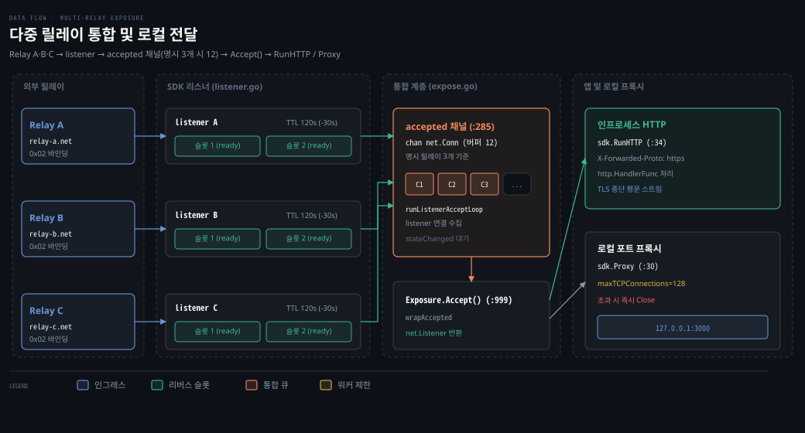

# sdk.Expose·Listener

---

> Go 애플리케이션 안에서 포털 SDK를 임베딩하여 다중 릴레이 연결을 수립하고 표준 리스너 계약과 프록시 파이프라인으로 트래픽을 처리하는 내부 구조를 다룹니다.

## 사용 예와 최소 임베딩 구조

> 외부 프로세스 격리 대신 단일 바이너리 배포가 필요할 때 포털 SDK 임베딩 함수를 호출합니다.

외부 CLI 프로세스를 웹 서비스와 함께 띄우면 데몬 감시와 프로세스 재시작 관리가 복잡해집니다. 컨테이너 내부에서 프로세스 간 루프백 소켓 통신을 거치면 파일 디스크립터가 낭비되고 네트워크 지연 시간도 늘어납니다. Go 언어로 작성된 애플리케이션이라면 터널 수명주기를 애플리케이션 메모리 안으로 통합하는 편이 안전합니다.

포털 터널은 Go 애플리케이션이 외부 CLI 없이 코드 몇 줄로 직접 인터넷에 노출되도록 `sdk` 패키지를 제공합니다. 공식 문서의 브라우저 웹어셈블리(WASM) 런타임 가이드(`docs/src/routes/api-reference/sdk/+page.md:281-297`)에 수록된 최소 실행 코드는 이렇습니다.

```go
// 출처: docs/src/routes/api-reference/sdk/+page.md:281-297
id, err := identity.Generate("browser-preview")
if err != nil {
    return err
}

exposure, err := sdk.Expose(ctx, id, []string{relayURL})
if err != nil {
    return err
}
defer exposure.Close()

handler := http.HandlerFunc(func(w http.ResponseWriter, r *http.Request) {
    _, _ = io.WriteString(w, renderCurrentPreview())
})
return sdk.RunHTTP(ctx, exposure, handler, "")
```

디스크의 키 파일을 재사용하고 자동 탐색을 켜는 전체 코드는 배포 스킬 레퍼런스(`plugins/portal-deploy/skills/portal-expose/references/sdk-embed.md:9-54`)에 있습니다.

```go
// 출처: plugins/portal-deploy/skills/portal-expose/references/sdk-embed.md:9-54
package main

import (
	"log"
	"net/http"
	"os"

	"github.com/gosuda/portal-tunnel/v2/portal/identity"
	"github.com/gosuda/portal-tunnel/v2/sdk"
	"github.com/gosuda/portal-tunnel/v2/types"
	"github.com/gosuda/portal-tunnel/v2/utils"
)

func main() {
	ctx, stop := utils.SignalContext() // cancels on SIGINT/SIGTERM
	defer stop()

	// name applies only when the identity file does not exist yet.
	id, err := identity.LoadOrCreate("my-app", os.Getenv("PORTAL_IDENTITY_PATH"), os.Getenv("IDENTITY_JSON"))
	if err != nil {
		log.Fatal(err)
	}

	exposure, err := sdk.Expose(ctx, id, nil,
		sdk.WithDiscovery(3), // bootstrap relays plus discovery; nil relays is allowed only with this option
		sdk.WithMetadata(types.LeaseMetadata{Description: "my app"}),
	)
	if err != nil {
		log.Fatal(err)
	}
	defer exposure.Close() // RunHTTP does not close the exposure for you

	go func() {
		if relays, err := exposure.WaitReady(ctx); err == nil {
			log.Printf("public url: %s", relays[0].PublicURL)
		}
	}()

	mux := http.NewServeMux()
	mux.HandleFunc("/", func(w http.ResponseWriter, r *http.Request) { _, _ = w.Write([]byte("hello")) })
	if err := sdk.RunHTTP(ctx, exposure, mux, ""); err != nil { // "" = no extra local listener
		log.Fatal(err)
	}
}
```

두 예제의 핵심 진입점은 `sdk.Expose(ctx, id, relayURLs, options...)`(`sdk/expose.go:203`) 호출입니다. 이 함수가 반환하는 객체는 표준 `net.Listener` 인터페이스를 충족하므로 Go 표준 라이브러리의 `http.Serve(exposure, handler)`에 직접 전달할 수 있습니다.

기준 커밋 0a3b9c06 (2026-10-14)


## Exposure: 다중 릴레이를 감싸는 단일 net.Listener

> 여러 릴레이에서 인입되는 세션을 단일 채널 버퍼로 합치고 표준 리스너 계약으로 노출합니다.

단일 릴레이 서버에만 의존해 서비스를 배포하면 릴레이가 재시작되거나 네트워크 장애가 발생할 때 트래픽이 끊깁니다. 장애를 피하려면 복수의 독립된 릴레이에 세션을 열어 두어야 합니다. 하지만 애플리케이션 코드가 여러 수락 루프를 직접 다루면 동기화 버그가 생깁니다.

이 문제를 해결하는 중심 구조체가 **노출 객체(Exposure)**(`sdk/expose.go:90-123`)입니다. `Exposure`는 다중 릴레이 리스너의 수명주기를 총괄하며 내부 선언 `var _ net.Listener = (*Exposure)(nil)`(`:125`)로 표준 리스너임을 컴파일 타임에 보증합니다.

```go
// sdk/expose.go:90-123 발췌
type Exposure struct {
	cancel context.CancelFunc
	done   <-chan struct{}

	identity types.Identity
	options  options
	metadata types.LeaseMetadata
	cache    *cache.Source

	accepted  chan net.Conn
	datagrams chan types.DatagramFrame

	mu             sync.RWMutex
	reconcileMu    sync.Mutex
	relayURLs      []string
	relayListeners map[string]*listener
	blockedRelays  map[string]error
	statuses       map[string]RelayStatus
	stateChanged   chan struct{}
	updates        chan RelayStatus
	updatesMu      sync.Mutex
	acceptLoops    sync.WaitGroup

	discovery *discovery.Controller
	closeOnce sync.Once
	connSeq   atomic.Uint64
}
```

`sdk.Expose`를 호출할 때 가동할 부가 기능은 함수형 옵션(`sdk/expose.go:140`)으로 지정합니다.

- `WithStaticRelayCache(path, ttl)` (`sdk/expose.go:145`): 정적 파일 스냅샷을 업로드하고 오프라인 캐시를 활성화합니다. 선택된 릴레이가 콘텐츠를 저장하고 브라우저 TLS를 직접 종단하므로 캐시 응답은 종단간 암호화가 아니며(`:142-144`, `:234`), UDP·TCP·MITM 보호와 함께 사용할 수 없습니다(`:226-227`).
- `WithUDP()` (`:150`): L4 UDP 트래픽 수신을 위한 데이터그램 전송 경로를 요청합니다.
- `WithTCP()` (`:155`): 릴레이에 전용 공용 TCP 포트 할당을 요청합니다.
- `WithMITMProtection(enabled)` (`:162`): 중간자 공격 탐지용 자체 프로브 기능 동작 여부를 제어합니다.
- `WithOverlay()` (`:167`): 독립된 오버레이 네트워크 경로를 우선 사용하도록 요청합니다.
- `WithMetadata(metadata)` (`:172`): 임대 등록 시 전달할 설명 등의 메타데이터를 설정합니다.
- `WithDiscovery(maxActiveRelays)` (`:184`): 레지스트리 부트스트랩 노드와 동적 릴레이 탐색 컨트롤러(`portal/discovery`)를 활성화합니다.

개별 릴레이의 건강 상태는 `RelayStatus`(`sdk/expose.go:49-74`) 스냅샷으로 관리됩니다. 수명주기 상태인 `RelayState`(`:25-32`)는 `connecting`, `ready`, `failed`의 세 단계로 전이됩니다. 실패 사유를 나타내는 `RelayFailure`(`:39-46`)는 `runtime`, `terminal`, `mitm`으로 분류되어 릴레이 배제 여부를 결정합니다.

다중 릴레이를 하나의 리스너로 묶는 핵심 메커니즘은 채널 병합입니다. `Exposure`는 등록 대상 릴레이마다 내부 리스너(`newListener`, `sdk/listener.go:150`, `run`, `:256`)를 생성하여 `relayListeners` 맵에 보관합니다. 통합 수락 채널은 `sdk/expose.go:285`에서 할당합니다.

```go
accepted: make(chan net.Conn, max(len(initialRelays)*defaultReadyTarget*2, 1)),
```

`defaultReadyTarget`은 2입니다(`sdk/listener.go:37`). 버퍼 크기는 생성 시점의 명시 릴레이 수(`initialRelays := relayURLs`, `sdk/expose.go:254`)로만 고정됩니다.

`WithDiscovery`로 붙는 부트스트랩 릴레이는 세지 않으므로 앞서 살펴본 예제처럼 `sdk.Expose(ctx, id, nil, sdk.WithDiscovery(3))`로 호출하면 버퍼는 `max(0, 1) = 1`입니다(`:246-252`, `:285`). 명시 릴레이를 3대 지정하면 채널 버퍼 크기는 3 × 2 × 2 = 12가 됩니다. 각 내부 `listener`에도 `defaultReadyTarget*2 = 4` 크기의 자체 수락 버퍼(`sdk/listener.go:178`)가 따로 있습니다.

`Exposure`의 루틴 `runListenerAcceptLoop`(`sdk/expose.go:1247`)은 개별 릴레이에서 수락된 리스너 소켓을 단일 `accepted` 채널로 모읍니다(`:1333`).

소비자가 `Exposure.Accept()`(`sdk/expose.go:999-1022`)를 호출할 때 동작하는 대기 로직은 메인테이너 문서(`docs/maintainer/architecture.md:53-55`)에 이렇게 명시되어 있습니다.

> "Readiness and accept operations do not infer source exhaustion from the current membership; they wait for a future membership update, context cancellation, or exposure closure."
> (준비 상태 판정과 수락 동작은 현재 멤버십만으로 자원 고갈을 추론하지 않으며, 미래의 멤버십 갱신·컨텍스트 취소·노출 객체 종료를 기다립니다.)

실제 코드에서 `Exposure.Accept()`는 `accepted` 채널이 비어 있더라도 즉시 오류를 반환하며 빠져나오지 않습니다. `e.stateChanged` 알림 채널과 `e.accepted` 수신 채널을 동시에 감시합니다. 특정 릴레이와의 연결이 일시적으로 끊겨 현재 활성 릴레이가 0개가 되더라도 탐색 컨트롤러가 새 릴레이를 찾아내거나 기존 릴레이가 재연결될 때까지 대기합니다.



위 도식은 세 곳의 외부 릴레이에서 인입된 세션의 데이터 흐름을 보여줍니다. 세션은 각 내부 리스너의 작업 슬롯을 거쳐 `accepted` 채널로 수렴한 뒤 단일 `Accept()` 호출로 애플리케이션의 HTTP 핸들러나 로컬 프록시에 전달됩니다.


## listener 한 개의 일생

> 단일 릴레이와 통신하는 내부 리스너는 임대 등록, 리버스 세션 유지, 갱신 루프를 독립된 수명주기로 운용합니다.

릴레이 서버마다 서로 다른 지연 시간과 네트워크 단절이 발생할 때 이들을 하나의 루프에서 함께 다루면 한 곳의 지연이 전체 터널을 멈추므로 개별 릴레이와의 세션 관리는 각각 독립된 고루틴으로 격리되어야 합니다.

다중 릴레이 노출 객체 아래에서 실제로 연결을 맺고 유지하는 일은 내부 `listener`(`sdk/listener.go:118-148`)가 맡습니다. 각 `listener`는 독립된 고루틴 `run(ctx)`(`:256`) 안에서 임대 등록과 연결 풀링 루프를 격리하여 수행합니다.

리스너가 구동되면 `registerAndConfigure(ctx)`(`sdk/listener.go:1108`)를 실행합니다. 먼저 릴레이에 120초 수명(`defaultLeaseTTL = 2 * time.Minute`, `:35`)의 등록 챌린지를 요청합니다. SIWE 서명을 제출하여 임대 토큰과 리버스 엔드포인트를 발급받습니다([01-03.Control Plane Flow.md](./01-03.Control%20Plane%20Flow.md) 참조).

등록을 마치면 키리스 클라이언트(`keyless.NewClient`, `sdk/listener.go:1135`)를 생성합니다. SDK가 직접 테넌트 TLS 1.3을 종단하며 인증서 체인은 릴레이에서 pin하고 CertificateVerify 서명만 릴레이 `/v1/sign` 엔드포인트가 원격 생성합니다(`portal/keyless/client.go:1-10`, `:40-44`). 대칭 세션 키는 프로세스 밖으로 나가지 않아 종단간 기밀성을 보장합니다(`plugins/portal-deploy/skills/portal-expose/references/sdk-embed.md:90`).

그 직후 리스너는 활성 임대 수명주기 루프인 `runLease(ctx)`(`sdk/listener.go:564-634`)로 진입합니다. `runLease`는 여러 백그라운드 워커 고루틴을 띄워 서비스를 유지합니다.

- 정적 캐시 루프: 캐시 옵션이 켜져 있다면 `runStaticCache`(`sdk/listener.go:577-583`) 워커를 함께 가동하여 정적 파일 동기화와 오프라인 서빙 상태를 유지합니다.
- 리버스 세션 루프: `runReverseSessionLoop`(`sdk/listener.go:636-720`)는 슬롯 2개를 상시 가동합니다(`defaultReadyTarget = 2`). 각 슬롯은 아웃바운드 HTTP 연결을 맺고 `101` 하이잭으로 대기합니다([01-04.reverse_pool·reverse_framing.md](./01-04.reverse_pool%C2%B7reverse_framing.md), [01-05.stream_mux·yamux.md](./01-05.stream_mux%C2%B7yamux.md) 참조).

릴레이가 `0x02` 바인딩 마커를 보내면 소켓을 즉시 클레임합니다. 워커는 테넌트 TLS 악수를 끝마친 소켓으로 변환(`tenantTLS.TerminateConn`, `:679`)하여 `l.accepted` 채널로 넘깁니다. 소켓이 소비되면 즉시 새 연결을 맺어 대기 풀 2개를 유지합니다.

- 임대 갱신 루프: `runRenewLoop`(`sdk/listener.go:979-1035`)는 `renewDelay`(`:1037`) 함수로 타이머를 계산합니다. 만료 30초 전(`defaultRenewBefore = 30 * time.Second`, `:36`)에 릴레이로 갱신 요청을 보냅니다([01-06.lease·record.md](./01-06.lease%C2%B7record.md) 참조).

노트북 덮개를 닫아 OS 절전 모드에 들어갔다면 벽시계 시간의 점프가 생깁니다. 루프는 이를 감지(`elapsed > interval + wakeThreshold`, `:1004`)하여 고아 갱신 대신 즉시 `errLeaseRefreshRequired`를 반환하고 전체 재등록을 진행합니다.

- UDP 데이터그램 루프: `runDatagramLoop`(`sdk/listener.go:782-835`)입니다. UDP 옵션이 켜져 있다면 QUIC 백홀 세션을 연결하고 에지-오리진 간 비신뢰적 패킷 전송 파이프라인을 바인딩합니다([01-07.quic_backhaul·datagram.md](./01-07.quic_backhaul%C2%B7datagram.md) 참조).

일시 장애가 생기면 `waitRetry`(`sdk/listener.go:1189`)를 호출합니다. 지수 백오프 없이 `retryWait = max(3s, RetryAfter)`(`:1194-1197`)의 고정 간격으로 대기하며 컨텍스트가 취소되지 않는 한 false를 반환하지 않아 사실상 무한 재시도를 수행합니다(`:1189-1240`).

복구 불가능한 오류는 `isTerminalRelayError`(`sdk/listener.go:74-88`)가 판정합니다. 릴레이 버전 불일치 오류인 `errRelayIncompatible`(`:78-80`)과 아래 영구 거부 코드 5가지(`terminalAPIErrorCodes`, `:66-72`)가 여기에 해당합니다. 일시적 유량 제한을 제외한 4xx 클라이언트 오류도 종료 오류로 분류됩니다. 유량 제한 제외 판정은 `apiErr.IsRateLimited()`(`types/api.go:30-31`)가 담당하며 HTTP 429와 `APIErrorCodeRateLimited`를 포함합니다.

- `APIErrorCodeFeatureUnavailable`
- `APIErrorCodeTransportMismatch`
- `APIErrorCodeUDPDisabled`
- `APIErrorCodeTCPPortDisabled`
- `APIErrorCodeHostnameConflict`

종료 오류로 판정된 리스너는 즉시 루프를 끝내고 자신을 `RelayFailed`와 `RelayFailureTerminal`로 보고하여 릴레이 선택군에서 영구히 배제됩니다.


## 로컬로 넘기기: 프록시와 HTTP 라우팅

> 수락된 연결을 인프로세스 핸들러에서 직접 처리하거나 로컬 포트 및 경로 규칙에 따라 전달합니다.

인터넷에서 터널로 들어온 원시 소켓은 프로토콜 종류와 애플리케이션 구조에 따라 다르게 처리되어야 합니다. 인프로세스 Go 핸들러는 평문 HTTP 요청을 직접 받아야 하지만 기존 레거시 프로세스는 L4 포트 포워딩이 필요합니다.

### L4 TCP 프록시와 UDP 흐름 관리

터널이 수신한 원시 바이트 스트림을 로컬 포트(`127.0.0.1:3000`)로 그대로 전달하려면 `sdk.Proxy` 또는 `sdk.ProxyWithConfig`(`sdk/proxy.go:30-41`)를 사용합니다.

```go
// sdk/proxy.go:21, 135 발췌
const maxTCPConnections = 128

// proxyRelayConnections 내부 슬롯 제한
slots := make(chan struct{}, maxTCPConnections)
```

릴레이 측의 입장 통제와 별개로 SDK 로컬 프록시는 자체 동시성 예산을 강제합니다. `sdk/proxy.go:21`에 정의된 `maxTCPConnections = 128` 상수는 로컬로 포워딩할 수 있는 최대 TCP 워커 수를 제한합니다. 128개의 슬롯이 가득 찬 상태에서 추가 연결이 인입되면 소켓을 즉시 닫아(`:158`) 로컬 시스템의 파일 디스크립터 고갈을 차단합니다.

`ProxyWithConfig`는 프록시가 끝나면 `exposure.Close()`(`:107`)를 자동으로 호출합니다. `Exposure.Close`는 `closeOnce.Do`(`sdk/expose.go:1050`)로 보호되어 멱등하므로 재호출되어도 안전한 no-op입니다. e2e 하네스도 `sdk.Proxy` 실행 중 `exposure.Close()`를 별도로 부릅니다(`e2e/harness_test.go:130, 138`). `sdk-embed.md:94`의 "do not also defer" 지침은 버그 경고가 아니라 종료 소유권을 분명히 하라는 실무 권고입니다.

UDP 데이터그램 포워딩은 `udpFlowManager`(`sdk/proxy.go:379-489`)가 전담합니다. UDP는 비연결형 프로토콜이므로 로컬 소켓과의 양방향 매핑을 지속적으로 유지하려고 고유 키 `udpFlowKey`(`:366-371`)를 사용합니다.

```go
type udpFlowKey struct {
	flowID    uint32
	address   string
	relayURL  string
	leaseDone <-chan struct{}
}
```

흐름 키에 임대 종료 채널 `leaseDone`이 들어 있으므로 임대가 바뀌면 이전 소켓은 안전하게 닫힙니다. 청소 루틴 `runCleanup`(`sdk/proxy.go:398-420`)은 15초 주기로 동작하여 5분 이상 멈춘 유휴 흐름을 정리합니다(`DefaultUDPFlowIdleTimeout`, `types/transport.go:10`).

동시 활성 흐름 수는 최대 1024개로 제한됩니다(`DefaultUDPMaxFlows`, `types/transport.go:11`, `sdk/proxy.go:460`).

릴레이에서 로컬로 전달되는 인입 루프 `proxyExposureDatagrams`(`sdk/proxy.go:315-362`)에는 별도의 패킷 크기 검사가 없습니다. 반면 로컬 소켓을 읽는 응답 루프 `readLoop`(`:489-540`)는 크기 검사를 강제합니다. 패킷이 1238바이트를 초과하면 즉시 폐기합니다(`MaxUDPPayloadSize = 1280 - 37 - 5`, `types/transport.go:15-18`, `sdk/proxy.go:513`). 규격 내 패킷만 `exposure.SendDatagram`으로 릴레이에 회신합니다.

### L7 HTTP 라우팅과 헤더 재작성

인프로세스 웹 서버를 띄울 때는 편의 래퍼인 `sdk.RunHTTP`(`sdk/http.go:34-110`)를 활용합니다. `RunHTTP`는 표준 `http.Server`를 구성하면서 두 가지를 보장합니다.

모든 인입 요청의 `X-Forwarded-Proto` 헤더를 `https`로 강제 설정합니다(`:49`). 포털 터널의 모든 공개 주소는 TLS가 종단된 HTTPS 규격이므로 클라이언트가 변조된 스킴 헤더를 보내더라도 바로잡습니다.

세 가지 타임아웃도 강제합니다.
- 헤더 읽기: 30초 (`defaultHTTPReadHeaderTimeout`, `sdk/http.go:23`)
- 종료 유예: 5초 (`defaultHTTPShutdownTimeout`, `:24`)
- 연결 유휴: 90초 (`defaultHTTPIdleTimeout`, `:25`)

경로별로 여러 로컬 업스트림이나 정적 디렉토리를 분기해야 한다면 `sdk.NewHTTPRoutes`(`sdk/http.go:167-195`)를 사용합니다. 라우터는 등록된 규칙을 접두사 길이의 내림차순(`:187-192`)으로 정렬합니다. 가장 구체적인 경로가 먼저 매칭되는 최장 접두사 일치 규칙입니다.

매칭된 요청을 전달할 때는 `rewriteProxyRequest`(`sdk/http.go:298-346`)가 경로와 헤더를 재작성합니다.

- 접두사 제거: `/api/v1/users` 경로가 `/api` 접두사 라우트에 매칭되면 업스트림에는 `/v1/users`로 접두사를 떼고 전달합니다.
- 호스트 권한 보존: `pr.Out.Host = pr.In.Host`(`:324`)로 브라우저가 접속한 실제 공용 도메인을 업스트림에 보존합니다.
- 메타 헤더 주입: 비루트 경로인 경우 신뢰할 수 있는 `X-Forwarded-Prefix` 헤더를 설정합니다(`:344`).

응답이 반환될 때 `rewriteProxyResponse`(`sdk/http.go:353-459`)는 역방향 정규화를 수행합니다.

- Location 재작성: 업스트림이 리다이렉트 응답으로 `/v1/login`을 반환하면 클라이언트 브라우저가 올바르게 찾아갈 수 있도록 원래 접두사를 다시 붙여 `/api/v1/login`으로 고칩니다(`:386-414`).
- 쿠키 정규화: `Set-Cookie` 헤더의 `Path` 속성에 접두사를 반영합니다. `Domain` 속성이 로컬 호스트나 업스트림 주소로 지정되어 있다면 이를 제거하여 브라우저가 공용 터널 도메인에 쿠키를 정상 저장하도록 보정합니다(`:416-456`).


## SDK 계약의 경계

> 상위 오케스트레이션과 결제 및 신원 파일 관리는 호출자에게 위임하고 순수한 다중 리스너 책임에 집중합니다.

포털 SDK의 경계를 이해하려면 SDK가 스스로 처리하는 일뿐 아니라 의도적으로 소유하지 않는 항목도 구분해야 합니다. 메인테이너 아키텍처 문서(`docs/maintainer/architecture.md:49-61`)는 `sdk.Exposure` 절에서 책임 분리 경계를 다섯 가지로 정의합니다.

신원 키 파일 로딩(`identity.LoadOrCreate`)은 SDK의 책임이 아닙니다. 디스크의 특정 경로에서 개인키 파일을 읽거나 환경 변수의 니모닉을 파싱하는 행위는 CLI나 에이전트 계층의 권한입니다. `sdk.Expose`는 이미 온전히 파싱되고 검증된 `types.Identity` 인메모리 값만 전달받습니다.

유료 HTTP 결제 게이팅도 SDK 계약에 포함되지 않습니다. x402 결제 통제는 터널 코어가 아니라 CLI와 에이전트 계층이 담당합니다(`cmd/portal-tunnel/gateway/gateway.go:16-22`). 외부 모듈 `github.com/gosuda/x402-facilitator`의 Sui와 Casper 스킴을 합성하여 구성합니다. 지원 네트워크는 `sui:mainnet`, `sui:testnet`, `casper:casper`, `casper:casper-test`입니다(`cmd/portal-tunnel/main.go:114`).[^arch-x402]

에이전트의 내부 상태 모델(`portal/agent`) 역시 SDK 계약이 아닙니다. SDK는 에이전트 데몬이 사용하는 복잡한 런타임 제어 상태 대신 간결한 불변 스냅샷인 `RelayStatus`와 `RelayState`, `RelayFailure`만 사용자에게 제공합니다.

릴레이 탐색 정책 자체는 SDK `Exposure`가 구현하지 않습니다. `sdk.WithDiscovery`가 켜지면 `Exposure`는 릴레이 선출 정책을 독립 협력자인 `portal/discovery.Controller`에 위임합니다. `Exposure`는 리스너 이벤트에서 발생한 오류 분류만을 전달합니다. 사용자의 명시적 의도인 `AddRelay`나 `RemoveRelay`를 컨트롤러에 중계할 뿐 직접 알고리즘을 수행하지 않습니다.

로컬 포트 및 경로 대상 설정도 `Exposure` 객체가 소유하지 않습니다. 로컬 대상은 `sdk.ProxyConfig`와 `sdk.NewHTTPRoutes`가 독립적으로 쥡니다. `Exposure`는 들어오는 연결을 넘겨주는 표준 `net.Listener` 역할에만 충실합니다.

[^arch-x402]: 메인테이너 아키텍처 문서(`docs/maintainer/architecture.md:57-58`)의 "CLI and agent composition over `portal/x402`" 표기는 낡은 설명이며, 실제 저장소 트리에는 `portal/x402` 디렉터리가 존재하지 않고 외부 모듈 `github.com/gosuda/x402-facilitator`를 사용합니다.


## 리뷰 노트

> 소스 코드와 공식 문서를 교차 검증하며 확인한 주의점과 개선 검토 사항입니다.

- `RunHTTP` 동작 시 `r.TLS == nil` 환경과 스키마 판별 주의: 터널은 키리스 클라이언트로 TLS를 종단합니다(`sdk/listener.go:679`, `sdk/http.go:49`). Go 표준 `crypto/tls` 연결을 거치지 않아 `http.Request`의 `r.TLS`는 항시 `nil`입니다(`plugins/.../sdk-embed.md:91`). 핸들러에서 `r.TLS != nil`로 검사하면 평문으로 오판합니다. 공용 스키마는 언제나 `https`이므로 `X-Forwarded-Proto` 헤더로 판단해야 합니다.
- `sdk.Proxy` 사용 시 리스너 종료 소유권과 `exposure.Close()` 호출: `ProxyWithConfig`는 프록시 작업이 끝나면 스스로 `exposure.Close()`를 호출합니다(`sdk/proxy.go:107`). `Exposure.Close`는 `closeOnce.Do`(`sdk/expose.go:1050`)로 보호되어 여러 번 호출해도 안전한 no-op입니다. e2e 테스트 하네스도 프록시 실행 중 `exposure.Close()`를 별도로 호출합니다(`e2e/harness_test.go:130, 138`). `sdk-embed.md:94`의 "do not also defer" 지침은 이중 닫기 버그 경고가 아니라 종료 소유권을 프록시에 일임하라는 실무 권고입니다.
- 메인테이너 문서의 `portal/x402` 표기와 실제 소스 불일치: `docs/maintainer/architecture.md:57-58`에는 `portal/x402` 패키지를 합성한다고 기술되어 있습니다. 그러나 실제 저장소 트리에는 `portal/x402` 디렉터리가 없습니다. 실제 구현은 `cmd/portal-tunnel/gateway/gateway.go:16-22`에서 외부 모듈 `github.com/gosuda/x402-facilitator`를 import하여 처리합니다. 문서가 갱신되지 않은 것으로 보입니다.
- `udpFlowKey`의 `leaseDone` 채널 기반 임대 격리 (`sdk/proxy.go:370, 452`): UDP 흐름 매니저는 릴레이 URL과 플로우 ID뿐 아니라 `leaseDone <-chan struct{}` 채널을 맵의 키로 함께 포함합니다. 릴레이 연결이 일시 단절되어 임대가 재발급되면 이전 임대의 `leaseDone` 채널이 닫히면서 기존 소켓이 안전하게 종료되고 신규 임대 흐름과 키 충돌 없이 분리됩니다.
- macOS 절전 모드 복귀 시 벽시계 점프 감지와 고아 갱신 방지 (`sdk/listener.go:988-1011`): `runRenewLoop`는 `time.Now().Round(0)`를 호출하여 의도적으로 모노토닉 시계 판독값을 박탈합니다. macOS 환경에서 절전 모드(노트북 덮개 닫힘) 중에는 모노토닉 시계가 함께 멈추므로 경과 시간이 실제 시간과 일치하지 않는 현상이 발생합니다. 코드는 벽시계 시간의 차이(`elapsed > interval + wakeThreshold`)를 계산하여 절전 복귀를 감지합니다. 이미 만료되었을 갱신 API 호출을 생략한 채 즉시 `errLeaseRefreshRequired`를 발생시켜 신규 등록으로 복구합니다.
- `Exposure.Accept()`의 비고갈 대기 특성 (`sdk/expose.go:1003-1021`): `Accept()` 루프는 릴레이가 일시 단절되더라도 즉시 에러를 내지 않습니다. `stateChanged` 채널을 보며 새 릴레이가 붙을 때까지 대기합니다. 네트워크 복구를 기다리는 설계이지만 컨텍스트가 취소되지 않으면 블로킹이 계속 이어질 수 있습니다.


## 검증과 복습

> 이 문서에서 다룬 SDK 아키텍처와 계약 규약을 세 가지 질문으로 스스로 확인합니다.

Q1. `sdk.Expose`가 단일 소켓이나 전용 객체 대신 Go 표준 인터페이스인 `net.Listener`를 반환하도록 설계된 주된 이유는 무엇이고 다중 릴레이 환경에서 `Exposure.Accept()`는 개별 릴레이의 일시적 장애를 어떻게 처리합니까?

Q2. 단일 릴레이 리스너(`sdk/listener.go`)의 `runLease` 루프는 기본적으로 몇 개의 리버스 연결 슬롯을 상시 대기 상태로 유지하고 임대 유효기간 만료를 방지하기 위해 갱신 루프는 만료 몇 초 전에 호출을 시도합니까?

Q3. `sdk.Proxy`를 써서 L4 TCP 트래픽을 로컬 포트로 넘길 때 동시 연결 수는 최대 몇 개로 제한되고 한도를 초과하여 인입된 소켓은 어떻게 처리됩니까?


## 정답 (자답 후 펼치기)

> 위 세 가지 질문에 대한 해답과 코드 근거입니다.

Q1 정답. Go 표준 라이브러리의 `http.Serve`나 서드파티 프레임워크와 직접 호환되도록 하기 위해서입니다. `Exposure`는 각 리스너의 소켓을 단일 `accepted` 채널(`sdk/expose.go:285`)로 합칩니다. 릴레이가 일시 단절되더라도 종료하지 않고 `stateChanged` 채널을 보며 대기합니다(`:1016`).

Q2 정답. 기본적으로 2개의 리버스 세션 슬롯을 유지합니다(`defaultReadyTarget = 2`, `sdk/listener.go:37, 588`). 임대 유효기간 만료를 막기 위해 갱신 루프는 만료 30초 전(`defaultRenewBefore = 30 * time.Second`, `sdk/listener.go:36, 1043`)에 `/sdk/renew` 엔드포인트를 호출합니다.

Q3 정답. 로컬 프록시의 최대 동시 연결 수는 128개로 제한됩니다(`maxTCPConnections = 128`, `sdk/proxy.go:21`). 슬롯이 가득 찬 상태에서 추가 연결이 들어오면 버퍼에 대기시키지 않고 즉시 `relayConn.Close()`를 호출해 소켓을 닫아 로컬 서버의 자원 고갈을 방지합니다(`sdk/proxy.go:158`).


## 출처와 관련 문서

- [portal-tunnel 기준 커밋 소스 트리](https://github.com/gosuda/portal-tunnel/tree/0a3b9c06): 기준 커밋 0a3b9c06 소스 코드
- [Portal SDK API Reference](https://gosuda.github.io/portal-tunnel/api-reference/sdk): 공식 SDK 엔드포인트 및 브라우저 WASM 런타임 가이드 (`docs/src/routes/api-reference/sdk/+page.md`)
- `plugins/portal-deploy/skills/portal-expose/references/sdk-embed.md`: Go 애플리케이션 SDK 임베딩 가이드 및 최소 예제
- `docs/maintainer/architecture.md`: 메인테이너 아키텍처 및 `sdk.Exposure` 패키지 경계 규약
- `sdk/expose.go`, `sdk/listener.go`: 다중 릴레이 리스너 통합 및 단일 리스너 수명주기 구현체
- `sdk/proxy.go`, `sdk/http.go`: 로컬 L4 TCP/UDP 프록시 및 L7 HTTP 라우팅 파이프라인 구현체
- [01-03.Control Plane Flow.md](./01-03.Control%20Plane%20Flow.md): 터널 등록 및 SIWE 챌린지 제어 평면 규약
- [01-04.reverse_pool·reverse_framing.md](./01-04.reverse_pool%C2%B7reverse_framing.md): 릴레이 리버스 풀 및 0x02 바인딩 프레임 규약
- [01-05.stream_mux·yamux.md](./01-05.stream_mux%C2%B7yamux.md): 스트림 다중화 및 yamux 세션 구조
- [01-06.lease·record.md](./01-06.lease%C2%B7record.md): 임대 레코드 자료구조와 만료 제어 규약
- [01-07.quic_backhaul·datagram.md](./01-07.quic_backhaul%C2%B7datagram.md): QUIC 데이터그램 백홀 및 flow 매핑 규약
