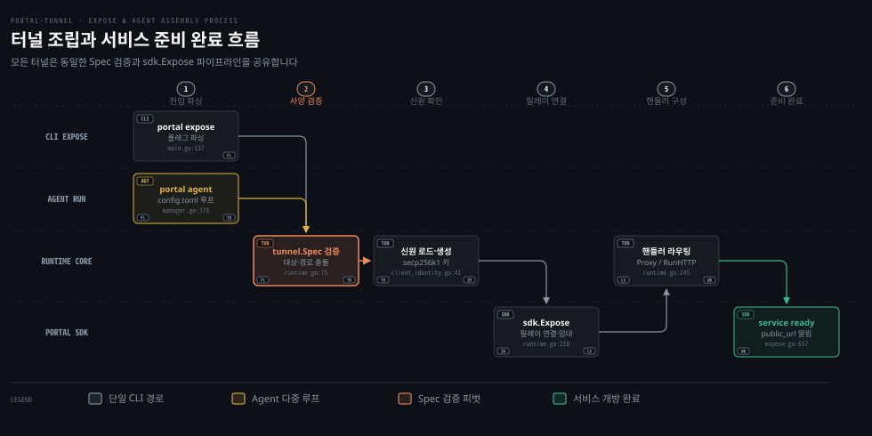

# CLI·Agent

---

> portal expose 명령의 런타임 조립 과정과 다중 터널을 유지하는 portal agent 의 구조, 로컬 제어 API, OS 서비스 등록 및 설치 파이프라인을 다룹니다.


## 명령 지도

> 명령줄 도구의 하위 명령 체계와 핵심 플래그 배치를 파악해야 런타임에 전달되는 제어 인자를 혼선 없이 지정할 수 있습니다.

어떤 옵션이 제어 평면으로 전달되고 어떤 설정이 로컬 프록시에 남는지는 CLI 도구의 구조와 플래그 역할을 정확히 알아야 가려낼 수 있습니다. 포털 터널의 실행 파일인 `portal`은 단일 터널 임시 공개부터 다중 터널 데몬 관리까지를 바이너리 하나에 담았습니다.

바이너리(`bin/portal --help`)를 직접 실행하고 공식 CLI 레퍼런스 문서(`docs/src/routes/cli-reference/+page.md:38-48`)와 대조해 최상위 하위 명령을 확인했습니다.

| 명령 | 사용 형식 | 핵심 역할 |
|---|---|---|
| `expose` | `portal expose [flags] <target>` | 단일 로컬 포트 또는 HTTP 라우트 묶음을 외부 릴레이에 공개 |
| `agent` | `portal agent <subcommand> [flags]` | 설정 파일 기반 다중 터널 영속 관리 데몬 구동 및 제어 |
| `auth` | `portal auth issue [flags] <host>` | 신원 개인키로 서명된 호스트 한정 접근 크리덴셜 발급 |
| `list` | `portal list [flags]` | 부트스트랩 및 지정 릴레이의 활성 URL과 소프트웨어 버전 출력 |
| `update` | `portal update [flags]` | 공식 릴리스 저장소에서 최신 바이너리를 받아 자체 교체 |
| `version` | `portal version` | 바이너리에 컴파일된 릴리스 버전 문자열(`types.ReleaseVersion`) 출력 |

가장 자주 쓰는 `portal expose`는 대상 주소를 세 가지 형태로 받습니다(`docs/src/routes/cli-reference/+page.md:74-84`).

1. 단일 포트: `3000` 형태는 루프백 IPv4 주소인 `127.0.0.1:3000`으로 자동 확장됩니다.
2. 호스트와 포트: `localhost:8080` 형태는 지정한 호스트명을 그대로 보존합니다.
3. HTTP URL: `http://127.0.0.1:3000` 형태는 주소 파싱을 거쳐 호스트와 포트만 추출됩니다(경로·쿼리는 거부).

대상의 프로토콜 성격에 따라 이 명령의 모드는 다섯 가지로 갈립니다(`docs/src/routes/cli-reference/+page.md:85-94`).

| 모드 | 실행 예시 | 런타임 처리 방식 |
|---|---|---|
| 기본 HTTPS 스트림 | `portal expose 3000` | 릴레이는 SNI 패스스루 중계, 터널 프로세스가 테넌트 TLS 종단 |
| 정적 사이트 서빙 | `portal expose --serve ./dist` | 로컬 디렉터리나 HTML 파일을 SPA 인덱스 폴백 핸들러로 호스팅 |
| 라우트 HTTP 역방향 프록시 | `portal expose --http-route /api=3001 --http-route /=5173` | 최장 접두사 일치 규칙으로 경로별 로컬 서비스에 트래픽 분배 |
| 전용 raw TCP 터널 | `portal expose localhost:25565 --tcp` | 릴레이에 전용 공인 TCP 포트를 요청해 TLS 없는 바이트 스트림 중계 |
| 공인 UDP 릴레이 | `portal expose 8080 --udp --udp-addr 19132` | 릴레이에 UDP 포트를 열고 QUIC 데이터그램 백홀로 패킷 왕복 |

`cmd/portal-tunnel/main.go:481-529`의 `printExposeUsage`는 플래그를 공통 플래그와 고급 플래그 두 그룹으로 나눕니다(`:504-511`).

- 공통 플래그: 공개 도메인 접두사를 지정하는 `--name`과 릴레이 주소 목록인 `--relays`가 있습니다. 릴레이 탐색을 켜는 `--discovery`(기본값 true)와 오버레이 전송을 우선하는 `--overlay`를 지원합니다. 중간자 탐지 시 릴레이를 배제하는 `--ban-mitm`과 애플리케이션 접근 보호를 위한 `--auth`(`siwe` 또는 `credential`)도 여기에 들어갑니다. 신원 키 경로는 `--identity-path`로 지정하며 유료 라우트 정산 주소는 `--x402-pay-to`로 넘깁니다.
- 고급 플래그: 메모리 신원 주입용 `--identity-json`과 출력 형식을 바꾸는 `--log-format`(text, json)이 있습니다. 프로메테우스 수집용 `--metrics-addr`와 릴레이 정적 캐시를 켜는 `--cache` 및 `--cache-ttl`을 지원합니다. 상위 프록시 전달 전 헤더를 지우는 `--strip-request-header`와 릴레이 상한인 `--max-active-relays`(기본값 3)도 제공됩니다.

`portal agent` 명령에는 하위 명령이 4개(`run`, `dashboard`, `stop`, `restart`) 있습니다(`cmd/portal-tunnel/agent.go:25-38`). `run`은 `--config`로 지정한 TOML 설정에 따라 OS 서비스를 등록하거나 포그라운드 프로세스로 동작합니다. `dashboard`는 터미널 UI를 띄우고 `stop`과 `restart`는 백그라운드 서비스를 제어합니다.

기준 커밋 0a3b9c06 (2026-10-14)


## expose 조립

> 단일 CLI 명령이 내부에서 플래그 파싱, 신원 로드, 명세 검증, SDK 노출, 프록시 구성을 거쳐 서비스 준비 상태로 전환되는 인과를 확인합니다.

명령어 한 줄은 백그라운드 네트워크 세션으로 승격되기까지 내부에서 여러 조립 단계를 거칩니다. 네트워크 지연이나 설정 충돌이 일어났을 때 어느 단계에서 실패했는지는 이 순서를 알아야 식별할 수 있습니다.

`cmd/portal-tunnel/main.go:131`의 `runExposeCommand`가 실행되면 가장 먼저 `installer.StartUpdateCheck(types.ReleaseVersion)`를 호출합니다. 이 함수는 백그라운드 고루틴에서 최신 릴리스가 있는지 확인합니다. 그 뒤 플래그를 파싱하고 `tunnelSpecFromExposeFlags`(`main.go:194`)로 핵심 구조체인 `tunnel.Spec`을 조립합니다.

조립의 중심 경로는 `cmd/portal-tunnel/tunnel/runtime.go:165`의 `tunnel.Start` 함수가 맡습니다.

첫째, 명세 유효성을 검사합니다. `spec.Validate()`(`runtime.go:75`)는 양립할 수 없는 플래그 조합을 엄격히 차단합니다. HTTP 터널 설정(`spec.HTTP`)은 전용 TCP(`Transport.TCP`)나 UDP(`Transport.UDP`)와 동시에 지정할 수 없습니다.

정적 서빙(`--serve`)을 쓸 때는 단일 대상(`target`)이나 HTTP 라우트(`--http-route`)를 함께 둘 수 없습니다. 릴레이 캐시(`--cache`)는 정적 서빙에만 허용되며 릴레이가 TLS를 종단하므로 중간자 차단(`--ban-mitm`)이나 애플리케이션 인증(`--auth`)과도 병행할 수 없습니다.

둘째 단계에서는 클라이언트 신원을 불러옵니다. `identity.LoadOrCreate(spec.Identity.Name, spec.Identity.Path, spec.Identity.JSON)`(`portal/identity/client_identity.go:41`)는 인메모리 JSON이 있으면 파싱합니다. 없으면 지정 경로의 파일(`identity.json`)을 읽습니다. 파일마저 없으면 새 개인키와 이더리움 주소(`0x...`)를 생성해 디스크에 저장합니다.

셋째, 릴레이 URL 목록을 정규화한 뒤 `sdk.Expose`(`cmd/portal-tunnel/tunnel/runtime.go:218`, 정의는 `sdk/expose.go:203`)를 호출해 SDK 릴레이 세션을 수립합니다. 네이티브 런타임은 HTTPS 제어 API(`/sdk/*`, `types/paths.go:28-37`)로 SIWE 서명 임대를 등록합니다. 등록을 마치면 TLS 위 `Upgrade: raw` 핸드셰이크(`sdk/reverse_transport.go:53-101`)를 거쳐 예비 리버스 연결 2개를 유지합니다. WebSocket과 yamux 스트림 다중화는 `js/wasm` 환경 전용입니다.

넷째는 핸들러 라우팅과 프록시입니다. 정적 사이트, 다중 라우트, 인증, 헤더 제거 정책이 포함된 경우 `gateway.ComposeHTTPRoutes`(`runtime.go:230`)로 합성 HTTP 핸들러를 만듭니다. `runtime.Run(ctx)`(`runtime.go:245`)는 HTTP 핸들러가 있으면 `sdk.RunHTTP`로 소켓을 받아 HTTP를 서빙합니다. 핸들러가 없는 순수 스트림이면 `sdk.ProxyWithConfig`를 써서 로컬 대상 주소로 바이트를 양방향 복사합니다.

다섯째, SDK가 릴레이와의 임대 등록을 끝내고 공인 주소를 확정하면 `sdk/expose.go:657`에서 준비 완료 알림 로그를 출력합니다.

```go
if advertised {
	relayStatusLogEvent(log.Info(), status).
		Str("address", e.identity.Address).
		Msg("service ready at " + status.PublicURL)
}
```

로컬 실측(2026-10-17, README 「직접 띄워 보기」)에서는 콘솔에 실제로 이 로그가 찍혔습니다.

```bash
INF service ready at https://demo-f7dc9a9730292fb2df94a95e9fbde9e993b1e658.localhost:18443 address=0xF7DC9a9730292fB2DF94A95E9FbDe9e993B1e658 alias_url=https://demo.localhost:18443 state=ready
```

머신 리더블 모드(`--log-format json`)를 지정하면 stdout에 `event=relay_status` 필드를 담은 단일 JSON 라인이 기록됩니다. 외부 오케스트레이션 도구는 이 이벤트를 감지해 배포 완료를 판정합니다.



위 도식은 단일 CLI 진입로와 Agent 다중 루프의 합류 흐름을 보여줍니다. 두 경로는 모두 `tunnel.Spec` 검증(`cmd/portal-tunnel/tunnel/runtime.go:166`)과 신원 로드(`:190`)를 거쳐 `sdk.Expose`로 연결되며 서비스 준비 로그를 출력합니다.


## agent 의 다중 터널 관리와 로컬 제어

> 단일 프로세스 안에서 여러 개의 터널 명세를 동시에 격리해 운영하고 루프백 제어 API 로 생명주기를 다루는 구조를 살펴봅니다.

단일 터널을 띄우는 `portal expose`는 셸 세션이 종료되면 함께 내려갑니다. 여러 마이크로서비스를 동시에 외부로 노출하려면 터미널 창을 여러 개 열어야 한다는 운영상 한계도 있습니다. 포털 에이전트(`portal agent`)는 상주형 관리자로, 설정 파일 하나에 적힌 여러 터널을 각각 독립된 런타임으로 관리합니다.

설정 파일 구조는 `cmd/portal-tunnel/agent/config.go`에 선언되어 있습니다. 에이전트 설정은 크게 상주 환경을 정의하는 `AgentConfig`(`:39`)와 각 터널의 노출 사양을 담는 `TunnelConfig`(`:46`) 슬라이스로 나뉩니다.

```toml
[agent]
control_addr = "127.0.0.1:4018"
service_name = "portal-agent"

[[tunnels]]
id = "web"
name = "my-site"
target = "127.0.0.1:3000"

[[tunnels]]
id = "api"
name = "my-api"
http_routes = [
  { prefix = "/v1", upstream = "127.0.0.1:8001" },
  { prefix = "/v2", upstream = "127.0.0.1:8002" }
]
```

저장소 루트에 있는 `config.toml` 파일(`config.toml:1-10`)은 주의해서 봐야 합니다. 이 파일은 에이전트 예시 설정이 아니라, 컴파일 시 바이너리에 임베드되는 릴리스 버전(`v2.6.4`), `base_url`, 그리고 프로토콜 식별자(`tunnel = "10"`, `discovery = "9"`)를 담은 빌드 타임 매니페스트입니다. 에이전트의 실제 기본 설정 파일은 플랫폼별 데이터 디렉터리(`service.DefaultConfigPath()`)에 있습니다.

동적 터널 관리자는 `cmd/portal-tunnel/agent/manager.go`에 구현되어 있습니다.

- `AddTunnel`(`:172`): 새 터널 정의를 받아 식별자 유효성을 확인한 뒤 설정 문서에 덧붙이고 `writeConfigAndApply`를 실행합니다.
- `UpdateTunnel`(`:127`): 설명·소유자·태그 등 메타데이터와 최대 활성 릴레이 수(`max_active_relays`)를 디스크에 반영하고 활성 터널에 즉시 적용합니다.
- `DeleteTunnel`(`:320`): 특정 터널을 설정에서 제거하고 `writeConfigAndApply`로 해당 터널 인스턴스를 즉각 중단합니다.
- `writeConfigAndApply`(`:359`): 변경된 구성을 파일 권한을 보존하며 디스크에 기록한 뒤 `ApplyConfig`(`:373`)를 호출합니다.
- `ApplyConfig`(`:373`): 현재 실행 중인 터널 맵과 새 설정을 비교해 추가된 터널은 시작하고 삭제된 터널은 종료하며 변경된 터널은 재시작하는 디프(diff) 제어를 수행합니다. 각 터널은 앞서 살펴본 `tunnel.Start`와 `Runtime`을 개별 고루틴으로 실행합니다.

외부 제어 요청은 루프백 주소(`127.0.0.1:4018`)에 바인딩된 HTTP 서버(`cmd/portal-tunnel/agent/control.go:46` `controlHandler.ServeHTTP`)가 전담합니다.

로컬 제어 평면에서 가장 중요한 보안 경계는 `trustedLocalRequest`(`control.go:164`)입니다. 브라우저에서 동작하는 악성 웹페이지는 DNS 리바인딩이나 크로스 사이트 요청 위조(CSRF) 기법으로 개발자의 로컬 에이전트를 조작하려 들 수 있습니다. 이 함수는 그런 공격을 원천 차단하려고 세 가지 조건을 검증합니다.

```go
func (s *controlHandler) trustedLocalRequest(r *http.Request) bool {
	if s.authority == "" || r.Host == "" {
		return false
	}
	if r.Host != s.authority && r.Host != s.localhostAuthority {
		return false
	}
	origins := r.Header.Values("Origin")
	if len(origins) == 0 {
		return true
	}
	if len(origins) != 1 {
		return false
	}
	scheme := "http://"
	if r.TLS != nil {
		scheme = "https://"
	}
	return origins[0] == scheme+r.Host
}
```

첫째, 요청의 `Host` 헤더가 리스너의 실제 주소(`127.0.0.1:4018`) 또는 `localhost` 별칭과 정확히 일치해야 합니다. 포털은 `X-Forwarded-Host`나 추가 DNS 해석 결과를 신뢰하지 않습니다. 둘째, 브라우저가 보낸 `Origin` 헤더가 있다면 반드시 1개여야 하며 해당 오리진이 `http://`와 정확한 호스트의 결합이어야 합니다. 셋째, 로컬 CLI나 터미널 도구처럼 `Origin` 헤더를 보내지 않는 클라이언트는 검사를 통과시킵니다.

인증은 상태 디렉터리의 비밀 토큰(`Bearer` 헤더)이나 이더리움 지갑 기반 로그인(`serveWalletAuth`, `:185`)으로 합니다. 지갑 세션 쿠키는 읽기 전용 상태 조회(`GET /agent/status`)만 허용됩니다. 터널 추가·삭제·수정과 릴레이 연결 등 상태 변경 제어는 반드시 `Bearer` 비밀 토큰을 제시해야 통과합니다(`cmd/portal-tunnel/agent/control.go:56-58`).

웹 대시보드에 접근할 수 있도록 SIWE 챌린지 발급과 서명 검증 로그인(`/agent/auth/login`)을 지원합니다. 로그인에 성공하면 `HttpOnly`, `SameSite=Strict` 속성이 붙은 안전한 세션 쿠키를 발급합니다.

모든 제어 경로는 `types/paths.go:47-55`에 선언된 상수 규약을 따릅니다.

- `/agent/status`: 에이전트 및 개별 터널의 실시간 상태 스냅샷 반환(GET)
- `/agent/shutdown`: 에이전트 데몬의 안전한 정상 종료 유도(POST)
- `/agent/tunnels`: 새 터널 추가 등록(POST)
- `/agent/tunnels/<id>`: 터널 삭제(DELETE) 및 설정 갱신(PATCH)
- `/agent/tunnels/<id>/relays`: 특정 터널의 릴레이 연결(POST) 및 연결 해제(DELETE, `cmd/portal-tunnel/agent/control.go:125-150`)
- `/agent/auth/*`: 지갑 세션 인증 경로 4종(`challenge`, `login`, `logout`, `status`, `types/paths.go:52-55`)

터미널 환경에서는 Bubble Tea 프레임워크 기반의 대시보드(`cmd/portal-tunnel/agent/dashboard.go`)를 실행할 수 있습니다(`portal agent dashboard`). 대시보드는 2초마다 `/agent/status`를 폴링합니다. 터널 목록 탭, 메타데이터 및 제한 수정 탭, 릴레이 수동 연결/해제 탭이 있어 터미널 안에서 전체 터널을 시각적으로 관제할 수 있습니다.


## OS 서비스 등록과 백그라운드 구동

> 운영체제마다 상이한 서비스 초기화 시스템에 터널 에이전트를 네이티브 데몬으로 등록하고 비정상 종료 시 재기동시키는 방식을 분석합니다.

터미널 창을 닫아도 터널이 유지되고 서버가 재부팅될 때 서비스가 자동으로 복원되려면 플랫폼별 운영체제 서비스 관리자에 정상 등록되어야 합니다. 셸 스크립트를 손으로 작성해 백그라운드로 돌리면 프로세스가 비정상 종료될 때 자동 복구(Auto-restart)를 보장할 수 없습니다.

`cmd/portal-tunnel/agent/service/` 패키지는 운영체제별 네이티브 초기화 시스템과 통신하는 코드를 분리해 유지합니다.

macOS(`service_darwin.go`)에서는 실행 권한에 따라 등록 경로와 도메인을 분기합니다(`launchdPlistPath`, `:59`). 루트 권한이면 `/Library/LaunchDaemons/<name>.plist`에 쓰고 시스템 도메인을 사용합니다. 일반 사용자면 `~/Library/LaunchAgents/<name>.plist`에 작성합니다.

생성되는 XML plist 파일(`launchdPlist`, `:70`)은 실행 인자로 `portal agent run --service --config <경로>`를 지정하고 `RunAtLoad`와 `KeepAlive`를 `true`로 설정합니다. 파일을 만든 뒤에는 `launchctl bootout`과 `launchctl bootstrap`, `launchctl kickstart -k` 명령을 차례로 호출해 서비스를 즉시 구동합니다.

Linux 구현은 `service_linux.go`에 있습니다.

루트 권한이면 시스템 단위인 `/etc/systemd/system/<name>.service`에 배치합니다. 일반 사용자면 `~/.config/systemd/user/<name>.service`에 두며 유저 모드로 동작합니다(`linuxUnitPath`, `:59`).

생성되는 유닛 파일(`systemdUnit`, `:93`)은 표준 설정으로 채워집니다. `Description=` 항목에는 `def.Description`(`"Manages Portal tunnel definitions and relay membership."`)이 들어갑니다. `"Portal Agent"`는 Windows용 `DisplayName`입니다.

```ini
[Unit]
Description=Manages Portal tunnel definitions and relay membership.
After=network-online.target
Wants=network-online.target

[Service]
Type=simple
WorkingDirectory=/path/to/config
ExecStart='/usr/local/bin/portal' 'agent' 'run' '--service' '--config' '/path/to/config.toml'
Restart=always
RestartSec=5

[Install]
WantedBy=default.target
```

유닛 파일이 생성되면 `service.Install`(`service_linux.go:25-28`)이 `daemon-reload`와 `enable`을 호출합니다. `start` 호출은 별도의 `service.Start`(`:31-37`)가 맡아 5초 후 재시작(`Restart=always`, `RestartSec=5`) 정책을 활성화합니다. 일반 사용자 모드(`~/.config/systemd/user`)에서는 사용자 로그인 없이 부팅 시 데몬이 시작되려면 systemd `loginctl enable-linger <사용자>` 설정이 필요합니다.

Windows(`service_windows.go`)에서는 Windows 서비스 제어 관리자 API에 직접 연결해 서비스를 자동 지연 시작(`DelayedAutoStart: true`, `StartAutomatic`)으로 등록합니다. 서비스가 실패하면 복구 동작(`SetRecoveryActions`, `:154`)으로 1차 실패 시 5초, 2차 10초, 3차 30초 뒤 자동 재시작하도록 설정합니다.

백그라운드 구동 시에는 서비스 핸들러가 운영체제의 정지(`svc.Stop`) 및 시스템 셧다운(`svc.Shutdown`) 이벤트를 감지해 정상 종료 절차를 밟습니다.

서비스 관리자가 없는 컨테이너나 경량 배포판에서는 `portal agent run --foreground` 플래그(선언은 `cmd/portal-tunnel/agent.go:47`, 분기는 `:70-71`)를 씁니다. 그러면 OS 서비스 등록 과정을 건너뛰고 현재 프로세스의 고루틴으로 에이전트 런타임을 직접 실행합니다. 대화형 TUI 셸에서 포그라운드로 실행하면 Bubble Tea 대시보드가 자동으로 열려 터널 상태를 화면에 표시합니다.


## 설치 스크립트와 자동 업데이트

> 배포 서버로부터 단일 명령으로 바이너리를 안전하게 설치하고 체크섬을 검증하며 릴레이 배포 시 발생하는 보안 고려사항을 짚어봅니다.

소스 코드를 직접 빌드하고 바이너리를 수동 배치하는 방식은 환경마다 도구 체인이 달라 설치 마찰을 일으킵니다. 번거로운 빌드 없이 단일 명령으로 바이너리를 설치하고 최신 버전으로 안전하게 갱신하려면 신뢰할 수 있는 배포 파이프라인과 무결성 검증이 받쳐 줘야 합니다.

설치 파이프라인의 핵심은 `cmd/portal-tunnel/installer/`에 있습니다.

- `install.sh`: 유닉스(macOS, Linux) 환경용 POSIX 호환 셸 스크립트입니다. OS와 아키텍처(x86_64, arm64)를 판별하고 다운로드 디렉터리(`~/.local/bin` 또는 `~/bin`)를 탐색해 바이너리를 설치합니다. 그 뒤 셸 프로파일(`.zshrc`, `.bashrc`)에 PATH를 추가합니다.
- `install.ps1`: 윈도우 PowerShell 환경용 설치 스크립트입니다.
- `update.go`: CLI 자체 업데이트(`portal update`)를 처리합니다. 공식 릴리스 주소에서 바이너리와 해시를 다운로드합니다. 파일의 SHA256 체크섬을 직접 계산해 비교한 뒤 실행 중인 바이너리를 교체합니다(`replaceBinary`, `cmd/portal-tunnel/installer/update.go:202`, 호출은 `:175`). 유닉스 환경에서는 `os.Rename`으로 원자적으로 교체하지만(`:209`) 실행 파일 잠금이 걸리는 Windows 환경에서는 기존 파일을 `.old`로 옆으로 이동한 뒤 교체합니다(`:254`).

포털 터널에서는 독특하게도 개별 릴레이 서버가 자체 설치 스크립트와 클라이언트 바이너리를 직접 호스팅할 수 있습니다. 릴레이 서버 라우터(`cmd/relay-server/api.go:126-132`)는 `types/paths.go:21-23`에 선언된 설치 전용 경로를 등록합니다.

```go
PathInstallShell      = PathAPIPrefix + "/install.sh"      // /api/install.sh
PathInstallPowerShell = PathAPIPrefix + "/install.ps1"     // /api/install.ps1
PathInstallBinPrefix  = PathAPIPrefix + "/install/bin/"    // /api/install/bin/
```

사용자가 릴레이 서버에 설치 스크립트를 요청하면(`curl -sSL https://portal.example.com/api/install.sh | bash`) 릴레이는 내장된 `install.sh` 원문에 자신의 접속 URL을 주입해 내려줍니다(`installer.RelayScript`, `installer.go:52-60`).

```bash
BASE_URL='https://portal.example.com'
RELAY_URL='https://portal.example.com'
BIN_PATH_PREFIX='api/install/bin'
```

이 방식이면 사용자는 별도의 설정 파일이나 플래그 입력 없이 바이너리를 설치하는 것만으로 해당 릴레이에 즉시 붙을 수 있어 온보딩 마찰이 크게 줄어듭니다.

그러나 이 구조는 공급망 보안 관점에서 중대한 설계 이슈를 안고 있습니다. 이슈 #630("security(installer): verify relay-hosted downloads against an independent trusted release source")이 바로 이 문제를 다룹니다.

이슈 #630에 따르면 릴레이에 바이너리가 없을 때는 공식 GitHub Releases로 307 리다이렉트합니다(`cmd/relay-server/api.go:667-677`). 릴레이가 내장 바이너리를 직접 서빙할 때는 릴레이 코드(`:680`)가 메모리 바이트로부터 SHA256 해시를 동적으로 계산해 내려줍니다. 클라이언트 설치 스크립트(`install.sh:108-131`)는 이 체크섬을 받아 다운로드한 바이너리와 비교합니다.

악의적인 공격자가 자체 릴레이를 운영하거나 기존 릴레이 서버를 탈취해 임베드된 바이너리를 악성 코드가 삽입된 바이너리로 교체하면, 그 릴레이는 변조된 바이너리의 해시값을 정직하게 계산해 내려줍니다. 클라이언트 설치 스크립트는 같은 릴레이가 내려준 체크섬과 바이너리를 대조하므로 해시 불일치를 감지하지 못하고 악성 바이너리를 그대로 실행합니다.

릴레이가 배포를 중계하더라도 체크섬이나 서명 검증은 릴레이 자신이 아닌 독립된 원천(공식 GitHub Releases 매니페스트 또는 신뢰된 공개키 서명)으로 교차 검증해야 한다는 개선안이 이슈 #630의 핵심 논점입니다.


## 기여 관점 메모

> 오픈소스 포털 터널 프로젝트가 안내하는 기여 정책과 기여자가 집중할 수 있는 통합 표면의 특성을 정리합니다.

프로젝트의 기여 정책을 모른 채 손을 대면 어느 영역을 수정해야 할지 판단이 서지 않아 기여가 거절되거나 리뷰가 지연됩니다. 오픈소스 프로젝트에 참여할 때는 핵심 엔진과 주변 통합 표면 사이의 기여 정책 경계를 명확히 이해해야 합니다.

프로젝트 루트의 `CONTRIBUTING.md:15-26`는 기여 유형을 구분해 안내합니다.

> ### For AI Contributors
>
> AI contributions are strongly encouraged on the user-facing and integration surface of Portal.
>
> This includes CLI behavior, logs, diagnostics, documentation, skills, configuration ergonomics, installer and service integration, local harnesses, and other friction encountered while using Portal.
>
> AI contributors may file issues, reviews, and improvement proposals in these areas without prior assignment.

`CONTRIBUTING.md:25`는 프로토콜 시맨틱, 암호화, 신뢰 경계, 신원, 전송 불변식, 아키텍처에 대해 인간의 정밀한 리뷰를 거치도록 규정합니다. 영문 목록은 "Core protocol semantics, cryptography, trust, identity, transport invariants, and architecture"입니다. 인간 기여자는 타당한 근거가 갖춰진 경우 코어 구현까지 기여를 확장할 수 있습니다(`CONTRIBUTING.md:11`).

반면 AI 기여자에게는 사용자 접점 표면에서의 활동을 적극 권장합니다. CLI 동작, 로그, 진단 도구, 문서, 설정 사용성, 인스톨러 및 OS 서비스 연동 같은 영역이라면 사전 배정 없이 이슈, 리뷰, 개선안을 제안할 수 있습니다(`CONTRIBUTING.md:17-21`).

포털을 분석하고 연동하다 보면 파싱 예외 처리가 반복되거나 로그 출력이 모호하거나 설정이 어긋나는 마찰을 겪습니다. 권장되는 기여 방향은 이런 마찰을 워크어라운드로 우회할 것이 아니라 포털 표면 자체를 개선해야 할 신호로 취급하는 것입니다.


## 리뷰 노트

> 소스 코드와 로컬 실측, 인스톨러 구현을 분석하며 확인한 주의점과 개선 검토 사항입니다.

- 저장소 루트와 에이전트 설정의 명칭 혼동입니다(`config.toml:1-10`, `service.go:21-48`). 루트 파일은 릴리스 버전·`base_url`과 프로토콜 식별자(`tunnel = "10"`, `discovery = "9"`)를 담은 빌드 타임 매니페스트입니다. 그런데 `portal agent run`의 설정 파일도 같은 `config.toml` 이름을 씁니다. 신규 기여자가 루트 파일을 에이전트 예시로 오인할 위험이 있으므로(추정: 에이전트에 주입 시 설정 불일치 마찰) 루트 파일을 `manifest.toml`로 변경하거나 설정 템플릿(`agent.example.toml`)을 분리하는 개선이 유용합니다.
- 릴레이 서빙 인스톨러의 자체 체크섬 검증 취약점입니다(이슈 #630, `cmd/portal-tunnel/installer/install.sh:108`, `cmd/relay-server/api.go:680`). 릴레이에 내장 바이너리가 없으면 공식 GitHub Releases로 리다이렉트하지만(`:667-677`) 릴레이가 내장 바이너리를 직접 제공할 때는 바이너리 해시를 메모리로부터 즉석 계산해 반환합니다. 악의적인 사설 릴레이를 이용하면 변조된 내장 바이너리와 변조된 체크섬이 동시에 제공되어 검증이 무력화됩니다. `install.sh`는 다운로드 후 독립 소스의 체크섬이나 서명을 교차 검증하도록 보강해야 합니다.
- OS 서비스 미지원 환경에서 agent 실행 마찰입니다(`agent.go:151`). 컨테이너나 WSL 등 데몬이 없는 환경에서 `portal agent run`을 실행하면 서비스 등록 실패로 즉시 종료됩니다. 에러 메시지에 `--foreground` 사용 안내가 들어 있기는 합니다. 그래도 서비스 매니저가 없을 때 자동으로 포그라운드 실행을 제안하거나 환경 변수로 전환하는 개선이 필요합니다.
- CLI 플래그와 Agent 설정 간의 기능 비대칭입니다(`main.go:121`, `config.go:379`). `portal expose`는 `--cache`와 `--cache-ttl` 플래그로 릴레이 정적 캐시를 지원합니다. 하지만 에이전트 TOML 설정에는 캐시 옵션이 선언되어 있지 않고 런타임 조립도 지원하지 않습니다. 에이전트 설정에서도 정적 사이트 서빙에 릴레이 캐시를 지정할 수 있게 해 일관성을 맞출 필요가 있습니다.
- 원시 전송 모드의 준비 완료 로그 문서와 코드 불일치입니다(`references/game-hosting.md:74`, `sdk/expose.go:638,654-657`, `sdk/listener.go:297-298`). 스킬 문서는 `--tcp`/`--udp` 모드에서 `service ready at` 대신 `raw transport endpoints allocated`가 출력된다고 서술합니다. 그러나 실제 코드의 `service ready at`은 전송 방식과 무관하게 `State==Ready && PublicURL != ""` 조건 충족 시 출력됩니다. 리스너가 raw 엔드포인트 할당 로그를 추가로 남길 뿐이므로 두 로그가 모두 나올 수 있습니다. 스킬 문서의 설명은 코드와 어긋나며 추가 실측이 필요합니다. 외부 배포 스크립트는 텍스트 로그 대신 머신 모드(`--log-format json`)의 `event=relay_status` 이벤트와 `tcp_addr`/`udp_addr` 필드를 기준으로 완료를 판정해야 합니다.


## 검증과 복습

> 이 문서에서 배운 CLI 및 에이전트 조립 구조를 세 가지 질문으로 스스로 확인합니다.

Q1. `portal expose` 명령 실행 시 `tunnel.Spec`의 유효성 검사(`Validate`) 단계에서 정적 서빙(`--serve`)과 함께 지정했을 때 즉시 오류로 거절되는 플래그들은 무엇이며 그 이유는 무엇입니까?

Q2. 포털 에이전트의 로컬 제어 HTTP 핸들러(`ServeHTTP`)에서 `trustedLocalRequest`는 외부 웹사이트의 악의적인 브라우저 스크립트 조작을 방어하기 위해 어떤 조건을 검사합니까?

Q3. 릴레이가 자체적으로 `/api/install.sh`와 바이너리를 내려줄 때, 이슈 #630이 지적하는 보안적 한계는 무엇이며 왜 독립 소스를 통한 교차 검증이 요구됩니까?


## 정답 (자답 후 펼치기)

> 위 세 가지 질문에 대한 해답과 코드 근거입니다.

Q1 정답입니다. 대상 주소(`target`), 라우트(`--http-route`), 헤더 제거(`--strip-request-header`), raw 전송(`--tcp`/`--udp`)이 거절됩니다(`cmd/portal-tunnel/tunnel/runtime.go:85-127`). 정적 서빙은 로컬 디렉터리를 직접 호스팅하므로 프록시 대상이나 raw 전송과 공존할 수 없습니다.

참고로 `--ban-mitm`과 `--auth`는 `--serve` 단독으로는 함께 쓸 수 있습니다. 릴레이 캐시(`--cache`)를 함께 켤 때만 릴레이가 TLS를 종단하므로 거절됩니다(`:98-107`).

Q2 정답. 첫째, 요청의 `Host` 헤더가 에이전트 리스너의 실제 루프백 주소(`127.0.0.1:4018`) 또는 `localhost` 별칭과 정확히 일치해야 하며 `X-Forwarded-Host`는 무시합니다. 둘째, 브라우저가 보낸 `Origin` 헤더가 존재할 경우 반드시 1개여야 하며 그 값이 `http://`와 해당 `Host`의 결합과 동일해야 합니다(`cmd/portal-tunnel/agent/control.go:164-183`). 이 두 검사로 제3자 웹사이트에서 발행된 악의적인 크로스 오리진 요청이나 DNS 리바인딩 요청을 차단합니다.

Q3 정답. 릴레이에 내장 바이너리가 없으면 공식 GitHub Releases로 리다이렉트됩니다(`cmd/relay-server/api.go:667-677`). 그러나 릴레이가 내장 바이너리를 직접 서빙하면 메모리 바이트로부터 SHA256 체크섬을 실시간 계산해 내려줍니다(`:680`). 사설 릴레이에 악성 바이너리가 내장되면 체크섬도 변조본에 맞춰 즉석 계산되므로 `install.sh`가 위변조를 감지하지 못합니다. 따라서 독립된 신뢰 원천(공식 Releases 매니페스트나 공개키 서명)의 체크섬으로 교차 검증해야 합니다.


## 출처와 관련 문서

- [portal-tunnel 기준 커밋 소스 트리](https://github.com/gosuda/portal-tunnel/tree/0a3b9c06): 기준 커밋 0a3b9c06 소스 코드
- [Portal CLI Reference](https://gosuda.github.io/portal-tunnel/cli-reference): 공식 CLI 하위 명령 및 플래그 레퍼런스
- [Portal Configuration Reference](https://gosuda.github.io/portal-tunnel/configuration): 에이전트 config.toml 설정 규격
- `cmd/portal-tunnel/main.go`, `cmd/portal-tunnel/tunnel/runtime.go`: CLI 진입점 및 터널 명세 조립 구현
- `cmd/portal-tunnel/agent/`: 다중 터널 매니저, 로컬 제어 API, TUI 대시보드 구현
- `cmd/portal-tunnel/agent/service/`: Darwin, Linux, Windows 플랫폼별 네이티브 서비스 통합 코드
- `cmd/portal-tunnel/installer/`: 설치 셸 스크립트 및 CLI 자가 업데이트 로직
- `CONTRIBUTING.md`: 사용자 접점 통합 표면 중심의 기여 가이드라인
