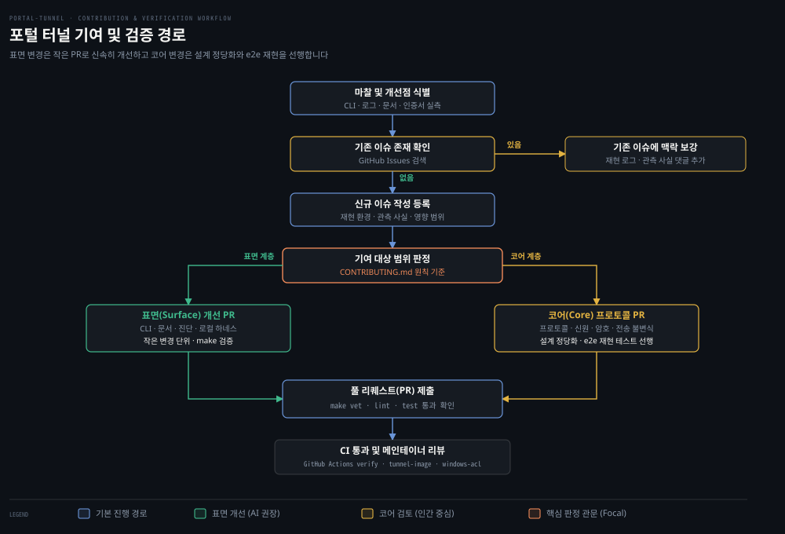

# AGENTS.md·e2e 하네스

---

> Portal 저장소의 엔지니어링 원칙과 테스트 구조를 분석하고, e2e 하네스 격리 원리와 CI 파이프라인, 안전한 첫 기여 진입 경로를 정리합니다.

## 학습 목표와 범위

> AGENTS.md의 설계 제약과 e2e 하네스의 격리 기법을 이해하고, CI 검증을 거쳐 안전하게 첫 기여를 수행하는 방법을 설명할 수 있습니다.

1. `AGENTS.md`에 명시된 핵심 개발 및 프로젝트 원칙(5대 축)이 실제 패키지 구조와 런타임 제어 흐름에 어떻게 투영되었는지 설명할 수 있습니다.
2. 단위 테스트와 e2e 통합 테스트의 역할 분담을 비교하고 중간 계층 모의 객체 테스트를 배제하는 기술적 근거를 제시할 수 있습니다.
3. `e2e/harness_test.go`가 단일 프로세스 안에서 릴레이, 터널 에이전트, 오리진 서버를 조립하고 에페머럴 포트 충돌을 회피하는 메커니즘을 설명할 수 있습니다.
4. `.github/workflows/ci.yml`과 `Makefile`의 정적 분석 파이프라인을 파악하고 실측 마찰 사례를 바탕으로 이슈 등록부터 PR 제출까지의 기여 흐름을 도식화할 수 있습니다.

이 문서는 저장소의 개발 규약, 테스트 하네스, 기여 정책을 다룹니다. 개별 프로토콜 프레이밍(`01-04`)이나 릴레이 인가 계층(`03-03`)의 세부 동작은 해당 편을 참고해 주시기 바랍니다.

기준 커밋 0a3b9c06 (2026-10-14)


## AGENTS.md 원칙

> 메커니즘 정당화, 단일 소유자, 테스트 전용 프로덕션 침투 금지 등 저장소가 요구하는 핵심 개발 원칙과 코드베이스 반영 사례를 살펴봅니다.

오픈소스 프로젝트에 코드를 기여할 때는 메인테이너가 어떤 스타일의 설계를 선호하고 어떤 변경을 거절하는지 파악하기 어렵습니다. Portal 저장소 루트의 `AGENTS.md`는 기여자가 지켜야 할 개발 원칙과 프로젝트 원칙을 짧게 선언합니다. 이 원칙들은 단순한 코딩 컨벤션이 아니라 복잡도가 불필요하게 팽창하지 않도록 방어하는 아키텍처 불변식입니다.

첫째, 새 메커니즘을 도입하기 전에 필요성부터 정당화해야 합니다(`AGENTS.md:15`). 문제가 충분히 크거나 반복되거나 수명이 길거나 독립적인 경우에만 지속 가능한 새 개념을 도입합니다(`large, repeated, long-lived, or independent`). 정당화 없이 인터페이스나 래퍼, 헬퍼 함수, 콜백, 훅, 채널, 잠금 장치, 설정 스위치 같은 부가 구조를 함부로 늘려서는 안 됩니다.

기존 소유자와 제어 흐름, 직렬화 계층으로 요구사항을 이미 표현할 수 있다면 그 구조를 그대로 씁니다. 일회성 문제를 기본값으로 일반화하지 않으며 둘 이상의 실제 호출자나 구현체, 수명주기 경로, 또는 영속적 경계가 그 확장된 형태 자체로 유용할 때만 일반화를 허용합니다(`AGENTS.md:16`).

둘째, 모든 상태와 제약에는 단 하나의 안정적인 계약과 실제 소유자를 우선합니다(`AGENTS.md:12`). 여러 계층에서 검증이나 정규화, 기본값 할당 로직을 중복해서 수행하지 않습니다(`AGENTS.md:35`).

릴레이가 발급한 임대의 수명과 만료 시점, 라우팅 가능 여부는 오직 `portal/lease.go`의 레지스트리가 소유합니다. 연결 풀을 관리하는 `portal/transport/reverse_pool.go` 역시 리버스 연결의 제공 예약(`:66-108`)과 할당(`Acquire`, `:112`), 정리(`Close`, `:154`)를 직접 소유합니다. 공유 런타임 로직은 단 하나의 소유자 모듈에 두고 재사용해야 하며 복제해서는 안 됩니다(`AGENTS.md:39`).

셋째, 오직 테스트를 위해 제품 코드에 침투 지점을 추가하는 일은 금지합니다(`AGENTS.md:22`). 내부 상태를 외부에서 엿보거나 가짜 객체를 주입하기 위해 제품 코드에 인터페이스나 콜백, 설정 스위치를 끼워 넣지 않습니다.

테스트는 시스템의 안정적인 공개 동작과 보안 불변식만을 검증해야 합니다. 호출 횟수나 내부 로그 출력, 재시도 횟수 같은 우발적인 구현 세부사항에 결합되어서는 안 됩니다(`AGENTS.md:17-19`).

넷째, 디렉터리는 패키지마다 책임이 갈리도록 배치합니다. 시스템 전체에서 공유하는 안정적인 계약과 공개 경로 상수, 프로토콜 헤더 이름은 모두 `types/` 패키지에 모아 둡니다(`AGENTS.md:37`).

`types/paths.go:3-56`에는 `/sdk/register`, `/v1/sign`, `/api/healthz` 같은 전역 엔드포인트 상수가 모여 있습니다. `types/types.go:12-20`에는 `X-Portal-Access-Token` 같은 HTTP 헤더 규약이 정의되어 있습니다.

반면 상태를 갖지 않는 순수 문자열 변환이나 네트워크 유틸리티는 `utils/`에 둡니다(`AGENTS.md:36`). `utils/utils.go:25-47`의 `SplitCSV`, `TrimHexPrefix`처럼 입력값만으로 동작하는 순수 함수만 `utils/`에 머뭅니다. 상태나 도메인 규칙을 가진 코드는 실제 소유 패키지로 격리합니다.

다섯째, 호출자와 피호출자가 로컬에 있고 실제 신뢰 경계가 없다면 불필요한 계층을 두지 않고 직접 수정합니다(`AGENTS.md:27`). 복잡성은 가장 낮은 수준의 소유자 안에서 해결하고 상위 계층에는 최소한의 표면만 노출합니다(`AGENTS.md:38`).

현재 사용처가 분명하지 않거나 실제 경계를 보호하지 못하는 필드, 메서드, 래퍼, 미사용 설정은 코드를 수정하면서 즉시 제거합니다(`AGENTS.md:28, 34`). 코드와 맞지 않거나 더는 유효하지 않은 문서는 시스템 이해를 방해하므로 발견하는 대로 갱신하거나 삭제해야 합니다(`AGENTS.md:42`).


## 테스트 철학

> 공개 계약을 보호하는 최하위 결정적 단위 테스트와 e2e의 이원 구조를 살피고, 취약한 중간 계층 모의 테스트를 배제하는 이유를 분석합니다.

Portal의 테스트 스위트는 단순한 이원 구조를 취합니다. 테스트는 변경 가능한 내부 구현 세부사항이 아니라 시스템의 안정적인 공개 동작과 프로토콜·보안 불변식을 검증해야 합니다. 이 철학에 따라 코드베이스는 최하위 단위 테스트와 시스템 전체를 블랙박스로 검증하는 종단간 통합 테스트(`e2e/`)로만 양분됩니다(`AGENTS.md:21`).

중간 계층 테스트는 저장소가 명시적으로 배제합니다. 여러 하위 컴포넌트를 조립한 뒤 가짜 전송 계층이나 모의 콜백을 끼워 넣어 내부 상태를 관찰하는 방식에는 큰 결함이 있습니다.

내부 호출 순서나 비공개 메서드 시그니처가 조금만 바뀌어도 테스트가 깨집니다. 실제 제품 동작에는 아무 문제가 없는데도 그렇습니다. 가짜 객체가 만든 환경은 실제 운영 환경의 동시성 경쟁이나 네트워크 버퍼 동작을 재현하지 못하므로 정작 중요한 회귀 결함을 놓치기 쉽습니다.

```go
// portal/transport/reverse_framing_test.go:11-40
func TestReadRawStartSkipsKeepaliveAndPreservesPayload(t *testing.T) {
	relay, client := net.Pipe()
	defer relay.Close()
	defer client.Close()
	written := make(chan error, 1)
	go func() {
		if err := WriteKeepalive(relay); err != nil {
			written <- err
			return
		}
		if err := WriteRawStart(relay); err != nil {
			written <- err
			return
		}
		_, err := relay.Write([]byte("raw"))
		written <- err
	}()
	binding, err := ReadStart(context.Background(), client, time.Second)
	if err != nil || binding != nil {
		t.Fatalf("raw start = %x, %v", binding, err)
	}
	_ = client.SetReadDeadline(time.Now().Add(time.Second))
	var payload [3]byte
	if _, err := io.ReadFull(client, payload[:]); err != nil || string(payload[:]) != "raw" {
		t.Fatalf("raw payload = %q, %v", payload, err)
	}
	if err := <-written; err != nil {
		t.Fatal(err)
	}
}
```

위 코드는 `portal/transport/reverse_framing_test.go:11-40`의 단위 테스트입니다. 외부 프레임워크나 복잡한 모의 객체 없이 Go 표준 라이브러리의 `net.Pipe()` 메모리 소켓만으로 바이트 스트림 프로토콜을 직접 검증합니다. 프레임 리더가 킵얼라이브 바이트를 건너뛰고 원시 페이로드를 그대로 보존하는지를 가장 낮은 소유자 계층에서 결정론적으로 확인합니다.

컴포넌트 경계를 넘나드는 회귀 결함은 먼저 지속 가능한 불변식을 최하위 소유자에서 방어하고 최하위 단위 테스트로 방어할 수 없는 실제 종단간 동작은 `e2e/` 패키지의 통합 테스트로 검증합니다(`AGENTS.md:23`). 실제 릴레이 서버 인스턴스와 터널 에이전트 클라이언트를 띄우고 실소켓으로 트래픽을 통과시켜 종단간 정합성을 확인합니다.

내부 구현 세부사항에 결합된 테스트가 리팩토링으로 쓸모없어지면 삭제합니다. 영속적으로 보호해야 할 계약이 있다면 최하위 소유자의 단위 테스트나 `e2e/` 테스트로 다시 방어합니다(`AGENTS.md:20`).


## e2e 하네스

> 단일 프로세스 안에서 릴레이, 터널, 오리진을 조립하는 e2e 하네스의 구현 구조와 에페머럴 포트 충돌 방지 기법을 분석합니다.

블랙박스 테스트를 수행하려면 릴레이 서버와 오리진 서버, 클라이언트 에이전트가 모두 동작해야 합니다. 오리진 서버는 로컬 서비스를 제공하고 클라이언트 에이전트는 터널 연결을 맺습니다. `e2e/harness_test.go`는 외부 프로세스를 따로 띄우지 않고 테스트 러너의 단일 프로세스 메모리 안에서 세 컴포넌트를 조립하는 통합 하네스를 제공합니다.

하네스의 핵심 생성 함수는 `newHarnessWithName`(`e2e/harness_test.go:55`)입니다. 이 함수는 먼저 로컬 루프백 인터페이스에 `httptest.Server`로 오리진 웹 서버를 띄웁니다. 이 서버는 고유 식별 문자열 `marker`("portal-e2e-ok")를 반환합니다(`:65-71`). 그다음 임시 디렉터리를 만들고 릴레이 서버 인스턴스 `portal.NewServer`를 생성해 백그라운드에서 기동합니다(`:83-98`).

```go
// e2e/harness_test.go:29-35
// relayHandler composes the relay's protocol route table the way
// cmd/relay-server does: portal handlers under their SDK paths wrapped with
// relay admission and ingress resolution. The zero dependencies here mean no
// proxy trust, the default pre-auth budget, and automatic approval.
func relayHandler(server *portal.Server, fallback http.Handler) http.Handler {
	return policy.Mux(server, fallback, nil, nil, nil, policy.DefaultPreAuthConfig())
}
```

릴레이 서버는 `relayHandler`(`e2e/harness_test.go:33-35`)로 실제 바이너리와 똑같이 라우팅 테이블을 구성합니다. 이 함수는 `policy.Mux`를 호출해 SDK 요청 경로 아래에 릴레이 진입 제어와 인그레스 확인 계층을 감싸고 기본 사전 인증 예산과 자동 승인 정책을 적용합니다.

릴레이가 시작되면 `identity.Generate`로 테스트 신원을 생성하고 `sdk.Expose`와 `sdk.Proxy`로 터널 세션을 맺습니다(`:100-131`).

테스트가 끝나면 `t.Cleanup(h.close)`(`:132, 136-156`)가 자원을 차례로 회수합니다. 컨텍스트 취소(`h.cancel`)와 노출 종료(`h.exposure.Close`) 뒤 릴레이를 닫습니다(`Shutdown` / `Wait`). 그다음 오리진 웹 서버를 닫고(`h.service.Close`) 프록시 완료(`<-h.proxyDone`)를 기다립니다.

### 커널 에페머럴 포트 충돌 회피

병렬로 실행되는 Go 테스트 환경에서 네트워크 리스너 포트를 배정하는 일은 까다롭습니다. 흔히 쓰는 `net.Listen("tcp", ":0")` 방식은 커널이 임의의 에페머럴 포트를 배정해 주지만 Portal 릴레이에는 직접 적용할 수 없습니다. 릴레이 설정은 기동하기 전에 클라이언트가 접근할 정규 SNI 포트 번호를 미리 알고 있어야 하고 임대 등록 시 그 포트로 리버스 접속 엔드포인트를 확정하기 때문입니다.

테스트 코드가 임의의 포트를 잠깐 열었다 닫은 뒤 릴레이에 넘겨주면 경쟁 상태가 생깁니다. 포트를 닫고 릴레이가 다시 바인딩하는 짧은 틈에 동시에 실행 중인 다른 테스트의 `:0` 할당 루틴이 그 포트를 낚아챌 수 있습니다.

```go
// e2e/harness_test.go:238-263
func harnessPort(t *testing.T, host string) int {
	t.Helper()
	harnessPortsMu.Lock()
	defer harnessPortsMu.Unlock()
	lo, hi := ephemeralPortRange()
	start, end := 31000, 32100
	if start <= hi && end >= lo {
		start, end = hi+1, min(hi+1100, 65535)
	}
	for port := start; port <= end; port++ {
		if _, used := harnessPorts[port]; used {
			continue
		}
		listener, err := net.Listen("tcp", net.JoinHostPort(host, strconv.Itoa(port)))
		if err != nil {
			continue
		}
		if err := listener.Close(); err != nil {
			t.Fatalf("close harness port probe: %v", err)
		}
		harnessPorts[port] = struct{}{}
		return port
	}
	t.Fatal("no free listener port outside the ephemeral range")
	return 0
}
```

`e2e/harness_test.go:238-263`의 `harnessPort` 함수는 이 문제를 해결합니다. `ephemeralPortRange`(`:267-282`)는 리눅스의 `/proc/sys/net/ipv4/ip_local_port_range`에서 커널 자동 할당 범위를 읽어옵니다. 비리눅스 환경이거나 파일을 읽지 못하면 `49152, 65535`를 기본값으로 사용합니다(`:268-270`).

이 범위를 읽은 뒤에는 커널의 동적 할당 범위와 겹치지 않는 포트 대역을 탐색합니다. 기본 탐색 대역은 `31000~32100`이고 이 대역이 커널 동적 범위와 겹치면 커널 상한선 바로 위인 `hi+1 … min(hi+1100, 65535)`로 범위를 옮깁니다(`:243-246`). 커널의 `:0` 자동 할당은 이 영역의 포트를 배정하지 않으므로 탐색 후 닫힌 포트는 릴레이가 다시 바인딩할 때까지 다른 고루틴의 `:0` 할당에 가로채이지 않고 안전하게 남습니다.

### e2e 테스트 스위트 주제별 분류

`e2e/` 디렉터리에는 Portal의 네트워크 시나리오와 프로토콜 불변식을 검증하는 테스트 파일 26개가 있습니다. 파일별 핵심 주제는 아래 표로 정리했습니다.

| 주제 영역 | 대상 파일 목록 | 주요 검증 내용 |
|---|---|---|
| 터널 수립 및 라우팅 | `tunnel_test.go`, `alias_url_test.go`, `reconnect_test.go`, `restart_recovery_test.go` | 정규 호스트명 및 별칭 라우팅, 터널 재연결, 릴레이 재기동 후 세션 복구 |
| TCP 인그레스 및 수명주기 | `tcp_admission_test.go`, `tcp_lifecycle_test.go`, `tcp_proxy_test.go`, `rawtcp_test.go`, `ingress_test.go` | ClientHello 검사 슬롯 및 테넌트 브리지 한도, 연결 수립과 종료 상태 전이 |
| UDP 및 데이터그램 | `udp_test.go`, `udp_limits_test.go`, `udp_fallback_test.go`, `quic_auth_test.go` | QUIC 백홀 기반 UDP 포워딩, 과대 패킷 폐기 및 소켓 격리·해제, TCP 폴백 동작 |
| 보안·신원 및 TLS | `keyless_test.go`, `mitm_test.go`, `authority_rotation_test.go` | 무키 원격 서명 무결성, 중간자 공격 자가 탐지, 임대 서명 authority 교체 뒤 재등록 |
| 릴레이 제어 및 정책 | `relay_control_plane_test.go`, `relay_http_test.go`, `relay_policy_test.go`, `control_body_test.go` | 사전 인증 토큰 버킷 차감, 차단 및 거절 정책 동기화, 미읽기 제어 요청 본문 종료 |
| 분산 협력 및 정적 캐시 | `membership_test.go`, `cache_test.go` | 다중 릴레이 멤버십 갱신, 멀티파트 정체 시 admission 해제, 정적 캐시 오프로드와 오프라인 TLS |
| 브라우저 및 에이전트 환경 | `browser_connector_test.go`, `browserproc_unix_test.go`, `browserproc_windows_test.go`, `lifecycle_log_test.go` | 패키징된 브라우저 WASM 커넥터 구동, OS별 브라우저 프로세스 수명주기, 생존 주기 로그 기록 |

### tunnel_test.go 검증 흐름

하네스를 어떻게 쓰는지는 `e2e/tunnel_test.go:9-45`의 `TestCanonicalTunnel`에서 잘 보입니다. 이 테스트는 기본 터널의 종단간 정합성을 확인합니다.

```go
// e2e/tunnel_test.go:9-31 발췌
func TestCanonicalTunnel(t *testing.T) {
	for _, host := range []string{"127.0.0.1", "::1"} {
		t.Run(host, func(t *testing.T) {
			h := newHarnessWithName(t, "e2e", host)
			publicURL := h.waitForPublicURL()
			publicOrigin, err := url.Parse(publicURL)
			if err != nil {
				t.Fatalf("parse public URL: %v", err)
			}
			portalOrigin, err := url.Parse(h.server.PortalURL())
			if err != nil {
				t.Fatalf("parse portal URL: %v", err)
			}
			if publicOrigin.Port() != portalOrigin.Port() {
				t.Fatalf("public URL port = %q, want canonical PORTAL_URL port %q", publicOrigin.Port(), portalOrigin.Port())
			}
			leases := h.server.PublicLeases()
			if len(leases) != 1 || publicOrigin.Hostname() != leases[0].CanonicalHostname {
				t.Fatalf("public URL hostname = %q, leases = %+v; want returned canonical hostname", publicOrigin.Hostname(), leases)
			}
			if got := h.get(publicURL); got != marker {
				t.Fatalf("canonical tenant response = %q, want %q", got, marker)
			}
            // ...
```

테스트는 IPv4(`127.0.0.1`)와 IPv6(`::1`) 두 루프백 주소에서 각각 하네스를 구동합니다. 터널이 준비될 때까지 `h.waitForPublicURL()`(`:13`)로 기다린 뒤 발급된 공개 URL의 포트가 릴레이의 정규 포트와 일치하는지 대조합니다.

릴레이의 활성 임대 목록이 돌려준 호스트명도 공개 URL의 호스트명과 같은지 검증합니다. `h.get(publicURL)`(`:29`)을 호출해 정규 호스트명으로 오리진의 `marker` 문자열이 그대로 돌아오는지도 확인합니다. 마지막으로 별칭 호스트명으로 만든 `friendlyURL` 요청과 노출 객체의 `AliasURL` 상태가 일치하는지 검증합니다(`:32-42`).


## CI·로컬 검증

> GitHub Actions 워크플로, Makefile 타깃, 정적 분석 도구 체계와 AGENTS.md의 테스트 실행 절제 지침을 분석합니다.

로컬에서 잘 돌던 코드가 CI 환경에서 빌드 실패나 의존성 충돌로 반려되는 일은 흔합니다. 이런 불일치를 막으려고 저장소는 도구 연쇄로 자동 검증 관문을 만들어 두었습니다. 기여자의 코드는 로컬 환경과 GitHub Actions CI 파이프라인에 정의된 정적 분석·테스트 관문을 차례로 통과해야 합니다.

### CI 워크플로 구성

저장소의 기본 지속적 통합 파이프라인은 `.github/workflows/ci.yml`에 선언되어 있으며 서로 독립된 잡 세 개를 병렬로 수행합니다.

핵심 검증은 `verify` 잡이 맡습니다(`.github/workflows/ci.yml:18-63`). 최신 Ubuntu 환경에서 Go와 Node.js 22를 설정합니다. 먼저 `go mod tidy`를 실행하고 `git diff --exit-code -- go.mod go.sum`(`:40-41`)으로 모듈 의존성 파일에 누락이나 변경이 없는지 확인합니다.

그다음 `make install`(`:44`)로 Go 린터 도구(goimports, golangci-lint, gojgp, `Makefile:32-35`)를 설치하고 별도 단계인 `npm ci`(`ci.yml:46-48`)로 프론트엔드 의존성을 복원합니다. `make build-tunnel`(`:51`)로 바이너리 컴파일을 확인한 뒤 `make vet`, `make lint`, `make test`(`:55-57`)와 프론트엔드 검사를 차례로 통과해야 합니다.

`tunnel-image` 잡(`:64-83`)은 Docker Buildx로 `cmd/portal-tunnel/Dockerfile` 기반 컨테이너 이미지가 결함 없이 빌드되는지 검증합니다.

마지막 `windows-acl` 잡(`:84-99`)은 Windows 러너 환경에서 파일 권한 제어가 취약해질 수 있는 에이전트 상태 디렉터리와 신원 관리 로직을 보호합니다. `go test -count=1 ./utils ./portal/identity ./cmd/portal-tunnel/agent`(`:98`)로 윈도우 전용 ACL 회귀 테스트를 돌립니다.

### Makefile 타깃과 정적 분석 체계

로컬 개발자는 `Makefile`에 정의된 타깃을 사용해 CI와 동일한 수준의 검증을 사전에 수행할 수 있습니다.

- `make vet`: `go vet $(GO_PACKAGES)`를 실행하여 표준 Go 컴파일러 수준의 문법 및 타입 실수를 포착합니다(`Makefile:41-42`).
- `make lint`: `golangci-lint run`과 `go run ./cmd/gojgp-lint`를 순차적으로 실행합니다(`Makefile:44-47`).
- `make test`: 커버리지 프로파일을 수집하며 Go 전체 패키지 테스트와 프론트엔드 테스트를 수행합니다(`Makefile:54-57`).

`.golangci.yml` 설정은 노이즈를 줄이고 실제 결함을 잡는 린터 13개를 활성화합니다(`.golangci.yml:14-28`).

활성화된 린터 목록에는 코드 품질을 검사하는 `govet`, `errcheck`, `staticcheck`, `unused`, `errorlint`, `copyloopvar`, `nilerr`가 포함됩니다. 여기에 자원 누수를 막는 `bodyclose`, `sqlclosecheck`, `rowserrcheck`, `durationcheck`, `noctx`, `wastedassign`이 함께 동작합니다. 이 린터들은 컨텍스트가 누락된 HTTP 요청이나 닫히지 않은 응답 본문처럼 장기 실행 네트워크 서버에서 자원 누수를 일으키는 패턴을 기계적으로 차단합니다.

따로 볼 만한 도구는 `cmd/gojgp-lint`입니다. JustGoodPractices 분석기(`github.com/gosuda/JustGoodPractices/cmd/gojgp`, `Makefile:35`)를 실행해 코드 설계 원칙 위반을 찾는 래퍼입니다.

```go
// cmd/gojgp-lint/main.go:45-58 발췌
	seen := make(map[diagnostic]struct{})
	var findings []diagnostic
	for _, analyzers := range report {
		for _, finding := range analyzers["gojgp"] {
			if strings.HasPrefix(finding.Message, ignoredLawOfDemeter) {
				continue
			}
			if _, ok := seen[finding]; ok {
				continue
			}
			seen[finding] = struct{}{}
			findings = append(findings, finding)
		}
	}
```

`cmd/gojgp-lint/main.go:49-51`을 보면 `[Design Principles: Law of Demeter]`(디미터 법칙) 관련 경고는 무시하도록 필터링되어 있습니다. 네트워크 패킷 처리나 하위 구조체 필드 참조가 빈번한 코드베이스 특성을 고려한 실용적 예외로 추정됩니다. 그 밖의 설계 원칙 위반은 단 하나라도 남아 있으면 프로세스를 즉시 종료해 CI 실패로 처리합니다(`:69-72`).

### AGENTS.md의 테스트 절제 원칙

`AGENTS.md`의 검증 절 마지막에는 기여자와 자동화 도구를 위한 중요한 행동 지침이 적혀 있습니다.

> "Run tests only when explicitly requested. If verification seems necessary, ask before running it." (`AGENTS.md:48-49`)

전체 테스트 스위트(`make test`)는 실제 네트워크 소켓을 열고 데이터그램과 TLS 핸드셰이크를 주고받는 무거운 e2e 시나리오를 여럿 포함합니다. `AGENTS.md:48-49`는 구체적인 이유를 밝히지 않습니다. 작은 코드 수정마다 전체 e2e 테스트를 무분별하게 반복 실행하면 시스템 자원이 낭비되고 CPU 스로틀링이나 타임아웃 오류가 나기 쉽다는 실무적 판단에 따른 지침으로 추정됩니다.

macOS 기여자는 로컬에서 `go test ./... -count=1`을 실행할 때 환경 요인에 주의해야 합니다. 17개 단위 패키지는 정상 통과하지만 `e2e` 패키지에서 3건의 실패가 발생합니다(로컬 실측). 실패한 3건은 루프백 IP를 다르게 바인딩하는 테스트입니다. `ingress_test.go:40`의 `TestPublicIngressPreservesRegistrationPeer`는 `127.0.0.2`를 요구합니다. `quic_auth_test.go`(`:81, :144`)의 두 인증 테스트는 `127.0.0.1`~`127.0.0.16` 다중 소스를 순회합니다.

Linux는 `127.0.0.0/8` 전체를 루프백으로 처리합니다. 반면 macOS `lo0`에는 기본적으로 `127.0.0.1`만 있어 다른 루프백 IP 바인딩 시 `bind: can't assign requested address` 오류가 발생합니다. Linux 러너를 쓰는 CI에서는 정상 통과합니다. macOS 로컬에서 이 테스트까지 수행하려면 `sudo ifconfig lo0 alias` 명령으로 `127.0.0.2`~`127.0.0.16` 별칭을 먼저 추가해야 합니다.

코드를 바꾼 뒤에는 `make vet`이나 대상 패키지의 단위 테스트처럼 가벼운 검증부터 진행합니다. 전체 통합 테스트는 명시적인 요구가 있거나 PR 제출 직전일 때 실행해야 합니다.


## 기여 정책

> 인간 기여자의 코어 책임과 AI 기여자의 표면 계층 권장 범위를 선언한 CONTRIBUTING.md의 정책적 배경을 분석합니다.

오픈소스 프로젝트에 기여할 때 어디까지 자동화 도구로 제안해도 되고 어디서부터 인간의 설계 검토가 필요한지 모르면 불필요한 반려가 되풀이됩니다. Portal은 주체별 역할 분담과 승인 경계를 `CONTRIBUTING.md`에 규정합니다. `AGENTS.md`가 구현 원칙을 다룬다면 `CONTRIBUTING.md`는 기여 주체에 따라 권장 영역과 승인 정책을 나눕니다.

### 인간 기여자의 역할

인간 기여자는 시스템 전 영역에 걸쳐 변경을 제안할 수 있습니다(`CONTRIBUTING.md:5-13`). 정확성이 깊은 맥락과 트레이드오프 판단, 신중한 검증에 의존하는 핵심 영역일수록 인간의 설계 감각과 정밀한 검토가 중요합니다.

인간의 기여는 코어 구현, 프로토콜 동작, 신뢰 경계, 신원 체계, 전송 불변식, 암호학, 아키텍처 변경까지 확장될 수 있습니다. 단 이러한 변경은 `AGENTS.md`의 규칙에 부합해야 하고 그 변경이 왜 필요한지 설계 정당화가 함께 있어야 합니다.

### AI 기여자의 권장 영역

AI 기여자에게는 시스템의 사용자 접점과 통합 표면 쪽 기여가 강력히 권장됩니다(`CONTRIBUTING.md:16-24`). 구체적인 권장 영역은 아래 여섯 가지입니다.

- CLI 명령어의 사용 편의성과 플래그 동작 개선
- 서버 및 클라이언트 로그 출력과 진단 메시지 정제
- 공식 문서, 예제, 학습 문서의 보완
- 설정 사용성 개선 및 환경 변수 정합성 검증
- 인스톨러 스크립트, OS 서비스 통합, 로컬 테스트 하네스 개선
- 사용자가 Portal을 운영하면서 마주치는 실질적인 마찰 해결

AI는 이 영역에서 사전 작업 할당 없이도 자유롭게 이슈를 제기하고 개선안을 낼 수 있습니다. 설명을 거듭해야 하거나 애매한 출력 때문에 파싱 우회책을 짜야 하는 상황을 발견하면 우회 코드를 덧붙이지 말고 Portal의 표면 자체를 고치라고 권장합니다(`CONTRIBUTING.md:23`).

### 코어 불변식의 방어선

기여 정책은 안전장치도 둡니다. 코어 프로토콜 시맨틱, 암호화 알고리즘, 신뢰 모델, 신원 체계, 전송 불변식에는 고도의 인간 검토가 필수적입니다(`CONTRIBUTING.md:25`).

AI는 코어 영역에서 문제점을 식별하거나 개선안을 발의할 수는 있습니다. 하지만 자동화된 추론 결과나 에이전트의 편의성만을 근거로 코어 프로토콜의 불변식을 변경하는 PR을 승인해서는 안 됩니다. 이 제한은 시스템의 보안성과 분산 네트워크 신뢰 경계를 지키기 위한 필수적인 방어 원칙입니다.


## 첫 기여 진입로

> 로컬 와일드카드 인증서 마찰을 사례로 삼아, 이슈 확인부터 범위 판정, 로컬 검증, PR 제출로 이어지는 단계별 절차를 살펴봅니다.

큰 코드베이스를 처음 마주하면 어디부터 손대야 첫 PR을 안전하게 만들 수 있을지 막막합니다. 가장 좋은 진입로는 제품을 로컬에서 직접 실행하고 실습하며 발견한 실제 마찰을 올바른 절차로 해결하는 것입니다.

### 실측 마찰 사례: 로컬 개발 인증서와 OpenSSL 검증 불일치

로컬 개발 환경에서 릴레이 서버를 구동해 보면 독특한 마찰을 겪습니다. Portal 릴레이는 로컬 개발 편의를 위해 자체 서명 TLS 인증서를 자동 생성합니다. 이 인증서의 주체 대체 이름은 `localhost, *.localhost, 127.0.0.1, ::1`로 설정됩니다(`portal/acme/certificate.go:238`).

Go 표준 라이브러리의 호스트 검증 루틴은 `demo.localhost`나 `demo-<hex>.localhost` 같은 1단계 서브도메인을 와일드카드 SAN과 매칭해 통과시킵니다. 그러나 호스트 OS의 `OpenSSL 3.6`이나 macOS 기본 `curl`은 같은 로컬 와일드카드 인증서에서 호스트 불일치 오류를 내며 연결을 거부합니다. 로컬 실측에서는 `curl -k` 옵션을 붙여야만 통신이 됩니다.

현재 공식 문서의 셀프 호스팅 안내는 이 로컬 인증서 검증 불일치 현상을 설명하지 않습니다. 이 마찰은 신규 기여자가 첫 기여로 도전하기에 알맞은 주제입니다.

### 기여 범위 판정과 단계별 절차

이 마찰을 풀 때 가장 먼저 판단할 것은 기여의 범위입니다.

호스트 도메인이 등록될 때마다 인증서에 호스트별 SAN을 실시간으로 추가 발급하도록 코드를 고치는 방안을 떠올릴 수 있습니다. 하지만 그러면 임대가 생성될 때마다 인증서를 갱신해야 해서 `portal/acme`의 코어 수명주기가 복잡해지고 `AGENTS.md`의 메커니즘 최소화 원칙에도 위배됩니다.

가장 알맞은 해결책은 셀프 호스팅 가이드 문서에 로컬 개발 환경 주의사항을 적는 것입니다. 로컬 테스트에서는 `-k` 옵션을 쓰거나 Go 클라이언트를 써야 한다는 안내 문구를 추가하는 표면 문서 PR을 작성합니다.

기여 절차는 아래 다섯 단계로 진행됩니다.

1. **마찰 식별 및 기존 이슈 검색**: 다른 기여자가 같은 문제를 이미 등록했는지 GitHub Issues에서 먼저 검색합니다. 이미 이슈가 있다면 새로운 관측 로그나 재현 환경을 댓글로 보강합니다.
2. **신규 이슈 작성**: 등록된 이슈가 없다면 신규 이슈를 엽니다. 실행 환경, 구체적인 오류 출력 로그, 원인 분석, 권장 해결 방향을 객관적 사실 위주로 기술합니다.
3. **범위 판정**: 기여 영역이 표면인지 코어인지 판단합니다. 표면 변경은 즉시 작은 단위의 PR로 진행할 수 있지만 코어 변경은 사전 설계 정당화와 재현 테스트 작성이 선행되어야 합니다.
4. **로컬 검증**: 문서를 고쳤다면 `make build-docs`(`Makefile:117-120`, bun 사전 설치 필요)를 실행해 사이트 빌드가 깨지지 않는지 확인합니다. Go 코드를 수정했다면 `make vet`, `make lint`, 대상 패키지 테스트를 로컬에서 통과시킵니다.
5. **풀 리퀘스트 제출 및 리뷰**: 변경의 맥락과 연결된 이슈 번호를 명시하여 PR을 등록합니다. GitHub Actions CI 파이프라인 통과를 확인하고 인간 메인테이너의 코드 리뷰 피드백을 반영해 병합을 마칩니다.



위 도식은 마찰 식별부터 이슈 검색, 기여 범위 판정, 로컬 검증 및 메인테이너 리뷰로 이어지는 전체 기여 경로를 요약합니다. 표면 개선은 작은 PR로 빠르게 제안할 수 있지만 코어 프로토콜 수정에는 사전 설계 논의와 e2e 재현이 필요하다는 점도 보여줍니다. 열려 있는 이슈 가운데 초심자가 도전하기 좋은 목록은 `05-01 코드 리뷰` 편에서 다룹니다.

도식의 "make vet · lint · test 통과 확인" 단계에서 주의할 점이 있습니다. `AGENTS.md:48-49`는 불필요한 전체 테스트 반복을 절제하도록 권고합니다. macOS 환경에서는 루프백 바인딩 제약으로 e2e 3건이 실패하므로(본 문서 CI·로컬 검증 절 참고) 변경된 대상 패키지의 단위 테스트와 린터부터 검증하는 흐름이 안전합니다.


## 리뷰 노트

> 소스 코드 분석과 로컬 실측 과정에서 관측된 시스템 동작 및 문서와의 차이점을 정리합니다.

- `cmd/gojgp-lint/main.go:49`의 디미터 법칙 예외 처리: Go 정적 분석 파이프라인에서 객체지향 설계 규칙 중 디미터 법칙만 명시적으로 필터링하고 있습니다. 네트워크 프레임 처리나 내부 구조체 필드 접근 시 유연성을 확보하기 위한 실용적 예외로 보이나 개발자 문서에 이 예외의 선정 배경이 기술되어 있지 않습니다.
- `e2e/harness_test.go:268`의 비리눅스 환경 포트 대역 가정: `ephemeralPortRange` 함수가 리눅스 설정 파일이 없는 환경에서 고정값 `49152, 65535`를 fallback으로 사용합니다. macOS의 기본 동적 포트 대역과 일치하여 충돌은 없으나 환경에 따라 커널 에페머럴 포트 대역이 다를 수 있다는 점은 잠재적 가정입니다.
- `.github/workflows/ci.yml:98`의 Windows ACL 테스트 범위: 윈도우 환경 전용 회귀 테스트가 `./utils`, `./portal/identity`, `./cmd/portal-tunnel/agent` 3개 패키지만 선별하여 수행됩니다. 다른 패키지의 윈도우 호환성은 컴파일 성공 여부로만 간접 확인되므로 파일 시스템 권한 외의 소켓 동작 차이는 Windows 환경에서 별도 확인이 필요합니다(추정).
- macOS 환경 e2e 루프백 바인딩 실패(로컬 실측): `ingress_test.go:40`(`127.0.0.2`)과 `quic_auth_test.go:79-81`은 macOS에서 `bind` 오류를 냅니다. Linux와 달리 `lo0`에 `127.0.0.1`만 있어 발생하며 로컬 전체 테스트 시 별칭 설정이 필요합니다.


## 자가 점검 질문

> 본문에서 다룬 AGENTS.md 원칙, e2e 하네스 구조, 기여 정책을 스스로 검증하기 위한 질문입니다.

1. `AGENTS.md`에서 테스트만을 위한 프로덕션 코드 침투 지점을 금지하는 엔지니어링적 이유는 무엇입니까?
2. `e2e/harness_test.go`가 병렬 테스트 환경에서 포트를 할당할 때 `net.Listen("tcp", ":0")`을 직접 사용하지 않고 `harnessPort`를 구현한 이유는 무엇입니까?
3. `CONTRIBUTING.md`에서 규정한 인간 기여자와 AI 기여자의 주된 책임 영역의 차이는 무엇입니까?
4. 로컬 개발 환경에서 생성되는 `*.localhost` 와일드카드 인증서에서 OpenSSL 계열 클라이언트가 오류를 일으킬 때, 인증서 발급 로직을 수정하는 대신 문서를 보완하는 PR이 권장되는 이유는 무엇입니까?


## 정답 (자답 후 펼치기)

> 위 자가 점검 질문에 대한 핵심 답변입니다.

1. 테스트 편의만을 위해 제품 코드에 가짜 인터페이스나 콜백 주입구, 설정 스위치를 추가하면 코드의 본래 서명이 오염되고 복잡도가 증가하기 때문입니다. 내부 호출 순서나 비공개 상태를 엿보는 중간 계층 테스트는 리팩토링 때 쉽게 깨져 유지보수 비용을 키웁니다. 그래서 실제 동작하는 공개 계약과 불변식만을 단위 테스트나 블랙박스 e2e로 검증해야 합니다.
2. 릴레이 서버는 기동하기 전에 정규 SNI 포트 번호를 미리 알아야 임대 등록 시 올바른 접속 엔드포인트를 확정할 수 있어 `:0`으로 자동 할당받을 수 없기 때문입니다. 임의의 포트를 잠깐 열었다가 닫고 다시 바인딩하는 방식은 병렬 실행 중인 다른 테스트의 `:0` 할당과 경쟁 상태를 일으킵니다. 그래서 커널 에페머럴 포트 대역 밖의 전용 영역(31000~32100, 겹칠 경우 커널 상한선 위)을 명시적으로 탐색해 배정합니다.
3. 인간 기여자는 깊은 맥락과 정밀한 검증이 필요한 코어 프로토콜, 암호학, 신뢰 경계, 신원 체계, 전송 불변식, 아키텍처까지 확장하여 기여할 수 있습니다. 반면 AI 기여자는 CLI 편의성, 로그 진단, 문서 보강, 설정 사용성, 설치 스크립트, 로컬 하네스 등 사용자 접점 및 통합 표면 계층에 집중하도록 권장됩니다. 코어 영역 변경은 자동화 추론만으로 승인되지 않습니다.
4. 호스트별로 SAN을 동적 추가하는 코어 로직을 넣으면 테넌트 임대가 생성될 때마다 인증서를 재발급해야 하므로 시스템 복잡도가 크게 오르고 `AGENTS.md`의 메커니즘 최소화 원칙에 위배되기 때문입니다. 셀프 호스팅 가이드에 `-k` 옵션이나 Go 클라이언트 사용법을 명시하는 방식은 코어 런타임에 부담을 주지 않으면서 사용자의 실질적 마찰을 해소하는 표면 개선입니다.


## 출처와 관련 문서

> 본문 작성에 참고한 1차 공식 자료와 저장소 내부의 연관 문서 목록입니다.

- [gosuda/portal-tunnel 공식 저장소](https://github.com/gosuda/portal-tunnel/tree/0a3b9c06): 기준 커밋 0a3b9c06 소스 코드 및 `AGENTS.md`, `CONTRIBUTING.md`
- [Portal Documentation: Architecture](https://gosuda.github.io/portal-tunnel/architecture): 시스템 공개 아키텍처 및 프로토콜 시퀀스
- [Portal Maintainer Architecture](https://github.com/gosuda/portal-tunnel/blob/0a3b9c06/docs/maintainer/architecture.md): 내부 패키지 소유권 및 릴레이 전송 아키텍처 불변식 명세
- [What is Portal·비교 제품](00-01.What%20is%20Portal·비교%20제품.md): 역방향 터널 개념 및 9개 대안 기술 비교
- [Concepts](00-02.Concepts.md): 임대(lease), 레코드(record), 브리지(bridge) 핵심 개념
- [Control Plane Flow](01-03.Control%20Plane%20Flow.md): 컨트롤 플레인 생명주기 및 역방향 연결 등록
- [lease·record](01-06.lease·record.md): 임대 등록 및 브리지 입장 인가 통제
- [relay policy](03-03.relay%20policy.md): 사전 인증 예산 및 릴레이 인가 5계층
