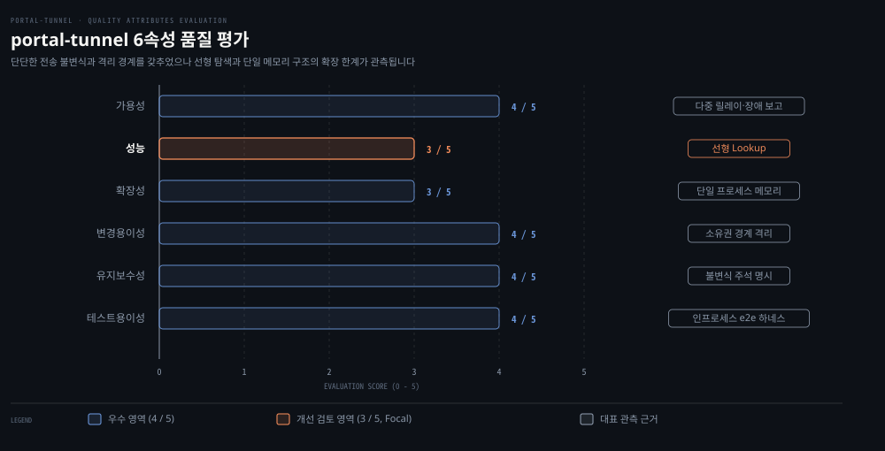

# 코드 리뷰

---

> 기준 커밋 129b6de5을 바탕으로 portal-tunnel의 6대 품질 속성과 핵심 불변식을 종합 평가하며 확인된 실측 마찰과 설계 가설을 바탕으로 학습자를 위한 단계별 기여 로드맵을 정리합니다.

## 리뷰 범위와 방법

> 소스 코드 정독, 로컬 실측, 자동화 테스트 스위트 검증을 통합하여 시스템의 단단한 지점과 취약한 지점을 판정한 기준과 평가 절차를 설명합니다.

역방향 터널 시스템이 프로덕션 환경에서 신뢰를 얻으려면 분산 환경의 연결 장애와 악의적 트래픽 공세를 어떻게 방어하는지 검증해야 합니다. 이 리뷰는 기준 커밋 `129b6de5`의 portal-tunnel이 어떤 지점에서 불변식을 지키고 어디에서 취약성과 병목을 드러내는지 근거를 들어 평가합니다.

본 코드 리뷰는 01장부터 04장까지 분석한 핵심 패키지 전체를 대상으로 삼습니다. 대상 범위는 릴레이 코어를 구성하는 `portal/` 패키지와 클라이언트 접점인 `sdk/` 패키지를 포함합니다. 사용자 진입점인 `cmd/`와 `agent/` 패키지, 공유 계약을 정의하는 `types/`와 유틸리티인 `utils/`도 함께 검토했습니다.

분석과 검증에는 세 가지 방법을 교차 적용했습니다.

1. **코드 정독**: 저장소 루트의 `AGENTS.md`와 아키텍처 문서를 기준으로 잠금 순서, 상태 전이 조건, 예외 처리 경로를 추적했습니다.
2. **로컬 릴레이와 터널 실측**: 로컬 실측(2026-10-17, README 「직접 띄워 보기」)으로 단일 머신에서 제어 평면 임대 등록부터 데이터 평면 프록시까지의 실제 패킷 교환을 관측했습니다.
3. **전체 테스트 스위트 실행**: macOS arm64 환경에서 `go test ./... -count=1` 명령을 실행해 18개 패키지 중 17개 패키지가 통과하는 것을 확인했습니다. 유일하게 실패한 `e2e` 패키지의 오류는 루프백 보조 IP 바인딩 마찰(E2E-1) 때문이었습니다.

리뷰에서 나온 발견 사항은 모두 세 단계 판정 기준으로 분류했습니다.

1. **확인**: 소스 코드 정독과 로컬 실측, 또는 테스트 실행으로 결함이나 제약 사항이 확정된 항목입니다.
2. **의문(가설)**: 특정 경계 조건(비정상 연결 단절, 트래픽 폭주 등)에서 문제가 생길 가능성은 있으나 메인테이너의 설계 의도 확인이나 추가 e2e 재현 검증이 필요한 항목입니다.
3. **해당 없음(좋은 설계)**: 초기 검토에서 문제 소지를 의심했던 항목입니다. 소스 코드를 분석해 보니 방어 로직과 회수 경로가 갖춰져 시스템을 보호하고 있어 좋은 설계로 확인했습니다.

기준 커밋 129b6de5 (2026-10-20)

## 핵심 불변식과 잘 된 설계

> 다중 테넌트 환경의 권한 탈취, 자원 누수, 데이터 손실을 원천 방어하는 다섯 가지 핵심 아키텍처 불변식과 그 구현 메커니즘을 분석합니다.

분산 리버스 터널 시스템에서는 네트워크 단절과 악의적 테넌트의 임대 탈취 시도가 끊임없이 일어납니다. 시스템의 중심을 지탱하는 불변식이 부실하면 서비스 거부나 메모리 누수 같은 장애를 막기 어렵습니다. portal-tunnel은 다섯 지점에서 무엇을 막는지 분명히 정의해 시스템을 방어합니다.

### keyless 서명 경계의 엄격한 4중 제약 (KL-1)

- **코드 위치**: `portal/keyless/signer.go:52-58`, `portal/keyless/bindings.go:69-96`, keyless_tls `relay/signer/service.go:92-160`
- **무엇을 막는가**: 와일드카드 인증서 개인키를 모든 테넌트가 공유하는 환경에서 발생할 수 있는 서명 위조를 막습니다. 타 테넌트의 호스트명을 도용해 `CertificateVerify` 서명을 얻거나 서명 요청을 재전송하는 공격도 차단합니다.

서명 요청이 유효하려면 네 가지 조건을 모두 만족해야 합니다. 첫째, 인증된 임대 ID가 컨텍스트에 있어야 합니다. 둘째, 요청의 16바이트 바인딩이 해당 임대에 발급된 것이어야 합니다. 셋째, ClientHello 해시가 실제 라우팅된 연결과 일치해야 합니다. 넷째, 바인딩은 `ValidateAndConsume` 호출로 즉시 폐기되어야 합니다.

릴레이 서명기는 클라이언트가 제출한 해시를 맹신하지 않습니다. ClientHello와 ServerHello 등 원문 핸드셰이크 바이트를 직접 받아 트랜스크립트 해시를 스스로 계산합니다. 이 때문에 임대 소유자가 서명을 받을 수 있는 것은 자신에게 라우팅된 연결 하나, 그것도 단 한 번뿐입니다.

### 임대 등록 직후 fail-closed 격리 (CP-3)

- **코드 위치**: `portal/api_server.go:341-343`
- **무엇을 막는가**: 임대 등록 시점과 정책 엔진의 인가 반영 시점 사이에 미승인 임대로 외부 트래픽이 라우팅되는 보안 레이스 윈도우를 차단합니다.

챌린지 검증을 통과해 신규 임대가 메모리에 생성되더라도 코드는 성공 응답을 보내기 전에 `s.registry.suspendIdentity(identityKey)`부터 호출해 신원을 즉시 일시 정지(fail-closed) 상태로 둡니다. 그다음 오버레이 디스크립터 발급과 정책 엔진 동기화를 차례로 진행합니다. 정책 mux가 테넌트의 접근 허용 결정을 완전히 적용한 뒤에야 클라이언트에게 200 OK 등록 성공을 알립니다.

### 역방향 연결 풀의 ReserveOffer 및 Commit 2단계 분리 (TR-1)

- **코드 위치**: `portal/transport/reverse_pool.go:66-108`
- **무엇을 막는가**: 오버레이 수락 직후 실제 연결이 부족해지는 경쟁 상태를 방지하고 풀이 닫히는 과정에서 처리 중이던 연결이 비정상 유실되는 현상을 차단합니다.

터널이 역방향 연결을 풀에 제공할 때 바로 대기 큐(`ready`)에 넣지는 않습니다. 먼저 `ReserveOffer`를 호출해 풀 내부 가용 용량을 선점하고 예약 객체(`offerReservation`)를 얻습니다. 오버레이 원격 노드에 수락 확인을 보낸 뒤에야 `Commit`을 호출해 연결을 활성 큐에 넣고 거절되면 `Cancel`을 호출합니다. 풀이 닫힐 때도 미결 예약이 0이 될 때까지 `cond.Wait`로 기다리므로 안전하게 종료됩니다.

### 양방향 프록시의 half-close 보존 및 동적 대역폭 갱신 (TR-3)

- **코드 위치**: `portal/proxy.go:27-67,100-132`
- **무엇을 막는가**: HTTP 요청 업로드 완료 후 응답 수신을 대기하는 정상 클라이언트 연결이 조기 종료되는 오류를 막습니다. 런타임에 바꾼 대역폭 제한이 바로 반영되지 않아 생기는 트래픽 폭주도 차단합니다.

`proxy.copy` 루프는 한쪽 스트림에서 `io.EOF`를 읽으면 소켓 전체를 닫지 않고 `closeWrite` 인터페이스를 호출합니다. 송신 방향만 닫는 TCP 반닫기가 그대로 유지됩니다. 32KiB 버퍼 루프마다 `bpsManager.ThrottleIdentityBPS`를 다시 호출해 토큰 버킷도 확인합니다. 그래서 관리자가 런타임에 대역폭 한도를 바꾸면 다음 32KiB 청크 전송부터 새 한도가 바로 적용됩니다.

### 임대 등록 실패 시 원자적 자원 회수 경로 (CP-4)

- **코드 위치**: `portal/api_server.go:360-374`
- **무엇을 막는가**: 부분 등록 실패로 인해 릴레이 내부 메모리와 외부 DNS 시스템에 불완전한 유령 임대가 영구 잔류하는 리소스 누수를 차단합니다.

임대 등록의 마지막 관문인 DNS 동기화(`syncLeaseDNS`)가 타임아웃이나 오류로 실패하면 방금 발급된 임대의 액세스 토큰으로 `registry.Unregister`를 즉시 호출합니다. 레지스트리에서 임대를 제거하면서 생성을 시도했던 DNS 레코드도 삭제합니다. 레지스트리 검색에서 누락되더라도 `closeRecord`를 직접 호출해 소켓과 채널을 강제 해제하는 2중 회수 경로도 갖췄습니다.

## 6속성 평가

> 가용성, 성능, 확장성, 변경용이성, 유지보수성, 테스트용이성이라는 6대 아키텍처 품질 속성의 실측 결과와 개선 조치를 제시합니다.

소프트웨어 아키텍처는 기능 구현만으로 완성되지 않습니다. 병목이나 장애 요인을 미리 찾아내지 못하면 안정적으로 운영하기 어렵습니다. 이 절은 portal-tunnel의 코드베이스와 실측 데이터로 6대 품질 속성의 강점과 구조적 한계를 평가하고 개선 조치를 정리합니다.

위 도식은 6대 품질 속성의 평가 점수와 대표 관측 근거를 가로 막대 차트로 요약합니다. 변경용이성, 유지보수성, 테스트용이성, 가용성은 4점으로 완성도가 높습니다. 성능과 확장성은 선형 탐색과 단일 메모리 구조 때문에 3점에 머물러 개선 검토가 필요합니다.

### 가용성: 4/5

- **근거**: 다중 릴레이 장애 발생 시 `Report`로 후보군에서 즉시 격리합니다(`portal/discovery/controller.go:73`). 129b6de5(#647)에서는 백그라운드 MITM 프로브(`sdk/listener.go:581`)가 MITM 차단 옵션을 켠 경우 방문자 요청 없이도 exporter 불일치 릴레이를 격리합니다. 또한 129b6de5(#648)에서 동일 IssuedAt에 서명 내용이 모순된 디스크립터를 즉시 거부(`upsertConflicting`, `portal/discovery/relayset.go:301-308`)하여 오염을 막습니다.
- **갱신 및 제한**: 임대 만료 30초 전에 갱신 루프를 가동합니다(`sdk/listener.go:36`). 10초 클레임 타임아웃으로 교착을 방지합니다(`portal/server.go:37`). ACME DNS 동기화 연속 실패 시 지수 백오프를 적용합니다(`portal/acme/maintenance.go:37`).
- **감점 요인**: 비정상 종료 터널의 연결이 keepalive 지연으로 풀에 잔류할 가능성이 있습니다(TR-2, `portal/transport/reverse_pool.go:186-213`). 전역 tenant 예산(1024)의 출발지·identity 공정성이 보장되지 않는 점은 설계 의도 확인이 필요합니다(TR-4, `portal/server.go:889-926`).
- **조치**: TR-2는 e2e 테스트 환경에서 지연 시간을 측정합니다. TR-4는 메인테이너에게 tenant 예산 공정성의 설계 의도를 문의합니다.

### 성능: 3/5

- **근거 (PF-1)**: 공개 연결마다 `Lookup` 함수가 전체 임대 슬라이스를 2회 선형 탐색합니다(`portal/lease.go:271-302`).
- **버퍼 및 백홀**: 프록시 루프는 32KiB 버퍼마다 BPS 한도를 반복 조회합니다(`portal/proxy.go:100-132`). WebSocket의 yamux HOL 블로킹과 5분 종료 타이머가 스트리밍을 제약합니다(`portal/transport/stream_mux.go:290-294`).
- **조치**: 임대 수 증가에 따른 Lookup 처리 벤치마크를 작성하고 호스트 색인 PR을 제안합니다.

### 확장성: 3/5

- **근거**: 임대 레지스트리와 바인딩 테이블이 단일 프로세스 메모리에 저장됩니다(`portal/lease.go:49`, `portal/keyless/bindings.go:14`). 단일 릴레이의 수평 확장이 불가능하며 discovery를 통한 분산 배포만 가능합니다.
- **감점 요인 (PF-2)**: 검사 128개와 테넌트 1024개 예산이 상수로 고정되어 장비 맞춤 조정이 어렵습니다(`portal/server.go:44-45`).
- **조치**: 설정 추가를 경계하는 `AGENTS.md` 철학 안에서 환경 변수 기반 튜닝 필요성을 메인테이너와 논의합니다.

### 변경용이성: 4/5

- **근거**: 패키지 소유권이 아키텍처 문서에 고정되어 있습니다(`maintainer architecture.md`). `types/` 패키지가 공유 계약만 소유하며 단일 소유자 원칙으로 결합도를 낮췄습니다.
- **감점 요인 (ST-1)**: 웹 UI를 서빙하는 `agent/dashboard.go`가 2,255줄에 달합니다. `portal/lease.go:337`의 `Register` 함수도 207줄에 걸쳐 복잡한 상태를 한 몸체에서 처리합니다.
- **조치**: 200줄 이상인 대형 함수는 검증과 전이 로직을 서브루틴으로 분리하는 리팩토링을 검토합니다.

### 유지보수성: 4/5

- **근거**: 동시성 제어와 전송 불변식을 설명하는 고품질 주석이 코드 인접 지점에 풍부합니다(`portal/transport/reverse_pool.go:13-15`, `portal/lease.go:199-200`).
- **감점 요인 (TR-5)**: 미등록 SNI 요청마다 Warn 로그를 남겨 외부 트래픽이 로그를 증폭시킬 위험이 있습니다(`portal/server.go:1000-1007`).
- **조치**: 미등록 SNI 로깅 빈도를 제한하거나 Debug 레벨로 전환해 관측성을 안정화합니다.

### 테스트용이성: 4/5

- **근거**: 상태 판정 함수가 `now time.Time`을 주입받는 결정론적 패턴을 준수합니다(ST-2, `portal/lease.go:280,304`). 단일 프로세스에서 릴레이와 에이전트를 실측하는 e2e 하네스를 갖췄습니다(ST-3, `e2e/harness_test.go:29-35`).
- **감점 요인 (E2E-1)**: macOS 환경에서 루프백 보조 IP 바인딩 부재로 e2e 테스트 3건이 실패합니다(`e2e/ingress_test.go:40,75`, `e2e/quic_auth_test.go:81,144`). ingress 테스트는 127.0.0.2, quic_auth 테스트는 127.0.0.2~127.0.0.16 별칭이 필요합니다.
- **조치**: 바인딩 실패 시 `t.Skip` 처리와 함께 환경 설정 안내(ingress 테스트는 127.0.0.2, quic_auth 테스트는 127.0.0.2~127.0.0.16 별칭 필요)를 출력하도록 헬퍼를 보완합니다.

전체로 보면 portal-tunnel은 전송과 신원 불변식이 탄탄하게 설계되어 있습니다. 다만 가용성과 확장성 측면에서 제기된 TR-2 가설 검증과 TR-4(tenant 예산 공정성 질문)의 설계 의도 확인이 필요합니다.

## 의문과 가설 목록

> 정적 코드 분석과 실측에서 포착된 잠재적 위험을 가설 형태로 정리하고 구체적인 검증 경로를 수립합니다.

코드 검토만으로는 정상 트래픽 흐름 이면에 숨은 비정상 네트워크 엣지 케이스나 보안 위협을 확정하기 어렵습니다. 이 절은 확정된 결함과 검증되지 않은 설계 가설을 나누어 기록하고 항목마다 확인 방법을 적어 둡니다.

| 번호 | 위치 | 내용 한 줄 | 확인 방법 |
|---|---|---|---|
| CP-2 | `portal/api_server.go:390-400` | SIWE 메시지 scheme이 `r.TLS == nil`로 결정되어 앞단 TLS 프록시 환경에서 `http://`로 생성될 가능성 | 리버스 프록시 뒤 배포 환경 실측 및 설계 의도 문의 |
| TR-2 | `portal/transport/reverse_pool.go:186-213` | 비정상 종료 터널의 대기 연결이 TCP keepalive 송신 버퍼 특성으로 인해 lease 만료까지 풀에 잔류할 가능성(가설) | 터널 패킷 drop 후 릴레이 연결 풀 지연 시간 측정 e2e 하네스 작성 |
| TR-4 | `portal/server.go:889-926`, `portal/lease.go:201-225`, `portal/proxy.go:27` | 전역·lease 예산의 출발지/identity 공정성 미보장 — 설계 의도 확인 필요 | 메인테이너에게 예산 공정성 설계 의도 문의(보안 성격으로 판단 시 비공개 경로) |
| TR-5 | `portal/server.go:1000-1007` | 미등록 SNI 수신 시 무조건 Warn 로그를 기록하여 공격자가 임의의 로그 증폭을 유발할 가능성 | 검사 예산 범위 내 무작위 SNI 전송 시 로그 출력 빈도 측정 |
| PF-1 | `portal/lease.go:271-302` | 공개 연결마다 RLock 아래에서 전체 임대 목록을 2회 선형 탐색하여 대규모 임대 환경에서 CPU 경합 가능성 | 임대 수(100~10,000개) 증가에 따른 Lookup 벤치마크 테스트 |
| PF-2 | `portal/server.go:44-45` | 검사(128) 및 테넌트(1024) 예산 상수가 하드코딩되어 고사양 서버 환경에서 확장성 제약 가능성 | AGENTS.md 원칙과 대규모 트래픽 처리 요구사항 간 트레이드오프 설계 확인 |

가설은 검증 전까지 결함으로 단정할 수 없으니 가설이라고 분명히 적어야 합니다.

TR-4는 relay 전역 tenant 예산(1024, `portal/server.go:44`)과 lease 당 예산 128개가 출발지·identity 별 공정성을 따로 보장하지 않는다는 점을 설계 질문으로 남깁니다. maintainer 문서는 검사 예산 128개의 불공정을 명시하지만 tenant 예산에 대해서는 언급이 없습니다. 실제 운영 영향은 확인하지 않았습니다. 메인테이너에게는 tenant 예산 공정성의 설계 의도를 묻되 보안 성격으로 판단되면 공개 이슈 대신 비공개 경로로 확인해야 합니다.

## 기여 후보와 순서

> 표면 개선에서 시작하여 성능 벤치마크와 코어 검증으로 나아가는 학습자의 단계별 기여 로드맵을 제시합니다.

오픈소스 프로젝트에 처음 참여하면서 어디서 시작할지 모른 채 무작정 복잡한 코어 프로토콜 변경부터 시도하면 반려되는 일이 생깁니다. 아래 순서는 기여의 난이도와 검증 위험도, 그리고 메인테이너의 기여 가이드라인(`CONTRIBUTING.md`)을 고려해 쉬운 것부터 정했습니다.

1. **(1) E2E-1 (macOS 루프백 테스트 격리 및 안내)**: `e2e/ingress_test.go:40,75`와 `e2e/quic_auth_test.go:81,144`의 바인딩 실패를 보완합니다. 바인딩 실패 시 `t.Skip`으로 건너뛰고 로컬 설정 안내(ingress 테스트는 127.0.0.2, quic_auth 테스트는 127.0.0.2~127.0.0.16 별칭 필요)를 출력하게 합니다. 또는 `CONTRIBUTING.md`에 macOS 준비 명령을 추가합니다. 외부 런타임 영향이 없는 안전한 첫 PR입니다.
2. **(2) OB-1 (셀프 호스팅 로컬 인증서 안내 문서 보완)**: 로컬 실측에서 확인된 `*.localhost` 와일드카드 인증서 검증 불일치를 안내합니다. 셀프 호스팅 가이드 문서에 `curl -k` 옵션이나 Go 클라이언트 사용법을 명시합니다. 코어 발급 로직을 건드리지 않고 실제 마찰을 해소하는 표면 문서 기여입니다.
3. **(3) CP-2 (SIWE 등록 URI scheme 결정 질문)**: 앞단 TLS 종단 프록시 환경에서 `r.TLS == nil`로 인해 SIWE 메시지 scheme이 `http://`로 생성되는 현상을 다룹니다(`portal/api_server.go:390-400`). 이것이 의도된 동작인지 `X-Forwarded-Proto` 헤더를 고려해야 하는지 GitHub Issues로 질의합니다.
4. **(4) PF-1 (Lookup 선형 탐색 벤치마크 및 해시맵 색인)**: 임대 수 증가에 따른 `Lookup` 함수의 실행 시간을 측정하는 `BenchmarkLookup` 코드를 먼저 작성합니다. 계측 결과를 이슈에 첨부해 필요성을 증명한 뒤 호스트명 해시맵 색인을 도입하는 코드 PR을 제안합니다.
5. **(5) TR-2 / TR-4 (대기 연결 잔류 실측 및 tenant 예산 공정성 질문)**: 터널 패킷 drop 시나리오를 e2e 테스트 코드로 작성하여 TR-2의 연결 풀 잔류 시간을 측정합니다. TR-4는 메인테이너에게 tenant 예산 공정성의 설계 의도를 묻습니다(보안 성격으로 판단되면 공개 이슈 대신 비공개 경로).

포털 터널 저장소의 열린 이슈와 이어지는 지점도 눈여겨볼 만합니다.

- `#654: feat: add relay observability and Grafana dashboard`: 릴레이 내부의 동시 연결 수, Lookup 지연 시간, 테넌트별 트래픽을 관측하는 기능으로 PF-1 및 TR-4(예산 사용량 관측)의 모니터링 기반이 됩니다.
- `#470: Add NAT-PMP/UPnP direct ingress with relay fallback`: 릴레이 부하를 줄이고 클라이언트 간 직접 통신을 확장하려는 시도입니다.
- `#643: feat(acme): support ARI-aware renewals and configurable CA directory`: 인증서 갱신 시점을 최적화하여 가용성을 보강합니다.
- `#653: feat(sdk): identity-bound TLS channel binding for native clients`: 신원 바인딩을 TLS 핸드셰이크 단계까지 밀착시켜 보안 경계를 강화하는 제안입니다.

최근 병합된 변경과 그 뒤에 남은 한계도 확인해야 합니다. 백그라운드 MITM 프로브를 도입한 PR #647, 디스커버리 충돌 디스크립터 거부를 넣은 #648, credential subject 폐기와 신원 헤더 제거를 다룬 #656이 129b6de5에 병합되었습니다. 하지만 상위 이슈 #651은 OIDC 등 남은 인증 범위가 여전히 열려 있습니다. 한편 이슈 #645와 #646은 적응형·선택적 MITM 회피와 교차 릴레이 공격 실험 등 정량 탐지 평가를 미구현 한계로 남긴 채 2026-10-19 not planned 상태로 닫혔습니다.

`CONTRIBUTING.md`에 명시된 바와 같이 기여자는 작업 성격에 맞추어 역할을 분담해야 합니다. AI 기여자는 CLI 편의성, 문서 보완, 테스트 환경 격리, 로그 개선처럼 사용자 접점의 표면 계층을 신속하게 개선하는 데 적합합니다.

반면 전송 불변식, 코어 암호화, 신원 인가 모델 같은 코어 계층은 깊은 도메인 맥락과 트레이드오프 검토를 요구합니다. 이 영역의 변경은 인간 엔지니어의 설계 판단과 사전 검토를 반드시 거쳐야 합니다.

## 이 리뷰의 한계

> 정적 코드 분석과 단일 로컬 실측 환경에 기반한 본 리뷰의 경계 조건과 추가 검증 필요성을 정리합니다.

정적 코드 분석과 로컬 개발 환경 실측만으로는 프로덕션 분산 시스템의 위험을 모두 다루기 어렵습니다. 아래에 이 리뷰의 한계를 적어 두고 이후 추가 검증의 출발점으로 삼습니다.

- 대규모 공개 릴레이의 실제 운영 텔레메트리 데이터가 부재하여 실제 트래픽 패턴 속 임대 수명주기를 온전히 관측하지 못했습니다.
- 수천 개 이상의 동시 연결이나 대역폭이 극한까지 포화된 상태에서 스트레스 부하를 직접 측정하지 못했습니다.
- 가설로 제기된 TR-2(소켓 버퍼 keepalive 지연)와 TR-4(tenant 예산 공정성 질문)는 정적 분석과 아키텍처 추론에 기반한 것으로 실제 운영 영향과 설계 의도를 아직 확인하지 못했습니다.
- 분석 및 학습 문서는 AI 보조 도구로 작성했고 독립 검증 라운드도 거쳤습니다. 그래도 프로덕션 배포나 코어 기여 전에는 인간 메인테이너와 보안 엔지니어가 마지막으로 원전 대조와 실측 검증을 반드시 해야 합니다.

## 리뷰 노트

> 소스 코드 분석과 로컬 실측, 16편의 학습 문서 교차 검증을 종합하며 최종적으로 확인한 시스템 동작 특이점입니다.

- `portal/discovery/controller.go:73`의 실패 보고 중복 제거: `Report` 함수는 동일 릴레이의 실패 이벤트를 메모리에서 중복 제거해 discovery 정책 갱신 오버헤드를 방지합니다. 다만 릴레이 장애 복구 알림(`ReportSuccess`)은 별도 인터페이스 없이 TTL 만료 후 자연 복구에 의존하므로 일시적 네트워크 플랩 시 복구 지연이 발생할 수 있습니다.
- `sdk/listener.go:36`의 갱신 주기 버퍼: 임대 만료 30초 전 갱신(`defaultRenewBefore`)은 2분 TTL 대비 25%의 충분한 안전 마진을 제공합니다. 고지연 위성망이나 재시도 지수 백오프 상황에서는 이 30초가 소진될 수 있어 환경별로 마진을 조정할 여지가 있습니다.
- `portal/server.go:1000-1007`의 미등록 SNI Warn 로그: 악의적 외부 스캐너가 대량의 무작위 SNI로 핸드셰이크를 시도할 경우 파일 I/O 부하를 가중시킬 수 있습니다. 프로덕션 릴레이를 운영할 때는 로깅 레벨을 조정하거나 필터링해야 합니다.

## 자가 점검 질문

> 본문에서 다룬 품질 평가, 핵심 불변식, 기여 후보를 스스로 복습하기 위한 질문입니다.

1. portal-tunnel의 Keyless TLS 서명기(KL-1)가 와일드카드 인증서 키를 여러 테넌트가 공유하는데도 다른 테넌트의 호스트명 인증서를 도용할 수 없도록 방어하는 핵심 4중 불변식은 무엇입니까?
2. 임대 등록 과정(CP-3)에서 신원을 생성 직후 곧바로 `suspendIdentity`로 잠그는 이유는 무엇입니까?
3. 공개 인그레스 라우팅(PF-1)에서 `Lookup` 함수가 대규모 임대 환경에서 성능 병목 후보로 지목되는 구조적 원인은 무엇입니까?
4. macOS 로컬 개발 환경에서 `go test ./...`를 실행할 때 `e2e` 패키지의 테스트가 실패하는 원인(E2E-1)과 권장되는 첫 기여 해결책은 무엇입니까?

## 정답 (자답 후 펼치기)

> 위 자가 점검 질문에 대한 핵심 답변입니다.

1. (1) 인증된 lease ID 존재, (2) 임대에 발급된 16바이트 바인딩 일치, (3) 릴레이가 실제 라우팅한 연결의 ClientHello 해시 일치, (4) 바인딩의 1회성 소모(`ValidateAndConsume`)입니다. 서명기는 클라이언트가 전달한 해시를 신뢰하지 않고 전체 핸드셰이크 트랜스크립트 원문을 받아 해시를 스스로 계산하므로 다른 테넌트 호스트명의 유효한 서명을 가로챌 수 없습니다.
2. 임대 레코드 생성 시점과 정책 엔진의 인가 반영 시점 사이에 존재하는 보안 레이스 윈도우를 차단하려는 것입니다. 신원을 fail-closed 상태로 둔 뒤 정책 mux가 해당 테넌트의 접근 결정을 확정하고 적용한 다음에야 클라이언트에게 성공 응답을 반환하므로 미승인 임대로 트래픽이 라우팅되지 않습니다.
3. 공개 연결이 유입될 때마다 레지스트리 읽기 잠금(`mu.RLock`) 아래에서 전체 임대 슬라이스를 순회하며 완전 일치와 패턴 일치로 총 두 번의 선형 탐색(O(N))을 수행하기 때문입니다. 임대 수가 수천 개 이상으로 증가하면 연결 수립마다 잠금 경합과 CPU 지연이 발생하므로 호스트명 해시맵 색인이 필요합니다.
4. Linux와 달리 macOS 루프백은 보조 IP에 자동 응답하지 않아 소켓 바인딩 에러(`can't assign requested address`)가 발생하기 때문입니다. ingress 테스트는 127.0.0.2, quic_auth 테스트는 127.0.0.2~127.0.0.16 별칭이 필요합니다. 바인딩 실패 시 `t.Skip`으로 건너뛰며 설정 안내(ingress는 127.0.0.2, quic_auth는 127.0.0.2~127.0.0.16 별칭 필요)를 제공하거나 개발 가이드 문서에 macOS 준비 절차를 추가하는 표면 PR이 권장됩니다.

## 출처와 관련 문서

> 본문 작성에 참고한 공식 1차 자료와 저장소 내부의 연관 학습 문서 목록입니다.

- [gosuda/portal-tunnel 공식 저장소](https://github.com/gosuda/portal-tunnel/tree/129b6de5): 기준 커밋 129b6de5 소스 코드 및 `AGENTS.md`, `CONTRIBUTING.md`
- [Portal Maintainer Architecture](https://gosuda.github.io/portal-tunnel/architecture): 내부 패키지 소유권 및 릴레이 전송 불변식 명세
- [What is Portal·비교 제품](00-01.What%20is%20Portal·비교%20제품.md): 역방향 터널 개념 및 9개 대안 기술 비교
- [Concepts](00-02.Concepts.md): 임대(lease), 레코드(record), 브리지(bridge) 핵심 개념
- [Control Plane Flow](01-03.Control%20Plane%20Flow.md): 제어 평면 등록 및 역방향 연결 할당
- [reverse_pool·reverse_framing](01-04.reverse_pool·reverse_framing.md): 역방향 연결 풀 및 프레이밍 불변식
- [stream_mux·yamux](01-05.stream_mux·yamux.md): 스트림 다중화 및 WebSocket 백홀 구조
- [lease·record](01-06.lease·record.md): 임대 수명주기 및 브리지 인가 통제
- [quic_backhaul·datagram](01-07.quic_backhaul·datagram.md): QUIC 백홀 및 UDP 데이터그램 전달
- [SNI routing·ClientHello](02-02.SNI%20routing·ClientHello.md): SNI 라우팅 및 인그레스 검사 슬롯
- [keyless TLS](02-03.keyless%20TLS.md): 키리스 서명 4중 제약 및 트랜스크립트 불변식
- [MITM self-probe](02-04.MITM%20self-probe.md): 중간자 공격 능동 탐침 메커니즘
- [ACME·DNS-01·ENS](02-05.ACME·DNS-01·ENS.md): 와일드카드 인증서 자동 발급 및 백오프
- [identity·SIWE·lease token](03-02.identity·SIWE·lease%20token.md): EIP-4361 신원 검증 및 토큰 발급
- [relay policy](03-03.relay%20policy.md): 릴레이 정책 mux 및 사전 인증 예산
- [discovery·overlay](03-04.discovery·overlay.md): 오버레이 라우팅 및 릴레이 디스커버리
- [sdk.Expose·Listener](04-01.sdk.Expose·Listener.md): 클라이언트 SDK 리스너 및 프록시 파사드
- [CLI·Agent](04-02.CLI·Agent.md): CLI 진입점 및 에이전트 데몬 구조
- [AGENTS.md·e2e 하네스](04-03.AGENTS.md·e2e%20하네스.md): 개발 원칙, e2e 테스트 하네스, 기여 정책
