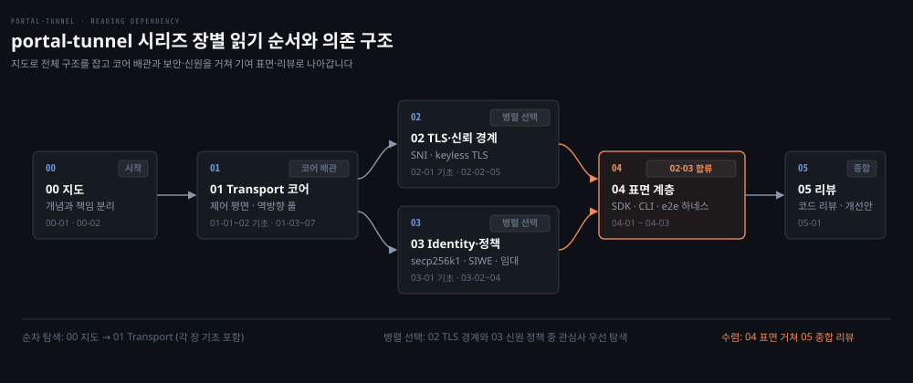

# portal-tunnel — 시리즈 인덱스

---

> 사설망 뒤의 서비스를 공인 IP 없이 안전하게 외부에 노출하는 Go 기반 오픈소스 역방향 터널 gosuda/portal-tunnel의 아키텍처를 코드 리딩으로 이해하고 실무 검증과 오픈소스 기여로 이어가는 학습 지도입니다.

## 시리즈 목적과 대상 독자

> 프로덕션 수준의 역방향 터널을 밑바닥 코드부터 정독하여, 연결 수립·라우팅·신뢰 경계의 제어 원리를 파악하고 실제 결함 리뷰와 기여까지 도달하는 것을 목표로 삼습니다.

로컬 개발 환경이나 사설망 내부 서비스를 공인 인터넷에 열어주려면 공인 IP를 발급받거나 공유기의 포트 포워딩(Port Forwarding) 설정을 열어야 합니다. 하지만 NAT 뒤에서는 외부 인바운드 연결을 직접 수신하기 어렵고 방화벽을 임의로 해제하는 것은 보안 위험을 부릅니다. 이 문제를 해결하는 소프트웨어가 역방향 터널(Reverse Tunnel)입니다.

이 시리즈는 Go 언어로 작성된 MIT 라이선스 오픈소스 [gosuda/portal-tunnel](https://github.com/gosuda/portal-tunnel)을 코드 수준에서 정독합니다. 동작 원리를 파악하고 아키텍처 리뷰와 코드 기여(Contribution)로 나아가려고 마련했습니다.

HTTP, TCP, Go 기본 문법을 이해하고 소켓 프로그래밍을 경험해 본 개발자를 독자로 삼습니다. 같은 저장소의 [gonet-lab](../../project/gonet-lab/README.md)에서 TCP echo 서버, UDP 데이터그램, DNS 클라이언트, 포트 스캐너를 직접 구현해 보았다고 가정합니다. 반면 역방향 터널의 핵심 기법인 역방향 연결 풀링, SNI 라우팅, keyless TLS, yamux 스트림 다중화, SIWE(Sign-In with Ethereum) 신원 증명은 처음 접하는 개념이라고 보고 첫 등장마다 배경과 원리를 함께 설명합니다.

기준 커밋은 0a3b9c06 (2026-10-14, release v2.6.4)입니다.


## 편 목록

> 전체 6개 장 묶음 아래 22개 편으로 나누어 수송 계층, 신뢰 경계, 신원 정책, 공개 표면과 리뷰를 단계별로 다룹니다.

터널의 동작을 단편적인 기능 단위로만 쪼개어 보면 전체 인과관계를 파악하기 어렵습니다. 그래서 개념과 배관, 보안과 정책, 사용 표면과 품질 검증이라는 6개 장 묶음으로 나누어 다룹니다.

- 00 지도: 시리즈 개요, 개념 정의, 릴레이와 터널의 책임 분리 모델
- 01 Transport 코어: NAT·다중화 기초 → 제어 평면 등록, 역방향 연결 풀, yamux 스트림 다중화, 수송 백홀
- 02 TLS·신뢰 경계: TLS 1.3·SNI 기초 → SNI 라우팅, keyless TLS 원격 서명, 중간자 공격 방어, 인증서 발급
- 03 Identity·정책: 전자서명·secp256k1·JWT 기초 → secp256k1 신원 키, SIWE 챌린지, 릴레이 진입 정책과 평판 관리
- 04 표면(SDK·CLI·기여): Go SDK 임베딩, 터널 CLI 에이전트, AGENTS.md 개발 원칙과 테스트 하네스
- 05 리뷰: v2.6.4 전체 아키텍처 종합 리뷰, 결함 분석과 리팩터링 제안

| 장 묶음 | 편 | 다루는 것 | 상태 |
|---|---|---|---|
| 00 지도 | [00-01.What is Portal·비교 제품.md](00-01.What%20is%20Portal%C2%B7%EB%B9%84%EA%B5%90%20%EC%A0%9C%ED%92%88.md) | 역방향 터널 원리, Portal의 설계 차별점과 기존 터널링 도구 비교 | draft |
| 00 지도 | [00-02.Concepts.md](00-02.Concepts.md) | portal-tunnel 시스템의 핵심 개념과 구성요소 간 책임 분리를 다루는 종합 지도 | draft |
| 01 Transport 코어 | [01-01.NAT·conntrack·outbound connection.md](01-01.NAT%C2%B7conntrack%C2%B7outbound%20connection.md) | (기초) 사설망의 인바운드 수신 한계, conntrack 상태 추적과 아웃바운드 연결, 역방향 터널의 비대칭 활용 원리 | draft |
| 01 Transport 코어 | [01-02.Stream multiplexing·HTTP Upgrade·QUIC.md](01-02.Stream%20multiplexing%C2%B7HTTP%20Upgrade%C2%B7QUIC.md) | (기초) 단일 연결 다중화 원리, TCP 헤드오브라인 차단 한계, QUIC 전송 규약과 HTTP Upgrade 메커니즘 | draft |
| 01 Transport 코어 | [01-03.Control Plane Flow.md](01-03.Control%20Plane%20Flow.md) | 호스트 등록, 리버스 연결 유지 및 안전한 종료를 위한 제어 평면의 네 단계 규약 | draft |
| 01 Transport 코어 | [01-04.reverse_pool·reverse_framing.md](01-04.reverse_pool%C2%B7reverse_framing.md) | ReversePool 연결 확보 및 관리, 유휴 연결 유지와 활성화 신호 제어를 위한 첫 바이트 프레이밍 규약 | draft |
| 01 Transport 코어 | [01-05.stream_mux·yamux.md](01-05.stream_mux%C2%B7yamux.md) | WebSocket과 yamux를 활용한 다중 스트림 중계 보조 캐리어의 동작 원리와 트레이드오프 | draft |
| 01 Transport 코어 | [01-06.lease·record.md](01-06.lease%C2%B7record.md) | 호스트-터널 매핑을 위한 임대 레코드 자료구조, 수명주기, 다단계 연결 인입 관문 및 스트림 취소 전파 규약 | draft |
| 01 Transport 코어 | [01-07.quic_backhaul·datagram.md](01-07.quic_backhaul%C2%B7datagram.md) | 전용 포트와 QUIC DATAGRAM 백홀을 통한 UDP·원시 TCP 트래픽 격리 전달 전송 규약 | draft |
| 02 TLS·신뢰 경계 | [02-01.TLS 1.3 handshake·SNI·ECDHE.md](02-01.TLS%201.3%20handshake%C2%B7SNI%C2%B7ECDHE.md) | (기초) 브라우저와 서버 간 TLS 1.3 핸드셰이크, SNI 전송, ECDHE 비밀 키 합의와 도메인 소유권 검증 원리 | draft |
| 02 TLS·신뢰 경계 | [02-02.SNI routing·ClientHello.md](02-02.SNI%20routing%C2%B7ClientHello.md) | 복호화 없는 ClientHello SNI 확장 파싱 기반 목적지 터널 인그레스 라우팅과 버퍼링 원리 | draft |
| 02 TLS·신뢰 경계 | [02-03.keyless TLS.md](02-03.keyless%20TLS.md) | 인증서 개인키 격리와 트래픽 평문 은닉을 위한 원격 핸드셰이크 서명 분리 키리스 규약 | draft |
| 02 TLS·신뢰 경계 | [02-04.MITM self-probe.md](02-04.MITM%20self-probe.md) | 릴레이의 TLS 가로채기 감지를 위한 런타임 자가 프로브 메커니즘과 TLS exporter 검증 원리 | draft |
| 02 TLS·신뢰 경계 | [02-05.ACME·DNS-01·ENS.md](02-05.ACME%C2%B7DNS-01%C2%B7ENS.md) | 와일드카드 인증서 발급을 위한 DNS-01 방식, 다중 DNS 공급자 구조와 내장 권한 DNS 및 ENS 연동 | draft |
| 03 Identity·정책 | [03-01.Digital signature·secp256k1·JWT.md](03-01.Digital%20signature%C2%B7secp256k1%C2%B7JWT.md) | (기초) 전자서명, secp256k1 타원곡선, 이더리움 주소 도출 및 무상태 인가 규약인 JWT의 설계 원리 | draft |
| 03 Identity·정책 | [03-02.identity·SIWE·lease token.md](03-02.identity%C2%B7SIWE%C2%B7lease%20token.md) | secp256k1 개인키와 SIWE 서명 증명, 최소 권한 ES256K JWT 토큰 기반 임대 제어 및 리버스 세션 격리 | draft |
| 03 Identity·정책 | [03-03.relay policy.md](03-03.relay%20policy.md) | 익명 발신자 사전 인증 예산과 검증된 서비스 신원 기준 연산 자원 및 라우팅 통제 정책 계층 | draft |
| 03 Identity·정책 | [03-04.discovery·overlay.md](03-04.discovery%C2%B7overlay.md) | 다중 릴레이 탐색과 MOLS 격자 우선순위 장애 극복, IVNP 오버레이 소유권 경계 | draft |
| 04 표면(SDK·CLI·기여) | [04-01.sdk.Expose·Listener.md](04-01.sdk.Expose%C2%B7Listener.md) | Go 애플리케이션 임베딩을 위한 net.Listener 구현과 sdk.Expose, 프록시 파이프라인 구조 | draft |
| 04 표면(SDK·CLI·기여) | [04-02.CLI·Agent.md](04-02.CLI%C2%B7Agent.md) | portal expose 명령 런타임 조립, portal agent 다중 터널 구조, 로컬 제어 API와 OS 서비스 등록·설치 | draft |
| 04 표면(SDK·CLI·기여) | [04-03.AGENTS.md·e2e 하네스.md](04-03.AGENTS.md%C2%B7e2e%20%ED%95%98%EB%84%A4%EC%8A%A4.md) | Portal 저장소 엔지니어링 원칙, 테스트 구조, e2e 하네스 격리 원리와 CI 파이프라인 및 기여 진입 경로 | draft |
| 05 리뷰 | [05-01.코드 리뷰.md](05-01.%EC%BD%94%EB%93%9C%20%EB%A6%AC%EB%B7%B0.md) | 기준 커밋 0a3b9c06 종합 평가, 6대 품질 속성과 핵심 불변식 검증, 실측 마찰 기반 단계별 기여 로드맵 | draft |


## 읽는 순서

> 지도로 전체 구조를 잡은 뒤 각 장 첫머리의 기초 편을 딛고 코어 배관, 보안·신원 경계, 외부 표면과 테스트, 최종 코드 리뷰로 나아갑니다.



처음 보는 독자는 00-01편과 00-02편으로 전체 지도와 아키텍처 책임을 파악한 다음, 각 장을 순서대로 읽으면 됩니다. 각 장은 해당 영역의 기반 원리를 설명하는 기초 편으로 시작하므로, 배경 지식이 필요한 독자는 장의 첫머리부터 차례대로 학습할 수 있습니다. 이미 아는 개념이면 그 장의 기초 편을 건너뛰고 곧바로 본편으로 넘어가도 무방합니다.

각 장의 본편은 장 첫머리의 기초 편을 전제 지식으로 삼습니다. 본편을 읽다가 기본 원리가 생소하게 느껴질 때는 같은 장의 기초 편으로 돌아가 개념을 보충할 수 있습니다. 장을 넘는 짝 하나만 따로 밝히면, 01-03 Control Plane Flow의 토큰 검증 부분은 03-01(서명·JWT)의 배경 지식을 전제로 합니다.

| 본편 | 같은 장 기초 편 | 다루는 배경 지식 |
|---|---|---|
| [01-03.Control Plane Flow.md](01-03.Control%20Plane%20Flow.md), [01-04.reverse_pool·reverse_framing.md](01-04.reverse_pool%C2%B7reverse_framing.md) | [01-01.NAT·conntrack·outbound connection.md](01-01.NAT%C2%B7conntrack%C2%B7outbound%20connection.md) | NAT 뒤 사설망의 아웃바운드 연결 수립과 conntrack 상태 추적 |
| [01-05.stream_mux·yamux.md](01-05.stream_mux%C2%B7yamux.md), [01-07.quic_backhaul·datagram.md](01-07.quic_backhaul%C2%B7datagram.md) | [01-02.Stream multiplexing·HTTP Upgrade·QUIC.md](01-02.Stream%20multiplexing%C2%B7HTTP%20Upgrade%C2%B7QUIC.md) | 단일 연결 다중화, TCP 헤드오브라인 차단 극복과 QUIC·HTTP Upgrade |
| [02-02.SNI routing·ClientHello.md](02-02.SNI%20routing%C2%B7ClientHello.md), [02-03.keyless TLS.md](02-03.keyless%20TLS.md), [02-04.MITM self-probe.md](02-04.MITM%20self-probe.md), [02-05.ACME·DNS-01·ENS.md](02-05.ACME%C2%B7DNS-01%C2%B7ENS.md) | [02-01.TLS 1.3 handshake·SNI·ECDHE.md](02-01.TLS%201.3%20handshake%C2%B7SNI%C2%B7ECDHE.md) | TLS 1.3 핸드셰이크, SNI 전송 및 ECDHE 키 교환 원리 |
| [03-02.identity·SIWE·lease token.md](03-02.identity%C2%B7SIWE%C2%B7lease%20token.md) | [03-01.Digital signature·secp256k1·JWT.md](03-01.Digital%20signature%C2%B7secp256k1%C2%B7JWT.md) | secp256k1 전자서명, 이더리움 주소 도출 및 JWT 무상태 인가 |
| [01-03.Control Plane Flow.md](01-03.Control%20Plane%20Flow.md) (토큰 부분) | [03-01.Digital signature·secp256k1·JWT.md](03-01.Digital%20signature%C2%B7secp256k1%C2%B7JWT.md) (03장) | 임대 발급과 리버스 세션 수립 시의 JWT 토큰 검증 |

01장 Transport 코어는 역방향 연결 풀과 스트림 다중화라는 물리적·논리적 배관이 어떻게 놓이는지를 다루므로 가장 먼저 순서대로 통과해야 합니다. 수송 배관의 구조를 알아야 그 위에 얹히는 상위 계층을 온전히 이해할 수 있기 때문입니다.

수송 배관이 세워진 후에는 TLS 암호화 경계를 다루는 02장과 신원·정책을 다루는 03장 중 관심사에 맞추어 어느 쪽을 먼저 읽어도 무방합니다. 04장 표면 계층은 내부 코어와 보안 경계가 맞물리는 방식을 파악한 뒤 기여에 뛰어들기 직전에 읽는 것이 효과적입니다. 마지막 05장 코드 리뷰는 앞선 전 과정을 종합해 실제 코드베이스의 잠재적 결함과 개선점을 짚습니다.


## 선행 지식과 관련 학습 문서

> 소켓 제어, 패킷 수명, NAT 동작, 네트워크 및 Go 로드맵의 기반 지식을 딛고 서 있습니다.

역방향 터널을 깊이 이해하려면 소켓 I/O, 패킷 상태 추적, 오버레이 신뢰 모델을 먼저 알아 두어야 합니다. 아래 문서를 먼저 살펴보면 학습 효율이 높아집니다.

- 소켓 프로그래밍 실습: [gonet-lab 인덱스](../../project/gonet-lab/README.md): 소켓 바인딩, TCP 에코, UDP 전송, 순수 Go 바이트 단위 DNS 클라이언트를 직접 구현하며 시스템 콜과 파일 디스크립터 수명을 확인한 실습 랩입니다.
- 중간 장비와 NAT 동작: [연결은 양 끝만의 일이 아니다](../../project/network-fundamentals-lab/05-01.연결은%20양%20끝만의%20일이%20아니다.md): 양 끝단의 호스트뿐 아니라 패킷 경로 사이에 위치한 방화벽과 NAT 장비가 연결 상태(conntrack)를 어떻게 기억하고 변경하는지 다룹니다. 역방향 터널이 아웃바운드 연결을 먼저 맺는 이유를 이해하는 바탕이 됩니다.
- 네트워크 학습 로드맵: [네트워크 로드맵](../../../roadmap/network-roadmap.md): 8단계 오버레이와 신뢰, 9단계 터널과 경로에서 다루는 이론적 토대와 연결됩니다. portal-tunnel은 로드맵 8·9단계의 역방향 터널과 keyless TLS를 실제 코드로 확인하는 참조 구현입니다.
- Go 언어 학습 로드맵: [Go 로드맵](../../../roadmap/go-roadmap.md): 동시성과 고루틴, 채널 제어, 저수준 I/O 인터페이스를 활용한 네트워크 서비스 설계 단계의 심화 학습서로 연결됩니다.


## 직접 띄워 보기

> 로컬 환경에서 중계 서버(relay-server)와 터널(portal)을 직접 빌드하고 띄워 역방향 요청 전달을 검증하는 최소 절차입니다.

포털 터널의 실제 제어 평면 등록과 요청 중계를 확인하려면 로컬에서 중계 서버와 클라이언트를 직접 빌드해 구동해 보면 됩니다. 중계 서버는 프런트엔드 정적 웹 산출물을 임베드하므로 `make build-frontend`를 먼저 수행해야 정상 기동됩니다.

```bash
# 1. 프런트엔드 빌드 및 바이너리 컴파일
make build-frontend
go build -o bin/relay-server ./cmd/relay-server
go build -o bin/portal ./cmd/portal-tunnel

# 2. 중계 서버(relay-server) 기동
./bin/relay-server --portal-url https://localhost:18443 --identity-path <dir>/relay-certs --discovery=false

# 3. 로컬 대상 서비스 노출 (예: 13000 포트)
./bin/portal expose 13000 --name demo --relays https://localhost:18443 --discovery=false --identity-path <dir>/tunnel-identity.json

# 4. 중계 서버 인그레스로 공개 요청 전송
curl -sk --resolve demo-<주소 40hex 소문자>.localhost:18443:127.0.0.1 https://demo-<주소 40hex 소문자>.localhost:18443/
```

로컬 실측(2026-10-17)에서 동작 특성과 관측 결과를 확인했습니다.
- 리슨 포트는 TCP 18443 하나뿐이며 SNI 라우팅과 제어 평면 API(`/sdk/*`, `/api/*`)가 단일 포트를 공유합니다.
- 터널 기동 시 표준 canonical URL(`demo-<주소 40hex 소문자>.localhost:18443`)과 축약 friendly alias URL(`demo.localhost:18443`) 두 개가 준비됩니다.
- 릴레이 로그에 `sdk reverse connected ... ready=1/2`가 찍히며 터널이 아웃바운드 연결 2개를 미리 열어둡니다. 공개 요청이 유입되어 연결 하나를 소비하면 곧바로 새 원격 포트로 풀을 보충해 유휴 연결 수를 유지합니다.
- 자체 서명 개발 인증서의 SAN은 `localhost, *.localhost, 127.0.0.1, ::1`입니다(`portal/acme/certificate.go:238`). Go `crypto/x509`는 이를 통과시키지만 OpenSSL 3.6과 macOS 기본 curl(LibreSSL)은 와일드카드 아래가 한 라벨뿐인 `*.localhost` 매칭을 거부합니다(검증기 정책 차이로 보임, 추정). 그래서 로컬에서 검증할 때는 curl에 `-k` 옵션을 주어야 정상 응답을 확인할 수 있습니다.


## gonet-lab 클론코딩과의 관계

> 원리를 손으로 체득하는 gonet-lab 실습의 목표 지점이며 본 시리즈는 그 과정에서 길을 잃지 않게 돕는 프로덕션 참조서 역할을 맡습니다.

제품 코드를 눈으로 읽기만 해서는 네트워크 배압이나 연결 수명주기의 복잡성을 온전히 체득하기 어렵습니다. 직접 코드를 작성해 보는 실습은 gonet-lab 로드맵의 Phase 8 Reverse Tunnel 및 Phase 9 Stream Multiplexing에서 portal-tunnel의 핵심 설계를 본떠 수행합니다. 빈 파일에서 시작해 아웃바운드 세션 수립과 yamux 다중화를 직접 조립하고 TLS 패스스루는 이 시리즈로 비교해 봅니다. 이 과정에서 이 시리즈는 실제 프로덕션 오픈소스가 어떤 구조와 트레이드오프를 거쳐 구현되었는지 대조하는 상세 정독 참조서 역할을 합니다.


## 기여 경로와 검증 절차

> 사람과 AI 기여자의 역할 분담을 존중하며 표면 계층의 마찰 해소에서 시작해 코어 영역 검증으로 나아가는 기여 흐름을 안내합니다.

오픈소스 프로젝트에 기여할 때 코드의 성격에 맞지 않는 변경을 제안하면 검증에서 실패하기 쉽습니다. portal-tunnel 프로젝트의 기여 정책(`CONTRIBUTING.md`)은 기여 주체에 따라 권장 영역을 명확히 구분합니다.

- 기여 주체별 권장 영역: 사람 기여자는 수송(transport), 신원(identity), 암호(cryptography) 등 코어 구현까지 기여할 수 있지만 설계 의도와 맥락의 명확한 근거와 철저한 검증이 요구됩니다. 반면 AI 기여자에게는 CLI 인터페이스, 진단 로그, 문서 보강, 설정 인체공학, 로컬 테스트 하네스 마찰 개선 등 외부 표면 영역의 기여를 권장합니다.
- 로컬 검증 명령: 기여 전에는 로컬에서 `make vet`, `make lint`, `make test` 세 가지 CI 명령을 통과해야 합니다(`make tidy`는 로컬 의존성 정리용입니다).
- 기여 진입 순서 제안: 코드를 읽으며 직접 겪은 문서와 CLI 사용성 마찰을 정리하는 단계에서 출발해 단위 테스트 및 e2e 하네스 케이스를 보강한 뒤 마지막으로 코어 프로토콜 이슈로 들어가는 순서를 권장합니다. 구체적인 가이드와 원칙은 04-03편과 05-01편에서 상세히 다룹니다.


## 관련 문서

> 이 인덱스가 가리키는 외부 실습과 로드맵입니다.

- [gonet-lab 프로젝트 인덱스](../../project/gonet-lab/README.md): 소켓·TCP·UDP·DNS를 Go로 직접 짠 실습 랩
- [연결은 양 끝만의 일이 아니다](../../project/network-fundamentals-lab/05-01.연결은%20양%20끝만의%20일이%20아니다.md): NAT와 방화벽 conntrack 중간 장비 동작
- [네트워크 로드맵](../../../roadmap/network-roadmap.md): 8단계 오버레이와 신뢰, 9단계 터널과 경로
- [Go 로드맵](../../../roadmap/go-roadmap.md): 네트워크 서비스와 동시성 설계
