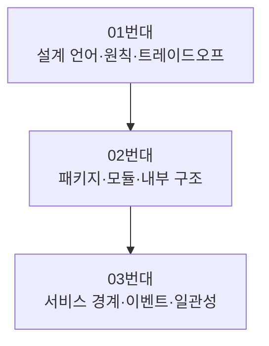
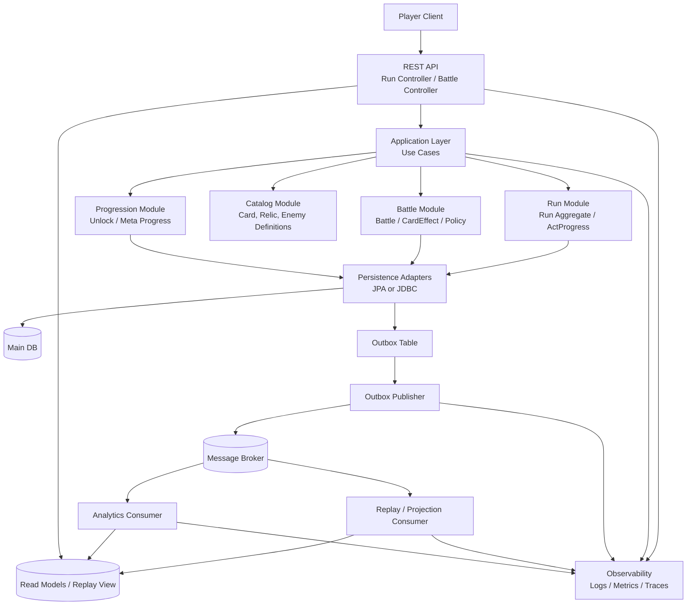

# 아키텍처 시리즈

> Spring Boot 4.x와 Java 25 기준으로 애플리케이션 아키텍처를 정리하고 도메인을 여러 아키텍처 관점으로 반복 해석합니다.

## 경계 기준

01번대 설계 언어와 품질 속성, 02번대 애플리케이션 내부 구조, 03번대 서비스 경계와 이벤트 일관성으로 책임을 나눕니다.

- 도메인 주도 설계(DDD)는 `04_ddd/`, 이벤트 기반 아키텍처(EDA)는 `05_edd/`에 둡니다.
- 이벤트 기반 아키텍처의 구체적 구현 디테일과 브로커 운영은 [`04_messaging/`](../04_messaging/)에 위임합니다.
- Spring Framework의 구현 디테일은 [`09_spring/`](../09_spring/)에 속하며 본 카테고리는 아키텍처 원칙과의 연결만 다룹니다.
- 마이크로 프론트엔드는 프론트엔드를 소재로 삼지만 경계 설정과 소유권을 다루므로 본 카테고리에 둡니다.

## 키워드

키워드 파일 없음

## 하위 폴더·문서 목록

### 01번대 — 아키텍처 기초와 아키텍트 관점 (`01_foundation/`)

| # | 문서 | 다루는 질문 |
|---|------|------------|
| 01-01 | [소프트웨어 아키텍처와 품질 속성](01_foundation/01-01.%EC%86%8C%ED%94%84%ED%8A%B8%EC%9B%A8%EC%96%B4%20%EC%95%84%ED%82%A4%ED%85%8D%EC%B2%98%EC%99%80%20%ED%92%88%EC%A7%88%20%EC%86%8D%EC%84%B1.md) | 아키텍처는 무엇을 지키는 제약인가 |
| 01-02 | [객체지향과 설계 원칙](01_foundation/01-02.%EA%B0%9D%EC%B2%B4%EC%A7%80%ED%96%A5%EA%B3%BC%20%EC%84%A4%EA%B3%84%20%EC%9B%90%EC%B9%99.md) | 좋은 객체와 SOLID는 어떻게 적용하는가 |
| 01-03 | [아키텍트의 관점과 품질 속성 트레이드오프](01_foundation/01-03.%EC%95%84%ED%82%A4%ED%85%8D%ED%8A%B8%EC%9D%98%20%EA%B4%80%EC%A0%90%EA%B3%BC%20%ED%92%88%EC%A7%88%20%EC%86%8D%EC%84%B1%20%ED%8A%B8%EB%A0%88%EC%9D%B4%EB%93%9C%EC%98%A4%ED%94%84.md) | 어떤 결정이 무엇을 희생하는가 |
| 01-04 | [ADR과 Spring Boot 아키텍처 의사결정](01_foundation/01-04.ADR%EA%B3%BC%20Spring%20Boot%20%EC%95%84%ED%82%A4%ED%85%8D%EC%B2%98%20%EC%9D%98%EC%82%AC%EA%B2%B0%EC%A0%95.md) | 결정을 어떻게 남길 것인가 |

> 유비쿼터스 언어와 도메인 모델은 [`04_ddd/`](04_ddd/) 서브폴더로 이동했습니다. (01_foundation은 빈칸을 메워 01-01~01-04로 연속 재번호)

### 02번대 — 애플리케이션 내부 구조 (`02_application/`)

| # | 문서 | 다루는 질문 |
|---|------|------------|
| 01-01 | [Spring Boot 레이어드 아키텍처와 패키지 구조](02_application/01-01.Spring%20Boot%20%EB%A0%88%EC%9D%B4%EC%96%B4%EB%93%9C%20%EC%95%84%ED%82%A4%ED%85%8D%EC%B2%98%EC%99%80%20%ED%8C%A8%ED%82%A4%EC%A7%80%20%EA%B5%AC%EC%A1%B0.md) | 가장 흔한 출발점에서 service가 비대해지는 이유 |
| 01-02 | [클린 아키텍처](02_application/01-02.%ED%81%B4%EB%A6%B0%20%EC%95%84%ED%82%A4%ED%85%8D%EC%B2%98.md) | 의존성 규칙이 풀고자 한 문제 |
| 01-03 | [헥사고날 아키텍처](02_application/01-03.%ED%97%A5%EC%82%AC%EA%B3%A0%EB%82%A0%20%EC%95%84%ED%82%A4%ED%85%8D%EC%B2%98.md) | Ports & Adapters의 책임 분할 |
| 01-04 | [모듈러 모놀리스와 Spring Modulith](02_application/01-04.%EB%AA%A8%EB%93%88%EB%9F%AC%20%EB%AA%A8%EB%86%80%EB%A6%AC%EC%8A%A4%EC%99%80%20Spring%20Modulith.md) | 모놀리스 안에서 경계를 어떻게 강제할 것인가 |
| 01-05 | [계층 내부 의존성 룰 — 사이클 방지를 위한 sub-layer DAG](02_application/01-05.%EA%B3%84%EC%B8%B5%20%EB%82%B4%EB%B6%80%20%EC%9D%98%EC%A1%B4%EC%84%B1%20%EB%A3%B0%20%E2%80%94%20%EC%82%AC%EC%9D%B4%ED%81%B4%20%EB%B0%A9%EC%A7%80%EB%A5%BC%20%EC%9C%84%ED%95%9C%20sub-layer%20DAG.md) | 같은 레이어 내 사이클을 어떻게 막을 것인가 |
| 01-06 | [도구 레이어 — Implement Layer와 Reader Writer 패턴](02_application/01-06.%EB%8F%84%EA%B5%AC%20%EB%A0%88%EC%9D%B4%EC%96%B4%20%E2%80%94%20Implement%20Layer%EC%99%80%20Reader%20Writer%20%ED%8C%A8%ED%84%B4.md) | 추가 분할은 어떤 책임을 표현해야 하는가 |
| 01-07 | [다중 엔티티 조회 API 설계](02_application/01-07.%EB%8B%A4%EC%A4%91%20%EC%97%94%ED%8B%B0%ED%8B%B0%20%EC%A1%B0%ED%9A%8C%20API%20%EC%84%A4%EA%B3%84.md) | API Composition·BFF·GraphQL 중 어느 것 |
| 01-08 | [실용적 아키텍처 패턴 — 5계층 절충형](02_application/01-08.%EC%8B%A4%EC%9A%A9%EC%A0%81%20%EC%95%84%ED%82%A4%ED%85%8D%EC%B2%98%20%ED%8C%A8%ED%84%B4%20%E2%80%94%205%EA%B3%84%EC%B8%B5%20%EC%A0%88%EC%B6%A9%ED%98%95.md) | 유스케이스를 1급 계층으로, 나머지는 필요할 때만 |

> DDD 전략적·전술적 패턴, 헥사고날 변형 TPS 사례, 도메인 책임 분리는 [`04_ddd/`](04_ddd/) 서브폴더로 이동했습니다. (02_application은 빈칸을 메워 01-01~01-08로 연속 재번호)

### 03번대 — 서비스 경계와 이벤트 기반 확장 (`03_distributed/`)

| # | 문서 | 다루는 질문 |
|---|------|------------|
| 01-01 | [분산 아키텍처 기초](03_distributed/01-01.%EB%B6%84%EC%82%B0%20%EC%95%84%ED%82%A4%ED%85%8D%EC%B2%98%20%EA%B8%B0%EC%B4%88.md) | 언제 분리하고 무엇을 잃는가 |
| 01-02 | [서비스 간 연동 방식 비교](03_distributed/01-02.%EC%84%9C%EB%B9%84%EC%8A%A4%20%EA%B0%84%20%EC%97%B0%EB%8F%99%20%EB%B0%A9%EC%8B%9D%20%EB%B9%84%EA%B5%90.md) | 동기·비동기·이벤트 통신의 차이 |
| 01-03 | [REST, gRPC, Messaging 선택 기준](03_distributed/01-03.REST%2C%20gRPC%2C%20Messaging%20%EC%84%A0%ED%83%9D%20%EA%B8%B0%EC%A4%80.md) | 워크로드별 통신 프로토콜 선택 |
| 01-04 | [트랜잭션 경계와 데이터 일관성](03_distributed/01-04.%ED%8A%B8%EB%9E%9C%EC%9E%AD%EC%85%98%20%EA%B2%BD%EA%B3%84%EC%99%80%20%EB%8D%B0%EC%9D%B4%ED%84%B0%20%EC%9D%BC%EA%B4%80%EC%84%B1.md) | 강한 일관성 vs 결과적 일관성 |
| 01-05 | [프론트엔드와 백엔드의 책임 경계](03_distributed/01-05.%ED%94%84%EB%A1%A0%ED%8A%B8%EC%97%94%EB%93%9C%EC%99%80%20%EB%B0%B1%EC%97%94%EB%93%9C%EC%9D%98%20%EC%B1%85%EC%9E%84%20%EA%B2%BD%EA%B3%84.md) | 진실 공급원은 어디에 두는가, 02_application 01-07과 자매 관계 |

### 04번대 — 도메인 주도 설계 시리즈

DDD 4개 절(전략·전술·진화·사례)을 독립 시리즈로 묶었습니다. SSOT: `docs/02_Architecture/02_DDD/` 13편.

→ [`04_ddd/`](04_ddd/) — 절 체계와 문서 목록은 서브폴더 README 참조. 갭은 [`04_ddd/GAP.md`](04_ddd/GAP.md)입니다.

### 05번대 — 이벤트 기반 아키텍처 시리즈

EDA 4개 절(기초·처리 모델·워크플로우·운영)을 독립 시리즈로 묶었습니다. SSOT: `docs/02_Architecture/03_EventDriven/` 17편. 구현 디테일은 [`../04_messaging/`](../04_messaging/)에 위임합니다.

→ [`05_edd/`](05_edd/) — 절 체계와 문서 목록은 서브폴더 README 참조. 갭은 [`05_edd/GAP.md`](05_edd/GAP.md)입니다.

### 06번대 — 『클린 아키텍처 핵심 가이드』 학습 + TPS approval 실습 (`06_clean-arch-book/`)

한승희 저 『클린 아키텍처 핵심 가이드』(위키북스 2026)를 1장씩 읽고 운영 중인 모듈을 진단하는 시리즈입니다. 챕터마다 요약 노트와 진단 두 파일이 짝을 이룹니다.

→ [`06_clean-arch-book/`](06_clean-arch-book/) — 책 정보·진행 절차·10개 장 인덱스는 서브폴더 README를 참조합니다.

### 단행본 정독 (`book/`)

→ [`book/system-design/`](book/system-design/) — Alex Xu 『System Design Interview』(2판 Volume 1) 정독 노트 19편입니다. 1~15장을 장 단위로 쓰고 긴 장 넷은 두 편으로 나눴으며 16장은 인덱스에서만 다룹니다.

→ [`book/bytebytego-system-design/`](book/bytebytego-system-design/) — ByteByteGo 「System Design」 그림 해설 모음을 주제별로 묶은 정독 노트입니다. DB·캐시·네트워크·보안·저장소·메시징 등을 주제별로 묶었습니다.

→ [`book/sdp_system-design-primer/`](book/sdp_system-design-primer/) — The System Design Primer 정독 인덱스입니다. 로드 밸런서·캐시·복제 부품 개념을 Primer 순서로 따라가며 기존 문서 매핑 표와 공백 목록을 둡니다.

→ [`book/bmf_building-micro-frontends/`](book/bmf_building-micro-frontends/) — Luca Mezzalira 『Building Micro-Frontends』(2판) 정독 노트입니다. 경계를 어디에 긋고 누가 소유하는지를 다룹니다.

## 공통 도메인

예시 프로젝트는 로그라이크 덱빌딩 게임 `Slay the Spire 2` 스타일의 단일 런(run) 관리 서비스입니다.
플레이어가 런을 시작하고 전투를 진행하며 보상을 선택해 다음 노드로 이동하는 흐름을 중심으로 설명합니다.
규칙 변화와 상태 전이가 풍부해 객체지향·DDD·이벤트 소싱 같은 아키텍처 주제를 다루기에 적합합니다.

시리즈 전체에서 사용하는 핵심 용어는 다음과 같습니다:

- `Run`: 플레이어의 단일 게임 세션
- `Battle`: 턴 기반 전투 단위
- `Deck`, `Hand`, `DrawPile`, `DiscardPile`: 카드 상태 집합
- `Relic`, `Potion`, `Reward`: 런 중 획득 가능한 보조 요소
- `ActProgress`: 맵 진행 상태와 보스 도달 여부

## 기준 기술 스택

본 시리즈는 다음 전제 위에 작성합니다:

- 프레임워크: Spring Boot `4.x`
- 언어: Java `25` (record, sealed type, virtual thread 활용)
- 아키텍처 스타일: 모듈러 모놀리스 우선, 필요 시 서비스 분리
- 비동기 처리: 메시징 기반 확장 가능

Spring Boot 4.x는 최신 Jakarta 스택과 관측성, 모듈화, AOT 친화성을 전제합니다. Java 25는 현대적 언어와 런타임 기능을 안정적으로 활용하는 기준점입니다.

## 읽는 순서

> 번호 순서대로 읽으면 개념이 자연스럽게 이어집니다. 01번대는 기초, 02번대는 애플리케이션 내부, 03번대는 서비스 경계와 이벤트 흐름입니다.

01번대에서 설계 언어와 품질 속성, 아키텍트 관점을 맞춥니다.
02번대에서 한 애플리케이션 내부를 어떻게 나눌지 결정합니다.
03번대에서 서비스 경계를 어디에 두고 어떻게 통신·일관성을 유지할지 다룹니다.

## 관련 참고

본 시리즈는 `poc/02_Architecture/01-event-driven`의 학습 자료와 연결됩니다. 특히 CQRS, 이벤트 소싱, Saga, Request-Response Bridge 문서는 해당 PoC 개념 흐름을 Spring Boot 애플리케이션 설계 관점으로 가져온 것입니다.

## 최종 구현 흐름

이 시리즈의 내용을 모두 반영해 구현하면 프로그램은 대체로 다음 흐름으로 동작합니다:

핵심 게임플레이는 `Run`과 `Battle` 모듈이 같은 애플리케이션 안에서 강한 일관성으로 처리합니다.
전투 완료, 보상 선택, 런 종료 같은 사실은 Outbox를 거쳐 메시지 브로커로 전달되고 리플레이 뷰와 분석 모델은 이를 비동기로 소비해 별도 읽기 모델을 만듭니다.

## 후속 주제 (예정)

Spring의 **설계 철학** 관점은 별도 추가가 예정되어 있습니다. Spring Framework의 구현 디테일은 [`09_spring/`](../09_spring/)에 속하며 본 시리즈는 아키텍처 원칙과의 연결만 다룹니다.

- `IoC를 GoF·DIP 관점으로 해석` — IoC가 풀고자 했던 설계 문제
- `AOP가 해결하는 횡단 관심사` — Decorator 패턴의 프레임워크화
- `Convention over Configuration` — Spring Boot의 철학적 기반
