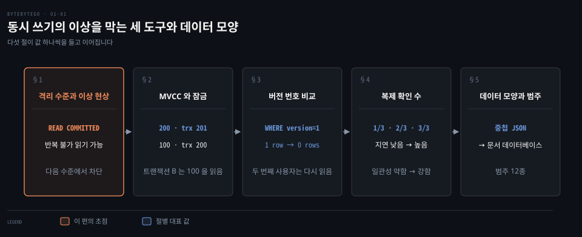
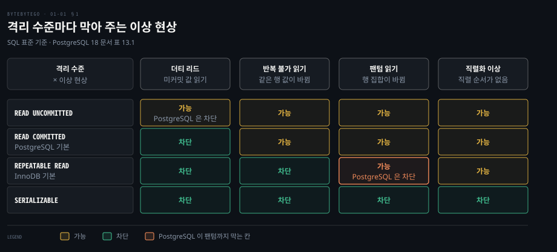
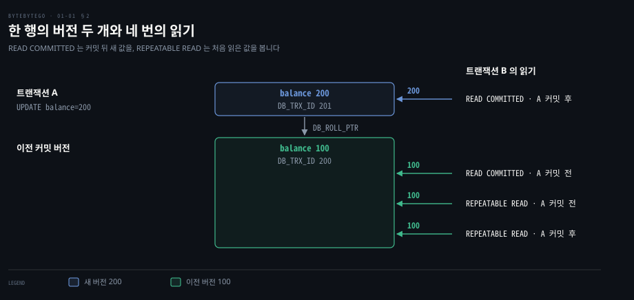
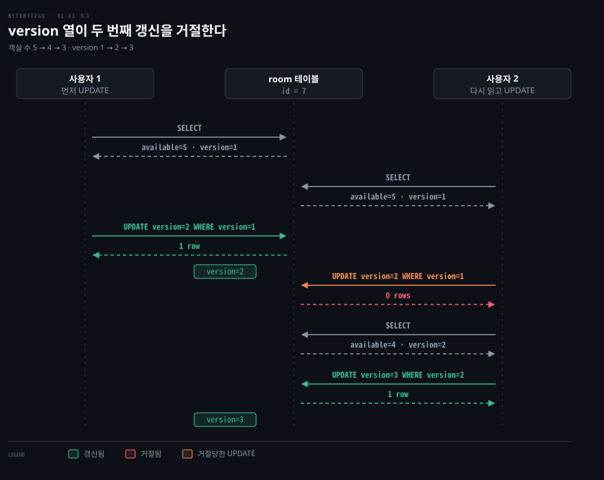
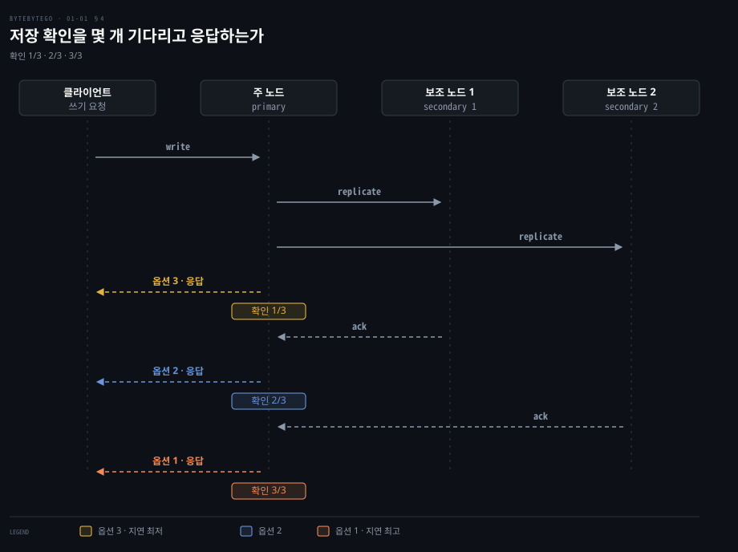
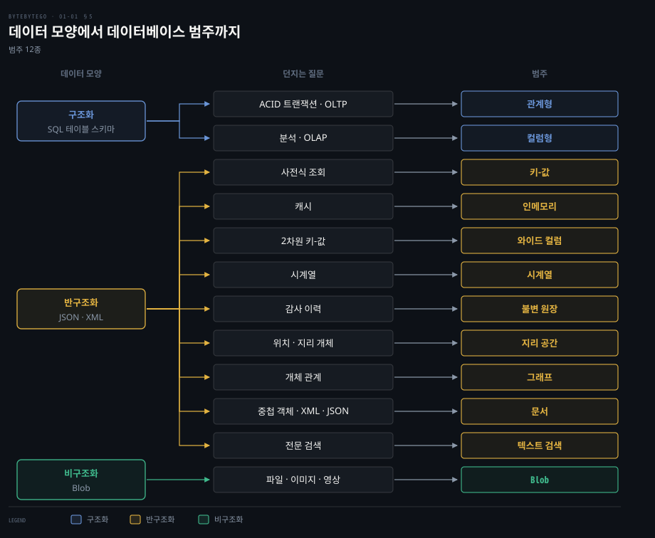

# 격리 수준과 낙관적 잠금이 동시 쓰기의 이상 현상을 막고 데이터 모양이 데이터베이스 종류를 고른다

---

> 동시 쓰기의 이상은 격리 수준이 약속하고 MVCC 와 잠금이 구현하며, 낙관적 잠금은 버전 번호로 충돌을 나중에 잡습니다. 복제 확인 수는 지연과 일관성을 맞바꾸고 데이터 모양은 저장소 범주를 고릅니다.


## 핵심 요약

> 동시에 쓰는 사용자가 늘면 데이터베이스는 "누가 누구의 중간 상태를 보는가" 를 정해야 합니다. 그 선택은 격리 수준·버전 비교·복제 확인 수·저장소 범주라는 네 층에서 따로 이루어집니다.

격리 수준은 SQL 표준이 세 가지 이상 현상(더티 리드·반복 불가 읽기·팬텀 읽기)으로 정의한 약속입니다. 엔진은 행마다 이전 버전을 남기는 MVCC 와 행 잠금으로 이 약속을 지킵니다. 같은 이름의 수준이라도 엔진마다 막는 범위가 다릅니다.

잠금을 잡지 않고 쓰는 낙관적 잠금은 `version` 열을 `WHERE` 조건에 넣어, 읽은 뒤 누군가 바꿨다면 0 행이 갱신되게 합니다. 복제본이 있으면 쓰기 성공을 알리는 시점도 고릅니다. 세 노드 중 1·2·3 개의 확인을 기다리는 선택이 지연과 일관성을 서로 바꿉니다. 마지막으로 데이터가 표 모양인지 JSON 인지 파일인지가 열두 가지 저장소 범주 가운데 후보를 좁힙니다.




## 학습 목표

> 이 편을 읽고 나면 다음을 설명할 수 있습니다.

1. 더티 리드·반복 불가 읽기·팬텀 읽기를 계좌 잔액 예시로 구분하고, 네 격리 수준이 각각 무엇을 막는지 말할 수 있습니다.
2. MVCC 에서 읽기가 쓰기를 기다리지 않는 이유와 READ COMMITTED·REPEATABLE READ 가 읽는 버전이 갈리는 지점을 설명할 수 있습니다.
3. 낙관적 잠금의 `WHERE version = N` 이 충돌을 어떻게 0 행으로 드러내는지와 경쟁이 심할 때 성능이 무너지는 이유를 설명할 수 있습니다.
4. 복제 확인을 1·2·3 개 기다리는 선택이 지연과 일관성을 어떻게 맞바꾸는지 설명할 수 있습니다.
5. 데이터 모양과 질의 종류로 관계형·키-값·문서·그래프 같은 저장소 범주를 고를 수 있습니다.


## 1. 격리 수준은 동시 트랜잭션이 서로의 중간 상태를 얼마나 보는지를 정한다

> 격리는 트랜잭션이 다른 트랜잭션이 없는 것처럼 실행되게 하려는 약속입니다. 전부 지키면 비싸서 SQL 표준은 보호 범위가 다른 네 수준을 둡니다.

두 트랜잭션이 같은 계좌를 동시에 만지면 읽는 쪽은 무엇을 보게 될까요? 표준은 이 질문을 "어떤 이상 현상이 일어나도 되는가" 로 바꿔 답합니다. 이상 현상은 셋입니다.[^pg-iso]

- **더티 리드**: 다른 트랜잭션이 아직 커밋하지 않은 쓰기를 읽습니다. 계좌 A 의 잔액을 100 에서 200 으로 바꾼 트랜잭션이 롤백하면, 200 을 읽은 쪽은 존재한 적 없는 값을 본 것입니다.
- **반복 불가 읽기**: 같은 행을 두 번 읽었는데, 그 사이에 다른 트랜잭션이 커밋해서 값이 달라집니다. 첫 읽기는 100, 둘째 읽기는 200 입니다.
- **팬텀 읽기**: 같은 조건으로 두 번 조회했는데, 그 사이에 다른 트랜잭션이 커밋한 삽입이나 삭제로 행의 집합이 달라집니다. `balance > 50` 이 세 행이었다가 네 행이 됩니다.

표준은 이 세 현상을 어느 수준에서 허용하는지로 네 수준을 가릅니다. 가장 엄격한 SERIALIZABLE 은 현상 목록이 아니라 "동시에 실행한 결과가 어떤 순서로든 한 번에 하나씩 실행한 결과와 같다" 로 정의됩니다.[^pg-iso] 그래서 PostgreSQL 문서는 네 번째 열로 직렬화 이상을 따로 둡니다. 커밋한 트랜잭션 묶음의 결과가 어떤 직렬 순서와도 맞지 않는 상태입니다.



위쪽에서 아래로 갈수록 막는 것이 늘어납니다. 읽기는 수준마다 다릅니다. 쓰기는 어느 수준에서도 같은 행을 먼저 갱신한 트랜잭션이 끝나기를 기다립니다. 한 행을 두 트랜잭션이 동시에 갱신하게 두는 수준은 없습니다.[^pg-iso]

같은 이름이라도 엔진이 막는 범위가 같지 않습니다. 표에서 "PostgreSQL 은 차단" 이라고 적힌 두 칸이 그 자리입니다.

- PostgreSQL 은 READ UNCOMMITTED 를 요청해도 READ COMMITTED 처럼 동작하므로 더티 리드는 어느 수준에서도 일어나지 않습니다. REPEATABLE READ 도 표준보다 강해서 팬텀 읽기를 막습니다. 그래도 직렬화 이상은 남습니다.[^pg-iso]
- MySQL InnoDB 의 기본값은 REPEATABLE READ 입니다. 일반 `SELECT` 는 첫 읽기에서 잡은 스냅샷을 끝까지 봅니다. 그러나 `UPDATE`·`DELETE`·잠금 읽기는 가장 최근 커밋 상태를 대상으로 합니다. 그래서 스냅샷에서는 0 건이던 행을 `UPDATE` 가 10 건 바꾸는 일이 생깁니다.[^my-cr]
- PostgreSQL 의 기본값은 READ COMMITTED 입니다.[^pg-iso]

기본값이 엔진마다 다르다는 사실은 이식할 때 조용히 의미가 바뀐다는 뜻입니다. 같은 코드를 PostgreSQL 에서 MySQL 로 옮기면 "같은 수준" 의 이름 아래 다른 보장이 깔립니다. 이상 현상을 표준 밖의 쓰기 스큐까지 넓혀 보는 일은 [쓰기 스큐와 직렬화 가능성](../../../05_data/book/designing-data-intensive-applications/08-03.Write%20Skew와%20직렬화%20가능성.md)에서, 격리 수준 선택 가이드는 [트랜잭션과 격리 수준](../../../05_data/01_foundation/01-04.%ED%8A%B8%EB%9E%9C%EC%9E%AD%EC%85%98%EA%B3%BC%20%EA%B2%A9%EB%A6%AC%20%EC%88%98%EC%A4%80.md)에서 다룹니다.


## 2. MVCC 는 행의 이전 버전을 남겨 읽기가 쓰기를 기다리지 않게 한다

> 읽기마다 잠금을 잡으면 쓰기가 막히므로, 엔진은 갱신할 때 이전 값을 남겨 두고 읽는 트랜잭션에는 자기 시점에 맞는 버전을 내줍니다. 이 방식이 MVCC 입니다.

읽는 쪽이 쓰는 쪽을 기다리지 않으면서도 커밋하지 않은 값을 보지 않으려면 무엇이 필요할까요? 값을 덮어쓰지 않고 이전 값을 어딘가에 남겨 두는 것입니다.

**MVCC**(다중 버전 동시성 제어)는 이전 버전을 보관하고 읽는 트랜잭션에 맞는 버전을 고르는 방식입니다. InnoDB 에서는 행마다 숨은 필드가 붙습니다.[^my-mvcc]

- `DB_TRX_ID`: 이 행을 마지막으로 삽입하거나 갱신한 트랜잭션의 식별자입니다.
- `DB_ROLL_PTR`: 롤백 세그먼트의 언두 로그 레코드를 가리키는 포인터입니다. 이 레코드로 갱신 이전의 행을 되살릴 수 있습니다.

트랜잭션 A 의 식별자를 201 이라 하겠습니다. 식별자 값은 예시입니다. A 가 `balance` 를 100 에서 200 으로 바꾸면 현재 행은 `balance 200, DB_TRX_ID 201` 이 됩니다. `DB_ROLL_PTR` 은 `balance 100, DB_TRX_ID 200` 을 되살릴 언두 레코드를 가리킵니다. A 가 아직 커밋하지 않았을 때 트랜잭션 B 가 읽으면 201 은 B 가 볼 수 있는 커밋 목록에 없습니다. B 는 포인터를 따라 내려가 커밋된 200 번 버전의 `balance 100` 을 읽습니다.



A 가 커밋한 뒤에는 수준에 따라 읽는 값이 갈립니다. READ COMMITTED 는 읽을 때마다 새 스냅샷을 잡으므로 커밋 뒤 첫 읽기가 200 입니다. REPEATABLE READ 는 트랜잭션의 첫 일반 읽기에서 스냅샷을 잡아 끝까지 쓰므로, B 가 A 의 커밋 전에 처음 읽었다면 커밋 뒤에도 100 입니다.[^my-cr] 읽는 쪽이 어느 버전을 보는지는 잠금이 아니라 스냅샷을 잡는 시점이 정합니다.

| 읽는 수준 | A 커밋 전 B 의 읽기 | A 커밋 후 B 의 읽기 |
|---|---|---|
| READ COMMITTED | 100 | 200 |
| REPEATABLE READ | 100 | 100 |

잠금은 읽기가 아니라 쓰기와 잠금 읽기에서 일합니다. InnoDB 의 SERIALIZABLE 은 REPEATABLE READ 와 같습니다. 다만 자동 커밋이 꺼져 있으면 일반 `SELECT` 를 `SELECT ... FOR SHARE` 로 바꿔 읽은 행에 공유 잠금을 잡습니다.[^my-iso]

잠금은 두 종류입니다. 공유 잠금(S lock)을 쥐면 다른 세션은 그 행을 읽을 수는 있어도 바꾸지 못합니다. 배타 잠금(X lock)은 `SELECT ... FOR UPDATE` 와 쓰기가 잡고, 다른 트랜잭션의 갱신과 `FOR SHARE` 를 막습니다.[^my-lock] 쓰기는 네 수준 모두 배타 잠금을 잡습니다. 잠금 종류와 단위는 [동시성 제어와 락](../../../05_data/02_relational/sql-mysql/04-02.동시성제어와%20락.md)에서 다룹니다.

PostgreSQL 의 SERIALIZABLE 은 다릅니다. REPEATABLE READ 와 같은 스냅샷 위에서 읽기·쓰기 의존성을 감시합니다. 직렬 순서가 없다고 판단되면 트랜잭션 하나를 `could not serialize access` 오류로 중단합니다. 이 감시용 잠금(술어 잠금)은 다른 트랜잭션을 막지 않아서 교착을 만들지 않습니다. 대신 애플리케이션이 재시도를 준비해야 합니다.[^pg-iso]

MVCC 에는 비용이 있습니다. 이전 버전은 그것을 볼 수 있는 트랜잭션이 모두 끝나야 지울 수 있어서, 오래 열려 있는 트랜잭션은 언두 공간을 키웁니다. 읽기만 하는 트랜잭션도 정기적으로 커밋하라는 것이 문서의 권고입니다.[^my-mvcc] InnoDB 가 이 구조를 어떻게 쓰는지는 [InnoDB MVCC](../../../05_data/02_relational/sql-mysql/04-01.InnoDB%20MVCC.md)에, 스냅샷 격리의 갱신 손실 처리는 [약한 격리 수준과 스냅샷 격리](../../../05_data/book/designing-data-intensive-applications/08-02.약한%20격리%20수준과%20스냅샷%20격리.md)에 있습니다.


## 3. 낙관적 잠금은 읽은 버전 번호가 그대로일 때만 갱신을 받아 준다

> 잠금을 잡지 않고 여럿이 같은 행을 고치게 두되, 갱신 순간에 "내가 읽은 뒤 아무도 안 바꿨는가" 를 `version` 열로 확인합니다. 충돌이 드물면 빠르고 많으면 재시도가 쌓입니다.

잠금 없이 두 사용자가 같은 행을 읽고 각자 고쳐 쓰면 어떻게 될까요? 나중에 쓴 쪽이 먼저 쓴 쪽의 변경을 덮어씁니다. 행을 읽을 때부터 잠그는 비관적 방식은 이를 막지만 읽는 시간만큼 다른 쓰기를 세워 둡니다. **낙관적 잠금**(낙관적 동시성 제어)은 반대로 충돌이 드물 것이라 가정하고 모두 진행시킨 뒤, 쓰는 순간에 충돌을 검사합니다.

구현은 둘입니다. 행마다 버전 번호를 두거나 마지막 수정 시각을 둡니다. 서버 시계는 시간이 지나며 어긋날 수 있어서 보통 버전 번호가 더 낫다고 봅니다. 버전 번호 방식의 순서는 다음과 같습니다.

1. 테이블에 `version` 열을 추가합니다.
2. 행을 고치기 전에 애플리케이션이 그 행의 `version` 을 함께 읽습니다.
3. 갱신할 때 `version` 을 1 올린 값을 쓰되, `WHERE` 에 읽었던 `version` 을 넣습니다.
4. 영향받은 행이 0 이면 그 사이에 누군가 바꾼 것이므로 갱신을 포기하고 2번부터 다시 합니다.

객실 예약으로 값을 따라가 봅니다. `room` 테이블의 `id = 7` 행은 `available = 5, version = 1` 입니다.

```sql
-- 두 사용자가 모두 같은 행을 읽습니다. 결과는 available=5, version=1 입니다.
SELECT available, version FROM room WHERE id = 7;

-- 먼저 도착한 UPDATE 는 version 이 아직 1 이라 조건이 맞아 1 row 를 바꿉니다.
-- 이제 행은 available=4, version=2 입니다.
UPDATE room
   SET available = 4, version = 2
 WHERE id = 7 AND version = 1;

-- 두 번째 사용자의 같은 문장은 version 이 이미 2 라 조건이 맞지 않아 0 rows 입니다.
UPDATE room
   SET available = 4, version = 2
 WHERE id = 7 AND version = 1;
```



도식은 `WHERE id = 7` 을 줄여 `WHERE version=1` 로만 적었습니다. 두 번째 사용자는 0 행이라는 신호를 받고 다시 읽어 `available=4, version=2` 를 얻습니다. 이어서 `available = 3, version = 3` 으로 갱신해 성공합니다.

검증이 별도 확인 단계가 아니라 `UPDATE` 한 문장의 `WHERE` 안에 들어 있습니다. 그래서 확인과 갱신 사이에 다른 트랜잭션이 끼어들 틈이 없습니다.

Java 에서는 이 패턴이 표준 어노테이션입니다. JPA 의 `@Version` 이 붙은 필드는 갱신 때 버전 불일치를 낙관적 잠금 실패로 판정하는 데 쓰이고,[^jpa-version] 충돌이 나면 영속성 공급자가 `OptimisticLockException` 을 던져 현재 트랜잭션을 롤백 대상으로 표시합니다.[^jpa-ole] 버전 필드의 타입으로는 `int`·`long`·`Instant` 같은 값이 허용되므로 번호와 시각 두 방식이 모두 열려 있습니다. JDBC 쪽 구현은 [JDBC 트랜잭션](../../../01_language/book/jpf_java-performance/11-02.JDBC%20트랜잭션%20—%20autocommit·batch·격리%20수준·락.md)에서, JPA 의 `@Version` 과 재시도 패턴은 [낙관적 비관적 락](../../../05_data/03_persistence/jpa/04-02.낙관적%20비관적%20락.md)에서 다룹니다.

경쟁이 심해지면 이 방식은 급격히 느려집니다. 여러 사용자가 같은 객실을 동시에 예약하면 모두 같은 `available` 과 `version` 을 읽습니다. 한 라운드에 한 명만 성공하고 나머지는 0 행을 받아 다시 읽고 다시 시도합니다. 다음 라운드에서도 한 명만 성공합니다. 결과는 맞지만 재시도가 쌓여 사용자 경험이 나빠집니다.

충돌이 많은 행에는 다른 도구가 낫습니다.

- 조건부 원자 갱신: `UPDATE room SET available = available - 1 WHERE id = 7 AND available > 0` 한 문장으로 읽기와 쓰기를 합칩니다. PostgreSQL 의 READ COMMITTED 에서 `UPDATE` 는 먼저 갱신한 트랜잭션이 끝나기를 기다린 뒤 `WHERE` 를 새 버전에 다시 평가하므로 감소분이 사라지지 않습니다.[^pg-rc]
- 비관적 잠금: `SELECT ... FOR UPDATE` 로 행을 읽으면서 잠가, 다른 갱신이 끝나기를 줄 세웁니다.[^my-lock]
- 수준을 올리고 재시도: PostgreSQL 의 REPEATABLE READ 는 스냅샷 이후 다른 트랜잭션이 바꾼 행을 갱신하려 하면 `could not serialize access due to concurrent update` 로 중단시킵니다. 낙관적 잠금을 엔진이 대신 해 주는 셈이고 애플리케이션은 전체 트랜잭션을 재시도합니다.[^pg-iso]


## 4. 복제 확인을 몇 개 기다리고 응답할지가 지연과 일관성을 맞바꾼다

> 데이터를 복제하면 쓰기 성공을 언제 알릴지가 설계 변수가 됩니다. 확인을 많이 기다릴수록 일관성은 강해지고 지연은 늘어납니다.

데이터를 세 노드에 복제해 두었을 때, 클라이언트에게 "저장됐습니다" 는 언제 돌려주면 될까요? 세 가지 선택이 있습니다.

| 선택 | 성공을 알리는 시점 | 지연 | 일관성 |
|---|---|---|---|
| 옵션 1 | 세 노드 모두 저장한 뒤 | 가장 높음 | 가장 강함 |
| 옵션 2 | 주 노드와 보조 노드 하나가 저장한 뒤 | 중간 | 중간 |
| 옵션 3 | 주 노드가 저장한 뒤 | 가장 낮음 | 가장 약함 |



옵션 1 은 응답을 받은 뒤 어느 노드에서 읽어도 새 값이 보입니다. 대신 가장 느린 노드를 기다리므로 지연이 가장 깁니다. 노드 하나가 멈추면 쓰기가 끝나지 못합니다.

옵션 3 은 주 노드만 저장하면 응답하므로 빠릅니다. 아직 복제를 받지 못한 보조 노드에서 읽으면 이전 값이 나옵니다. 주 노드가 그 직후 죽으면 응답한 쓰기가 사라질 수 있습니다. 옵션 2 와 3 은 응답 뒤에도 일부 노드가 새 값을 모르는 구간이 있어 결과적 일관성에 속합니다.

이 선택은 정족수 계산과 같은 구조입니다. 복제본 수가 N=3 일 때 쓰기 확인 수 W 가 3·2·1 이면 각각 옵션 1·2·3 입니다. 읽기 쪽 R 과 합쳐 `W + R > N` 이면 읽기가 최신 쓰기를 포함합니다.

정족수 계산과 충돌 해소는 [키-값 저장소](../system-design/06-01.키-값%20저장소는%20CAP%20선택%20아래%20안정%20해시로%20나누고%20N·W·R%20정족수로%20복제%20일관성을%20고른다.md)에서 다룹니다. 동기·비동기·반동기 복제의 차이는 [복제 개요와 단일 리더](../../../05_data/book/designing-data-intensive-applications/06-01.복제%20개요와%20단일%20리더.md)의 §2 에서 다룹니다. 세 옵션이 각각 동기·반동기·비동기에 대응합니다. 복제 지연이 사용자에게 보이는 방식과 대응은 [복제 지연 문제와 일관성 보장](../../../05_data/book/designing-data-intensive-applications/06-03.복제%20지연%20문제와%20일관성%20보장.md)에서 다룹니다.

실제 제품에서는 이 선택이 설정 값으로 나타납니다.

- Cassandra 는 연산마다 일관성 수준을 고릅니다. `ONE` 은 복제본 하나, `QUORUM` 은 과반(n/2 + 1), `ALL` 은 전부의 응답을 기다립니다. 읽기 수준과 쓰기 수준이 정족수로 교차하면 쓰기가 다음 읽기에 보입니다.[^cass-cl]
- PostgreSQL 은 `synchronous_commit` 이 `remote_apply`·`on`·`remote_write`·`local`·`off` 로 기다리는 지점을 정합니다. 동기 대기 대상은 `synchronous_standby_names` 가 정하고, `ANY 2 (s1, s2, s3)` 처럼 쓰면 나열한 대기 서버 중 두 개의 응답이 오면 커밋이 진행됩니다.[^pg-sync]

지연과 일관성 가운데 무엇을 우선하는지는 업무가 정합니다. 결제 확정은 옵션 1 쪽이 맞고, 조회수 같은 값은 옵션 3 쪽도 받아들일 만합니다. 읽기 복제본을 늘리는 구조는 [파티셔닝과 읽기 복제본](./01-02.파티셔닝과%20읽기%20복제본은%20데이터베이스를%20넓히고%20전역%20유일%20ID%20는%20나뉜%20데이터에%20순서를%20준다.md)에서 이어집니다.


## 5. 데이터 모양과 던지는 질문이 저장소 범주를 고른다

> 데이터베이스 선택은 오래 가는 약속이라 가볍게 정하면 안 됩니다. 데이터 모양이 후보를 먼저 줄이고, 그 데이터에 던지는 질문이 범주를 정합니다.

모든 데이터를 한 종류의 저장소에 넣으면 안 되는 이유는 무엇일까요? 질문마다 빠른 저장 구조가 다르기 때문입니다.

먼저 데이터의 모양을 셋으로 나눕니다. 구조화는 SQL 테이블 스키마로 표현되는 데이터입니다. 반구조화는 JSON·XML 처럼 중첩과 가변 필드를 담는 데이터입니다. 비구조화는 파일·이미지·영상 같은 Blob 입니다. 그 아래 던지는 질문이 열두 범주로 가릅니다. 도식은 이를 한 층으로 폈지만 실제로는 용도로 갈라지는 가지가 있습니다. 인메모리는 키-값에서 캐시 용도로, 시계열·불변 원장·지리 공간은 와이드 컬럼에서 시계열·감사 이력·위치 용도로, 텍스트 검색은 문서에서 전문 검색 용도로 갈라집니다.



| 범주 | 던지는 질문 | 예 |
|---|---|---|
| 관계형 | ACID 트랜잭션 · OLTP: 여러 행을 묶어 읽고 쓴다 | PostgreSQL[^pg-iso] |
| 컬럼형 | 분석 · OLAP: 많은 행의 몇 열을 모아 집계한다 | ClickHouse[^clickhouse] |
| 키-값 | 사전식 조회: 키 하나로 값을 바로 찾는다 | DynamoDB[^dynamodb] |
| 인메모리 | 캐시: 지연이 가장 중요한 읽기를 메모리에서 답한다 | Redis[^redis] |
| 와이드 컬럼 | 2차원 키-값: 파티션 키 아래 행마다 열이 다른 값을 둔다 | Cassandra[^cass-wide] |
| 시계열 | 시계열: 시간 순서의 측정값을 쓰고 구간으로 읽는다 | 메트릭 편 참고 |
| 불변 원장 | 감사 이력: 변경 이력을 고치지 못하게 남긴다 | SQL Server·Azure SQL 의 원장 기능[^ledger] |
| 지리 공간 | 위치 · 지리 개체: 위치와 영역으로 검색한다 | PostGIS[^postgis] |
| 그래프 | 개체 관계: 개체 사이의 관계를 따라간다 | Neo4j[^neo4j] |
| 문서 | 중첩 객체 · XML · JSON: 문서를 통째로 저장하고 조회한다 | MongoDB[^mongodb] |
| 텍스트 검색 | 전문 검색: 본문에서 단어로 찾는다 | Elasticsearch[^elastic] |
| Blob | 파일 · 이미지 · 영상: 파일을 그대로 보관한다 | Amazon S3[^s3] |

몇 가지는 같은 제품이 여러 범주에 걸칩니다. DynamoDB 는 키-값과 문서 모델을 모두 지원하고,[^dynamodb] Redis 는 캐시부터 큐까지 쓰는 자료구조 서버입니다.[^redis] 그래서 표는 제품을 가리키는 지도가 아니라 질문을 범주로 옮기는 지도입니다. 제품 이름과 기능은 바뀌므로 범주를 고른 뒤 제품은 공식 문서로 확인하는 순서가 안전합니다.

각 범주의 자세한 내용은 앞선 노트가 갖고 있습니다. 관계형 대 문서 모델은 [모델 선택과 스키마 유연성](../../../05_data/book/designing-data-intensive-applications/03-04.모델%20선택과%20스키마%20유연성.md)에, 캐시는 [캐시 전략](./02-01.캐시%20전략은%20읽기·쓰기%20경로에서%20캐시%20자리를%20정하고%20Redis%20는%20메모리와%20단일%20스레드%20이벤트%20루프로%20빠르다.md)에, SQL 과 NoSQL 의 선택 기준은 [시스템 설계 입문서 요약](../sdp_system-design-primer/README.md)에 있습니다. 시계열은 [메트릭 모니터링](./08-03.메트릭%20모니터링은%20시계열%20데이터베이스에%20쓰기를%20몰아%20담고%20수집·질의·경보·시각화로%20나뉜다.md)이, Blob 은 [블록·파일·객체 저장소](./04-01.블록·파일·객체%20저장소는%20접근%20단위가%20다르고%20이레이저%20코딩과%20분할%20업로드가%20큰%20데이터를%20싸고%20안전하게%20담는다.md)가 이어서 다룹니다.


## 면접 대비

> 격리 수준의 이상 현상, MVCC 가 읽는 버전, 낙관적 잠금의 충돌 신호, 복제 확인 수, 저장소 범주 선택에 관한 질문입니다.

1. 더티 리드·반복 불가 읽기·팬텀 읽기는 무엇이고 READ COMMITTED 와 REPEATABLE READ 는 각각 무엇을 막습니까?
2. MySQL InnoDB 와 PostgreSQL 은 같은 REPEATABLE READ 에서 어떻게 다르게 동작합니까?
3. MVCC 에서 읽기가 쓰기를 기다리지 않는 이유와 READ COMMITTED·REPEATABLE READ 에서 같은 시점의 읽기 값이 갈리는 이유는 무엇입니까?
4. 낙관적 잠금은 충돌을 어떻게 감지하고, 동시 요청이 많을 때 왜 성능이 떨어집니까?
5. 세 노드에 복제할 때 쓰기 성공 응답 시점에 따라 지연과 일관성이 어떻게 달라지고, 데이터 모양은 저장소 선택에 어떻게 쓰입니까?


## 정답 (자답 후 펼치기)

> 면접 질문에 대한 키워드 중심의 모범 답안입니다.

### 정답 1 — 세 현상과 수준별 차단

더티 리드는 미커밋 값을 읽는 것입니다. 반복 불가 읽기는 같은 행을 다시 읽었는데 커밋된 새 값이 보이는 것입니다. 팬텀 읽기는 같은 조건의 행 집합이 달라지는 것입니다. READ COMMITTED 는 더티 리드만 막습니다. REPEATABLE READ 는 더티 리드와 반복 불가 읽기를 표준상 막습니다.

### 정답 2 — InnoDB 는 스냅샷과 최신 상태가 갈리고 PostgreSQL 은 팬텀까지 막음

InnoDB 의 일반 `SELECT` 는 첫 읽기의 스냅샷을 쓰지만 `UPDATE`·`DELETE`·잠금 읽기는 최신 커밋 상태에 적용됩니다. PostgreSQL 의 REPEATABLE READ 는 스냅샷 격리로 구현돼 팬텀을 막습니다. 갱신 충돌이면 직렬화 오류로 중단하고 직렬화 이상은 남습니다.

### 정답 3 — 버전 체인과 스냅샷 시점

행마다 이전 버전을 언두 로그로 잇고 읽는 쪽은 자기 스냅샷에서 보이는 버전을 고르므로 읽기가 잠금을 안 잡습니다. READ COMMITTED 는 읽기마다 스냅샷을 새로 잡고 REPEATABLE READ 는 첫 읽기의 스냅샷을 유지해서 값이 갈립니다.

### 정답 4 — `WHERE version = 읽은 값` 이 0 행이면 충돌

갱신을 `version` 비교와 함께 보내고 영향 행이 0 이면 충돌입니다. 경쟁이 심하면 한 라운드에 한 명만 성공하고 나머지는 다시 읽고 재시도해서 성능이 무너집니다. 대안은 조건부 원자 갱신과 `FOR UPDATE` 입니다.

### 정답 5 — 확인 1·2·3 개와 질문 중심 선택

세 노드 확인을 기다리면 일관성이 가장 강하고 지연이 가장 높으며, 주 노드만 기다리면 지연이 가장 낮고 일관성이 가장 약합니다. 저장소는 데이터 모양(구조화·반구조화·비구조화)과 던지는 질문(트랜잭션·분석·관계·검색 등)으로 범주를 좁힙니다.


## 참고 자료

- ByteByteGo, 「System Design」 그림 해설 모음 중 격리 수준·데이터베이스 고르기·낙관적 잠금·지연과 일관성 글.
- Satish Chandra Gupta, SQL vs. NoSQL: Cheatsheet for AWS, Azure, and Google Cloud (CC BY-NC-ND 4.0). §5 분류의 출처이며 그림은 다시 그렸습니다.
- ByteByteGo 공개 저장소의 같은 글(격리 수준): https://github.com/ByteByteGoHq/system-design-101/blob/ee4b7305a2ccd6aa13688559d345e8a6647774de/data/guides/what-are-database-isolation-levels.md
- PostgreSQL 18, Transaction Isolation: https://www.postgresql.org/docs/18/transaction-iso.html
- MySQL 9.7, InnoDB Transaction Isolation Levels: https://dev.mysql.com/doc/refman/9.7/en/innodb-transaction-isolation-levels.html
- MySQL 9.7, InnoDB Multi-Versioning: https://dev.mysql.com/doc/refman/9.7/en/innodb-multi-versioning.html
- MySQL 9.7, Consistent Nonlocking Reads: https://dev.mysql.com/doc/refman/9.7/en/innodb-consistent-read.html


## 관련 문서

- [파티셔닝과 읽기 복제본은 데이터베이스를 넓히고 전역 유일 ID 는 나뉜 데이터에 순서를 준다](./01-02.파티셔닝과%20읽기%20복제본은%20데이터베이스를%20넓히고%20전역%20유일%20ID%20는%20나뉜%20데이터에%20순서를%20준다.md)
- [캐시 전략은 읽기·쓰기 경로에서 캐시 자리를 정하고 Redis 는 메모리와 단일 스레드 이벤트 루프로 빠르다](./02-01.캐시%20전략은%20읽기·쓰기%20경로에서%20캐시%20자리를%20정하고%20Redis%20는%20메모리와%20단일%20스레드%20이벤트%20루프로%20빠르다.md)
- [키-값 저장소는 CAP 선택 아래 안정 해시로 나누고 N·W·R 정족수로 복제 일관성을 고른다](../system-design/06-01.키-값%20저장소는%20CAP%20선택%20아래%20안정%20해시로%20나누고%20N·W·R%20정족수로%20복제%20일관성을%20고른다.md)
- [트랜잭션과 격리 수준](../../../05_data/01_foundation/01-04.%ED%8A%B8%EB%9E%9C%EC%9E%AD%EC%85%98%EA%B3%BC%20%EA%B2%A9%EB%A6%AC%20%EC%88%98%EC%A4%80.md)
- [약한 격리 수준과 스냅샷 격리](../../../05_data/book/designing-data-intensive-applications/08-02.%EC%95%BD%ED%95%9C%20%EA%B2%A9%EB%A6%AC%20%EC%88%98%EC%A4%80%EA%B3%BC%20%EC%8A%A4%EB%83%85%EC%83%B7%20%EA%B2%A9%EB%A6%AC.md)

[^pg-iso]: PostgreSQL 18, 13.2 Transaction Isolation(표 13.1, Read Committed·Repeatable Read·Serializable 절): <https://www.postgresql.org/docs/18/transaction-iso.html>
[^pg-rc]: PostgreSQL 18, 13.2.1 Read Committed Isolation Level(UPDATE 가 먼저 갱신한 트랜잭션을 기다린 뒤 WHERE 를 다시 평가): <https://www.postgresql.org/docs/18/transaction-iso.html#XACT-READ-COMMITTED>
[^my-iso]: MySQL 9.7, 17.7.2.1 Transaction Isolation Levels(InnoDB 기본 REPEATABLE READ, SERIALIZABLE 의 FOR SHARE 변환, 잠금 읽기): <https://dev.mysql.com/doc/refman/9.7/en/innodb-transaction-isolation-levels.html>
[^my-lock]: MySQL 9.7, 17.7.2.4 Locking Reads(FOR SHARE 는 읽기만 허용, FOR UPDATE 는 갱신·FOR SHARE 를 막음): <https://dev.mysql.com/doc/refman/9.7/en/innodb-locking-reads.html>
[^my-mvcc]: MySQL 9.7, 17.3 InnoDB Multi-Versioning(DB_TRX_ID·DB_ROLL_PTR, 언두 로그, 정기 커밋 권고): <https://dev.mysql.com/doc/refman/9.7/en/innodb-multi-versioning.html>
[^my-cr]: MySQL 9.7, 17.7.2.3 Consistent Nonlocking Reads(첫 읽기의 스냅샷, READ COMMITTED 의 읽기별 스냅샷, UPDATE 가 최신 커밋을 대상으로 하는 예): <https://dev.mysql.com/doc/refman/9.7/en/innodb-consistent-read.html>
[^jpa-version]: Jakarta Persistence 3.2, `@Version`: <https://jakarta.ee/specifications/persistence/3.2/apidocs/jakarta.persistence/jakarta/persistence/Version.html>
[^jpa-ole]: Jakarta Persistence 3.2, `OptimisticLockException`: <https://jakarta.ee/specifications/persistence/3.2/apidocs/jakarta.persistence/jakarta/persistence/OptimisticLockException.html>
[^cass-cl]: Apache Cassandra 5.0, Dynamo 문서의 Tunable Consistency(ONE·QUORUM·ALL, R+W>N 모델): <https://cassandra.apache.org/doc/5.0/cassandra/architecture/dynamo.html>
[^pg-sync]: PostgreSQL 18, `synchronous_commit`: <https://www.postgresql.org/docs/18/runtime-config-wal.html#GUC-SYNCHRONOUS-COMMIT>, `synchronous_standby_names`(FIRST·ANY): <https://www.postgresql.org/docs/18/runtime-config-replication.html#GUC-SYNCHRONOUS-STANDBY-NAMES>
[^clickhouse]: ClickHouse 문서, What is ClickHouse?(컬럼 지향 OLAP DBMS): <https://clickhouse.com/docs/intro>
[^dynamodb]: Amazon DynamoDB Developer Guide, What is Amazon DynamoDB?(키-값·문서 모델, JOIN 미지원): <https://docs.aws.amazon.com/amazondynamodb/latest/developerguide/Introduction.html>
[^redis]: Redis 문서, Redis data types(자료구조 서버): <https://redis.io/docs/latest/develop/data-types/>
[^cass-wide]: Apache Cassandra 5.0, Dynamo 문서(와이드 컬럼 저장소 인터페이스, 파티션 키): <https://cassandra.apache.org/doc/5.0/cassandra/architecture/dynamo.html>
[^ledger]: Microsoft Learn, Ledger overview(SQL Server 2022 이상·Azure SQL 의 변조 증거 기능): <https://learn.microsoft.com/en-us/azure/azure-sql/database/ledger-overview>
[^postgis]: PostGIS 공식 사이트(PostgreSQL 에 지리 공간 저장·인덱스·함수를 더함): <https://postgis.net/>
[^neo4j]: Neo4j 문서, What is Neo4j?(네이티브 그래프 데이터베이스): <https://neo4j.com/docs/getting-started/whats-neo4j/>
[^mongodb]: MongoDB 문서, Documents(BSON 문서 레코드): <https://www.mongodb.com/docs/manual/core/document/>
[^elastic]: Elastic 문서, Full-text search: <https://www.elastic.co/docs/solutions/search/full-text>
[^s3]: Amazon S3 User Guide, What is Amazon S3?(객체 저장소): <https://docs.aws.amazon.com/AmazonS3/latest/userguide/Welcome.html>
