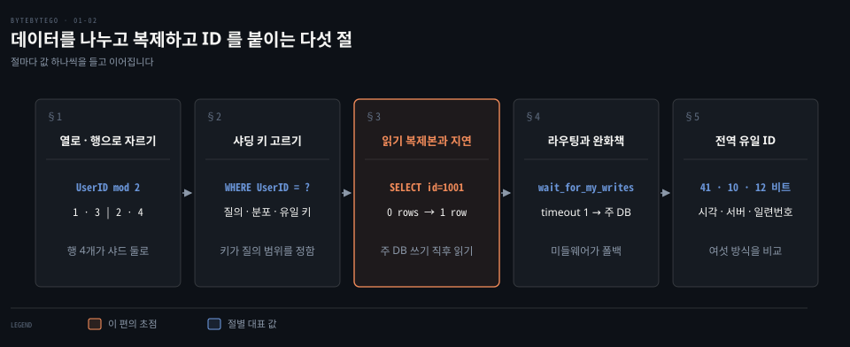
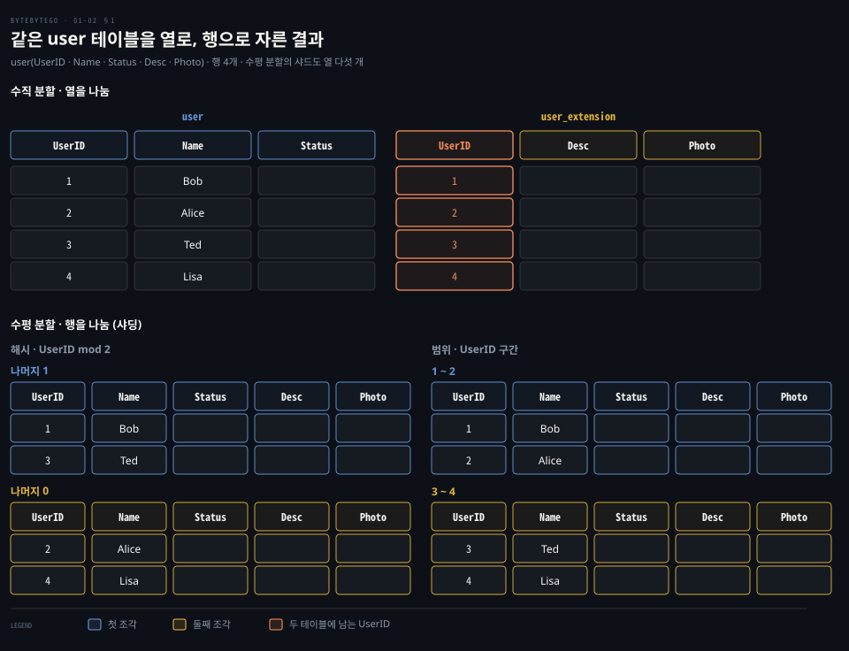
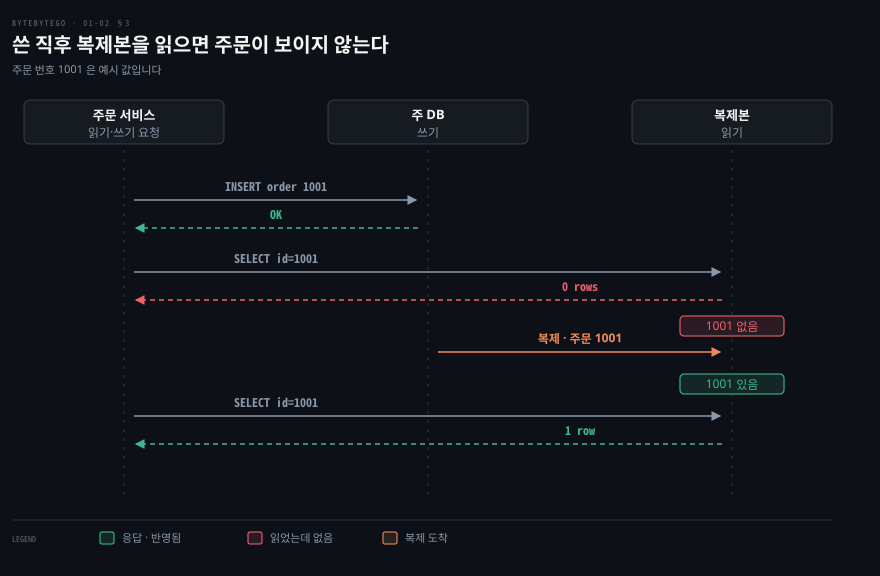
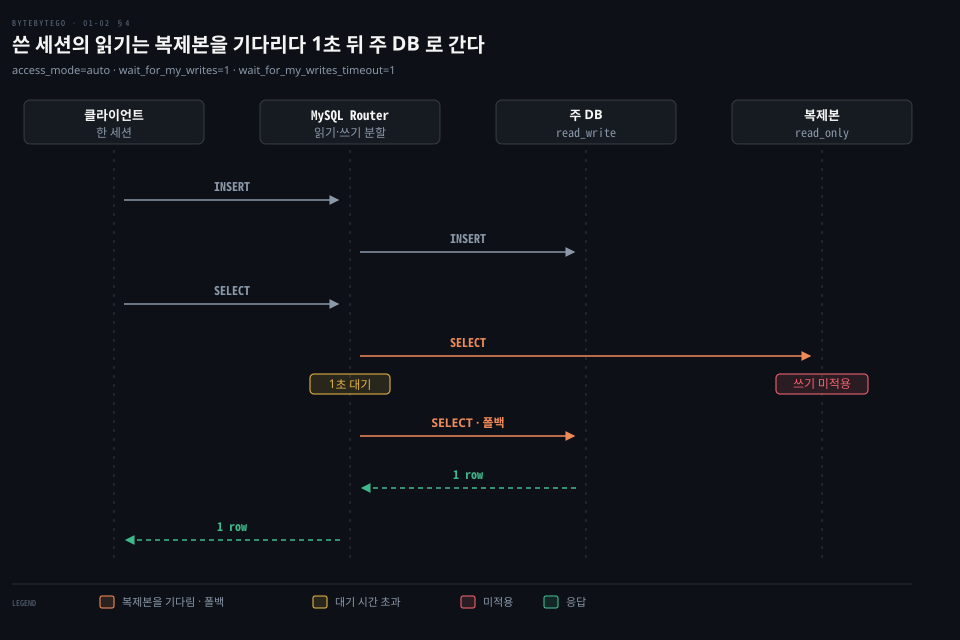
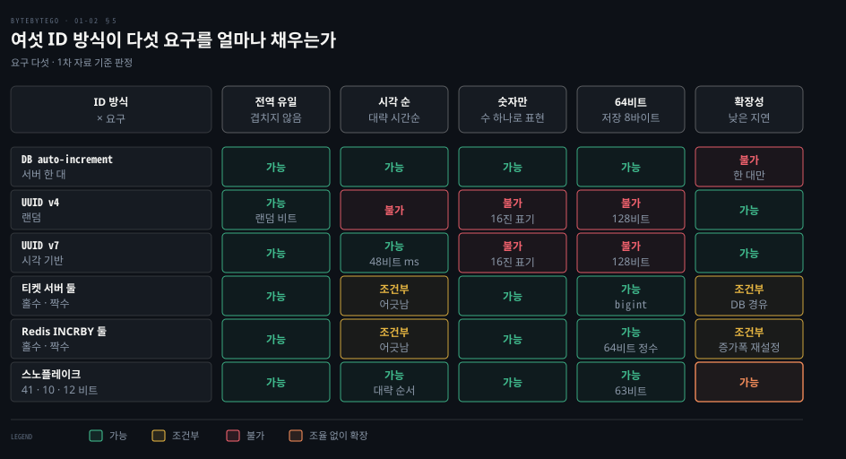

# 파티셔닝과 읽기 복제본은 데이터베이스를 넓히고 전역 유일 ID 는 나뉜 데이터에 순서를 준다

---

> 테이블을 열이나 행으로 나누고 읽기를 복제본으로 흩으면 데이터베이스가 넓어지지만, 샤딩 키·복제 지연·서버를 가로지르는 ID 라는 새 문제가 따라옵니다.

## 핵심 요약

> 한 서버에 담기지 않는 데이터는 나누고 읽기가 몰리면 복제본으로 흩어야 하며, 나눈 만큼 "어느 조각인가", "복제본이 얼마나 늦는가", "ID 가 겹치지 않는가" 를 따로 답해야 합니다.

테이블은 열 방향이나 행 방향으로 자릅니다. 행 방향으로 자른 조각을 샤드라 부르고, 어느 행이 어느 샤드로 가는지는 샤딩 키에 라우팅 규칙을 적용해 정합니다. 샤드 수가 바뀌면 같은 규칙에서도 행이 옮겨 가므로 키와 규칙은 처음에 신중히 골라야 합니다.

읽기 복제본은 쓰기를 주 DB 로, 읽기를 복제본으로 보내 읽기 부하를 나눕니다. 복제가 늦으면 방금 쓴 값을 복제본에서 읽지 못하는데, 이를 막는 길은 읽기를 주 DB 로 돌리거나 복제본이 따라잡았는지 확인하는 것입니다. 마지막으로 샤드마다 자기 번호표를 쓰면 ID 가 겹치므로, 서버끼리 조율하지 않고도 겹치지 않는 시각 기반 ID 가 필요합니다.

## 학습 목표

> 이 편을 읽고 나면 다음을 설명할 수 있습니다.

1. 수직 파티셔닝과 수평 파티셔닝(샤딩)이 같은 테이블을 어떻게 다르게 자르는지 실제 행과 열로 설명할 수 있습니다.
2. 범위 샤딩과 해시 샤딩이 행을 나누는 방식과 각각의 쏠림·질의 비용을 설명할 수 있습니다.
3. 샤딩 키를 고르는 세 기준과, 샤드 수가 바뀔 때 mod 규칙이 키를 대부분 옮긴다는 점을 설명할 수 있습니다.
4. 읽기 복제본에서 복제 지연이 쓰기 직후의 읽기를 어떻게 깨뜨리는지와 세 가지 완화책을 설명할 수 있습니다.
5. 전역 유일 ID 의 요구 다섯 가지와 여섯 방식이 그것을 어디까지 채우는지 비교할 수 있습니다.

## 1. 수직 파티셔닝은 열을, 수평 파티셔닝은 행을 나눠 한 테이블을 여러 조각으로 만든다

> 한 테이블이 한 서버에 맞지 않을 때 자를 수 있는 방향은 열과 행 둘뿐입니다. 열로 자르면 행 수가 그대로이고, 행으로 자르면 열이 그대로입니다.

사용자 테이블이 수억 행으로 자라 한 서버의 디스크와 메모리를 넘어서면 무엇을 잘라야 할까요? 데이터를 따로 접근할 수 있는 조각으로 나누는 일을 **파티셔닝**이라 하고, 자르는 방향에 따라 두 가지로 갈립니다.

- **수직 파티셔닝**: 일부 열을 새 테이블로 옮깁니다. 각 테이블의 행 수는 같고 열은 줄어듭니다.
- **수평 파티셔닝**: 한 테이블을 행 단위로 여러 작은 테이블로 나눕니다. 열은 그대로이고 행이 줄어듭니다. 흔히 샤딩이라 부릅니다.

위쪽이 수직 파티셔닝입니다. `user` 테이블의 `Desc`·`Photo` 를 `user_extension` 으로 옮기면 행은 여전히 네 개입니다. 두 테이블 모두 `UserID` 를 갖는데, 이 열이 두 조각을 같은 사용자로 다시 이어 붙이는 열쇠이기 때문입니다. 자주 읽는 `Name`·`Status` 만 한 테이블에 남기면 한 번에 읽는 열이 줄어듭니다.

아래쪽이 수평 파티셔닝입니다. 같은 네 행이 두 샤드로 갈리고 열은 다섯 개 그대로입니다. 어느 샤드로 보낼지 정하는 규칙이 라우팅 알고리즘이고 흔한 규칙은 둘입니다.

- 범위 샤딩: 정수·시각처럼 순서가 있는 열의 구간으로 가릅니다. `UserID` 1~2 는 한 샤드, 3~4 는 다른 샤드입니다.
- 해시 샤딩: 하나 이상의 열에 해시 함수를 적용합니다. `UserID mod 2` 를 쓰면 나머지 1 인 1·3 이 한 샤드, 나머지 0 인 2·4 가 다른 샤드입니다.

"파티션" 이라는 말은 규모에 따라 뜻이 갈립니다. PostgreSQL 문서는 파티셔닝을 논리적으로 하나인 큰 테이블을 더 작은 물리 조각으로 나누는 일로 정의합니다.[^pg-part] MySQL 8.4 도 행 기준으로 나누는 수평 파티셔닝만 지원하고, 수직 파티셔닝은 지원하지 않으며 계획도 없다고 적습니다.[^my-part]

두 엔진의 파티션은 기본적으로 한 서버 안의 조각입니다. PostgreSQL 은 외부 테이블을 파티션으로 붙일 수도 있지만 세심한 주의가 필요하다고 문서가 적습니다.[^pg-part] 조각마다 별도 서버를 쓰는 경우가 샤딩이고, 이 편의 "샤드" 는 이쪽을 가리킵니다.

한 서버 안 파티셔닝도 이득이 있습니다. 질의가 일부 파티션만 보면 나머지를 건너뛰고, 쓸모가 사라진 데이터는 파티션을 통째로 지워 대량 `DELETE` 를 피합니다.[^pg-part] 다만 PostgreSQL 문서는 테이블 크기가 서버 물리 메모리를 넘을 정도로 클 때에야 이득이 보통 값어치가 있다고 경험칙을 줍니다.[^pg-part]

샤딩의 이득은 서버를 더해 부하를 흩을 수 있다는 것과, 조각마다 행이 적어 질의가 훑는 행이 줄어든다는 것입니다. 비용은 둘입니다. 하나는 정렬입니다. 샤드마다 정렬된 결과를 가져와 애플리케이션 코드에서 합쳐 다시 정렬해야 합니다. 상위 10건을 두 샤드에서 구하면 각 샤드에서 10건씩 받아 20건을 정렬한 뒤 10건을 고릅니다. 다른 하나는 쏠림입니다. 어떤 샤드에 행이 몰리면 그 샤드가 핫스팟이 됩니다.

샤딩이 전체 확장 흐름에서 놓이는 자리는 [캐시·CDN·무상태 웹 계층·메시지 큐·샤딩이 규모를 늘리는 순서](../system-design/01-02.캐시·CDN·무상태%20웹%20계층·데이터%20센터·메시지%20큐·샤딩이%20수백만%20사용자까지%20규모를%20늘린다.md)에서, 샤딩 이론은 [샤딩 개요와 키 범위 샤딩](../../../05_data/book/designing-data-intensive-applications/07-01.샤딩%20개요와%20키%20범위%20샤딩.md)에서 다룹니다.

## 2. 샤딩 키는 질의가 한 샤드에서 끝나고 행이 고르게 퍼지도록 고른다

> 키가 규칙의 입력이므로 키를 잘못 고르면 질의가 모든 샤드로 퍼지거나 한 샤드에 쓰기가 몰립니다. 샤드 수가 바뀔 때 옮겨 갈 행의 양도 규칙이 정합니다.

샤드를 둘에서 셋으로 늘리면 어떤 행이 옮겨 갈까요? 답은 키와 규칙에 달려 있어서, 기준 셋을 차례로 봅니다.

첫째는 질의의 모양입니다. PostgreSQL 문서는 파티션 열로 질의의 `WHERE` 절에 가장 자주 나오는 열을 고르는 것이 흔히 최선이라고 안내합니다.[^pg-part] 이 문서는 한 서버 안 파티셔닝을 다루지만 이유는 샤딩에서도 같습니다. `WHERE UserID = ?` 처럼 키가 `WHERE` 에 있으면 규칙이 샤드 하나를 가리키고, 없으면 모든 샤드에 질의를 보내 결과를 합쳐야 합니다.

둘째는 분포입니다. 범위 샤딩에 `UserID` 처럼 늘기만 하는 키를 쓰면 새 행이 항상 가장 높은 구간에 들어가 쓰기가 마지막 샤드에 몰립니다. 해시 샤딩은 행을 고르게 흩지만, 구간 질의("UserID 1~100")는 모든 샤드를 봐야 합니다.

셋째는 유일성입니다. MySQL 파티셔닝은 파티션 식에 쓰는 열이 기본 키를 포함한 모든 유일 키에 들어 있어야 한다는 제약을 둡니다.[^my-part] 샤드는 서로 다른 서버라 한 샤드의 DB 가 다른 샤드의 행을 보지 못하므로(5절의 Flickr 사례), 유일해야 하는 값은 샤딩 키와 함께 설계하거나 5절의 전역 ID 로 정합니다.

마지막은 샤드 수의 변화입니다. 해시 샤딩의 규칙이 "UserID 를 샤드 수로 나눈 나머지" 라면 샤드 수가 바뀔 때 나머지가 거의 다 바뀌어 키 대부분이 다른 샤드로 옮겨 갑니다. 샤드 둘을 셋으로 바꾸면 UserID 1~6 의 `mod 2` 나머지는 1, 0, 1, 0, 1, 0 이고 `mod 3` 나머지는 1, 2, 0, 1, 2, 0 이라 1 과 6 만 그대로이고 2·3·4·5 의 네 행이 움직입니다. PostgreSQL 의 해시 파티션도 같은 구조로, 파티션마다 법(modulus)과 나머지(remainder)를 지정합니다.[^pg-part]

나머지 연산이 옮기는 양의 계산과 격자는 [안정 해시의 §1](../system-design/05-01.안정%20해시는%20해시%20링과%20가상%20노드로%20서버가%20늘고%20줄%20때%20옮길%20키를%20줄인다.md)과 [샤딩 절](../system-design/01-02.캐시·CDN·무상태%20웹%20계층·데이터%20센터·메시지%20큐·샤딩이%20수백만%20사용자까지%20규모를%20늘린다.md)에서 풀었습니다. 옮길 키를 줄이는 방법은 서버를 링 위에 놓고 키를 가까운 서버에 배정하는 안정 해시이고, 샤딩 관점의 해시 규칙은 [해시 샤딩과 일관 해싱](../../../05_data/book/designing-data-intensive-applications/07-02.해시%20샤딩과%20일관%20해싱.md)에서 다룹니다.

## 3. 읽기 복제본은 읽기를 흩지만 복제가 늦으면 쓴 직후의 읽기가 이전 상태를 본다

> 읽기가 많은 서비스는 주 DB 한 대로 읽기를 모두 받기 어렵습니다. 복제본으로 읽기를 흩으면 용량은 늘지만 복제본이 주 DB 보다 늦을 수 있다는 값을 치릅니다.

읽기 요청이 쓰기보다 훨씬 많다면 주 DB 는 어떻게 부하를 덜 수 있을까요? **읽기 복제본 패턴**은 데이터를 바꾸는 명령(`INSERT`·`UPDATE`·`DELETE`)을 모두 주 DB 로, 읽기를 복제본으로 보냅니다. 주 DB 는 변경을 복제본 둘에 복제합니다.

주문 서비스로 흐름을 따라가 봅니다. 사용자 Alice 가 주문을 넣으면 주문 서비스가 주 DB 에 주문을 만듭니다(쓰기). 주문 상세와 최근 주문 목록은 복제본에서 읽습니다(읽기). 문제는 복제가 즉시 끝나지 않는다는 점입니다.

**복제 지연**은 복제본이 주 DB 의 변경을 따라잡지 못한 구간입니다. 네트워크 지연이나 서버 과부하 같은 이유로 복제본이 수 초에서 수 분까지 늦을 수 있습니다. 그 사이 Alice 가 방금 넣은 주문을 확인하면 읽기가 복제본으로 가서 주문이 보이지 않습니다.

그림의 주문 번호 1001 은 예시 값입니다. 주 DB 에 쓰기는 성공(`OK`)하지만 복제본에는 복제가 닿기 전이라 첫 `SELECT` 는 `0 rows` 입니다. 복제가 도착한 뒤의 같은 `SELECT` 는 `1 row` 입니다. 사용자는 주문이 성공했는데 목록에 없는 상황을 보고 혼란스러워합니다.

이때 필요한 성질이 **쓰기 후 읽기 일관성**(read-after-write)입니다. 자기가 쓴 값은 그 직후의 읽기에서 보여야 한다는 요구입니다. 일관성 모델의 전체 그림과 단조 읽기 같은 이웃 보장은 [복제 지연 문제와 일관성 보장](../../../05_data/book/designing-data-intensive-applications/06-03.복제%20지연%20문제와%20일관성%20보장.md)에서, 쓰기 응답을 몇 개의 복제본 확인 뒤에 줄지는 [격리 수준과 낙관적 잠금…](./01-01.격리%20수준과%20낙관적%20잠금이%20동시%20쓰기의%20이상%20현상을%20막고%20데이터%20모양이%20데이터베이스%20종류를%20고른다.md)의 복제 확인 수 절에서 다룹니다. 주 DB 와 복제본의 기본 구성은 [단일 서버에서 출발한 시스템의 DB 복제](../system-design/01-01.단일%20서버에서%20출발한%20시스템은%20DB%20분리·로드밸런서·DB%20복제로%20첫%20병목을%20넘는다.md)에서 다룹니다.

## 4. 라우팅은 애플리케이션이나 미들웨어가 맡고 복제 지연은 읽기를 주 DB 로 돌리거나 따라잡기를 확인해 다룬다

> 읽기·쓰기를 가르는 위치와 지연을 다루는 방법은 별개의 선택입니다. 위치는 코드와 미들웨어 둘이고, 방법은 읽기를 주 DB 로 보내거나 복제본의 따라잡기를 확인하는 셋입니다.

읽기와 쓰기를 어디서 갈라야 할까요? 라우팅 로직을 두는 자리는 둘입니다.

| 위치 | 장점 | 비용 |
|---|---|---|
| 애플리케이션 코드 | 중간 계층 없이 요청마다 경로를 직접 정함 | 코드가 DB 구성(어느 서버가 주인지)을 알아야 함 |
| 데이터베이스 미들웨어 | 애플리케이션이 토폴로지를 모르고, MySQL 프로토콜을 쓰면 기존 클라이언트가 그대로 연결됨 | 미들웨어가 단일 장애점이 되어 이중화가 필요하고, 중간 홉만큼 지연이 늘어남 |

미들웨어는 사용자·스키마·문장마다 다른 규칙을 적용할 수 있습니다. 현재 MySQL 진영의 예가 MySQL Router 입니다. 8.4 문서는 Router 가 각 쿼리를 읽기와 쓰기로 분류해 알맞은 서버로 보낸다고 설명합니다.[^router-rw]

설정에서는 `access_mode` 를 `auto` 로 두고, 세션마다 `ROUTER SET access_mode='read_write'` 로 모든 트래픽을 주 서버로 고정할 수도 있습니다. 이 분할은 `role=PRIMARY_AND_SECONDARY` 인 메타데이터 캐시(`metadata-cache`) URL 을 가리키는 `destinations`, `connection_sharing=1`, `protocol=classic` 이 전제입니다.[^router-cfg] 읽기 대상은 InnoDB Cluster 의 secondary 이거나 Replica Cluster 의 인스턴스입니다.[^router-rw]

복제 지연을 다루는 방법은 셋이고 쓰기 후 읽기 일관성에서 비용을 어디에 얹느냐가 다릅니다.

1. 지연에 민감한 읽기를 주 DB 로 보냅니다. 결제 직후 잔액처럼 늦으면 안 되는 읽기를 경로 단위로 고정합니다. 주 DB 읽기 부하가 그만큼 늘어납니다.
2. 쓰기 직후의 읽기를 주 DB 로 보냅니다. 방금 쓴 사용자의 짧은 구간만 주 DB 에서 읽고 나머지는 복제본으로 보냅니다. 구간을 복제 지연의 상한보다 짧게 잡으면 다시 이전 상태가 보입니다.
3. 복제본이 따라잡았는지 확인합니다. 따라잡았으면 복제본에서 읽고, 아니면 읽기를 실패시키거나 주 DB 에서 읽습니다.

세 번째 방법의 확인 수단은 엔진마다 다릅니다.

- MySQL: `WAIT_FOR_EXECUTED_GTID_SET(gtid_set[, timeout])` 이 해당 트랜잭션 집합이 실행될 때까지 기다리고, 성공이면 0 시간 초과면 1 을 돌려줍니다.[^my-gtid] 클라이언트는 `session_track_gtids` 추적기로 자기 쓰기의 GTID 를 OK 패킷에 실어 받을 수 있습니다.[^my-track]
- PostgreSQL: 주 DB 의 `pg_current_wal_lsn()` 이 돌려주는 쓰기 위치를 기억해 두고, 복제본의 `pg_last_wal_replay_lsn()`(재생을 마친 마지막 위치)이 그 값 이상인지 비교합니다.[^pg-lsn]
- 쓰기 쪽에 비용 얹기: `synchronous_commit = remote_apply` 는 커밋이 동기 복제본의 재생까지 기다리게 합니다. 문서가 밝히듯 커밋 지연이 크게 늘어납니다.[^pg-sc]

미들웨어는 이 확인을 대신합니다. Router 의 `wait_for_my_writes` 가 1 이면 읽기 쿼리가 그 세션이 마지막으로 쓴 트랜잭션을 기다립니다. `wait_for_my_writes_timeout`(기본 1초) 안에 복제본이 적용하지 못하면 읽기를 read_write 대상으로 돌려보냅니다.[^router-cfg]

그림은 폴백 경로입니다. 클라이언트의 `INSERT` 가 주 DB 로 가고, 같은 세션의 `SELECT` 는 복제본으로 향합니다. 복제본이 1초 안에 그 쓰기를 적용하지 못하면 Router 가 같은 `SELECT` 를 주 DB 로 다시 보내 `1 row` 를 받습니다. 복제본이 제때 따라잡았다면 복제본의 응답이 그대로 돌아갑니다.

## 5. 전역 유일 ID 는 샤드를 가로질러 겹치지 않으면서 대략 시각 순으로 정렬되는 64비트 숫자여야 한다

> 샤드마다 자기 번호표를 쓰면 ID 가 겹쳐 데이터를 옮기거나 합칠 수 없습니다. 서버끼리 조율하지 않고도 겹치지 않고 대략 정렬되는 ID 가 필요하고, 스노플레이크가 그 요구를 한 번에 채웁니다.

샤드 둘이 각자 `auto_increment` 로 번호를 매기면 두 샤드가 모두 ID 1 을 발급합니다. 어느 샤드의 1 번 행인지 구분되지 않고, 샤드 사이에 행을 옮기는 순간 키가 충돌합니다. Flickr 는 같은 이유로 MySQL 의 auto-increment 가 물리·논리 데이터베이스를 가로질러 유일성을 보장하지 못해 따로 ID 서버를 두었다고 밝힙니다.[^flickr] 소셜 서비스의 전역 ID 가 갖춰야 할 요구는 다섯입니다.

1. 전역 유일: 겹치면 충돌합니다.
2. 대략 시각 순: 사용자 ID·게시물 ID 를 추가 정보 없이 대략 시간순으로 정렬합니다.
3. 숫자만: 숫자는 그 자체로 정렬됩니다.
4. 64비트: 2^32 = 4,294,967,296 이라 약 43억 개뿐이라 모자라고, 2^128 은 공간을 낭비합니다. 2^64 는 약 1.8×10^19 라 충분합니다.
5. 높은 확장성과 낮은 지연: 초당 많은 ID 를 낮은 지연으로 만듭니다.

방식마다 어느 칸이 비는지 차례로 봅니다. 비트 배치·티켓 서버 구현·시계 어긋남 처리는 [분산 유일 ID](../system-design/07-01.분산%20유일%20ID%20는%20UUID·티켓%20서버%20대신%20타임스탬프와%20일련번호를%20묶은%2064비트%20스노플레이크로%20만든다.md)에서 풀었으므로 여기서는 칸의 값만 짚습니다.

- `auto_increment` 한 대: 전역 유일·시각 순·숫자·64비트는 채우지만 서버 한 대에서만 동작해 확장성 칸이 빕니다. 샤드마다 따로 쓰면 앞의 충돌이 일어납니다.
- UUID: 서버끼리 조율 없이 만들고 겹치지 않지만 128비트이고 16진 문자열로 표기해 숫자·64비트 칸이 빕니다. 시각 순은 버전에 갈립니다. RFC 9562(2024년 5월, RFC 4122 를 대체)에서 UUIDv4 는 무작위라 시간순이 아니고, UUIDv7 은 앞 48비트에 밀리초 시각을 두어 시간순으로 정렬됩니다.[^rfc9562]
- 티켓 서버 둘: 전용 데이터베이스가 번호를 내므로 모든 발급이 그 DB 를 지납니다. 한 대는 단일 장애점이라 홀수·짝수를 나눠 맡은 두 대를 번갈아 부르는데, 두 서버의 번호가 조금씩 어긋나 시간순이 흐트러집니다. 번호 열은 `bigint` 라 64비트 칸은 채웁니다.[^flickr]
- Redis `INCRBY` 둘: `INCR` 는 키를 하나 올리고 `INCRBY key increment` 는 지정한 만큼 올리며, 둘 다 64비트 부호 있는 정수로 제한됩니다.[^redis-incr][^redis-incrby] 둘 다 증가폭을 2 로 하고 시작값을 -1 과 0 으로 두면 서버 A 가 1·3·5·7, 서버 B 가 2·4·6·8 을 냅니다. 구조상 서버를 더하거나 빼면 증가폭을 다시 맞춰야 하므로 확장성 칸이 조건부입니다.
- 스노플레이크: 64비트 안에 시각 41·서버 10·일련번호 12비트를 담아 합 63비트입니다. 서버끼리 조율하지 않으며, ID 는 약 1초 이내 범위에서 대략 시간순(k-sorted)으로 정렬된다고 약속합니다.[^snowflake]

현재 상태도 짚어 둡니다. 원 스노플레이크 저장소는 보관(archived) 처리되어 있고,[^snowflake-gh] Discord 가 이 형식을 씁니다.[^discord] 비트 배치와 시계 어긋남 처리, 같은 형식을 쓰는 서비스의 필드 폭은 [분산 유일 ID](../system-design/07-01.분산%20유일%20ID%20는%20UUID·티켓%20서버%20대신%20타임스탬프와%20일련번호를%20묶은%2064비트%20스노플레이크로%20만든다.md)에서 자세히 다룹니다.

## 면접 대비

> 수직·수평 파티셔닝, 샤딩 키 기준, 복제 지연과 완화책, 전역 유일 ID 방식 선택에 관한 질문입니다.

1. 수직 파티셔닝과 수평 파티셔닝은 같은 테이블을 어떻게 다르게 자르고, 샤딩이 어렵게 만드는 질의는 무엇입니까?
2. 범위 샤딩과 해시 샤딩은 각각 어떤 쏠림과 질의 비용을 갖습니까?
3. 샤딩 키를 고르는 기준 셋은 무엇이고, 샤드 수가 바뀔 때 `UserID mod N` 규칙이 왜 문제가 됩니까?
4. 읽기 복제본에서 쓴 직후 읽기가 이전 상태를 보는 이유와 이를 막는 세 가지 방법은 무엇입니까?
5. 전역 유일 ID 에 요구되는 조건은 무엇이고, UUID·티켓 서버·스노플레이크는 각각 어디서 막힙니까?

## 정답 (자답 후 펼치기)

> 면접 질문에 대한 키워드 중심의 모범 답안입니다.

### 정답 1 — 열로 자르느냐 행으로 자르느냐

수직 파티셔닝은 일부 열을 새 테이블로 옮겨 행 수는 같고 열이 줄어듭니다. 수평 파티셔닝은 행을 조각으로 나눠 열은 같고 행이 줄어듭니다. 샤딩은 정렬이 어렵습니다. 샤드마다 정렬한 결과를 가져와 애플리케이션이 합쳐 다시 정렬해야 하고, 한 샤드에 행이 몰리는 쏠림도 생깁니다.

### 정답 2 — 구간과 해시

범위 샤딩은 늘기만 하는 키에서 새 행이 마지막 구간으로 몰립니다. 해시 샤딩은 고르게 흩지만 구간 질의가 모든 샤드를 봅니다.

### 정답 3 — 키 기준 셋과 나머지 연산의 이동량

기준은 질의의 `WHERE` 에 가장 자주 나오는 열, 행이 고르게 퍼지는 분포, 유일 키에 파티션 식의 열이 들어 있는지입니다. 나머지 연산 규칙은 샤드 수가 바뀌면 나누는 수가 달라져 키 대부분이 옮겨 가고, 새 샤드가 받을 몫보다 많이 움직입니다. 안정 해시가 이 이동량을 줄입니다.

### 정답 4 — 복제 지연과 세 방법

복제가 비동기라 복제본이 주 DB 를 따라잡기 전에 읽으면 쓴 값이 없습니다. 방법은 지연에 민감한 읽기를 주 DB 로 보내기, 쓰기 직후의 읽기를 주 DB 로 보내기, 복제본이 따라잡았는지 확인하고 아니면 주 DB 에서 읽기입니다. 확인은 MySQL 의 GTID 대기 함수나 PostgreSQL 의 WAL 위치 비교이고 Router 는 `wait_for_my_writes` 로 대신합니다.

### 정답 5 — 다섯 요구와 방식별 빈칸

요구는 전역 유일·대략 시각 순·숫자만·64비트·확장성입니다. UUID 는 128비트이고 v4 는 시간순이 아닙니다. 티켓 서버는 한 대면 단일 장애점이고 둘이면 시각 순이 어긋납니다. `auto_increment` 는 한 대에서만 동작합니다. 스노플레이크는 시각·서버·일련번호를 비트로 나눠 조율 없이 다섯을 채웁니다.

## 참고 자료

- ByteByteGo, 「System Design」 그림 해설 모음 중 수직·수평 파티셔닝, 읽기 복제본 패턴 두 편, 전역 유일 ID 글.
- ByteByteGo 공개 저장소의 같은 글: [Vertical vs Horizontal Partitioning](https://github.com/ByteByteGoHq/system-design-101/blob/ee4b7305a2ccd6aa13688559d345e8a6647774de/data/guides/vertical-partitioning-vs-horizontal-partitioning.md), [Read Replica Pattern](https://github.com/ByteByteGoHq/system-design-101/blob/ee4b7305a2ccd6aa13688559d345e8a6647774de/data/guides/read-replica-pattern.md), [How to Implement Read Replica Pattern](https://github.com/ByteByteGoHq/system-design-101/blob/ee4b7305a2ccd6aa13688559d345e8a6647774de/data/guides/how-to-implement-read-replica-pattern.md), [Unique ID Generator](https://github.com/ByteByteGoHq/system-design-101/blob/ee4b7305a2ccd6aa13688559d345e8a6647774de/data/guides/unique-id-generator.md)
- PostgreSQL 18, Table Partitioning: https://www.postgresql.org/docs/18/ddl-partitioning.html
- MySQL 8.4, Overview of Partitioning in MySQL: https://dev.mysql.com/doc/refman/8.4/en/partitioning-overview.html
- MySQL Router 8.4, Read/Write Splitting: https://dev.mysql.com/doc/mysql-router/8.4/en/router-read-write-splitting.html
- RFC 9562, Universally Unique IDentifiers (UUIDs): https://www.rfc-editor.org/rfc/rfc9562
- Flickr, Ticket Servers: Distributed Unique Primary Keys on the Cheap: https://code.flickr.net/2010/02/08/ticket-servers-distributed-unique-primary-keys-on-the-cheap/

## 관련 문서

- [격리 수준과 낙관적 잠금이 동시 쓰기의 이상 현상을 막고 데이터 모양이 데이터베이스 종류를 고른다](./01-01.격리%20수준과%20낙관적%20잠금이%20동시%20쓰기의%20이상%20현상을%20막고%20데이터%20모양이%20데이터베이스%20종류를%20고른다.md)
- [캐시·CDN·무상태 웹 계층·데이터 센터·메시지 큐·샤딩이 수백만 사용자까지 규모를 늘린다](../system-design/01-02.캐시·CDN·무상태%20웹%20계층·데이터%20센터·메시지%20큐·샤딩이%20수백만%20사용자까지%20규모를%20늘린다.md)
- [안정 해시는 해시 링과 가상 노드로 서버가 늘고 줄 때 옮길 키를 줄인다](../system-design/05-01.안정%20해시는%20해시%20링과%20가상%20노드로%20서버가%20늘고%20줄%20때%20옮길%20키를%20줄인다.md)
- [분산 유일 ID 는 UUID·티켓 서버 대신 타임스탬프와 일련번호를 묶은 64비트 스노플레이크로 만든다](../system-design/07-01.분산%20유일%20ID%20는%20UUID·티켓%20서버%20대신%20타임스탬프와%20일련번호를%20묶은%2064비트%20스노플레이크로%20만든다.md)
- [복제 지연 문제와 일관성 보장](../../../05_data/book/designing-data-intensive-applications/06-03.복제%20지연%20문제와%20일관성%20보장.md)
- [해시 샤딩과 일관 해싱](../../../05_data/book/designing-data-intensive-applications/07-02.해시%20샤딩과%20일관%20해싱.md)

[^pg-part]: PostgreSQL 18, 5.12 Table Partitioning(정의, 외부 테이블을 파티션으로 둘 수 있음, 파티션 제거의 이득, 테이블 크기가 서버 메모리를 넘을 때라는 경험칙, 해시 파티션의 modulus·remainder, 5.12.6 파티션 열 선택): <https://www.postgresql.org/docs/18/ddl-partitioning.html>
[^my-part]: MySQL 8.4, 26.1 Overview of Partitioning in MySQL(행 기준 수평 파티셔닝만 지원하고 수직 파티셔닝은 지원하지 않음, 파티션 식의 열은 모든 유일 키에 포함): <https://dev.mysql.com/doc/refman/8.4/en/partitioning-overview.html>
[^router-rw]: MySQL Router 8.4, 3.5 Read/Write Splitting(각 쿼리를 읽기·쓰기로 분류해 알맞은 서버로 보냄): <https://dev.mysql.com/doc/mysql-router/8.4/en/router-read-write-splitting.html>
[^router-cfg]: MySQL Router 8.4, 3.5.1 Configuration(`access_mode`·`connection_sharing`·`protocol`·`destinations`(`role=PRIMARY_AND_SECONDARY`) 전제, `ROUTER SET`, `wait_for_my_writes`, `wait_for_my_writes_timeout` 기본 1초와 read_write 폴백): <https://dev.mysql.com/doc/mysql-router/8.4/en/router-read-write-splitting-configuration.html>
[^my-gtid]: MySQL 8.4, 14.18.2 Functions Used with Global Transaction Identifiers (GTIDs)(`WAIT_FOR_EXECUTED_GTID_SET`, 반환값 0 성공·1 시간 초과): <https://dev.mysql.com/doc/refman/8.4/en/gtid-functions.html>
[^my-track]: MySQL 8.4, 7.1.18 Server Tracking of Client Session State(GTID 추적기를 `session_track_gtids` 가 제어, 추적 정보는 OK 패킷에 실림): <https://dev.mysql.com/doc/refman/8.4/en/session-state-tracking.html>
[^pg-lsn]: PostgreSQL 18, 9.28 System Administration Functions(`pg_current_wal_lsn()` 은 현재 WAL 쓰기 위치, `pg_last_wal_replay_lsn()` 은 복구 중 재생을 마친 마지막 WAL 위치): <https://www.postgresql.org/docs/18/functions-admin.html>
[^pg-sc]: PostgreSQL 18, `synchronous_commit`(`remote_apply` 는 동기 복제본이 커밋을 적용해 질의에 보일 때까지 기다리며 커밋 지연이 크게 늘어남): <https://www.postgresql.org/docs/18/runtime-config-wal.html#GUC-SYNCHRONOUS-COMMIT>
[^flickr]: Flickr 코드 블로그, Ticket Servers: Distributed Unique Primary Keys on the Cheap(2010-02-08. MySQL 은 물리·논리 DB 를 가로질러 유일성을 보장하지 못함, `Tickets64`, `REPLACE INTO`, 두 서버의 홀수·짝수 분담): <https://code.flickr.net/2010/02/08/ticket-servers-distributed-unique-primary-keys-on-the-cheap/>
[^rfc9562]: RFC 9562(2024년 5월, RFC 4122 를 대체)의 UUIDv4 와 UUIDv7 정의, UUIDv7 은 가장 높은 48비트에 Unix 밀리초 타임스탬프: <https://www.rfc-editor.org/rfc/rfc9562>
[^redis-incr]: Redis 문서, INCR(키가 없으면 0 에서 시작, 키 값을 하나 올림, 64비트 부호 있는 정수로 제한): <https://redis.io/docs/latest/commands/incr/>
[^redis-incrby]: Redis 문서, INCRBY(키 값을 지정한 증가폭만큼 올림, 64비트 부호 있는 정수로 제한): <https://redis.io/docs/latest/commands/incrby/>
[^snowflake]: twitter-archive/snowflake 의 README(태그 `snowflake-2010`. 시각 41비트·서버 10비트·일련번호 12비트, 조율 없음, 약 1초 이내 k-sorted, 시계 후퇴 시 발급 거절): <https://github.com/twitter-archive/snowflake/blob/snowflake-2010/README.mkd>
[^discord]: Discord 개발자 문서, Reference 의 Snowflakes(Discord 가 Twitter 의 스노플레이크 형식을 씀): <https://discord.com/developers/docs/reference#snowflakes>
[^snowflake-gh]: GitHub 저장소 twitter-archive/snowflake 는 보관(archived) 상태이고 마지막 푸시는 2020-07-22 입니다(GitHub API 로 확인): <https://github.com/twitter-archive/snowflake>
