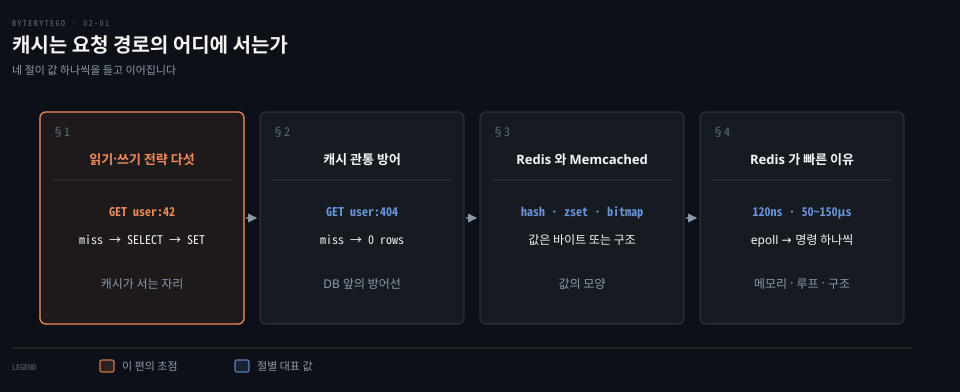
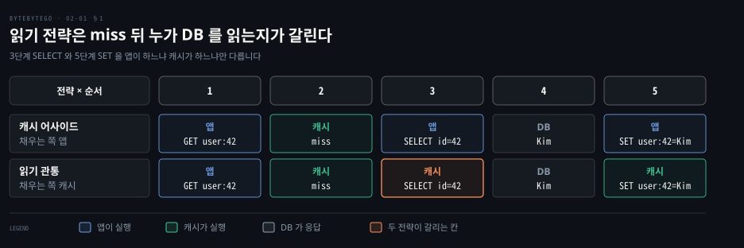
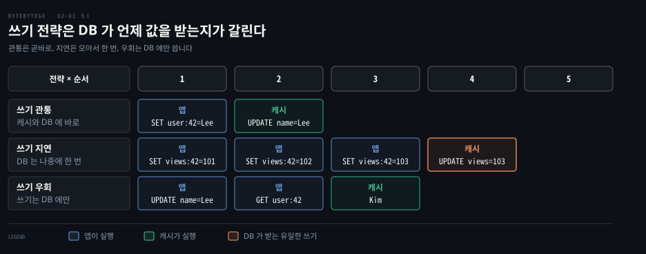
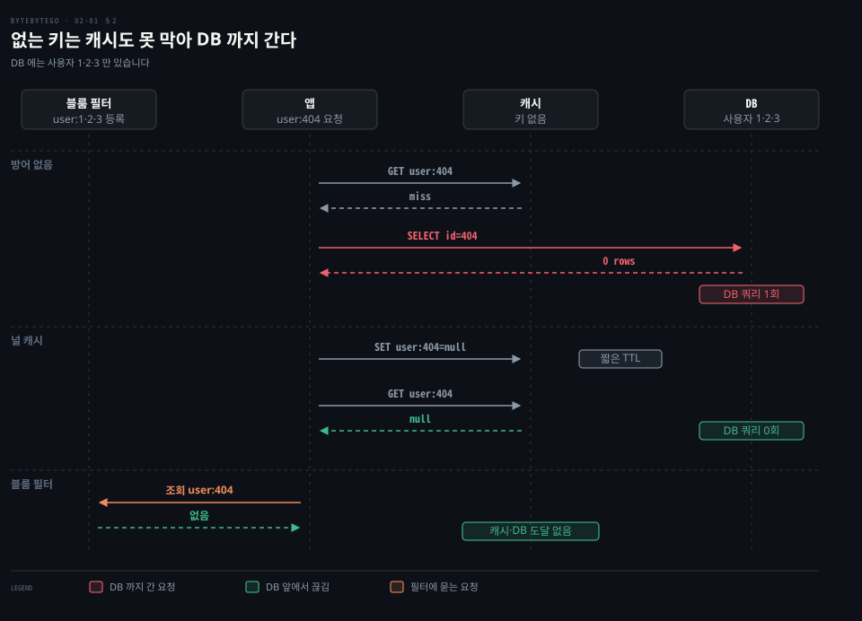
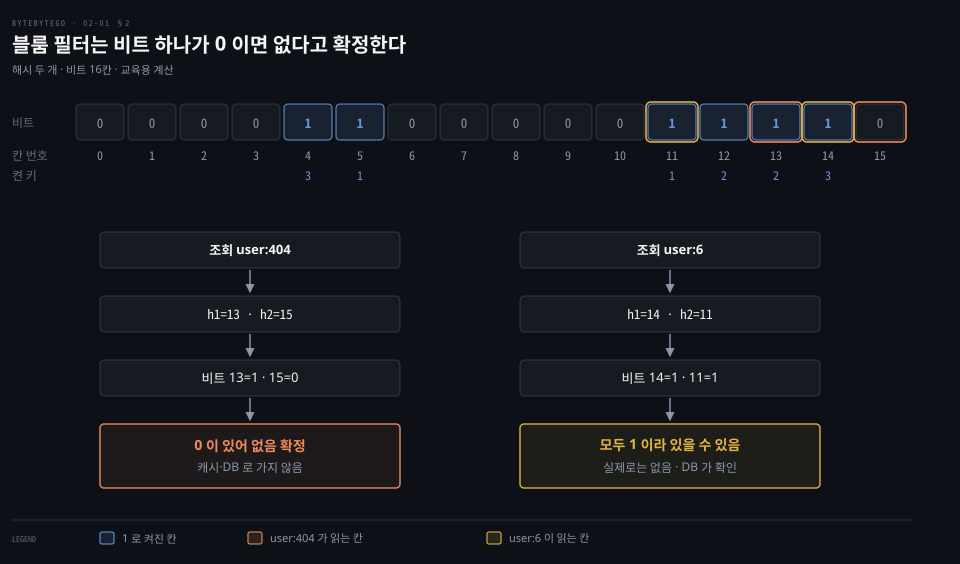
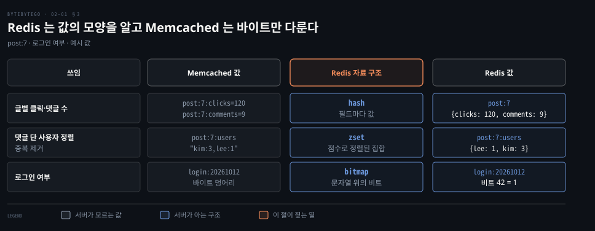
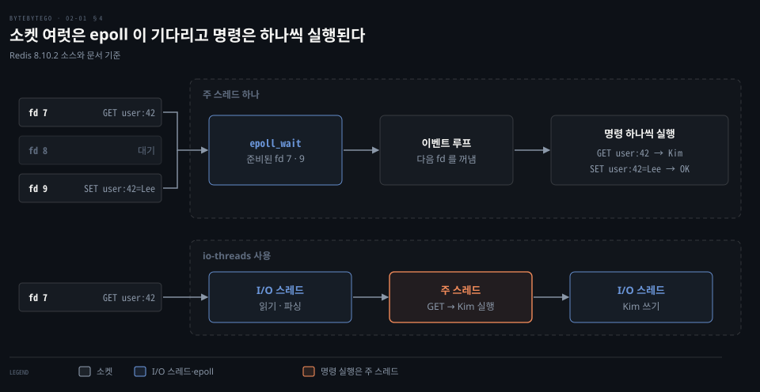
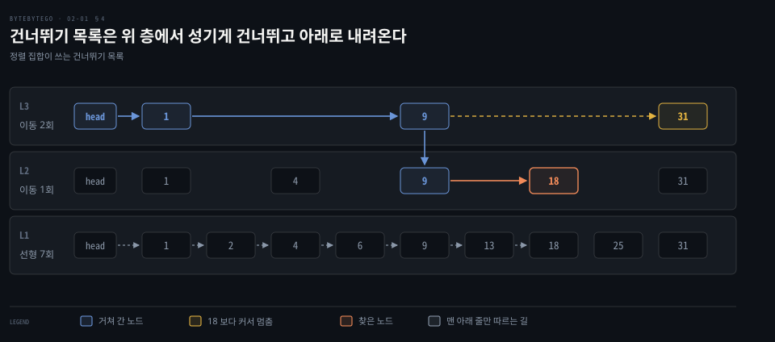

# 캐시 전략은 읽기·쓰기 경로에서 캐시 자리를 정하고 Redis 는 메모리와 단일 스레드 이벤트 루프로 빠르다

---

> 캐시는 읽기에서 miss 뒤 누가 DB 를 읽어 채우는지로, 쓰기에서 DB 가 값을 언제 받는지로 경로가 갈립니다. 없는 키는 널 캐시와 블룸 필터로 막고, Redis 는 메모리와 epoll 이벤트 루프와 알맞은 자료 구조로 빠릅니다.

## 핵심 요약

> 캐시는 요청 경로의 어디에 서는지가 읽기·쓰기 전략을 가르고, 무엇으로 만드는지가 속도를 가릅니다.

읽기 전략은 miss 뒤에 DB 를 읽어 캐시를 채우는 일을 앱이 하느냐(캐시 어사이드) 캐시가 하느냐(읽기 관통)로 갈립니다. 쓰기 전략은 DB 가 값을 받는 때로 갈립니다. 쓰기 관통은 곧바로, 쓰기 지연은 모아서 나중에, 쓰기 우회는 DB 에만 씁니다.

캐시에도 DB 에도 없는 키를 반복해서 조회하면 요청마다 DB 까지 갑니다. 널 캐시는 "없음" 을 짧게 저장하고 블룸 필터는 비트 몇 개로 없음을 확정해서 이 길을 DB 앞에서 끊습니다.

Redis 는 값의 모양을 아는 서버여서 hash·zset·bitmap 으로 쓰임을 곧바로 담습니다. 속도는 메모리 지연, 소켓 여럿을 epoll 로 기다리고 명령을 주 스레드에서 하나씩 실행하는 구조, 크기에 따라 바뀌는 자료 구조에서 나옵니다.

## 학습 목표

> 이 편을 읽고 나면 다음을 설명할 수 있습니다.

1. 읽기 전략 둘과 쓰기 전략 셋을 miss 뒤 DB 를 읽는 주체와 DB 가 값을 받는 때로 구분하고, 한 요청의 다섯 걸음을 따라갈 수 있습니다.
2. 없는 키가 캐시를 지나 DB 까지 가는 까닭과 널 캐시·블룸 필터가 막는 자리, 그리고 블룸 필터의 거짓 양성이 치르는 값을 설명할 수 있습니다.
3. Redis 와 Memcached 를 값의 모양·스레드·원자 연산·복제로 비교해 쓰임에 맞게 고를 수 있습니다.
4. Redis 가 빠른 이유를 지연 시간 비율·epoll·명령 실행 단일 스레드·I/O 스레드의 현재 상태로 설명할 수 있습니다.
5. Redis 가 해시와 정렬 집합을 작을 때와 클 때 어떤 구조로 저장하는지, 건너뛰기 목록이 값을 찾는 길을 설명할 수 있습니다.

## 1. 읽기와 쓰기 전략은 캐시가 요청 경로의 어디에 서는지로 갈린다

> 읽기는 miss 뒤에 누가 DB 를 읽어 채우는지로, 쓰기는 DB 가 값을 언제 받는지로 전략이 갈립니다. 읽기 둘과 쓰기 셋이 있고 실제로는 섞어 씁니다.

캐시에 없는 `user:42` 를 읽는 요청이 왔다고 해 봅시다. DB 에서 읽어 와 캐시를 채우는 일은 애플리케이션이 해야 할까요, 캐시가 해야 할까요?

### 읽기 전략은 miss 뒤의 세 걸음을 누가 하는지가 다르다

**캐시 어사이드**(cache-aside)는 앱이 캐시를 먼저 묻고, miss 이면 앱이 직접 `SELECT id=42` 로 DB 를 읽어 `SET user:42=Kim` 으로 캐시에 씁니다. 캐시는 DB 옆에 비켜 서 있을 뿐 DB 를 알지 못합니다. 필요할 때 적재하므로 지연 적재(lazy loading)라고도 부릅니다.[^azure-aside][^aws-wt]

**읽기 관통**(read-through)은 앱이 캐시에만 묻는 방식입니다. miss 이면 캐시가 DB 를 읽어 저장한 뒤 값을 돌려줍니다.[^hz-store] 캐시 제품이 이 기능을 주지 않으면 앱이 캐시 어사이드로 같은 일을 흉내 냅니다.[^azure-aside]

두 전략의 다섯 걸음은 같고, DB 를 읽는 세 번째와 캐시에 쓰는 다섯 번째를 앱이 하느냐 캐시가 하느냐만 다릅니다. 그 차이가 DB 읽기 코드가 놓이는 자리를 정합니다. 캐시 어사이드는 그 코드가 앱에 있어서 캐시 노드가 비어도 앱은 계속 동작하고 지연만 늘어납니다.[^aws-lazy] 읽기 관통은 코드가 캐시 계층으로 들어가 앱은 캐시 하나만 보면 됩니다.

읽기 쪽의 공통 비용은 둘입니다. miss 한 번에 캐시에 묻기, DB 읽기, 캐시에 쓰기의 왕복이 셋 듭니다. 그리고 DB 가 바뀌어도 캐시는 모르므로 낡은 값이 남을 수 있습니다.[^aws-lazy] 그래서 캐시 어사이드에서 값을 고칠 때는 DB 를 먼저 쓰고 캐시 항목을 지웁니다. 캐시를 먼저 지우면 그 틈에 다른 요청이 옛 값을 DB 에서 읽어 캐시에 다시 채웁니다.[^azure-aside]

### 쓰기 전략은 DB 가 값을 받는 때가 다르다

**쓰기 관통**(write-through)은 쓰기가 캐시와 DB 에 동기로 모두 닿은 뒤에야 끝납니다. `SET user:42=Lee` 가 캐시에 닿으면 `UPDATE name=Lee` 가 DB 로 바로 갑니다. 두 곳을 쓰는 순서는 구현마다 다릅니다. 캐시 계층이 대신 쓰는 구현은 캐시에 쓴 값을 곧바로 DB 에 동기로 씁니다.[^hz-store] 앱이 DB 를 갱신한 직후 캐시도 갱신하는 구현도 있습니다.[^aws-wt] 어느 쪽이든 캐시가 낡지 않지만 쓰기마다 왕복이 둘이고, 한 번도 읽히지 않을 값까지 캐시에 들어갑니다.[^aws-wt][^aws-lazy]

**쓰기 지연**(write-back, write-behind)은 캐시에만 쓰고 바로 응답하며 DB 에는 나중에 비동기로 기록합니다. Hazelcast 는 `write-delay-seconds` 가 0 보다 크면 이 방식이 됩니다. `write-coalescing` 이 켜져 있으면 지연 시간 안에 같은 키를 여러 번 쓴 경우 마지막 쓰기만 DB 로 갑니다.[^hz-config] `views:42` 가 101, 102, 103 으로 오르는 동안 DB 는 `UPDATE views=103` 한 번만 받는 셈입니다. 대가는 DB 에 닿기 전에 캐시 노드를 잃으면 그 변경도 함께 사라진다는 것입니다.

**쓰기 우회**(write-around)는 DB 에만 쓰고 캐시는 건드리지 않습니다. `UPDATE name=Lee` 는 DB 로만 갑니다. 캐시에 없던 키는 다음에 읽힐 때 miss 가 나면서 캐시 어사이드와 같은 길로 채워집니다. 쓰자마자 읽힐 일이 드문 값으로 캐시를 채우지 않으니 낭비가 줄어듭니다. 다만 이미 캐시에 있던 `user:42` 는 갱신되지 않아, 이어진 `GET user:42` 가 옛 값 `Kim` 을 돌려줍니다. 만료 시간이나 삭제를 따로 걸어야 합니다.

| 전략 | 캐시를 채우거나 쓰는 쪽 | DB 가 값을 받거나 읽히는 때 | 대가 |
| --- | --- | --- | --- |
| 캐시 어사이드 | 앱이 miss 뒤 DB 를 읽고 씀 | miss 때마다 | miss 한 번에 왕복 셋, 낡은 값 |
| 읽기 관통 | 캐시가 miss 뒤 DB 를 읽고 저장 | miss 때마다 | 같은 왕복, 캐시 제품의 기능이 필요 |
| 쓰기 관통 | 캐시와 DB 에 동기로 씀 | 쓰는 즉시 | 쓰기 왕복 둘, 안 읽힐 값도 저장 |
| 쓰기 지연 | 캐시에만 쓰고 나중에 모아 DB 로 | 지연 시간 뒤 | 캐시를 잃으면 미반영 변경이 사라짐 |
| 쓰기 우회 | DB 에만 씀 | 쓰는 즉시 | 캐시에 있던 키는 낡음 |

다섯은 하나만 고르는 선택지가 아닙니다. 쓰기 관통은 거의 언제나 지연 적재와 함께 씁니다. 값에 만료 시간(TTL)을 더하면 낡음과 군더더기를 함께 줄입니다.[^aws-wt][^aws-lazy]

TTL·무효화·동시 만료 폭주 같은 운영 문제는 [캐싱 전략](../../../05_data/01_foundation/01-07.캐싱%20전략.md)에서 다뤘고, 캐시 층을 어디에 두는지는 [수백만 사용자까지 규모를 늘리는 편](../system-design/01-02.캐시·CDN·무상태%20웹%20계층·데이터%20센터·메시지%20큐·샤딩이%20수백만%20사용자까지%20규모를%20늘린다.md)의 §1 에 있습니다.

## 2. 없는 키는 캐시에도 없어 DB 까지 가고 널 캐시와 블룸 필터가 그 길을 끊는다

> 존재하지 않는 키는 캐시에 채울 값이 없어 요청마다 miss 가 납니다. 널 캐시는 없음을 저장해 두 번째부터 막고, 블룸 필터는 첫 요청부터 DB 앞에서 막습니다.

DB 에 없는 `user:404` 를 반복해서 조회하면 어디까지 갈까요? 캐시 어사이드는 miss 가 나면 `SELECT id=404` 로 DB 를 읽고, DB 는 `0 rows` 를 돌려줍니다. 캐시에 쓸 값이 없으니 다음 요청도 똑같이 miss 입니다. 요청 수만큼 DB 쿼리가 나가므로, 없는 키를 마구 던지는 악의적 트래픽이나 키를 잘못 만드는 클라이언트가 DB 를 과부하로 몰 수 있습니다. 이 현상을 **캐시 관통**(cache penetration)이라 부릅니다.

### 널 캐시는 없다는 답을 짧게 저장한다

DB 가 `0 rows` 를 돌려주면 앱이 `user:404` 에 `null` 을 짧은 TTL 로 저장합니다. 다음 `GET user:404` 는 `null` 을 받고 DB 쿼리는 나가지 않습니다. 없다는 지식을 저장하는 발상은 DNS 에도 있고, RFC 2308 은 이를 부정 캐싱(negative caching)이라 부릅니다.[^rfc2308] TTL 을 짧게 잡는 까닭은 그 키가 나중에 실제로 만들어졌을 때 `null` 이 남아 있는 동안 계속 없음으로 읽히기 때문입니다. 공격자가 키를 바꿔 가며 던지면 `null` 항목이 키마다 하나씩 쌓이는 한계도 있습니다.

### 블룸 필터는 비트 몇 개로 없음을 확정한다

**블룸 필터**는 원소를 해시해서 비트 배열의 몇 칸을 켜 두고 "이 원소가 있습니까?" 에 답하는 확률적 자료 구조입니다. 없다는 답은 확실하고 있다는 답은 추정입니다.[^bloom] Redis 8.0 부터는 별도 모듈 없이 Redis 에 들어 있습니다.[^rn8]

원리를 값으로 따라가 봅시다. 비트 16칸에 해시 둘을 쓰고, 위치는 SHA-256 해시의 앞 4바이트와 다음 4바이트를 정수로 읽어 16 으로 나눈 나머지로 정합니다. 교육용 계산이며 Redis 의 구현은 아닙니다. DB 에 사용자 1·2·3 만 있으므로 세 키를 넣으면 `user:1` 이 5·11, `user:2` 가 12·13, `user:3` 이 4·14 칸을 켭니다.

`user:404` 는 13 번과 15 번 칸을 읽습니다. 13 번은 1 이지만 15 번이 0 이므로 한 칸이라도 0 이면 없음이 확정되어 캐시와 DB 에 가지 않습니다. `user:6` 은 14 번과 11 번 칸이 모두 1 이어서 있을 수 있음으로 통과하고, DB 가 `0 rows` 로 답합니다. 거짓 양성이 치르는 값은 DB 쿼리 한 번이며 정확성은 깨지지 않습니다. 다만 DB 에 새 행을 만들 때 필터에도 등록해야 합니다. 등록을 빠뜨린 키는 필터에 처음부터 없어 막힙니다.

두 방법은 쓰임이 다릅니다. 널 캐시는 구현이 단순하지만 없는 키마다 항목이 하나 듭니다. 블룸 필터는 키 공간이 커도 메모리가 고정되지만 등록을 관리해야 하고 거짓 양성을 감수합니다. 널 캐시의 코드와 블룸 필터 적용은 [캐싱 전략](../../../05_data/01_foundation/01-07.캐싱%20전략.md)의 Cache Penetration 절에 있습니다. 같은 필터가 LSM 트리의 읽기에서 SSTable 을 거르는 이야기는 [LSM 저장 엔진](../../../05_data/book/designing-data-intensive-applications/04-02.LSM%20저장%20엔진.md)의 §3 에, 크롤러가 중복 URL 을 거르는 쓰임은 [크롤러 중복 제거 편](./08-01.트위터%20타임라인·구글%20독스%20동시%20편집·슬랙%20알림%20판정·크롤러%20중복%20제거는%20팬아웃·OT·흐름도·블룸%20필터로%20푼다.md)에 있습니다.

## 3. Redis 는 값의 모양을 아는 서버이고 Memcached 는 바이트를 두는 캐시다

> Memcached 는 키·만료·플래그·원시 데이터만 알고, Redis 는 키 하나에 해시·정렬 집합·비트맵 같은 구조를 두고 서버가 그 구조를 직접 다룹니다.

한 글의 클릭 수와 댓글 수를 캐시에 두려면 키와 값을 어떻게 놓을까요? Memcached 의 항목은 키, 만료 시간, 선택 플래그, 원시 데이터로 이뤄지고 서버는 데이터의 모양을 모릅니다. 구조가 있는 값은 직렬화해서 올려야 하고, 서버가 값을 직접 건드리는 것은 `incr`·`decr` 같은 단순한 경우입니다.[^mc-overview] 
그래서 두 수는 `post:7:clicks=120` 과 `post:7:comments=9` 처럼 키 둘로 나누는 편이 자연스럽습니다. Redis 는 `post:7` 하나에 `{clicks: 120, comments: 9}` 인 해시를 둘 수 있습니다.

Redis 는 문자열·해시·리스트·집합·정렬 집합·스트림·비트맵·HyperLogLog·지리 공간 인덱스 같은 자료형을 서버가 다룹니다.[^redis-types]

이 모양이 도움이 되는 쓰임은 다섯입니다. 글마다 클릭과 댓글 수를 세는 일은 해시가 맡습니다.

댓글 단 사용자를 정렬하고 중복을 없애는 일은 정렬 집합이 맡습니다. 예를 들어 `post:7:users` 에 `{lee: 1, kim: 3}` 을 두면 댓글 수로 정렬되고 같은 사용자는 한 번만 들어갑니다. 사용자의 행동 이력을 캐시하거나 악성 행동을 거르는 일에는 정렬 집합과 해시를 함께 씁니다.

지리 공간 인덱스는 두 원소 사이의 거리를 재거나 한 점에서 일정 거리 안의 원소를 찾는 데 씁니다.[^redis-geo]

로그인 여부나 멤버십 여부처럼 참·거짓 값을 아주 많이 담는 일은 비트맵이 맡습니다. `login:20261012` 의 비트 42 가 1 이면 42 번 사용자가 그날 로그인한 것입니다. 비트맵은 별도 자료형이 아니라 문자열 위의 비트 연산이며 최대 512MB 입니다.[^redis-bitmap] 사용자 1,000,000 명을 1 비트씩 두면 1,000,000 ÷ 8 = 125,000 바이트로 약 122KiB 입니다.

| 비교 항목 | Memcached | Redis |
| --- | --- | --- |
| 값 | 원시 데이터, 서버는 모양을 모름[^mc-overview] | 여러 자료형[^redis-types] |
| 스레드 | listener 스레드와 작업 스레드 여럿, 각자 epoll 루프, 기본 4 개[^mc-threads] | 명령 실행은 주 스레드, I/O 스레드는 선택[^bench][^conf-io] |
| 발행·구독 | 명령이 없음[^mc-proto] | 채널을 구독하고 발행하며 패턴 구독도 되고 전달은 최대 한 번[^redis-pubsub] |
| 원자 연산 | `cas` 와 `incr`·`decr`[^mc-proto] | `MULTI`·`EXEC`·`WATCH`(롤백 없음)와 Lua 스크립트·Functions[^redis-tx][^redis-lua] |
| 복제 | 서버끼리 서로 모르고 복제가 없음[^mc-overview] | 리더-팔로워 복제[^redis-repl] |
| 디스크에 남기기 | 정상 재시작 사이에 캐시를 되살리는 warm restart(`-e`, 1.5.18 부터)[^mc-restart] | RDB 스냅샷과 AOF 로그[^redis-persist] |
| 비우는 규칙 | 기본 LRU 와 만료[^mc-overview] | `maxmemory-policy` 열 가지[^redis-evict] |

고르는 기준은 값의 모양에서 나옵니다. 직렬화한 덩어리를 읽고 쓰는 단순한 캐시이고 여러 코어를 한 프로세스로 쓰고 싶으면 Memcached 가 맞습니다. 구조 있는 값을 서버에서 바로 다루거나 복제·영속·원자 연산이 필요하면 Redis 입니다. Redis 한 인스턴스의 명령 실행은 한 코어에서 돌아 여러 코어를 쓰려면 인스턴스를 여럿 띄웁니다.[^bench] 인메모리 저장소의 내구성 차이는 [인메모리 저장](../../../05_data/book/designing-data-intensive-applications/04-04.보조%20인덱스와%20인메모리%20저장.md)의 §3 에, Redis 자료형별 쓰임은 [NoSQL 비교](../../../05_data/01_foundation/01-06.NoSQL%20비교.md)의 Key-Value 절에 있습니다.

## 4. Redis 의 속도는 메모리와 epoll 이벤트 루프의 단일 스레드 실행과 알맞은 자료 구조에서 나온다

> 지연이 작은 메모리에서 소켓 여럿을 epoll 하나로 기다리고 명령을 주 스레드에서 하나씩 실행하며, 자료 구조는 크기에 따라 촘촘한 것과 빠른 것을 갈아 끼웁니다.

Redis 는 명령을 주 스레드 하나에서 실행하는데 어떻게 많은 요청을 받을까요? 세 가지가 겹칩니다.

### 메모리는 디스크보다 수백에서 수만 배 빠르다

지연 시간은 RAM 120ns, SSD 50~150µs, HDD 1~10ms 로 잡습니다. 2024 년 기준으로 잡은 설계 가정입니다.[^bb-fast] SSD 는 50µs = 50,000ns 이므로 50,000 ÷ 120 ≈ 417 배이고 150µs 면 150,000 ÷ 120 = 1,250 배입니다. HDD 는 1ms = 1,000,000ns 이므로 1,000,000 ÷ 120 ≈ 8,333 배이고 10ms 면 약 83,333 배입니다. 출처가 다른 지연 시간 표(2007 년 값, 메모리 참조 100ns·디스크 탐색 10ms)는 [규모 추정 편](../system-design/02-01.개략적%20규모%20추정은%202의%20거듭제곱·지연%20시간·가용성%20수치로%20QPS%20와%20저장%20용량을%20어림한다.md)의 §2 에 있습니다.

### epoll 하나가 소켓 여럿을 기다리고 명령은 하나씩 실행된다

클라이언트마다 소켓 하나가 열립니다. 소켓마다 스레드를 두면 연결 수만큼 스레드가 늘어납니다. 그래서 한 스레드가 파일 디스크립터 여럿을 한꺼번에 기다리는 I/O 다중화를 씁니다. Linux 의 epoll 은 `epoll_create` 로 인스턴스를 만들고 `epoll_ctl` 로 fd 를 등록합니다. 그다음 `epoll_wait` 한 번이 준비된 fd 만 돌려줍니다.

Redis 의 이벤트 라이브러리는 시스템이 지원하는 다중화 계층을 evport, epoll, kqueue, select 순으로 고릅니다.[^ae] Linux 에서는 `epoll_create` 와 `epoll_wait` 를 부릅니다.[^ae-epoll] 집합을 커널에 한 번 등록하는 epoll 과 부를 때마다 집합을 넘기는 `ppoll` 의 차이는 [kprobe 와 버퍼 편](../../../02_os/book/learning-ebpf/04-02.kprobe%20는%20perf%20이벤트로%20붙고%20perf%20버퍼는%20CPU%20마다,%20링%20버퍼는%20하나로%20사용자%20공간에%20넘긴다.md)의 §3 에 있습니다.

fd 7 에 `GET user:42`, fd 9 에 `SET user:42=Lee` 가 도착하고 fd 8 은 조용하다고 합시다. `epoll_wait` 는 준비된 7·9 만 돌려주고 이벤트 루프가 하나씩 꺼내 실행합니다. `GET` 은 `Kim` 을, `SET` 은 `OK` 를 돌려줍니다. 문서는 Redis 를 명령 실행 기준으로 대체로 단일 스레드인 서버라고 설명하고 여러 코어는 인스턴스를 여럿 띄워 쓰라고 합니다.[^bench] 트랜잭션 문서는 `MULTI` 로 묶은 명령 사이에 다른 클라이언트의 요청이 끼지 않는다고 보장합니다.[^redis-tx]

I/O 스레드는 6.0 에서 들어왔고[^rn6] 8.0 에서 새 구현으로 바뀌었습니다.[^rn8] 기본은 꺼져 있습니다. `io-threads` 를 켜면 소켓 읽기·쓰기와 프로토콜 파싱을 I/O 스레드가 맡고, 명령 실행은 주 스레드에 남습니다.[^bench] 문서는 코어가 네 개 이상이고 한 인스턴스가 CPU 를 많이 쓰는 문제가 실제로 있을 때만 켜라고 권합니다.[^conf-io]

### 자료 구조는 작을 때 촘촘하고 클 때 빠른 구조로 바뀐다

문자열은 **SDS**(Simple Dynamic String)로 저장합니다. 헤더에 길이 `len` 과 확보한 크기 `alloc` 이 있어서 길이를 상수 시간에 알 수 있습니다. 남은 공간은 `alloc - len` 입니다.[^sds]

값으로 저장하는 44 바이트 이하 문자열은 객체에 붙여 두는 embstr 이고 `len`·`alloc` 이 있는 8비트 헤더를 씁니다. `alloc` 에는 할당기가 실제로 준 크기가 들어갑니다. `alloc` 필드가 없는 더 작은 헤더는 31 바이트 이하 키 이름 같은 곳에만 쓰입니다.[^sds-type]

덧붙일 때는 필요한 길이의 두 배를 확보합니다. 그 길이가 1MiB 를 넘으면 1MiB 씩 더 확보합니다.[^sds]

나머지 자료형은 크기에 따라 구조를 바꿉니다. 7.0 부터 ziplist 대신 listpack 을 씁니다.[^rn7] 경계의 기본값은 다음과 같습니다.[^conf-enc]

| 자료형 | 작을 때 | 경계를 넘으면 |
| --- | --- | --- |
| 해시 | listpack, 필드 512 개 이하·값 64 바이트 이하 | 해시 테이블 |
| 리스트 | listpack 하나, 8KB 이하 | listpack 을 노드로 잇는 quicklist |
| 집합 | 정수만이면 intset 512 개 이하, 아니면 listpack 128 개 이하·64 바이트 이하 | 해시 테이블 |
| 정렬 집합 | listpack, 128 개 이하·64 바이트 이하 | 건너뛰기 목록과 해시 테이블 |

이 구조 이름은 `OBJECT ENCODING` 이 돌려주는 값과 같습니다.[^obj] 리스트는 새로 만들 때 listpack 하나이고 8KB 를 넘으면 quicklist 로 바뀝니다. 줄어서 한도의 절반 아래가 되면 다시 listpack 이 됩니다.[^list] quicklist 의 노드 하나가 listpack 입니다.[^quick] 정렬 집합은 같은 원소를 해시 테이블과 건너뛰기 목록에 함께 둡니다. 해시 테이블은 원소로 점수를 찾고, 건너뛰기 목록은 점수로 정렬된 순서를 줍니다.[^zset]

건너뛰기 목록은 정렬된 연결 리스트 위에 성긴 색인 층을 얹은 구조입니다. 위 층에서 크게 건너뛰다가 목표를 넘기기 직전에 한 층 내려옵니다.

값 18 을 찾으려면 맨 위 층에서 헤더, 1, 9 로 두 번 가고 다음이 31 이어서 9 에서 내려옵니다. 가운데 층에서 9 에서 18 로 한 번 가면 닿으므로 이동이 세 번입니다.

맨 아래 줄만 따르면 헤더, 1, 2, 4, 6, 9, 13, 18 로 일곱 번입니다. Redis 의 순위 조회 코드가 이 규칙으로 층마다 오른쪽으로 가고, 이동을 마친 노드가 목표와 같으면 그 층에서 끝냅니다.[^zrank] 층의 모양은 설명용 예시이고 Redis 는 노드마다 층 수를 무작위로 정합니다.

## 면접 대비

> 읽기·쓰기 전략, 캐시 관통의 방어, Redis 와 Memcached 의 선택, Redis 가 빠른 이유에 관한 질문입니다.

1. 캐시 어사이드와 읽기 관통은 miss 뒤의 처리가 어떻게 다르고, 캐시에서 값을 고칠 때 DB 와 캐시의 순서는 왜 중요합니까?
2. 조회수 카운터에 쓰기 관통과 쓰기 지연 중 무엇이 맞고, 쓰기 지연을 쓸 때 감수할 위험은 무엇입니까?
3. 존재하지 않는 키를 반복해서 조회하면 어떤 일이 생기고, 널 캐시와 블룸 필터는 각각 어디서 막으며 한계는 무엇입니까?
4. Redis 는 명령을 주 스레드 하나에서 실행하는데 왜 빠르고, `io-threads` 는 무엇을 바꿉니까?
5. Memcached 와 Redis 는 무엇을 기준으로 고르고, Redis 의 정렬 집합은 내부에서 어떤 구조를 씁니까?

## 정답 (자답 후 펼치기)

> 면접 질문에 대한 키워드 중심의 모범 답안입니다.

### 정답 1 — 채우는 주체와 DB 먼저, 캐시 삭제 나중

캐시 어사이드는 앱이 miss 뒤 DB 를 읽어 캐시에 쓰고, 읽기 관통은 캐시가 그 일을 합니다. 값을 고칠 때는 DB 를 먼저 쓰고 캐시 항목을 지워야 합니다. 캐시를 먼저 지우면 그 틈에 다른 요청이 옛 값을 DB 에서 읽어 캐시에 다시 채웁니다.

### 정답 2 — 쓰기 지연은 DB 쓰기를 모으고 캐시 유실에 약함

조회수는 값이 자주 바뀌고 최신 한 값만 DB 에 남으면 되므로 쓰기 지연이 맞습니다. 101·102·103 을 캐시에 쓰고 DB 는 103 한 번만 받습니다. 대가는 DB 에 닿기 전에 캐시 노드를 잃으면 그 변경이 사라진다는 것입니다. 잃으면 안 되는 값에는 쓰기 관통을 씁니다.

### 정답 3 — 요청마다 DB 쿼리, 널 캐시는 두 번째부터 블룸 필터는 첫 요청부터

없는 키는 캐시에 채울 값이 없어 요청마다 miss 가 나고 DB 쿼리가 나갑니다. 널 캐시는 없음을 짧은 TTL 로 저장해 두 번째 요청부터 막습니다. 키마다 항목이 하나 듭니다. 블룸 필터는 비트 중 하나가 0 이면 없음을 확정해 첫 요청부터 막습니다. 거짓 양성이 있어 일부는 DB 까지 갑니다.

### 정답 4 — 메모리·epoll·주 스레드 실행, I/O 만 나눔

메모리 지연이 SSD 와 수백에서 천여 배 차이가 나고, epoll 하나로 소켓 여럿을 기다려 준비된 것만 주 스레드가 하나씩 실행합니다. `io-threads` 는 소켓 읽기·쓰기와 파싱만 I/O 스레드에 나누고 명령 실행은 주 스레드에 남깁니다.

### 정답 5 — 값의 모양이 기준, 정렬 집합은 건너뛰기 목록과 해시 테이블

직렬화한 덩어리를 읽고 쓰는 단순 캐시이고 여러 코어를 한 프로세스로 쓰려면 Memcached 입니다. 구조 있는 값·복제·영속·원자 연산이 필요하면 Redis 입니다. 정렬 집합은 작으면 listpack 이고 크면 건너뛰기 목록과 해시 테이블에 같은 원소를 둡니다.

## 참고 자료

- ByteByteGo, 「System Design」 그림 해설 모음 중 캐시 전략·캐시 관통·Redis 와 Memcached·Redis 속도 글.
- ByteByteGo 공개 저장소의 같은 글 네 편: 위 frontmatter `source` 의 링크(커밋 b28380a 고정).
- Microsoft Learn, Cache-Aside pattern: https://learn.microsoft.com/en-us/azure/architecture/patterns/cache-aside
- Amazon ElastiCache User Guide, Caching strategies: https://docs.aws.amazon.com/AmazonElastiCache/latest/dg/Strategies.html
- Hazelcast 5.7, MapStore: https://docs.hazelcast.com/hazelcast/5.7/mapstore/working-with-external-data
- RFC 2308, Negative Caching of DNS Queries: https://www.rfc-editor.org/rfc/rfc2308
- Redis 문서, Bloom filter: https://redis.io/docs/latest/develop/data-types/probabilistic/bloom-filter/
- Memcached 문서: https://docs.memcached.org/
- Redis 8.10.2 소스: https://github.com/redis/redis/tree/8.10.2/src

## 관련 문서

- [격리 수준과 낙관적 잠금이 동시 쓰기의 이상 현상을 막고 데이터 모양이 데이터베이스 종류를 고른다](./01-01.격리%20수준과%20낙관적%20잠금이%20동시%20쓰기의%20이상%20현상을%20막고%20데이터%20모양이%20데이터베이스%20종류를%20고른다.md)
- [트위터 타임라인·구글 독스 동시 편집·슬랙 알림 판정·크롤러 중복 제거는 팬아웃·OT·흐름도·블룸 필터로 푼다](./08-01.트위터%20타임라인·구글%20독스%20동시%20편집·슬랙%20알림%20판정·크롤러%20중복%20제거는%20팬아웃·OT·흐름도·블룸%20필터로%20푼다.md)
- [캐시·CDN·무상태 웹 계층·데이터 센터·메시지 큐·샤딩이 수백만 사용자까지 규모를 늘린다](../system-design/01-02.캐시·CDN·무상태%20웹%20계층·데이터%20센터·메시지%20큐·샤딩이%20수백만%20사용자까지%20규모를%20늘린다.md)
- [처리율 제한 미들웨어는 규칙과 Redis 카운터로 429 를 돌려주고 분산 환경의 경쟁 조건과 동기화를 푼다](../system-design/04-02.처리율%20제한%20미들웨어는%20규칙과%20Redis%20카운터로%20429%20를%20돌려주고%20분산%20환경의%20경쟁%20조건과%20동기화를%20푼다.md)
- [캐싱 전략](../../../05_data/01_foundation/01-07.캐싱%20전략.md)
- [OLTP 저장과 인덱스 기초](../../../05_data/book/designing-data-intensive-applications/04-01.OLTP%20%EC%A0%80%EC%9E%A5%EA%B3%BC%20%EC%9D%B8%EB%8D%B1%EC%8A%A4%20%EA%B8%B0%EC%B4%88.md)
- [커널이 패킷을 주고받는 자리 — 소켓·인터페이스·veth·브리지](../../../08_cloud/book/networking-and-kubernetes/02-01.커널이%20패킷을%20주고받는%20자리%20—%20소켓·인터페이스·veth·브리지.md)

[^azure-aside]: Microsoft Learn, Cache-Aside pattern(요청 시 적재, 쓰기 뒤 무효화와 순서, 읽기 관통을 흉내 냄): <https://learn.microsoft.com/en-us/azure/architecture/patterns/cache-aside>
[^aws-lazy]: Amazon ElastiCache User Guide, Caching strategies의 Lazy loading(miss 한 번의 왕복 셋, 낡은 값, 노드가 비어도 앱은 동작, TTL 결합): <https://docs.aws.amazon.com/AmazonElastiCache/latest/dg/Strategies.html>
[^aws-wt]: AWS 백서 Database Caching Strategies Using Redis, Caching patterns의 Write-Through(DB 갱신 직후 캐시 갱신, 지연 적재와 함께 씀, 덜 읽히는 데이터도 캐시에 들어감): <https://docs.aws.amazon.com/whitepapers/latest/database-caching-strategies-using-redis/caching-patterns.html>
[^hz-store]: Hazelcast 5.7, Working with external data(MapLoader 는 읽기 관통, MapStore 는 읽기 관통·쓰기 관통·쓰기 지연): <https://docs.hazelcast.com/hazelcast/5.7/mapstore/working-with-external-data>
[^hz-config]: Hazelcast 5.7, MapStore configuration guide(`write-delay-seconds` 가 0 이면 쓰기 관통이고 0 보다 크면 쓰기 지연, `write-coalescing`): <https://docs.hazelcast.com/hazelcast/5.7/mapstore/configuration-guide>
[^rfc2308]: RFC 2308, Negative Caching of DNS Queries(없다는 지식의 저장을 negative caching 이라 정의): <https://www.rfc-editor.org/rfc/rfc2308>
[^bloom]: Redis 문서, Bloom filter(없음은 보장하고 있음은 추정): <https://redis.io/docs/latest/develop/data-types/probabilistic/bloom-filter/>
[^rn8]: Redis 8.0.0 릴리스 노트(RedisBloom 을 Redis 에 포함, 새 I/O 스레딩 구현 #13695): <https://github.com/redis/redis/blob/8.0.0/00-RELEASENOTES>
[^mc-overview]: Memcached 문서 개요(항목은 키·만료·플래그·원시 데이터, 서버는 모양을 모르고 `incr`·`decr` 만 단순하게 다룸, 서버끼리 복제 없음, 기본 LRU): <https://docs.memcached.org/>
[^mc-threads]: Memcached 1.6.45 doc/threads.txt(listener 스레드와 N 개의 event worker, 각 worker 의 epoll 루프): <https://github.com/memcached/memcached/blob/1.6.45/doc/threads.txt>, memcached.c L233(`settings.num_threads = 4`): <https://github.com/memcached/memcached/blob/1.6.45/memcached.c#L233>
[^mc-proto]: Memcached 1.6.45 doc/protocol.txt(`cas` L210, `incr`·`decr` L368·L372, 발행·구독 명령은 문서 전체에 없음): <https://github.com/memcached/memcached/blob/1.6.45/doc/protocol.txt#L210>
[^redis-types]: Redis 문서, Redis data types: <https://redis.io/docs/latest/develop/data-types/>
[^redis-bitmap]: Redis 문서, Bitmaps(문자열 위의 비트 연산, 최대 512MB): <https://redis.io/docs/latest/develop/data-types/strings/bitmaps/>
[^redis-tx]: Redis 문서, Transactions(직렬 실행, 다른 요청이 끼지 않음, 롤백 미지원): <https://redis.io/docs/latest/develop/using-commands/transactions/>
[^redis-lua]: Redis 문서, Scripting(Lua 5.1, Redis Functions): <https://redis.io/docs/latest/develop/programmability/>
[^redis-repl]: Redis 문서, Replication(leader follower 복제): <https://redis.io/docs/latest/operate/oss_and_stack/management/replication/>
[^redis-persist]: Redis 문서, Persistence(RDB 스냅샷·AOF 로그): <https://redis.io/docs/latest/operate/oss_and_stack/management/persistence/>
[^redis-evict]: Redis 문서, Key eviction(`noeviction` 을 포함한 `maxmemory-policy` 열 가지): <https://redis.io/docs/latest/develop/reference/eviction/>
[^bench]: Redis 문서, Benchmarks(명령 실행 기준으로 대체로 단일 스레드, 여러 코어는 인스턴스 여럿): <https://redis.io/docs/latest/operate/oss_and_stack/management/optimization/benchmarks/>
[^conf-io]: Redis 8.10.2 redis.conf L1388-L1421(THREADED I/O, 기본 꺼짐, 읽기·쓰기·파싱을 I/O 스레드가 맡음): <https://github.com/redis/redis/blob/8.10.2/redis.conf#L1388-L1421>
[^ae]: Redis 8.10.2 src/ae.c L30-L44: <https://github.com/redis/redis/blob/8.10.2/src/ae.c#L30-L44>
[^ae-epoll]: Redis 8.10.2 src/ae_epoll.c L28(`epoll_create`)·L93(`epoll_wait`): <https://github.com/redis/redis/blob/8.10.2/src/ae_epoll.c#L28>
[^rn6]: Redis 6.0.0 릴리스 노트(Threaded I/O): <https://github.com/redis/redis/blob/6.0.0/00-RELEASENOTES>
[^sds]: Redis 8.10.2 src/sds.h L32-L37(`sdshdr8` 의 `len`·`alloc`), L113(`sdsavail`): <https://github.com/redis/redis/blob/8.10.2/src/sds.h#L32-L37>, src/sds.c L294-L299(선할당): <https://github.com/redis/redis/blob/8.10.2/src/sds.c#L294-L299>
[^rn7]: Redis 7.0.0 릴리스 노트 L447(Replace ziplist with listpack in Hash, List, Zset): <https://github.com/redis/redis/blob/7.0.0/00-RELEASENOTES#L447>
[^conf-enc]: Redis 8.10.2 redis.conf L2215-L2216(해시)·L2296(리스트)·L2319·L2325-L2326(집합)·L2331-L2332(정렬 집합): <https://github.com/redis/redis/blob/8.10.2/redis.conf#L2215-L2332>
[^obj]: Redis 8.10.2 src/object.c L1302-L1319(`strEncoding` 의 인코딩 이름), src/t_hash.c L1577-L1578(필드 수가 한도를 넘으면 해시 테이블로 변환), src/t_set.c L47-L65(집합의 intset·listpack·해시 테이블 변환), L1778(`OBJECT ENCODING` 이 `strEncoding` 을 씀): <https://github.com/redis/redis/blob/8.10.2/src/object.c#L1302-L1319>
[^quick]: Redis 8.10.2 src/quicklist.h L38-L42: <https://github.com/redis/redis/blob/8.10.2/src/quicklist.h#L38-L42>
[^zset]: Redis 8.10.2 src/t_zset.c L20-L40(해시 테이블과 건너뛰기 목록에 같은 원소를 두고 Pugh 의 알고리즘을 따름): <https://github.com/redis/redis/blob/8.10.2/src/t_zset.c#L20-L40>
[^bb-fast]: ByteByteGo 공개 저장소 Why is Redis so Fast?(createdAt 2024-03-07): <https://github.com/ByteByteGoHq/system-design-101/blob/b28380a4710c5ec9638ec037d4168e288f334cba/data/guides/why-is-redis-so-fast.md>
[^mc-restart]: Memcached 문서, Warm Restart(1.5.18 이상은 정상 재시작 사이에 캐시를 복구, `-e` 로 램 디스크의 파일 지정): <https://docs.memcached.org/features/restart/>
[^redis-pubsub]: Redis 문서, Pub/Sub(SUBSCRIBE·PUBLISH, 최대 한 번 전달): <https://redis.io/docs/latest/develop/pubsub/>
[^redis-geo]: Redis 문서, Geospatial(GEODIST 등 거리·반경 질의): <https://redis.io/docs/latest/develop/data-types/geospatial/>
[^list]: Redis 8.10.2 src/t_list.c L17-L46(`listTypeTryConvertListpack`)·L60-L82(`listTypeTryConvertQuicklist`)·L499(새 리스트는 listpack): <https://github.com/redis/redis/blob/8.10.2/src/t_list.c#L17-L82>, 7.2.0 릴리스 노트 L275(작은 리스트 메모리 최적화): <https://github.com/redis/redis/blob/7.2.0/00-RELEASENOTES#L275>
[^sds-type]: Redis 8.10.2 src/sds.c L33-L34(`sdsReqType`, 32 미만은 SDS_TYPE_5)·L139-L155(`alloc` 에 usable 을 넣음), src/sds.h L28-L31(sdshdr5 는 `flags`·`buf` 뿐), src/object.c L221-L242·L337-L340(44 바이트 이하는 embstr, 항상 타입 8): <https://github.com/redis/redis/blob/8.10.2/src/sds.c#L33-L34>
[^zrank]: Redis 8.10.2 src/t_zset.c L645-L662(`zslGetRank`): <https://github.com/redis/redis/blob/8.10.2/src/t_zset.c#L645-L662>
