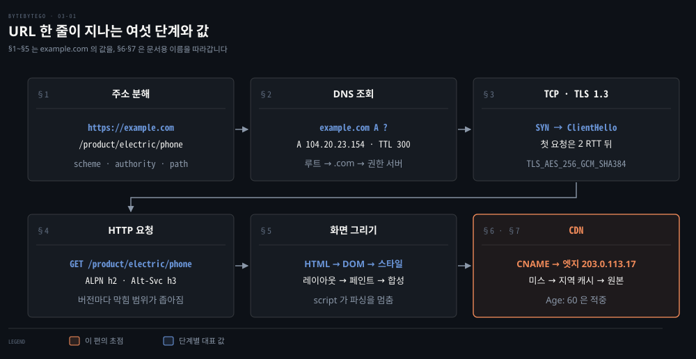
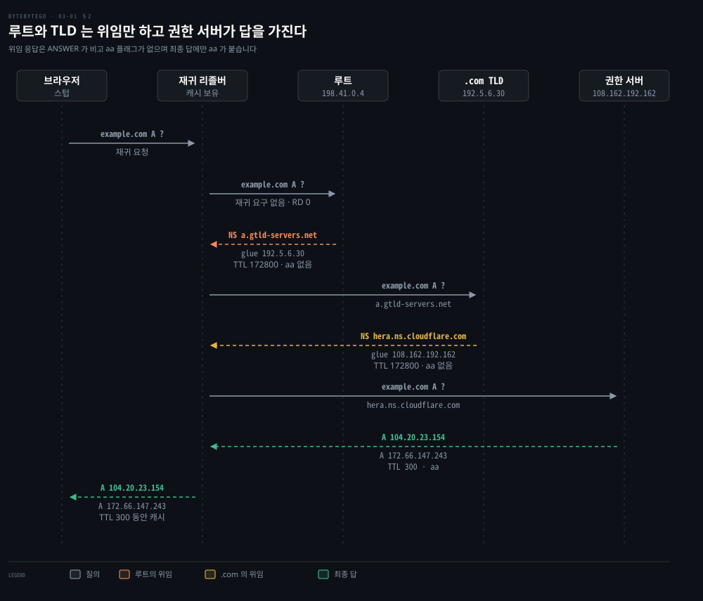
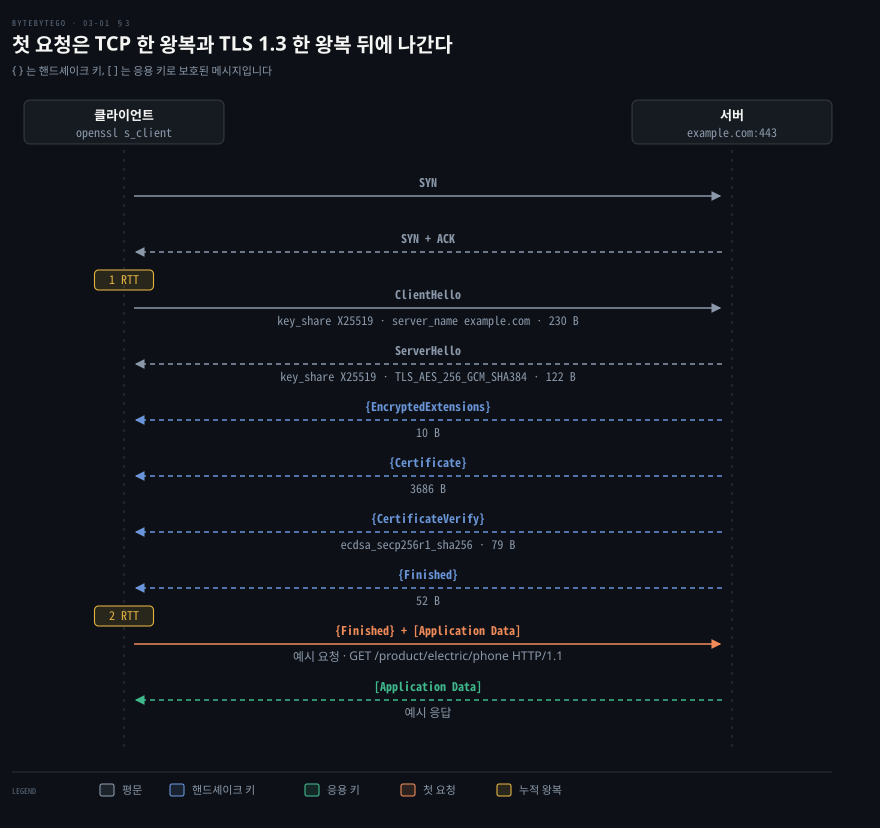
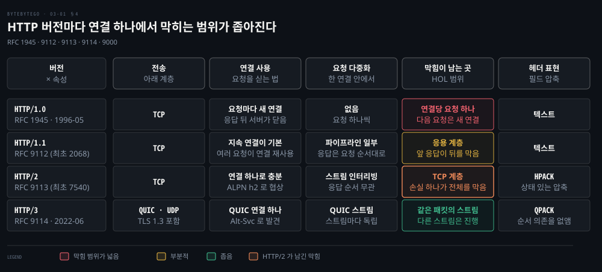
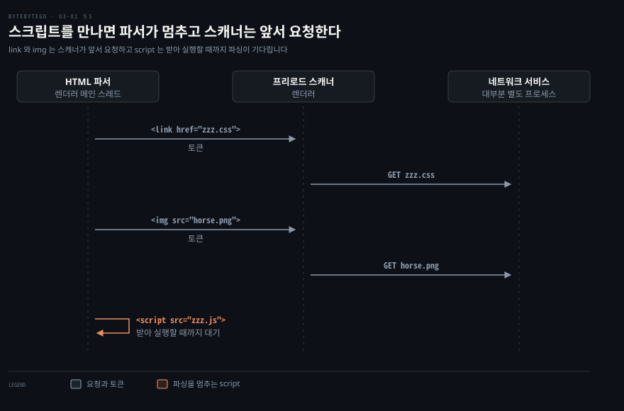
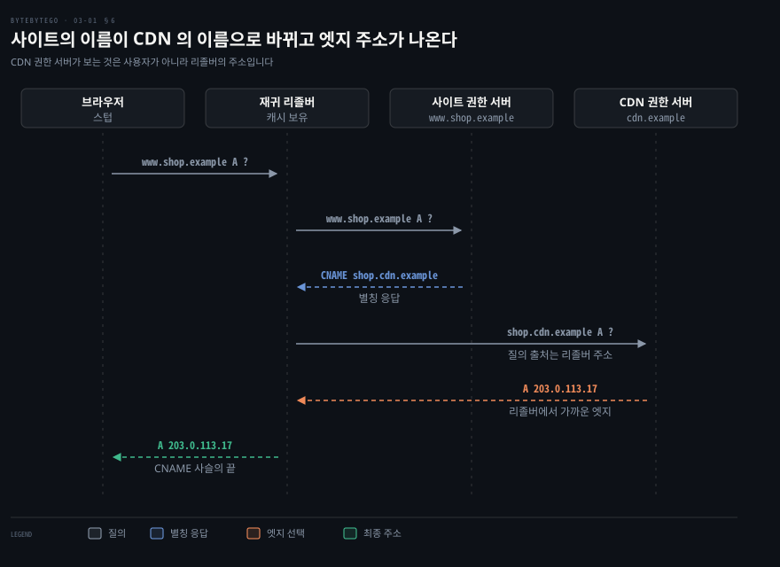
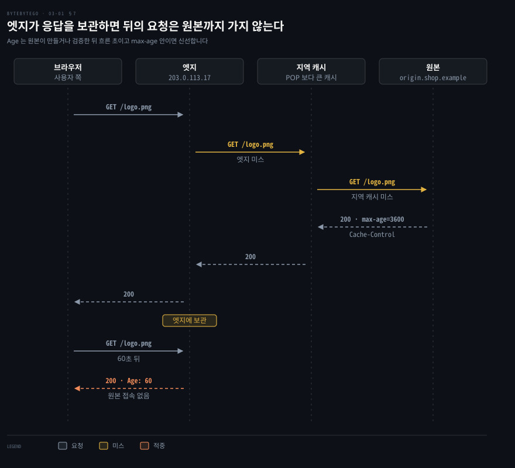

# URL 을 치면 DNS·TCP·TLS·HTTP 를 거쳐 브라우저가 화면을 그리고 CDN 이 그 길을 줄인다

---

> 주소창의 URL 은 이름 조회·연결·암호화 합의·요청이라는 왕복을 차례로 엽니다. 브라우저는 받은 HTML 을 스타일·레이아웃·합성 단계로 그리고 CDN 은 이름 풀이와 캐시로 그 거리를 줄입니다.


## 핵심 요약

> 이 편의 중심 생각은 첫 화면까지의 지연이 왕복 횟수의 합이라는 것입니다. 줄이는 방법은 왕복을 합치거나 거리를 줄이는 것입니다.

DNS 는 루트·TLD·권한 서버의 위임을 따라 내려가고 TTL 동안 캐시됩니다. TCP 한 왕복과 TLS 1.3 한 왕복이 지나야 첫 요청이 나갑니다. QUIC 위의 HTTP/3 는 이 둘을 한 왕복으로 합칩니다.

받은 HTML 은 렌더러의 메인 스레드가 DOM 으로 파싱합니다. 스크립트를 만나면 파싱이 멈추고 스타일·레이아웃·페인트를 거친 결과가 GPU 타일로 합성됩니다. CDN 은 DNS 별칭으로 가까운 엣지 주소를 알려 주며 엣지와 지역 캐시가 원본으로 가는 요청을 끊습니다.




## 학습 목표

> 이 편을 읽고 나면 다음을 설명할 수 있습니다.

1. URL 이 scheme·authority·path 로 갈라지고 각 부분이 어느 단계의 입력이 되는지 설명할 수 있습니다.
2. 재귀 리졸버가 루트·TLD·권한 서버로 내려가며 위임 응답과 최종 답을 구별하는 방식을 설명할 수 있습니다.
3. TCP 와 TLS 1.3 의 왕복 수를 세어 첫 요청이 나가는 시점을 계산할 수 있습니다.
4. HTTP 1.0 에서 3 까지 한 연결에서 요청이 서로를 막는 범위가 어떻게 좁아졌는지 말할 수 있습니다.
5. 스크립트가 HTML 파싱을 멈추는 까닭과 CDN 이 엣지를 고르는 근거와 한계, 캐시 경로를 설명할 수 있습니다.


## 1. URL 하나는 이름 조회·연결·암호화·요청·그리기의 순서를 연다

> 주소의 세 부분은 서로 다른 단계로 흘러갑니다. 이름은 DNS 로, 경로는 요청 줄로, scheme 은 연결을 암호화할지로 이어집니다.

`https://example.com/product/electric/phone` 을 치고 Enter 를 누르면 화면이 뜨기 전에 네트워크에서는 무슨 일이 어떤 순서로 일어날까요?

URL 문법은 scheme·authority·path·query·fragment 로 나뉩니다.[^rfc3986] 이 주소에서 scheme 은 `https`, authority 는 `example.com`, path 는 `/product/electric/phone` 입니다. 마지막 `phone` 을 따로 가리키는 구성 요소는 문법에 없고 path 의 끝 조각일 뿐입니다.

Chrome 에서는 UI 스레드가 입력을 먼저 받아 검색어인지 URL 인지 가릅니다. URL 이면 네트워크 스택이 DNS 조회와 TLS 연결 설정을 거쳐 요청을 보냅니다. 응답이 301 같은 리디렉션이면 새 URL 로 같은 과정을 다시 시작합니다.[^chrome-nav] 현재 Chromium 은 이 스택을 네트워크 서비스로 분리해 대부분의 플랫폼에서 별도 프로세스로 돌립니다. Android 에서는 브라우저 프로세스 안이 기본입니다.[^chromium-netsvc]

1. DNS: 이름 `example.com` 을 IP 주소로 바꿔야 어디로 연결할지 압니다.
2. TCP: IP 와 포트로 연결을 열어야 바이트를 순서대로 주고받을 수 있습니다.
3. TLS: scheme 이 `https` 이므로 서버를 확인하고 키를 합의한 뒤에야 요청을 안전하게 보냅니다.
4. HTTP: 경로와 호스트를 담은 요청을 보내고 HTML 을 돌려받습니다.
5. 렌더링: 받은 HTML 이 DOM·스타일·레이아웃을 거쳐 화면이 됩니다.

HTTP/1.1 로 쓰면 요청은 아래 두 줄로 시작합니다. 요청 줄에는 경로 전체가 실리고 `Host` 가 authority 를 알려 줍니다. HTTP/2 와 3 는 같은 의미를 다른 틀에 담습니다.[^rfc9113][^rfc9114]

```bash
GET /product/electric/phone HTTP/1.1
Host: example.com
```


## 2. DNS 는 루트와 TLD 가 위임만 하고 권한 서버가 답을 가진다

> 한 서버가 모든 이름을 알 수 없으므로 이름 공간은 루트·TLD·권한 서버로 나뉩니다. 위임 응답은 다음에 물을 서버를 알려 주고 최종 답은 권한 서버만 줍니다.

example.com 의 IP 를 아는 서버는 어디에 있을까요?

Chrome 은 자체 호스트 캐시(`net::HostCache`)를 먼저 보고, 시스템 리졸버를 쓸 때는 운영체제가 자기 캐시와 HOSTS 파일을 본 뒤 DNS 에 묻습니다.[^chromium-dns] 그 질의를 받는 서버가 재귀 리졸버입니다. 질의를 보내는 쪽인 스텁 리졸버는 재귀 리졸버에 한 번만 묻습니다. 재귀 리졸버는 대신 이름을 풀어 주며 받은 답을 캐시하는 것이 일반적입니다.[^rfc9499]

루트에 먼저 묻고 위임(referral)을 받아 내려가는 방식이 반복 질의입니다. 아래 세 질의는 dig 로 전체 이름을 직접 보낸 것입니다. 실제 리졸버는 QNAME 최소화로 루트와 TLD 에는 필요한 라벨만 물을 수 있습니다.[^rfc9156] 루트 이름 서버는 13개 이름이고 12개 기관이 운영합니다. 2026-10-12T16:26Z 기준 인스턴스는 2047개입니다.[^root]



세 서버에 같은 질문을 직접 던지면 위임이 이어지는 모양이 보입니다. 측정은 2026-10-12T16:28Z 에 dig 9.10.6 으로 했습니다. 루트 `a.root-servers.net` 의 주소는 198.41.0.4 이고, `+norecurse` 는 재귀 요구 비트 RD 를 0 으로 둬서 서버가 대신 풀어 주지 않고 위임만 돌려주게 합니다.

```bash
# 루트: com. 을 맡은 서버를 알려 주는 위임이 옵니다.
dig +norecurse @a.root-servers.net example.com A
# .com TLD: example.com. 의 이름 서버를 알려 주는 위임이 옵니다.
dig +norecurse @a.gtld-servers.net example.com A
# 권한 서버: 최종 답이 오고 flags 에 aa 가 붙습니다.
dig +norecurse @hera.ns.cloudflare.com example.com A
```

루트의 응답에는 ANSWER 가 없고 `com.` 의 NS 13개와 추가 칸의 주소만 있습니다. 추가 칸에는 `a.gtld-servers.net` 의 주소 192.5.6.30 이 함께 옵니다. 이 이름 서버는 형제 도메인(`net.`)에 있어 glue 가 꼭 필요하지는 않지만, 구현 대부분이 주소를 함께 주어 리졸버의 추가 질의를 줄입니다.[^rfc9471] TLD 의 응답도 위임입니다. `example.com.` 의 NS 두 개와 glue 108.162.192.162 가 오며 두 응답 모두 TTL 이 172800초(2일)입니다.

권한 서버의 응답만 ANSWER 를 담고 aa 플래그가 켜집니다. A 레코드 두 개(104.20.23.154 와 172.66.147.243)의 TTL 은 300초입니다. 재귀 리졸버는 이 답을 TTL 동안 캐시하므로 같은 이름을 다시 물으면 루트까지 가지 않습니다.[^rfc9499] 위임 대상은 운영 사정으로 바뀔 수 있어서 값마다 측정 시각을 남겼습니다.

DNS 메시지의 바이트 구조는 [DNS 질의 한 장을 바이트로](../../../02_os/project/gonet-lab/03-01.DNS%20질의%20한%20장을%20바이트로%20-%20헤더·라벨·압축%20포인터·TC.md) 에서 다룹니다.

이름 풀이가 하는 일은 [메일과 이름은 어떻게 찾아가는가](../../../02_os/book/cntd_computer-networking-top-down/02-03.메일과%20이름은%20어떻게%20찾아가는가.md) §4 에, 재귀와 반복의 메시지와 캐싱은 §6·§7 에 있습니다. 위임과 리졸버 캐시는 [위임이 그은 경계가 질의 경로를 정한다](../../../08_cloud/book/learning-coredns/02-01.위임이%20그은%20경계가%20질의%20경로를%20정한다.md) 에서 다룹니다. OS 안의 리졸버는 §5, 위임과 참조는 §2·§6, 캐싱은 §7 입니다.


## 3. TCP 한 왕복과 TLS 1.3 한 왕복이 지나야 첫 요청이 나간다

> 연결과 키 합의가 각각 한 왕복을 쓰므로 첫 요청은 두 왕복 뒤에 나갑니다. 서버 인증서의 키는 세션 키를 감싸는 데 쓰이지 않고 서명으로 신원을 증명합니다.

IP 를 알았는데 왜 곧바로 요청을 보내지 못할까요?

TCP 는 SYN 과 SYN+ACK 한 왕복으로 연결을 엽니다. 세 세그먼트와 상태는 [TCP 연결 편](../../../02_os/book/tii_tcp-ip-illustrated/13-01.TCP%20연결은%20세%20세그먼트로%20열고%20네%20세그먼트로%20닫는다.md)이 다룹니다.

그 위에서 TLS 1.3 의 클라이언트는 첫 메시지 ClientHello 에 지원하는 암호군과 임시 Diffie-Hellman 공유값(`key_share`), 접속할 호스트 이름 `server_name`(example.com)을 싣습니다. 서버는 ServerHello 에 자신의 `key_share` 를 담아 답합니다. 두 공유값이 공유 비밀과 이후의 키를 만듭니다. ServerHello 이후의 메시지는 모두 암호화됩니다.[^rfc8446-flow]



서버 인증서가 하는 일은 서명입니다. CertificateVerify 가 핸드셰이크 전체에 대한 서명이고 Finished 가 그 전체에 대한 MAC 입니다.[^rfc8446-flow] 클라이언트는 인증서가 URL 의 호스트와 맞는지 확인합니다.[^rfc9110-cert] 세션 키를 만들어 서버의 공개키로 감싸 보내는 정적 RSA 방식은 TLS 1.3 에서 사라졌고 모든 공개키 키 교환이 전방 비밀성을 줍니다.[^rfc8446-diff]

핸드셰이크가 키를 만들면 레코드 프로토콜이 그 키로 트래픽을 보호합니다. 데이터는 합의한 키의 AEAD 대칭 암호가 보호합니다.[^rfc8446-flow] 공개키 연산은 키 합의와 서명에만 씁니다. 비대칭 알고리즘은 같은 강도의 대칭 알고리즘보다 계산이 많이 들기 때문입니다.[^rfc4949]

메시지 길이는 아래 명령으로 쟀습니다. OpenSSL 3.6.4 로 2026-10-12T16:33Z 에 example.com 에 접속했고, 길이에는 4바이트 핸드셰이크 헤더가 들어 있습니다. 브라우저가 보낸 값이 아니어서 클라이언트 설정에 따라 달라집니다. 같은 도구가 기본 그룹을 제안하면 ClientHello 는 1464 B 였습니다.

```bash
# 키 교환 그룹을 X25519 로 고정하고 핸드셰이크 메시지를 출력합니다.
openssl s_client -connect example.com:443 -servername example.com -tls1_3 -groups X25519 -msg
```

1. ClientHello 230 B, ServerHello 122 B, EncryptedExtensions 10 B
2. Certificate 3686 B, CertificateVerify 79 B, Finished 52 B

요청 줄은 §1 의 예시이고 응답은 내용을 싣지 않은 예시이며 실측한 것은 길이입니다. 서버가 보낸 첫 비행 가운데 인증서가 3686 ÷ (122+10+3686+79+52) = 3686 ÷ 3949 ≈ 0.93 이라서 서버의 첫 비행은 대부분 인증서입니다. 합의된 암호군은 TLS_AES_256_GCM_SHA384 이고 서명은 ecdsa_secp256r1_sha256 이었습니다.

첫 요청이 나가기까지의 왕복 수는 아래처럼 셉니다.

1. TCP: SYN 에서 SYN+ACK 까지 1 RTT 입니다.
2. TLS 1.3: ClientHello 에서 서버의 Finished 까지 1 RTT 이므로 요청은 TCP 1 + TLS 1 = 2 RTT 뒤에 나갑니다. 요청은 클라이언트의 Finished 와 같은 비행에 `[Application Data]` 로 실립니다.
3. TLS 1.2: 서버의 첫 비행 뒤에 클라이언트의 두 번째 비행이 한 번 더 오가는 두 왕복이어서 같은 셈이 3 RTT 입니다.[^rfc5246] 메시지 흐름은 [TLS 핸드셰이크 읽기](../../../02_os/book/paw_packet-analysis-wireshark/04-01.TLS%20핸드셰이크%20읽기.md) §2 에 있습니다.
4. QUIC: 전송과 암호 핸드셰이크를 합쳐 1 RTT 뒤에 응용 데이터를 보냅니다.[^rfc9000-hs]

이전 연결의 PSK 가 있으면 TLS 1.3 은 첫 비행에 데이터를 실을 수 있고 QUIC 도 0-RTT 를 선택할 수 있습니다. 다만 이 데이터는 연결 사이의 재전송 방지 보장이 약합니다.[^rfc8446-0rtt][^rfc9001-0rtt] 새 TCP 연결은 혼잡 창이 작게 시작하는 문제도 있습니다. 이 부분은 [느린 시작 편](../../../02_os/book/tii_tcp-ip-illustrated/16-01.혼잡%20창은%20느린%20시작으로%20키우고%20혼잡%20회피로%20다듬는다.md)에서 다룹니다.


## 4. HTTP 는 버전마다 한 연결에서 요청이 막히는 범위를 좁혔다

> 요청마다 연결을 열던 방식에서 지속 연결, 스트림 다중화, QUIC 스트림으로 가며 요청이 서로를 막는 범위가 좁아졌습니다. HTTP/2 가 남긴 막힘은 TCP 계층입니다.

같은 서버에서 이미지와 스크립트 수십 개를 받아야 한다면 연결과 요청은 어떻게 묶어야 할까요?



한 연결에서 앞 요청이 뒤 요청을 기다리게 하는 막힘을 HOL(head-of-line) 막힘이라고 부릅니다.

HTTP/1.x 의 필드는 공백으로 구분되는 텍스트입니다.[^rfc9114-text] HTTP/1.0 은 요청을 보낼 때마다 클라이언트가 연결을 열고 응답 뒤에 서버가 닫는 것이 관행이었습니다.[^rfc1945] HTTP/1.1 은 1997년 1월 RFC 2068 로 처음 나왔고[^rfc2068] 현재 규격은 RFC 9112 입니다.

HTTP/1.1 은 지속 연결을 기본으로 삼아 여러 요청이 한 연결을 씁니다.[^rfc9112] 파이프라인에서 서버는 응답을 요청이 도착한 순서대로 보내야 하므로 응용 계층의 막힘이 남습니다.[^rfc9112] 그래서 클라이언트는 동시성을 얻으려고 연결을 여러 개 엽니다.[^rfc9113] 연결 수 상한은 규격이 숫자를 정하지 않고 클라이언트가 제한하라고만 권고합니다.[^rfc9112]

HTTP/2 는 2015년 5월 RFC 7540 으로 나왔고 2022년 6월 RFC 9113 이 대신합니다.[^rfc7540] 한 연결에 여러 스트림의 메시지를 섞어 보내고 필드를 압축하며, 이 압축 HPACK 은 상태를 가집니다.[^rfc9113] 그래서 응용 계층의 막힘은 풀렸지만 TCP 가 순서대로 전달하는 바이트열 위에 있어서 세그먼트 하나의 손실이 모든 스트림을 멈춥니다. 규격도 이 TCP 막힘을 풀지 못한다고 적습니다.[^rfc9113] TLS 위에서는 ALPN 의 `h2` 로 협상합니다.[^rfc9113]

HTTP/3 은 QUIC 위에 얹혀 2022년 6월 표준 트랙 RFC 9114 로 발행되었습니다.[^rfc9114] QUIC 은 UDP 데이터그램에 실리고 TLS 1.3 을 핸드셰이크로 쓰며 스트림이 서로 독립입니다. 새 요청은 열린 연결에 스트림을 하나 더 만들 뿐입니다.[^rfc9114-qpack]

한 패킷이 사라져도 그 패킷에 데이터가 든 스트림만 기다립니다.[^rfc9000-hol] 같은 패킷에 여러 스트림이 실렸다면 그 스트림들은 함께 막히므로 구현은 한 패킷에 담는 스트림 수를 줄이라고 권고됩니다.[^rfc9000-hol] 헤더 압축 HPACK 은 전달 순서를 전제하는데 QUIC 이 그것을 보장하지 않아 QPACK 이 대신합니다.[^rfc9114-qpack]

클라이언트는 https 주소에 곧바로 QUIC 을 시도해도 됩니다. 서버가 `Alt-Svc: h3=":50781"` 같은 응답 헤더로 알린 HTTP/3 엔드포인트를 쓸 수도 있습니다. UDP 가 막혀 QUIC 연결이 실패하면 TCP 기반 버전으로 돌아갑니다.[^rfc9114-disc]

HTTP/2 의 서버 푸시는 [HTTP2 서버 푸시 편](../../../02_os/book/npg_network-programming-with-go/09-02.미들웨어는%20핸들러를%20감싸고%20ServeMux%20는%20경로를%20나누며%20HTTP2%20서버%20푸시는%20브라우저가%20걷어냈다.md)에서 다룹니다. 지속 연결로 왕복을 세는 방법은 [웹은 어떻게 주고받는가](../../../02_os/book/cntd_computer-networking-top-down/02-02.웹은%20어떻게%20주고받는가.md) §2 에, HTTP/2 의 막힘과 HTTP/3·QUIC 은 §6·§7 에 있습니다.


## 5. 브라우저는 HTML 을 DOM 으로 바꾸고 스크립트를 만나면 파싱을 멈춘다

> 렌더러의 메인 스레드는 HTML 을 파싱해 DOM 을 만들며 하위 자원을 앞서 요청하고, 스크립트를 만나면 멈춥니다. 스타일·레이아웃·페인트 뒤의 합성은 별도 스레드가 맡습니다.

받은 것은 글자뿐인 HTML 입니다. 이것이 어떻게 화면의 픽셀이 되고 시간은 어디서 샐까요?

응답의 `Content-Type` 헤더가 종류를 알립니다. 헤더가 없거나 틀리면 본문 첫 몇 바이트로 종류를 판별합니다. HTML 이면 렌더러에 넘기며 이때부터 문서 로딩이 시작됩니다.[^chrome-nav] 메인 스레드는 HTML 표준의 파싱 규칙으로 DOM 을 만듭니다.

HTML 파싱 규칙은 닫는 태그가 빠져도 오류를 던지지 않도록 설계되어 있습니다.[^chrome-render] 파서가 느려지는 자리는 외부 자원이어서, 프리로드 스캐너가 파서가 만든 토큰에서 `<link>` 와 `` 를 보고 네트워크 서비스에 요청을 앞서 보냅니다.[^chrome-render][^chromium-netsvc]



도식의 `<link href="zzz.css">` 와 `` 는 스캐너가 앞서 요청합니다. `<script src="zzz.js">` 를 만나면 파서가 멈춥니다. 스크립트가 `document.write()` 로 문서 모양을 바꿀 수 있기 때문입니다. zzz.js 를 내려받아 실행하기 전에는 다음 토큰의 뜻을 알 수 없습니다. `async` 나 `defer` 를 붙이면 파싱을 막지 않습니다.[^chrome-render]

DOM 뒤의 단계는 Chrome 의 렌더링 파이프라인 문서가 이름을 붙입니다.[^renderingng]

1. Style: DOM 에 CSS 를 적용해 노드마다 계산된 스타일을 만듭니다.
2. Layout: 요소의 크기와 위치를 정합니다.
3. Paint: 스타일과 레이아웃에서 래스터 방법을 적은 디스플레이 리스트를 만듭니다.
4. Commit 과 Layerize: 결과를 컴포지터 스레드로 복사하고 독립 래스터가 가능한 레이어로 나눕니다.
5. Raster 와 Draw: GPU 타일로 래스터하고 컴포지터 프레임을 합쳐 화면에 그립니다.

스크롤과 변형 애니메이션은 레이아웃과 페인트를 건너뛰고 컴포지터 스레드에서 처리할 수 있습니다. 그래서 메인 스레드가 자바스크립트로 막혀 있어도 움직일 수 있습니다.[^renderingng] DOM 이나 스타일이 바뀌면 영향받는 부분의 뒤 단계가 다시 돕니다. 애니메이션은 이를 프레임마다 반복해야 해서 놓친 프레임이 끊김으로 보입니다.[^chrome-render]


## 6. CDN 은 DNS 별칭을 이어 리졸버에서 가까운 엣지 주소를 알려 준다

> 사이트의 이름은 CNAME 별칭으로 CDN 의 이름이 되고 CDN 의 권한 서버가 엣지 주소를 고릅니다. 위치를 판단하는 입력은 사용자가 아니라 질의한 리졸버의 주소입니다.

원본이 런던에 있고 사용자가 뉴욕에 있다면 응답은 대서양을 건너는 왕복만큼 느립니다. 그 거리를 어떻게 줄일까요?

먼저 이름 풀이입니다. 사이트의 권한 서버는 주소 대신 CDN 의 이름을 가리키는 CNAME 별칭을 돌려줍니다.[^rfc1034] 재귀 리졸버가 그 CDN 이름을 CDN 의 권한 서버에 다시 물으면 CDN 이 엣지 주소를 고릅니다. 아래 이름과 주소는 문서용 예시입니다.

`www.shop.example` 의 권한 서버가 `shop.cdn.example` 을 가리키고 CDN 이 엣지 203.0.113.17 을 고릅니다. `.example` 은 RFC 2606 이 예시용으로 두었고[^rfc2606] 203.0.113.0/24 는 RFC 5737 의 문서용 주소 범위입니다.[^rfc5737]



권한 서버가 보는 것은 질의한 리졸버의 주소이고 사용자의 주소가 아닙니다. 사용자가 리졸버에서 멀면 고른 엣지도 멀 수 있습니다. EDNS Client Subnet 이 클라이언트 네트워크를 알려 주는 용도로 쓰이고 있습니다. 다만 이 규격은 운영과 사생활에 알려진 결함이 있다고 스스로 밝히는 Informational 문서입니다.[^rfc7871]


## 7. 엣지와 지역 캐시가 응답을 보관해 원본까지 가는 요청을 끊는다

> 엣지에 응답이 없으면 지역 캐시를 거쳐 원본까지 올라가고, 받은 응답은 Cache-Control 이 정한 시간 동안 원본 접속 없이 나갑니다.

엣지에 응답이 없으면 요청은 어디까지 올라가고, 한 번 받은 응답은 언제까지 믿을 수 있을까요?

엣지(203.0.113.17)가 `/logo.png` 를 갖고 있지 않으면 위로 올라갑니다. CloudFront 는 POP 에서 캐시를 확인합니다. 없으면 regional edge cache 를 거쳐 원본에 가고 받은 객체를 캐시에 보관합니다.[^cloudfront]

Cloudflare 도 같은 목적의 계층 캐시를 제공합니다.[^cloudflare] 계층이 몇 단인지는 서비스마다 다릅니다. CloudFront 에서 지역 캐시는 POP 하나보다 큰 캐시이고, 동적 요청은 지역 캐시를 거치지 않고 원본으로 바로 갑니다.[^cloudfront] 원본은 도식에서 `origin.shop.example` 로 두었습니다.



원본의 `200` 응답은 `Cache-Control: max-age=3600` 을 달고 지역 캐시와 엣지를 거쳐 내려옵니다. 보관 시간은 원본이 `Cache-Control` 로 정합니다. 공유 캐시에서는 `s-maxage` 가 `max-age` 를 덮어쓰고 `Age` 는 원본이 응답을 만들었거나 재검증한 뒤 흐른 시간입니다.[^rfc9111] 위 도식(예시 값)에서 엣지는 보관한 응답을 다시 내줄 때 `Age` 를 붙입니다. `Age` 가 있다는 것은 이번 요청을 위해 원본이 만들거나 검증한 응답이 아니라는 뜻이어서, 처음 요청의 응답에는 두지 않았습니다.

60초 뒤 요청의 `Age: 60` 이 `max-age=3600` 안이라서 엣지가 원본 접속 없이 답합니다. 무효화·TTL·비용을 설계하는 방법은 [캐시·CDN 편](../system-design/01-02.캐시·CDN·무상태%20웹%20계층·데이터%20센터·메시지%20큐·샤딩이%20수백만%20사용자까지%20규모를%20늘린다.md)과 [캐시 전략 편](./02-01.캐시%20전략은%20읽기·쓰기%20경로에서%20캐시%20자리를%20정하고%20Redis%20는%20메모리와%20단일%20스레드%20이벤트%20루프로%20빠르다.md)에서 다룹니다.


## 면접 대비

> URL 입력 뒤의 왕복 수와 DNS 위임, TLS 1.3 의 키, HTTP 버전의 막힘, CDN 의 엣지 선택에 관한 면접 질문입니다.

1. https 주소의 첫 요청이 나가기까지 TCP·TLS 가 쓰는 왕복 수를 TLS 1.3 과 QUIC 으로 비교해 보십시오.
2. 루트·TLD·권한 서버 가운데 어느 응답에 aa 플래그가 붙으며 위임 응답에는 무엇이 들어 있습니까?
3. TLS 1.3 에서 서버 인증서의 공개키는 무엇에 쓰이며 세션 키는 어디서 나옵니까?
4. HTTP/2 가 풀지 못한 막힘은 무엇이고 HTTP/3 는 어디까지 풀며 어떤 단서가 남습니까?
5. CDN 이 가까운 엣지를 고르는 근거와 한계, 엣지 미스 때의 경로를 설명해 보십시오.


## 정답 (자답 후 펼치기)

> 면접 질문에 대한 키워드 중심의 모범 답안입니다.

### 정답 1 — TCP 1 + TLS 1 = 2 RTT, QUIC 은 1 RTT

TLS 1.3 위의 HTTP 는 SYN 한 왕복과 ClientHello 한 왕복 뒤인 2 RTT 에 요청이 나갑니다. TLS 1.2 면 3 RTT 입니다. QUIC 은 전송과 암호 핸드셰이크를 합쳐 1 RTT 이며 PSK 가 있으면 0-RTT 데이터는 재전송 공격에 약합니다.

### 정답 2 — aa 는 권한 서버, 위임은 NS 와 glue

최종 답만 권한 서버가 aa 와 함께 줍니다. 루트와 TLD 의 위임 응답은 ANSWER 가 비고 다음 서버의 NS 레코드와 glue 주소, TTL 을 담습니다.

### 정답 3 — 인증서 키는 서명, 세션 키는 (EC)DHE

공개키는 CertificateVerify 서명을 확인해 신원을 증명합니다. 세션 키는 두 `key_share` 의 공유 비밀에서 유도되고 정적 RSA 키 전송은 TLS 1.3 에서 사라졌습니다.

### 정답 4 — TCP 계층 막힘, QUIC 스트림 독립, 한 패킷 단서

HTTP/2 는 응용 계층 막힘을 풀었지만 TCP 의 손실 하나가 모든 스트림을 멈춥니다. HTTP/3 는 QUIC 스트림을 독립시켜 손실을 그 패킷의 스트림에 가둡니다. 한 패킷에 여러 스트림이 실리면 함께 막힙니다.

### 정답 5 — 리졸버 주소 기준 선택, 엣지·지역 캐시·원본

CDN 권한 서버는 질의한 리졸버의 주소로 엣지를 고르므로 사용자와 리졸버가 멀면 어긋납니다. ECS 가 이를 보완하지만 결함이 알려져 있습니다. 엣지 미스는 지역 캐시를 거쳐 원본에 가고 응답은 `Cache-Control` 에 따라 보관됩니다.


## 참고 자료

- ByteByteGo, 「System Design」 그림 해설 모음 중 URL 입력 뒤의 흐름·DNS 조회·HTTPS·HTTP 버전·브라우저 동작·CDN 글.
- ByteByteGo 공개 저장소의 같은 글: [URL 입력 뒤](https://github.com/ByteByteGoHq/system-design-101/blob/main/data/guides/what-happens-when-you-type-a-url-into-your-browser.md), [DNS 조회](https://github.com/ByteByteGoHq/system-design-101/blob/main/data/guides/how-does-the-domain-name-system-dns-lookup-work.md), [HTTPS](https://github.com/ByteByteGoHq/system-design-101/blob/main/data/guides/how-does-https-work.md)
- 같은 주제의 다른 글: [HTTP 1·2·3](https://github.com/ByteByteGoHq/system-design-101/blob/main/data/guides/http1-http2-http3.md), [브라우저 렌더링](https://github.com/ByteByteGoHq/system-design-101/blob/main/data/guides/how-does-the-browser-render-a-web-page.md)
- IETF RFC 9846(TLS 1.3, 8446 폐기)·9114·9113·9112·9111·9110·9000·9001·9499·9471.
- IETF RFC 7540·5246·2606·5737·2068·1945·9156·4949·1034·7871·3986. 각 RFC 의 링크는 해당 문장의 각주에 있습니다.
- Chrome for Developers, Inside look at modern web browser (parts 2·3, 2018): https://developer.chrome.com/blog/inside-browser-part3/
- Chrome for Developers, RenderingNG architecture: https://developer.chrome.com/docs/chromium/renderingng-architecture


## 관련 문서

- [캐시·CDN·무상태 웹 계층·데이터 센터·메시지 큐·샤딩이 수백만 사용자까지 규모를 늘린다](../system-design/01-02.캐시·CDN·무상태%20웹%20계층·데이터%20센터·메시지%20큐·샤딩이%20수백만%20사용자까지%20규모를%20늘린다.md)
- [캐시 전략은 읽기·쓰기 경로에서 캐시 자리를 정하고 Redis 는 메모리와 단일 스레드 이벤트 루프로 빠르다](./02-01.캐시%20전략은%20읽기·쓰기%20경로에서%20캐시%20자리를%20정하고%20Redis%20는%20메모리와%20단일%20스레드%20이벤트%20루프로%20빠르다.md)
- [API 는 SOAP·REST·GraphQL·RPC 로 갈리고 토큰·HMAC·SSO·솔트 해시가 접근과 비밀번호를 지킨다](./03-02.API%20는%20SOAP·REST·GraphQL·RPC%20로%20갈리고%20토큰·HMAC·SSO·솔트%20해시가%20접근과%20비밀번호를%20지킨다.md)
- [TCP 연결은 세 세그먼트로 열고 네 세그먼트로 닫는다](../../../02_os/book/tii_tcp-ip-illustrated/13-01.TCP%20연결은%20세%20세그먼트로%20열고%20네%20세그먼트로%20닫는다.md)
- [TLS 핸드셰이크 읽기](../../../02_os/book/paw_packet-analysis-wireshark/04-01.TLS%20핸드셰이크%20읽기.md)
- [HTTP에서 TCP·TLS·UDP까지 — Transport 계층 해부](../../../08_cloud/book/networking-and-kubernetes/01-02.HTTP에서%20TCP·TLS·UDP까지%20—%20Transport%20계층%20해부.md)

[^rfc3986]: RFC 3986 §3 Syntax Components: <https://www.rfc-editor.org/rfc/rfc3986#section-3>
[^chrome-nav]: Chrome for Developers, Inside look at modern web browser (part 2), 2018-09: <https://developer.chrome.com/blog/inside-browser-part2/>
[^rfc9113]: RFC 9113 §1 Introduction(HTTP 의미를 최적화해 표현, HTTP/1.1 파이프라인의 응용 계층 막힘, TCP 막힘은 해결하지 않음)과 §4.3.1 Field Compression(HPACK 은 상태를 가짐), §3.2 Starting HTTP/2 for "https" URIs(ALPN `h2`): <https://www.rfc-editor.org/rfc/rfc9113>
[^rfc9499]: RFC 9499 §6 DNS Servers and Clients(recursive resolver·iterative mode·authoritative server)와 §7 Zones 의 Glue records: <https://www.rfc-editor.org/rfc/rfc9499>
[^root]: Root Server System, 2026-10-12T16:26:24Z 기준 인스턴스 2047개·운영 기관 12곳·이름 13개: <https://root-servers.org/>
[^rfc8446-flow]: RFC 9846 §1 Introduction(핸드셰이크·레코드 프로토콜), §2 Protocol Overview(메시지 흐름, 핸드셰이크 세 단계, CertificateVerify 와 Finished), §4.3 Extensions 표의 server_name, §5 Record Protocol. 2026-07 에 RFC 8446 을 폐기하고 TLS 1.3 의 현행 규격이 되었다: <https://www.rfc-editor.org/rfc/rfc9846#section-2>
[^rfc9110-cert]: RFC 9110 §4.3.4 https Certificate Verification: <https://www.rfc-editor.org/rfc/rfc9110#section-4.3.4>
[^rfc8446-diff]: RFC 9846 §1.3 Major Differences from TLS 1.2(정적 RSA 제거, 모든 공개키 키 교환이 전방 비밀성): <https://www.rfc-editor.org/rfc/rfc9846#section-1.3>
[^rfc9114-text]: RFC 9114 §1.1 Prior Versions of HTTP(HTTP/1.1 은 공백으로 구분되는 텍스트 필드를 씀): <https://www.rfc-editor.org/rfc/rfc9114#section-1.1>
[^rfc4949]: RFC 4949 Internet Security Glossary, Version 2, `hybrid encryption` 항목(비대칭 알고리즘은 같은 강도의 대칭 알고리즘보다 계산이 많음), 2007-08: <https://www.rfc-editor.org/rfc/rfc4949>
[^chromium-netsvc]: Chromium `services/network/README.md`(커밋 2c1f4fc, Where does the network service run?): <https://chromium.googlesource.com/chromium/src/+/2c1f4fc88cdc12f795cb8f2524ea7db579c64137/services/network/README.md>
[^chromium-dns]: Chromium `net/dns/README.md`(커밋 2c1f4fc, HostCache 와 시스템 리졸버): <https://chromium.googlesource.com/chromium/src/+/2c1f4fc88cdc12f795cb8f2524ea7db579c64137/net/dns/README.md>
[^rfc9156]: RFC 9156 DNS Query Name Minimisation to Improve Privacy, 2021-11: <https://www.rfc-editor.org/rfc/rfc9156>
[^rfc9471]: RFC 9471 §2.2 Glue for Sibling Domain Name Servers(형제 도메인 이름 서버의 glue 는 필수가 아니고 최적화): <https://www.rfc-editor.org/rfc/rfc9471#section-2.2>
[^rfc2068]: RFC 2068 HTTP/1.1, 1997-01: <https://www.rfc-editor.org/rfc/rfc2068>
[^rfc7540]: RFC 7540 HTTP/2, 2015-05(RFC 9113 이 폐기): <https://www.rfc-editor.org/rfc/rfc7540>
[^rfc2606]: RFC 2606 §2 TLDs for Testing & Documentation Examples(.example): <https://www.rfc-editor.org/rfc/rfc2606>
[^rfc5737]: RFC 5737 IPv4 Address Blocks Reserved for Documentation(203.0.113.0/24): <https://www.rfc-editor.org/rfc/rfc5737>
[^rfc9000-hs]: RFC 9000 §1 Overview(QUIC 핸드셰이크는 암호와 전송 협상을 결합): <https://www.rfc-editor.org/rfc/rfc9000#section-1>, RFC 9001 §2.1 TLS Overview(1 RTT 뒤 응용 데이터): <https://www.rfc-editor.org/rfc/rfc9001#section-2.1>
[^rfc5246]: RFC 5246 §7.3 Handshake Protocol Overview(TLS 1.2 전체 핸드셰이크의 메시지 흐름): <https://www.rfc-editor.org/rfc/rfc5246#section-7.3>
[^rfc9001-0rtt]: RFC 9001 §9.2 Replay Attacks with 0-RTT: <https://www.rfc-editor.org/rfc/rfc9001#section-9.2>
[^rfc8446-0rtt]: RFC 9846 §2.3 0-RTT Data(보안 속성이 더 약함): <https://www.rfc-editor.org/rfc/rfc9846#section-2.3>
[^rfc1945]: RFC 1945 §1.3 Overall Operation, 1996-05: <https://www.rfc-editor.org/rfc/rfc1945#section-1.3>
[^rfc9112]: RFC 9112 §9.3 Persistence(HTTP/1.1 은 지속 연결이 기본)와 §9.4 Concurrency(연결 수 상한에 숫자를 두지 않음), 2022-06: <https://www.rfc-editor.org/rfc/rfc9112#section-9.3>
[^rfc9114]: RFC 9114 HTTP/3, 2022-06: <https://www.rfc-editor.org/rfc/rfc9114>
[^rfc9000-hol]: RFC 9000 §13 Packetization and Reliability(스트림 다중화와 막힘 회피, 한 패킷의 여러 스트림 단서): <https://www.rfc-editor.org/rfc/rfc9000#section-13>, 스트림 독립은 RFC 9114 §2: <https://www.rfc-editor.org/rfc/rfc9114#section-2>
[^rfc9114-qpack]: RFC 9114 §2 HTTP/3 Protocol Overview(요청 하나가 QUIC 스트림 하나를 씀, HPACK 이 순서 전달을 전제해 QPACK 으로 대체): <https://www.rfc-editor.org/rfc/rfc9114#section-2>
[^rfc9114-disc]: RFC 9114 §3.1 Discovering an HTTP/3 Endpoint, §3.1.1 HTTP Alternative Services: <https://www.rfc-editor.org/rfc/rfc9114#section-3.1>
[^chrome-render]: Chrome for Developers, Inside look at modern web browser (part 3), 2018-09: <https://developer.chrome.com/blog/inside-browser-part3/>
[^renderingng]: Chrome for Developers, RenderingNG architecture, 2021-07 갱신(파이프라인 단계와 컴포지터 스레드): <https://developer.chrome.com/docs/chromium/renderingng-architecture>
[^rfc1034]: RFC 1034 §3.6.2 Aliases and canonical names: <https://www.rfc-editor.org/rfc/rfc1034#section-3.6.2>
[^rfc7871]: RFC 7871 Client Subnet in DNS Queries, §1 Introduction: <https://www.rfc-editor.org/rfc/rfc7871#section-1>
[^cloudfront]: Amazon CloudFront Developer Guide, How CloudFront delivers content: <https://docs.aws.amazon.com/AmazonCloudFront/latest/DeveloperGuide/HowCloudFrontWorks.html>
[^cloudflare]: Cloudflare Cache docs, Tiered Cache, 2026-09-29 갱신: <https://developers.cloudflare.com/cache/how-to/tiered-cache/>
[^rfc9111]: RFC 9111 §5.2.2.10 s-maxage 와 §5.1 Age: <https://www.rfc-editor.org/rfc/rfc9111#section-5.2.2.10>
