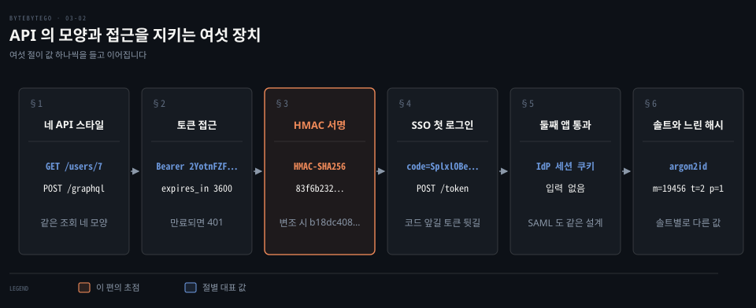
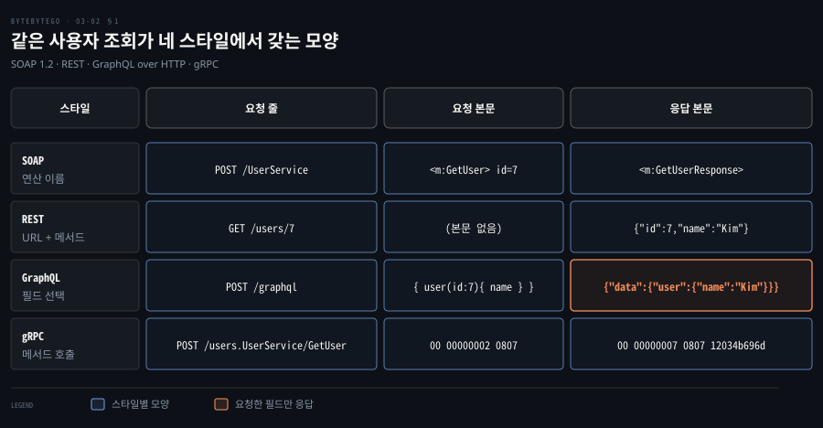
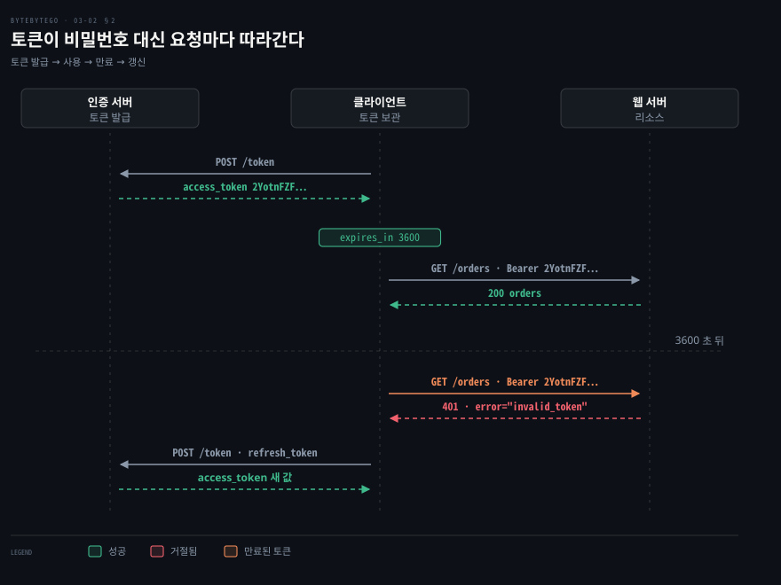
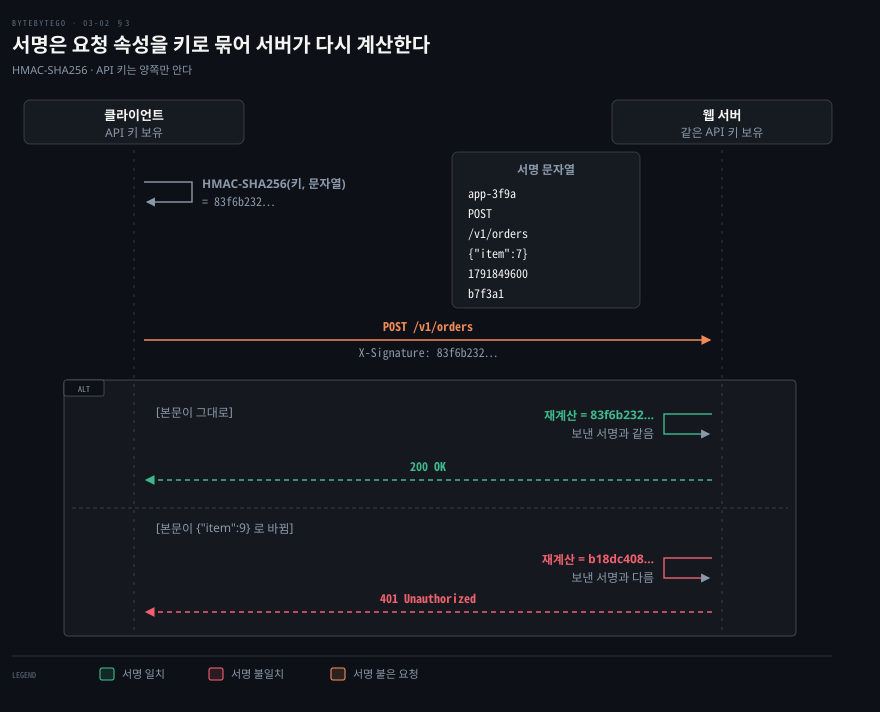
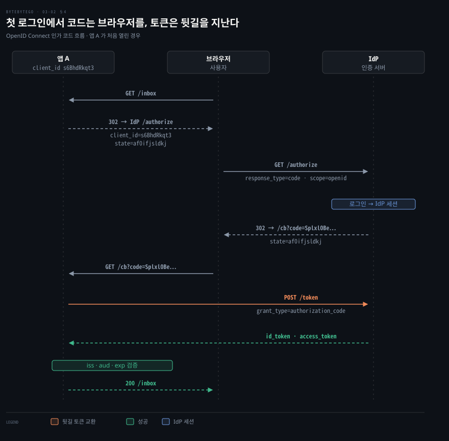
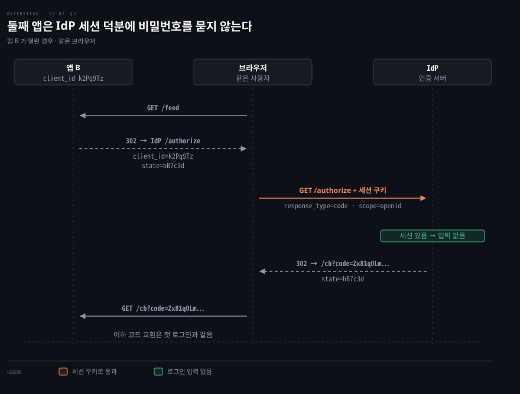
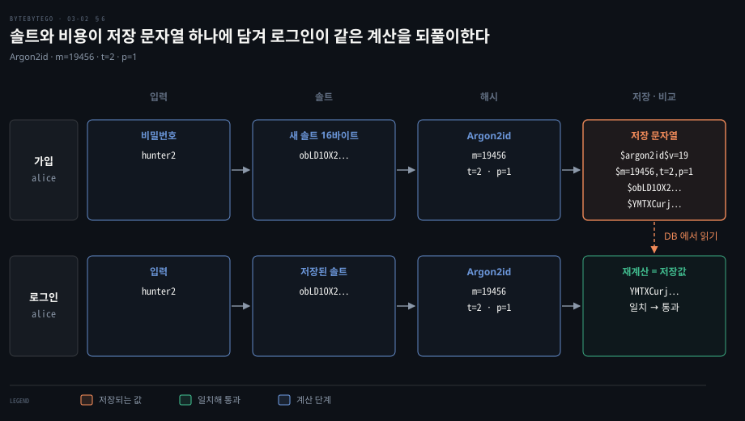

# API 는 SOAP·REST·GraphQL·RPC 로 갈리고 토큰·HMAC·SSO·솔트 해시가 접근과 비밀번호를 지킨다

---

> API 스타일은 요청이 가리키는 대상을 정하고, 토큰·HMAC 서명·SSO 는 호출자를 증명하며, 솔트를 섞은 느린 해시는 유출된 저장소에서 비밀번호를 지킵니다.

## 핵심 요약

> 이 편의 중심 생각은 API 보안이 비밀 자체를 보내지 않고 비밀을 안다는 증거만 보내는 쪽으로 발전한다는 것입니다.

같은 조회라도 SOAP·REST·GraphQL·gRPC 는 요청에 적는 것이 다릅니다. 호출자의 증명은 세 층입니다. 토큰은 비밀번호를 한 번만 쓰고 만료 시각이 있는 증표로 바꿉니다. HMAC 서명은 요청 전체를 키로 묶어 서버가 다시 계산하게 합니다. SSO 는 로그인 자체를 인증 서버 하나로 모읍니다.

비밀번호는 저장소가 털릴 때를 가정해 저장합니다. 사용자마다 다른 솔트를 섞고 일부러 느리게 만든 해시를 쓰며, 로그인은 저장된 솔트와 비용으로 같은 계산을 되풀이해 견줍니다.

## 학습 목표

> 이 편을 읽고 나면 다음을 설명할 수 있습니다.

1. SOAP·REST·GraphQL·RPC(gRPC)가 같은 조회를 요청에 어떻게 다르게 적는지 설명할 수 있습니다.
2. 토큰의 발급·사용·만료·갱신 순서와 OAuth 2.0 에서 클라이언트가 비밀번호를 직접 받는 방식이 금지된 이유를 말할 수 있습니다.
3. HMAC 서명 문자열에 본문·타임스탬프·nonce 가 들어가는 이유와 서버의 검증 순서를 설명할 수 있습니다.
4. OIDC 인가 코드 흐름과 SAML 웹 브라우저 SSO 의 차이, 둘째 앱이 비밀번호를 묻지 않는 이유를 설명할 수 있습니다.
5. 솔트가 막는 공격과 빠른 해시가 부족한 이유를 설명하고 현재 권장 알고리즘과 설정을 댈 수 있습니다.

## 1. 같은 사용자 조회가 네 스타일에서 다른 모양이 된다

> API 스타일은 요청이 무엇을 가리키는지를 정합니다. SOAP 은 연산 이름, REST 는 URL 과 메서드, GraphQL 은 고른 필드, gRPC 는 메서드 호출입니다.

사용자 7 한 명을 가져오는 일은 같은데 스타일을 바꾸면 요청에 무엇을 적어야 할까요? 아래 격자는 같은 조회를 네 방식으로 쓴 모양입니다. 사용자 7·이름 Kim·서비스 이름은 설명을 위해 만든 값입니다.

**SOAP** 은 모든 메시지를 XML 봉투(envelope)에 담는 W3C 규격입니다. 1.2 판의 봉투는 `http://www.w3.org/2003/05/soap-envelope` 이름공간을 쓰고 XML 직렬화에는 미디어 타입 `application/soap+xml` 을 쓰도록 권고합니다.[^soap] 연산 이름(`GetUser`)이 본문의 봉투에 들어가므로 봉투를 실은 요청은 URL 하나에 `POST` 로 갑니다.

**REST** 는 규격이 아니라 제약의 묶음입니다. Fielding 의 박사 논문은 클라이언트-서버·무상태·캐시·균일한 인터페이스·계층 시스템에 선택 제약인 코드 온 디맨드를 더해 정의했습니다.[^rest] 웹에서는 URL 이 자원을 가리키고 HTTP 메서드가 동작을 정하므로 `GET /users/7` 한 줄이 요청의 전부입니다. 무상태 제약 때문에 요청마다 호출자의 증명이 따라가야 하며, 그 방법이 이어지는 절들입니다.

**GraphQL** 은 스키마와 타입 시스템 위에서 클라이언트가 필요한 필드를 골라 묻는 질의 언어입니다. HTTP 에서는 한 URL 에 `POST` 하고 본문에 JSON `{"query": ...}` 를 싣는다고 GraphQL over HTTP 규격 초안이 정합니다.[^gqlhttp] 응답은 질의의 모양 그대로 `data` 아래에 옵니다. `name` 만 골랐으니 `id` 가 오지 않는 점이 REST 응답과 다릅니다. 정식 사양의 최신 판은 2025년 9월 판입니다.[^gql]

**RPC**(remote procedure call)는 원격 서버의 프로시저를 로컬 함수처럼 부르는 스타일입니다. 요청이 함수 이름과 인자로 조직되고 형식은 JSON·XML·Protobuf·Thrift·FlatBuffers 로 갈립니다.

위치를 숨기는 데서 오는 문제는 [데이터플로우 — DB·REST·RPC](../../../05_data/book/designing-data-intensive-applications/05-04.데이터플로우%20—%20DB·REST·RPC.md)의 RPC 절에서 다뤘습니다. 그 대표 구현이 **gRPC** 이며 프로토콜 버퍼를 인터페이스 정의 언어와 메시지 형식으로 함께 씁니다.[^grpc] 요청은 HTTP/2([RFC 9113](https://www.rfc-editor.org/rfc/rfc9113))의 `POST` 이고 경로가 `/서비스명/메서드명` 입니다. 본문은 압축 플래그 1바이트와 길이 4바이트를 앞에 붙인 메시지입니다.[^grpc-h2]

`int64 id = 1` 필드에 7 을 넣으면 태그 `(필드 번호 << 3) | 와이어 타입` 이 `(1<<3)|0 = 08` 이라 메시지가 `08 07` 두 바이트입니다. 길이 접두를 붙이면 `00 00000002 0807` 입니다.[^pb] 응답의 `12 03 4b 69 6d` 는 필드 2 의 문자열(와이어 타입 2, `(2<<3)|2 = 12`)로 길이 3 의 `Kim` 입니다. 필드 태그는 [Protocol Buffers 와 Avro](../../../05_data/book/designing-data-intensive-applications/05-03.Protocol%20Buffers와%20Avro.md)에서 다뤘습니다.

격자의 값을 표로 옮기면 다음과 같습니다. SOAP 의 `m:` 요소 이름과 서비스 이름은 이 설명이 만든 값입니다.

| 스타일 | 요청 줄 | 요청 본문 | 응답 본문 |
|--------|---------|-----------|-----------|
| SOAP | `POST /UserService` | `<m:GetUser> id=7` | `<m:GetUserResponse>` |
| REST | `GET /users/7` | 없음 | `{"id":7,"name":"Kim"}` |
| GraphQL | `POST /graphql` | `{ user(id:7){ name } }` | `{"data":{"user":{"name":"Kim"}}}` |
| gRPC | `POST /users.UserService/GetUser` | `00 00000002 0807` | `00 00000007 0807 12034b696d` |

REST 는 2000년 논문에서, GraphQL 은 2015년 첫 사양에서 나왔습니다.[^rest][^gql] 표현 형식은 REST 가 XML·JSON·HTML·일반 텍스트를 모두 싣고 GraphQL 은 JSON 을 씁니다. SOAP 은 결제 게이트웨이·신원 관리·CRM·금융과 통신 서비스 같은 기존 업무 시스템에 남아 있습니다.

고르는 기준은 호출자와 응답 모양입니다. 브라우저와 외부 개발자에게 여는 API 는 URL 과 HTTP 캐시를 그대로 쓰는 REST 가 맞습니다. 화면마다 필요한 필드가 다른 클라이언트에는 GraphQL 이 응답 모양을 고르게 해 줍니다. 서비스끼리 스키마를 공유하며 작은 바이너리 메시지를 주고받을 때는 gRPC 가 어울리고, XML 규격을 요구하는 기존 시스템과 맞물릴 때 SOAP 이 남습니다. 서비스 간 호출은 [REST, gRPC, Messaging 선택 기준](../../03_distributed/01-03.REST,%20gRPC,%20Messaging%20선택%20기준.md)에서 이어집니다.

## 2. 토큰은 비밀번호 대신 만료 시각이 있는 증표로 요청마다 따라간다

> 인증 서버가 만료 시간이 있는 토큰을 발급하고 클라이언트는 `Authorization: Bearer` 헤더로 그 토큰을 보냅니다. 만료되면 401 이 오고 갱신 토큰으로 새 토큰을 받습니다.

무상태 API 는 요청마다 호출자를 증명해야 하는데, 비밀번호를 매번 보내면 비밀번호가 요청 수만큼 네트워크에 나갑니다. 토큰은 그 노출을 한 번으로 줄입니다.

토큰 발급 규격은 OAuth 2.0([RFC 6749](https://www.rfc-editor.org/rfc/rfc6749))이고 토큰은 인증 서버의 `POST /token` 으로 받습니다. 응답에는 토큰과 함께 초 단위 수명 `expires_in` 이 옵니다. 도식의 토큰 `2YotnFZF…` 와 수명 `3600` 은 RFC 6749 §5.1 예시 응답의 값(`2YotnFZFEjr1zCsicMWpAA`)이고 `/orders` 는 이 설명이 만든 경로입니다. 클라이언트는 수명 동안 `Authorization: Bearer <토큰>` 헤더에 토큰을 실어 보냅니다.[^6749][^6750]

만료·폐기·형식 오류인 토큰에는 웹 서버가 `401` 과 `WWW-Authenticate: Bearer error="invalid_token"` 을 돌려줍니다. 그러면 클라이언트는 새 토큰을 받아 요청을 되풀이합니다. 갱신 토큰(`refresh_token`)이 있으면 `grant_type=refresh_token` 요청으로 사용자 입력 없이 받습니다.[^6749][^6750]

**Bearer** 토큰은 가진 쪽 누구나 같은 방식으로 쓸 수 있는 토큰입니다. 그래서 Bearer 토큰을 실은 요청은 항상 TLS 위로 보내야 합니다.[^6750] 중간에서 토큰을 얻은 쪽이 그대로 쓰는 한계는 다음 절의 서명이 메웁니다. TLS 는 [URL 을 치면 …](./03-01.URL%20을%20치면%20DNS·TCP·TLS·HTTP%20를%20거쳐%20브라우저가%20화면을%20그리고%20CDN%20이%20그%20길을%20줄인다.md)에서 봤습니다.

OAuth 2.0 에서 클라이언트가 사용자의 비밀번호를 직접 받아 인증 서버에 넘기는 비밀번호 자격 증명 grant 는 RFC 9700 이 사용하지 말라고(MUST NOT) 정했습니다. 비밀번호가 클라이언트까지 노출되고 다단계 인증과 맞지 않기 때문입니다.[^9700] 자기 서비스의 로그인 폼이 자기 서버로 비밀번호를 보내는 일을 막는 규칙은 아닙니다.

현재 방식은 사용자가 인증 서버의 화면에서 직접 로그인하고 클라이언트가 인가 코드를 토큰으로 바꾸는 흐름입니다. 공개 클라이언트는 PKCE([RFC 7636](https://www.rfc-editor.org/rfc/rfc7636))를 반드시 쓰고 기밀 클라이언트에도 권장됩니다.[^9700] 이 흐름이 §4 입니다.

## 3. HMAC 서명은 요청 속성을 비밀 키로 묶어 서버가 다시 계산해 위조를 가려낸다

> 클라이언트는 App ID·메서드·URI·본문·타임스탬프·nonce 를 이은 문자열에 API 키를 섞어 HMAC 서명을 보내고 서버는 같은 재료로 다시 계산해 견줍니다. API 키는 네트워크에 나가지 않습니다.

토큰은 훔친 사람이 그대로 쓸 수 있고 본문이 중간에서 바뀌어도 서버는 알지 못합니다. 보낸 쪽의 신원과 요청의 무결성을 함께 확인하려면 어떻게 해야 할까요?

**HMAC**(hash-based message authentication code)은 해시 함수에 공유 비밀 키를 섞어 메시지 인증 코드를 만드는 방식입니다.[^2104] MAC 의 개념은 [열쇠를 나눠 갖지 않고 어떻게 비밀을 만드는가](../../../02_os/book/cntd_computer-networking-top-down/08-02.열쇠를%20나눠%20갖지%20않고%20어떻게%20비밀을%20만드는가.md)의 MAC 절에서 다뤘습니다. 해시와 HMAC 의 요약은 [암호학 기초](../../../99_ETC/security/01_concepts/2026-05-29_암호학%20기초%20—%20대칭·비대칭·해시·HMAC.md)에 있습니다.

서버는 키 둘을 만들어 줍니다. 하나는 신원을 알리는 App ID 이고 다른 하나는 서명에 쓰는 API 키입니다. 둘을 공개 키와 개인 키라 부르기도 하지만 HMAC 은 양쪽이 같은 키를 갖는 대칭 방식이라 API 키는 서버도 가져야 합니다. API 키는 요청에 실리지 않고 서명 계산에만 쓰입니다.

해시는 SHA-256 을 씁니다. HMAC-MD5 가 당장 깨진 것은 아니어도 새 설계에는 쓰지 말라고 RFC 6151 §2 가 권하며 대안으로 HMAC-SHA256 을 듭니다.[^6151]

클라이언트는 서명에 넣을 속성을 정해진 순서로 줄바꿈으로 이어 서명 문자열을 만듭니다. 여섯 줄은 아래와 같습니다. 순서와 값, 키 `demo-api-key-8c41` 은 이 예시가 만든 값입니다.

1. App ID: `app-3f9a`
2. 메서드: `POST`
3. URI: `/v1/orders`
4. 본문: `{"item":7}`
5. 타임스탬프: `1791849600` (2026-10-13 00:00:00 UTC)
6. nonce: `b7f3a1`

서명은 이 여섯 줄을 줄바꿈으로 이은 문자열에 대해 계산합니다. 계산은 `HMAC-SHA256(키, 서명 문자열) = 83f6b23283b33ad8c6578b8814f93b3c3622654f83d4c3f2d28b197565cca9b5` 입니다.

클라이언트는 이 값을 헤더(`X-Signature` 는 예시 이름)에 싣습니다. 서버는 App ID 로 API 키를 찾고 요청에서 같은 여섯 줄을 다시 만들어 계산한 값을 보낸 값과 견줍니다. 견줄 때는 `==` 대신 시간 차이로 값을 짐작하기 어렵게 만든 비교 함수를 씁니다. Python 문서는 `hmac.compare_digest()` 를 권합니다.[^pyhmac]

본문이 `{"item":9}` 로 바뀐 채 도착하면 서버의 계산값은 `b18dc40839e6d724bf64b728dd504a0e1fc16cd7e1fb2861767c64e9d81e51b1` 이라 보낸 서명과 달라 401 입니다. 한 글자만 바뀌어도 전혀 다른 값이 나오고 키를 모르면 바뀐 본문에 맞는 서명을 만들 수 없으므로 서명이 무결성을 지킵니다.

타임스탬프와 nonce 는 재전송을 막습니다. 가로챈 요청을 그대로 다시 보내면 서명은 맞습니다. 그래서 서버는 타임스탬프가 허용 시간 창 밖이면 거절하고, 창 안에서는 nonce 를 창 길이만큼 기억해 같은 nonce 가 다시 오면 거절합니다. 창의 길이는 서비스가 정하는 설계 값입니다.

두 값이 서명 문자열에 들어 있어 공격자는 시각만 새로 고칠 수 없습니다. 타임스탬프만 600초 늦춘(`1791850200`) 문자열의 서명은 `f86eac43b5561a68…` 로 달라집니다. nonce 와 재전송 공격은 [살아 있는 상대를 확인하고 …](../../../02_os/book/cntd_computer-networking-top-down/08-03.살아%20있는%20상대를%20확인하고%20메일과%20TCP%20에%20붙입니다.md)에서 다뤘습니다. HMAC 은 본문을 가리지 않으므로 TLS 와 함께 씁니다.

## 4. SSO 첫 로그인에서 코드는 브라우저를 지나고 토큰은 뒷길로 온다

> 앱은 사용자를 IdP 로 리디렉션하고 돌아온 코드를 직접 토큰으로 바꿔 ID 토큰을 검증합니다. 코드는 브라우저를 지나지만 토큰은 앱과 IdP 사이의 직접 호출로만 옵니다.

앱마다 로그인 화면을 만들면 비밀번호가 앱 수만큼 퍼지고 사용자도 앱마다 로그인합니다. **SSO** 는 single sign-on 의 줄임말로, 로그인을 **IdP** 하나에 맡기는 방식입니다. IdP 는 identity provider, 곧 인증 서버입니다.

표준은 SAML 2.0 과 OpenID Connect 이고 이후 OpenID Connect 는 OIDC 로 씁니다. OIDC 는 OAuth 2.0 위에 신원 계층을 얹었습니다.[^oidc] 도식의 값은 `/inbox` 만 이 설명이 만든 경로이고 나머지는 규격 예시입니다. 위임 인가와 OIDC 의 개요는 [OAuth2 와 OIDC](../../../99_ETC/security/01_concepts/2026-05-29_OAuth2와%20OIDC%20—%20위임%20인가와%20그%20위의%20인증.md)에서 다룹니다.

앱 A 는 `state` 를 실어 `/authorize` 로 리디렉션하고, 돌아온 `state` 가 같은지 확인해 위조 요청을 걸러냅니다. IdP 는 사용자를 인증하고 IdP 도메인에 세션을 남긴 뒤 `302` 로 `code` 를 앱에 돌려보냅니다.

요청에는 `response_type=code`, `scope=openid`(규격 예시는 `openid profile email` 이고 필수는 `openid`), `client_id=s6BhdRkqt3`, `state=af0ifjsldkj` 가 실립니다. 코드는 `/cb?code=SplxlOBeZQQYbYS6WxSbIA&state=af0ifjsldkj` 로 돌아옵니다.

코드를 가로채도 토큰은 얻지 못합니다. 토큰 엔드포인트가 기밀 클라이언트에는 클라이언트 인증을, 공개 클라이언트에는 PKCE 검증값을 요구하고, 코드는 한 번만 쓰이고 곧 만료되기 때문입니다. 토큰은 사용자 에이전트를 거치지 않고 앱에 직접 전달되어 브라우저 주소창과 기록에 남지 않습니다.[^6749] 앱이 `POST /token` 으로 `grant_type=authorization_code` 와 그 코드를 보내 `id_token` 과 `access_token` 을 받습니다. 이 호출이 IdP 에 되묻는 확인 한 번입니다.

ID 토큰은 JWT([RFC 7519](https://www.rfc-editor.org/rfc/rfc7519))입니다. 앱은 `iss` 가 IdP 와 같은지, `aud` 에 자기 `client_id` 가 있는지, 지금이 `exp` 전인지 확인합니다. 요청에 nonce 를 실었다면 같은 `nonce` 가 있는지도 봅니다.[^oidc] 규격 예시 토큰의 본문은 `iss` http://server.example.com, `sub` 248289761001, `aud` s6BhdRkqt3, `nonce` n-0S6_WzA2Mj, `exp` 1311281970 입니다.

인가 응답에서 토큰을 곧바로 받는 암시적 흐름은 누출과 재사용 위험 때문에 쓰지 말라고(SHOULD NOT) RFC 9700 이 정합니다.[^9700]

## 5. 둘째 앱은 IdP 세션 쿠키 덕분에 비밀번호를 묻지 않고 SAML 도 같은 설계다

> 같은 브라우저에서 둘째 앱을 열면 IdP 로 가는 요청에 세션 쿠키가 따라가서 로그인 화면 없이 코드가 돌아옵니다. SAML 도 IdP 의 기존 세션을 재사용합니다.

같은 브라우저에서 앱 B 를 열면 또 로그인해야 할까요?

`/authorize` 요청에 IdP 의 세션 쿠키가 따라가므로 IdP 는 사용자를 이미 알고 곧바로 코드를 돌려줍니다. 이후의 코드 교환은 첫 로그인과 같습니다. 앱 B 의 `client_id=k2Pq9Tz`·`state=bB7c3d`·`code=Zx81q0Lm…` 은 이 설명을 위해 만든 값이고 `/feed` 도 만든 경로입니다.

세션 재사용은 SAML 2.0 도 같습니다. IdP 는 새로 인증하거나 기존 세션을 재사용할 수 있고, 요청의 `ForceAuthn` 이 `true` 이면 새 인증을 강제합니다.[^saml]

IdP 는 세션에 참여한 앱을 기억하며, SAML 의 단일 로그아웃 프로파일은 IdP 가 같은 세션의 다른 참여자에게도 로그아웃 요청을 보내게 합니다.

| 구분 | OIDC 인가 코드 흐름 | SAML 2.0 웹 브라우저 SSO |
|------|---------------------|---------------------------|
| 앱이 시작 | `/authorize` 로 리디렉션 | `<AuthnRequest>` 를 리디렉션·POST·아티팩트 중 하나로 전달 |
| IdP 의 응답 | `302` 로 `code` | `<Response>` 를 POST 또는 아티팩트로 전달 (리디렉션은 URL 길이 탓에 금지) |
| 앱이 받는 증명 | 토큰 엔드포인트의 JWT ID 토큰 | 서명된 `<Assertion>` (POST 로 받으면 서명 필수) |
| 앱의 검증 | `iss`·`aud`·`exp`·`nonce` | 서명·`Recipient`·`NotOnOrAfter`·`InResponseTo` |

## 6. 비밀번호는 솔트를 섞은 느린 해시로 저장한다

> 비밀번호는 평문도 빠른 해시도 아닌 사용자마다 다른 솔트를 섞은 느린 해시로 저장합니다. 현재 권장은 Argon2id 이고 로그인은 저장된 솔트와 비용으로 다시 계산해 견줍니다.

저장소가 유출되면 저장된 값에서 비밀번호가 얼마나 쉽게 드러날까요? 평문은 내부 접근만으로 전부 보입니다. 해시만 저장하면 같은 비밀번호가 같은 값이 되어 미리 계산한 표(rainbow table)에서 찾아집니다. alice 와 bob 이 둘 다 `hunter2` 를 쓴다고 해 보겠습니다. 솔트는 이 예시가 만든 16바이트로 alice 는 `a1b2c3d4e5f60718293a4b5c6d7e8f90`, bob 은 `0f1e2d3c4b5a69788796a5b4c3d2e1f0` 입니다. 해시는 SHA-256 이고 `hunter2` 의 바이트 뒤에 솔트 16바이트를 붙여 계산했습니다.

| 사용자 | SHA-256(hunter2) | SHA-256(hunter2 + 솔트) |
|--------|------------------|--------------------------|
| alice | `f52fbd32b2b3b86ff88ef6c490628285f482af15ddcb29541f94bcf526a3f6c7` | `bfc4ee8b1b0c93177419ae8ef2a15c4684a9a78425f43203bfd9ee33a57b76a3` |
| bob | `f52fbd32b2b3b86ff88ef6c490628285f482af15ddcb29541f94bcf526a3f6c7` | `cdbe16ad805306a77ffe4314d9904733da8201e0ac50646ecb2e8e81e2655f5f` |

**솔트**(salt)는 비밀번호마다 새로 만드는 유일한 난수입니다. 비밀이 아니라서 해시 옆에 평문으로 저장해도 됩니다.[^owasp] 솔트가 사용자마다 다르면 공격자는 해시를 하나씩 따로 깨야 하고, 같은 비밀번호도 다른 값이 되므로 두 사용자의 비밀번호가 같은지도 알 수 없습니다.

솔트만으로는 부족합니다. SHA-256 같은 빠른 해시는 공격자가 짧은 시간에 많은 비밀번호를 시도하게 하므로 저장에 맞지 않습니다.[^owasp] 비용을 조절할 수 있는 느린 해시를 쓰며 OWASP 의 권고 순서는 다음과 같습니다.

| 순서 | 알고리즘 | 최소 설정 |
|------|----------|-----------|
| 1 | Argon2id | 메모리 19 MiB(`m=19456`), 반복 `t=2`, 병렬 `p=1` |
| 2 | scrypt | 비용 `N=2^17`, 블록 `r=8`, 병렬 `p=1` |
| 3 | bcrypt | 레거시 한정, 작업 계수 10 이상, 비밀번호 72바이트 한도 |
| 4 | PBKDF2 | FIPS-140 이 필요할 때만, HMAC-SHA-256, 600,000 회 이상 |

가입은 새 솔트를 만들고 Argon2id 로 계산해 알고리즘·비용·솔트·해시를 한 문자열로 저장합니다. 이 예시의 값은 `$argon2id$v=19$m=19456,t=2,p=1$obLD1OX2BxgpOktcbX6PkA$YMTXCurjWaDXqfW4Jia1wikDHHvv6U50PQ+rsTy/DQU` 입니다. 솔트는 `a1b2c3d4e5f60718293a4b5c6d7e8f90` 16바이트를 base64 로 쓴 것입니다.

로그인은 입력된 비밀번호와 저장 문자열 속의 솔트·비용으로 같은 계산을 해 해시를 견주고 일치하면 통과시킵니다. 이 견줌에도 시간이 값을 드러내지 않는 비교 함수를 씁니다.

Argon2 는 2015년 Password Hashing Competition 의 우승작이고 규격은 [RFC 9106](https://www.rfc-editor.org/rfc/rfc9106)입니다. 비용은 서버 한 대에서 해시 하나가 1초 안에 끝나는 선에서 정하고, 올릴 때는 사용자가 다음에 로그인할 때 새 비용으로 다시 해시해 저장합니다.[^owasp] 솔트와 별도로 비밀 값(pepper)을 DB 밖에 두어 한 겹 더 두를 수 있지만 바꾸려면 모든 사용자가 비밀번호를 재설정해야 합니다.[^owasp]

## 면접 대비

> API 스타일, 토큰, HMAC, SSO, 비밀번호 저장에 관한 면접 질문입니다.

1. 같은 사용자 조회를 SOAP·REST·GraphQL·RPC(gRPC)로 보낼 때 요청이 가리키는 대상은 각각 무엇입니까?
2. 토큰이 만료되면 서버는 무엇을 돌려주고 클라이언트는 무엇을 하며, OAuth 2.0 에서 클라이언트가 비밀번호를 직접 받는 방식은 왜 금지됩니까?
3. HMAC 서명 문자열에 본문·타임스탬프·nonce 를 넣는 까닭과 서버의 검증 순서는 무엇입니까?
4. 인가 코드 흐름에서 토큰 교환이 브라우저를 거치지 않는 이유와 둘째 앱이 비밀번호를 묻지 않는 이유는 무엇입니까?
5. 솔트가 막는 공격은 무엇이고 SHA-256 에 솔트를 붙여도 부족한 이유는 무엇이며 로그인 때 무엇을 계산해 무엇과 견줍니까?

## 정답 (자답 후 펼치기)

> 면접 질문에 대한 키워드 중심의 모범 답안입니다.

### 정답 1 — 연산·자원·필드·메서드

SOAP 은 XML 봉투 안의 연산 이름이고 REST 는 URL 과 HTTP 메서드입니다. GraphQL 은 한 URL 에 `POST` 한 질의의 필드 선택입니다. RPC 는 원격 프로시저를 로컬 함수처럼 부르는 호출이며 gRPC 는 `/서비스명/메서드명` 과 프로토콜 버퍼 메시지입니다.

### 정답 2 — 401 invalid_token, 갱신, MUST NOT

웹 서버가 `401` 과 `error="invalid_token"` 을 돌려주고 클라이언트는 갱신 토큰으로 새 토큰을 받아 요청을 되풀이합니다. OAuth 2.0 에서 클라이언트가 비밀번호를 직접 받으면 비밀번호가 클라이언트까지 노출되고 다단계 인증과 맞지 않아서 RFC 9700 이 사용하지 말라고 정했습니다. 인가 코드와 PKCE 를 씁니다.

### 정답 3 — 무결성과 재전송 방지

본문이 서명에 들어가므로 바뀌면 서버의 재계산값이 달라집니다. 타임스탬프는 오래된 요청을, nonce 는 창 안의 재전송을 거절하게 합니다. 서버는 App ID 로 키를 찾아 같은 문자열을 만들고 HMAC 을 계산해 상수 시간 비교로 견줍니다.

### 정답 4 — 코드는 앞길, 토큰은 뒷길, IdP 세션

코드만 가로채서는 토큰을 못 받습니다. 토큰 엔드포인트가 클라이언트 인증이나 PKCE 를 요구하고 코드는 1회용이며 곧 만료됩니다. 앱이 토큰 엔드포인트에 직접 `POST` 해 ID 토큰으로 바꾸므로 토큰은 브라우저를 지나지 않습니다. 둘째 앱의 `/authorize` 요청에는 IdP 도메인의 세션 쿠키가 따라가서 로그인 화면이 생략됩니다.

### 정답 5 — 사전 계산 표, 빠른 해시, 재계산

솔트는 미리 계산한 표와 해시 일괄 비교를 막고 같은 비밀번호의 동일 여부를 숨깁니다. 빠른 해시는 시도 속도가 높아서 Argon2id 같은 느린 해시를 씁니다. 로그인은 저장된 솔트·비용으로 입력을 다시 해시해 저장된 해시와 견줍니다.

## 참고 자료

- ByteByteGo, 「System Design」 그림 해설 모음의 해당 글 넷과 공개 저장소 [system-design-101](https://github.com/ByteByteGoHq/system-design-101/tree/main/data/guides): [API 스타일](https://github.com/ByteByteGoHq/system-design-101/blob/main/data/guides/soap-vs-rest-vs-graphql-vs-rpc.md) · [웹 API 접근](https://github.com/ByteByteGoHq/system-design-101/blob/main/data/guides/how-to-design-secure-web-api-access-for-your-website.md) · [SSO](https://github.com/ByteByteGoHq/system-design-101/blob/main/data/guides/v1what-is-sso-single-sign-on.md) · [비밀번호 저장](https://github.com/ByteByteGoHq/system-design-101/blob/main/data/guides/how-to-store-passwords-in-the-database.md)
- OWASP, [Password Storage Cheat Sheet](https://cheatsheetseries.owasp.org/cheatsheets/Password_Storage_Cheat_Sheet.html)

## 관련 문서

- [URL 을 치면 DNS·TCP·TLS·HTTP 를 거쳐 브라우저가 화면을 그리고 CDN 이 그 길을 줄인다](./03-01.URL%20을%20치면%20DNS·TCP·TLS·HTTP%20를%20거쳐%20브라우저가%20화면을%20그리고%20CDN%20이%20그%20길을%20줄인다.md)
- [REST, gRPC, Messaging 선택 기준](../../03_distributed/01-03.REST,%20gRPC,%20Messaging%20선택%20기준.md)
- [열쇠를 나눠 갖지 않고 어떻게 비밀을 만드는가](../../../02_os/book/cntd_computer-networking-top-down/08-02.열쇠를%20나눠%20갖지%20않고%20어떻게%20비밀을%20만드는가.md)
- [살아 있는 상대를 확인하고 메일과 TCP 에 붙입니다](../../../02_os/book/cntd_computer-networking-top-down/08-03.살아%20있는%20상대를%20확인하고%20메일과%20TCP%20에%20붙입니다.md)
- [데이터플로우 — DB·REST·RPC](../../../05_data/book/designing-data-intensive-applications/05-04.데이터플로우%20—%20DB·REST·RPC.md)
- [Protocol Buffers 와 Avro](../../../05_data/book/designing-data-intensive-applications/05-03.Protocol%20Buffers와%20Avro.md)
- [OAuth2 와 OIDC — 위임 인가와 그 위의 인증](../../../99_ETC/security/01_concepts/2026-05-29_OAuth2와%20OIDC%20—%20위임%20인가와%20그%20위의%20인증.md)
- [암호학 기초 — 대칭·비대칭·해시·HMAC](../../../99_ETC/security/01_concepts/2026-05-29_암호학%20기초%20—%20대칭·비대칭·해시·HMAC.md)

[^soap]: W3C, SOAP 1.2 Part 1 (Second Edition) §1.1 이름공간 표, §1.3 미디어 타입: <https://www.w3.org/TR/soap12-part1/>
[^rest]: Roy Fielding, 박사 논문 "Architectural Styles and the Design of Network-based Software Architectures" §5.1: <https://ics.uci.edu/~fielding/pubs/dissertation/rest_arch_style.htm>
[^gqlhttp]: GraphQL over HTTP (Working Draft) §3.1 미디어 타입, §4.4 POST: <https://graphql.github.io/graphql-over-http/draft/>
[^gql]: GraphQL 사양 버전 목록과 September 2025 판: <https://spec.graphql.org/>
[^grpc]: gRPC, Introduction to gRPC: <https://grpc.io/docs/what-is-grpc/introduction/>
[^grpc-h2]: gRPC over HTTP2: <https://github.com/grpc/grpc/blob/master/doc/PROTOCOL-HTTP2.md>
[^pb]: Protocol Buffers, Encoding 의 태그 공식 `(field_number << 3) | wire_type`: <https://protobuf.dev/programming-guides/encoding/>
[^6749]: RFC 6749 §5.1 예시 응답 `"expires_in":3600`, §6 갱신 요청, §1.3.1 인가 코드의 이점(토큰이 사용자 에이전트를 거치지 않음), §4.1.2 코드의 단수명·1회 사용: <https://www.rfc-editor.org/rfc/rfc6749#section-5.1>
[^6750]: RFC 6750 §1.2 Bearer Token 정의, §2.1 요청 헤더, §3 `invalid_token` 응답, §5.3 "Always use TLS": <https://www.rfc-editor.org/rfc/rfc6750>
[^9700]: RFC 9700 §2.1.1 인가 코드와 PKCE, §2.1.2 암시적 흐름, §2.4 비밀번호 자격 증명 grant: <https://www.rfc-editor.org/rfc/rfc9700>
[^2104]: RFC 2104 Abstract·§1: <https://www.rfc-editor.org/rfc/rfc2104>
[^6151]: RFC 6151 §2 Security Considerations: <https://www.rfc-editor.org/rfc/rfc6151#section-2>
[^pyhmac]: Python 문서, hmac 모듈의 `compare_digest()` 경고: <https://docs.python.org/3/library/hmac.html>
[^oidc]: OpenID Connect Core 1.0 §3.1.1 흐름 단계, §3.1.2.1 예시 요청, §3.1.2.5 예시 응답, §3.1.3.1 토큰 요청, §3.1.3.7 ID 토큰 검증: <https://openid.net/specs/openid-connect-core-1_0.html>
[^saml]: SAML 2.0 Profiles §4.1.2 개요(응답 바인딩), §4.1.3.4 IdP 의 신원 확인(세션 재사용·`ForceAuthn`), §4.1.3.5 응답 전달(POST 어서션 서명), §4.1.4.3 앱의 검증 항목, §4.4 단일 로그아웃(IdP 가 세션 참여자를 정해 알림): <https://docs.oasis-open.org/security/saml/v2.0/saml-profiles-2.0-os.pdf>
[^owasp]: OWASP Password Storage Cheat Sheet 의 요약·Salting·Work Factor·Argon2id·scrypt·bcrypt·PBKDF2·Peppering 절: <https://cheatsheetseries.owasp.org/cheatsheets/Password_Storage_Cheat_Sheet.html>
