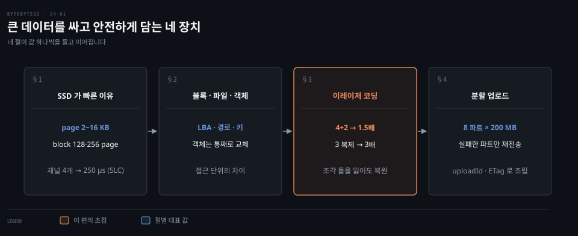
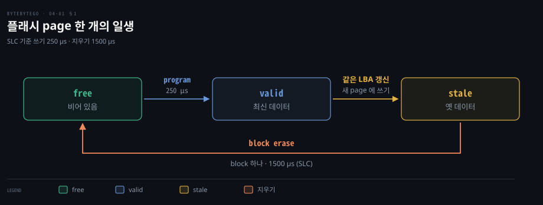
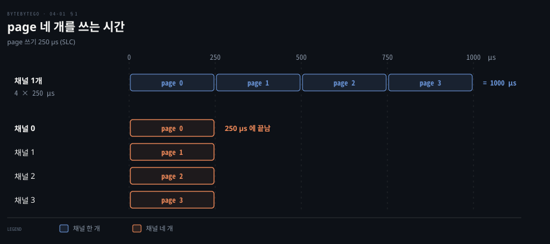
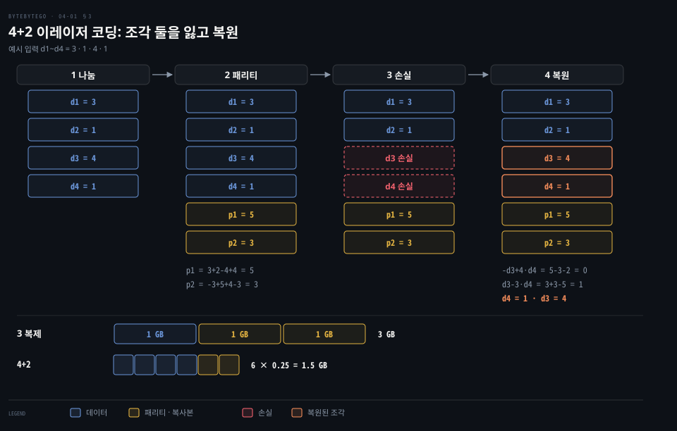
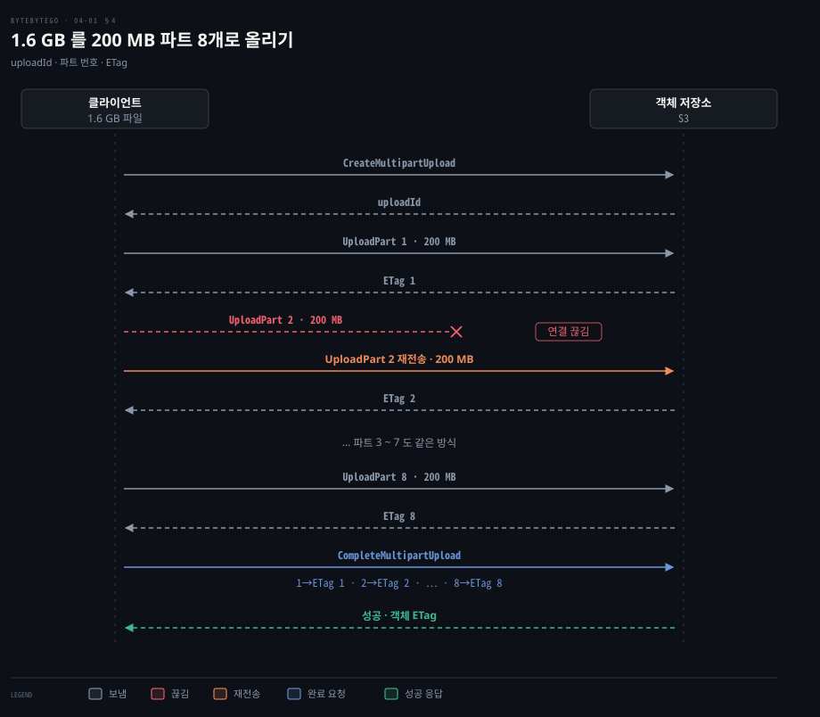

# 블록·파일·객체 저장소는 접근 단위가 다르고 이레이저 코딩과 분할 업로드가 큰 데이터를 싸고 안전하게 담는다

---

> SSD 는 page 로 쓰고 채널을 병렬로 써서 빠르고 블록·파일·객체 저장소는 접근 단위가 갈립니다. 이레이저 코딩은 복제의 절반 공간으로 같은 수의 손실을 견디고 분할 업로드는 실패를 파트 하나로 가둡니다.

## 핵심 요약

> 이 편의 중심 생각은 큰 데이터를 담는 장치와 서비스가 한 번에 다루는 단위를 먼저 정하고 병렬·중복·재시도를 그 단위에 맞춘다는 것입니다.

SSD 는 page 단위로 쓰고 block 단위로 지우는 플래시를 컨트롤러가 가려 줍니다. 채널을 병렬로 써서 빠릅니다. 블록·파일·객체 저장소는 같은 바이트를 LBA·경로·키라는 서로 다른 주소로 다룹니다.

객체 저장소는 이 단위가 객체 전체여서 두 가지 장치가 붙습니다. 이레이저 코딩은 데이터를 조각과 패리티로 나눠 3 복제의 절반 공간에 같은 손실 허용을 줍니다. 분할 업로드는 객체를 파트로 쪼개 끊긴 파트만 다시 보냅니다.

## 학습 목표

> 이 편을 읽고 나면 다음을 설명할 수 있습니다.

1. page·block·FTL 로 SSD 가 덮어쓰기 대신 새 page 에 쓰고 block 째 지우는 과정을 설명할 수 있습니다.
2. 채널 병렬이 page 네 개의 쓰기를 1000 µs 에서 250 µs 로 줄이는 계산을 할 수 있습니다.
3. 블록·파일·객체 저장소를 접근 단위·제자리 수정·공유 방식으로 구분해 용도에 맞게 고를 수 있습니다.
4. 4+2 이레이저 코딩의 저장 공간(1.5배)과 조각 둘을 잃은 뒤의 복원을 값으로 계산해 3 복제와 비교할 수 있습니다.
5. 멀티파트 업로드의 세 요청과 파트 한도를 설명하고 실패한 파트만 다시 보내는 이유를 말할 수 있습니다.

## 1. SSD 는 page 로 쓰고 block 으로 지우며 채널을 병렬로 써서 빠르다

> 플래시는 page 를 덮어쓸 수 없고 block 째 지워야 하므로 컨트롤러가 논리 주소를 물리 page 에 매핑해 이를 가립니다. 속도는 움직이는 부품이 없는 것과 채널 병렬에서 옵니다.

2014 년에 정리된 표에서 회전 디스크의 탐색 지연은 9000 µs 이고 플래시 읽기는 25~100 µs 였습니다.[^ssd-arch] 값은 그 무렵 문헌에서 모은 것이어서 지금 제품과 다를 수 있습니다. 무엇이 이 차이를 만들까요?

SSD 는 플래시 메모리 기반이고 기계 부품이 없습니다. 호스트 인터페이스(SATA 나 PCIe)로 들어온 명령을 컨트롤러의 프로세서가 받아 플래시 컨트롤러로 넘깁니다. 내장 RAM 은 캐시와 매핑 정보를 담습니다. NAND 플래시 패키지는 여러 채널에 나뉘어 붙습니다.[^ssd-arch]

같은 표에서 HDD 의 읽기 지연은 2000~7000 µs 이고 플래시 읽기는 셀 종류에 따라 SLC 25 µs · MLC 50 µs · TLC 100 µs 입니다.[^ssd-arch]

### page 는 덮어쓸 수 없고 block 째 지운다

읽기와 쓰기는 page(2~16 KB) 단위이고 지우기는 block(대개 128 또는 256 page) 단위입니다. Samsung SSD 840 EVO 는 8 KB page 256 개가 모인 2048 KB block 을 씁니다. 아래 시간은 같은 표의 SLC 열 값이고 TLC 는 쓰기 1500 µs, 지우기 5000 µs 로 더 깁니다.[^ssd-arch] page 에 데이터를 쓰는 일을 program 이라고도 부릅니다. 쓰기는 free 상태의 page 에만 되므로, 바이트 하나를 고쳐도 page 하나가 통째로 새 자리에 쓰입니다.[^ssd-pages]

데이터가 쓰여 최신 값을 가진 page 는 여기서 valid 라고 부릅니다(이 노트의 이름이고 근거 글은 free 와 stale 만 이름 붙입니다). 갱신하면 옛 page 는 stale 로 남습니다. free 로 돌아가려면 block 전체를 지우는 erase 가 필요합니다. 지우기 명령은 호스트가 내지 않고 컨트롤러의 가비지 컬렉션이 필요할 때 냅니다.[^ssd-pages] 그림의 SLC 값은 쓰기 250 µs 와 지우기 1500 µs 입니다. 지우기가 쓰기보다 길고 block 전체에 걸립니다.[^ssd-arch]

호스트는 이 사정을 보지 못합니다. **FTL**(Flash Translation Layer)이 호스트의 LBA 배열을 물리 page 에 잇는 매핑 테이블을 RAM 에 둡니다. 전원이 꺼질 때를 위해 플래시에도 남겨 둡니다.[^ssd-pages] 같은 LBA 를 다시 쓰면 새 page 에 쓰고 매핑만 바꿉니다.

### 채널 네 개면 page 네 개를 같은 구간에 쓴다

플래시 컨트롤러와 패키지 사이의 채널은 독립적이고 동시에 접근할 수 있습니다.[^ssd-par] page 쓰기가 250 µs 일 때 채널 한 개는 page 네 개를 4 × 250 = 1000 µs 에 씁니다. 채널 네 개는 이상적으로 250 µs 에 씁니다. 제품 사양이 아니라 병렬의 효과를 계산한 값입니다.

컨트롤러는 여러 칩의 block 에 동시에 써서 이 병렬을 얻습니다.[^ssd-par] FTL 과 I/O 스택을 시스템 성능 관점에서 읽으려면 [디스크 — 아키텍처](../../../02_os/book/systems-performance/09-02.디스크%20—%20아키텍처.md)의 §2 를 보십시오.

## 2. 블록·파일·객체 저장소는 접근 단위가 다르다

> 블록 저장소는 번호 붙은 원시 블록을, 파일 저장소는 경로와 오프셋을, 객체 저장소는 키 하나에 객체 하나를 HTTP 로 줍니다. 단위가 다르니 되는 일이 갈립니다.

데이터베이스는 블록 볼륨을, 공유 문서함은 파일 공유를, 동영상 원본은 객체 저장소를 고릅니다. 같은 바이트를 담는데 무엇이 선택을 가를까요?

**블록 저장소**는 서버에 원시 블록을 볼륨으로 내줍니다. 서버가 포맷해 파일 시스템으로 쓰거나 데이터베이스·가상 머신이 블록을 직접 관리합니다. 서버에 붙은 HDD·SSD 가 모두 여기 속합니다. FC 나 iSCSI 로 네트워크 너머에 붙어도 원시 블록을 주는 점은 같습니다.[^iscsi]

보통 서버 하나가 소유합니다. 클라우드 볼륨은 다중 연결을 지원하기도 하지만 AWS EBS 의 Multi-Attach 는 같은 가용 영역의 io1·io2 볼륨에 한정됩니다. 표준 파일 시스템은 여러 서버의 동시 접근을 가정하지 않아 클러스터 파일 시스템이 필요합니다.[^ebs]

**파일 저장소**는 블록 위에 파일과 디렉터리 계층을 얹어 많은 서버가 NFS 나 SMB 로 함께 씁니다. 서버는 블록을 관리할 필요가 없습니다. AWS EFS 는 NFS 4.1 과 4.0 을 지원합니다.[^efs]

**객체 저장소**는 데이터와 메타데이터를 키 하나에 묶고 REST API 로 HTTP 요청을 받습니다. S3 의 범용 버킷은 객체를 평평한 키 공간에 둡니다. 슬래시 같은 구분자와 접두사로 계층처럼 목록을 뽑을 뿐 디렉터리가 있는 것은 아닙니다.[^prefix] 디렉터리 버킷은 데이터를 디렉터리 계층으로 둡니다.[^dirbucket]

블록과 파일 저장소는 제자리 수정이 됩니다. 블록은 블록을 덮어쓰고 파일은 파일의 일부를 고쳐 씁니다. 객체 저장소에는 객체의 일부만 고치는 요청이 없고 같은 키에 쓰면 객체 전체가 바뀝니다. 버전 관리를 켠 버킷에서는 덮어쓰기가 새 버전을 만듭니다.[^versioning] S3 Express One Zone 스토리지 클래스의 디렉터리 버킷에서는 객체 끝에 데이터를 덧붙일 수 있습니다.[^append] 이 성질은 [분산 파일시스템과 오브젝트 스토어](../../../05_data/book/designing-data-intensive-applications/11-02.분산%20파일시스템과%20오브젝트%20스토어.md)의 §3 에서도 다룹니다.

S3 의 일관성은 강합니다. 객체의 PUT·DELETE 에 대해 모든 리전에서 쓴 직후의 읽기가 최신 값을 돌려줍니다.[^consistency]

| 비교 | 블록 | 파일 | 객체 |
|------|------|------|------|
| 비용 | 높음 | 중간~높음 | 낮음 |
| 성능 | 중간~높음(최고 수준 포함) | 중간~높음 | 낮음~중간 |
| 확장성 | 중간 | 높음 | 방대함 |
| 제자리 수정 | 가능 | 가능 | 불가(통째 교체·버전) |
| 어울리는 일 | 데이터베이스·가상 머신 | 범용 파일 시스템 접근 | 이진·비정형 데이터 |

위 표는 세 범주의 일반적인 상대 비교이지 제품 사양이 아닙니다. S3 는 기본 스토리지 클래스로 S3 Standard 를 쓰고 접근 빈도에 맞춘 다른 스토리지 클래스를 함께 둡니다.[^s3-class] 대표 서비스는 AWS S3, Google Cloud Storage, Azure Blob Storage 입니다.[^gcs][^azblob]

쿠버네티스에서 PV 가 블록 볼륨과 NFS 공유를 모두 붙이는 모습은 [PV·PVC·StorageClass](../../../08_cloud/book/kubernetes-in-action/10-01.PV·PVC·StorageClass와%20동적%20프로비저닝.md)에서 봅니다.

## 3. 이레이저 코딩은 조각과 패리티로 복제의 절반 공간에 같은 손실 허용을 준다

> 3 복제는 공간이 3배이고 4+2 이레이저 코딩은 1.5배인데 둘 다 임의의 둘을 잃어도 데이터를 지킵니다. 대가는 복원할 때 남은 조각을 읽어 계산해야 한다는 것입니다.

객체 저장소는 서버가 죽어도 객체를 잃지 않아야 합니다. 객체를 세 벌 두면 안전하지만 공간이 세 배입니다. 더 싸게 같은 일을 할 수는 없을까요?

**이레이저 코딩**은 데이터를 같은 크기의 조각으로 나누고 조각들로 계산한 패리티를 더해 서로 다른 서버에 둡니다. 일부를 잃으면 남은 조각과 패리티로 되살립니다. 1 GB 객체를 4+2 로 코딩하면 0.25 GB 데이터 조각 4개와 패리티 2개를 합쳐 6 × 0.25 = 1.5 GB 입니다. 3 복제는 3 GB 이므로 추가 공간이 50% 대 200% 입니다. 

두 방식 모두 임의의 둘을 잃어도 살아남습니다. 복제는 복사본 하나가 남으면 되고 4+2 는 6조각 중 4조각이 남으면 됩니다.[^bb-rs]

예로 d1~d4 = 3·1·4·1 을 넣어 따라가 봅니다. 값은 설명을 위해 고른 가정이고 식은 단순화한 예시입니다. p1 = d1 + 2·d2 − d3 + 4·d4 = 5, p2 = −d1 + 5·d2 + d3 − 3·d4 = 3 입니다. d3 와 d4 를 잃으면 미지수 둘에 식 둘이 남습니다. p1 − d1 − 2·d2 = −d3 + 4·d4 = 0 이고 p2 + d1 − 5·d2 = d3 − 3·d4 = 1 입니다. 두 식을 더하면 d4 = 1 이고 d3 = 1 + 3·1 = 4 로 되살아납니다.

이 식은 설명용이고 한계가 있습니다. d1 과 d3 를 함께 잃으면 p1 + p2 = 7·d2 + d4 라 둘이 한 식에만 남아 풀 수 없습니다. 실제 Reed-Solomon 부호는 파일의 바이트를 행렬로 놓고 부호 행렬을 곱해 패리티를 만듭니다. 어느 조각을 잃어도 데이터 조각 수만큼만 남으면 원본이 풀립니다.[^bb-rs]

대가는 복원 비용입니다. 잃은 조각 하나를 되살리려면 다른 조각들을 읽어 다시 계산합니다.[^bb-vault] 복제는 복사본 하나를 읽어 오면 끝입니다.

내구성 수치는 조심해서 읽어야 합니다. Backblaze 가 11 nines 를 계산한 대상은 17+3 입니다. 파일을 20 조각으로 나눠 조각 넷을 잃어야 파일이 사라집니다. 입력은 드라이브 연 고장률 0.81%(복구 서비스 가정을 더해 유효 0.41%)와 평균 재구성 6.5일입니다.[^bb-dur] 17+3 의 추가 공간은 3 ÷ 17 ≈ 17.6% 입니다.

S3 도 이레이저 코딩을 씁니다. S3 엔지니어는 객체를 k 개의 조각으로 나누고 m 개의 패리티를 더하는 Reed-Solomon 류 알고리즘을 쓰며 (k+m) 조각 중 k 개만 남으면 읽을 수 있다고 밝혔습니다.[^s3-ec] k 와 m 의 값은 밝히지 않았습니다. 사용자 가이드는 S3 Standard 가 여러 장치에 걸쳐 최소 세 가용 영역에 객체를 중복 저장하고 연간 99.999999999% 의 내구성을 설계 목표로 한다고 적습니다.[^s3-dur] 복제와 이레이저 코딩의 비교는 [분산 파일시스템과 오브젝트 스토어](../../../05_data/book/designing-data-intensive-applications/11-02.분산%20파일시스템과%20오브젝트%20스토어.md)의 §2 에 있습니다.

## 4. 분할 업로드는 큰 객체를 파트로 나눠 실패를 파트 하나로 가둔다

> 객체를 파트로 나눠 독립적으로 올리고 완료 요청이 파트 번호와 ETag 목록으로 조립을 시킵니다. 연결이 끊기면 그 파트만 다시 보내므로 1.6 GB 를 처음부터 올릴 일이 없습니다.

1.6 GB 를 올리다 연결이 끊기면 처음부터 다시 올려야 할까요? 한 번에 올리는 요청은 그렇습니다. 파트로 나누면 잃는 양이 파트 하나로 줄어듭니다.

**멀티파트 업로드**는 세 요청입니다.

1. 시작 요청 CreateMultipartUpload 가 업로드 ID 를 돌려줍니다.
2. 파트 요청 UploadPart 는 업로드 ID 와 파트 번호를 싣고 가며, S3 가 그 파트의 ETag 를 돌려줍니다.
3. 완료 요청 CompleteMultipartUpload 는 업로드 ID 와 파트 번호·ETag 목록을 담아 가며, S3 가 파트 번호의 오름차순으로 이어 붙여 객체를 만듭니다.

파트는 독립적이어서 순서와 무관하게 병렬로 올릴 수 있습니다. 실패한 파트만 다시 보내면 됩니다.[^s3-mpu]

도식은 1.6 GB 를 200 MB 파트 8개로 나눈 경우입니다. 파트 2 에서 연결이 끊기면 다시 보내는 양은 200 MB 입니다. 한 번에 올렸다면 1.6 GB 입니다. 200 ÷ 1600 = 1/8 입니다.

현재 S3 의 한도는 다음과 같습니다. 파트 번호는 1~10,000 이고 파트 크기는 5 MiB~5 GiB 이며 마지막 파트에는 하한이 없습니다. 객체 한 개는 최대 48.8 TiB 입니다.[^s3-limits] 10,000 × 5 GiB = 50,000 GiB ≈ 48.8 TiB 로 맞아떨어집니다. 예의 200 MB 파트는 5 MiB~5 GiB 안이고 파트 8개는 10,000 이하여서 한도 안입니다. 객체가 100 MB 이상이면 멀티파트를 권장하는데 1.6 GB 는 이 기준을 넘습니다.[^s3-mpu]

파트마다 받은 ETag 는 완료 요청에 담아야 하는 값입니다. 완료된 객체의 ETag 는 파트 ETag 들을 묶은 체크섬이어서 MD5 일 필요가 없습니다. SDK 와 콘솔은 기본으로 체크섬을 계산해 보내며 알고리즘은 바꿀 수 있습니다. 구형 SDK 로 체크섬 없이 올리면 S3 가 CRC-64/NVME 를 자동으로 적용합니다.[^s3-mpu] 완료 요청에는 직접 기록한 번호·ETag 를 쓰고 ListParts 결과를 쓰지 않습니다. 시작한 업로드는 완료하거나 중단하기 전까지 파트 저장 요금이 계속됩니다.[^s3-mpu]

Google Drive 가 파일을 블록으로 쪼개 변경분만 올리는 설계는 [Google Drive 편](../system-design/15-01.Google%20Drive%20는%20파일을%20블록으로%20쪼개%20변경분만%20올리고%20강한%20일관성의%20메타데이터와%20롱%20폴링으로%20동기화한다.md)에서, 조각으로 올려 실패한 조각만 다시 올리는 흐름은 [트랜스코딩 편](../system-design/14-02.트랜스코딩은%20전처리·DAG%20스케줄러·자원%20관리자·작업%20서버로%20나뉘고%20사전%20서명%20URL·CDN%20비용·오류%20처리로%20다듬는다.md)의 §5 에서, 큰 영상을 BLOB 저장소에 올리는 경로는 [YouTube 업로드 편](../system-design/14-01.YouTube%20업로드는%20원본을%20BLOB%20저장소에%20두고%20DAG%20로%20쪼갠%20트랜스코딩을%20거쳐%20CDN%20으로%20스트리밍한다.md)에서 이어집니다.

## 면접 대비

> SSD 의 구조, 저장소 세 종류의 구분, 이레이저 코딩의 값, 멀티파트 업로드의 요청을 묻는 면접 질문입니다.

1. SSD 가 HDD 보다 빠른 이유와 덮어쓰기가 비싼 이유를 page·block·FTL 로 설명해 보십시오.
2. 블록·파일·객체 저장소를 접근 단위와 제자리 수정 여부로 구분해 보십시오. 데이터베이스·공유 문서함·동영상 원본에는 무엇을 고르겠습니까?
3. 4+2 이레이저 코딩이 3 복제보다 공간이 적은데 같은 수의 손실을 견디는 까닭과 그 대가는 무엇입니까?
4. d1~d4 = 3·1·4·1 이고 p1 = d1 + 2·d2 − d3 + 4·d4 이며 p2 = −d1 + 5·d2 + d3 − 3·d4 일 때 d3·d4 를 잃으면 어떻게 복원합니까? 이 식이 실패하는 손실은 무엇입니까?
5. 멀티파트 업로드의 세 요청과 uploadId·ETag 의 역할, 파트 하나가 실패했을 때 다시 보낼 범위를 설명해 보십시오.

## 정답 (자답 후 펼치기)

> 면접 질문에 대한 키워드 중심의 모범 답안입니다.

### 정답 1 — 이동 부품 없음, 채널 병렬, FTL 이 가린 지우기

플래시는 이동 부품이 없고 채널을 병렬로 씁니다. FTL 이 LBA 를 물리 page 에 매핑해 쓰는 자리를 고릅니다. page 는 덮어쓸 수 없어 갱신은 새 page 에 쓰고 옛 page 는 stale 로 남습니다. free 로 되돌리려면 block 째 지워야 합니다.

### 정답 2 — LBA·경로·키, 객체는 통째 교체

블록은 LBA 로 원시 블록을 주고 보통 서버 하나가 소유해 데이터베이스·가상 머신에 맞습니다. 파일은 경로와 오프셋으로 NFS·SMB 공유에 맞습니다. 객체는 키 하나에 객체 전체를 HTTP 로 다뤄 통째로 교체하며 동영상 원본·백업에 맞습니다.

### 정답 3 — 임의의 둘 손실, 복원 때 조각 읽기

4+2 는 6조각 중 4조각이 남으면 되어 임의의 둘을 견딥니다. 공간은 1.5배이고 3 복제는 3배입니다. 복원하려면 남은 조각을 읽어 다시 계산해야 해서 복사본 하나를 읽는 복제보다 비용이 큽니다.

### 정답 4 — 두 식으로 d4 → d3, d1·d3 는 실패

p1 − d1 − 2·d2 = −d3 + 4·d4 = 0, p2 + d1 − 5·d2 = d3 − 3·d4 = 1 을 더해 d4 = 1, d3 = 4 입니다. d1·d3 를 잃으면 p1 + p2 = 7·d2 + d4 로 둘이 한 식에만 남아 풀리지 않으므로 Reed-Solomon 은 어느 조각을 잃어도 풀리게 계수를 정합니다.

### 정답 5 — 시작·파트·완료, 실패한 파트만 재전송

시작 요청이 uploadId 를, 파트마다 ETag 를 돌려줍니다. 완료 요청이 uploadId 와 파트 번호·ETag 목록으로 오름차순 조립을 시킵니다. 실패한 파트 하나(예에서 200 MB)만 다시 보냅니다.

## 참고 자료

- ByteByteGo, 「System Design」 그림 해설 모음 중 SSD·블록/파일/객체 저장소·이레이저 코딩·큰 파일 올리기 글.
- ByteByteGo 공개 저장소의 같은 글(이레이저 코딩): https://github.com/ByteByteGoHq/system-design-101/blob/main/data/guides/erasure-coding.md
- 같은 저장소의 저장소 개요: https://github.com/ByteByteGoHq/system-design-101/blob/main/data/guides/storage-systems-overview.md
- 같은 저장소의 큰 파일 올리기: https://github.com/ByteByteGoHq/system-design-101/blob/main/data/guides/how-to-upload-a-large-file-to-s3.md
- Amazon S3 User Guide, Uploading and copying objects using multipart upload: https://docs.aws.amazon.com/AmazonS3/latest/userguide/mpuoverview.html

## 관련 문서

- [파티셔닝과 읽기 복제본은 데이터베이스를 넓히고 전역 유일 ID 는 나뉜 데이터에 순서를 준다](./01-02.파티셔닝과%20읽기%20복제본은%20데이터베이스를%20넓히고%20전역%20유일%20ID%20는%20나뉜%20데이터에%20순서를%20준다.md)
- [Google Drive 는 파일을 블록으로 쪼개 변경분만 올리고 강한 일관성의 메타데이터와 롱 폴링으로 동기화한다](../system-design/15-01.Google%20Drive%20는%20파일을%20블록으로%20쪼개%20변경분만%20올리고%20강한%20일관성의%20메타데이터와%20롱%20폴링으로%20동기화한다.md)
- [분산 파일시스템과 오브젝트 스토어](../../../05_data/book/designing-data-intensive-applications/11-02.분산%20파일시스템과%20오브젝트%20스토어.md)

[^ssd-arch]: Coding for SSDs 2부(구조와 Table 1, 2014년): <https://codecapsule.com/2014/02/12/coding-for-ssds-part-2-architecture-of-an-ssd-and-benchmarking/>
[^ssd-pages]: Coding for SSDs 3부 §3.1·§4(page 쓰기, block 지우기, FTL): <https://codecapsule.com/2014/02/12/coding-for-ssds-part-3-pages-blocks-and-the-flash-translation-layer/>
[^ssd-par]: Coding for SSDs 4부 §6.2(채널·패키지·칩·플레인 병렬): <https://codecapsule.com/2014/02/12/coding-for-ssds-part-4-advanced-functionalities-and-internal-parallelism/>
[^iscsi]: RFC 7143 iSCSI: <https://www.rfc-editor.org/rfc/rfc7143>
[^ebs]: Amazon EBS User Guide, Multi-Attach: <https://docs.aws.amazon.com/ebs/latest/userguide/ebs-volumes-multi.html>
[^efs]: Amazon EFS User Guide, What is Amazon EFS: <https://docs.aws.amazon.com/efs/latest/ug/whatisefs.html>
[^prefix]: Amazon S3 User Guide, Organizing objects using prefixes: <https://docs.aws.amazon.com/AmazonS3/latest/userguide/using-prefixes.html>
[^versioning]: Amazon S3 User Guide, S3 Versioning: <https://docs.aws.amazon.com/AmazonS3/latest/userguide/Versioning.html>
[^append]: Amazon S3 User Guide, Appending data to objects in directory buckets: <https://docs.aws.amazon.com/AmazonS3/latest/userguide/directory-buckets-objects-append.html>
[^consistency]: Amazon S3 User Guide, Amazon S3 data consistency model: <https://docs.aws.amazon.com/AmazonS3/latest/userguide/Welcome.html>
[^s3-class]: Amazon S3 User Guide, Understanding and managing storage classes: <https://docs.aws.amazon.com/AmazonS3/latest/userguide/storage-class-intro.html>
[^gcs]: Google Cloud, Cloud Storage introduction: <https://cloud.google.com/storage/docs/introduction>
[^azblob]: Microsoft Learn, Azure Blob Storage introduction: <https://learn.microsoft.com/en-us/azure/storage/blobs/storage-blobs-introduction>
[^bb-rs]: Backblaze, Backblaze Open-sources Reed-Solomon Erasure Coding Source Code (2015): <https://www.backblaze.com/blog/reed-solomon/>
[^bb-vault]: Backblaze, Backblaze Vaults: Zettabyte-Scale Cloud Storage Architecture(조각을 다른 조각에서 재계산): <https://www.backblaze.com/blog/vault-cloud-storage-architecture/>
[^bb-dur]: Backblaze, Backblaze Durability is 99.999999999% (2018, 11 nines 계산 입력): <https://www.backblaze.com/blog/cloud-storage-durability/>
[^dirbucket]: Amazon S3 User Guide, Directory buckets overview: <https://docs.aws.amazon.com/AmazonS3/latest/userguide/directory-buckets-overview.html>
[^s3-ec]: Andy Warfield, Building and operating a pretty big storage system called S3 (2023-07-27): <https://www.allthingsdistributed.com/2023/07/building-and-operating-a-pretty-big-storage-system.html>
[^s3-dur]: Amazon S3 User Guide, Data protection(내구성·가용 영역 중복): <https://docs.aws.amazon.com/AmazonS3/latest/userguide/DataDurability.html>
[^s3-mpu]: Amazon S3 User Guide, multipart upload: <https://docs.aws.amazon.com/AmazonS3/latest/userguide/mpuoverview.html>
[^s3-limits]: Amazon S3 User Guide, multipart upload limits: <https://docs.aws.amazon.com/AmazonS3/latest/userguide/qfacts.html>
