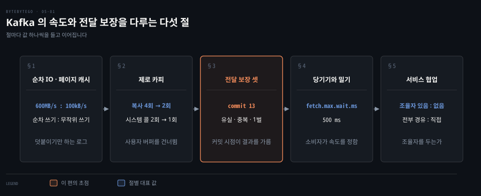
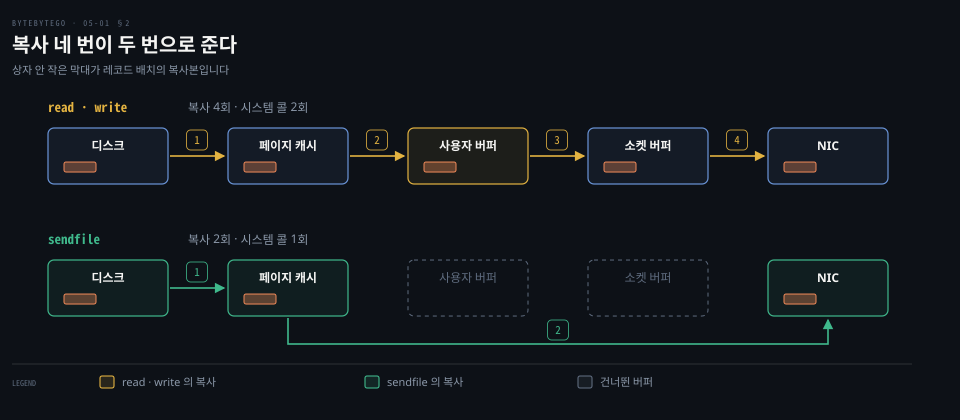
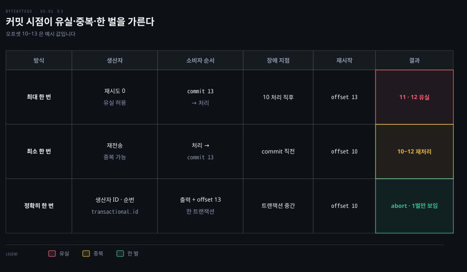
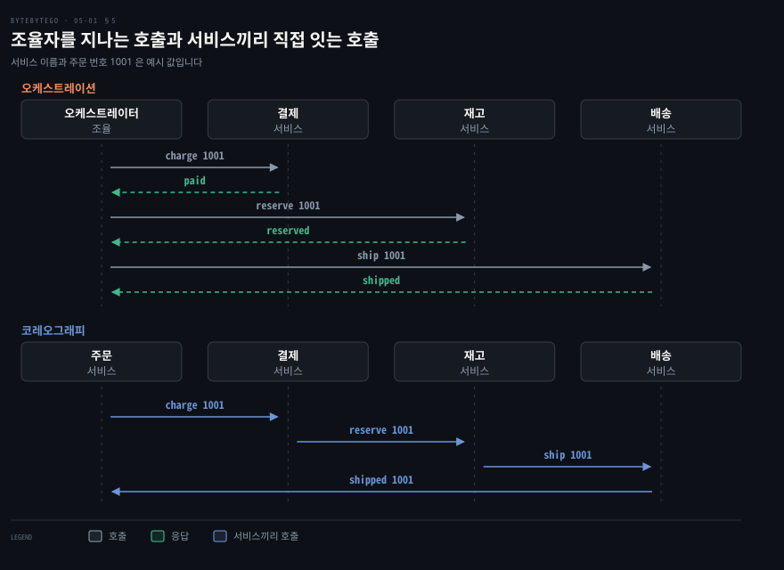

# Kafka 는 순차 IO 와 제로 카피로 빠르고 전달 보장은 최대 한 번·최소 한 번·정확히 한 번으로 갈린다

---

> Kafka 는 로그 끝에 덧붙이는 순차 IO 와 페이지 캐시, 커널 안에서 끝나는 sendfile 로 빠르고, 전달 보장은 소비자가 오프셋을 커밋하는 시점과 트랜잭션 여부로 갈리며, 소비자는 당겨서 속도를 정합니다.


## 핵심 요약

> 이 편의 중심 생각은 Kafka 의 속도는 디스크를 피해서가 아니라 디스크가 빠른 방식으로만 써서 나오고, 전달 보장은 기능 이름이 아니라 오프셋을 저장하는 순서가 정한다는 것입니다.

Kafka 는 메시지를 파일 끝에 덧붙이기만 하고 읽기는 운영체제의 페이지 캐시가 받아 줍니다. 소비자에게 보낼 때는 `sendfile` 로 사용자 공간을 거치지 않아 복사 네 번이 두 번으로 줄고 TLS 를 켜면 이 길이 막힙니다.

전달 보장은 세 가지입니다. 처리하기 전에 오프셋을 저장하면 최대 한 번(유실), 처리한 뒤에 저장하면 최소 한 번(중복), 출력과 오프셋을 한 트랜잭션에 묶으면 정확히 한 번입니다. 소비자가 브로커에서 당겨 가는 구조는 느린 소비자를 밀어닥침에서 지켜 주고, 같은 원리가 메트릭 수집과 서비스 협업의 중앙 조율자 논쟁에도 다시 나타납니다.




## 학습 목표

> 이 편을 읽고 나면 다음을 설명할 수 있습니다.

1. Kafka 가 디스크에 쓰고도 빠른 이유를 순차 쓰기와 페이지 캐시로 설명할 수 있습니다.
2. read·write 길의 복사 네 번이 sendfile 길의 두 번으로 줄어드는 과정과 TLS 의 영향을 설명할 수 있습니다.
3. 최대 한 번·최소 한 번·정확히 한 번을 오프셋 커밋 순서로 가르고 정확히 한 번이 성립하는 범위를 말할 수 있습니다.
4. 소비자가 당기는 방식이 밀기 방식보다 느린 소비자에게 안전한 까닭과 메트릭 수집의 당기기를 연결할 수 있습니다.
5. 오케스트레이션과 코레오그래피를 메시지 흐름·장애 지점·확장 방식으로 견줄 수 있습니다.


## 1. 순차 IO 와 페이지 캐시는 디스크를 느리지 않게 쓴다

> 디스크가 느리다는 통념은 무작위 접근에만 맞고, 끝에 덧붙이는 순차 접근은 네트워크만큼 빠를 수 있습니다. Kafka 는 로그 파일 끝에만 쓰고 읽기는 운영체제의 페이지 캐시에 맡깁니다.

메시지를 전부 디스크에 쓰는 시스템이 어떻게 메모리 큐만큼 빠를 수 있을까요? Kafka 설계 문서의 답은 디스크 성능이 접근 방식에 따라 극단적으로 갈린다는 것입니다.[^design-persistence] 7200rpm SATA 디스크 여섯 개를 RAID-5 로 묶은 JBOD 구성에서 순차 쓰기는 약 600MB/sec 이고 무작위 쓰기는 약 100kB/sec 입니다. 600MB/s 를 100kB/s 로 나누면 6,000 이므로 6,000배 넘게 차이 납니다. 순차 접근이 가장 예측하기 쉬운 패턴이어서 운영체제가 미리 읽기(read-ahead)와 모아 쓰기(write-behind)로 최적화해 주기 때문입니다.

그래서 Kafka 의 저장소는 **순차 IO** 만 쓰는 구조입니다. 덧붙이기만 하는 로그 자체는 [메시지 큐 아키텍처](../../../04_messaging/04_BrokerArchitecture/01-01.메시지%20큐%20아키텍처.md) 편의 §1 에서 먼저 다뤘습니다. 파티션 로그는 파일에 레코드를 덧붙이기만 하고, 읽기는 파일 안의 위치(오프셋)부터 앞으로 훑습니다. 모든 연산이 O(1) 이고 읽기가 쓰기를 막지 않습니다. 메시지마다 B-트리 같은 구조를 갱신하는 설계는 디스크 탐색이 한 번에 10ms 쯤 걸립니다. 캐시 크기가 그대로인 채 데이터가 늘면 속도가 초선형으로 떨어져서 데이터가 두 배가 되면 두 배보다 훨씬 느려진다고 설계 문서는 적습니다.[^design-persistence]

작은 쓰기를 하나씩 보내지 않는 것도 한 축입니다. 프로토콜이 메시지 묶음(message set)을 기본 단위로 삼아 네트워크 왕복, 로그 덧붙이기, 소비자의 읽기가 모두 큰 덩어리로 이뤄집니다. 설계 문서는 이 한 가지가 자릿수가 다른 속도 향상을 낸다고 설명합니다.[^design-efficiency]

읽기는 **페이지 캐시** 가 받습니다. 운영체제는 남는 메모리를 전부 디스크 캐시로 쓰므로 프로세스가 자기 캐시를 따로 두면 같은 데이터가 두 번 저장됩니다. JVM 객체는 메모리 오버헤드가 커서 데이터 크기의 두 배가 되기도 합니다. 힙이 커질수록 가비지 컬렉션도 느려집니다.

그래서 Kafka 는 자체 캐시를 두지 않고 쓰기를 곧바로 파일 시스템의 로그에 넘깁니다. 실제로는 커널 페이지 캐시에 들어가는 것이어서 디스크 반영을 기다리지 않습니다. 이 캐시는 서비스를 재시작해도 따뜻하게 남고 캐시와 파일 사이의 일관성은 운영체제가 맡습니다.[^design-persistence]

그 결과로 설계 문서는 소비자가 대부분 따라잡은 클러스터에서는 디스크 읽기 활동이 아예 보이지 않는다고 적습니다. 페이지 캐시에서 전부 서비스하기 때문입니다.[^design-efficiency] 메시지는 파티션의 동기화 복제본(ISR)이 모두 로그에 적용했을 때 커밋된 것으로 칩니다.[^design-semantics] 페이지 캐시와 파일 시스템 캐시가 다루는 일반 원리는 [파일 시스템 — 아키텍처·캐시](../../../02_os/book/systems-performance/08-02.파일%20시스템%20—%20아키텍처·캐시·파일시스템%20유형.md) 편에 있습니다.


## 2. 제로 카피는 사용자 공간을 건너뛰어 복사를 줄인다

> 로그 파일의 바이트를 소켓으로 보낼 때 일반 경로는 데이터를 사용자 공간으로 올렸다 내립니다. sendfile 은 커널 안에서 페이지 캐시에서 NIC 로 바로 보내 복사 네 번을 두 번으로 줄입니다.

소비자가 읽으러 왔을 때 브로커는 파일의 한 구간을 네트워크로 내보냅니다. 평범하게 `read()` 로 읽고 `write()` 로 보내면 바이트가 어디를 거칠까요? 설계 문서는 네 단계로 적습니다.[^design-efficiency]

1. 운영체제가 디스크에서 커널 공간의 페이지 캐시로 읽습니다.
2. 애플리케이션이 커널 공간에서 사용자 공간 버퍼로 읽습니다.
3. 애플리케이션이 그 데이터를 커널 공간의 소켓 버퍼로 다시 씁니다.
4. 운영체제가 소켓 버퍼에서 NIC 버퍼로 복사해 네트워크로 내보냅니다.

복사가 네 번이고 시스템 콜이 두 번(`read` 와 `write`)입니다. **제로 카피** 는 이 중간 복사를 없애는 기법이고, 리눅스에서는 `sendfile` 시스템 콜이 맡습니다.

`sendfile(out_fd, in_fd, …)` 는 파일 기술자 사이의 복사를 커널 안에서 끝내서 `read`·`write` 조합보다 효율적입니다.[^man-sendfile] 이 경로에서는 데이터가 페이지 캐시에서 NIC 버퍼로 직접 가서, 디스크에서 캐시로 읽는 복사와 캐시에서 NIC 로 보내는 복사 두 번만 남고, 시스템 콜도 `sendfile` 한 번으로 줄어듭니다.

자바에서 `sendfile` 을 부르는 `FileChannel.transferTo()` 와 read·write 방식을 견준 IBM 의 측정이 이 효과를 보여 줍니다. 리눅스 2.6 커널에서 7MB 파일은 156ms 에서 45ms, 200MB 파일은 2,124ms 에서 1,150ms 로 줄었습니다. 글은 약 65% 단축이라고 요약하지만 표로 다시 계산하면 줄어든 폭이 파일 크기마다 46%(200MB)에서 71%(7MB)까지 다릅니다.[^ibm-zerocopy]



이 최적화는 Kafka 가 생산자·브로커·소비자에서 같은 이진 메시지 형식을 쓰기 때문에 성립합니다. 디스크에 쓴 형식 그대로 네트워크로 나가므로 중간에서 바이트를 바꿀 필요가 없습니다.[^design-efficiency] 소비자가 여럿일 때도 이득이 큽니다. 데이터는 페이지 캐시에 정확히 한 번 들어가고 소비마다 다시 쓰이므로, 소비 속도가 네트워크 한계에 가까워집니다. 소비자가 따라잡은 상태라면 디스크에서 캐시로 읽는 첫 번째 복사도 생기지 않아 복사는 한 번(캐시에서 NIC)만 남습니다.[^design-efficiency]

단, 조건이 하나 있습니다. TLS/SSL 라이브러리는 사용자 공간에서 돌고 커널 안에서 암호화하는 `SSL_sendfile` 은 현재 Kafka 가 지원하지 않아서, SSL 을 켜면 `sendfile` 이 쓰이지 않습니다.[^design-efficiency] 즉 암호화한 브로커에서는 복사가 다시 늘어납니다.


## 3. 전달 보장은 오프셋을 저장하는 시점이 가른다

> 최대 한 번은 처리 전에, 최소 한 번은 처리 뒤에 오프셋을 저장하고, 정확히 한 번은 출력과 오프셋을 한 트랜잭션으로 묶습니다. 장애가 처리와 저장 사이에 나는 순서에 따라 유실이나 중복이 결정됩니다.

메시지 큐는 서로 떨어진 구성 요소를 잇는 통로입니다. 그 통로가 메시지를 몇 번 전해 주는지는 어떻게 정할까요? 세 가지로 갈립니다.

**최대 한 번** 은 메시지가 유실될 수는 있어도 다시 전달되지 않는 것입니다. **최소 한 번** 은 유실은 없지만 중복 전달이 있을 수 있는 것입니다. **정확히 한 번** 은 각 메시지가 정확히 한 번만 처리되는 것입니다.[^design-semantics] 모니터링 지표처럼 조금 잃어도 되는 곳은 최대 한 번이 맞습니다. 중복 제거가 가능한 곳은 최소 한 번, 결제·거래·회계처럼 중복이 안 되는 곳은 정확히 한 번이 맞습니다.

정확히 한 번은 구현이 가장 어렵고 시스템의 성능과 복잡도 비용이 큽니다. 하류 서비스나 제3자가 멱등을 지원하지 않을 때 특히 필요해서 그 비용을 치르는 선택입니다.

Kafka 에서 이 구분은 소비자가 읽은 위치를 저장하는 **오프셋 커밋** 순서로 구체화됩니다. 소비자가 오프셋 10·11·12 를 받아 처리하다 장애가 났다고 합시다(오프셋 값은 예시입니다).

- 읽고, 위치를 먼저 저장한 뒤 처리하면 최대 한 번입니다. 13 을 커밋하고 10 을 처리한 직후 죽으면, 새 소비자는 13 부터 시작해 11·12 는 처리되지 않습니다.[^design-semantics]
- 읽고, 처리한 뒤 위치를 저장하면 최소 한 번입니다. 10~12 를 처리했는데 13 을 커밋하기 전에 죽으면, 새 소비자는 10 부터 다시 읽어 세 개를 재처리합니다. 메시지에 기본 키가 있어 갱신이 멱등이면 같은 레코드를 한 번 더 덮어쓸 뿐입니다.[^design-semantics]
- 출력과 오프셋 13 을 한 트랜잭션에 쓰면 정확히 한 번입니다. 트랜잭션이 중간에 끊기면 저장된 오프셋은 10 그대로 남고, 출력은 `read_committed` 소비자에게 보이지 않아 한 벌만 남습니다. 살아 있는 소비자의 현재 위치는 자동으로 되감기지 않아서 커밋된 오프셋을 다시 읽어 위치를 옮기거나 소비자를 새로 만들어야 합니다.[^design-semantics]



생산자 쪽은 별개의 문제입니다. 네트워크 오류를 받은 생산자는 메시지가 커밋됐는지 알 수 없어 재전송합니다. 0.11.0.0 이전에는 이 재전송이 중복을 만들었습니다. 지금은 **멱등 생산자** 가 브로커가 부여한 생산자 ID 와 메시지마다 붙는 순번으로 중복을 걸러 냅니다.[^design-semantics]

`enable.idempotence` 의 기본값은 true 입니다. `acks=all`, 재시도 0 초과, 연결당 미응답 요청 5 이하가 함께 필요합니다.[^producer-configs] 여러 파티션에 원자적으로 쓰려면 `transactional.id` 를 지정한 트랜잭션을 씁니다. 생산자 쪽 세부는 [Producer 생성과 전송 모드](../../../04_messaging/04_BrokerArchitecture/05-02.Producer%20생성과%20전송%20모드.md) 편에 있습니다.

Kafka 는 기본으로 최소 한 번을 보장합니다. 최대 한 번은 생산자의 재시도를 끄고 처리 전에 오프셋을 커밋해서 만듭니다.[^design-semantics]

정확히 한 번의 범위는 따로 짚어야 합니다. Kafka 토픽에서 읽어 다른 Kafka 토픽에 쓰는 처리가 대상이고 Kafka Streams 가 그 예입니다. 트랜잭션 생산자와 `read_committed` 소비자로 성립합니다. 외부 시스템에 쓰는 경우에는 그 시스템의 협조가 필요합니다.[^design-semantics] 직접 구성할 때의 설정은 다음 세 줄입니다.

```properties
# 소비자: 커밋된 트랜잭션의 레코드만 읽습니다.
isolation.level=read_committed
# 소비자: 오프셋 커밋을 자동으로 하지 않고 트랜잭션 안에서 보냅니다.
enable.auto.commit=false
# 생산자: 값 order-processor-1 은 예시이고, 트랜잭션 ID 를 지정하면 트랜잭션 전달이 켜지고, 재시작 시 이전 인스턴스의 미완료 트랜잭션이 abort 됩니다.
transactional.id=order-processor-1
```

세 줄은 Kafka 설계 문서가 정확히 한 번의 조건으로 적은 설정입니다.[^design-transactions] 오프셋 커밋 API 는 [오프셋 커밋 API](../../../04_messaging/04_BrokerArchitecture/01-05.오프셋%20커밋%20API.md) 편, 수동 확인은 [Manual Ack 와 Offset Commit 정책](../../../04_messaging/04_BrokerArchitecture/03-03.Manual%20Ack와%20Offset%20Commit%20정책.md) 편에서 이어집니다.

멱등 생산자의 내부는 [Idempotent Producer](../../../04_messaging/05_ConsistencyPattern/03-05.Idempotent%20Producer%20—%20PID·시퀀스·중복%20방지.md) 편의 §2 에 있습니다. 여기서 말한 생산자 ID 와 순번이 그 편에서는 PID 와 시퀀스입니다. 트랜잭션의 zombie fencing 과 `read_committed` 는 [Kafka Transactions 내부](../../../04_messaging/05_ConsistencyPattern/03-06.Kafka%20Transactions%20내부%20—%20Zombie%20Fencing·2PC.md) 편의 §3·§4 에서 다룹니다.

스트림 처리 일반의 정확히 한 번(사실상 한 번)은 [시간 추론과 내결함성](../../../05_data/book/designing-data-intensive-applications/12-04.시간%20추론과%20내결함성·12장%20종합.md) 편의 §3 에 있습니다. 세 의미론과 Kafka 내부 정확히 한 번의 범위는 [Exactly-once 의미론과 Consumer Idempotency](../../../04_messaging/05_ConsistencyPattern/03-04.Exactly-once%20의미론과%20Consumer%20Idempotency.md) 편의 §1·§2 에 있습니다. 알림 시스템은 같은 문제를 전달 전체로 넓혀 봅니다. 정확히 한 번이 불가능하다고 보고 이벤트 ID 로 중복을 걸러 줄입니다. 이 편은 처리 범위로 한정해 말하는 점이 다릅니다([알림 시스템](../system-design/10-01.알림%20시스템은%20제3자%20푸시·SMS·이메일%20서비스%20앞에%20메시지%20큐와%20작업%20서버를%20두어%20재시도와%20중복을%20다룬다.md) 편의 §6). 결제에서 멱등 키로 이중 청구를 막는 같은 발상은 [결제 정확성](./07-02.결제%20정확성은%20멱등%20키로%20이중%20청구를%20막고%20대사로%20장부%20불일치를%20찾고%20토큰화로%20카드%20정보를%20지킨다.md) 편에서 다룹니다.


## 4. 당기기와 밀기는 속도를 누가 정하느냐의 선택이다

> 브로커가 밀면 느린 소비자가 밀려드는 데이터에 압도되고, 소비자가 당기면 소비자는 따라잡을 수 있을 때 따라잡습니다. Kafka 소비자는 당기고, 메트릭 수집에서도 같은 선택이 다시 나옵니다.

데이터를 보내는 쪽이 밀어야 할까요, 받는 쪽이 당겨야 할까요? Kafka 는 생산자가 브로커에 밀고 소비자가 브로커에서 당기는 전통적 설계를 따릅니다.[^design-pull]

밀기 방식은 브로커가 전송 속도를 정합니다. 소비 속도가 생산 속도보다 느려지면 소비자가 압도되고 설계 문서는 이를 서비스 거부 공격에 비유합니다. 당기기 방식에서는 소비자가 뒤처져도 나중에 따라잡으면 됩니다. 백오프 프로토콜로 밀기를 보완할 수 있지만 소비자를 최대한 쓰면서 넘치지 않게 속도를 맞추는 일은 생각보다 까다롭다고 문서는 말합니다.[^design-pull]

당기기에는 일괄 처리가 잘 맞는다는 장점도 있습니다. 밀기 방식은 요청을 즉시 보낼지 모아서 보낼지를 하류가 바로 처리할 수 있는지 모른 채 정해야 합니다. 지연을 줄이도록 맞추면 메시지를 하나씩 보내다 하류에서 다시 버퍼링됩니다. 당기기 방식에서는 소비자가 현재 위치 뒤의 가능한 메시지를 한 번에 가져옵니다(설정한 최대 크기까지). 불필요한 지연 없이 일괄 처리가 최적이 됩니다.[^design-pull]

소비자 설정에서 `fetch.min.bytes` 의 기본값은 1 바이트라 데이터가 생기는 대로 응답합니다. `fetch.max.wait.ms` 의 기본값 500 은 데이터가 모자랄 때 브로커가 기다리는 상한(밀리초)입니다.[^consumer-configs] `poll()` 한 번에 돌려주는 레코드는 `max.poll.records` 가 제한하며 기본값은 500 입니다.[^consumer-configs] poll 루프와 설정은 [Consumer poll 루프와 종료](../../../04_messaging/04_BrokerArchitecture/01-06.Consumer%20poll%20루프와%20종료.md) 편에 있습니다.

메트릭 수집에서도 같은 질문이 반복됩니다. 수집기가 서비스에서 지표를 당기는 방식에서는, 수집기가 당길 대상 목록을 알아야 합니다. 서버가 자주 늘고 줄어드는 환경에서 파일에 DNS·IP 를 적어 두는 순진한 방법은 유지하기 어려워서, 서비스가 자기 가용성을 등록하는 **서비스 디스커버리**(예: 쿠버네티스)를 둡니다.

수집기는 먼저 디스커버리에서 당길 간격·IP·타임아웃·재시도 같은 메타데이터를 받고, 각 서비스가 노출한 HTTP 엔드포인트(예: `/metrics`)로 지표를 가져옵니다. 엔드포인트를 내려면 보통 서비스에 클라이언트 라이브러리를 넣습니다. 대상 목록이 바뀌면 수집기가 디스커버리에 변경 알림을 등록해 받거나 주기적으로 폴링해 갱신합니다.

Prometheus 공식 FAQ 는 당기기를 택한 이유를 셋 듭니다. 노트북에서도 추가 모니터링 인스턴스를 띄울 수 있고 대상이 죽었는지를 더 쉽고 믿을 수 있게 알 수 있습니다. 브라우저로 대상의 상태를 직접 볼 수도 있습니다.[^prom-faq]

같은 문서는 당기기가 밀기보다 조금 낫다고 보지만 모니터링 시스템을 고르는 결정적 기준은 아니라고 덧붙입니다. 밀어야 하는 경우를 위해 Pushgateway 를 제공합니다.[^prom-faq] 어느 한쪽이 정답인 논쟁이 아니라는 뜻입니다. Kafka 소비자와 달리 메트릭에서는 당기기의 이점이 속도 조절보다 대상 생존 확인에 있습니다. 서비스 디스커버리와 relabeling 은 [서비스 디스커버리와 relabeling](../../../06_observability/book/mastering_prometheus/04-01.서비스%20디스커버리와%20relabeling.md) 편, 시계열 저장은 [메트릭 모니터링](./08-03.메트릭%20모니터링은%20시계열%20데이터베이스에%20쓰기를%20몰아%20담고%20수집·질의·경보·시각화로%20나뉜다.md) 편에 있습니다.


## 5. 마이크로서비스 협업은 중앙 조율자를 두느냐로 갈린다

> 오케스트레이션은 한 조율자가 모든 서비스를 호출하고 결과를 모읍니다. 코레오그래피는 조율자 없이 서비스끼리 규칙대로 주고받습니다.

서비스 여럿이 한 작업을 함께 처리할 때 누가 순서를 정할까요? 방법은 둘입니다. 코레오그래피는 안무가가 규칙을 정해 두면 무대 위의 무용수들(서비스)이 그 규칙대로 서로 상호작용하는 방식입니다. 오케스트레이션은 지휘자가 악단을 이끄는 것처럼 조율자가 권한의 중심에서 서비스를 호출하고 조합하는 방식입니다. 오케스트레이션은 서비스 사이의 트랜잭션 관리도 함께 맡습니다.

오케스트레이션은 신뢰성과 규모 확대 면에서 낫고 코레오그래피는 지연과 단일 장애점에서 낫습니다. 아래에서 하나씩 따집니다.

같은 주문 1001 을 결제·재고·배송 서비스가 처리한다고 그려 보면 차이가 드러납니다(서비스 이름은 예시입니다). 오케스트레이션에서는 조율자가 서비스마다 호출하고 응답을 받아 모든 호출과 응답이 조율자를 지납니다. 코레오그래피에서는 주문이 결제를, 결제가 재고를, 재고가 배송을 직접 부르고 마지막에 배송이 주문에 알려 조율자 없이 서비스 사이에서 이어집니다. 도식의 호출 개수는 두 판을 견주려는 값이 아니라 흐름을 보이려는 예시여서 개수로 우열을 가리지 않습니다.



오케스트레이션의 이점은 셋입니다. 첫째는 신뢰성으로, 트랜잭션 관리와 오류 처리가 내장되어 있습니다. 코레오그래피는 점대점 통신이어서 장애 시나리오가 훨씬 복잡해집니다. 둘째는 확장성으로, 새 서비스를 추가할 때 오케스트레이터의 규칙만 고치면 됩니다. 코레오그래피에서는 상호작용하는 모든 서비스를 고쳐야 합니다. 셋째는 느슨한 결합으로, 서비스 사이의 경계가 분명해져서 테스트 케이스를 도메인 안에 가둘 수 있습니다.

한계도 둘입니다. 성능에서는 모든 호출이 중앙 조율자를 거치므로 코레오그래피보다 지연이 크고 처리량이 조율자의 용량에 묶입니다. 단일 장애점도 문제여서, 조율자가 죽으면 서비스들이 서로 통신하지 못하므로 조율자를 고가용성으로 만들어야 합니다. 코레오그래피 쪽에서는 서비스 의존 관계가 복잡해져 디버깅과 테스트가 어려워진다는 점이 따라옵니다.

실제 사례로는 Netflix 가 만든 마이크로서비스 워크플로 조율 플랫폼 Conductor 가 있습니다. 다만 Netflix 는 2023년 12월 13일부로 GitHub 의 Conductor OSS 유지보수를 중단했습니다. 이후 [conductor-oss/conductor](https://github.com/conductor-oss/conductor) 저장소가 이어받아 지금도 갱신되고 있습니다(2026-10-12 확인).[^conductor-readme] 이 둘의 비교와 사가 패턴은 [Choreography vs Orchestration](../../05_edd/03-02.Choreography%20vs%20Orchestration.md) 편에서 더 깊게 다룹니다.


## 면접 대비

> Kafka 의 속도 원리, 전달 보장의 구분, 소비 모델, 협업 방식에 관한 면접 질문입니다.

1. 디스크에 쓰는 Kafka 가 빠른 이유를 순차 IO 와 페이지 캐시로 설명해 보십시오.
2. 제로 카피(sendfile)가 복사 횟수를 어떻게 줄이며 TLS 를 켜면 왜 이 이점이 사라집니까?
3. 최대 한 번·최소 한 번·정확히 한 번을 소비자의 오프셋 커밋 순서로 구분하고 각각 알맞은 사용처를 말해 보십시오.
4. Kafka 에서 정확히 한 번이 성립하는 범위와 필요한 생산자·소비자 설정은 무엇입니까?
5. 소비자가 당기는 방식이 브로커가 미는 방식보다 안전한 까닭과 오케스트레이션이 단일 장애점이 되는 까닭을 설명해 보십시오.


## 정답 (자답 후 펼치기)

> 면접 질문에 대한 키워드 중심의 모범 답안입니다.

### 정답 1 — 덧붙이기만 하는 로그와 페이지 캐시

파티션 로그에 끝에만 쓰는 순차 접근은 순차 쓰기 600MB/s 대 무작위 100kB/s 로 6,000배 넘게 빠릅니다. 운영체제가 읽기와 쓰기를 모아 주기 때문입니다. 읽기는 자체 캐시 없이 페이지 캐시가 받아 중복 저장과 GC 부담이 없고 따라잡은 소비자는 디스크를 읽지 않습니다.

### 정답 2 — 복사 4회에서 2회, SSL 이면 sendfile 불가

일반 경로는 디스크→페이지 캐시→사용자 버퍼→소켓 버퍼→NIC 로 복사 네 번과 시스템 콜 두 번입니다. `sendfile` 은 페이지 캐시에서 NIC 로 직접 보내 두 번이 되지만, TLS 가 사용자 공간에서 돌아 Kafka 가 SSL 을 켜면 `sendfile` 을 쓰지 않습니다.

### 정답 3 — 처리 전 커밋은 유실, 처리 후 커밋은 중복

처리 전에 오프셋을 저장하면 최대 한 번(모니터링 지표 같은 유실 허용), 처리 뒤에 저장하면 최소 한 번(멱등 갱신이나 중복 제거가 되는 곳)입니다. 출력과 오프셋을 한 트랜잭션에 묶으면 정확히 한 번이어서 결제·거래·회계에 쓰지만 구현이 가장 어렵고 성능·복잡도 비용이 큽니다.

### 정답 4 — Kafka 안에서 읽고 쓰는 처리는 트랜잭션

멱등 생산자와 `transactional.id` 트랜잭션, 소비자의 `isolation.level=read_committed` 와 `enable.auto.commit=false` 로 Kafka 토픽 사이의 처리(Kafka Streams)에서 성립합니다. 외부 시스템에 쓸 때는 그 시스템의 협조가 필요합니다.

### 정답 5 — 소비자가 속도를 정하고, 조율자는 모든 호출이 지난다

밀기 방식은 브로커가 속도를 정해 느린 소비자가 압도되지만, 당기기는 소비자가 따라잡을 수 있을 때 가져오고 일괄 처리도 최적이 됩니다. 오케스트레이터는 모든 서비스 호출이 지나므로 죽으면 서비스끼리 통신이 끊겨 고가용성이 필요합니다.


## 참고 자료

- ByteByteGo 「System Design」 그림 해설 모음의 글 네 편입니다. 공개 저장소의 글 목록: https://github.com/ByteByteGoHq/system-design-101/blob/b28380a/README.md
  - https://github.com/ByteByteGoHq/system-design-101/blob/b28380a4710c5ec9638ec037d4168e288f334cba/data/guides/why-is-kafka-fast.md
  - https://github.com/ByteByteGoHq/system-design-101/blob/b28380a4710c5ec9638ec037d4168e288f334cba/data/guides/delivery-semantics.md
  - https://github.com/ByteByteGoHq/system-design-101/blob/b28380a4710c5ec9638ec037d4168e288f334cba/data/guides/push-vs-pull-in-metrics-collecting-systems.md
  - https://github.com/ByteByteGoHq/system-design-101/blob/b28380a4710c5ec9638ec037d4168e288f334cba/data/guides/orchestration-vs-choreography-microservices.md
  - https://bytebytego.com/guides/why-is-kafka-fast
  - https://bytebytego.com/guides/delivery-semantics
  - https://bytebytego.com/guides/push-vs-pull-in-metrics-collecting-systems
  - https://bytebytego.com/guides/orchestration-vs-choreography-microservices
- Apache Kafka 4.3 문서: https://kafka.apache.org/43/design/design/
- Linux sendfile(2): https://man7.org/linux/man-pages/man2/sendfile.2.html


## 관련 문서

- [오프셋 커밋 API](../../../04_messaging/04_BrokerArchitecture/01-05.오프셋%20커밋%20API.md)
- [Producer 생성과 전송 모드](../../../04_messaging/04_BrokerArchitecture/05-02.Producer%20생성과%20전송%20모드.md)
- [Choreography vs Orchestration](../../05_edd/03-02.Choreography%20vs%20Orchestration.md)
- [Exactly-once 의미론과 Consumer Idempotency](../../../04_messaging/05_ConsistencyPattern/03-04.Exactly-once%20의미론과%20Consumer%20Idempotency.md)
- [Idempotent Producer](../../../04_messaging/05_ConsistencyPattern/03-05.Idempotent%20Producer%20—%20PID·시퀀스·중복%20방지.md)
- [Kafka Transactions 내부](../../../04_messaging/05_ConsistencyPattern/03-06.Kafka%20Transactions%20내부%20—%20Zombie%20Fencing·2PC.md)

[^design-persistence]: Kafka 4.3 설계 문서 Persistence: <https://kafka.apache.org/43/design/design/#persistence>
[^design-efficiency]: Kafka 4.3 설계 문서 Efficiency: <https://kafka.apache.org/43/design/design/#efficiency>
[^man-sendfile]: sendfile(2): <https://man7.org/linux/man-pages/man2/sendfile.2.html>
[^design-semantics]: Kafka 4.3 설계 문서 Message Delivery Semantics: <https://kafka.apache.org/43/design/design/#message-delivery-semantics>
[^producer-configs]: Kafka 4.3 생산자 설정 `enable.idempotence`·`acks`: <https://kafka.apache.org/43/configuration/producer-configs/>
[^design-transactions]: Kafka 4.3 설계 문서 Using Transactions: <https://kafka.apache.org/43/design/design/#using-transactions>
[^design-pull]: Kafka 4.3 설계 문서 Push vs. pull: <https://kafka.apache.org/43/design/design/#push-vs-pull>
[^consumer-configs]: Kafka 4.3 소비자 설정 `fetch.min.bytes`·`fetch.max.wait.ms`·`max.poll.records`: <https://kafka.apache.org/43/configuration/consumer-configs/>
[^prom-faq]: Prometheus FAQ "Why do you pull rather than push?": <https://prometheus.io/docs/introduction/faq/#why-do-you-pull-rather-than-push>
[^conductor-readme]: Netflix/conductor README 공지(2023-12-13, 커밋 고정): <https://github.com/Netflix/conductor/blob/548f386c2c6c1e4d467b8551edbb6182881004ae/README.md>. 이어받은 저장소: conductor-oss/conductor README 는 "the continuation of the original Netflix Conductor repository" 라고 적습니다. <https://github.com/conductor-oss/conductor>
[^ibm-zerocopy]: IBM Developer, "Efficient data transfer through zero copy" Table 1: <https://developer.ibm.com/articles/j-zerocopy/> (Kafka 설계 문서 Efficiency 절이 링크한 글)
