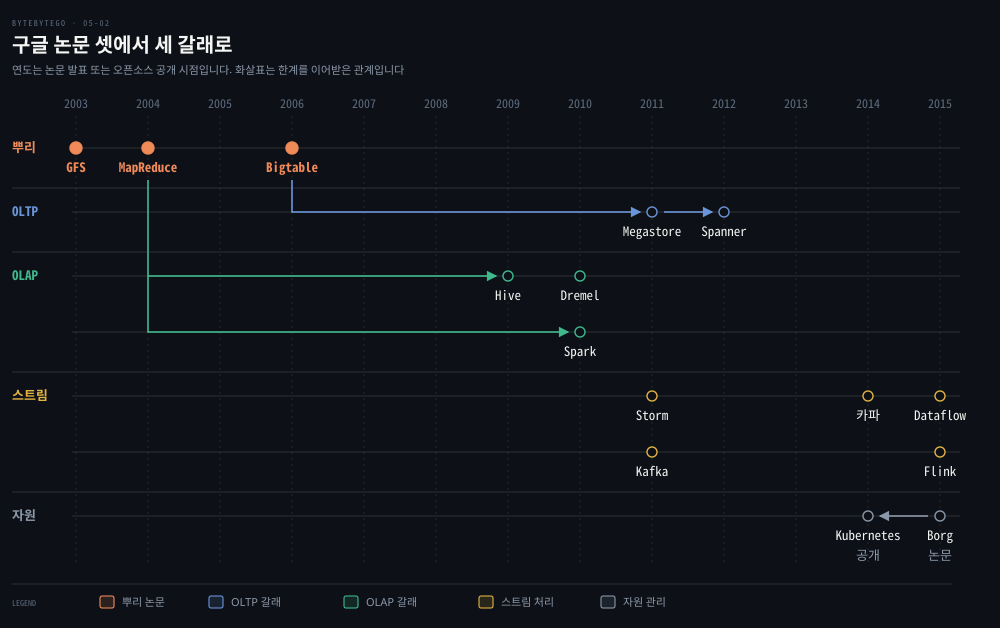
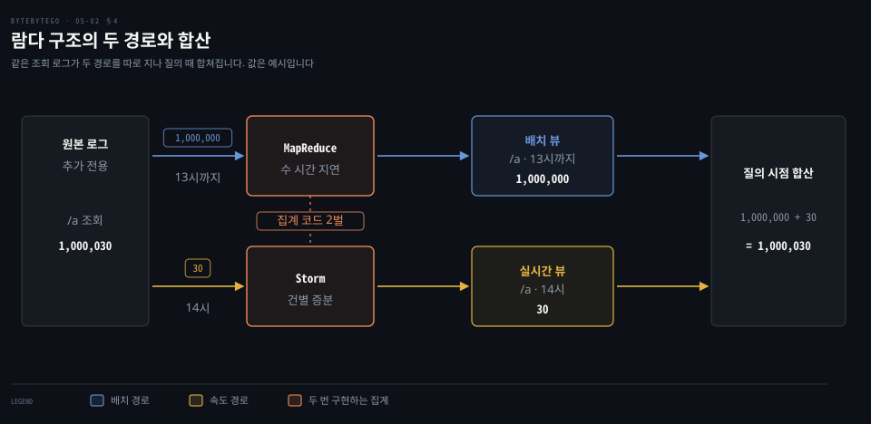
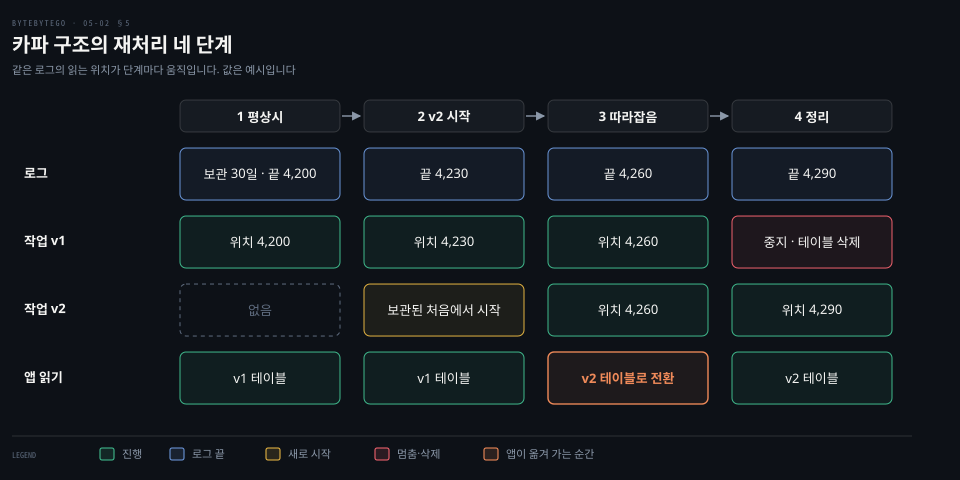

# 빅데이터 기술은 GFS·MapReduce·BigTable 에서 출발해 OLTP·OLAP·스트림 처리 갈래로 앞 세대의 한계를 하나씩 풀었다

---

> 빅데이터 기술은 구글의 GFS(저장)·MapReduce(계산)·Bigtable(온라인 조회) 세 논문에서 출발했고, 세 논문이 남긴 한계를 OLTP·OLAP·스트림 처리 갈래의 후속 시스템이 하나씩 풀었습니다.

## 핵심 요약

> 이 편의 중심 생각은 후속 시스템이 새 발명이 아니라 앞 세대가 남긴 한계 하나에 대한 응답이라는 것입니다.

구글은 2003년부터 2006년까지 값싼 서버 수천 대에 저장·계산·조회를 나눠 맡기는 논문 셋을 냈습니다. GFS 는 큰 파일을 청크로 쪼개 복제해 저장합니다. MapReduce 는 map 과 reduce 두 함수로 계산을 나눠 맡깁니다. Bigtable 은 그 위에 행 키로 찾는 구조화 저장소를 얹습니다. 세 논문이 남긴 한계가 뒤따른 시스템들의 숙제가 됐습니다. 관계형 모델과 다중 행 트랜잭션의 부재, 낮은 수준의 프로그래밍 모델, 디스크를 오가는 지연이 그것입니다.

OLTP 갈래에서는 Megastore 가 스키마와 작은 묶음 안의 ACID 를 되찾았고 Spanner 가 전 세계 규모의 외부 일관성 트랜잭션을 되찾았습니다. OLAP 갈래에서는 Hive 가 SQL 로 쓰기 어려움을 풀었고 Spark 와 Dremel 이 디스크 왕복과 질의 지연을 줄였습니다. 스트림 갈래에서는 람다 구조가 배치와 속도 두 경로로 지연을 줄였지만 같은 코드를 두 벌 유지해야 했습니다. 카파 구조와 Dataflow 모델·Flink 는 경로를 하나로 합쳤습니다.

## 학습 목표

> 이 편을 읽고 나면 다음을 설명할 수 있습니다.

1. 구글 논문 셋이 각각 맡은 일(저장·계산·온라인 조회)과 남긴 한계를 설명할 수 있습니다.
2. Bigtable 에서 Megastore 를 거쳐 Spanner 로 스키마와 트랜잭션이 돌아온 순서와 이유를 설명할 수 있습니다.
3. Hive·Spark·Dremel 이 MapReduce 의 서로 다른 한계를 어떻게 풀었는지 견줄 수 있습니다.
4. 람다 구조의 두 경로와 합산, 카파 구조의 재처리 절차를 같은 값으로 따라가며 차이를 말할 수 있습니다.
5. Dataflow 모델이 묻는 네 질문과 Chubby·Borg·Kubernetes 가 맡는 바닥 계층을 설명할 수 있습니다.

## 1. 구글 논문 셋은 저장·계산·온라인 조회를 나눠 맡고 한계를 남겼다

> GFS 는 파일 저장, MapReduce 는 계산, Bigtable 은 키로 읽고 쓰는 온라인 저장을 맡습니다. 세 논문은 값싼 서버가 수시로 죽는다는 전제로 단순화를 택했고, 그 단순화가 다음 세대의 숙제입니다.

서버 수천 대가 매일 어딘가에서 죽는다면 데이터와 계산을 어떻게 맡겨야 할까요? GFS 는 값싼 범용 서버 위에서 장애를 견디는 분산 파일 시스템입니다.[^gfs] 파일 대부분이 덧붙이기로만 바뀌고 임의 위치 쓰기는 사실상 없다는 관찰이 설계의 출발이었습니다.[^gfs] 파일은 64MB 청크로 쪼개져 기본 세 복제본이 서로 다른 청크서버에 놓입니다. 청크의 위치는 마스터 하나가 관리합니다.[^gfs]

마스터가 하나라는 단순화에는 값이 따릅니다. 변경을 받는 마스터는 하나입니다. 읽기의 고가용성은 그림자 마스터가 맡습니다. 더 강한 일관성을 갖춘 고가용성은 primary-copy 방식을 들이면 가능하다고만 논문이 적었습니다.[^gfs] 일관성도 느슨합니다. 동시에 성공한 쓰기는 영역을 '일관되지만 정의되지 않은' 상태로 남겨 여러 쓰기의 조각이 섞일 수 있습니다. 레코드 추가는 최소 한 번 들어가므로 중복과 패딩이 낄 수 있습니다.[^gfs] 응용은 체크포인트와 자기 검증 레코드로 이를 감당합니다.

MapReduce 는 계산을 map 과 reduce 두 함수로 나눠 맡깁니다. 입력 키-값 쌍마다 map 이 중간 쌍을 내면 같은 키의 값을 reduce 가 합칩니다. 병렬화와 분산은 프레임워크가 맡고 장애는 작업을 다시 실행해 견딥니다.[^mapreduce] map 의 중간 결과는 그 서버의 로컬 디스크에 남고 reduce 의 결과는 전역 파일 시스템(GFS)에 남습니다.[^mapreduce]

단순한 만큼 낮은 수준의 모델입니다. Hive 개발진은 이 모델이 유지와 재사용이 어려운 맞춤 프로그램을 요구한다고 짚었습니다.[^hive] Spark 개발진은 작업마다 디스크에서 데이터를 다시 읽는 비용을 짚었습니다.[^spark]

Bigtable 은 GFS 위에 온라인 조회용 저장소를 얹습니다. 데이터는 행 키·컬럼 키·타임스탬프로 찾는 정렬된 맵입니다. 로그와 데이터 파일은 GFS 에 두고 마스터 선출과 스키마 정보는 Chubby 에 둡니다.[^bigtable] 대신 관계형 모델을 지원하지 않고 트랜잭션은 한 행 안에서만 됩니다.[^bigtable]

| 논문 | 맡은 일 | 남긴 한계 | 이어받은 갈래 |
|------|---------|------------------|----------------|
| GFS 2003 | 대용량 파일 저장 | 단일 마스터, 느슨한 일관성 | 후속 파일 시스템 Colossus |
| MapReduce 2004 | 배치 계산 | 낮은 수준의 모델, 디스크 왕복(Hive·Spark 논문이 짚음) | OLAP 과 스트림 |
| Bigtable 2006 | 키로 찾는 온라인 저장 | 관계형 모델·다중 행 트랜잭션 없음 | OLTP |

GFS 의 한계는 구글 안에서 후속 시스템으로 풀렸습니다. 구글 클라우드 블로그는 Colossus 를 GFS 의 후계 파일 시스템이라 소개합니다. 검색의 메타데이터를 감당하려는 GFS 의 확장 한계가 개발 동기였고, 파일 메타데이터를 Bigtable 에 담아 가장 큰 GFS 클러스터보다 100배 넘게 키웠다고 설명합니다.[^colossus]

분산 파일 시스템의 일반 원리는 [분산 파일시스템과 오브젝트 스토어](../../../05_data/book/designing-data-intensive-applications/11-02.분산%20파일시스템과%20오브젝트%20스토어.md) 편에 있습니다. Bigtable 이 쓰는 SSTable 의 쓰기·읽기 경로는 [키-값 저장소 두 번째 편](../system-design/06-02.벡터%20시계·가십·임시%20위탁·머클%20트리가%20충돌과%20장애를%20다루고%20쓰기와%20읽기는%20SSTable%20을%20지난다.md)의 §6·§7 에 있습니다.

## 2. OLTP 갈래는 Bigtable 이 버린 스키마와 트랜잭션을 Megastore 와 Spanner 가 되찾았다

> Bigtable 이 포기한 것은 관계형 모델과 다중 행 트랜잭션입니다. Megastore 는 작은 묶음 안에서 스키마와 ACID 를, Spanner 는 전 세계 규모에서 외부 일관성 트랜잭션을 되찾았습니다.

키 하나로 읽고 쓰는 저장소에 복잡한 스키마와 강한 일관성을 요구하면 어디서 막힐까요? Spanner 논문은 Bigtable 사용자의 불만을 둘로 적습니다. 스키마가 복잡하고 자주 바뀌는 응용에서 쓰기 어렵고, 광역 복제 아래에서도 강한 일관성이 필요한 응용에서 쓰기 어렵다는 것입니다.[^spanner]

2011년 논문의 Megastore 는 NoSQL 의 확장성과 전통 RDBMS 의 편의를 섞은 저장소입니다.[^megastore] 데이터 모델은 스키마로 선언하고 타입이 강합니다. 각 데이터 센터에서는 그 센터의 Bigtable 이 바탕을 이룹니다.[^megastore]

단순화의 핵심은 데이터를 **엔터티 그룹**으로 나누는 것입니다. 그룹 하나는 단일 단계 ACID 트랜잭션으로 바뀌고 Paxos 로 데이터 센터 사이를 동기 복제합니다. 그룹을 넘나드는 작업은 비싼 2단계 커밋 대신 보통 비동기 메시지 큐를 씁니다. 그룹을 가로지르는 인덱스는 일관성이 느슨합니다.[^megastore] 메일은 계정 하나가 자연스러운 엔터티 그룹입니다.[^megastore] 트랜잭션 격리의 일반 원리는 [격리 수준과 낙관적 잠금](./01-01.격리%20수준과%20낙관적%20잠금이%20동시%20쓰기의%20이상%20현상을%20막고%20데이터%20모양이%20데이터베이스%20종류를%20고른다.md) 편에 있습니다.

그룹을 넘는 원자적 갱신은 2단계 커밋으로 되지만 지연이 커서 논문이 권하지 않았습니다.[^megastore] Spanner 논문은 많은 구글 응용이 반관계형 모델과 동기 복제 때문에 Megastore 를 택했지만 쓰기 처리량은 상대적으로 낮았다고 적습니다.[^spanner] 2012년 논문의 Spanner 는 Bigtable 같은 버전 있는 키-값 저장소에서 시각 기록이 붙은 다중 버전 데이터베이스로 진화했습니다. 스키마가 있는 반관계형 표와 SQL 기반 질의 언어와 범용 트랜잭션을 제공합니다. 논문은 전 세계 규모에서 외부 일관성 분산 트랜잭션을 처음 지원한 시스템이라고 밝힙니다.[^spanner]

열쇠는 TrueTime API 입니다. 현재 시각을 한 값이 아니라 불확실 구간으로 돌려줍니다. 구글의 구현은 그 불확실성을 대체로 10ms 아래로 유지하고, 구간이 커지면 Spanner 가 그만큼 기다려 순서를 지킵니다.[^spanner]

지금은 Spanner 가 이 설계를 서비스로 내놓습니다. 공식 문서는 TrueTime 과 외부 일관성을 따로 설명하고[^spanner-tt] Spanner 는 PostgreSQL 인터페이스도 제공합니다(2026-10 확인).[^spanner-pg] 분산 트랜잭션의 원자 커밋은 [분산 트랜잭션과 2PC](../../../05_data/book/designing-data-intensive-applications/08-04.분산%20트랜잭션과%202PC.md) 편의 §4 에 있습니다.

## 3. OLAP 갈래는 MapReduce 를 SQL 로 감싼 Hive 와 메모리의 Spark, 트리와 컬럼의 Dremel 로 갈린다

> Hive 는 MapReduce 를 SQL 로 감싸 쓰기 어려움을, Spark 는 디스크 왕복을, Dremel 은 질의 지연을 겨냥합니다. 풀려는 한계가 달라서 같은 OLAP 안에서도 방법이 셋으로 갈립니다.

분석가가 질의 하나마다 map 과 reduce 함수를 짜야 한다면 어떻게 될까요? 2009년 Facebook 의 Hive 는 SQL 과 닮은 선언형 언어 HiveQL 을 받아 MapReduce 작업으로 컴파일합니다.[^hive] 스키마와 통계를 담는 Metastore 도 갖췄습니다. 논문 시점에 Facebook 의 Hive 웨어하우스는 수천 개 표에 700TB 가 넘는 데이터를 담았고 100명이 넘는 사용자가 썼습니다.[^hive]

논문 시점의 Hive 는 아래에서 MapReduce 가 돌아 질의마다 디스크를 왕복했습니다. 지금 Hive 4.2.1 의 설정은 실행 엔진 기본값을 `tez` 로 두고 `mr` 은 폐기 예정으로 둡니다. Spark 엔진은 Hive 4 에서 제거됐습니다.[^hive-conf]

2010년 Spark 논문은 반복 작업과 대화형 분석에서 MapReduce 의 비용을 짚었습니다. 작업마다 데이터를 디스크에서 다시 읽습니다. Pig 나 Hive 같은 SQL 인터페이스로 묻는 질의도 질의마다 별도 MapReduce 작업이라 지연이 수십 초에 이릅니다.[^spark] 그래서 작업 사이에 쓰는 데이터 집합(working set)을 여러 서버의 메모리에 올려 두고 재사용합니다. 반복 기계학습에서는 Hadoop 보다 10배 빨랐고 39GB 데이터를 1초 안에 훑는 대화형 질의도 보였습니다.[^spark] 메모리의 집합은 읽기 전용 모음(RDD)이라 한 조각이 사라져도 다시 만들 수 있습니다.[^spark]

2010년 논문의 Dremel 은 다른 길입니다. 여러 단계의 실행 트리와 컬럼 저장 배치를 결합해 조 단위 행 표에서도 집계 질의를 몇 초에 돌립니다.[^dremel] 질의 하나의 실측이 방법의 차이를 보여 줍니다. 같은 질의를 레코드 단위로 저장한 데이터에 MapReduce 로 돌리면 압축 데이터 87TB 를 읽고 몇 시간이 걸립니다. 컬럼 저장으로 바꾸면 0.5TB 만 읽어 몇 분으로 줍니다. Dremel 은 같은 0.5TB 를 몇 초에 처리합니다(3000 노드, 레코드 850억 건).[^dremel]

논문은 Dremel 이 MapReduce 를 대체하려는 것이 아니라고 밝힙니다. MapReduce 파이프라인의 출력을 분석하거나 큰 계산의 시제품을 만들 때 함께 쓰입니다. 이 시스템은 2006년부터 구글 안에서 쓰였습니다.[^dremel] 그 계보는 BigQuery 로 이어졌습니다. 2016년 구글 블로그는 BigQuery 요청을 Dremel 질의 엔진이 처리하고 슬롯(말단)과 믹서(집계)는 Borg 가 돌리며 데이터는 Colossus 에서 읽는다고 설명했습니다.[^bq] 2020년 논문도 BigQuery 가 Dremel 위에 있다고 적습니다.[^dremel-2020]

컬럼 저장 자체는 [분석용 컬럼 지향 저장](../../../05_data/book/designing-data-intensive-applications/04-05.분석용%20컬럼%20지향%20저장.md) 편에 있습니다. MapReduce 와 데이터플로우 엔진은 [MapReduce](../../../05_data/book/designing-data-intensive-applications/11-03.분산%20잡%20오케스트레이션과%20MapReduce.md)·[데이터플로우 엔진](../../../05_data/book/designing-data-intensive-applications/11-04.데이터플로우%20엔진과%20배치%20활용.md) 편에 있습니다. OLTP 와 OLAP 의 구분은 [운영 시스템 vs 분석 시스템](../../../05_data/book/designing-data-intensive-applications/01-01.운영%20시스템%20vs%20분석%20시스템.md) 편의 §3 에 있습니다.

## 4. 람다 구조는 배치와 속도 두 경로를 질의 때 합쳐 지연을 줄이지만 같은 집계를 두 번 구현한다

> 람다 구조는 배치 경로의 정확함에 속도 경로의 빠름을 더하고 질의 때 둘을 합칩니다. 대가는 같은 집계를 두 시스템에 따로 구현하는 일입니다.

배치 처리는 정확하지만 결과가 늦습니다. 지연을 줄이면서 정확함을 지키려면 어떻게 해야 할까요? 2011년 Nathan Marz 가 글로 제시한 틀이 람다 구조입니다. 모든 데이터를 바꾸지 않는 추가 전용 마스터 데이터셋에 쌓고 배치 경로가 그 전부에서 뷰를 미리 계산합니다.[^marz-cap]

배치 경로는 쓴 데이터가 질의에 반영되기까지 몇 시간이 걸립니다. 마지막 몇 시간은 속도(실시간) 경로가 증분 알고리즘으로 따로 메웁니다. 질의 때는 두 뷰를 합칩니다. 실시간 뷰가 낸 값은 결국 배치 뷰가 덮어써서 실수가 바로잡힙니다.[^marz-cap]

도식의 조회 건수와 시각은 설명용 예시 값이고 `/a` 는 조회 대상 페이지의 예시 주소이며 원본 로그는 마스터 데이터셋입니다. 구조는 Marz 의 페이지 조회 수 예시를 따랐습니다. 13시까지의 조회 1,000,000건은 MapReduce 가 배치 뷰로 셉니다. 14시의 30건은 Storm 이 건마다 실시간 뷰에 더합니다. 질의 시점에 1,000,000 + 30 = 1,000,030 으로 합칩니다.[^marz-cap]

속도 경로를 맡은 Storm 은 Marz 가 BackType 에서 만들었습니다. Twitter 에 합류한 뒤 2011년 9월 19일 컨퍼런스에서 오픈소스로 공개했고 2014년 9월 17일 Apache 최상위 프로젝트가 됐습니다.[^marz-storm] 2011년 6월에는 LinkedIn 이 로그 수집과 전달을 위한 Kafka 를 논문으로 발표했습니다.[^kafka-paper] Kafka 내부는 [Kafka 편](./05-01.Kafka%20는%20순차%20IO%20와%20제로%20카피로%20빠르고%20전달%20보장은%20최대%20한%20번·최소%20한%20번·정확히%20한%20번으로%20갈린다.md)에서 다뤘으므로 여기서는 풀지 않습니다.

도식 가운데 칩이 람다의 대가를 가리킵니다. 같은 집계를 MapReduce 와 Storm 에 따로 구현해야 합니다. 이 비용이 다음 절의 출발점입니다.

## 5. 카파 구조는 로그를 오래 보관해 경로를 하나로 줄이고 Dataflow 모델과 Flink 가 그 경로를 다듬는다

> 카파 구조는 로그를 오래 보관해 재처리를 스트림 작업 하나가 맡게 합니다. Dataflow 모델은 그 한 경로가 순서가 뒤섞인 데이터를 다루는 방법을 정하고 Flink 와 Beam 이 이를 이어받았습니다.

같은 코드를 두 시스템에 두면 무엇이 괴로울까요? 2014년 Jay Kreps 는 같은 결과를 내야 하는 코드를 복잡한 분산 시스템 둘에서 유지하는 일이 짐작처럼 고통스럽고 고쳐질 문제가 아니라고 비판했습니다.[^kreps] 그는 람다가 반복되는 이유를 도구의 한계로 봤습니다. 확장되지만 느린 배치 시스템과 빠르지만 재처리를 못 하는 스트림 시스템을 이어 붙인 임시 상태라는 것입니다.[^kreps]

대안은 재처리를 스트림 작업 하나가 맡게 하는 것입니다. Kreps 는 이를 카파 아키텍처라 불러도 되겠다고 덧붙였습니다.[^kreps] 절차는 네 단계입니다. 재처리할 기간만큼 Kafka 보관 기간을 늘립니다(예: 30일). 처리 코드가 바뀌면 같은 작업의 두 번째 인스턴스를 보관된 로그의 처음부터 돌려 새 출력 테이블에 씁니다. 따라잡으면 앱이 새 테이블을 읽게 바꿉니다. 옛 작업을 멈추고 옛 테이블을 지웁니다.[^kreps]

도식의 오프셋 4,200·4,230·4,260·4,290 은 예시 값이고 옛 작업을 v1 새 작업을 v2 라 불렀습니다. 1단계는 평상시입니다. 새 작업이 보관된 처음에서 시작해 로그 끝 4,260 을 따라잡는 순간 앱이 새 테이블로 옮겨 갑니다. Kreps 는 이 방식이 재처리가 필요할 때만 두 번째 사본을 띄운다는 점에서 람다와 다르다고 말합니다. 진짜 장점은 효율이 아니라 한 처리 프레임워크 위에서 개발·테스트·운영하는 단순함이라고 합니다.[^kreps]

2015년 구글의 Dataflow 모델 논문은 이 흐름에 추상화를 더했습니다. 끝나지 않고 순서도 뒤섞인 데이터를 처리할 때 정확성·지연·비용 사이에서 고르게 하는 모델입니다. 파이프라인을 네 질문으로 나눕니다. 무엇을 계산하는가, 이벤트 시간의 어디에서 계산하는가, 처리 시간의 언제 내보내는가, 앞선 결과와 뒤의 보정이 어떻게 이어지는가입니다.[^dataflow]

논문은 람다 구조가 원하는 요건 가운데 많은 것을 이루지만 시스템 둘을 만들고 유지해야 해서 단순함에서 실패한다고 평가합니다.[^dataflow] 구글 안의 경험도 적혀 있습니다. MillWheel 로 약한 일관성 스트리밍을 돌리고 밤마다 MapReduce 로 정답을 만들던 한 팀이 있었습니다. 결과를 받는 쪽이 시간이 지나며 약한 결과를 믿지 않게 되자 그 팀은 강한 일관성의 스트림 시스템으로 다시 구현했습니다.[^dataflow]

이 모델은 구글 밖에서 Apache Beam 과 Flink 로 이어졌습니다. Beam 소개 문서는 Beam 모델이 곧 Dataflow 모델이라고 적습니다.[^beam] 2015년 Flink 논문은 스트림과 배치를 한 실행 엔진으로 다룹니다. 람다 같은 패턴이 빠른 근사 경로와 늦은 정확 경로를 겹쳐 지연과 복잡도(시스템 여럿을 엮고 업무 로직을 두 번 구현)를 낳는다고 짚습니다.[^flink] 이벤트 시간과 워터마크와 순서가 뒤바뀐 데이터를 다루는 창 처리는 Dataflow 모델과 같은 계열의 개념입니다.[^flink]

람다와 카파의 일반론은 [배치·스트림 통합과 DB 언번들링](../../../05_data/book/designing-data-intensive-applications/13-02.배치·스트림%20통합과%20DB%20언번들링.md) 편의 §3 에 있습니다. 이벤트 시간과 지각 이벤트는 [시간 추론과 내결함성](../../../05_data/book/designing-data-intensive-applications/12-04.시간%20추론과%20내결함성·12장%20종합.md) 편의 §1·§2 에 있습니다. Kafka 위에서 도는 스트림 처리 실습은 [Kafka Streams](../../../04_messaging/06_StreamProcessing/01-01.Kafka%20Streams.md) 편에 있습니다.

## 6. 서버 수천 대를 굴리는 바닥은 합의 서비스와 자원 관리자가 맡는다

> 서버가 수천 대면 누가 마스터인지 합의하고 작업을 어느 서버에 놓을지 정하는 일이 따로 필요합니다. Chubby 와 Raft 가 앞의 일을, Borg 와 Kubernetes 가 뒤의 일을 맡습니다.

앞의 시스템들은 모두 마스터를 하나 세우거나 작업을 서버에 배치해야 합니다. 이 일은 누가 맡을까요? Chubby 는 굵은 단위의 잠금과 작은 저장을 주는 구글의 잠금 서비스입니다. GFS 는 Chubby 의 잠금으로 마스터를 정합니다. Bigtable 은 마스터 선출과 서버 발견과 스키마·접근 제어 저장에 씁니다.[^chubby][^bigtable] Chubby 자체는 복제본 다섯 개가 Paxos 로 상태를 맞춥니다.[^bigtable]

Paxos 의 난해함을 줄이려 2014년 Raft 가 나왔습니다. 논문은 학생 43명 대상 사용자 연구에서 Raft 쪽 질문에 더 잘 답한 학생이 33명이라고 보고합니다.[^raft] 합의의 일반론은 [합의와 코디네이션 서비스](../../../05_data/book/designing-data-intensive-applications/10-04.합의와%20코디네이션%20서비스.md) 편에 있습니다. 서비스끼리 말을 주고받는 공구로는 Thrift 가 있습니다. Thrift 는 Facebook 이 만들어 2010년부터 Apache 최상위 프로젝트입니다.[^thrift-apache] 언어 중립 정의 파일 하나에서 여러 언어의 RPC 클라이언트와 서버 코드를 생성하며 Hive 의 클라이언트 API 도 Thrift 로 만들어집니다.[^thrift][^hive]

작업 배치는 Borg 가 맡습니다. 2015년 논문이 소개한 구글의 클러스터 관리자 Borg 는 많은 응용의 수십만 작업을 최대 수만 대 규모의 클러스터에서 돌립니다.[^borg] 앞 절에서 본 Dremel 은 2009년 초 Borg 로 옮겨 그 위에서 돌았고,[^dremel-2020] 2016년 블로그는 실행 트리의 슬롯과 믹서도 Borg 가 돌린다고 적었습니다.[^bq]

Kubernetes 는 이 경험에서 나왔습니다. 구글은 2014년 Kubernetes 를 오픈소스로 공개했습니다. 공식 문서는 이 프로젝트가 구글이 운영해 온 15년 넘는 경험을 담았다고 적습니다(2026-10 확인).[^k8s] Borg 에서 Omega 를 거쳐 Kubernetes 로 이어지며 얻은 교훈은 2016년 ACM Queue 글에 정리돼 있습니다.[^k8s-queue] Kubernetes 의 구조와 기원은 [쿠버네티스란 무엇인가](../../../08_cloud/book/kubernetes-in-action/01-01.쿠버네티스란%20무엇인가%20—%20기원과%20아키텍처.md) 편의 §2 에 있습니다.

## 면접 대비

> 구글 논문 셋과 세 갈래의 한계 해소, 람다·카파 구조에 관한 면접 질문입니다.

1. GFS·MapReduce·Bigtable 이 각각 맡은 일과 남긴 한계는 무엇입니까?
2. Bigtable 이 버린 것을 Megastore 와 Spanner 가 어떤 순서로 되찾았는지 말해 보십시오.
3. Hive·Spark·Dremel 은 MapReduce 의 서로 다른 어떤 한계를 풉니까?
4. 람다 구조가 두 경로를 합산하는 방식과 그 대가, 카파 구조의 재처리 절차를 설명해 보십시오.
5. Dataflow 모델의 네 질문과 Kubernetes 가 Borg 에서 이어받은 것은 무엇입니까?

## 정답 (자답 후 펼치기)

> 면접 질문에 대한 키워드 중심의 모범 답안입니다.

### 정답 1 — 저장·계산·온라인 조회와 각자의 단순화

GFS 는 파일 저장이고 한계는 단일 마스터와 느슨한 일관성입니다. MapReduce 는 배치 계산이고 한계는 낮은 수준의 두 함수 모델과 디스크 왕복입니다. Bigtable 은 키로 찾는 온라인 저장이고 한계는 관계형 모델과 다중 행 트랜잭션의 부재입니다.

### 정답 2 — 스키마와 그룹 ACID 가 먼저, 전역 외부 일관성이 다음

Megastore 가 스키마와 엔터티 그룹 안의 ACID 와 Paxos 동기 복제를 되찾았습니다. 그룹을 넘는 갱신은 2단계 커밋이 느려 권하지 않았고 쓰기 처리량도 낮자 Spanner 가 TrueTime 의 불확실 구간으로 전 세계 규모의 외부 일관성 분산 트랜잭션을 지원했습니다.

### 정답 3 — 쓰기 난이도, 디스크 왕복, 질의 지연

Hive 는 SQL 형 언어를 MapReduce 로 컴파일해 쓰기 어려움을 풉니다. Spark 는 작업 사이의 데이터를 메모리에 두어 디스크 왕복을 줄입니다. Dremel 은 실행 트리와 컬럼 저장으로 질의를 몇 초로 줄입니다.

### 정답 4 — 람다는 두 경로 합산과 코드 두 벌, 카파는 로그 재생

람다는 배치 뷰와 실시간 뷰를 질의 때 더하는 구조이고 같은 집계를 두 시스템에 구현해야 합니다. 카파는 로그를 오래 보관하고 새 작업을 처음부터 돌려 새 테이블을 채운 뒤 앱을 옮기고 옛 작업과 테이블을 지웁니다.

### 정답 5 — 무엇·어디서·언제·어떻게, 그리고 경험의 오픈소스화

Dataflow 모델의 네 질문은 무엇을 계산하는가, 이벤트 시간 어디에서인가, 처리 시간 언제 내보내는가, 보정이 어떻게 이어지는가입니다. Kubernetes 는 구글이 Borg 로 쌓은 운영 경험을 담아 2014년 오픈소스로 공개한 컨테이너 오케스트레이터입니다.

## 참고 자료

- ByteByteGo 「System Design」 그림 해설 모음의 글 두 편(빅데이터 논문 연대표, 빅데이터의 진화). 공개 저장소 https://github.com/ByteByteGoHq/system-design-101 에서는 같은 글을 찾지 못했습니다.
- 논문과 글의 원본 주소는 각주에 있습니다. 구글 논문 셋: https://static.googleusercontent.com/media/research.google.com/en//archive/gfs-sosp2003.pdf · https://static.googleusercontent.com/media/research.google.com/en//archive/mapreduce-osdi04.pdf · https://static.googleusercontent.com/media/research.google.com/en//archive/bigtable-osdi06.pdf
- Dataflow 모델: https://www.vldb.org/pvldb/vol8/p1792-Akidau.pdf
- Kreps, Questioning the Lambda Architecture: https://www.oreilly.com/radar/questioning-the-lambda-architecture/

## 관련 문서

- [운영 시스템 vs 분석 시스템](../../../05_data/book/designing-data-intensive-applications/01-01.운영%20시스템%20vs%20분석%20시스템.md)
- [MapReduce](../../../05_data/book/designing-data-intensive-applications/11-03.분산%20잡%20오케스트레이션과%20MapReduce.md)
- [데이터플로우 엔진](../../../05_data/book/designing-data-intensive-applications/11-04.데이터플로우%20엔진과%20배치%20활용.md)
- [배치·스트림 통합과 DB 언번들링](../../../05_data/book/designing-data-intensive-applications/13-02.배치·스트림%20통합과%20DB%20언번들링.md)
- [Kafka 순차 IO 와 전달 보장](./05-01.Kafka%20는%20순차%20IO%20와%20제로%20카피로%20빠르고%20전달%20보장은%20최대%20한%20번·최소%20한%20번·정확히%20한%20번으로%20갈린다.md)

[^gfs]: Ghemawat·Gobioff·Leung, The Google File System (SOSP 2003). 상용 서버·덧붙이기 §1·§2.1, 복제본 3개 §2.3, 청크 64MB §2.5, 일관성 모델 §2.7, 마스터 복제와 그림자 마스터 §5.1.3, 관련 연구 §8: <https://static.googleusercontent.com/media/research.google.com/en//archive/gfs-sosp2003.pdf>
[^mapreduce]: Dean·Ghemawat, MapReduce: Simplified Data Processing on Large Clusters (OSDI 2004) §2, §3: <https://static.googleusercontent.com/media/research.google.com/en//archive/mapreduce-osdi04.pdf>
[^bigtable]: Chang 외, Bigtable: A Distributed Storage System for Structured Data (OSDI 2006). 초록, 관계형 모델 §1, 데이터 모델 §2, 단일 행 트랜잭션 §3, GFS·SSTable·Chubby §4: <https://static.googleusercontent.com/media/research.google.com/en//archive/bigtable-osdi06.pdf>
[^megastore]: Baker 외, Megastore: Providing Scalable, Highly Available Storage for Interactive Services (CIDR 2011). 초록, 엔터티 그룹 §2.2, 데이터 모델 §3.2, 2단계 커밋 §3.3.2: <https://www.cidrdb.org/cidr2011/Papers/CIDR11_Paper32.pdf>
[^spanner]: Corbett 외, Spanner: Google's Globally-Distributed Database (OSDI 2012). 초록과 §1: <https://static.googleusercontent.com/media/research.google.com/en//archive/spanner-osdi2012.pdf>
[^spanner-tt]: Google Cloud, Spanner: TrueTime and external consistency: <https://docs.cloud.google.com/spanner/docs/true-time-external-consistency>
[^spanner-pg]: Google Cloud, PostgreSQL interface (Spanner): <https://docs.cloud.google.com/spanner/docs/postgresql-interface>
[^hive]: Thusoo 외, Hive - A Warehousing Solution Over a Map-Reduce Framework (VLDB 2009) §1, §3: <https://www.vldb.org/pvldb/vol2/vldb09-938.pdf>
[^hive-conf]: Apache Hive 4.2.1 `HiveConf.java` 의 `hive.execution.engine`: <https://raw.githubusercontent.com/apache/hive/rel/release-4.2.1/common/src/java/org/apache/hadoop/hive/conf/HiveConf.java>. Spark 엔진 제거: HIVE-26134 <https://issues.apache.org/jira/browse/HIVE-26134>
[^spark]: Zaharia 외, Spark: Cluster Computing with Working Sets (HotCloud 2010) 초록과 §1: <https://www.usenix.org/legacy/event/hotcloud10/tech/full_papers/Zaharia.pdf>
[^dremel]: Melnik 외, Dremel: Interactive Analysis of Web-Scale Datasets (VLDB 2010). 초록, §1, §7 실험: <https://www.vldb.org/pvldb/vol3/R29.pdf>
[^bq]: Google Cloud 블로그, BigQuery under the hood (2016-01-28): <https://cloud.google.com/blog/products/bigquery/bigquery-under-the-hood>
[^dremel-2020]: Melnik 외, Dremel: A Decade of Interactive SQL Analysis at Web Scale (VLDB 2020): <https://www.vldb.org/pvldb/vol13/p3461-melnik.pdf>
[^thrift-apache]: Apache Thrift 소개: <https://thrift.apache.org/about>
[^colossus]: Google Cloud 블로그, A peek behind Colossus, Google's file system: <https://cloud.google.com/blog/products/storage-data-transfer/a-peek-behind-colossus-googles-file-system>
[^marz-cap]: Nathan Marz, How to beat the CAP theorem (2011-10-13): <http://nathanmarz.com/blog/how-to-beat-the-cap-theorem.html>
[^marz-storm]: Nathan Marz, History of Apache Storm and lessons learned: <http://nathanmarz.com/blog/history-of-apache-storm-and-lessons-learned.html>
[^kafka-paper]: Kreps·Narkhede·Rao, Kafka: a Distributed Messaging System for Log Processing (NetDB 2011, 2011-06-12): <https://www.microsoft.com/en-us/research/wp-content/uploads/2017/09/Kafka.pdf>
[^kreps]: Jay Kreps, Questioning the Lambda Architecture (O'Reilly Radar, 2014-07-02): <https://www.oreilly.com/radar/questioning-the-lambda-architecture/>
[^dataflow]: Akidau 외, The Dataflow Model (VLDB 2015) §1, §3.3.1: <https://www.vldb.org/pvldb/vol8/p1792-Akidau.pdf>
[^beam]: Apache Beam 소개: <https://beam.apache.org/about/>
[^flink]: Carbone 외, Apache Flink: Stream and Batch Processing in a Single Engine (IEEE Data Eng. Bulletin 2015) §1, 시간 개념과 창: <https://asterios.katsifodimos.com/assets/publications/flink-deb.pdf>
[^chubby]: Burrows, The Chubby lock service for loosely-coupled distributed systems (OSDI 2006): <https://static.googleusercontent.com/media/research.google.com/en//archive/chubby-osdi06.pdf>
[^raft]: Ongaro·Ousterhout, In Search of an Understandable Consensus Algorithm (확장판, 2014-05-20): <https://raft.github.io/raft.pdf>
[^thrift]: Slee·Agarwal·Kwiatkowski, Thrift: Scalable Cross-Language Services Implementation (Facebook, 2007): <https://thrift.apache.org/static/files/thrift-20070401.pdf>
[^borg]: Verma 외, Large-scale cluster management at Google with Borg (EuroSys 2015): <https://static.googleusercontent.com/media/research.google.com/en//pubs/archive/43438.pdf>
[^k8s]: Kubernetes 공식 문서, 개요: <https://kubernetes.io/docs/concepts/overview/>
[^k8s-queue]: Burns 외, Borg, Omega, and Kubernetes (ACM Queue, 2016-03-02): <https://queue.acm.org/detail.cfm?id=2898444>
