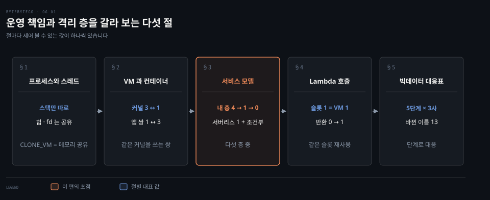
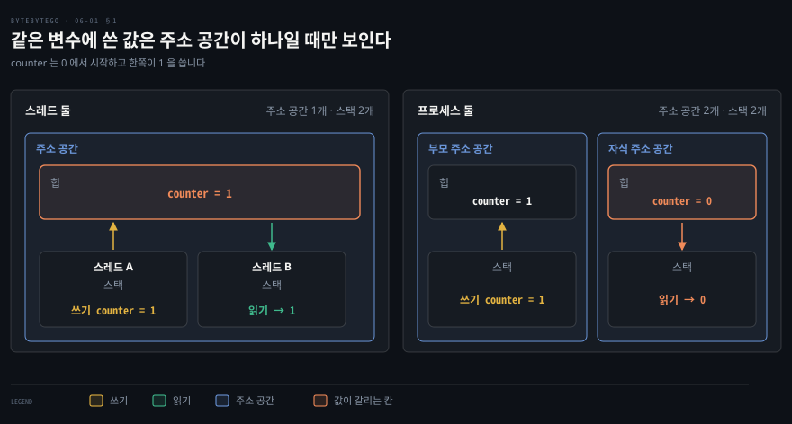
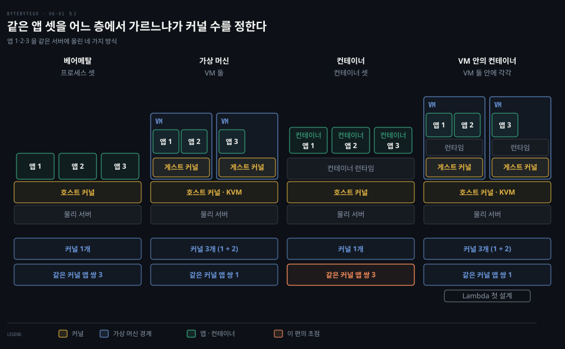
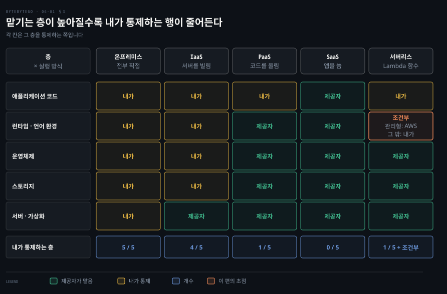
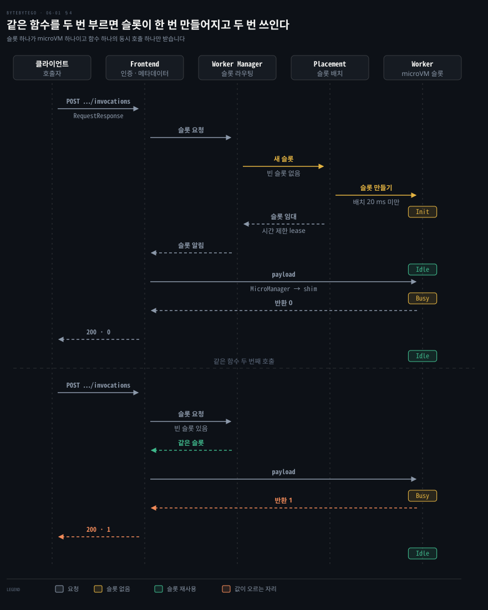

# IaaS·PaaS·SaaS 와 가상 머신·컨테이너·서버리스는 운영 책임을 어디까지 넘기는지로 갈린다

---

> IaaS·PaaS·SaaS 는 고객이 맡는 층의 수로 갈리고, 가상 머신·컨테이너·서버리스는 서로 믿지 못하는 코드를 갈라 놓는 층이 어디인지로 갈립니다.

## 핵심 요약

> 이 편의 중심 생각은 클라우드 실행 환경이 두 질문으로 갈린다는 것입니다. 운영의 어느 층까지 맡기는가, 그리고 남의 코드를 어느 층에서 갈라 놓는가입니다.

프로세스와 스레드가 격리 단위의 출발점입니다. 프로세스는 주소 공간을 따로 갖고 스레드는 나눠 쓰는데, 둘 다 커널은 같습니다. 같은 서버에서 남의 코드를 돌리려면 경계를 커널 위에 두는 컨테이너나 커널 아래에 두는 가상 머신이 필요하고, 그만큼 커널 수와 비용이 달라집니다.

운영 책임은 다른 축입니다. IaaS 는 운영체제부터, PaaS 는 코드와 설정만, SaaS 는 사용자 설정만 고객 몫이고 서버리스 함수는 PaaS 쪽 끝에 놓입니다. Lambda 는 함수마다 마이크로 VM 을 하나씩 두어 두 축을 함께 밀어붙입니다.

서비스 이름은 클라우드마다 다르고 해마다 바뀝니다. 그래서 빅데이터 파이프라인은 이름이 아니라 수집·저장·준비·웨어하우스·표현 다섯 단계로 대응시킵니다.

## 학습 목표

> 이 편을 읽고 나면 다음을 설명할 수 있습니다.

1. 프로세스와 스레드가 공유하는 것과 따로 갖는 것을 나누고 문맥 전환 비용이 다른 까닭을 설명할 수 있습니다.
2. 베어메탈·가상 머신·컨테이너·VM 안의 컨테이너가 커널을 몇 개 쓰는지 세어 격리 강도를 비교할 수 있습니다.
3. IaaS·PaaS·SaaS 정의에서 소비자가 통제하는 층을 뽑아 격자로 정리하고 서버리스가 어디에 놓이는지 말할 수 있습니다.
4. Lambda 가 호출 한 건을 슬롯과 마이크로 VM 에 이어 주는 순서를 설명할 수 있습니다.
5. 세 클라우드의 빅데이터 서비스를 다섯 단계로 대응시키고 바뀐 이름을 현재 이름으로 읽을 수 있습니다.

## 1. 프로세스는 주소 공간을 따로 갖고 스레드는 그 주소 공간을 나눠 쓴다

> 프로그램은 디스크의 명령어 묶음이고 실행되면 프로세스가 됩니다. 스레드는 프로세스 안의 실행 흐름이며 스택만 따로 갖고 힙과 열린 파일은 함께 씁니다.

같은 프로그램을 두 번 실행한 것과 한 프로그램이 일을 둘로 나눈 것은 운영체제에게 어떻게 다를까요? 앞의 경우는 프로세스 둘이고 뒤의 경우는 스레드 둘입니다.[^bbg-thread] **프로그램**은 디스크에 놓인 실행 파일이고, 메모리에 올라 실행되면 **프로세스**가 되어 레지스터·프로그램 카운터·스택 같은 자원을 받습니다.

한 프로그램이 프로세스를 여럿 만들 수도 있습니다. Chromium 은 웹 사이트 인스턴스마다 렌더러 프로세스를 따로 두는 것을 목표로 하고, 프로세스가 너무 많아지면 새 탭을 기존 프로세스에 배정합니다.[^chromium] 그래서 탭 하나가 프로세스 하나라는 대응은 지금은 성립하지 않습니다.

같은 프로세스의 스레드는 전역 메모리(데이터와 힙)를 공유하고 스택만 스레드마다 따로 갖습니다. 프로세스 ID·열린 파일 기술자·현재 디렉터리·사용자와 그룹 ID 도 프로세스 전체가 공유하고, 스레드 ID·시그널 마스크·`errno` 는 스레드마다 따로입니다.[^pthreads]

리눅스에서는 `clone` 의 플래그가 무엇을 공유할지 하나씩 정합니다. 메모리 공간은 `CLONE_VM` 이 갈라서, 켜면 만든 쪽과 만들어진 쪽이 같은 메모리를 쓰고 쓰기가 서로 보이며 끄면 호출 시점의 복사본을 따로 받습니다. 파일 기술자 표는 `CLONE_FILES`, 현재 디렉터리와 루트는 `CLONE_FS` 가 정합니다. 같은 스레드 그룹에 들어가려면 `CLONE_THREAD` 를 켜야 하고 이 플래그는 `CLONE_SIGHAND` 를, 그것은 다시 `CLONE_VM` 을 함께 요구합니다.[^clone]

그림의 `counter` 가 이 차이를 보여 줍니다. 스레드 A 가 1 을 쓰면 스레드 B 는 1 을 읽습니다. 프로세스를 나눈 자식은 복사된 시점의 0 을 읽습니다.

이 차이는 비용으로도 이어집니다. 프로세스는 만들고 끝내는 데 시간이 더 들고, 스레드 사이의 통신은 메모리를 공유하므로 더 빠릅니다.[^bbg-thread] 문맥 전환도 같은 프로세스의 스레드 사이에서는 주소 공간이 같아서 쓰던 페이지 테이블을 그대로 두지만 프로세스 사이에서는 바꿔야 합니다.[^ostep] 반대로 공유 메모리를 동시에 고치면 경쟁 상태가 생기므로 공유는 곧 책임입니다. 커널 안에서 스레드가 `task_struct` 하나로 표현되는 구조는 [프로세스와 스레드 노트](../../../02_os/book/linux-kernel-programming/06-01.프로세스와%20스레드%20%281%29%20—%20컨텍스트·VAS·스택.md)에서 다뤘습니다.

프로세스 경계는 주소 공간을 갈라 놓지만 커널은 같습니다. 서로 믿지 못하는 코드를 한 서버에 올릴 때 이 경계로 충분한지가 다음 절의 질문입니다.

## 2. 가상 머신은 커널을 하나 더 두고 컨테이너는 커널을 나눠 쓴다

> 경계를 커널 아래에 두면 가상 머신이고 커널 위에 두면 컨테이너입니다. 경계가 커널 아래로 내려갈수록 같은 커널을 두드리는 앱 쌍이 줄어듭니다.

서버 한 대에 앱 셋을 올렸는데 하나가 뚫려도 나머지가 안전해야 한다면 어느 층에서 갈라야 할까요? 후보는 네 모양입니다.

**가상 머신**은 하이퍼바이저가 하드웨어 위에 추상 층을 만들고 VM 마다 자기 운영체제를 띄우는 방식입니다. 리눅스에서는 물리 서버 위의 호스트 커널이 KVM 으로 하이퍼바이저 구실을 하고,[^fc-paper] Firecracker 같은 VMM 이 KVM 으로 마이크로 VM 을 만듭니다.[^fc-repo]

VM 안의 코드는 게스트 커널을 마음껏 쓰지만 그 게스트 커널은 믿지 않는 대상으로 다룹니다. 하드웨어 가상화와 VMM 이 게스트 커널이 호스트에 닿는 범위를 막습니다.[^fc-paper] 하이퍼바이저가 호스트 운영체제 위에 얹히는 형태와 하드웨어에 직접 올라가는 형태의 차이는 [가상머신 노트](../../../08_cloud/book/container-security/05-01.가상머신%20—%20왜%20VM%20격리가%20더%20강하다고%20하는가.md)에서 풀었습니다.

**컨테이너**는 호스트 커널을 나눠 쓰는 프로세스입니다. 컨테이너 런타임이 물리 서버 위의 호스트 커널에서 컨테이너를 띄우고, 안의 코드는 호스트 커널을 직접 호출하며 커널 기능 몇 가지를 조합해 격리합니다. 네 가지가 쓰입니다.[^fc-paper]

- cgroups: CPU·메모리 사용을 묶습니다.
- namespaces: 프로세스 ID 나 네트워크 인터페이스 같은 자원을 따로 보이게 합니다.
- seccomp-bpf: 쓸 수 있는 시스템 콜을 제한합니다.
- chroot: 파일 시스템을 가둡니다.

앞의 둘은 [namespace 노트](../../../08_cloud/book/container-security/04-01.namespace와%20루트%20디렉토리%20—%20격리를%20만드는%20두%20장치.md)와 [Control Group 노트](../../../08_cloud/book/container-security/03-01.Control%20Group%20—%20자원을%20제한해%20굶기기를%20막다.md)가 자세합니다.

이 가운데 가장 중요한 경계는 시스템 콜 제한입니다. 그래서 호환성과 보안이 맞바뀝니다. 간단한 리눅스 프로그램은 서로 다른 시스템 콜 15개로 돌지만, 논문이 인용한 측정에서 우분투 15.04 한 벌이 문제없이 돌려면 시스템 콜 224개와 ioctl 52종이 필요했습니다.[^fc-paper] 시스템 콜을 많이 막을수록 안전해지지만 돌지 않는 프로그램이 생깁니다.

그림의 아래 두 줄은 세어서 얻은 값입니다. 베어메탈과 컨테이너는 앱 셋이 커널 하나를 같이 쓰므로, 같은 커널을 쓰는 앱 쌍이 앱 1 과 2, 1 과 3, 2 와 3 으로 셋입니다.

VM 둘에 앱 1·2 와 앱 3 을 나눠 올리면 같은 커널을 쓰는 쌍은 앱 1 과 2 하나만 남습니다. 대신 커널은 호스트 1개에 게스트 2개를 더해 셋입니다. 격리가 강해지는 만큼 커널과 메모리가 늘어나는 셈입니다.

Lambda 는 이 두 모양을 모두 거쳤습니다. 처음에는 고객 계정 사이를 VM 으로, 같은 고객의 함수 사이를 컨테이너로 갈랐습니다. 컨테이너가 보안과 호환성을 맞바꾸어야 했고 고정 크기 VM 에 일감을 촘촘히 담기 어려웠으므로, 2018년부터 EC2 베어메탈 위의 Firecracker 마이크로 VM 으로 옮겼습니다. 지금은 마이크로 VM 하나에 함수 하나가 들어가므로 같은 커널을 쓰는 함수 쌍이 0 입니다.[^fc-paper] 컨테이너와 VM 사이를 메우는 샌드박스 갈래는 [컨테이너 격리 강화 노트](../../../08_cloud/book/container-security/08-01.컨테이너%20격리%20강화%20—%20샌드박싱의%20세%20갈래.md)가 정리합니다.

## 3. IaaS·PaaS·SaaS 는 고객이 맡는 층의 수가 갈리는 지점이다

> 소비자가 통제하는 층이 IaaS 에서는 운영체제까지, PaaS 에서는 배포한 코드까지, SaaS 에서는 사용자 설정까지입니다. 서버리스 함수는 PaaS 쪽에 놓이되 런타임 칸의 주인이 조건에 따라 바뀝니다.

새벽에 운영체제 보안 패치가 나오면 누가 일어나야 할까요? 이 질문의 답이 서비스 모델입니다. 클라우드가 아닌 온프레미스에서는 하드웨어부터 애플리케이션까지 전부 직접 소유하고 운영합니다. NIST 는 클라우드의 세 가지 서비스 모델을 소비자가 통제하는 범위로 정의합니다.[^nist]

- **SaaS**: 소비자는 제공자의 애플리케이션을 쓰고, 네트워크·서버·운영체제·스토리지는 물론 개별 애플리케이션 기능도 통제하지 못하며 제한된 사용자별 설정만 다룹니다.
- **PaaS**: 소비자가 만들거나 구한 애플리케이션을 제공자가 지원하는 언어·라이브러리·서비스·도구로 올립니다. 운영체제와 스토리지는 통제하지 못하고 배포한 애플리케이션과 호스팅 환경 설정만 통제합니다.
- **IaaS**: 소비자는 처리·스토리지·네트워크 같은 기본 자원을 받아 운영체제와 애플리케이션을 포함한 임의의 소프트웨어를 올립니다. 운영체제·스토리지·배포한 애플리케이션을 통제하고 호스트 방화벽 같은 일부 네트워크 구성 요소만 제한적으로 통제합니다.

위 정의를 다섯 층으로 옮긴 것이 격자이고, 각 칸은 그 층을 통제하는 쪽입니다. NIST 정의가 IaaS 소비자의 통제 범위에 스토리지를 넣으므로 격자도 그 구분을 따랐습니다. 네트워크는 IaaS 에서도 일부만 소비자 몫이라 행으로 세우지 않았습니다. 내가 통제하는 행을 세면 온프레미스 5개, IaaS 4개(서버·가상화만 제공자), PaaS 1개(애플리케이션 코드), SaaS 0개입니다. 층을 넘길수록 패치와 용량 계획 부담이 사라지는 대신 통제할 수 있는 범위도 같이 사라집니다.

서버리스 함수는 소비자가 만든 코드를 제공자가 지원하는 런타임으로 올리므로 PaaS 정의에 가깝습니다. Lambda 에서는 AWS 가 인프라·기반 서비스·운영체제·애플리케이션 플랫폼을 관리하고 고객은 코드와 IAM 을 책임집니다.[^wp] 런타임 칸은 한 칸이 세 가지로 갈립니다.

1. 관리형 런타임이면 Lambda 가 보안 업데이트를 게시하고 기본값으로 자동 적용합니다.[^lrt]
2. 컨테이너 이미지로 배포하면 고객이 최신 베이스 이미지로 다시 빌드해 배포합니다.[^lrt]
3. 커스텀 런타임이면 최신 보안 패치를 넣는 유지보수까지 고객 몫입니다.[^wp]

어느 경우든 함수 코드와 그 의존성의 업데이트는 고객이 맡습니다. 그래서 서버리스에서 내가 통제하는 층은 1개에 조건부 1개입니다.

온프레미스·PaaS·IaaS 로 앱을 배포하는 선택지의 장단점은 [How to Deploy Your App 노트](../../../07_devops/book/fdsd_fundamentals-devops/01-01.How%20to%20Deploy%20Your%20App.md)가 온프레미스와 클라우드, PaaS 와 IaaS 를 나눠 비교합니다.

## 4. Lambda 는 호출 한 건을 슬롯 하나에 이어 주고 슬롯은 마이크로 VM 하나다

> 호출은 Frontend 가 받고 Worker Manager 가 빈 슬롯으로 라우팅하며 슬롯이 없으면 Placement 가 만듭니다. 슬롯 하나가 마이크로 VM 하나이고 그 안에서 함수의 동시 호출 하나만 처리합니다.

요청이 올 때만 남의 함수를 실행하는 서비스가 수많은 고객의 코드를 한 서버에서 어떻게 안전하고 빠르게 돌릴까요? 이 절은 기본 방식의 Lambda 함수를 다룹니다. 고객 소유 인프라에서 동시 호출을 받는 Managed Instances 는 수명주기가 달라 범위 밖입니다.[^rt]

### 호출 방식은 헤더 하나로 갈린다

호출은 `POST /2015-03-31/functions/{FunctionName}/invocations` 하나이고 `X-Amz-Invocation-Type` 헤더가 방식을 정합니다.[^invoke]

| 방식 | 헤더 값 | 성공 응답 | 페이로드 상한 |
|------|---------|-----------|---------------|
| 동기 | `RequestResponse` (기본) | 200 | 6 MB |
| 비동기 | `Event` | 202 | 1 MB |
| 검증 | `DryRun` | 204 | — |

비동기 호출은 Lambda 가 이벤트를 큐에 넣고 성공 응답을 돌려주면, 별도 프로세스가 큐에서 읽어 함수로 보냅니다.[^async] 이 편의 나머지는 동기 호출 경로입니다.

### 슬롯을 만드는 길과 재사용하는 길

호출 요청은 Frontend 로 들어와 인증과 인가를 거치고 함수 메타데이터를 읽습니다. 그다음 Worker Manager 가 같은 함수의 이벤트를 가능한 한 적은 워커로 몰아 보내는 상태 유지 라우터 역할을 합니다. 빈 슬롯이 있으면 그 슬롯을 Frontend 에 알려 줍니다. 없으면 Placement 를 불러 슬롯을 새로 만드는데, 논문은 배치 결정이 보통 20 ms 안에 끝난다고 적습니다. 만들어진 슬롯은 시간 제한이 있는 lease 로 Worker Manager 에 빌려 줍니다.[^fc-paper]

첫 호출에서 슬롯은 Init 을 마치면 Idle 이 되고, payload 가 오면 Busy 가 되었다가 응답 뒤 다시 Idle 이 됩니다.[^fc-paper] 두 번째 호출은 같은 슬롯을 다시 씁니다. 논문의 예제 함수가 모듈 변수 `i` 를 두고 `return i++` 를 하는데, 직렬 호출에서 반환값이 0, 1 로 오릅니다. 같은 마이크로 VM 과 그 안의 프로세스가 재사용된다는 뜻입니다.[^fc-paper] 경량 가상화와 FaaS 를 관측성 관점에서 견준 내용은 [클라우드 컴퓨팅 노트](../../../02_os/book/systems-performance/11-04.클라우드%20컴퓨팅%20—%20경량%20가상화·기타·비교.md)에 있습니다.

### 슬롯 한 칸은 마이크로 VM 한 대다

Worker 는 베어메탈 EC2 Nitro 인스턴스이고 그 안에 Firecracker 가 만든 마이크로 VM 이 여러 개 떠 있습니다.[^wp] 마이크로 VM 하나가 슬롯 하나이자 실행 환경 하나입니다.

실행 환경은 함수 버전 하나 전용이고 동시에 호출 하나만 받습니다. 같은 함수 버전의 여러 호출에는 재사용됩니다.[^wp] 그래서 한 호출이 `/tmp` 나 메모리에 남긴 상태가 다음 호출에 영향을 줄 수 있습니다. 호출끼리 완전히 갈라야 하면 함수를 따로 만드는 것이 권장됩니다.[^wp]

마이크로 VM 안에는 함수 샌드박스 하나, 줄인 리눅스 커널과 사용자 공간, 제어용 shim 프로세스가 있습니다. 워커마다 있는 MicroManager 가 shim 과 TCP/IP 소켓으로 통신하며, Frontend 의 payload 를 shim 에 건네고 응답을 되돌립니다.[^fc-paper] 격리는 마이크로 VM 하나에 그치지 않고 cgroups·namespaces·seccomp-bpf·iptables·chroot 와 Firecracker 의 입출력 속도 제한을 함께 씁니다.[^wp]

### 마이크로 VM 이 빠른 이유와 수명주기

Firecracker 는 QEMU 를 걷어 낸 새 VMM 으로, 2020년 논문은 마이크로 VM 당 메모리 오버헤드 5 MB 미만, 부팅 125 ms 안쪽, 호스트당 초당 최대 150개 생성을 보고합니다. 부팅이 125 ms 여도 확장 경로에서는 느려서 MicroManager 가 미리 부팅한 마이크로 VM 풀을 둡니다. 필요한 풀 크기는 리틀의 법칙으로 생성률 × 생성 지연이고, 초당 8개를 만들면 8 × 0.125 s = 1 이라 마이크로 VM 하나면 됩니다.[^fc-paper] 현재 저장소는 v1.17.0 이고 주로 Rust 로 작성돼 있습니다.[^fc-repo]

함수 쪽 수명주기는 Init·Invoke·Shutdown 입니다. Init 에서 확장 기능 시작, 런타임 부트스트랩, 함수 정적 코드 실행이 일어나고 10초로 제한됩니다. 호출이 끝나면 실행 환경을 얼려 두었다가 같은 함수 요청이 오면 재사용합니다. 문서는 콜드 스타트가 호출의 1% 미만이고 100 ms 아래에서 1초 넘게까지 걸린다고 설명합니다.[^rt] Worker 자체는 최대 14시간의 lease 를 받고, 한계에 가까워지면 새 호출을 받지 않고 마이크로 VM 을 정리한 뒤 종료됩니다.[^wp] 이 수치들은 슬롯 단위와 워커 단위로 서로 다른 대상입니다.

## 5. 세 클라우드의 빅데이터 서비스는 같은 다섯 단계에 이름만 달리 붙는다

> 수집·데이터 레이크·준비와 계산·웨어하우스·표현의 다섯 단계로 대응시키면 서비스 이름이 바뀌어도 위치는 변하지 않습니다. 수집과 표현 단계에는 서버리스 함수가 들어갑니다.

AWS 의 Kinesis 가 Azure 와 Google Cloud 에서는 무엇일까요? 이름을 외우면 해마다 틀리므로 단계로 묻습니다.[^bbg-big] 세 클라우드의 파이프라인은 같은 순서입니다.

1. 수집: 데이터를 받습니다.
2. 데이터 레이크: 원본을 저장합니다.
3. 준비와 계산: 걸러 내고 변환합니다.
4. 웨어하우스: 질의할 구조로 둡니다.
5. 표현: 대시보드로 보여 줍니다.

| 단계 | AWS | Azure | Google Cloud |
|------|-----|-------|--------------|
| 수집 | AWS IoT Core · Kinesis Data Streams · Amazon Data Firehose · AWS Lambda | Azure IoT Hub · Event Hubs · Azure Functions | Pub/Sub · Cloud Run functions |
| 데이터 레이크 | Amazon S3 · S3 Glacier 스토리지 클래스[^glacier] | Azure Data Lake Storage | Cloud Storage |
| 준비와 계산 | AWS Glue · Amazon EMR · Managed Service for Apache Flink · SageMaker AI | Azure Databricks · Stream Analytics · Data Explorer · Azure Machine Learning | Dataflow · Managed Service for Apache Spark |
| 웨어하우스 | Amazon Redshift · DynamoDB · Amazon RDS · OpenSearch Service | Cosmos DB · Azure SQL Database · Azure Managed Redis | BigQuery · Bigtable · Firestore in Datastore mode · Cloud SQL · Memorystore |
| 표현 | Amazon Quick Sight · AWS Lambda | Power BI · Azure Functions | Data Studio · Cloud Run functions |

수집과 표현 단계에는 요청이 올 때 함수를 실행하는 서비스가 들어가고 AWS Lambda·Azure Functions·Cloud Run functions 가 그 자리입니다.

실행 모델까지 같지는 않습니다. Lambda 실행 환경은 동시 호출 하나만 받지만 Azure Functions 인스턴스는 이벤트 여럿을 동시에 처리하고,[^azconc] Cloud Run 인스턴스는 요청을 최대 1,000개까지 동시에 받도록 설정할 수 있습니다.[^crconc]

탐색·카탈로그·노트북 계열 도구, AutoML, 데이터 준비 도구 Dataprep 은 표에서 뺐습니다. 단계 위치를 잡는 데 필요한 서비스만 실었습니다. 저장 단계의 객체 저장소 특성은 [블록·파일·객체 저장소 노트](./04-01.블록·파일·객체%20저장소는%20접근%20단위가%20다르고%20이레이저%20코딩과%20분할%20업로드가%20큰%20데이터를%20싸고%20안전하게%20담는다.md)에서 다뤘습니다.

### 바뀌거나 끝난 이름 열셋

2020년 무렵 쓰이던 이름 가운데 지금은 다르거나 종료된 것입니다.

1. Kinesis Data Firehose 는 Amazon Data Firehose 입니다.[^firehose]
2. Kinesis Data Analytics 는 Amazon Managed Service for Apache Flink 입니다.[^flink]
3. Amazon SageMaker 는 2024-12-03 에 Amazon SageMaker AI 로 바뀌었습니다.[^sagemaker]
4. Amazon QuickSight 는 Amazon Quick 의 기능인 Amazon Quick Sight 입니다.[^quick]
5. Amazon Elasticsearch Service 는 2021-09-08 에 Amazon OpenSearch Service 로 바뀌었습니다.[^opensearch]
6. Azure Data Lake Store(Gen1)는 2024-02-29 에 종료되어 Azure Data Lake Storage 로 넘어갔습니다.[^adls]
7. Azure Data Catalog 는 2024-05-15 에 종료되어 Microsoft Purview 로 넘어갔습니다.[^azdc]
8. Azure Cache for Redis 의 Basic·Standard·Premium 은 2028-09-30 에 종료되고 Azure Managed Redis 가 이어받습니다.[^azredis]
9. Google Cloud IoT Core 는 2023-08-16 에 종료되었습니다.[^gciot]
10. Cloud Functions 는 Cloud Run functions 입니다.[^gcf]
11. Dataproc 은 Managed Service for Apache Spark 로 이름이 바뀌었습니다.[^gcspark]
12. Cloud Datastore 는 Firestore in Datastore mode 입니다.[^gcdatastore]
13. Data Catalog 는 종료일이 2026-06-01 로 공지되었고 Knowledge Catalog 로 옮기도록 안내합니다.[^gcdc]

시각화 도구는 Data Studio 에서 Looker Studio 가 되었다가 현재 문서에서 다시 Data Studio 로 불립니다.[^gcds] 앞 열셋에는 세지 않았습니다. 팀에서 서비스 이름이 문서와 다를 때는 단계 위치로 먼저 찾고 현재 이름은 위 공식 문서에서 확인하면 됩니다.

## 면접 대비

> 격리 단위, 서비스 모델의 책임 범위, Lambda 호출 경로, 서비스 대응에 관한 면접 질문입니다.

1. 프로세스와 스레드가 공유하는 것과 따로 갖는 것을 말하고 문맥 전환 비용이 다른 까닭을 설명해 보십시오.
2. 컨테이너가 가상 머신보다 가볍지만 격리가 약하다고 하는 근거를 커널 관점에서 설명해 보십시오.
3. IaaS·PaaS·SaaS 를 소비자가 통제하는 층으로 구분하고 서버리스 함수가 어디에 놓이는지 말해 보십시오.
4. Lambda 에서 같은 함수를 연속 호출하면 상태가 남고 두 번째 호출이 빠른 까닭을 슬롯 관점에서 설명해 보십시오.
5. 클라우드마다 이름이 다른 빅데이터 서비스를 어떻게 대응시키며 이름 변경에 흔들리지 않으려면 무엇을 기준으로 삼아야 합니까?

## 정답 (자답 후 펼치기)

> 면접 질문에 대한 키워드 중심의 모범 답안입니다.

### 정답 1 — 힙은 공유하고 스택은 따로, 페이지 테이블 전환 유무

같은 프로세스의 스레드는 전역 메모리와 열린 파일을 공유하고 스택·레지스터·스레드 ID 를 따로 가집니다. 스레드 사이 전환은 페이지 테이블을 바꾸지 않아서 프로세스 사이 전환보다 쌉니다.

### 정답 2 — 커널 공유와 시스템 콜 경계

컨테이너는 호스트 커널 하나를 나눠 쓰고 cgroups·namespaces·seccomp-bpf 로 격리합니다. 침투자가 호스트 커널의 시스템 콜 면을 직접 두드리지만, VM 은 게스트 커널 하나가 사이에 더 있어 호스트에 닿는 면이 VMM 으로 좁혀집니다.

### 정답 3 — 층별 통제 범위

IaaS 는 운영체제·스토리지·애플리케이션, PaaS 는 배포한 애플리케이션과 환경 설정, SaaS 는 사용자 설정만 소비자 몫입니다. 서버리스 함수는 PaaS 쪽이고 런타임 패치는 관리형이면 제공자, 컨테이너 이미지와 커스텀이면 고객이 맡습니다.

### 정답 4 — 슬롯 재사용

슬롯이 마이크로 VM 하나이고 직렬 호출에서 재사용되므로 메모리와 `/tmp` 상태가 남습니다. 두 번째 호출은 Placement 와 Init 을 건너뛰어 빠릅니다. 호출끼리 격리하려면 함수를 따로 만듭니다.

### 정답 5 — 파이프라인 단계

수집·저장·준비·웨어하우스·표현의 위치로 대응시킵니다. 이름은 바뀌거나 종료되므로 현재 이름을 공식 문서로 확인합니다.

## 참고 자료

- ByteByteGo, system-design-101 가이드: [프로세스와 스레드](https://github.com/ByteByteGoHq/system-design-101/blob/main/data/guides/what-is-the-difference-between-process-and-thread.md) · [AWS Lambda 내부](https://github.com/ByteByteGoHq/system-design-101/blob/main/data/guides/how-does-aws-lambda-work-behind-the-scenes.md) · [빅데이터 파이프라인](https://github.com/ByteByteGoHq/system-design-101/blob/main/data/guides/big-data-pipeline-cheatsheet-for-aws-azure-and-google-cloud.md)
- Agache 외, 「Firecracker: Lightweight Virtualization for Serverless Applications」, NSDI '20: https://www.usenix.org/system/files/nsdi20-paper-agache.pdf
- Mell·Grance, 「The NIST Definition of Cloud Computing」, SP 800-145, 2011-09: https://nvlpubs.nist.gov/nistpubs/Legacy/SP/nistspecialpublication800-145.pdf
- AWS Lambda 개발자 안내서 · Security Overview of AWS Lambda 백서

## 관련 문서

- [프로세스와 스레드 (1) — 컨텍스트·VAS·스택](../../../02_os/book/linux-kernel-programming/06-01.프로세스와%20스레드%20%281%29%20—%20컨텍스트·VAS·스택.md)
- [가상머신 — 왜 VM 격리가 더 강하다고 하는가](../../../08_cloud/book/container-security/05-01.가상머신%20—%20왜%20VM%20격리가%20더%20강하다고%20하는가.md)
- [컨테이너 격리 강화 — 샌드박싱의 세 갈래](../../../08_cloud/book/container-security/08-01.컨테이너%20격리%20강화%20—%20샌드박싱의%20세%20갈래.md)
- [커널과 컨테이너](../../../02_os/kernel/01-01.커널과%20컨테이너.md)
- [How to Deploy Your App](../../../07_devops/book/fdsd_fundamentals-devops/01-01.How%20to%20Deploy%20Your%20App.md)
- [클라우드 컴퓨팅 — 경량 가상화·기타·비교](../../../02_os/book/systems-performance/11-04.클라우드%20컴퓨팅%20—%20경량%20가상화·기타·비교.md)
- [블록·파일·객체 저장소는 접근 단위가 다르고 이레이저 코딩과 분할 업로드가 큰 데이터를 싸고 안전하게 담는다](./04-01.블록·파일·객체%20저장소는%20접근%20단위가%20다르고%20이레이저%20코딩과%20분할%20업로드가%20큰%20데이터를%20싸고%20안전하게%20담는다.md)
- [배포 전략은 새 버전을 얼마나 조금씩 내보낼지 정하고 장애 대응은 진단 도구와 사후 검토로 이어진다](./06-02.배포%20전략은%20새%20버전을%20얼마나%20조금씩%20내보낼지%20정하고%20장애%20대응은%20진단%20도구와%20사후%20검토로%20이어진다.md)

[^bbg-thread]: ByteByteGo system-design-101 「Process vs Thread」: <https://github.com/ByteByteGoHq/system-design-101/blob/main/data/guides/what-is-the-difference-between-process-and-thread.md>
[^chromium]: Chromium 「Process Model and Site Isolation」 Goals 절과 「Multi-process Architecture」: <https://chromium.googlesource.com/chromium/src/+/main/docs/process_model_and_site_isolation.md>, <https://www.chromium.org/developers/design-documents/multi-process-architecture/>
[^pthreads]: pthreads(7): <https://man7.org/linux/man-pages/man7/pthreads.7.html>
[^clone]: clone(2) `CLONE_VM`: <https://man7.org/linux/man-pages/man2/clone.2.html>
[^ostep]: OSTEP 26장 「Concurrency: An Introduction」: <https://pages.cs.wisc.edu/~remzi/OSTEP/threads-intro.pdf>
[^fc-paper]: Agache 외, NSDI '20 §2 Choosing an Isolation Solution·§2.1·§4.1·§4.2·§4.3: <https://www.usenix.org/system/files/nsdi20-paper-agache.pdf>
[^fc-repo]: Firecracker v1.17.0 README(KVM 으로 microVM 생성, AWS Lambda·Fargate 를 위해 개발, Apache 2.0): <https://github.com/firecracker-microvm/firecracker/blob/v1.17.0/README.md>. 언어 구성: <https://api.github.com/repos/firecracker-microvm/firecracker/languages>
[^nist]: NIST SP 800-145 Service Models: <https://nvlpubs.nist.gov/nistpubs/Legacy/SP/nistspecialpublication800-145.pdf>
[^wp]: Security Overview of AWS Lambda 백서 「The Shared Responsibility Model」·「Lambda functions and layers」·「Lambda execution environments」·「Lambda MicroVMs and Workers」·「Lambda isolation technologies」: <https://docs.aws.amazon.com/pdfs/whitepapers/latest/security-overview-aws-lambda/security-overview-aws-lambda.pdf>
[^lrt]: Lambda 런타임 「Shared responsibility model」: <https://docs.aws.amazon.com/lambda/latest/dg/lambda-runtimes.html>
[^invoke]: Lambda API 「Invoke」: <https://docs.aws.amazon.com/lambda/latest/api/API_Invoke.html>
[^async]: Lambda 「Invoking a Lambda function asynchronously」: <https://docs.aws.amazon.com/lambda/latest/dg/invocation-async.html>
[^rt]: Lambda 「Understanding the Lambda execution environment lifecycle」: <https://docs.aws.amazon.com/lambda/latest/dg/lambda-runtime-environment.html>
[^bbg-big]: ByteByteGo system-design-101 「Big Data Pipeline Cheatsheet」: <https://github.com/ByteByteGoHq/system-design-101/blob/main/data/guides/big-data-pipeline-cheatsheet-for-aws-azure-and-google-cloud.md>
[^firehose]: AWS What's New 2024-02-09(이름 변경 공지): <https://aws.amazon.com/about-aws/whats-new/2024/02/amazon-data-firehose-formerly-kinesis-data-firehose/>. 현재 문서: <https://docs.aws.amazon.com/firehose/latest/dev/what-is-this-service.html>
[^flink]: AWS What's New 2023-08-30(이름 변경 공지): <https://aws.amazon.com/about-aws/whats-new/2023/08/amazon-managed-service-apache-flink/>. 현재 문서: <https://docs.aws.amazon.com/managed-flink/latest/java/what-is.html>
[^sagemaker]: Amazon SageMaker AI rename: <https://docs.aws.amazon.com/sagemaker/latest/dg/whatis.html>
[^quick]: Amazon Quick: <https://docs.aws.amazon.com/quick/latest/userguide/what-is.html>
[^adls]: Azure Data Lake Storage Gen1 retired(종료 공지 주소에 2024-02-29 가 명시): <https://azure.microsoft.com/en-us/updates?id=action-required-switch-to-azure-data-lake-storage-gen2-by-29-february-2024>, <https://learn.microsoft.com/en-us/previous-versions/azure/storage/blobs/data-lake-storage-migrate-gen1-to-gen2>
[^azdc]: Azure Data Catalog retired: <https://learn.microsoft.com/en-us/previous-versions/azure/data-catalog/overview>
[^azredis]: Azure Cache for Redis retirement FAQ: <https://learn.microsoft.com/en-us/azure/azure-cache-for-redis/retirement-faq>
[^gciot]: Google Cloud IoT Core 안내(2023-06-01 보관본): <https://web.archive.org/web/20230601145100/https://cloud.google.com/iot-core>
[^gcf]: Google Cloud Blog 2024-08-22 「Google Cloud Functions is now Cloud Run functions」: <https://cloud.google.com/blog/products/serverless/google-cloud-functions-is-now-cloud-run-functions>
[^gcspark]: Managed Service for Apache Spark(구 Dataproc on Compute Engine): <https://docs.cloud.google.com/managed-spark/docs/concepts/clusters-overview>
[^gcdatastore]: Firestore in Datastore mode: <https://docs.cloud.google.com/datastore/docs/concepts/overview>
[^gcdc]: Data Catalog deprecations(Deprecated 2025-02-03, Shutdown 2026-06-01 로 표기): <https://docs.cloud.google.com/data-catalog/docs/deprecations>
[^gcds]: Data Studio documentation("Looker Studio is now called Data Studio"): <https://docs.cloud.google.com/data-studio>
[^opensearch]: Amazon OpenSearch Service rename: <https://docs.aws.amazon.com/opensearch-service/latest/developerguide/rename.html>
[^glacier]: S3 Glacier storage classes: <https://docs.aws.amazon.com/AmazonS3/latest/userguide/glacier-storage-classes.html>
[^azconc]: Azure Functions concurrency: <https://learn.microsoft.com/en-us/azure/azure-functions/functions-concurrency>
[^crconc]: Cloud Run maximum concurrent requests per instance: <https://docs.cloud.google.com/run/docs/about-concurrency>
