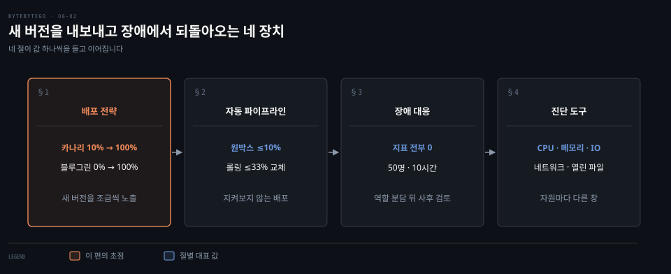
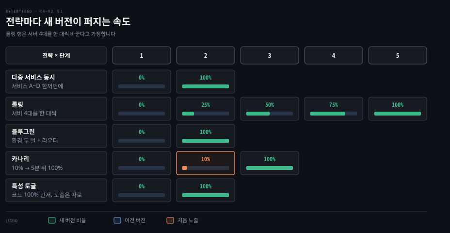
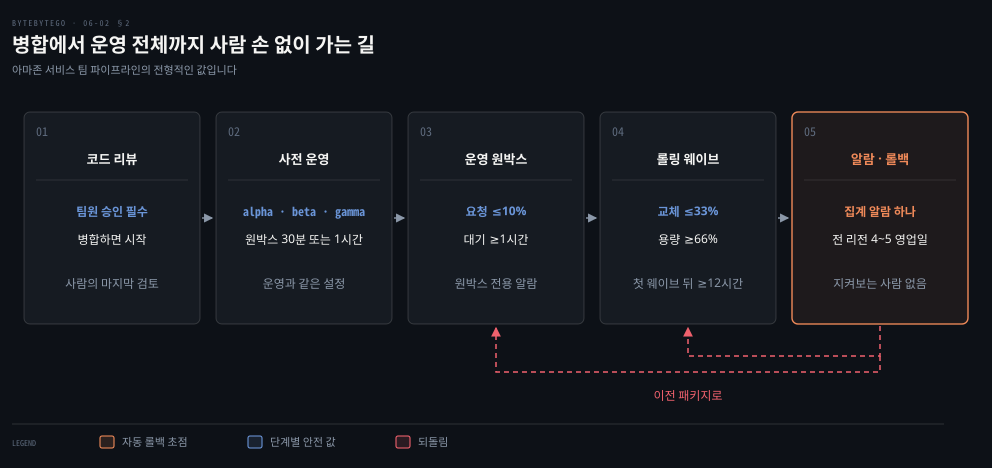
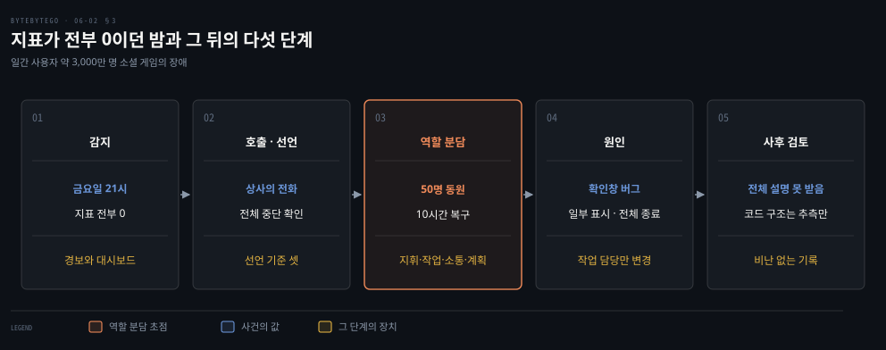
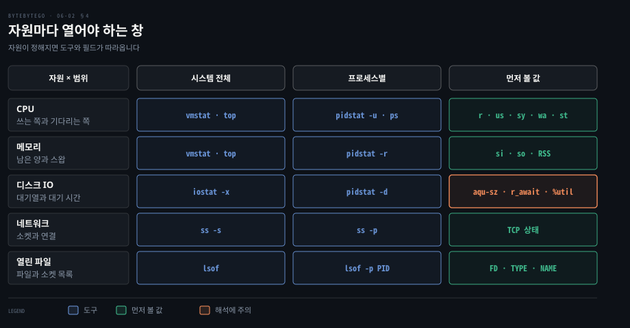

# 배포 전략은 새 버전을 얼마나 조금씩 내보낼지 정하고 장애 대응은 진단 도구와 사후 검토로 이어진다

---

> 새 버전은 한꺼번에 내보낼수록 결함이 모두에게 닿고, 그래서 비율과 대기 시간을 미리 정하며, 장애가 나면 역할을 나눠 복구한 뒤 사후 검토로 되짚고 느린 프로세스는 자원별 도구로 가려냅니다.


## 핵심 요약

> 이 편의 중심 생각은 새 버전이 닿는 범위와 장애 때의 작업 순서를 미리 값으로 정해 두면 사람이 지켜보지 않아도 피해가 작게 끝난다는 것입니다.

배포 전략 다섯은 새 버전을 받는 요청의 비율이 단계마다 어떻게 늘어나는지로 갈립니다. 한꺼번에 100% 로 가는 방식은 단순하지만 결함이 모두에게 닿고, 카나리는 처음 10% 만 보내 결함을 일찍 잡습니다. 특성 토글은 비율이 아니라 코드를 올리는 일과 기능을 켜는 일을 갈라 놓습니다.

큰 조직은 그 비율과 대기 시간을 파이프라인에 값으로 박아 사람 대신 지표를 지켜보게 합니다. 그래도 장애는 나고, 그때는 원인 추적보다 선언과 역할 분담이 먼저이며 복구 뒤에 비난 없는 사후 검토가 남습니다. 마지막으로 프로세스가 느릴 때는 CPU·메모리·디스크 IO·네트워크 가운데 어느 자원의 창을 열지 정하면 도구와 볼 값이 따라옵니다.




## 학습 목표

> 이 편을 읽고 나면 다음을 설명할 수 있습니다.

1. 다중 서비스 동시 배포·롤링·블루그린·카나리·특성 토글이 새 버전을 받는 비율을 단계마다 어떻게 바꾸는지 수치로 말할 수 있습니다.
2. 쿠버네티스 롤링의 `maxSurge` 와 `maxUnavailable` 기본값이 서버 4대에서 몇 대를 뜻하는지 계산할 수 있습니다.
3. 원박스·롤링 비율·대기 시간·자동 롤백이 사람이 지켜보지 않는 배포를 가능하게 하는 이유를 설명할 수 있습니다.
4. 대형 장애에서 선언 기준·네 역할·사후 검토를 순서대로 설명할 수 있습니다.
5. 자원마다 시스템 전체 도구와 프로세스별 도구를 고르고 `netstat` 대신 `ss` 를 쓰는 이유를 말할 수 있습니다.


## 1. 배포 전략은 새 버전을 받는 요청의 비율이 단계마다 어떻게 늘어나는지로 갈린다

> 결함이 숨은 새 버전을 몇 명이 먼저 만나게 할지가 전략마다 다르고, 그 첫 비율이 작을수록 되돌릴 일이 줄지만 감시와 운영 비용이 늡니다.

새 버전에 결함이 숨어 있다면 몇 명이 먼저 만나게 할까요? 배포 전략은 이 답을 단계별 비율로 적어 둔 것입니다. 아래 격자는 다섯 전략에서 새 버전을 받는 요청의 비율을 단계마다 보입니다. 롤링 행은 서버 4대를 한 대씩 바꾼다고 가정한 값이고, 카나리 행은 AWS CodeDeploy 의 Lambda 용 정의 `CodeDeployDefault.LambdaCanary10Percent5Minutes` 의 값입니다. 처음 10% 를 옮기고 5분 뒤 나머지 90% 를 옮깁니다.[^codedeploy]



### 다중 서비스 동시 배포는 단순하지만 어느 변경이 원인인지 가르기 어렵다

서비스 A 가 1.0 에서 1.1 로, B 가 1.2 에서 1.3 으로, C 가 2.0 에서 2.1 로, D 가 3.1 에서 3.1.1 로 한 번에 나가는 방식입니다. 절차가 하나라 만들기 쉽지만 서비스끼리의 의존 관계를 관리하고 시험하기 어렵습니다. 결함이 터지면 변경 네 개 가운데 원인을 가르기 어렵고, 되돌릴 때도 네 서비스를 서로 맞는 버전으로 함께 돌려야 합니다.

### 롤링은 서버를 조금씩 바꾸므로 두 버전이 섞여 도는 구간이 생긴다

쿠버네티스 Deployment 의 기본 전략이 **롤링 업데이트**입니다. 한 번에 바꾸는 폭은 두 값이 정합니다. `maxUnavailable` 은 동시에 내려가도 되는 파드 수이고 비율은 내림합니다. `maxSurge` 는 원하는 수보다 더 띄워도 되는 파드 수이고 비율은 올림합니다. 둘 다 기본값이 25% 입니다.[^k8s-rolling]

서버 4대면 `maxUnavailable` 은 4 × 25% = 1대, `maxSurge` 도 1대라서 최대 5대가 뜨고 최소 3대가 요청을 받습니다. 기존 파드를 모두 내린 뒤 띄우는 `Recreate` 전략은 그 사이 서비스가 멈춥니다. 선언 방법은 [Declarative Deployment 편](../../../08_cloud/book/kubernetes-patterns/03-01.Declarative%20Deployment%20—%20업그레이드·롤백을%20선언으로.md)에 있습니다. 두 값의 조합별 동작은 [Deployment 업데이트 편](../../../08_cloud/book/kubernetes-in-action/15-02.Deployment%20업데이트%20—%20Recreate·RollingUpdate·maxSurge.md)에 있고, 쿠버네티스에서 Recreate·RollingUpdate·Canary·A/B·Blue/Green·Shadowing 을 구현하는 방법은 [rollout 제어 편](../../../08_cloud/book/kubernetes-in-action/15-03.rollout%20제어와%20배포%20전략%20—%20pause·faulty·rollback·전략%205종.md)에 있습니다.

롤링의 위험은 이전 버전과 새 버전이 같은 데이터를 읽고 쓰는 구간입니다. 새 버전이 압축해 쓴 데이터를 이전 버전이 못 읽으면 그 구간에서 오류가 납니다. 안전하게 만드는 방법은 §2 에서 다룹니다.

### 블루그린은 환경 두 벌 사이에서 라우터를 한 번에 돌린다

운영과 최대한 같은 환경 두 벌 가운데 하나가 라이브이고, 다른 하나에서 새 버전을 마지막으로 시험합니다. 시험이 끝나면 라우터를 돌려 요청 전부를 새 환경으로 보냅니다. 이전 환경은 쉬는 상태로 남아 라우터만 다시 돌리면 롤백됩니다. 두 환경은 릴리스마다 역할을 바꿔 쓰고 이름의 색은 구분용입니다.[^fowler-bg]

환경을 한 벌 더 두는 비용이 듭니다. 스키마를 바꿀 때는 새 버전과 이전 버전을 모두 받는 스키마를 먼저 배포해 확인하고 애플리케이션을 올린 뒤 이전 버전용 지원을 지웁니다.[^fowler-bg]

### 카나리는 소수에게 먼저 보내고 지표를 보며 늘린다

새 버전을 소수 사용자에게만 먼저 열고 확신이 쌓이면 더 많은 서버와 사용자로 넓힙니다. 소수를 고르는 방법은 무작위 표본, 사내 직원, 지역이나 브랜드 단위가 있습니다. 문제가 생기면 사용자를 이전 버전으로 다시 돌리는 것이 롤백입니다.[^fowler-canary] 시험 환경을 따로 두지 않고 운영에서 확인하므로 카나리 지표를 감시하며 비율을 올려야 하고, 동시에 도는 버전이 늘수록 관리가 어렵습니다. 쿠버네티스 Deployment 는 릴리스마다 Deployment 를 따로 만들어 카나리를 구현합니다.[^k8s-canary]

### 특성 토글은 코드를 올리는 일과 기능을 켜는 일을 가른다

**특성 토글**은 새 코드를 꺼 둔 채 운영에 올리고 켜는 시점을 따로 정합니다. 릴리스 토글은 보통 한두 주를 넘기지 않는 과도기 장치이고, 토글은 쌓일수록 부담이라 만들 때 제거할 일도 함께 잡아야 합니다.[^fowler-toggles]

켠 대상을 사용자 집단별로 나누면 A/B 테스트입니다. 서버 4대 가운데 2대가 v1.1, 1대가 v1.2, 1대가 이전 v1.0 을 돌리면 노출이 50% 와 25% 로 갈립니다. 실험 토글은 통계적으로 의미 있는 결과가 날 때까지 몇 시간에서 몇 주를 유지합니다.[^fowler-toggles] 기능이 실수로 사용자에게 나가지 않도록 배포 과정을 통제해야 합니다.

카나리와 A/B 는 구현이 비슷하지만 목적이 다릅니다. 카나리는 회귀를 분이나 시간 단위로 잡고 A/B 는 가설을 검증하느라 수일이 걸리므로 하나로 섞지 않는 편이 낫습니다.[^fowler-canary]

| 전략 | 첫 노출 비율 | 되돌리는 방법 | 추가로 드는 것 |
|------|--------------|---------------|----------------|
| 다중 서비스 동시 | 100% | 서비스 여러 개를 맞춰 되돌림 | 의존 관계 시험 |
| 롤링 | 한 번에 25% 안팎 | 이전 버전으로 다시 교체 | 두 버전 호환 |
| 블루그린 | 라우터 전환 때 100% | 라우터를 되돌림 | 환경 한 벌 |
| 카나리 | 10% 같은 소수 | 요청을 이전 버전으로 돌림 | 지표 감시 |
| 특성 토글 | 0% 에서 켠 만큼 | 토글을 끔 | 토글 정리 |

롤링·카나리·블루그린을 Argo Rollouts 선언으로 다루는 방법은 [Argo Rollouts 편](../../../08_cloud/argocd/04-03.Argo%20Rollouts와%20배포%20전략.md)에, 메시의 가중치 라우팅으로 노출을 줄이는 방법은 [Istio 편](../../../08_cloud/book/istio-in-action/05-01.위험에%20노출되는%20트래픽을%20줄여%20가는%20순서.md)에 있습니다.


## 2. 작은 팀은 파이프라인에 안전장치를 값으로 박아 사람이 지켜보지 않는 배포를 한다

> 노출 폭과 대기 시간과 롤백 조건을 파이프라인이 정하면 배포마다 로그를 지켜보는 일이 사라지고, 되돌릴 수 있는 변경만 나가도록 배포가 두 단계로 갈립니다.

배포가 하루에 여러 번이면 로그와 지표를 지켜보는 일은 누가 맡을까요? 배포마다 사람 하나가 몇 시간씩 붙어 있으면 배포 횟수가 곧 팀의 한계가 됩니다. Amazon 은 한때 체크인에서 운영까지 평균 16일이 걸렸고, 코드를 짜는 데 하루 반, 빌드와 배포에 한 시간도 안 들었으며 나머지 약 14일은 사람이 빌드를 시작하고 배포하고 시험을 돌리기를 기다린 시간이었습니다. 시범으로 파이프라인을 붙인 팀은 그 시간이 90% 줄었습니다.[^bl-cd] 작은 단일 책임 팀은 장애도 직접 고치므로 시험에 충분히 투자할 동기가 생깁니다.[^bl-cd]

변경 하나는 소스·빌드·시험·운영 네 구간을 지납니다.

병합 전의 코드 리뷰가 사람이 거치는 마지막 승인이고, 병합하면 파이프라인이 자동으로 시작합니다. 운영 앞에는 alpha·beta·gamma 사전 운영 환경이 있습니다. gamma 는 운영과 같은 배포 설정과 알람을 쓰며 그 안의 원박스에 새 코드를 30분 또는 1시간 둡니다.[^bl-hands-off] 한 마이크로서비스에는 애플리케이션 코드, 인프라, OS 패치, 설정과 특성 플래그, 운영 도구마다 파이프라인이 따로 있고 모두 같은 안전장치를 씁니다. 그래서 §1 의 토글 설정도 코드처럼 롤백이 걸린 파이프라인으로 나갑니다.[^bl-hands-off] 운영 구간의 값은 다음과 같습니다.



운영 구간은 먼저 원박스로 시작합니다. 가상 머신 한 대, 컨테이너 한 개, 또는 Lambda 호출의 작은 비율에 새 코드를 올려 보통 전체 요청의 10% 이하만 받게 합니다. 이어서 롤링으로 한 번에 33% 이하를 바꾸고 나머지 66% 이상이 요청을 받습니다. 원박스는 요청이 적어 집계 알람에 안 걸릴 수 있으므로 그 한 대만의 오류율 같은 지표로도 롤백을 겁니다. 어느 단계에서든 서비스의 높은 심각도 집계 알람이 울리면 이전 패키지로 자동 롤백하고, 담당자가 호출을 받고 들어올 때는 롤백이 이미 진행 중인 경우가 많습니다.[^bl-hands-off]

결함이 천천히 드러날 수도 있어서 단계마다 대기 시간(bake time)을 둡니다. 보통 원박스 뒤 최소 1시간, 첫 리전 웨이브 뒤 최소 12시간, 이후 웨이브 뒤 2~4시간이고 특정 API 에 요청이 100건 이상 들어올 때까지 기다리는 조건도 겁니다. 이 값이면 전 리전에 닿는 데 4~5 영업일이 걸립니다. 배포 시작 시간대도 제한해 밤·주말·휴일, 많은 팀은 금요일과 늦은 오후를 뺍니다. 문제가 나도 담당자가 빨리 닿는 시간에 배포하려는 것입니다.[^bl-hands-off] 지표와 경보를 모으는 구조는 [메트릭 모니터링 편](./08-03.메트릭%20모니터링은%20시계열%20데이터베이스에%20쓰기를%20몰아%20담고%20수집·질의·경보·시각화로%20나뉜다.md)에서 다룹니다.

롤링 중에는 두 버전이 섞이므로 롤백도 안전해야 합니다. 되돌릴 수 없는 가장 흔한 이유는 프로토콜 변경입니다. 압축해 저장하는 코드가 나가면 이전 버전은 그 데이터를 읽지 못합니다. 하트비트를 5초에서 10초로 늘리기만 해도 이전 버전 서버가 끊어졌다고 보고 연결을 닫습니다.

그래서 두 단계로 나눕니다. 저장 형식을 XML 에서 JSON 으로 바꾸려면 먼저 JSON 도 읽는 V2 를 모든 서버에 올리고, 그다음에 JSON 으로 쓰게 하는 V3 를 올립니다. V3 를 되돌려도 V2 가 두 형식을 읽으므로 안전합니다.[^bl-rollback]


## 3. 대규모 장애에서는 원인 추적보다 선언과 역할 분담이 먼저이고 복구 뒤에 사후 검토가 남는다

> 모든 지표가 0이 된 밤처럼 원인을 모르는 순간에는 기술 작업과 소통과 변경 통제를 사람마다 나눠 맡아야 하고, 복구한 뒤에는 개인을 탓하지 않는 기록이 재발을 막습니다.

운영 대시보드의 모든 줄이 0 이 됐다면 누가 무엇을 먼저 할까요? 일간 사용자가 약 3,000만 명인 소셜 게임에서 실제로 그랬습니다. 코드로 인프라를 선언하는 방식이 자리 잡기 전, 벤더의 클라우드 관리 화면으로 AWS 를 다루던 시기였습니다. 금요일 21시에 대시보드의 모든 줄이 0 이었고 상사가 전화로 게임 전체가 내려갔다고 알렸습니다. HAProxy·PHP 웹 서버·MySQL·Memcache 까지 AWS 인스턴스가 전부 종료돼 있었고 50명이 10시간 걸려 되살렸습니다.

원인은 클라우드 관리 소프트웨어의 확인창 버그였습니다. 일부 노드의 종료를 누르면 창에는 그 목록이 맞게 뜨는데 뒤에서는 전부 종료했고, 한 SRE 가 안 쓰는 Memcache 풀을 평소처럼 끄려다 이 일이 났습니다. 코드 구조는 끝내 추측만 했고 전체 설명은 받지 못했습니다. 화면의 확인 목록과 실제 실행 대상이 다르면 확인 절차는 방어가 되지 못합니다.



Google SRE 는 이런 일에 단계마다 놓을 장치를 정해 둡니다.[^sre-incidents] 선언 기준은 셋입니다. 문제 해결에 다른 팀이 필요하거나, 장애를 고객이 볼 수 있거나, 한 시간 집중 분석해도 풀리지 않으면 선언합니다. 일찍 선언하고 간단히 풀려 닫는 편이 번지는 중간에 체계를 세우는 것보다 낫습니다.

선언하면 역할을 나눕니다. 지휘(incident commander)는 전체 상태를 쥐고 책임을 배정합니다. 작업(Ops)은 운영 도구로 대응하며 장애 동안 시스템을 바꾸는 유일한 팀입니다. 소통은 주기적으로 갱신을 내보내고, 계획은 버그 등록·인계·정상에서 벗어난 변경의 추적을 맡습니다.

기술 작업 한 사람에게 모든 일이 몰리면 소통이 비어 경영진의 문의가 쏟아집니다. 동료가 조율 없이 운영을 바꾸면 상황이 나빠집니다. 지휘는 여럿이 고칠 수 있는 장애 상태 문서를 갱신하고, 근무가 끝나면 지휘를 넘긴다고 말하고 확답을 받은 뒤에 떠납니다. 지휘 구조를 나누는 다른 방식과 사후 검토 운영은 [사고 관리 편](../../../06_observability/book/observability_with_grafana/09-01.사고%20관리%20—%20금은동%20지휘·SLI%20알림·IRM%20도구%20셋.md)에서 읽을 수 있습니다.

복구 뒤에는 사후 검토(postmortem)를 씁니다. 장애, 영향, 완화 조치, 근본 원인, 재발 방지 작업을 적은 기록입니다.[^sre-postmortem] 열 기준은 사고 전에 정해 둡니다. 사용자에게 보인 중단이 임계값을 넘었을 때, 데이터가 조금이라도 유실됐을 때, 담당자가 롤백이나 트래픽 우회로 개입했을 때, 복구 시간이 임계값을 넘었을 때, 감시가 놓쳐 사람이 직접 발견했을 때입니다. 비난 없는 사후 검토는 관련자가 모두 좋은 의도로 가진 정보 안에서 옳게 행동했다고 가정하고, 왜 정보가 부족했는지 같은 구조적 이유를 찾습니다. 이 기록이 없으면 앞의 사건처럼 원인이 추측으로 남습니다.

수백만 사용자로 규모를 늘리며 DB 복제와 캐시와 데이터 센터가 어떻게 붙는지는 [단일 서버에서 출발하는 편](../system-design/01-01.단일%20서버에서%20출발한%20시스템은%20DB%20분리·로드밸런서·DB%20복제로%20첫%20병목을%20넘는다.md)과 [캐시·CDN·샤딩 편](../system-design/01-02.캐시·CDN·무상태%20웹%20계층·데이터%20센터·메시지%20큐·샤딩이%20수백만%20사용자까지%20규모를%20늘린다.md)에서 다뤘습니다.


## 4. 리눅스 진단 도구는 자원마다 창이 따로 있어 CPU·메모리·IO·네트워크 중 어디가 막혔는지 가린다

> 프로세스가 이상하게 느릴 때는 자원부터 정하면 시스템 전체를 보는 도구와 프로세스별로 쪼개는 도구가 짝으로 따라오고, 도구가 대신 가리킨 자리를 읽으면 병목이 보입니다.

프로세스가 CPU 를 먹는지 메모리를 먹는지 디스크를 두드리는지 어떻게 알까요? 증상 하나에서 자원 넷으로 갈래를 먼저 나누면 도구가 정해집니다. 시스템 전체에서 어느 자원이 막혔는지 보고, 그다음 프로세스별 도구로 범인을 좁힙니다.



`vmstat` 은 프로세스·메모리·페이징·블록 IO·인터럽트·CPU 를 한 줄에 보고합니다. 필드는 다음과 같습니다.[^man-vmstat]

- `r`: 실행 중이거나 실행을 기다리는 프로세스 수
- `si`·`so`: 스왑 인·아웃
- `us`·`sy`·`wa`·`st`: 사용자·커널·IO 대기·가상 머신에 빼앗긴 시간

`iostat -x` 는 장치마다 `aqu-sz`(평균 대기열 길이), 읽기·쓰기별 평균 처리 시간 `r_await`·`w_await`, `%util` 을 보입니다. 합친 `await` 열은 `-s` 를 같이 줄 때 나옵니다.[^man-iostat][^iostat-src] `%util` 이 100% 에 가까우면 요청을 직렬로 처리하는 장치에서는 포화지만 RAID 나 SSD 처럼 병렬로 처리하는 장치에서는 한계를 보이지 못합니다.[^man-iostat] 그래서 `r_await`·`w_await` 와 `aqu-sz` 를 함께 봅니다.

`pidstat` 은 프로세스별로 `-u` 가 CPU, `-r` 이 페이지 폴트와 `RSS`, `-d` 가 입출력, `-w` 가 문맥 전환입니다.[^man-pidstat] `top` 은 `P` 키로 `%CPU`, `M` 키로 `%MEM` 순 정렬을 하고[^man-top] `ps` 는 `--sort=-pcpu` 로 정렬합니다.[^man-ps] `lsof` 는 열린 파일을 `FD`·`TYPE`·`NAME` 열로 나열하고 `-p` 로 한 프로세스에 한정합니다.[^man-lsof]

```bash
# CPU·메모리·스왑·블록 IO 를 1초마다 봅니다. 첫 보고는 부팅 이후 평균이라 -y 로 뺍니다.
vmstat -y 1
# 장치별 대기열·대기 시간·%util 을 확장 열로 봅니다.
iostat -x -y 1
# 프로세스별 CPU·메모리·입출력을 1초마다 봅니다.
pidstat -u -r -d 1
# 소켓 요약을 보고, 프로세스 이름까지 붙여 TCP 소켓을 나열합니다.
ss -s
ss -tanp
# PID 1234 가 연 파일과 소켓을 나열합니다. 1234 는 예시입니다.
lsof -p 1234
```

네트워크 연결은 지금 `netstat` 이 아니라 `ss` 로 봅니다. net-tools 의 `netstat(8)` 매뉴얼이 이 프로그램은 대부분 쓰이지 않는다고 적고 대체로 `ss`, `ip route`, `ip -s link`, `ip maddr` 를 듭니다.[^man-netstat] `ss` 는 인자 없이 쓰면 연결이 성립된 소켓만 보이므로 듣는 소켓은 `-l` 이나 `-a` 로 부릅니다. `ss -tanp` 는 TCP 소켓마다 상태(established·time-wait·close-wait 등)와 프로세스를 보입니다.[^man-ss]

도구마다 읽는 법은 [자원마다 창이 따로 나 있는 편](../../../02_os/book/learning-modern-linux/08-02.자원마다%20창이%20따로%20나%20있어%20어느%20창을%20여느냐가%20곧%20진단이다.md)에 있고, 자원별 방법론은 [USE 메서드 체크리스트](../../../02_os/book/systems-performance/a0-01.부록%20—%20USE%20메서드%20체크리스트·sar%20요약.md)와 [CPU](../../../02_os/book/systems-performance/06-04.CPU%20—%20관측%20도구·시각화.md)·[메모리](../../../02_os/book/systems-performance/07-04.메모리%20—%20관측%20도구.md)·[디스크](../../../02_os/book/systems-performance/09-04.디스크%20—%20관측%20도구.md)·[네트워크](../../../02_os/book/systems-performance/10-04.네트워크%20—%20관측%20도구.md) 관측 도구 편이 맡습니다. 커널 계층마다 어떤 도구가 어디를 보는지 한 장에 그린 지도는 Brendan Gregg 의 [Linux Performance 페이지](https://www.brendangregg.com/linuxperf.html)에 있습니다.


## 면접 대비

> 배포 전략의 비율, 사람이 지켜보지 않는 배포, 대형 장애의 순서, 진단 도구 선택에 관한 면접 질문입니다.

1. 카나리·블루그린·롤링을 첫 노출 비율과 롤백 방식으로 비교하고 어떤 서비스에 무엇을 고를지 말해 보십시오.
2. 쿠버네티스 Deployment 의 `maxSurge` 와 `maxUnavailable` 기본값이 서버 4대에서 몇 대이며 롤링 중 최소 몇 대가 요청을 받습니까?
3. 사람이 지켜보지 않아도 되는 배포 파이프라인은 어떤 안전장치로 만듭니까?
4. 대형 장애를 선언하는 기준과 역할 넷, 그리고 사후 검토를 여는 기준은 무엇입니까?
5. 프로세스가 느릴 때 `vmstat`·`iostat`·`pidstat`·`ss` 를 어떤 순서로 보며 `iostat` 의 `%util` 100% 를 어떻게 해석합니까?


## 정답 (자답 후 펼치기)

> 면접 질문에 대한 키워드 중심의 모범 답안입니다.

### 정답 1 — 첫 비율과 되돌림 방식

카나리는 10% 같은 소수에게 먼저 보내 지표를 보며 늘리고 요청을 이전 버전으로 돌려 롤백합니다. 블루그린은 환경 한 벌을 더 두고 라우터를 한 번에 돌려 전환과 롤백이 빠릅니다. 롤링은 서버를 조금씩 바꿔 추가 환경이 필요 없지만 두 버전이 섞입니다.

### 정답 2 — 4 × 25% 는 1대

`maxUnavailable` 은 내림해 1대, `maxSurge` 는 올림해 1대입니다. 최대 5대가 뜨고 최소 3대가 요청을 받습니다.

### 정답 3 — 원박스·롤링 상한·대기 시간·자동 롤백

원박스는 요청 10% 이하, 롤링은 한 번에 33% 이하 교체와 용량 66% 이상 유지입니다. 단계마다 대기 시간을 두고 집계 알람이 울리면 이전 패키지로 자동 롤백하며 롤백도 안전하도록 두 단계로 배포합니다.

### 정답 4 — 선언 셋·역할 넷·사후 검토 다섯 기준

다른 팀이 필요하거나 고객에게 보이거나 한 시간 분석해도 안 풀리면 선언합니다. 역할은 지휘·작업·소통·계획이고 시스템은 작업 담당만 바꿉니다. 사후 검토는 사용자 중단·데이터 유실·담당자 개입·긴 복구·감시 실패일 때 엽니다.

### 정답 5 — 시스템 전체에서 프로세스별로

`vmstat` 의 `r`·`wa`·`si`·`so` 로 자원을 정하고 디스크면 `iostat -x`, 프로세스는 `pidstat` 으로 좁히며 연결은 `ss` 로 봅니다. `%util` 100% 는 직렬 장치에서만 포화이고 SSD 와 RAID 에서는 `r_await`·`w_await` 와 `aqu-sz` 로 판단합니다.


## 참고 자료

- ByteByteGo, 「System Design」 그림 해설 모음 중 배포 전략, 아마존의 소프트웨어 빌드·운영, 대규모 장애 대응, 프로세스 진단 도구 글.
- ByteByteGo 공개 저장소의 같은 글: [Deployment Strategies](https://github.com/ByteByteGoHq/system-design-101/blob/main/data/guides/how-to-deploy-services.md)
- 같은 저장소의 관련 글: [Top 5 Most-Used Deployment Strategies](https://github.com/ByteByteGoHq/system-design-101/blob/main/data/guides/top-5-most-used-deployment-strategies.md), [Kubernetes Deployment Strategies](https://github.com/ByteByteGoHq/system-design-101/blob/main/data/guides/kubernetes-deployment-strategies.md), [Scaling Websites for Millions of Users](https://github.com/ByteByteGoHq/system-design-101/blob/main/data/guides/how-to-scale-a-website-to-support-millions-of-users.md)
- AWS Builders' Library: [Automating safe, hands-off deployments](https://builder.aws.com/content/3ErTKQOTKc5NIw031UePBPxTQ6I/automating-safe-hands-off-deployments), [Going faster with continuous delivery](https://builder.aws.com/content/3F08Mhh186qOa4VhG19egs06NJa/going-faster-with-continuous-delivery), [Ensuring rollback safety during deployments](https://builder.aws.com/content/3F04j2yRAAMBuPSPs50xwXZqg01/ensuring-rollback-safety-during-deployments)
- Google SRE Book: [Managing Incidents](https://sre.google/sre-book/managing-incidents/), [Postmortem Culture](https://sre.google/sre-book/postmortem-culture/)
- Brendan Gregg, Linux Performance: https://www.brendangregg.com/linuxperf.html (그림은 CC BY-SA 4.0 이지만 태그로 고정된 주소가 없어 가져오지 않고 링크만 겁니다)


## 관련 문서

- [사고 관리 — 금은동 지휘·SLI 알림·IRM 도구 셋](../../../06_observability/book/observability_with_grafana/09-01.사고%20관리%20—%20금은동%20지휘·SLI%20알림·IRM%20도구%20셋.md)
- [IaaS·PaaS·SaaS 와 가상 머신·컨테이너·서버리스는 운영 책임을 어디까지 넘기는지로 갈린다](./06-01.IaaS·PaaS·SaaS%20와%20가상%20머신·컨테이너·서버리스는%20운영%20책임을%20어디까지%20넘기는지로%20갈린다.md)
- [메트릭 모니터링은 시계열 데이터베이스에 쓰기를 몰아 담고 수집·질의·경보·시각화로 나뉜다](./08-03.메트릭%20모니터링은%20시계열%20데이터베이스에%20쓰기를%20몰아%20담고%20수집·질의·경보·시각화로%20나뉜다.md)
- [Declarative Deployment — 업그레이드·롤백을 선언으로](../../../08_cloud/book/kubernetes-patterns/03-01.Declarative%20Deployment%20—%20업그레이드·롤백을%20선언으로.md)
- [자원마다 창이 따로 나 있어 어느 창을 여느냐가 곧 진단이다](../../../02_os/book/learning-modern-linux/08-02.자원마다%20창이%20따로%20나%20있어%20어느%20창을%20여느냐가%20곧%20진단이다.md)

[^codedeploy]: AWS CodeDeploy 사용자 가이드, Lambda 용 배포 구성: <https://docs.aws.amazon.com/codedeploy/latest/userguide/deployment-configurations.html>
[^k8s-rolling]: Kubernetes 문서(v1.37, 2026-10 확인), Deployments 의 Rolling Update Deployment: <https://kubernetes.io/docs/concepts/workloads/controllers/deployment/>
[^k8s-canary]: 같은 문서의 Canary deployments: <https://kubernetes.io/docs/concepts/workloads/controllers/deployment/>
[^fowler-bg]: Martin Fowler, BlueGreenDeployment (2010): <https://martinfowler.com/bliki/BlueGreenDeployment.html>
[^fowler-canary]: Danilo Sato, CanaryRelease (martinfowler.com): <https://martinfowler.com/bliki/CanaryRelease.html>
[^fowler-toggles]: Pete Hodgson, Feature Toggles (aka Feature Flags) (martinfowler.com): <https://martinfowler.com/articles/feature-toggles.html>
[^bl-cd]: AWS Builders' Library, Going faster with continuous delivery: <https://builder.aws.com/content/3F08Mhh186qOa4VhG19egs06NJa/going-faster-with-continuous-delivery>
[^bl-hands-off]: AWS Builders' Library, Automating safe, hands-off deployments: <https://builder.aws.com/content/3ErTKQOTKc5NIw031UePBPxTQ6I/automating-safe-hands-off-deployments>
[^bl-rollback]: AWS Builders' Library, Ensuring rollback safety during deployments: <https://builder.aws.com/content/3F04j2yRAAMBuPSPs50xwXZqg01/ensuring-rollback-safety-during-deployments>
[^sre-incidents]: Google SRE Book, Managing Incidents: <https://sre.google/sre-book/managing-incidents/>
[^sre-postmortem]: Google SRE Book, Postmortem Culture: <https://sre.google/sre-book/postmortem-culture/>
[^man-vmstat]: vmstat(8): <https://man7.org/linux/man-pages/man8/vmstat.8.html>
[^man-iostat]: iostat(1): <https://man7.org/linux/man-pages/man1/iostat.1.html>
[^iostat-src]: sysstat v12.8.0 `iostat.c` 의 열 머리글 출력(1098~1119행): <https://github.com/sysstat/sysstat/blob/v12.8.0/iostat.c>
[^man-pidstat]: pidstat(1): <https://man7.org/linux/man-pages/man1/pidstat.1.html>
[^man-top]: top(1): <https://man7.org/linux/man-pages/man1/top.1.html>
[^man-ps]: ps(1): <https://man7.org/linux/man-pages/man1/ps.1.html>
[^man-lsof]: lsof(8): <https://man7.org/linux/man-pages/man8/lsof.8.html>
[^man-ss]: ss(8): <https://man7.org/linux/man-pages/man8/ss.8.html>
[^man-netstat]: netstat(8): <https://man7.org/linux/man-pages/man8/netstat.8.html>
