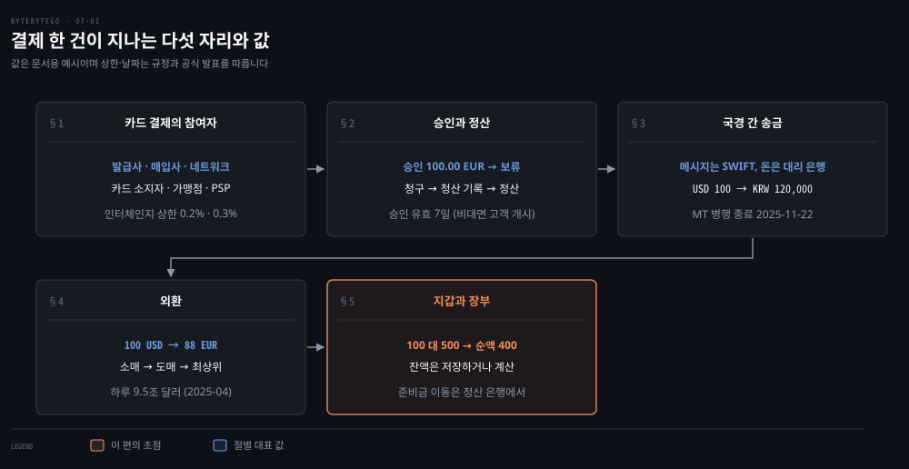
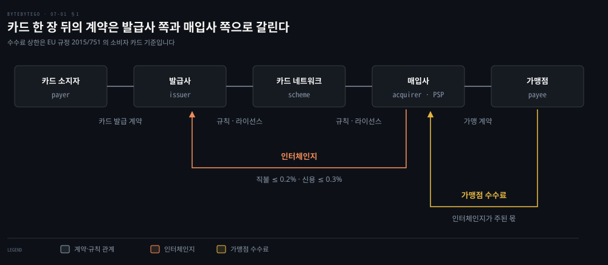
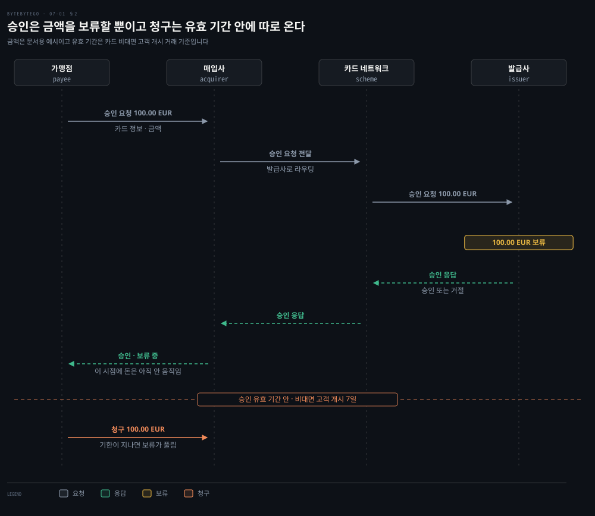
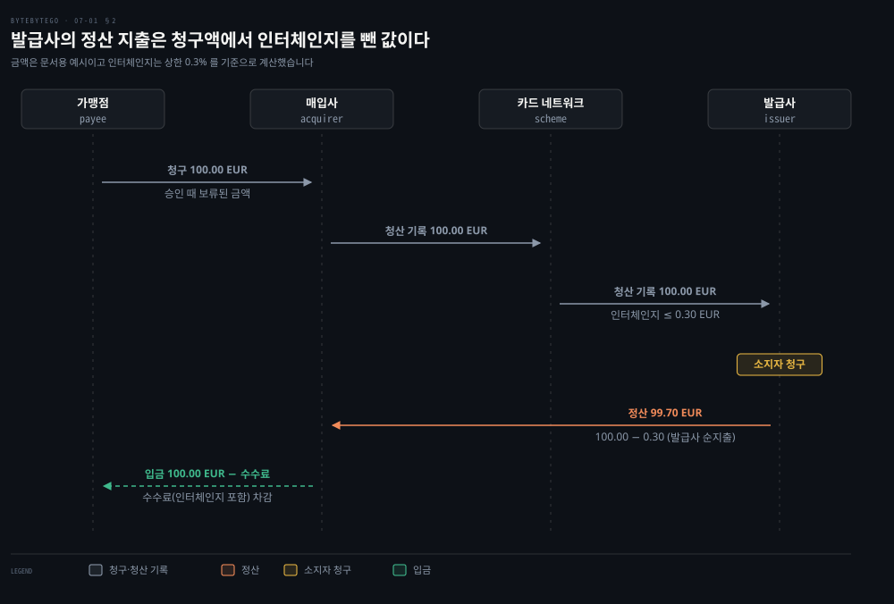
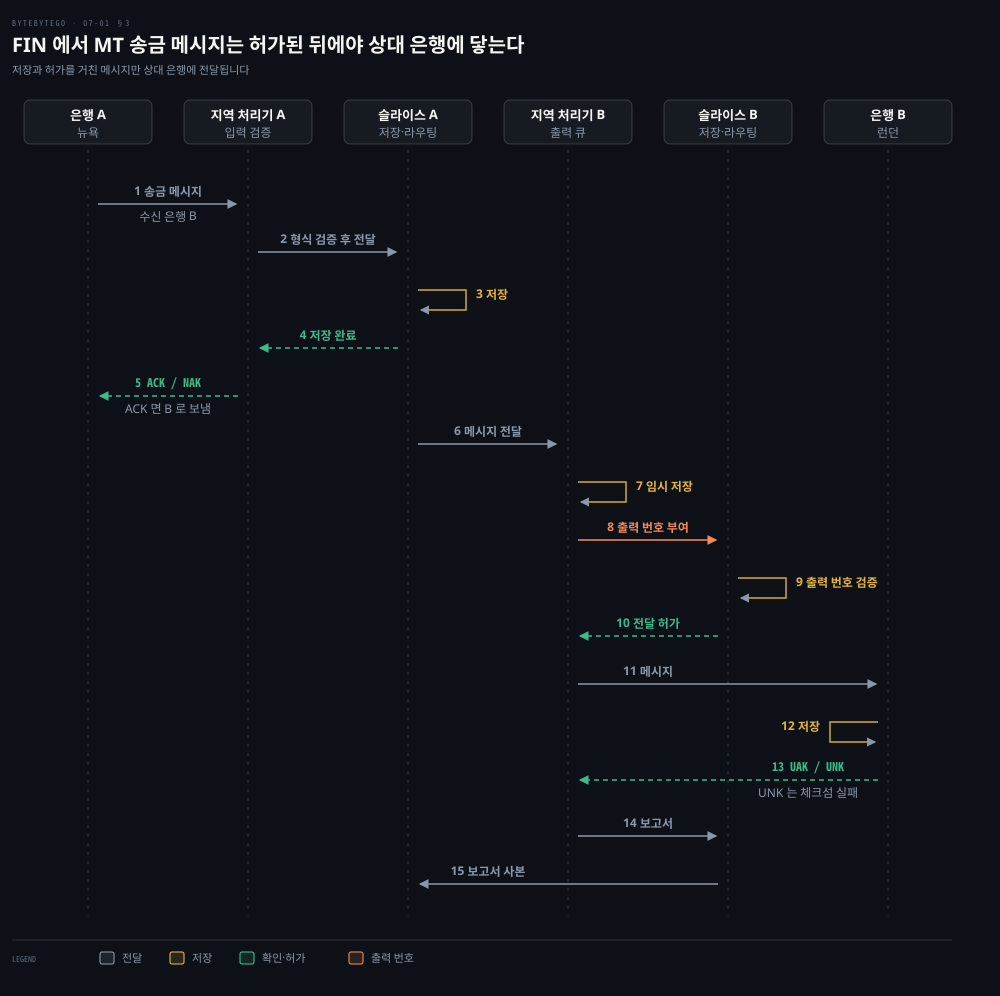
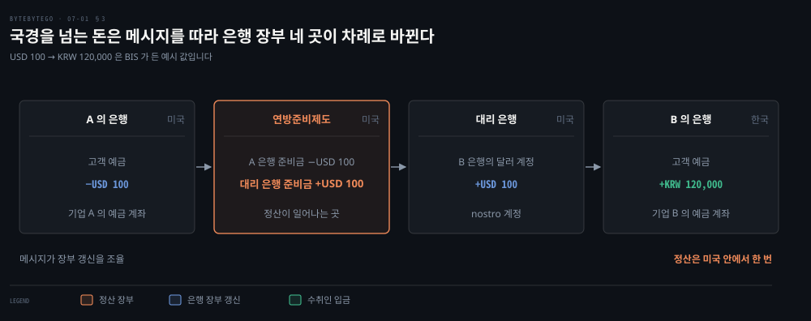
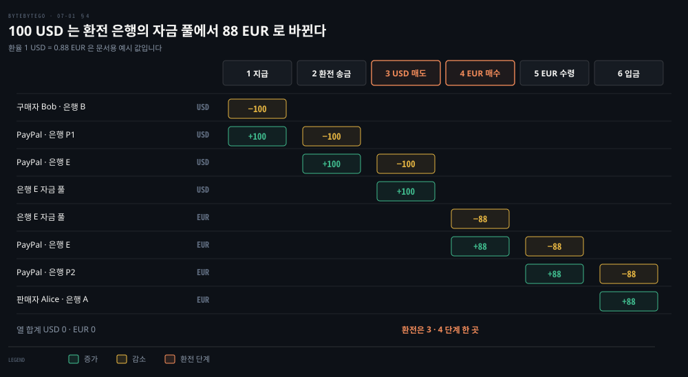
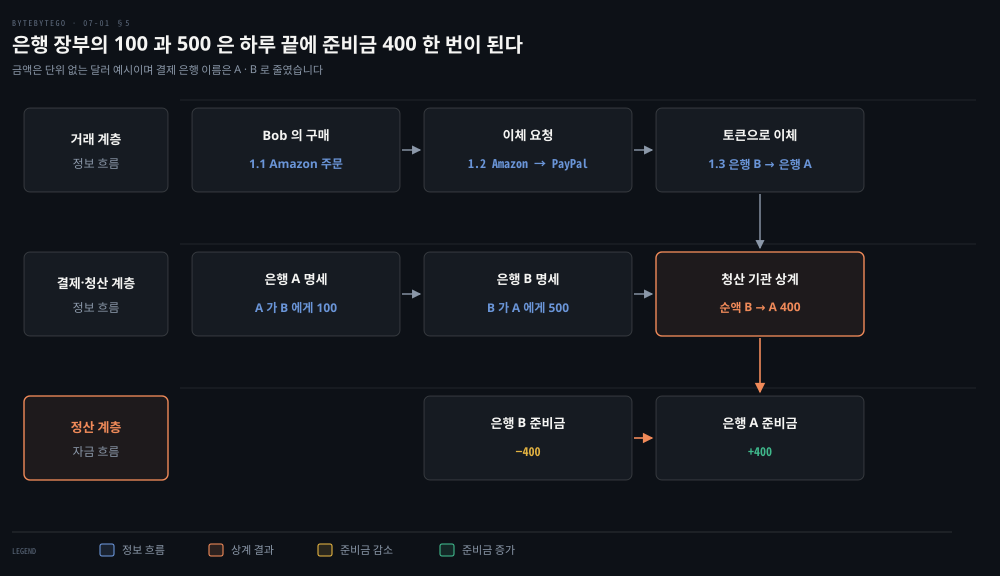

# 온라인 결제는 카드 네트워크·SWIFT·외환 경로로 돈이 움직이고 지갑과 장부가 그 흐름을 기록한다

---

> 결제 한 건에서 메시지는 카드 네트워크와 SWIFT 를 따라 곧바로 가지만 돈은 은행 장부와 정산 은행의 준비금에서 나중에 순액으로 움직이고, 지갑과 장부는 그 둘을 따로 기록합니다.

## 핵심 요약

> 이 편의 중심 생각은 결제에서 승인·메시지·장부 기록은 빠르게 오가는 정보이고 실제 자금 이동은 따로 한 번 일어난다는 것입니다.

카드 결제는 발급사와 매입사가 카드 네트워크의 규칙 아래 만나는 네 당사자 구조입니다. 승인은 금액을 보류할 뿐입니다. 돈은 청구 뒤 청산 기록을 거쳐 움직이고 발급사의 순지출은 인터체인지를 뺀 값입니다. 국경을 넘는 송금도 같습니다. SWIFT 는 메시지를 나르고 돈은 중앙은행 준비금 계정과 대리 은행이 상대 은행 몫으로 가진 계정이 차례로 고쳐지며 갑니다.

통화가 다르면 그 사이에 환전 은행의 자금 풀이 끼고, 풀이 모자라면 도매 시장으로 올라가 채웁니다. 이 모든 정보 흐름은 하루 끝에 은행들의 채무를 상계해 준비금 몇 곳만 옮기는 정산으로 끝납니다. 지갑 잔액을 어떻게 쓰고 읽는지는 저장하는 방식과 계산하는 방식으로 갈립니다.

## 학습 목표

> 이 편을 읽고 나면 다음을 설명할 수 있습니다.

1. 카드 결제의 발급사·매입사·카드 네트워크·가맹점이 누구와 계약하고 인터체인지와 가맹점 수수료가 어디서 어디로 가는지 설명할 수 있습니다.
2. 승인이 금액을 보류할 뿐이고 청구와 정산이 따로 오며 정산액이 인터체인지를 뺀 순액임을 금액으로 계산할 수 있습니다.
3. SWIFT 가 메시지만 나르고 대리 은행이 계정 기록으로 돈을 옮긴다는 점과 MT 에서 ISO 20022 로 바뀐 현재 상태를 말할 수 있습니다.
4. 환전이 환전 은행의 자금 풀에서 일어나고 풀이 소매·도매·최상위 시장으로 이어지는 순서를 계좌 증감으로 따라갈 수 있습니다.
5. 정보 흐름과 자금 흐름이 갈리는 까닭과 저장하는 잔액과 계산하는 잔액의 차이를 설명할 수 있습니다.

## 1. 카드 결제에는 계약이 둘로 갈린 네 당사자가 있다

> 카드 소지자는 발급사와, 가맹점은 매입사와 계약하고 둘 사이를 카드 네트워크의 규칙이 잇습니다. 두 쪽 사이에는 거래마다 인터체인지라는 수수료가 오갑니다.

온라인 가게가 카드 번호를 받으면 그 돈은 누구 계좌에서 누구 계좌로 가며, 그 사이에는 누가 끼어 있을까요? 유럽연합의 카드 수수료 규정이 당사자를 가장 짧게 정의합니다.[^eu-reg]

**발급사**(issuer)는 카드 소지자에게 결제 수단을 제공하고 그 사람의 카드 거래를 처리하기로 계약한 결제 서비스 제공자입니다. **매입사**(acquirer)는 수취인과 계약해 카드 거래를 받아 처리하는 결제 서비스 제공자입니다. 그 결과로 자금이 수취인에게 넘어갑니다.

규정은 둘 사이에 스킴이 끼는 구조를 네 당사자 카드 스킴이라 부릅니다. 스킴은 거래를 실행하는 규칙·관행·표준의 묶음입니다.[^eu-reg] 카드 네트워크가 곧 이 스킴입니다. 발급과 매입은 스킴 규칙과 라이선스 계약 아래 이뤄집니다. 규정은 그 라이선스에 EU 안의 영역 제한을 거는 것을 금지합니다(제6조).[^eu-reg] 가맹점과 매입사는 가맹 계약으로 묶입니다.

결제 서비스를 쓰는 가맹점은 매입사가 아니라 PSP 와 계약한 것처럼 보입니다. PSP 는 가맹점 앞에서 결제를 대행하는 서비스를 업계에서 부르는 말입니다. 규정이 쓰는 결제 서비스 제공자는 발급사와 매입사까지 아우르는 더 넓은 말이어서 범위가 다릅니다. 규정은 매입의 일부만 맡고 가맹점과 직접 계약하지 않는 중개자도 매입사 정의에 넣습니다. 데이터 처리나 단말 운영만 하는 것은 매입이 아니라고 따로 선을 긋습니다.[^eu-reg] PSP 가 매입사를 겸하는지 사이에 끼는지는 서비스마다 다릅니다.

돈의 방향은 두 갈래입니다. 가맹점은 매입사에 가맹점 수수료를 냅니다. 규정은 이를 수취인이 매입사에 내는 수수료로 정의합니다. 인터체인지가 그 수수료의 주된 부분이라고 설명합니다.[^eu-reg]

**인터체인지**는 거래마다 발급사와 매입사 사이에 오가는 수수료입니다. 발급사가 받는 보수는 이름이 달라도 인터체인지로 본다고 규정이 못 박습니다.[^eu-reg]

인터체인지에는 법적 상한이 걸려 있습니다. 양쪽 결제 서비스 제공자가 유럽연합 안에 있는 소비자 카드 거래에서 직불카드는 거래액의 0.2%, 신용카드는 0.3% 를 넘을 수 없습니다.[^eu-reg] 회원국은 국내 거래에 더 낮은 상한을 둘 수 있습니다. 상한이 어떻게 쓰이는지는 100 EUR 신용카드 결제에서 100.00 × 0.003 = 0.30 EUR 로 계산됩니다. 이 값은 EU 규정의 상한이며 다른 지역의 인터체인지 수준을 말하는 것이 아닙니다.

스킴이 발급과 매입을 직접 맡는 세 당사자 모델도 있습니다. 그런 스킴이 다른 결제 서비스 제공자에게 발급이나 매입을 허가하면 네 당사자 스킴으로 간주합니다.[^eu-reg]

## 2. 승인은 금액을 보류하고 정산은 청산 기록 뒤에 인터체인지를 뺀 금액으로 이뤄진다

> 승인 요청은 가맹점에서 발급사까지 왕복해 금액을 보류할 뿐 돈을 옮기지 않습니다. 청구가 오면 청산 기록이 같은 길을 가고, 정산에서 발급사의 순지출은 인터체인지를 뺀 금액입니다.

결제 버튼을 누른 순간 카드에서 돈이 빠져나갈까요? 승인과 정산은 서로 다른 메시지이고 서로 다른 시점에 일어납니다. 규정도 승인 메시지와 청산 메시지를 따로 떼어 서로 다른 처리 업체가 처리할 수 있어야 한다고 정합니다.[^eu-reg]

### 승인은 보류다

승인 요청에는 카드 정보와 금액이 담기고 가맹점 → 매입사 → 카드 네트워크 → 발급사 순으로 전달됩니다. 카드 네트워크가 요청을 해당 발급사로 보내면 발급사는 거래를 승인하거나 거절한 응답을 같은 길로 돌려보냅니다. 이 경로는 미국 직불카드 시스템을 설명한 연준 문서의 서술입니다.[^fed-regii] 발급사가 거래를 승인한다는 점은 EU 규정도 정합니다.[^eu-reg] 응답이 돌아온 시점에도 돈은 아직 움직이지 않습니다. 승인은 금액을 고객의 결제 수단에 보류해 지급을 보장하는 일입니다. 호텔이 도착 전에 전액을 승인해 두고 체크아웃 때 청구하는 방식이 대표적입니다.[^stripe-hold]

보류에는 기한이 있습니다. 기한 안에 청구하지 않으면 보류가 풀리고 결제는 취소 상태가 됩니다. 기한은 카드 브랜드와 거래 유형에 따라 다릅니다. 아래는 결제 서비스 Stripe 의 문서가 적은 값입니다.[^stripe-hold]

| 거래 유형 | Visa | Mastercard |
|-----------|------|------------|
| 비대면, 고객이 개시 | 7일 | 7일 |
| 비대면, 가맹점이 개시 | 5일(정확히 4일 18시간) | 7일 |
| 대면(단말기) | 5일(정확히 4일 18시간) | 2일 |

### 발급사의 정산 지출은 인터체인지를 뺀 값이다

청구가 오면 상황이 바뀝니다. **청산**은 누가 누구에게 얼마를 줘야 하는지를 계산하는 일이고, **정산**은 실제 돈이 정산 은행의 준비금 사이에서 움직이는 일입니다. 두 용어는 5절의 그림에서 층으로 다시 나옵니다.

가맹점은 승인 때 보류된 100.00 EUR 을 청구합니다. 매입사가 이를 청산 기록으로 카드 네트워크에 넘기고 네트워크가 발급사에 전합니다.[^fed-regii] 발급사는 소지자에게 100.00 EUR 을 청구합니다.

카드 거래에서 발급사는 소지자를 대신해 매입사에 상품 대금을 지급하라는 지시를 받고, 인터체인지는 반대로 매입사가 발급사에 냅니다.[^ecb-ic] 그래서 발급사가 매입사에 줄 100.00 EUR 과 매입사가 발급사에 줄 인터체인지를 상계하면 발급사의 순지출이 나옵니다. 신용카드 상한 0.3% 를 기준으로 하면 100.00 − 0.30 = 99.70 EUR 입니다. 실제 인터체인지가 상한보다 낮으면 순지출은 99.70 EUR 보다 커집니다. 네트워크는 하루 동안 받은 청산 메시지를 모아 인터체인지를 반영해 발급사와 매입사 각각의 순 정산 위치를 계산합니다.[^fed-regii]

가맹점 입금액은 청구액 100.00 EUR 에서 가맹점 수수료를 뺀 값으로 그렸습니다. 이 수수료에는 매입사가 발급사에 건네는 인터체인지가 들어 있습니다. 수수료를 입금액에서 빼는지 따로 청구하는지는 계약마다 다르므로 도식의 입금 줄은 단순화입니다.

## 3. 국경을 넘는 송금은 SWIFT 가 메시지를 나르고 돈은 대리 은행 계정이 옮긴다

> SWIFT 는 은행 사이의 메시지를 나르는 협동조합이고 자금을 보유하거나 계정을 관리하지 않습니다. 돈은 중앙은행 준비금 계정과 대리 은행이 상대 은행 몫으로 가진 계정이 차례로 고쳐지며 움직입니다.

미국 은행과 한국 은행이 서로 계좌를 두고 있지 않다면 달러 100 은 어떻게 한국 기업의 원화가 될까요? 질문을 둘로 나눠야 답이 보입니다. 메시지는 누가 나르고, 돈은 누가 옮길까요?

### 메시지는 SWIFT 가 나르고 MT 는 FIN 이 저장한다

SWIFT 는 금융기관 사이의 지급 메시지를 나르는 회원 소유의 협동조합이고, 본부는 벨기에에 있습니다. 스스로 자금을 보유하거나 고객 계정을 관리하지 않는다고 밝힙니다.[^swift-pr] 그래서 메시지가 도착해도 돈은 아직 움직이지 않은 것입니다.

SWIFT 의 FIN 서비스는 MT 메시지를 저장한 뒤 전달하는 방식으로 동작합니다. 그 안의 처리기를 지역 처리기와 슬라이스 처리기라 부릅니다.[^swift-fin] 순서는 보통 아래처럼 설명됩니다. 뉴욕의 은행 A 가 보낸 메시지가 지역 처리기와 슬라이스 처리기에 저장된 뒤 런던의 은행 B 에 닿고, 수신 확인과 보고서가 되돌아옵니다. 지역 처리기는 입력 검증과 출력 큐를, 슬라이스 처리기는 저장과 라우팅을 맡습니다.

값이 있는 칸은 세 곳입니다. 5번의 ACK 는 메시지를 은행 B 로 보내겠다는 뜻이고 NAK 는 보내지 않겠다는 뜻입니다. 8번에서 수신 쪽 지역 처리기가 메시지에 출력 번호를 붙이고, 슬라이스 처리기가 이를 검증하고 나서 전달을 허가합니다. 13번의 UAK 는 은행 B 가 오류 없이 받았다는 긍정 응답이고 UNK 는 체크섬이 틀렸다는 부정 응답입니다.

### 지금의 지급 지시는 ISO 20022 로 FINplus 를 탄다

예전에는 지급 지시를 MT 형식으로 보냈지만 지금은 아닙니다. SWIFT 는 2023년 3월에 국경 간 지급·보고(CBPR+)에서 MT 와 ISO 20022 를 함께 쓰는 병행 기간을 시작했습니다. 병행은 2025년 11월 22일에 끝났습니다. 이제 지급 지시는 ISO 20022 가 필수입니다.[^swift-pr]

종료 이틀 뒤인 2025년 11월 24일에 관측한 지급 지시의 97% 가 ISO 20022 였습니다. 남은 MT 지시는 한동안 자동 변환 서비스가 ISO 20022 로 바꿔 줍니다.[^swift-pr]

ISO 20022 지급 지시(CBPR+)는 FIN 이 아니라 FINplus 라는 InterAct 저장·전달 서비스로 교환됩니다.[^swift-fi] 위의 처리기 순서는 MT 를 나르는 FIN 의 것이므로 지금의 지급 지시가 그대로 이 경로를 타는 것은 아닙니다.

### 돈은 대리 은행 계정이 옮긴다

돈의 이동은 BIS 가 든 예가 가장 깔끔합니다. 미국의 기업 A 가 한국의 기업 B 에 USD 100 을 보내는데, B 는 미국 은행 계좌가 없고 한국 은행에서 원화를 받아야 합니다.[^bis-b87]

국내 지급이라면 중앙은행이 은행 사이의 지급을 준비금 이체로 정산하면 끝납니다. 국경을 넘으면 통화가 달라 모두가 쓰는 공통 정산 자산이 없어서 다른 방법이 필요합니다. **대리 은행**이 그 틈을 잇습니다. A 의 은행이 대리 은행에 미국 안의 국내 지급으로 USD 100 을 주고, 이 지급은 연방준비제도 장부에서 정산됩니다. 대리 은행은 그 돈을 받았으니 한국 은행이 대리 은행에 열어 둔 달러 계정(nostro 계정)에 USD 100 을 입금합니다. 한국 은행은 이 입금을 확인한 뒤 기업 B 의 예금에 원화를 올립니다. BIS 의 예시 환산 값은 KRW 120,000 입니다.[^bis-b87]

정산은 미국 안에서만 일어납니다. 여러 나라를 건너는 것은 메시지와 각 은행의 장부 갱신이며, 은행마다 제재 목록과 자금세탁 점검을 순서대로 하느라 시간이 걸린다고 BIS 는 지적합니다.[^bis-b87]

## 4. 환전은 환전 은행의 자금 풀에서 일어나고 풀은 도매 시장으로 이어진다

> 구매자의 USD 를 판매자의 EUR 로 바꾸는 일은 결제 서비스가 환전 은행의 자금 풀에서 달러를 팔고 유로를 사는 거래입니다. 풀이 모자라면 도매와 최상위 시장으로 올라가 채웁니다.

구매자는 USD 로 내고 판매자는 EUR 만 받을 수 있다면, 환전은 어느 계좌에서 일어날까요? 아래는 구매자 Bob 이 100 USD 를 내고 판매자 Alice 는 EUR 만 받을 수 있을 때, 지갑 서비스 PayPal 이 은행 E 를 환전 제공자로 쓰는 예입니다. 환율은 1 USD = 0.88 EUR 이라 가정했습니다.

도식의 각 열은 합이 0 입니다. 돈이 사라지지 않고 계좌에서 계좌로 옮겨 가기 때문입니다. 1·2단계에서 달러는 구매자의 은행 B 에서 PayPal 의 은행 P1 계좌를 거쳐 은행 E 의 PayPal 달러 계좌로 갑니다. 3단계에서 은행 E 의 **자금 풀**이 그 100 USD 를 사들입니다. 4단계에서 풀이 88 EUR 을 PayPal 의 은행 E 유로 계좌에 넣습니다. 5·6단계에서 유로가 PayPal 의 은행 P2 계좌를 거쳐 판매자의 은행 A 계좌로 갑니다.

환전이 일어나는 곳은 3·4단계뿐이고 나머지는 같은 통화의 이동입니다. PayPal 은 효율을 위해 외화를 미리 일정량 사 둔다고 설명됩니다.

풀의 유로가 모자라면 환전 시장의 더 윗층으로 올라갑니다. 소매 시장에는 자금 풀이 있습니다. 도매 시장은 투자은행·상업은행·외환 제공자로 이뤄져 소매의 누적 주문을 받습니다. 최상위 참가자는 여러 나라의 예금증서를 많이 가진 다국적 상업은행이고, 도매에서 주문이 충분히 쌓이면 여기로 올라갑니다. 달러는 위로 팔려 올라가고 유로는 아래로 사들여 내려옵니다.

규모는 BIS 의 3년 주기 조사에서 확인됩니다. 2025년 4월 장외 외환 거래는 하루 평균 약 9.5조 달러(9,510,240백만 달러)였습니다. 2022년의 7,468십억 달러보다 늘었습니다(9,510 ÷ 7,468 ≈ 1.27). 달러는 8,471,519 ÷ 9,510,240 ≈ 89.1% 의 거래에서 한쪽이었습니다.

이 조사의 분류는 거래 상대방 기준입니다. 딜러 사이 거래는 4,442,684 ÷ 9,510,240 ≈ 47%, 기타 금융기관은 4,626,616 ÷ 9,510,240 ≈ 49%, 비금융 고객은 440,864 ÷ 9,510,240 ≈ 5% 입니다. 그래서 위 세 층과 일대일로 대응하지 않습니다.[^bis-fx]

## 5. 정산은 하루 끝에 순액만 옮기고 지갑과 장부는 정보 흐름을 기록한다

> 결제는 거래 계층, 결제·청산 계층, 정산 계층으로 갈립니다. 앞의 둘은 정보만 움직이고 마지막 정산 계층에서만 준비금이 움직이기 때문에, 지갑과 장부는 앞의 정보 흐름을 기록하고 정산이 그 결과를 맞춥니다.

Bob 이 Amazon 에서 책을 사면 돈은 정확히 언제 Bob 의 계좌에서 판매자의 계좌로 갈까요? 답은 두 시점으로 갈립니다. 장부에서는 곧바로 빠지고 더해지는 것처럼 보이지만, 실제 자금은 하루 끝 정산에서 움직입니다.

### 세 층과 순액

아래 그림은 Bob 이 PayPal 로 Amazon 에서 책을 사는 지급 흐름입니다. 1.1 에서 Bob 이 주문하면 1.2 에서 Amazon 이 PayPal 에 이체를 요청하고, 1.3 에서 PayPal 이 저장해 둔 Bob 의 직불카드 토큰으로 Bob 의 은행 B 에서 Amazon 의 은행 A 로 이체를 요청합니다. 여기까지가 거래 계층입니다.

은행 A 와 B 는 하루 동안의 명세를 청산 기관에 보냅니다. 청산 기관은 서로의 채무를 상계합니다. 하루 끝에 은행 A 가 은행 B 에 100 을 주고 은행 B 가 은행 A 에 500 을 줘야 한다면 순액은 500 − 100 = 400 이고, 은행 B 가 은행 A 에 400 을 주는 것으로 끝납니다. 두 은행은 정산 은행에 준비금을 미리 예치해 두었으므로 실제 돈은 정산 은행 안에서 B 의 준비금에서 A 의 준비금으로 400 만 움직입니다. 국내 지급에서 이런 정산 기관 역할은 중앙은행이 맡는 것이 보통입니다.[^bis-b87]

Amazon 이 판매자 Claire 에게 지급하는 흐름도 같습니다. 은행 A 에서 은행 C 로 이체 지시가 나가고 두 은행은 장부에만 기록하며 실제 돈은 움직이지 않습니다. 명세가 청산 기관을 거쳐 정산 은행에 닿고 나서야 A 의 준비금에서 C 의 준비금으로 돈이 옮겨 갑니다.

### 정보 흐름과 자금 흐름은 따로 움직인다

앞의 두 층을 **정보 흐름**, 마지막 정산 층을 **자금 흐름**이라 부릅니다. 장부에서 돈이 이미 옮겨 간 것처럼 보이는 시각과 실제 자금이 움직이는 시각이 어긋나기 때문에, 두 쪽을 맞추는 대사가 시스템마다 중요해집니다. 이중 청구를 막는 멱등성과 장부 불일치를 찾는 대사는 [결제 정확성 편](./07-02.결제%20정확성은%20멱등%20키로%20이중%20청구를%20막고%20대사로%20장부%20불일치를%20찾고%20토큰화로%20카드%20정보를%20지킨다.md)에서 다룹니다.

### 잔액은 저장하거나 계산한다

정보 흐름을 기록하는 지갑은 잔액을 두 가지 방식으로 가집니다. 전통적인 지갑은 계정마다 잔액 숫자를 데이터베이스에 저장하고 이체마다 이 숫자를 고칩니다. 비트코인에는 저장된 잔액이 없습니다. 거래는 이전 거래의 출력을 입력으로 쓰고 새 출력을 만들며, 입력과 출력이 복식부기 장부의 줄처럼 짝을 이룹니다.[^mb-ch02]

노드는 아직 쓰이지 않은 출력, 곧 **UTXO** 의 데이터베이스를 가집니다. 새 블록이 오면 거기서 쓰인 출력은 지우고 새로 만들어진 출력은 더합니다.[^mb-ch06] 지갑은 자기 주소에 속한 사용 가능한 출력을 추적합니다. 이체할 때는 그중에서 입력을 고릅니다.[^mb-ch02]

쓸 수 있는 출력이 100,000 사토시짜리 하나뿐이라면 이 지갑의 잔액은 100,000 사토시(0.001 BTC)입니다. 이 값은 어디에도 저장된 숫자가 아니라 쓸 수 있는 출력의 합입니다.

비트코인은 출력의 잠금 조건을 Forth 같은 스택 기반 언어 Script 로 적습니다.[^mb-ch07] 이더리움의 EVM 은 스택 머신으로 컨트랙트의 바이트코드를 실행합니다.[^evm] 비트코인의 검증 노드는 스크립트를 실행해 통과한 거래만 받아들입니다.[^mb-ch07] 이더리움은 가스가 모자라 검증 단계에서 걸린 거래를 블록에 넣지 않지만, 실행 도중 가스가 떨어진 거래는 변경만 되돌리고 가스를 소비합니다.[^eth-gas]

비트코인에서 거래가 쌓이는 곳은 블록체인이고, 노드는 이 체인에서 UTXO 데이터베이스를 갱신합니다. 전통적인 지갑도 이벤트 소싱으로 짓는다면 구조가 비슷해집니다. 이체 이벤트를 불변 로그에 쌓고 잔액은 거기서 파생합니다. 이벤트 소싱의 구조는 [Event Sourcing](../../../04_messaging/07_CQRS_EventSourcing/01-02.Event%20Sourcing.md) 과 [이벤트 소싱·CQRS·DataFrame](../../../05_data/book/designing-data-intensive-applications/03-06.이벤트%20소싱·CQRS·DataFrame.md) 에서 다룹니다.

## 면접 대비

> 카드 결제의 당사자와 시점, 국경 간 송금과 환전, 정산과 잔액에 관한 면접 질문입니다.

1. 카드 결제의 발급사·매입사·카드 네트워크가 누구와 계약하고 인터체인지는 어디서 어디로 가는지 설명해 보십시오.
2. 카드 승인과 정산은 왜 따로 일어나며 100 EUR 신용카드 결제에서 발급사의 순지출은 얼마입니까?
3. SWIFT 가 돈을 옮기지 않는다면 국경을 넘는 송금에서 돈은 무엇이 어떻게 옮기며, 현재 SWIFT 의 지급 메시지 형식은 무엇입니까?
4. 100 USD 가 PayPal 과 환전 은행을 거쳐 88 EUR 로 바뀌는 과정에서 환전이 일어나는 계좌와 풀이 모자랄 때의 경로를 설명해 보십시오.
5. 은행 A 가 B 에 100, B 가 A 에 500 을 줘야 할 때 정산은 무엇이 어떻게 움직이며 비트코인 지갑의 잔액은 어떻게 얻습니까?

## 정답 (자답 후 펼치기)

> 면접 질문에 대한 키워드 중심의 모범 답안입니다.

### 정답 1 — 소지자↔발급사, 가맹점↔매입사, 인터체인지는 매입사에서 발급사로

발급사는 카드 소지자와, 매입사는 가맹점과 계약하고 둘 사이를 카드 네트워크의 규칙이 잇습니다. 인터체인지는 매입사 쪽에서 발급사 쪽으로 가는 수수료이고, 가맹점 수수료의 주된 부분입니다. EU 의 소비자 카드 상한은 직불 0.2%, 신용 0.3% 입니다.

### 정답 2 — 승인은 보류, 정산은 인터체인지를 뺀 순액

승인은 한도를 보류하는 메시지이고 청구와 청산 기록이 따로 옵니다. 100 EUR 신용카드의 상한 기준 인터체인지는 100 × 0.003 = 0.30 EUR 이므로 발급사의 순지출은 100.00 − 0.30 = 99.70 EUR 입니다. 실제 인터체인지가 낮으면 순지출은 더 큽니다.

### 정답 3 — 대리 은행의 계정 갱신, ISO 20022

SWIFT 는 메시지만 나릅니다. 돈은 중앙은행 준비금 계정과 대리 은행이 상대 은행 몫으로 가진 계정이 차례로 고쳐지며 움직이고, 정산은 한 나라 중앙은행 장부 안에서 일어납니다. 지급 지시는 2025년 11월 22일 이후 ISO 20022 가 필수이고 남은 MT 는 변환 서비스를 거칩니다.

### 정답 4 — 은행 E 의 자금 풀, 도매 시장으로 올라감

환전은 3·4단계에서 은행 E 의 자금 풀이 PayPal 의 100 USD 를 사들이고 88 EUR 을 내주는 거래입니다. 풀이 모자라면 도매 시장 안에서 달러를 팔고 유로를 사고, 주문이 쌓이면 최상위 참가자까지 올라갑니다.

### 정답 5 — 순액 400 의 준비금 이동, 잔액은 UTXO 의 합

상계하면 500 − 100 = 400 이고 B 의 준비금에서 A 의 준비금으로 400 만 정산 은행에서 움직입니다. 비트코인 지갑은 저장된 잔액이 없고 자기 주소의 쓸 수 있는 출력을 합산해 잔액을 얻습니다.

## 참고 자료

- ByteByteGo 「System Design」 그림 해설 모음, 「What is the future of online payments?」·「SWIFT payment network」·「Foreign exchange in payment」·「Money movement」.
- ByteByteGo, SWIFT Payment Messaging System: https://github.com/ByteByteGoHq/system-design-101/blob/b28380a/data/guides/swift-payment-messaging-system.md
- ByteByteGo, Money Movement: https://github.com/ByteByteGoHq/system-design-101/blob/b28380a/data/guides/money-movement.md
- ByteByteGo, Foreign Exchange Payments: https://github.com/ByteByteGoHq/system-design-101/blob/b28380a/data/guides/foreign-exchange-payments.md
- Regulation (EU) 2015/751 on interchange fees for card-based payment transactions: https://eur-lex.europa.eu/legal-content/EN/TXT/HTML/?uri=CELEX:32015R0751
- Swift, 2025-11-25 보도자료 ISO 20022 전환 완료: https://www.swift.com/about-us/media-centre/press-releases/global-financial-community-completes-switch-iso-20022-paving-way-new-levels-cross-border-payment-speed-and-innovation-around-world
- BIS Bulletin No 87, Next generation correspondent banking (2024-05-30): https://www.bis.org/publications/bulletin-87-next-generation-correspondent-banking.pdf
- BIS, 2025 Triennial Central Bank Survey, OTC foreign exchange market turnover in April 2025 (확정치, 2026-06): https://www.bis.org/publications/triennial-survey/rpfx25-fx-annex-2606.pdf
- Stripe Docs, Place a hold on a payment method: https://docs.stripe.com/payments/place-a-hold-on-a-payment-method
- Andreas M. Antonopoulos·David A. Harding, Mastering Bitcoin 3판, Ch.2·Ch.6·Ch.7: https://github.com/bitcoinbook/bitcoinbook/tree/275c4eb
- ethereum.org, Ethereum Virtual Machine: https://ethereum.org/en/developers/docs/evm/
- ethereum.org, Gas and fees: https://ethereum.org/en/developers/docs/gas/
- Swift Developer Portal 용어집, FIN·Slice Processor·Regional Processor: https://developer.swift.com/glossary/fin
- Swift, ISO 20022 for Financial Institutions: https://www.swift.com/standards/iso-20022/iso-20022-financial-institutions-focus-payments-instructions
- ECB Occasional Paper No 131, Interchange fees in card payments (2011-09): https://www.ecb.europa.eu/pub/pdf/scpops/ecbocp131.pdf
- Federal Reserve, Regulation II 최종 규칙 76 FR 43394: https://www.federalregister.gov/documents/2011/07/20/2011-16861/debit-card-interchange-fees-and-routing

## 관련 문서

- [결제 정확성은 멱등 키로 이중 청구를 막고 대사로 장부 불일치를 찾고 토큰화로 카드 정보를 지킨다](./07-02.결제%20정확성은%20멱등%20키로%20이중%20청구를%20막고%20대사로%20장부%20불일치를%20찾고%20토큰화로%20카드%20정보를%20지킨다.md)
- [Kafka 는 순차 IO 와 제로 카피로 빠르고 전달 보장은 최대 한 번·최소 한 번·정확히 한 번으로 갈린다](./05-01.Kafka%20는%20순차%20IO%20와%20제로%20카피로%20빠르고%20전달%20보장은%20최대%20한%20번·최소%20한%20번·정확히%20한%20번으로%20갈린다.md)

[^eu-reg]: Regulation (EU) 2015/751 — 제1조 1항·5항, 제2조 정의 (1) acquirer·(2) issuer·(10) interchange fee·(12) merchant service charge·(16)(17)(18) 스킴, 제3조 1항(직불 0,2 %)·제4조(신용 0,3 %)·제5조(우회 금지)·제6조 1항(영역 제한 금지)·제7조 3항(승인과 청산 메시지 분리), 전문 (10)·(29)·(30). <https://eur-lex.europa.eu/legal-content/EN/TXT/HTML/?uri=CELEX:32015R0751>
[^stripe-hold]: Stripe Docs — 승인 후 보류와 capture, 승인 유효 기간 표(2026-10-13 열람). <https://docs.stripe.com/payments/place-a-hold-on-a-payment-method>
[^swift-pr]: Swift — 2025-11-25 보도자료(2025-11-22 병행 종료, 2023-03 병행 시작, 97%, 변환 서비스, 자금 보유·계정 관리를 하지 않음, 벨기에 본부). <https://www.swift.com/about-us/media-centre/press-releases/global-financial-community-completes-switch-iso-20022-paving-way-new-levels-cross-border-payment-speed-and-innovation-around-world>
[^bis-b87]: BIS Bulletin No 87, Garratt·Koo Wilkens·Shin, 2024-05-30 — "How correspondent banking works" 와 Graph 1. <https://www.bis.org/publications/bulletin-87-next-generation-correspondent-banking.pdf>
[^bis-fx]: BIS Triennial Central Bank Survey 2025, Detailed tables, Table 1 (확정치, 2026-06 발표, net-net 기준, 백만 달러)과 Table 25(통화별 일평균, 십억 달러, 2022년 합계 7,468). <https://www.bis.org/publications/triennial-survey/rpfx25-fx-annex-2606.pdf>
[^mb-ch02]: Mastering Bitcoin 3판, Ch.2 "Transaction Inputs and Outputs"·"Getting the Right Inputs" (커밋 275c4eb 고정). <https://github.com/bitcoinbook/bitcoinbook/blob/275c4eb/ch02_overview.adoc>
[^mb-ch06]: Mastering Bitcoin 3판, Ch.6 UTXO 데이터베이스 설명 (커밋 275c4eb). <https://github.com/bitcoinbook/bitcoinbook/blob/275c4eb/ch06_transactions.adoc>
[^ecb-ic]: ECB Occasional Paper No 131, Interchange fees in card payments (2011-09), 3.1절 끝부분(인쇄 쪽 11) — 발급사가 매입사에 대금을 지급하도록 지시받고 인터체인지는 반대 방향으로 매입사가 발급사에 낸다. <https://www.ecb.europa.eu/pub/pdf/scpops/ecbocp131.pdf>
[^swift-fin]: Swift Developer Portal 용어집 — FIN("MT 메시지를 store-and-forward 방식으로 주고받는 메시징 서비스"), Slice Processor("FIN 서비스 안에서 메시지를 안전 저장하고 라우팅하는 처리기"). <https://developer.swift.com/glossary/fin>, <https://developer.swift.com/glossary/slice-processor-sp>, Regional Processor("The node of the FIN system …") <https://developer.swift.com/glossary/regional-processor-rp>
[^swift-fi]: Swift — ISO 20022 for Financial Institutions, CBPR+ go-live 항목("CBPR+ messages are exchanged via FINplus, the InterAct store-and-forward messaging service"). <https://www.swift.com/standards/iso-20022/iso-20022-financial-institutions-focus-payments-instructions>
[^mb-ch07]: Mastering Bitcoin 3판, Ch.7 "Transaction Scripts and Script Language" (커밋 275c4eb). <https://github.com/bitcoinbook/bitcoinbook/blob/275c4eb/ch07_authorization-authentication.adoc>
[^evm]: ethereum.org, Ethereum Virtual Machine (EVM) — 스택 머신, 컨트랙트 바이트코드 실행 (2026-10-13 열람). <https://ethereum.org/en/developers/docs/evm/>
[^fed-regii]: Board of Governors of the Federal Reserve System, Debit Card Interchange Fees and Routing (Regulation II) 최종 규칙, 76 FR 43394(2011-07-20), 배경 절 — 승인 요청·응답의 경로, 하루치 청산 메시지로 계산하는 순 정산 위치, 인터체인지의 방향. 미국 직불카드의 네 당사자 시스템을 설명한 문서입니다. <https://www.federalregister.gov/documents/2011/07/20/2011-16861/debit-card-interchange-fees-and-routing>
[^eth-gas]: ethereum.org, Gas and fees — 검증 단계 실패는 블록에 들지 않고 가스를 쓰지 않으며, 실행 중 가스가 떨어지면 변경은 되돌려지고 가스는 소비된다 (2026-10-13 열람). <https://ethereum.org/en/developers/docs/gas/>
