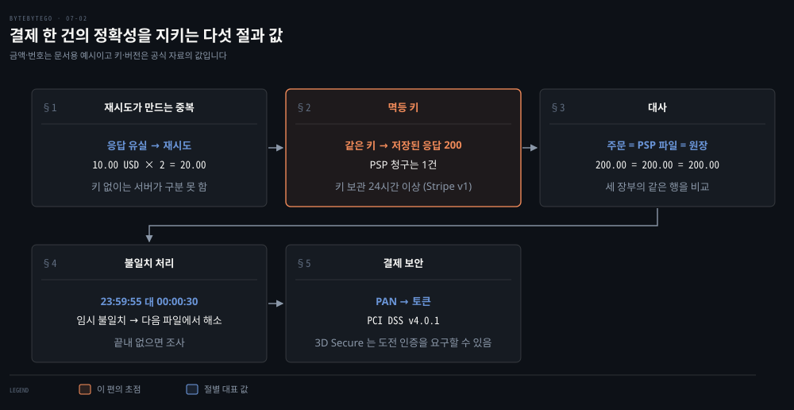
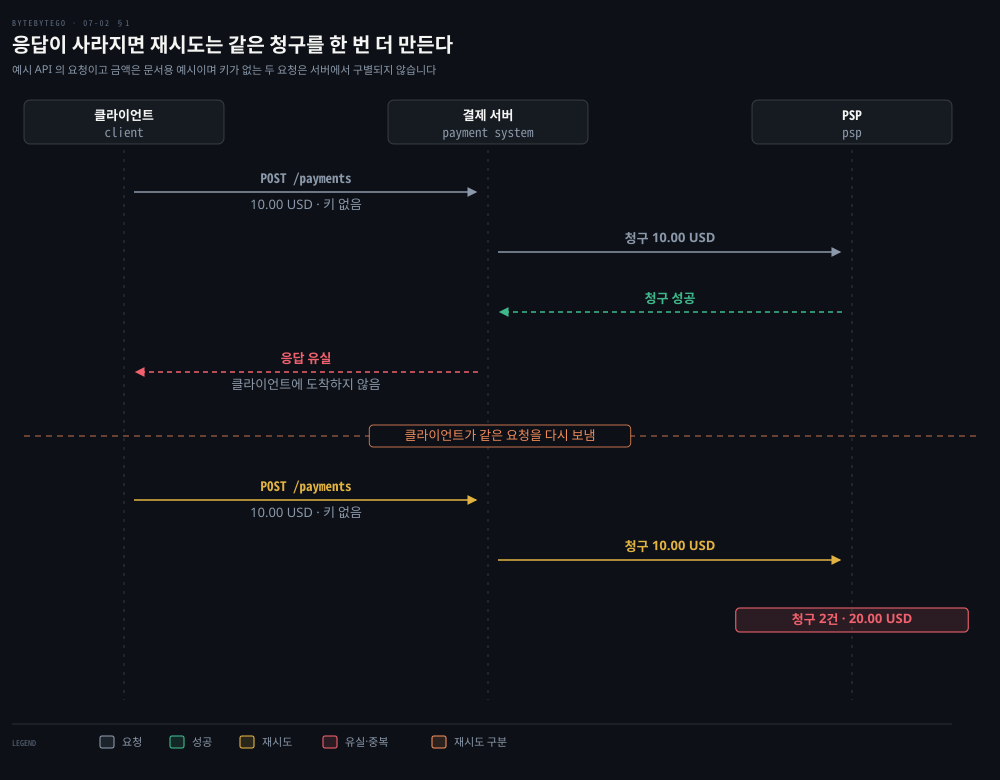
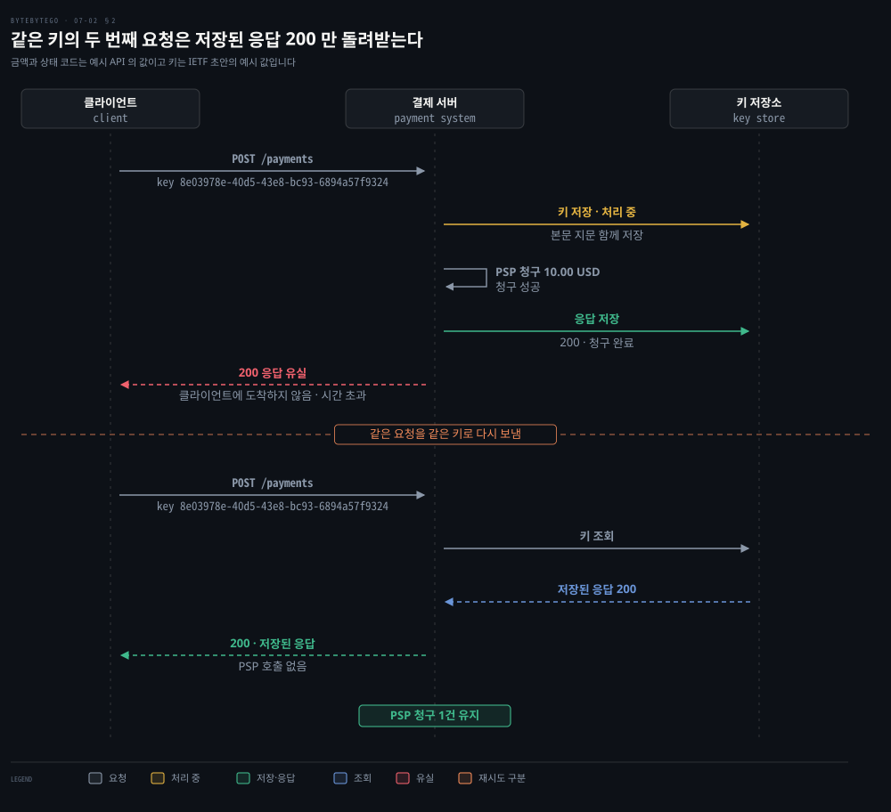
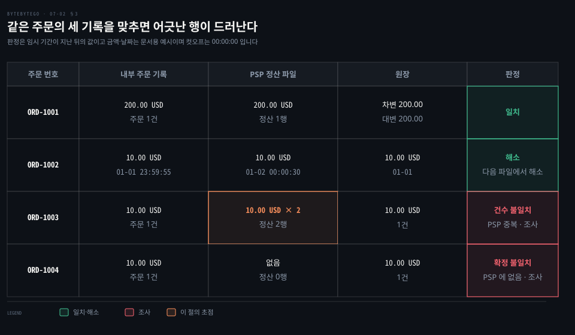
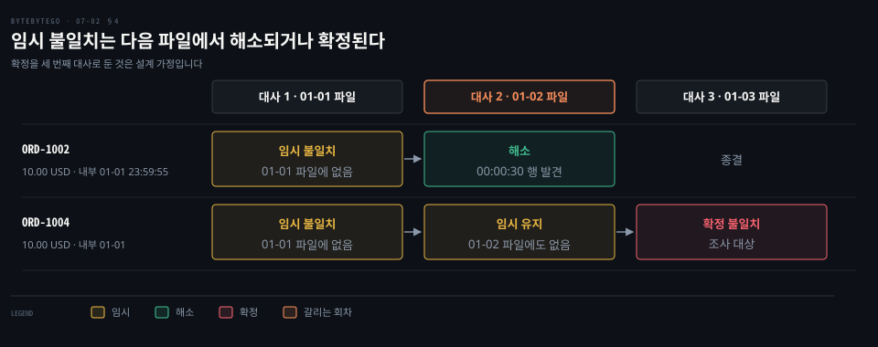
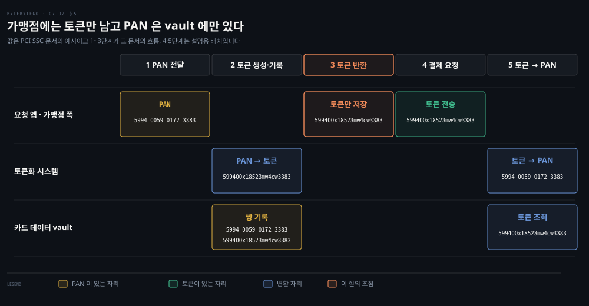

# 결제 정확성은 멱등 키로 이중 청구를 막고 대사로 장부 불일치를 찾고 토큰화로 카드 정보를 지킨다

---

> 결제 시스템은 재시도가 만든 중복을 멱등 키로 한 번만 처리하고, 그래도 어긋난 기록은 대사로 찾으며, 카드 번호는 토큰으로 바꿔 가맹점 시스템에 남기지 않습니다.


## 핵심 요약

> 이 편의 중심 생각은 결제의 정확성이 한 가지 장치가 아니라 요청 한 건이 지나는 세 단계(요청·장부·보안)에서 각각 따로 지켜진다는 것입니다.

요청 단계에서는 재시도가 최소 한 번을 보장하고 멱등 키가 최대 한 번을 보장해, 응답이 사라진 요청을 다시 보내도 청구는 한 번입니다. 그래도 PSP 와 내부 시스템은 서로 다른 시각과 형식으로 기록하므로, 장부 단계에서는 주문·PSP 정산 파일·원장을 대사로 맞춥니다.

대사에서 어긋난 행은 시각 차이로 생긴 임시 불일치와 조사할 불일치로 나뉩니다. 보안 단계에서는 카드 번호를 토큰으로 바꿔 우리 시스템에 남기지 않습니다. PCI DSS 가 그 범위를 정하고 3D Secure 가 발급사의 확인을 더합니다.




## 학습 목표

> 이 편을 읽고 나면 다음을 설명할 수 있습니다.

1. 응답이 사라진 요청을 재시도하면 이중 청구가 생기는 경로와, 정확히 한 번이 최소 한 번과 최대 한 번으로 나뉘는 이유를 설명할 수 있습니다.
2. 멱등 키가 서버에서 처리되는 순서와 키 없음·처리 중·다른 본문·완료 뒤 재시도의 응답을 구분할 수 있습니다.
3. 대사가 주문·PSP 정산 파일·원장 세 기록을 어떤 키로 맞추는지 설명할 수 있습니다.
4. 컷오프 때문에 생긴 임시 불일치와 조사할 불일치를 가르고 처리 순서를 말할 수 있습니다.
5. 토큰화가 PCI DSS 범위를 줄이는 원리와 줄이지 못하는 것, 3D Secure 가 막는 위협을 설명할 수 있습니다.


## 1. 재시도는 응답이 사라진 요청까지 다시 보내 이중 청구를 만든다

> 재시도는 결제가 최소 한 번은 처리되게 하지만, 서버가 이미 청구를 끝낸 요청을 응답만 못 받은 클라이언트가 다시 보내면 같은 청구가 한 번 더 만들어집니다.

이 편의 예시 API 에서 `POST /payments` 로 10.00 USD 를 청구하는 결제 요청이 시간 초과로 끝났다고 합시다. 서버가 청구하기 전에 끊겼는지, 청구한 뒤 응답이 사라졌는지는 클라이언트가 알 수 없습니다. 그래도 다시 보내면 안전할까요?

결제 시스템은 한 주문을 정확히 한 번 실행해야 합니다. 이 요구는 두 조건으로 쪼개면 풀립니다. 최소 한 번 실행되고, 동시에 최대 한 번 실행되는 것입니다.[^bbg-double] 최소 한 번은 재시도가 맡습니다. 네트워크가 나빠 10.00 USD 요청이 세 번 실패하고 네 번째에 성공하는 경우가 그 예입니다.[^bbg-double]

어려운 쪽은 최대 한 번입니다. 실패로 보이는 응답에는 두 종류가 섞여 있습니다. 요청이 서버에 닿지 못한 실패와, 서버가 처리를 마쳤는데 응답만 돌아오지 못한 실패입니다. 클라이언트에는 둘 다 같은 시간 초과입니다. IETF 초안도 이 상황을 적습니다. POST 요청이 시간 초과되면 클라이언트는 리소스가 만들어졌는지, 서버가 처리를 마쳤는지, 다시 보내도 안전한지 알 수 없습니다.[^ietf-draft]



첫 요청에서 서버는 PSP 에 10.00 USD 를 청구하고 성공을 받습니다. 응답이 클라이언트로 오는 길에서 사라지면 클라이언트는 같은 요청을 다시 보냅니다. 키가 없으니 서버는 둘째 요청을 새 주문으로 읽습니다. PSP 에 10.00 USD 를 다시 청구하면 카드에는 10.00 × 2 = 20.00 USD 가 청구됩니다.

HTTP 메서드의 성질이 이 차이를 만듭니다. 같은 요청을 여러 번 보낸 효과가 한 번 보낸 효과와 같으면 그 메서드는 **멱등**하다고 합니다. HTTP 의미 규격에서 PUT·DELETE 와 안전한 메서드는 멱등이고 POST 는 아닙니다.[^rfc9110] 결제 생성은 보통 POST 라서 시간 초과 뒤 자동 재시도가 안전하지 않습니다. 메서드별 안전성과 멱등성은 [HTTP 편](../../../02_os/book/npg_network-programming-with-go/08-01.HTTP%20는%20URL%20로%20자원을%20가리키고%20메서드로%20요청하며%20상태%20코드로%20답한다.md)의 §2 에서 다뤘습니다.

재시도 간격은 지수 백오프로 늘립니다. Adyen 문서도 요청이 몰려 처리율 제한에 걸리지 않도록 이 방식을 쓰라고 합니다.[^adyen-idem] 백오프와 지터는 [Retry Storm 방지](../../../04_messaging/05_ConsistencyPattern/06-02.Retry%20Storm%20방지%20—%20백오프%20jitter·동시성%20제한·서킷.md) 편에서 이어집니다. 전달 보장 세 가지는 [Kafka 편](./05-01.Kafka%20는%20순차%20IO%20와%20제로%20카피로%20빠르고%20전달%20보장은%20최대%20한%20번·최소%20한%20번·정확히%20한%20번으로%20갈린다.md)의 §3 이 오프셋 커밋 순서로 보입니다.


## 2. 멱등 키는 같은 요청에 같은 이름을 붙여 서버가 한 번만 처리하게 한다

> **멱등 키**는 클라이언트가 요청마다 만들어 헤더에 싣는 유일 값입니다. 서버는 키와 첫 응답을 저장해 두었다가 같은 키의 재시도에는 PSP 를 부르지 않고 저장된 응답을 돌려줍니다.

서버는 두 요청이 같은 주문의 재시도인지 새 주문인지 어떻게 구별할까요? 본문이 같아도 같은 상품을 두 번 산 것일 수 있어 본문만으로는 구별할 수 없습니다. 의도를 아는 쪽은 클라이언트뿐이라 키를 클라이언트가 만듭니다.

키는 요청 한 건마다 만들고 재시도에는 같은 값을 다시 씁니다. IETF 초안은 키가 유일해야 하고 다른 본문의 요청에 재사용하면 안 된다고 정합니다. UUID 같은 무작위 식별자를 권합니다.[^ietf-draft]

Stripe 는 V4 UUID 처럼 엔트로피가 충분한 무작위 문자열을 권합니다. 키는 255자까지이고 이메일 주소 같은 민감 정보를 키로 쓰지 말라고 합니다.[^stripe-idem] Adyen 은 키를 64자까지로 두고 UUID 를 권합니다.[^adyen-idem]

키는 HTTP 요청 헤더에 담습니다. 아래는 초안이 보이는 헤더 형식입니다.

```http
Idempotency-Key: "8e03978e-40d5-43e8-bc93-6894a57f9324"
```

키 값 `8e03978e-40d5-43e8-bc93-6894a57f9324` 는 초안이 든 예시입니다.

이 헤더는 아직 표준이 아닙니다. 위 형식을 정한 초안 draft-ietf-httpapi-idempotency-key-header 는 2025년 10월 15일의 07 판이 마지막입니다. 2026년 4월 18일에 만료된 상태이고 RFC 가 되지 않았습니다.[^ietf-page]

초안은 값을 따옴표 문자열로 쓰지만 Stripe 문서의 예시는 따옴표 없이 `Idempotency-Key: KG5LxwFBepaKHyUD` 로 씁니다.[^stripe-idem] 길이·보관 기간·오류 코드는 서비스마다 달라서 쓰는 PSP 의 문서로 확인합니다.



서버의 처리는 네 동작입니다. 키를 처리 중으로 저장하면서 본문의 지문을 함께 둡니다(초안 §2.4). PSP 에 청구합니다. 응답을 키에 붙여 저장합니다. 응답을 보냅니다. 응답이 사라져 클라이언트가 같은 키로 다시 보내면, 서버는 키를 조회해 저장된 응답 200 을 돌려주고 PSP 는 부르지 않습니다. 그래서 PSP 의 청구는 1건으로 남습니다.

서버가 만나는 경우는 다섯 가지이고 키 보관 기간이 따로 붙습니다. 초안이 정한 응답과 실제 서비스의 동작을 나란히 놓으면 다음과 같습니다.

| 경우 | 초안의 응답 | 실제 서비스 |
|------|-------------|-------------|
| 키가 필수인데 없음 | 400 | 서비스 문서를 따름 |
| 첫 요청 | 정상 처리 | Stripe(API v1): 처리가 시작된 뒤의 결과만 저장 |
| 완료된 뒤의 재시도 | 저장된 결과를 성공이든 오류든 돌려줌 | Stripe(API v1): 첫 요청의 상태 코드와 본문, 500 도 그대로 |
| 처리 중인 요청의 재시도 | 409 | Adyen: 422 또는 409, 오류 코드 704 |
| 같은 키에 다른 본문 | 422 | Stripe(API v1): 매개변수가 다르면 오류 |
| 키 보관 기간 | 서버가 문서에 공개 | Stripe(API v1): 24시간이 지나면 정리 가능, Adyen: 7~14일 |

표는 초안 §2.3·§2.5.2·§2.6·§2.7,[^ietf-draft] Stripe 문서,[^stripe-idem] Adyen 문서[^adyen-idem] 에서 옮겼습니다. Stripe 의 API v1 은 입력 검증에 실패했거나 동시에 실행 중인 요청과 부딪힌 요청은 실행이 시작되지 않아 결과를 저장하지 않으므로 다시 보낼 수 있다고 적습니다. API v2 는 성공한 작업을 반복하지 않고 실패하거나 일부만 된 작업은 가능하면 끝까지 처리해 갱신된 응답을 돌려줍니다.[^stripe-idem] 보관 기간이 지나 키가 정리되면 같은 키는 새 요청이 됩니다. 그래서 재시도는 그 기간 안에 끝나야 합니다.

키 저장은 읽고 쓰는 두 동작으로 나누면 안 됩니다. 두 요청이 동시에 와서 둘 다 키가 없다고 읽으면 둘 다 청구합니다. 클라이언트가 만든 요청 ID 를 끝까지 전달해 유일 제약으로 중복을 막는 방식은 [정확성과 신뢰](../../../05_data/book/designing-data-intensive-applications/13-04.정확성과%20신뢰·13장%20종합.md)의 §1 이 다룹니다. 유일 제약이 걸린 삽입 한 번으로 선점하는 방식은 [Inbox 편](../../../04_messaging/05_ConsistencyPattern/03-01.Inbox.md)이, 정확히 한 번의 범위는 [Exactly-once 편](../../../04_messaging/05_ConsistencyPattern/03-04.Exactly-once%20의미론과%20Consumer%20Idempotency.md)이 다룹니다.


## 3. 대사는 내부 장부와 PSP 정산 파일의 같은 행을 맞춘다

> 멱등 키가 있어도 장부는 어긋날 수 있습니다. **대사**는 서로 다른 시스템의 같은 거래 기록을 비교해 금액이 맞는지 확인하는 마지막 안전망입니다.

시스템이 정확히 한 번 처리한다고 믿는다면 대사는 필요 없을까요? 처리 과정에는 어긋날 자리가 많아서 대사 시스템은 항상 필요합니다. 어긋남이 없다고 믿는 시스템에도 안전망이 있어야 한다는 뜻입니다.[^bbg-recon] 믿되 검증하는 태도는 [정확성과 신뢰](../../../05_data/book/designing-data-intensive-applications/13-04.정확성과%20신뢰·13장%20종합.md)의 §6 이 다룹니다.

200 USD 짜리 시계를 PayPal 로 샀다고 합시다. 같은 거래가 세 곳에 남습니다. 전자상거래 사이트에는 200 USD 의 주문 기록이 있습니다. PayPal 에는 200 USD 의 거래 기록이 있습니다. 원장에는 구매자의 차변 200 USD 와 판매자의 대변 200 USD 가 있습니다.[^bbg-recon]

한 거래가 차변과 대변에 같은 금액을 한 번씩 적는 방식을 복식부기라고 합니다. 대사는 이 세 기록이 한 주문에서 같은 금액인지 확인합니다.

| 계정 | 차변 | 대변 |
|------|------|------|
| 구매자 | 200 USD | |
| 판매자 | | 200 USD |

세 기록을 한 행으로 묶으려면 공통 키가 있어야 합니다. 실무에서는 보통 다섯 단계의 번호 사슬이 됩니다.

1. 상점이 주문 번호를 붙입니다.
2. 그 번호가 결제 제공자로 넘어갑니다.
3. 제공자가 내부 결제 ID 를 만듭니다.
4. 입금을 받을 때 그 결제 ID 가 따라옵니다.
5. 송장 시스템이 주문 번호나 결제 ID 로 송장을 잇습니다.[^bbg-reader]

이 사슬이 끊기면 행을 짝지을 수 없습니다. 그래서 멱등 키와 별개로 주문 번호를 PSP 요청에 싣는 것이 대사의 전제입니다.

구매 한 건이 회사에 남기는 이벤트는 둘이 아니라 최소 넷입니다. 거래 때의 차변·대변 한 쌍에 더해, 며칠 뒤 PSP 가 은행 계좌로 돈을 옮길 때 한 쌍이 더 생깁니다.[^bbg-reader] 한 쌍이 늘 때마다 대사할 행도 늘어납니다.



격자의 주문 번호·날짜와 둘째 행부터의 금액은 예시입니다. 판정 열은 임시 기간이 지난 뒤의 값입니다. 첫 행 ORD-1001 은 세 기록이 모두 200.00 USD 인 일치입니다. 둘째 행 ORD-1002 는 시각만 어긋나 임시 불일치였다가 다음 파일에서 해소된 경우이고 §4 가 다룹니다. 셋째 행 ORD-1003 은 PSP 정산 파일에 같은 주문이 두 번 있는 경우입니다. 멱등 키가 PSP 까지 이어지지 않았거나 키 보관 기간이 지났을 때 생길 수 있고, 내부 주문과 원장은 1건이어서 대사만이 이를 잡습니다. 넷째 행 ORD-1004 는 PSP 에 끝내 행이 없어 확정 불일치가 된 경우입니다.

대사에는 두 가지 부담이 있습니다. 먼저 시스템마다 기록 형식이 달라서, 한쪽의 시각이 `2022/01/01` 이고 다른 쪽이 `Jan 1, 2022` 일 수 있습니다. 비교 전에 형식을 하나로 맞추는 변환 계층을 둡니다.[^bbg-recon] 다음으로 양이 많습니다. 거의 실시간 대사가 필요하면 스트림 처리 플랫폼을 쓰고, 하루 끝에 모아서 맞추면 충분하면 일괄 처리를 씁니다.[^bbg-recon]

PSP 쪽 파일은 서비스가 제공합니다. Stripe 의 지급 대사 보고서는 한 지급에 든 결제·환불·분쟁·수수료를 거래 단위 행으로 담은 CSV 를 내려받게 하고, 내보낼 때 사용자 지정 메타데이터를 넣어 회계 시스템의 기록과 맞출 수 있게 합니다.[^stripe-recon] 한 지급의 입금액은 여러 거래와 수수료를 합친 값이므로 주문 금액과 입금액을 비교하지 않고 거래 행끼리 맞춥니다.


## 4. 불일치는 임시와 조사 대상으로 갈라 다음 파일에서 다시 맞춘다

> 어긋난 행이 모두 오류는 아닙니다. 컷오프 때문에 생긴 불일치는 임시로 분류해 다음 날의 PSP 기록과 다시 맞추고, 끝내 안 맞는 행만 조사합니다.

01-01 23:59:55 에 만든 주문이 PSP 에는 01-02 00:00:30 으로 찍혔습니다. 오늘 PSP 파일에서 이 주문을 찾을 수 없다면 오류일까요?

하루 단위 대사는 컷오프 시각을 정합니다. 컷오프를 00:00:00 으로 잡으면 내부 시스템에서 23:59:55 로 기록된 행이 PSP 에서는 00:00:30 으로, 즉 다음 날로 기록될 수 있습니다. 오늘의 PSP 기록에서 이 행을 찾지 못해 불일치가 됩니다.[^bbg-recon] 이 불일치는 **임시 불일치**로 분류해 두었다가 다음 날의 PSP 기록과 다시 맞춥니다. 거기서 일치하는 행을 찾으면 불일치는 해소되고 더 할 일이 없습니다.[^bbg-recon]



그림의 ORD-1002 는 대사 1 에서 PSP 파일에 없다가 대사 2 에서 00:00:30 행이 발견되어 해소됩니다. ORD-1004 는 01-02 파일에도 없어 임시 불일치로 남습니다. 대사 3 에서는 확정 불일치가 되어 조사 대상이 됩니다. 확정 시점은 계약과 정산 주기로 정해야 하며 그림의 세 번째 대사는 설명용 가정입니다.

비교 결과는 크게 넷으로 나뉩니다. 아래 분류는 격자의 판정 열에 그 앞 단계인 임시 불일치를 더해 이 편이 정리한 것이고 처리는 설계 판단입니다.

| 판정 | 조건 | 처리 |
|------|------|------|
| 일치 | 세 기록의 금액과 건수가 같음 | 닫음 |
| 임시 불일치 | 한쪽 행이 컷오프로 다음 파일에 있을 수 있음 | 다음 대사 회차에서 재대사하고 찾으면 해소 |
| 건수 불일치 | 같은 주문이 한쪽에 두 번 있음 | 중복 청구로 보고 조사, 환불 여부 확인 |
| 확정 불일치 | 임시 기간이 지나도 한쪽에 행이 없음 | 조사 |

금액이 다른 경우도 있습니다. 거래가 PSP 의 기준 통화와 다른 통화로 일어나면 그 통화로 받은 뒤 기준 통화로 환전하는 계층이 하나 더 생깁니다. 제공자마다 이 처리가 다릅니다.[^bbg-reader]

입금 때도 환차가 한 번 더 생길 수 있습니다. 구매가 JPY, PSP 계정이 USD, 은행 계좌가 EUR 이면 PSP 가 은행으로 돈을 옮기는 단계에서 대사할 환차가 하나 더 있습니다.[^bbg-reader] 환전 경로는 [온라인 결제 편](./07-01.온라인%20결제는%20카드%20네트워크·SWIFT·외환%20경로로%20돈이%20움직이고%20지갑과%20장부가%20그%20흐름을%20기록한다.md)의 §4 에서 다뤘습니다.

구매자 쪽에서도 어긋남이 생깁니다. PayPal 에서 일주일 간격으로 두 건을 사면, 먼저 산 A 의 인출이 끝나지 않았거나 취소된 시점에 B 를 결제할 때 A 몫의 돈으로 B 를 일부 결제할 수 있어서 B 의 일부 금액만 은행에서 빠져나갑니다.[^bbg-reader] 이런 플랫폼별 동작은 대사 규칙이 플랫폼마다 달라져야 하는 이유입니다.


## 5. 결제 보안은 카드 번호를 토큰으로 바꾸고 범위를 정하고 소지자를 확인한다

> 결제 보안은 위협마다 장치가 다릅니다. 카드 번호가 시스템에 남는 것이 위험이라 토큰화로 번호를 vault 에만 두고, PCI DSS 가 그 범위를 정하며, 3D Secure 가 발급사의 확인을 더합니다.

결제 DB 에 카드 번호가 저장돼 있다면 DB 가 털릴 때 무엇이 새어 나갈까요? 위협과 장치는 다음처럼 짝지어집니다.[^bbg-sec]

| 위협 | 장치 |
|------|------|
| 요청·응답 도청 | HTTPS |
| 데이터 변조 | 암호화와 무결성 모니터링 |
| 중간자 공격 | TLS 와 인증서 인증 |
| 데이터 유실 | 여러 리전에 복제하고 스냅샷을 뜸 |
| 분산 서비스 거부 | 처리율 제한과 방화벽 |
| 카드 도난 | 토큰화 |
| 규정 준수 | PCI DSS |
| 사기 | 주소 확인, 카드 확인 값(CVV), 사용자 행동 분석 |

SSL 3.0 은 RFC 7568 이 쓰지 말라고 했고 TLS 1.0 과 1.1 은 RFC 8996 이 폐기했습니다. TLS 1.3 은 2026년 7월의 RFC 9846 이 정의하며 RFC 9846 은 RFC 8446 을 폐기합니다.[^tls] 처리율 제한은 [처리율 제한기 편](../system-design/04-01.처리율%20제한기는%20토큰%20버킷·누출%20버킷·고정%20윈도·이동%20윈도%20로그·이동%20윈도%20카운터로%20요청을%20센다.md)이 다룹니다.

### 토큰화는 카드 번호를 돌려받기 어려운 대체 값으로 바꾼다

**토큰화**는 카드의 주 계좌 번호(PAN)를 토큰이라는 대체 값으로 바꾸는 일입니다. 토큰으로 PAN 을 되찾는 반대 방향은 de-tokenization 이라고 합니다. 토큰의 안전은 토큰만 알고 PAN 을 알아내는 것이 불가능하다는 데 달려 있습니다.[^pci-token] 가맹점이 PAN 대신 토큰을 저장하면 환경에 남는 카드 정보가 줄어 PCI DSS 요구사항을 이행할 노력이 줄 수 있습니다.[^pci-token]



토큰화 시스템의 처리는 네 동작입니다. 요청 앱이 인증 정보와 함께 PAN 을 보냅니다. 시스템이 인증을 확인합니다. 시스템이 토큰을 만들거나 이미 있으면 가져와 PAN 과 짝으로 카드 데이터 vault 에 기록합니다. 토큰을 돌려줍니다.[^pci-token]

복원은 반대로 토큰을 보내 vault 에서 PAN 을 조회하는 일입니다. 토큰화와 복원은 승인된 앱의 요청을 받는 정해진 토큰화 시스템 안에서만 일어나야 합니다.[^pci-token]

가맹점이 PAN 을 되찾을 수 있으면 가맹점 환경이 PCI DSS 범위에 들어갑니다. 범위를 줄이려면 토큰이 생긴 뒤 가맹점이 PAN 을 되찾을 수 없어야 합니다.[^pci-token] 이를 이어 가면 결제 요청에도 가맹점은 PAN 이 아니라 토큰을 싣게 됩니다. 그림의 4·5단계는 이 설계 귀결을 그린 설명용 배치입니다. 다만 토큰만으로 거래를 시작할 수 있으면 그 토큰은 PAN 만큼 가치가 있어 PCI DSS 범위에 들 수 있습니다.[^pci-token]

그림의 값은 PCI SSC 문서의 예시이고 1~3단계가 그 문서의 흐름입니다. 그림은 인증 확인을 줄여 세 단계로 그렸습니다. PAN `5994 0059 0172 3383` 이 앞 6자리와 뒤 4자리를 남긴 토큰 `599400x18523mw4cw3383` 이 됩니다.[^pci-token]

토큰을 만드는 방법은 셋입니다. 강한 키로 되돌릴 수 있게 암호화하는 방법, 비밀 솔트를 쓴 해시 같은 단방향 함수, PAN 에서 계산하지 않은 순번이나 난수를 배정하는 방법입니다.[^pci-token] 암호화로 만든 토큰은 암호화된 PAN 이라 지침 밖의 PCI DSS 고려 대상이 될 수 있습니다.[^pci-token] 토큰이 PAN 모양을 흉내 내면 사람이 구별하지 못하므로 둘을 가르는 수단이 따로 있어야 합니다.[^pci-token]

토큰화가 규정 준수를 없애지는 않습니다. 토큰화 방식은 PCI DSS 를 유지하고 검증할 의무를 없애지 못합니다. 적용 대상 시스템 구성 요소 수를 줄여 검증을 단순하게 할 수 있을 뿐입니다.[^pci-token] vault 는 PAN 과 토큰이 함께 있어 흔히 공격자에게 가장 매력적인 대상입니다. PCI DSS 가 요구하는 것 이상의 통제가 필요할 수 있습니다.[^pci-token] 토큰화 시스템의 모든 구성 요소는 PCI DSS 범위 안이고, PAN 을 받는 수집 지점과 복원 지점에도 PCI DSS 통제가 적용됩니다.[^pci-token]

이 지침은 2011년 8월에 PCI DSS 2.0 시점에 나온 정보 보충 자료입니다. 여기서는 토큰의 성질을 설명하는 데에만 썼습니다.[^pci-token]

### PCI DSS 는 카드 정보를 다루는 조직의 기준이다

**PCI DSS** 는 브랜드 신용카드를 다루는 조직을 위한 정보 보안 표준입니다.[^bbg-sec] 현재 버전은 v4.0.1 입니다. PCI SSC 는 2024년 6월 11일 v4.0 에 대한 제한적 개정으로 v4.0.1 을 냈고 요구사항을 더하거나 지우지 않았습니다. v4.0 은 2024년 12월 31일에 폐기되어 v4.0.1 이 유일한 유효 버전이 되었으며, 새 요구사항의 시행일 2025년 3월 31일은 그대로입니다.[^pci-v401] 문서 도서관의 대표 문서도 v4.0.1 입니다.[^pci-lib]

### 3D Secure 는 발급사가 카드 소지자를 확인한다

번호가 도난당해도 소지자가 아니면 결제가 안 되도록 하는 장치가 3D Secure 입니다. EMV 3DS 는 가맹점과 발급사가 거래·결제 수단·기기 정보를 주고받으며 소지자를 인증하게 해 카드 비제시 사기를 막습니다.[^emv3ds] 많은 거래는 소지자가 구매 버튼만 누르면 승인됩니다. 위험이 더 높은 거래는 발급사가 추가 인증을 요구하기로 할 수 있고, 소지자는 일회용 비밀번호·지식 기반 질문·생체 같은 도전 인증을 거칩니다.[^emv3ds]

사양은 EMVCo 가 관리합니다. 2025년 8월 11일의 사양 공지 두 건이 v2.2.0 에서 v2.3.1.1 까지를 다룹니다.[^emv3ds] 규제와도 이어집니다. EEA 의 PSD2 가 정한 강한 고객 인증과 영국·인도·일본·호주의 비슷한 규제는 카드 결제에 3DS 를 쓰게 할 수 있고, 그 밖의 지역에서는 선택입니다.[^stripe-3ds] 토큰화는 번호가 새어 나가는 것을 막고 3DS 는 새어 나간 번호가 쓰이는 것을 막습니다. 둘은 서로 대신하지 않습니다.


## 면접 대비

> 이중 청구가 생기는 경로, 멱등 키의 처리, 대사와 불일치 분류, 카드 정보 보호에 관한 면접 질문입니다.

1. 결제 요청이 시간 초과로 끝났을 때 그대로 다시 보내면 왜 이중 청구가 생길 수 있고, 최소 한 번과 최대 한 번은 각각 무엇이 맡습니까?
2. 멱등 키를 서버가 아니라 클라이언트가 만드는 이유는 무엇이며, 같은 키에 다른 본문이 오거나 처리 중에 재시도가 오면 서버는 어떻게 응답해야 합니까?
3. 멱등 키로 중복을 막는데도 대사가 필요한 까닭은 무엇입니까?
4. 컷오프 시각 때문에 생긴 불일치는 어떻게 분류하고 어떻게 처리합니까?
5. 토큰화가 PCI DSS 범위를 줄이는 원리와 줄이지 못하는 것은 무엇이고, 3D Secure 는 무엇을 막습니까?


## 정답 (자답 후 펼치기)

> 면접 질문에 대한 키워드 중심의 모범 답안입니다.

### 정답 1 — 응답 유실은 처리 완료와 구별되지 않고, 최소 한 번은 재시도·최대 한 번은 멱등 확인

서버가 청구를 끝낸 뒤 응답만 사라지면 클라이언트에는 요청이 닿지 못한 실패와 같은 시간 초과로 보여 같은 요청을 다시 보냅니다. 키가 없으면 서버는 새 주문으로 읽어 PSP 에 두 번 청구합니다. 최소 한 번은 재시도가, 최대 한 번은 멱등 확인이 맡습니다.

### 정답 2 — 의도는 클라이언트만 알고, 다른 본문은 422·처리 중은 409

본문이 같아도 같은 상품을 두 번 산 것일 수 있어 같은 요청인지는 클라이언트만 압니다. 초안은 같은 키에 다른 본문이 오면 422, 처리 중에 재시도가 오면 409, 완료된 뒤의 재시도에는 저장된 결과를 돌려주라고 합니다.

### 정답 3 — 멱등 키가 닿지 않는 자리와 시각·통화 차이

멱등 키는 요청 단계의 중복만 막습니다. 키가 PSP 까지 이어지지 않거나 보관 기간이 지났을 수 있고, 시각·통화·수수료는 키와 무관하게 어긋납니다. 대사는 주문·PSP 정산 파일·원장을 맞추는 마지막 안전망입니다.

### 정답 4 — 임시 불일치로 두고 다음 파일에서 재대사

컷오프 00:00:00 에서 내부 23:59:55 와 PSP 00:00:30 은 날짜가 달라 오늘 파일에서 못 찾습니다. 임시 불일치로 분류하고 다음 날의 PSP 기록과 다시 맞춰 찾으면 해소하고, 끝내 없으면 조사합니다.

### 정답 5 — PAN 을 토큰으로 대체해 범위를 줄이지만 의무는 남고, 3DS 는 도난 번호의 사용을 막음

토큰은 PAN 으로 되돌리기 어려워 가맹점에 PAN 이 남지 않고 적용 구성 요소가 줄지만 PCI DSS 를 유지하고 검증할 의무는 없어지지 않으며 vault 는 PCI DSS 환경이어야 합니다. 3D Secure 는 발급사가 소지자를 확인해 번호만 아는 사람의 비제시 결제를 막습니다.


## 참고 자료

- ByteByteGo 「System Design」 그림 해설 모음, 「Avoid double charge」·「Reconciliation」(두 편)·「Payment security」.
- ByteByteGo, How to Avoid Double Payment: https://github.com/ByteByteGoHq/system-design-101/blob/b28380a/data/guides/how-to-avoid-double-payment.md
- ByteByteGo, Reconciliation in Payment: https://github.com/ByteByteGoHq/system-design-101/blob/b28380a/data/guides/reconciliation-in-payment.md
- IETF, The Idempotency-Key HTTP Header Field (draft-ietf-httpapi-idempotency-key-header, 07 판 2025-10-15, 만료): https://datatracker.ietf.org/doc/draft-ietf-httpapi-idempotency-key-header/
- RFC 9110 HTTP Semantics, §9.2.2 Idempotent Methods: https://www.rfc-editor.org/rfc/rfc9110#section-9.2.2
- RFC 7568 Deprecating Secure Sockets Layer Version 3.0: https://www.rfc-editor.org/rfc/rfc7568
- RFC 8996 Deprecating TLS 1.0 and TLS 1.1: https://www.rfc-editor.org/rfc/rfc8996
- RFC 9846 The Transport Layer Security (TLS) Protocol Version 1.3: https://www.rfc-editor.org/rfc/rfc9846
- Stripe Docs, Idempotent requests: https://docs.stripe.com/api/idempotent_requests
- Adyen Docs, API idempotency: https://docs.adyen.com/development-resources/api-idempotency/
- Stripe Docs, Payout reconciliation report: https://docs.stripe.com/reports/payout-reconciliation
- PCI SSC, PCI DSS Tokenization Guidelines (Information Supplement, 2011-08): https://www.pcisecuritystandards.org/documents/Tokenization_Guidelines_Info_Supplement.pdf
- PCI SSC, Just Published: PCI DSS v4.0.1 (2024-06-11): https://blog.pcisecuritystandards.org/just-published-pci-dss-v4-0-1
- EMVCo, EMV 3-D Secure: https://www.emvco.com/emv-technologies/3-d-secure/
- Stripe Docs, 3D Secure authentication: https://docs.stripe.com/payments/3d-secure


## 관련 문서

- [온라인 결제는 카드 네트워크·SWIFT·외환 경로로 돈이 움직이고 지갑과 장부가 그 흐름을 기록한다](./07-01.온라인%20결제는%20카드%20네트워크·SWIFT·외환%20경로로%20돈이%20움직이고%20지갑과%20장부가%20그%20흐름을%20기록한다.md)
- [Kafka 는 순차 IO 와 제로 카피로 빠르고 전달 보장은 최대 한 번·최소 한 번·정확히 한 번으로 갈린다](./05-01.Kafka%20는%20순차%20IO%20와%20제로%20카피로%20빠르고%20전달%20보장은%20최대%20한%20번·최소%20한%20번·정확히%20한%20번으로%20갈린다.md)
- [정확성과 신뢰·13장 종합](../../../05_data/book/designing-data-intensive-applications/13-04.정확성과%20신뢰·13장%20종합.md)
- [Exactly-once 의미론과 Consumer Idempotency](../../../04_messaging/05_ConsistencyPattern/03-04.Exactly-once%20의미론과%20Consumer%20Idempotency.md)
- [Inbox](../../../04_messaging/05_ConsistencyPattern/03-01.Inbox.md)
- [알림 시스템은 제3자 푸시·SMS·이메일 서비스 앞에 메시지 큐와 작업 서버를 두어 재시도와 중복을 다룬다](../system-design/10-01.알림%20시스템은%20제3자%20푸시·SMS·이메일%20서비스%20앞에%20메시지%20큐와%20작업%20서버를%20두어%20재시도와%20중복을%20다룬다.md)

[^bbg-double]: ByteByteGo, How to Avoid Double Payment — 정확히 한 번을 최소 한 번과 최대 한 번으로 나누고, 재시도가 최소 한 번을 맡으며 $10 결제가 네 번째 시도에서 성공하는 예. <https://github.com/ByteByteGoHq/system-design-101/blob/b28380a/data/guides/how-to-avoid-double-payment.md>
[^ietf-draft]: IETF, draft-ietf-httpapi-idempotency-key-header-07 — §1 시간 초과 시나리오, §2.2 유일성과 UUID 권고, §2.3 만료 정책 공개, §2.4 지문, §2.5.2 자원의 문서화 책임, §2.6 강제, §2.7 400·409·422. <https://www.ietf.org/archive/id/draft-ietf-httpapi-idempotency-key-header-07.txt>
[^ietf-page]: IETF Datatracker, draft-ietf-httpapi-idempotency-key-header — 최신 판 07(2025-10-15), 상태 Expired, 2026-04-18 만료, RFC 번호 없음. <https://datatracker.ietf.org/doc/draft-ietf-httpapi-idempotency-key-header/>
[^rfc9110]: RFC 9110 HTTP Semantics §9.2.2 — PUT·DELETE 와 안전한 메서드가 멱등. <https://www.rfc-editor.org/rfc/rfc9110#section-9.2.2>
[^stripe-idem]: Stripe API Reference, Idempotent requests — 키 255자, V4 UUID 권고, API v1 의 첫 요청 상태 코드와 본문 저장(500 포함)·24시간 이후 정리·매개변수 비교·실행 전 실패는 저장하지 않음, API v2 의 재시도 동작, 헤더 예시. <https://docs.stripe.com/api/idempotent_requests>
[^adyen-idem]: Adyen Docs, API idempotency — 키 64자와 UUID 권고, 7~14일 유효, 회사 계정 단위, 처리 중 중복은 422 또는 409 와 코드 704, 지수 백오프. <https://docs.adyen.com/development-resources/api-idempotency/>
[^bbg-recon]: ByteByteGo, Reconciliation in Payment — 세 기록과 복식부기, 데이터 정규화, 데이터 양, 컷오프와 임시 불일치, 정확히 한 번이어도 대사가 필요하다는 설명. <https://github.com/ByteByteGoHq/system-design-101/blob/b28380a/data/guides/reconciliation-in-payment.md>
[^bbg-reader]: ByteByteGo 「System Design」 그림 해설 모음의 「Reconciliation」 두 번째 글 — 독자가 보낸 통화 문제·이벤트 최소 4개·그림자 거래와 주문 번호에서 송장까지의 다섯 단계. 저장소 가이드에서는 이 글을 찾지 못했습니다.
[^stripe-recon]: Stripe Docs, Payout reconciliation report — 항목별 CSV, 보고 범주, 사용자 지정 메타데이터. <https://docs.stripe.com/reports/payout-reconciliation>
[^bbg-sec]: ByteByteGo 「System Design」 그림 해설 모음의 「Payment security」 표 — 위협과 해결책 여덟 쌍. 이 표를 설명한 저장소 가이드는 찾지 못했습니다.
[^tls]: RFC 7568 Deprecating Secure Sockets Layer Version 3.0 <https://www.rfc-editor.org/rfc/rfc7568>, RFC 8996 Deprecating TLS 1.0 and TLS 1.1 <https://www.rfc-editor.org/rfc/rfc8996>, RFC 9846 The Transport Layer Security (TLS) Protocol Version 1.3, 2026-07, RFC 8446 폐기 <https://www.rfc-editor.org/rfc/rfc9846>
[^pci-token]: PCI SSC, PCI DSS Tokenization Guidelines(2011-08) — §1.3 정의와 원칙, §2 토큰 형식·토큰 생성 방식, §2.1.3 vault, §2.2 Figure 1·2 와 범위 설명, §2.3.4 구별 가능성, §2.4.1 수집·복원 지점의 통제, §3.1.1 범위 원칙, §4.1 결제 수단으로 쓰이는 토큰. <https://www.pcisecuritystandards.org/documents/Tokenization_Guidelines_Info_Supplement.pdf>
[^pci-v401]: PCI SSC 블로그, Just Published: PCI DSS v4.0.1(2024-06-11) — 제한적 개정, 요구사항 추가·삭제 없음, v4.0 폐기 2024-12-31, 새 요구사항 시행일 2025-03-31 유지. <https://blog.pcisecuritystandards.org/just-published-pci-dss-v4-0-1>
[^pci-lib]: PCI SSC Document Library — 대표 문서 PCI DSS v4.0.1. <https://www.pcisecuritystandards.org/document_library/>
[^emv3ds]: EMVCo, EMV 3-D Secure — 가맹점과 발급사의 데이터 교환, 많은 거래는 구매 버튼만 누르고 위험이 높은 거래는 발급사가 추가 인증을 요구할 수 있음, 사양 v2.2.0–2.3.1.1(Specification Bulletin 279·280, 2025-08-11). <https://www.emvco.com/emv-technologies/3-d-secure/>
[^stripe-3ds]: Stripe Docs, 3D Secure authentication — PSD2(EEA)와 영국·인도·일본·호주의 비슷한 규제가 카드 결제에 3DS 를 요구할 수 있고 다른 지역에서는 선택. <https://docs.stripe.com/payments/3d-secure>
