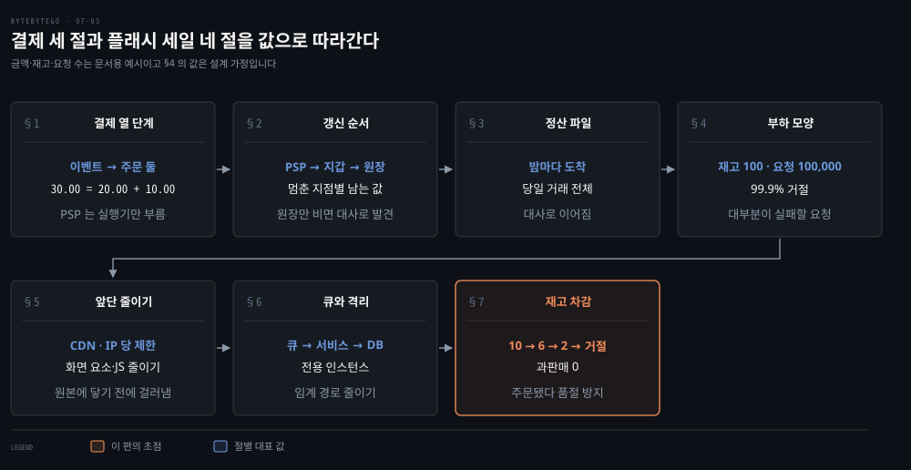
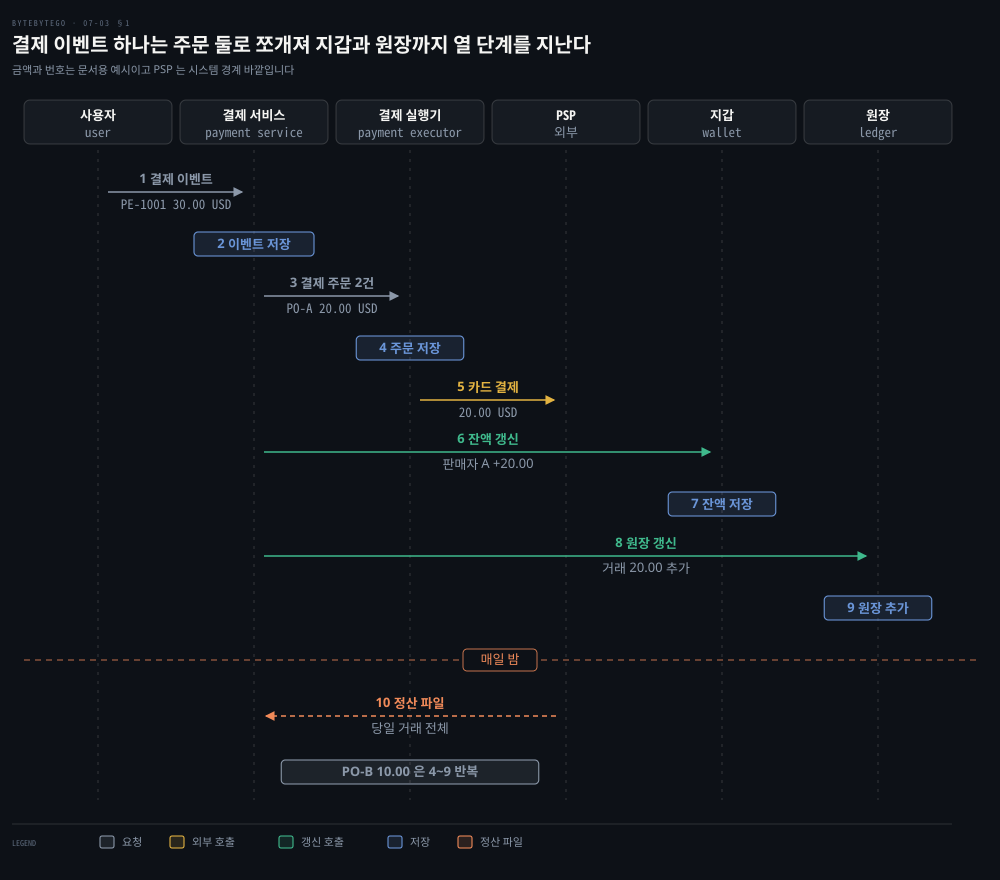
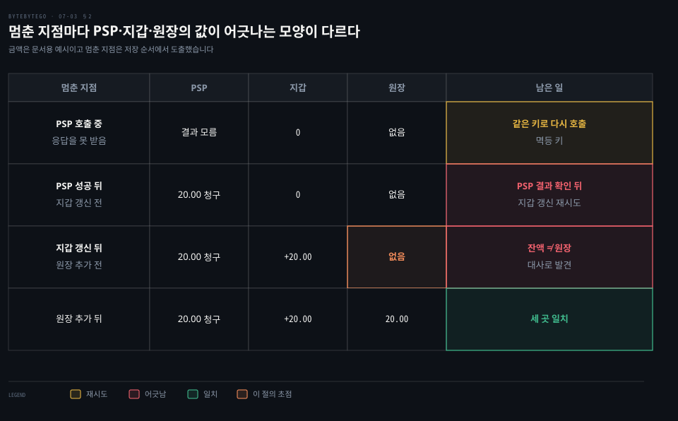
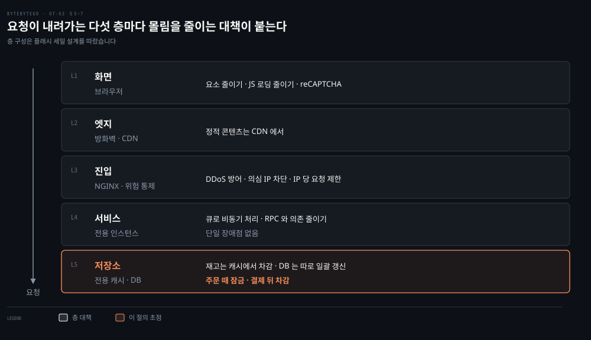
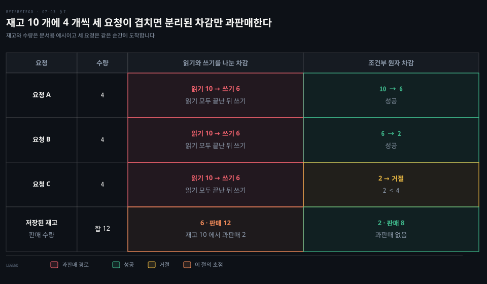

# 결제 시스템은 결제 이벤트를 결제 주문으로 나눠 PSP 에 맡기고 플래시 세일은 비동기 큐와 재고 차감 순서로 과판매를 막는다

---

> 구매 버튼 한 번은 결제 이벤트에서 결제 주문, PSP 호출, 지갑과 원장(장부) 갱신으로 이어지고, 플래시 세일은 같은 구매를 층마다 줄이고 큐로 나눠 재고를 한 곳에서 원자적으로 차감해 과판매를 막습니다.

## 핵심 요약

> 이 편의 중심 생각은 돈이 오가는 시스템이 단계마다 기록을 남기며 정해진 순서로 나아가고, 순간적으로 몰리는 시스템은 그 순서의 앞쪽에서 대부분의 요청을 싸게 걸러 낸다는 것입니다.

결제 쪽은 결제 이벤트를 결제 주문으로 쪼개고 주문마다 결제 실행기가 PSP 를 호출한 뒤 지갑과 원장을 차례로 갱신합니다. 각 단계는 자기 DB 에 기록을 남기고 다음 단계를 부릅니다. 그래서 서버가 어디서 멈춰도 남은 기록으로 이어서 처리하거나 어긋남을 찾을 수 있습니다. 밤마다 오는 정산 파일은 이 내부 기록을 바깥 쪽 기록과 맞춰 볼 입력이 됩니다.

플래시 세일은 평균이 아니라 짧은 순간의 극단적 동시성이 문제입니다. 화면·CDN·진입 층에서 요청을 줄입니다. 서비스는 큐와 전용 인스턴스로 보호합니다. 재고는 캐시 한 곳에서 원자적으로 차감합니다. 주문 때 잠그고 결제가 성공한 뒤 확정하므로 주문이 됐다가 품절이라는 안내를 피할 수 있습니다.

## 학습 목표

> 이 편을 읽고 나면 다음을 설명할 수 있습니다.

1. 결제 이벤트가 결제 주문으로 쪼개져 PSP 에 닿기까지의 순서와 단계마다 기록이 남는 자리를 설명할 수 있습니다.
2. PSP·지갑·원장의 갱신 순서가 만드는, 멈춘 지점별 남는 값과 그 어긋남을 찾는 방법을 설명할 수 있습니다.
3. 정산 파일이 어느 내부 기록과 이어져 대사의 입력이 되는지 말할 수 있습니다.
4. 플래시 세일에서 층마다 몰림을 줄이는 대책과 그 대책이 앞단에 놓이는 이유를 짚을 수 있습니다.
5. 과판매가 생기는 경쟁 조건과 원자적 조건부 차감, 주문 때 잠그고 결제 뒤 차감하는 순서를 설명할 수 있습니다.

## 1. 구매 버튼 하나는 결제 이벤트가 되어 주문별로 쪼개진 뒤 PSP 까지 간다

> 결제 이벤트 하나가 판매자별 결제 주문으로 나뉘고, 결제 실행기가 주문마다 외부 PSP 를 한 번씩 부릅니다. 시스템 안쪽은 단계마다 자기 DB 에 기록을 남깁니다.

한 번의 결제에 판매자가 둘이면 PSP 호출도 하나일까요? 아닙니다. 구매 버튼을 누르면 **결제 이벤트**가 하나 생기고 결제 서비스가 가장 먼저 받아 저장합니다. 한 결제 과정에 여러 판매자의 상품이 들어 있으면 이벤트 하나가 **결제 주문**을 여럿 품습니다. 결제 서비스는 주문마다 결제 실행기를 한 번씩 부릅니다.[^bbg-pay]

**결제 실행기**는 주문을 자기 DB 에 저장한 뒤 외부 **PSP**(결제 서비스 제공자)를 호출해 카드 결제를 끝냅니다. PSP 는 PayPal·Stripe·Adyen 처럼 시스템 경계 바깥에서 카드 네트워크(Visa·Mastercard)로 이어지는 회사입니다.[^bbg-pay]

결제 서비스·결제 실행기·지갑·원장(장부, ledger)은 경계 안쪽이고 각자 DB 를 가집니다. 카드 네트워크가 승인과 정산을 나누는 구조는 [온라인 결제 편](./07-01.온라인%20결제는%20카드%20네트워크·SWIFT·외환%20경로로%20돈이%20움직이고%20지갑과%20장부가%20그%20흐름을%20기록한다.md)의 §1~2 가 다룹니다.

예를 들어 이벤트 PE-1001 이 30.00 USD 이고 판매자 A 의 주문 PO-A 20.00 USD 와 판매자 B 의 주문 PO-B 10.00 USD 로 이뤄졌다고 합시다. 결제 서비스는 이벤트를 저장하고 실행기를 두 번 부릅니다. 실행기는 PO-A 를 저장한 뒤 PSP 에 20.00 USD 를 청구합니다. PO-B 의 10.00 USD 도 같은 순서를 따로 지납니다. 이벤트와 주문을 가르는 이유는 지갑 잔액이 판매자마다 따로 오르기 때문이라고 읽을 수 있습니다. 이는 단계 순서에서 읽어 낸 해석입니다.

PSP 호출이 시간 초과로 끝났을 때 같은 청구를 두 번 만들지 않는 방법은 [결제 정확성 편](./07-02.결제%20정확성은%20멱등%20키로%20이중%20청구를%20막고%20대사로%20장부%20불일치를%20찾고%20토큰화로%20카드%20정보를%20지킨다.md)의 §1~2 가 다룹니다. 그 편의 멱등 키는 주문 하나에 키 하나를 대응시키면 자연스럽습니다.

## 2. 지갑과 원장은 PSP 가 성공한 뒤 차례로 갱신하므로 멈춘 지점마다 남는 값이 다르다

> PSP 가 성공하면 지갑 잔액을 올리고, 지갑이 성공하면 원장에 거래를 덧붙입니다. 순서가 정해져 있어서 서버가 멈춘 지점에 따라 세 곳에 남는 값이 정해집니다.

PSP 에서 20.00 USD 가 청구된 직후에 결제 서비스가 멈추면 어떻게 될까요?

순서는 이렇습니다. 실행기가 결제를 성공시키면 결제 서비스가 지갑을 갱신합니다. 지갑 서비스는 새 잔액을 DB 에 저장합니다. 지갑이 성공하면 결제 서비스가 원장을 호출합니다. 원장 서비스는 새 거래를 DB 에 덧붙입니다.[^bbg-pay] PO-A 기준으로 지갑에는 판매자 A 의 잔액 +20.00 이 저장되고 원장에는 거래 20.00 이 덧붙습니다. 잔액을 저장하는 방식과 계산하는 방식의 차이는 [온라인 결제 편](./07-01.온라인%20결제는%20카드%20네트워크·SWIFT·외환%20경로로%20돈이%20움직이고%20지갑과%20장부가%20그%20흐름을%20기록한다.md)의 §5 가 다룹니다.

순서대로 한 단계씩 저장하기 때문에 멈춘 지점마다 세 곳의 값이 다른 모양으로 남습니다. 아래 표는 PO-A 20.00 USD 를 기준으로 그 모양을 나열한 것입니다.

첫 줄은 응답을 못 받아 청구 여부를 모르는 경우입니다. 같은 키로 다시 호출하면 PSP 가 중복을 걸러 줍니다. 둘째 줄은 돈이 청구됐는데 판매자 잔액이 오르지 않은 경우입니다. 이 줄의 복구는 설계 판단입니다. 주문은 PSP 호출 전에 저장돼 있으므로 서버가 다시 떠도 처리하던 주문이 무엇인지는 알 수 있습니다. 그러나 청구가 성공했는지는 주문만으로 알 수 없어서, PSP 결과를 주문에 기록해 두거나 같은 멱등 키로 PSP 에 결과를 다시 확인한 뒤에 지갑 갱신을 시도해야 합니다.

셋째 줄은 잔액은 올랐는데 원장이 비어 있는 경우입니다. 두 곳은 서로 다른 서비스의 DB 라서 시스템 안에서 즉시 알아채기 어렵습니다. 지갑 잔액과 원장의 거래 합계를 비교해 이 어긋남을 찾는 것은 설계 판단입니다. 대사 일반은 [결제 정확성 편](./07-02.결제%20정확성은%20멱등%20키로%20이중%20청구를%20막고%20대사로%20장부%20불일치를%20찾고%20토큰화로%20카드%20정보를%20지킨다.md)의 §3 이, 잔액을 저장하거나 계산하는 방식은 [온라인 결제 편](./07-01.온라인%20결제는%20카드%20네트워크·SWIFT·외환%20경로로%20돈이%20움직이고%20지갑과%20장부가%20그%20흐름을%20기록한다.md)의 §5 가 다룹니다. 원장을 마지막에 쓰는 순서는 원장에 앞 단계가 모두 끝난 거래만 남게 합니다. 그래서 뒤 단계가 앞 단계를 앞지르는 일은 없고 값은 PSP ≥ 지갑 ≥ 원장 순으로만 어긋납니다. 이 해석도 순서에서 읽어 낸 설계 판단입니다.

## 3. 밤마다 오는 정산 파일은 내부 기록과 맞춰 볼 바깥 쪽 기록이다

> PSP 나 은행은 밤마다 그날의 거래를 담은 정산 파일을 보내고, 이 파일의 행이 내부 주문·원장과 맞춰 보는 대사의 바깥 쪽 입력이 됩니다.

앞의 기록은 모두 우리 시스템 안의 기록입니다. PSP 가 본 거래와 같은지는 어떻게 알까요? 매일 밤 PSP 나 은행이 고객에게 **정산 파일**을 보냅니다. 이 파일에는 은행 계좌의 잔액과 그날 그 계좌에서 일어난 모든 거래가 들어 있습니다.[^bbg-pay] §1 의 시퀀스 그림은 정산 파일을 결제 서비스가 받는다고 가정해 그렸습니다. 파일을 받는 구성 요소는 설계에서 정하는 부분입니다.

실제 PSP 의 보고서도 이 모양입니다. 거래 단위 행의 CSV 는 [결제 정확성 편](./07-02.결제%20정확성은%20멱등%20키로%20이중%20청구를%20막고%20대사로%20장부%20불일치를%20찾고%20토큰화로%20카드%20정보를%20지킨다.md)의 §3 이 다룹니다. Adyen 은 정산 묶음 하나에 든 결제·환불·차지백을 거래별 비용과 함께 보여 줍니다. 지급 묶음을 은행 명세서와 맞춰 보는 묶음 단위 보고서도 따로 둡니다.[^adyen-recon]

이 파일의 한 행이 [결제 정확성 편](./07-02.결제%20정확성은%20멱등%20키로%20이중%20청구를%20막고%20대사로%20장부%20불일치를%20찾고%20토큰화로%20카드%20정보를%20지킨다.md)의 대사 격자에서 PSP 정산 파일 열에 놓이는 값입니다. 컷오프 시각 때문에 생기는 임시 불일치와 다음 파일에서의 재대사는 그 편의 §4 가 다룹니다. 정산 계층이 순액을 하루 끝에 옮기는 구조는 [온라인 결제 편](./07-01.온라인%20결제는%20카드%20네트워크·SWIFT·외환%20경로로%20돈이%20움직이고%20지갑과%20장부가%20그%20흐름을%20기록한다.md)의 §5 가 다룹니다.

## 4. 플래시 세일의 부하는 짧은 순간에 요청이 극단적으로 몰리는 모양이다

> 플래시 세일은 평균이 아니라 한순간의 동시성이 크기를 정하고, 그 요청의 대부분은 어차피 실패할 요청이라는 점이 설계 방향을 정합니다.

평소의 결제 시스템은 하루에 고르게 퍼진 요청을 받습니다. 플래시 세일은 시작 시각에 요청이 한꺼번에 몰립니다. 그래서 극단적인 동시성, 높은 가용성, 빠른 응답을 화면부터 백엔드까지 모두 고려해야 합니다.[^bbg-flash]

몰림이 얼마나 비대칭인지 가정 값으로 따져 봅시다. 재고가 100 개인 상품에 요청이 100,000 건 온다고 하면 팔 수 있는 것은 100 건입니다. (100,000 − 100) ÷ 100,000 = 99.9% 는 실패할 요청입니다. 이 값은 설명을 위한 설계 가정입니다. 실패할 요청이 DB 까지 가면 DB 가 그 처리에 쓰러져 살 수 있는 100 명마저 못 사게 됩니다. 그래서 실패할 요청을 가장 앞단에서 가장 싸게 걸러 내는 것이 설계의 목표가 됩니다.

설계 원칙은 여섯 가지이고 이 편은 그 원칙을 층마다 대책으로 옮깁니다.[^bbg-flash]

| 원칙 | 뜻 | 다루는 절 |
|------|----|-----------|
| 적을수록 좋다 | 화면 요소·DB 질의·웹 요청·의존 시스템을 줄입니다 | §5 |
| 짧은 임계 경로 | 서비스 사이 이동을 줄이거나 한 서비스로 합칩니다 | §6 |
| 비동기 | 높은 TPS 를 메시지 큐로 받습니다 | §6 |
| 격리 | 정적·동적 콘텐츠와 희소 상품의 프로세스·DB 를 가릅니다 | §5·§6 |
| 과판매 방지 | 재고를 언제 차감하는지가 중요합니다 | §7 |
| 사용자 경험 | 주문 성공을 알린 뒤 품절을 알리지 않습니다 | §7 |

## 5. 프런트엔드와 진입 층에서 요청을 줄이고 걸러 낸다

> 화면은 요소와 스크립트를 줄이고 정적 콘텐츠는 CDN 이 답하며, 진입 층은 DDoS 와 의심 IP 와 IP 당 요청 수를 막아 서비스에 닿는 요청 자체를 줄입니다.

요청 하나는 뒤로 갈수록 비쌉니다. 정적 파일은 CDN 이 답하면 원본에 닿지 않습니다. 봇 요청은 서비스에 닿기 전에 걸러 내면 DB 를 쓰지 않습니다. 아래 그림은 이 층을 위에서 아래로 쌓아 보여 줍니다.

화면은 페이지 요소와 JavaScript 로딩을 줄이고 정적 콘텐츠를 CDN 에 둡니다. 정적 콘텐츠는 CDN 이 답하고 주문·재고 같은 동적 요청만 서비스로 보내는 것이 정적·동적 격리입니다. 요청은 화면 다음에 방화벽을 지나고 거기서 CDN 과 NGINX 로 갈라집니다. 의심스러운 활동에는 주문 전에 reCAPTCHA 같은 봇 판별을 둡니다.[^bbg-flash] CDN 이 DNS 로 가까운 엣지를 알려 주고 엣지에 응답을 보관하는 구조는 [URL 편](./03-01.URL%20을%20치면%20DNS·TCP·TLS·HTTP%20를%20거쳐%20브라우저가%20화면을%20그리고%20CDN%20이%20그%20길을%20줄인다.md)의 §6~7 이, 정적 파일을 TTL 동안 CDN 이 내려 주는 규모 확장의 한 단계는 [수백만 사용자 편](../system-design/01-02.캐시·CDN·무상태%20웹%20계층·데이터%20센터·메시지%20큐·샤딩이%20수백만%20사용자까지%20규모를%20늘린다.md)의 §2 가 다룹니다.

진입 층에는 NGINX 와 위험 통제가 있습니다. 처리율 제한 항목은 DDoS 방어, 의심 IP 차단, 한 IP 당 요청 제한입니다.[^bbg-flash] 알고리즘과 429 응답, 분산 환경의 카운터는 [처리율 제한기 편](../system-design/04-01.처리율%20제한기는%20토큰%20버킷·누출%20버킷·고정%20윈도·이동%20윈도%20로그·이동%20윈도%20카운터로%20요청을%20센다.md)과 [처리율 제한 미들웨어 편](../system-design/04-02.처리율%20제한%20미들웨어는%20규칙과%20Redis%20카운터로%20429%20를%20돌려주고%20분산%20환경의%20경쟁%20조건과%20동기화를%20푼다.md)이 다룹니다.

## 6. 큐와 격리와 짧은 임계 경로로 서비스와 저장소를 보호한다

> 서비스는 전용 인스턴스에서 큐로 요청을 받아 비동기로 처리하고, 의존과 호출 단계를 줄여 임계 경로를 짧게 하며, 재고는 전용 캐시에 두고 DB 는 따로 갱신합니다.

앞단을 통과한 요청은 서비스가 받습니다. 한 상품의 몰림이 다른 상품의 주문까지 막으면 안 됩니다. 서비스 층에 붙는 대책이 네 가지입니다.[^bbg-flash]

- 이 일에 쓰는 인스턴스를 따로 둡니다.
- 메시지 큐로 비동기 처리합니다.
- RPC 와 다른 서비스에 대한 의존을 줄입니다.
- 단일 장애점을 없앱니다.

큐는 생산자와 소비자의 속도를 분리합니다. 높은 TPS 의 요청을 큐가 받아 두면 서비스는 처리할 수 있는 속도로 꺼내 쓰고, 소비자만 따로 늘릴 수 있습니다. 큐의 구조는 [수백만 사용자 편](../system-design/01-02.캐시·CDN·무상태%20웹%20계층·데이터%20센터·메시지%20큐·샤딩이%20수백만%20사용자까지%20규모를%20늘린다.md)의 §5 가, 큐를 사이에 둔 작업자 분리는 [알림 시스템 편](../system-design/10-01.알림%20시스템은%20제3자%20푸시·SMS·이메일%20서비스%20앞에%20메시지%20큐와%20작업%20서버를%20두어%20재시도와%20중복을%20다룬다.md)의 §5 가 다룹니다. 큐 뒤의 처리 결과는 요청과 같은 순간에 나오지 않으므로 화면은 접수와 확정을 구분해 보여 줘야 합니다. 이는 §7 의 사용자 경험과 이어지는 설계 판단입니다.

임계 경로는 서비스 사이를 오가는 횟수가 줄수록 짧아집니다. 호출이 한 번 늘 때마다 지연과 실패 지점이 하나씩 늘기 때문에, 이동을 줄이거나 여러 서비스를 하나로 합칩니다. 희소 상품은 프로세스와 DB 도 따로 둡니다.[^bbg-flash]

저장소 층에서는 이 세일 전용 캐시를 두고 재고를 그 캐시에서 유지하고 DB 는 따로 일괄 갱신합니다.[^bbg-flash] 캐시에 먼저 쓰고 DB 는 모아서 쓰는 이 모양은 쓰기 지연 전략과 닮았습니다. 그래서 캐시가 유실되면 그만큼의 쓰기가 사라질 수 있다는 점도 같이 가져옵니다. 쓰기 전략은 [캐시 전략 편](./02-01.캐시%20전략은%20읽기·쓰기%20경로에서%20캐시%20자리를%20정하고%20Redis%20는%20메모리와%20단일%20스레드%20이벤트%20루프로%20빠르다.md)의 §1 이 다룹니다. 큐 소비자가 전달 보장을 어떻게 지키는지는 [Kafka 편](./05-01.Kafka%20는%20순차%20IO%20와%20제로%20카피로%20빠르고%20전달%20보장은%20최대%20한%20번·최소%20한%20번·정확히%20한%20번으로%20갈린다.md)의 §3 이 다룹니다.

## 7. 재고는 주문 때 잠그고 결제가 성공한 뒤 차감하며 차감 판정은 한 번에 원자적으로 한다

> 재고 차감은 읽고 확인하고 쓰는 세 걸음을 한 판정으로 묶어야 과판매가 없고, 주문 때 확보하고 결제 뒤 확정해야 주문 성공 뒤 품절을 알리지 않습니다.

재고가 하나 남았는데 두 사람이 동시에 주문하면 누구에게 팔아야 할까요? 과판매는 나쁘고 재고를 언제 차감하느냐가 중요합니다.[^bbg-flash] 답은 이렇습니다. 주문을 받을 때 재고를 잠그고 결제가 성공한 뒤에 차감합니다.[^bbg-flash]

이 순서를 풀어 쓰면 네 걸음입니다.

1. 주문 요청이 오면 요청 수량만큼을 먼저 확보합니다.
2. 확보하지 못하면 그 자리에서 품절로 거절하고 결제로 보내지 않습니다.
3. 확보하면 사용자를 결제로 보내고 결제가 성공한 뒤 확보한 수량을 확정 차감합니다.
4. 결제가 실패하거나 시간이 지나면 확보를 되돌립니다.

이 풀이는 위 두 원칙을 이어 읽은 해석이고, 되돌리는 기한은 설계에서 정해야 합니다.

이 순서가 사용자 경험 원칙을 지킵니다. 주문 성공을 알려 놓고 나중에 사용할 수 있는 상품이 없다고 알리면 안 됩니다.[^bbg-flash] 품절 판정이 결제보다 앞에 있으므로 주문 성공 화면은 확보에 성공한 뒤에만 나옵니다.

확보 판정이 안전하려면 읽고 확인하고 쓰는 세 걸음이 갈라지면 안 됩니다. Redis 문서의 예가 그 경쟁 조건을 보입니다. 두 클라이언트가 같은 값 10 을 읽고 둘 다 1 을 더해 쓰면 최종 값이 12 가 아니라 11 이 됩니다.[^redis-tx] 재고도 같은 모양이어서 읽기와 쓰기를 나누면 아래 왼쪽 열처럼 과판매가 납니다. 같은 구조가 카운터에서 어떻게 생기는지는 [처리율 제한 미들웨어 편](../system-design/04-02.처리율%20제한%20미들웨어는%20규칙과%20Redis%20카운터로%20429%20를%20돌려주고%20분산%20환경의%20경쟁%20조건과%20동기화를%20푼다.md)의 §4 가 다룹니다.

읽기와 쓰기를 나누면 세 요청이 모두 재고 10 을 읽고 각자 6 을 씁니다. 저장된 재고는 6 인데 12 개가 팔립니다. 재고를 확인하고 빼는 일을 한 번에 판정하면 A 는 10 → 6, B 는 6 → 2 로 성공하고 C 는 2 < 4 라서 거절됩니다. 판매는 8 개입니다.

재고를 안전하게 빼는 방법은 저장소마다 다릅니다. Redis 의 DECRBY 는 키에서 수량만큼 먼저 빼고 뺀 뒤의 값을 돌려줍니다.[^redis-decrby] 값이 음수이면 과판매이므로 INCRBY 로 수량을 되돌리고 거절해야 합니다.[^redis-incrby] 이 방식은 확인 없이 먼저 빼는 보상형이라 한 판정이 아닙니다.

확인과 차감을 정말 한 판정으로 묶는 것은 Lua 스크립트가 맡습니다. 스크립트가 도는 동안 서버의 다른 활동이 막혀 스크립트 전체가 원자적으로 실행됩니다.[^redis-eval] DB 에서는 재고가 요청 수량 이상이라는 조건을 UPDATE 의 WHERE 에 넣습니다. UPDATE 는 만난 레코드에 배타 잠금을 걸어 같은 행의 동시 갱신을 줄 세우고,[^mysql-lock] 실제로 바뀐 행 수를 돌려주므로 0 행이면 품절입니다.[^mysql-update]

## 면접 대비

> 결제 단계와 기록 순서, 멈춘 지점별 어긋남, 정산 파일, 플래시 세일의 층별 대책, 재고 차감에 관한 면접 질문입니다.

1. 결제 이벤트와 결제 주문을 나누는 이유는 무엇이고, 외부 PSP 는 어느 구성 요소가 부르며 호출 전에 무엇을 저장합니까?
2. PSP 결제가 성공한 직후 결제 서비스가 멈추면 세 곳에 무엇이 남고, 어떤 기록으로 이어서 처리합니까?
3. 밤마다 오는 정산 파일은 무엇을 담고, 어떤 내부 기록과 맞춰 봅니까?
4. 플래시 세일에서 요청 대부분이 실패할 요청이라는 점이 층별 대책에 어떻게 반영됩니까?
5. 재고 과판매는 어떤 경쟁 조건에서 생기고, 주문 때 잠그고 결제 뒤 차감하는 순서는 사용자 경험을 어떻게 지킵니까?

## 정답 (자답 후 펼치기)

> 면접 질문에 대한 키워드 중심의 모범 답안입니다.

### 정답 1 — 판매자별 주문, 실행기만 PSP 를 부른다

한 결제에 여러 판매자의 상품이 있으면 결제 이벤트 하나가 결제 주문 여럿을 품습니다. 주문마다 실행기를 한 번씩 부릅니다. 판매자마다 잔액이 따로 오르므로 주문 단위로 쪼개 읽을 수 있습니다. PSP 호출은 실행기만 하고 호출 전에 주문을 먼저 저장합니다.

### 정답 2 — PSP 결과를 확인한 뒤 지갑 갱신을 재시도

PSP 는 20.00 청구, 지갑은 0, 원장은 없음으로 남습니다. 주문은 PSP 호출 전에 저장돼 있어 무엇을 처리하던 중인지는 알 수 있지만 청구 성공은 주문만으로 알 수 없으므로, PSP 결과를 기록하거나 같은 키로 재확인한 뒤 지갑 갱신을 다시 시도합니다. 지갑만 오르고 원장이 비면 잔액과 원장이 어긋나 대사가 찾습니다.

### 정답 3 — 은행 잔액과 그날의 모든 거래, 주문·원장과 대사

PSP 나 은행이 밤마다 보내는 파일에는 계좌 잔액과 그날의 모든 거래가 있습니다. 이 행을 내부 주문 기록·원장과 맞추는 것이 대사이고 컷오프 때문에 생긴 차이는 다음 파일에서 다시 맞춥니다.

### 정답 4 — 실패할 요청을 앞단에서 싸게 거절

재고 100 개에 요청 100,000 건이면 99.9% 가 실패할 요청이라 DB 까지 가면 안 됩니다. 화면은 요소와 스크립트를 줄이고 정적 콘텐츠를 CDN 에 둡니다. 진입 층은 DDoS·의심 IP·IP 당 요청을 막습니다. 서비스는 큐와 전용 인스턴스로 받습니다.

### 정답 5 — 읽기와 쓰기의 틈, 확보 판정이 결제보다 앞

읽기와 쓰기를 나누면 요청 셋이 같은 재고 10 을 읽어 12 개가 팔립니다. 확인과 차감을 Lua 스크립트나 조건부 UPDATE 로 한 판정에 묶습니다. 주문 때 확보에 성공한 요청만 결제로 가므로 주문 성공 뒤 품절을 알리지 않습니다.

## 참고 자료

- ByteByteGo 「System Design」 그림 해설 모음, 「Design a payment system」·「Design a flash sale system」.
- ByteByteGo, Payment System: https://github.com/ByteByteGoHq/system-design-101/blob/b28380a/data/guides/payment-system.md
- Redis Docs, Transactions: https://redis.io/docs/latest/develop/using-commands/transactions/
- Redis Docs, DECRBY: https://redis.io/docs/latest/commands/decrby/
- Redis Docs, INCRBY: https://redis.io/docs/latest/commands/incrby/
- Redis Docs, Scripting with Lua: https://redis.io/docs/latest/develop/programmability/eval-intro/
- MySQL 8.4 Reference Manual, Locks Set by Different SQL Statements in InnoDB: https://dev.mysql.com/doc/refman/8.4/en/innodb-locks-set.html
- MySQL 8.4 Reference Manual, UPDATE Statement: https://dev.mysql.com/doc/refman/8.4/en/update.html
- Adyen Docs, Settlement reconciliation: https://docs.adyen.com/reporting/settlement-reconciliation/

## 관련 문서

- [온라인 결제는 카드 네트워크·SWIFT·외환 경로로 돈이 움직이고 지갑과 장부가 그 흐름을 기록한다](./07-01.온라인%20결제는%20카드%20네트워크·SWIFT·외환%20경로로%20돈이%20움직이고%20지갑과%20장부가%20그%20흐름을%20기록한다.md)
- [결제 정확성은 멱등 키로 이중 청구를 막고 대사로 장부 불일치를 찾고 토큰화로 카드 정보를 지킨다](./07-02.결제%20정확성은%20멱등%20키로%20이중%20청구를%20막고%20대사로%20장부%20불일치를%20찾고%20토큰화로%20카드%20정보를%20지킨다.md)
- [URL 을 치면 DNS·TCP·TLS·HTTP 를 거쳐 브라우저가 화면을 그리고 CDN 이 그 길을 줄인다](./03-01.URL%20을%20치면%20DNS·TCP·TLS·HTTP%20를%20거쳐%20브라우저가%20화면을%20그리고%20CDN%20이%20그%20길을%20줄인다.md)
- [캐시 전략은 읽기·쓰기 경로에서 캐시 자리를 정하고 Redis 는 메모리와 단일 스레드 이벤트 루프로 빠르다](./02-01.캐시%20전략은%20읽기·쓰기%20경로에서%20캐시%20자리를%20정하고%20Redis%20는%20메모리와%20단일%20스레드%20이벤트%20루프로%20빠르다.md)
- [처리율 제한기는 토큰 버킷·누출 버킷·고정 윈도·이동 윈도 로그·이동 윈도 카운터로 요청을 센다](../system-design/04-01.처리율%20제한기는%20토큰%20버킷·누출%20버킷·고정%20윈도·이동%20윈도%20로그·이동%20윈도%20카운터로%20요청을%20센다.md)
- [처리율 제한 미들웨어는 규칙과 Redis 카운터로 429 를 돌려주고 분산 환경의 경쟁 조건과 동기화를 푼다](../system-design/04-02.처리율%20제한%20미들웨어는%20규칙과%20Redis%20카운터로%20429%20를%20돌려주고%20분산%20환경의%20경쟁%20조건과%20동기화를%20푼다.md)
- [캐시·CDN·무상태 웹 계층·데이터 센터·메시지 큐·샤딩이 수백만 사용자까지 규모를 늘린다](../system-design/01-02.캐시·CDN·무상태%20웹%20계층·데이터%20센터·메시지%20큐·샤딩이%20수백만%20사용자까지%20규모를%20늘린다.md)

[^bbg-pay]: ByteByteGo, Payment System — 열 단계와 정산 파일. <https://github.com/ByteByteGoHq/system-design-101/blob/b28380a/data/guides/payment-system.md>
[^bbg-flash]: ByteByteGo 「System Design」 그림 해설 모음의 「Design a flash sale system」 — 층별 대책 상자와 디자인 원칙 여섯. 저장소 가이드에서는 이 글을 찾지 못했습니다.
[^adyen-recon]: Adyen Docs, Settlement reconciliation — 거래 단위와 묶음 단위 보고. <https://docs.adyen.com/reporting/settlement-reconciliation/>
[^redis-tx]: Redis Docs, Transactions — GET·SET 으로 나눈 증가의 경쟁 조건. <https://redis.io/docs/latest/develop/using-commands/transactions/>
[^redis-decrby]: Redis Docs, DECRBY — 수량만큼 빼고 뺀 뒤의 값을 돌려줌. <https://redis.io/docs/latest/commands/decrby/>
[^redis-incrby]: Redis Docs, INCRBY — 수량만큼 더함. <https://redis.io/docs/latest/commands/incrby/>
[^redis-eval]: Redis Docs, Scripting with Lua — 스크립트의 원자적 실행. <https://redis.io/docs/latest/develop/programmability/eval-intro/>
[^mysql-lock]: MySQL 8.4, Locks Set by Different SQL Statements in InnoDB — UPDATE ... WHERE 의 배타 잠금. <https://dev.mysql.com/doc/refman/8.4/en/innodb-locks-set.html>
[^mysql-update]: MySQL 8.4, UPDATE Statement — 실제로 바뀐 행 수를 돌려줌. <https://dev.mysql.com/doc/refman/8.4/en/update.html>
