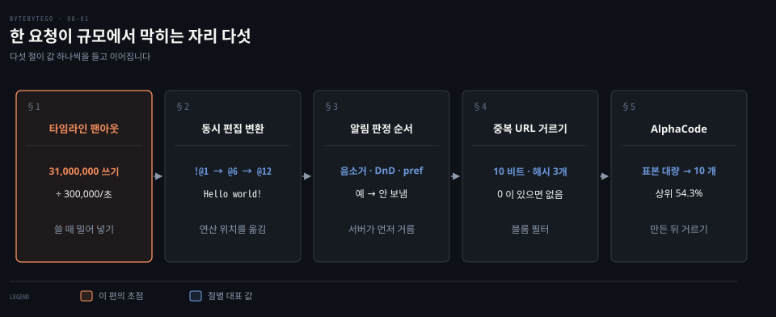
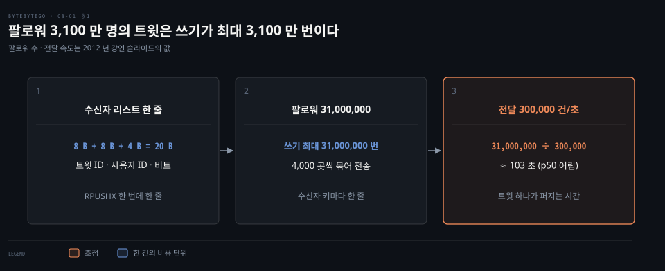
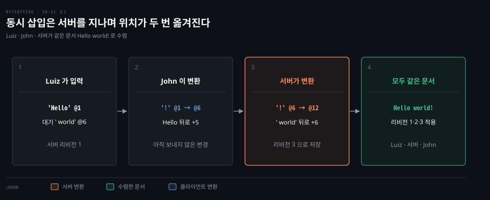
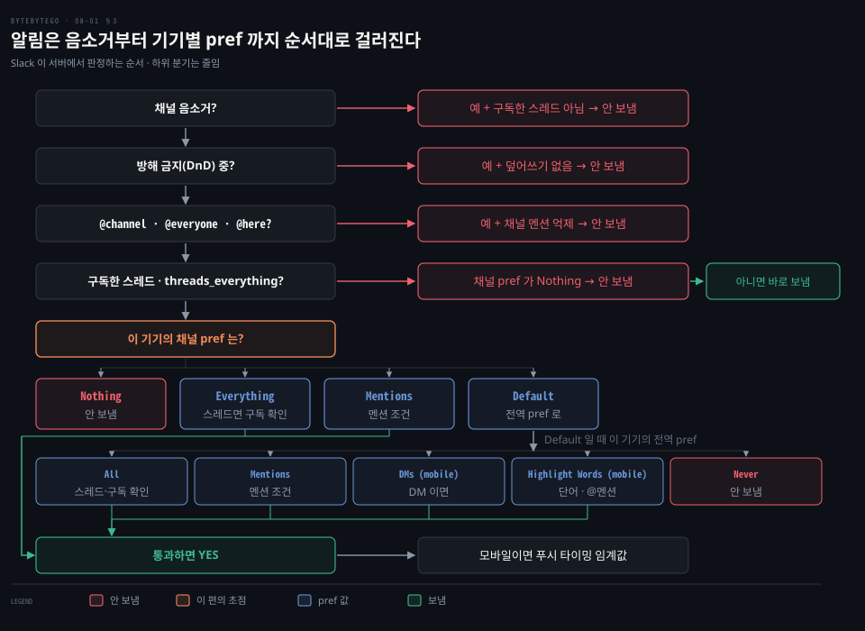
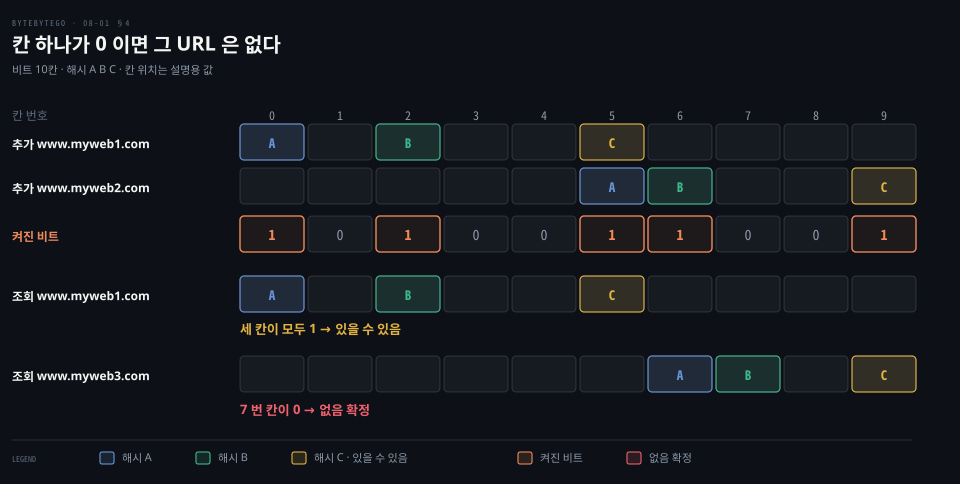
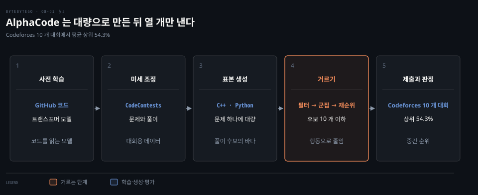

# 트위터 타임라인·구글 독스 동시 편집·슬랙 알림 판정·크롤러 중복 제거는 팬아웃·OT·흐름도·블룸 필터로 푼다

---

> 규모가 커지면 한 요청의 비용을 쓸 때, 읽을 때, 서버에서, 비트 하나로, 만든 뒤 거르기로 어디에 둘지 정해야 하고 다섯 사례가 그 선택을 하나씩 보여 줍니다.

## 핵심 요약

> 이 편의 중심 생각은 시스템 설계가 비용이 사라지게 하는 일이 아니라 비용이 앉을 자리를 고르는 일이라는 것입니다.

타임라인은 쓸 때 수신자마다 한 줄씩 미리 쌓아 읽기를 싸게 만들고, 팔로워가 많은 계정에서 그 쓰기가 폭발합니다. 동시 편집은 서버가 연산 순서를 정하고 뒤 연산의 위치를 옮겨 같은 문서로 모읍니다. 알림은 클라이언트가 아니라 서버가 음소거·방해 금지·멘션·스레드·기기별 설정을 정해진 순서로 거쳐 판정합니다.

중복 URL 은 문자열을 저장하지 않고 비트 몇 개를 켜서 없음을 확정하는 블룸 필터로 거릅니다. 코드 생성은 만든 것을 전부 내지 않고 대량으로 만든 뒤 행동을 보고 열 개 이하로 줄입니다.

## 학습 목표

> 이 편을 읽고 나면 다음을 설명할 수 있습니다.

1. 홈 타임라인을 쓸 때 쌓는 방식의 읽기·쓰기 비용과 팔로워가 많은 계정에서 생기는 지연을 숫자로 설명할 수 있습니다.
2. 두 사용자의 동시 삽입이 서버를 지나며 위치가 변환되어 같은 문서로 모이는 과정을 값으로 따라갈 수 있습니다.
3. 알림 판정이 서버에서 어떤 순서로 걸러지는지와 그 로직이 서버에 있어야 하는 까닭을 말할 수 있습니다.
4. 블룸 필터가 없음은 확정하고 있음은 추정하는 이유와 크롤러에서 거짓 양성이 치르는 값을 설명할 수 있습니다.
5. 코드 생성 시스템이 대량 생성 뒤에 거르는 구조를 취하는 까닭과 순위 수치의 뜻을 말할 수 있습니다.

## 1. 트윗 한 건은 수신자마다 Redis 에 한 줄이 되므로 팔로워가 많으면 쓰기가 몰린다

> 타임라인의 비용은 쓸 때 수신자마다 한 줄을 쌓느냐, 읽을 때 모아 오느냐 사이를 오갑니다. Twitter 는 읽기를 싸게 만들려고 쓰기에 비용을 넣었고 팔로워가 많은 계정이 그 값을 가장 크게 치렀습니다.

홈 화면은 초당 수십만 번 열리는데 열 때마다 팔로우하는 계정의 트윗을 모아 정렬하면 어떻게 될까요? 2012 년 QCon 강연에서 Twitter 는 활성 사용자가 1 억 5 천만 명이 넘고 홈 타임라인 읽기가 초당 30 만 건을 넘는다고 밝혔습니다.[^slides] 하루에 올라오는 트윗은 약 4 억 건, 평균 초당 약 5,000 건이고 큰 사건 때는 초당 12,000 건을 넘었습니다.

트윗 한 건의 길은 Write API 에서 셋으로 갈립니다. Write API 가 트윗을 받는 데까지가 동기 경로이고 그 뒤는 모두 비동기입니다. Fanout 서비스는 수신자마다 Redis 의 타임라인 리스트에 한 줄을 쌓습니다. Ingester 는 트윗을 토큰으로 쪼개 Earlybird 색인에 넣고, HTTP 와 모바일 푸시는 따로 갑니다.

읽는 쪽에서는 Timeline 서비스가 그 사용자의 리스트를 가진 Redis 서버를 찾아 돌려주고, 검색은 Blender 가 질의 결과를 합칩니다.

수신자 리스트의 한 줄은 8 바이트 트윗 ID, 8 바이트 사용자 ID, 4 바이트 비트로 20 바이트입니다.[^slides]

`RPUSHX` 로 이미 캐시된 타임라인에만 덧붙이고, 수신자 키 기준으로 4,000 곳씩 파이프라인에 태우며 복제합니다. Redis 쪽은 쓰기가 수신자 수에 비례하고 읽기는 한 번에 끝납니다. Earlybird 쪽은 그 반대로 쓰기가 한 번이고 읽기가 많습니다. 슬라이드가 두 방향을 나란히 둔 것은 비용이 사라지지 않고 자리를 옮긴다는 뜻입니다.

문제는 팔로워가 많은 계정입니다. 슬라이드는 팔로워가 3,100 만 명인 계정을 보였고 전달 속도는 초당 약 30 만 건이었습니다. 트윗 하나가 모든 수신자에게 가려면 31,000,000 ÷ 300,000 ≈ 103 초입니다.

슬라이드의 다른 수치인 100 만 명까지 p50 3.5 초를 31 배 하면 약 108 초로 비슷합니다. 쓰기 3,100 만 번은 상한입니다. 캐시되지 않은 타임라인에는 쓰지 않기 때문입니다.

시간은 상한이 아니라 어림값입니다. 초당 30 만 건은 서비스 전체의 하루 300 억 건 전달(300 억 ÷ 86,400 ≈ 347,000)과 같은 크기이고 3.5 초는 중앙값이므로 100 초 안팎이라는 규모만 읽습니다.

슬라이드는 이 문제 바로 뒤에 질의 확장을 `home_timeline:raffi OR user_timeline:taylorswift13` 꼴로 보였습니다. 캐시에 쌓아 둔 홈 타임라인에 팔로워가 많은 계정의 타임라인을 읽을 때 합치는 구성으로 읽힙니다. 몇 명부터 따로 다루는지는 슬라이드에 없습니다. 밀기·당기기·섞기의 쓰기와 읽기 횟수는 [뉴스 피드 편](../system-design/11-01.뉴스%20피드는%20쓸%20때%20밀어%20넣는%20팬아웃과%20읽을%20때%20당기는%20팬아웃을%20섞고%20캐시를%20다섯%20층으로%20나눈다.md)의 3 절이 숫자 가정으로 풉니다.

이 구조는 2012 년 강연 시점의 것이며 지금 구조를 밝힌 자료가 아닙니다. 서비스 이름은 현재 X 입니다.[^tos]

## 2. 동시에 넣은 두 글자는 서버가 순서를 정하고 뒤 연산의 위치를 옮겨 같은 문서로 만든다

> 동시 편집은 같은 자리에 두 사람이 넣은 글자가 서로의 위치를 어긋나게 하는 문제입니다. 서버가 연산의 순서를 정하고 뒤에 오는 연산의 위치를 앞선 연산만큼 옮기면 모든 편집자가 같은 문서를 봅니다.

Luiz 가 문서 맨 앞에 Hello 를 치는 동안 John 이 빈 문서에 느낌표를 치면 둘의 위치는 같은 1 번입니다. 그대로 적용하면 한쪽은 `!Hello`, 다른 쪽은 `Hello!` 가 됩니다. 면접용 설계 답안은 이 문제를 풀 구성을 다음처럼 그립니다. 클라이언트가 편집 연산을 WebSocket 서버로 보내고, 연산은 메시지 큐에 남습니다. 파일 연산 서버가 큐의 연산을 협업 알고리즘으로 변환하고 파일 메타데이터·파일 내용·연산 세 종류를 저장하며 캐시가 곁에 섭니다.

충돌을 푸는 알고리즘은 세 갈래입니다. **OT**(연산 변환), 차분 동기화, **CRDT**(충돌 없는 복제 데이터 타입)입니다.

OT 는 1989 년 Ellis 와 Gibbs 가 그룹웨어의 동시성 제어로 제안했고,[^ellis] CRDT 는 2011 년 Shapiro 등이 정식화했습니다.[^shapiro] Google Docs 는 2010 년 블로그에서 OT 와 협업 프로토콜을 쓴다고 밝혔고 그 프로토콜의 값을 직접 보였습니다.[^docs] 아래가 그 예입니다.

Luiz 의 클라이언트가 `InsertText 'Hello' @1` 을 서버에 보내 리비전 1 로 남습니다. 이어 `' world' @6` 을 쳤지만 보낸 변경이 아직 확인되지 않아 대기 목록에 둡니다. 한 번에 대기 변경을 하나만 보내기 때문입니다. John 은 그동안 빈 문서에 `'!' @1` 을 쳤습니다. 서버가 보낸 `'Hello' @1` 을 받은 John 의 클라이언트는 자기 대기 변경을 그 뒤로 5 만큼 옮겨 `'!' @6` 으로 바꿉니다.

이어 서버는 Luiz 의 `' world' @6` 을 먼저 받아 리비전 2 로 남깁니다. John 의 변경은 John 이 리비전 2 라고 믿었지만 서버에는 이미 리비전 2 가 있습니다. 서버는 John 의 변경을 마지막 동기화 이후 확정된 변경, 곧 `' world' @6` 에 맞춰 6 만큼 밀어 `'!' @12` 로 바꾸고 리비전 3 으로 남깁니다. 세 곳 모두 `Hello world!` 에서 만납니다. 같은 6 번 자리에 두 삽입이 겹친 이 예에서는 서버가 먼저 받은 쪽이 앞에 오고 뒤에 받은 쪽이 밀립니다.

클라이언트는 서버 확인을 기다리지 않고 자기 변경을 바로 적용해서 네트워크가 느려도 타자가 막히지 않습니다. 서버는 편집자별 상태를 몰라도 되어 편집자가 늘어도 변환 비용이 일정하다고 Google 블로그는 적었습니다.[^docs] 대부분의 문서용 CRDT 는 위치를 변환하지 않고 글자마다 안정된 식별자를 줘서 같은 결과에 모읍니다. 두 방식을 같은 문자열로 견주는 설명은 [DDIA 쓰기 충돌 해소 노트](../../../05_data/book/designing-data-intensive-applications/06-05.쓰기%20충돌%20해소.md)의 3 절에 있습니다.

## 3. 알림은 음소거·방해 금지·멘션 억제를 지난 뒤 기기별 설정이 갈라 서버가 정한다

> 알림 한 건은 겉보기엔 한 번의 판단이지만 서버가 사용자·채널·기기별 설정을 정해진 순서로 거쳐 가려냅니다. 이 판단을 서버로 옮겨야 배경 클라이언트를 가볍게 만들 수 있었습니다.

메시지가 하나 왔을 때 사용자에게 알려야 할까요? Slack 은 2017 년 데스크톱 앱의 메모리를 줄이려고 오랫동안 안 본 팀을 얇은 클라이언트로 바꿨습니다.

얇은 클라이언트는 읽지 않은 표시와 알림 뱃지, 데스크톱 알림만 맡습니다. 그래서 서버가 알림 개수를 세고 알림이 될 메시지를 가려 포맷하는 일을 떠안아야 했습니다.[^slack] 서버는 `has_unreads` 와 `mention_count` 를 memcache 에 둡니다. 알림이 될 메시지는 `desktop_notification` 이라는 새 메시지 유형으로 바꿔 웹소켓에 실어 보냅니다.

판정에는 사용자와 팀의 설정이 모두 들어갑니다. Slack 엔지니어링 블로그는 서버로 옮겨 온 이 로직을 흐름도 하나로 보였습니다.

맨 위의 네 질문은 모두 안 보냄으로 빠질 출구를 하나씩 가집니다. 채널이 음소거인데 구독한 스레드의 메시지가 아니면 멈춥니다. 방해 금지(DnD) 중인데 덮어쓰기가 없으면 멈추고, `@channel`·`@everyone`·`@here` 멘션이 억제되어 있으면 멈춥니다. 스레드를 구독했고 `threads_everything` 이 켜져 있어도 채널 알림 설정(pref)이 Nothing 이면 멈춥니다. Nothing 이 아니면 아래 질문을 거치지 않고 바로 보냅니다. 같은 질문인 스레드 메시지 && 구독 여부가 음소거 뒤와 멘션 뒤에 두 번 나오는 까닭은 질문 하나가 앞뒤 맥락에서 다른 결론으로 이어지기 때문입니다.

여기까지 지나면 이 기기의 채널 알림 설정 값 넷이 갈립니다. Nothing 은 멈춥니다. Everything 은 스레드가 아닌 메시지를 바로 보내고 스레드 메시지는 구독했을 때만 보내며, 구독하지 않았으면 Mentions 의 조건으로 넘깁니다. Mentions 는 DM·@멘션·단어 조건을 봅니다. Default 는 전역 설정 다섯 값(All·Mentions·DMs (mobile)·Highlight Words (mobile)·Never)으로 넘어갑니다.

통과해도 모바일이면 푸시 타이밍 임계값을 한 번 더 봅니다. 데스크톱이 채널을 읽음으로 표시하는 설정이면 거기서 읽은 메시지는 모바일 푸시가 가지 않습니다. 그림에 싣지 않은 하위 분기가 이만큼 더 있어서 단순해 보이는 기능이 오래 걸렸다는 것이 이 흐름도의 교훈입니다. 이 구조는 2017 년 글 기준이며 지금의 판정 순서가 그대로라는 자료는 확인하지 못했습니다.

## 4. 블룸 필터는 URL 을 저장하지 않고 칸 몇 개를 켜서 본 적 없음을 확정한다

> 크롤러가 같은 URL 을 두 번 받지 않으려면 본 URL 을 어딘가에 기억해야 합니다. 블룸 필터는 URL 문자열 대신 비트 몇 개만 남기고, 없다는 답은 확정하지만 있다는 답은 틀릴 수 있습니다.

URL 이 10 억 개이고 평균 100 바이트라는 설계 가정이면 문자열을 그대로 모으는 집합은 10 억 × 100 B = 100 GB 입니다. 10 억은 크롤러 편의 월 10 억 페이지 규모를 빌린 값이고 100 바이트는 이 노트가 세운 값입니다. 데이터베이스에 두고 하나씩 물으면 그 부하가 큽니다. 블룸 필터는 이 둘 사이에서 고정된 크기의 비트 배열만 둡니다. 1970 년 Bloom 이 제안한 확률적 자료 구조입니다.[^bloom] 원소마다 해시 함수 k 개를 적용해 나온 칸을 켜고, 조회할 때 같은 k 칸이 모두 1 이면 있을 수 있음, 하나라도 0 이면 없음입니다.

그림은 10 칸에 해시 A·B·C 를 쓴 예입니다. 두 URL 이 5 번 칸을 함께 켰습니다. 그래서 `www.myweb1.com` 의 세 칸이 모두 1 이어도, 5 번이 다른 URL 이 켠 것일 수 있어 있다는 보장이 없습니다. `www.myweb3.com` 은 7 번 칸이 0 이어서 없음이 확정됩니다. 칸 위치는 설명용 값이며 실제 해시 출력이 아닙니다.

거짓 양성이 치르는 값은 쓰임마다 다릅니다. 캐시 앞에서는 DB 질의 한 번이면 되지만([캐시 편](./02-01.캐시%20전략은%20읽기·쓰기%20경로에서%20캐시%20자리를%20정하고%20Redis%20는%20메모리와%20단일%20스레드%20이벤트%20루프로%20빠르다.md)의 2 절), 크롤러에서는 한 번도 안 본 URL 을 이미 본 것으로 착각해 영영 받지 못합니다. 거짓 음성은 없어서 받은 것을 또 받는 일은 없습니다. 이 비용을 어디까지 받아들일지가 오류율 설정입니다.

크기는 계산으로 정합니다. RedisBloom 은 오류율 p 에서 원소당 비트 수를 −ln p ÷ (ln 2)² 로 잡고 해시 수를 그 값에 ln 2 를 곱해 올린 정수로 정합니다.[^redisbloom] 10 억 URL 에 p = 1% 면 원소당 약 9.59 비트이므로 약 1.2 GB 이고 해시는 7 개입니다. p = 0.1% 면 약 14.4 비트, 약 1.8 GB 이고 해시는 10 개입니다. 문자열 집합 100 GB 에 견주면 100 ÷ 1.2 ≈ 83 배 작습니다. 해시를 많이 쓸수록 한 원소가 켜는 칸이 늘어 배열이 빨리 차므로 RedisBloom 은 ln 2 × (비트 ÷ 원소) 개를 씁니다.

해시를 k 개 따로 계산하지도 않습니다. RedisBloom 은 MurmurHash2 로 두 값 a, b 를 구합니다. i 번째 칸은 (a + i·b) 를 비트 수로 나눈 나머지입니다.[^redisbloom]

Apache Spark 의 BloomFilter 도 Murmur3 두 값에서 k 칸을 만들고,[^spark] InfluxDB 1.x·2.x 는 xxhash 두 값을 씁니다.[^influx] 해시는 고르게 퍼지고 빨라야 하므로 이런 비암호 해시를 고릅니다.

필터는 Redis 오픈 소스에 내장된 자료형으로 `BF.RESERVE` 에 오류율과 용량을 주고 `BF.ADD`·`BF.EXISTS` 로 씁니다.[^redisdocs] 필터의 원리와 크롤러 안의 자리는 [웹 크롤러 편](../system-design/09-01.웹%20크롤러는%20URL%20프론티어가%20우선순위와%20예의를%20지키며%20BFS%20로%20내려받고%20중복과%20함정을%20걸러%20낸다.md)의 7 절이 이어 받습니다.

## 5. AlphaCode 는 풀이를 대량으로 만든 뒤 거르고 묶고 순위를 다시 매겨 열 개 이하만 낸다

> 한 번에 맞는 코드를 쓰는 모델 대신, 틀린 것이 섞여도 대량으로 만들고 동작을 보고 줄이는 구조가 대회 수준의 성적을 냈습니다. 만든 것을 거르는 단계가 시스템의 절반입니다.

문제 하나에 정답 프로그램 하나를 곧바로 쓰는 것이 대회 문제를 푸는 길일까요? DeepMind 의 AlphaCode 는 그렇게 하지 않았습니다. 트랜스포머를 공개된 GitHub 코드로 사전 학습하고, 비교적 작은 대회용 데이터인 CodeContests 로 미세 조정합니다. 평가 때는 문제마다 C++ 와 Python 프로그램을 대량으로 만들고 필터·군집·재순위로 후보 열 개로 줄여 외부 판정에 냅니다.[^alphacode-blog]

논문은 성능을 만든 핵심 구성을 셋으로 꼽았습니다. 깨끗한 대회용 학습·평가 데이터, 표본을 싸게 뽑을 수 있는 큰 트랜스포머, 그리고 대규모 표본 추출 뒤에 프로그램의 동작을 보고 작은 제출 집합으로 줄이는 거르기입니다.[^alphacode-arxiv] 만든 것을 전부 내지 않으므로 모델이 한 번에 맞히지 못해도 후보 열 개 안에 정답이 들어가면 됩니다.

성적은 Codeforces 의 최근 대회 10 개를 모의로 치러 평균 순위가 상위 54.3% 였습니다. 상위 54.3% 는 참가자의 45.7% 를 앞섰다는 뜻이고 DeepMind 는 중위권 참가자 수준이라고 썼습니다. 참가자가 5,000 명을 넘는 대회 기준입니다. 논문 본문은 이를 추정 Codeforces 레이팅 1238, 곧 최근 6 개월 안에 대회에 참가한 사용자 가운데 상위 28% 로 옮기고, 그 집단이 전체 프로그래머의 작고 선별된 부분집합이라고 덧붙였습니다.[^alphacode-arxiv] 연구는 2022 년 Science 에 실렸습니다.[^science]

이후 Gemini 를 기반으로 한 AlphaCode 2 는 같은 평가 플랫폼에서 1.7 배 많은 문제를 풀었고 참가자의 85% 보다 낫다고 추정되었습니다.[^ac2]

## 면접 대비

> 팬아웃 비용, 동시 편집 변환, 알림 판정 위치, 블룸 필터 설정, 대량 생성 뒤 거르기에 관한 질문입니다.

1. 홈 타임라인을 쓸 때 미리 쌓는 방식은 읽기와 쓰기 비용이 어떻게 갈리며 팔로워가 3,100 만 명인 계정에서 무엇이 문제가 됩니까?
2. Luiz 가 `'Hello' @1`, John 이 빈 문서에 `'!' @1` 을 동시에 넣을 때 서버는 어떤 값으로 바꿔 같은 문서를 만듭니까?
3. 알림 판정 로직을 클라이언트가 아니라 서버가 갖게 된 까닭과 판정이 걸러지는 큰 순서는 무엇입니까?
4. 10 억 URL 의 중복을 오류율 1% 로 거르려면 메모리와 해시 수는 얼마이며 거짓 양성이 크롤러에 무엇을 일으킵니까?
5. 대량으로 생성한 프로그램을 필터·군집·재순위로 줄이는 구조의 이점은 무엇이고 상위 54.3% 는 무슨 뜻입니까?

## 정답 (자답 후 펼치기)

> 면접 질문에 대한 키워드 중심의 모범 답안입니다.

### 정답 1 — 읽기 O(1), 쓰기는 팔로워 수만큼

수신자마다 Redis 리스트에 20 바이트 한 줄을 쌓아 읽기를 O(1) 에 가깝게 만들지만 쓰기는 팔로워 수만큼입니다. 3,100 만 명에 초당 30 만 건이면 31,000,000 ÷ 300,000 ≈ 103 초가 걸리고, 팔로워가 많은 계정은 읽을 때 합치는 구성이 슬라이드에 보입니다.

### 정답 2 — `'!' @1` → `@6` → `@12`

John 의 클라이언트가 서버가 보낸 `'Hello' @1` 을 받아 자기 `'!'` 을 5 만큼 밀어 `@6` 으로, 서버가 먼저 확정한 `' world' @6` 에 맞춰 6 만큼 더 밀어 `@12` 로 바꿉니다. 결과는 세 곳 모두 `Hello world!` 입니다.

### 정답 3 — 얇은 클라이언트는 판정할 수 없어서

배경 팀의 클라이언트는 알림을 띄우고 뱃지를 갱신할 만큼만 두어서, 서버가 설정을 모두 반영해 알림 여부와 개수를 정해 줍니다. 순서는 음소거·방해 금지·멘션 억제·스레드 구독을 지난 뒤 기기별 채널 설정과 전역 설정, 모바일이면 푸시 타이밍입니다.

### 정답 4 — 약 1.2 GB 와 해시 7 개, 안 본 URL 을 놓침

원소당 −ln 0.01 ÷ (ln 2)² ≈ 9.59 비트이므로 10 억 개에 약 1.2 GB 이고 해시는 ceil(ln 2 × 9.59) = 7 입니다. 거짓 양성은 새 URL 을 본 것으로 착각해 영영 받지 않게 만들고 거짓 음성은 없습니다.

### 정답 5 — 대량 생성 뒤 동작을 보고 열 개 이하로 줄임

대량 표본 뒤에 프로그램의 동작으로 거르고 묶고 순위를 다시 매겨 열 개 이하만 내면 한 번에 맞히지 못해도 후보 안에 정답이 들면 됩니다. 상위 54.3% 는 참가자의 45.7% 를 앞섰다는 뜻이며 중위권 수준입니다.

## 참고 자료

- ByteByteGo(Alex Xu 외), System Design 그림 해설 모음. 공개 저장소의 같은 주제 글: [How to Design Google Docs](https://github.com/ByteByteGoHq/system-design-101/blob/main/data/guides/how-to-design-google-docs.md), [How to Avoid Crawling Duplicate URLs at Google Scale?](https://github.com/ByteByteGoHq/system-design-101/blob/main/data/guides/how-to-avoid-crawling-duplicate-urls-at-google-scale.md)
- 본문 각주의 1차 자료: Timelines at Scale(QCon), Google Drive Blog(2010), Slack Engineering(2017), RedisBloom 소스, DeepMind AlphaCode

## 관련 문서

- [캐시 전략은 읽기·쓰기 경로에서 캐시 자리를 정하고 Redis 는 메모리와 단일 스레드 이벤트 루프로 빠르다](./02-01.캐시%20전략은%20읽기·쓰기%20경로에서%20캐시%20자리를%20정하고%20Redis%20는%20메모리와%20단일%20스레드%20이벤트%20루프로%20빠르다.md)
- [뉴스 피드는 쓸 때 밀어 넣는 팬아웃과 읽을 때 당기는 팬아웃을 섞고 캐시를 다섯 층으로 나눈다](../system-design/11-01.뉴스%20피드는%20쓸%20때%20밀어%20넣는%20팬아웃과%20읽을%20때%20당기는%20팬아웃을%20섞고%20캐시를%20다섯%20층으로%20나눈다.md)
- [웹 크롤러는 URL 프론티어가 우선순위와 예의를 지키며 BFS 로 내려받고 중복과 함정을 걸러 낸다](../system-design/09-01.웹%20크롤러는%20URL%20프론티어가%20우선순위와%20예의를%20지키며%20BFS%20로%20내려받고%20중복과%20함정을%20걸러%20낸다.md)
- [알림 시스템은 제3자 푸시·SMS·이메일 서비스 앞에 메시지 큐와 작업 서버를 두어 재시도와 중복을 다룬다](../system-design/10-01.알림%20시스템은%20제3자%20푸시·SMS·이메일%20서비스%20앞에%20메시지%20큐와%20작업%20서버를%20두어%20재시도와%20중복을%20다룬다.md)

[^slides]: Raffi Krikorian, Timelines at Scale 슬라이드(표지 qcon sf 2012): <https://www.infoq.com/presentations/Twitter-Timeline-Scalability/>
[^tos]: X Terms of Service(2026-10-09 시행): <https://x.com/en/tos>
[^ellis]: C. A. Ellis, S. J. Gibbs, "Concurrency control in groupware systems", SIGMOD '89, pp. 399-407: <https://doi.org/10.1145/67544.66963>
[^shapiro]: M. Shapiro, N. Preguiça, C. Baquero, M. Zawirski, "Conflict-Free Replicated Data Types", SSS 2011: <https://doi.org/10.1007/978-3-642-24550-3_29>
[^docs]: Google Drive Blog, 2010-09-23, Luiz 와 John 의 예(`InsertText 'Hello' @1`·`' world' @6`·`'!' @1`, 리비전 3, 대기 변경은 한 번에 하나, 서버는 클라이언트 상태를 알 필요 없음): <https://drive.googleblog.com/2010/09/whats-different-about-new-google-docs.html>
[^slack]: Slack Engineering, 2017-03-03(2021-03-23 갱신). 서버가 알림 개수·알림 대상 메시지를 계산하도록 옮긴 설명, `has_unreads`·`mention_count` memcache, `desktop_notification` 메시지 유형, 알림 판정 흐름도: <https://slack.engineering/reducing-slacks-memory-footprint/>
[^bloom]: B. H. Bloom, "Space/time trade-offs in hash coding with allowable errors", Communications of the ACM 13(7), 1970, pp. 422-426: <https://doi.org/10.1145/362686.362692>
[^redisbloom]: RedisBloom v2.4.27 `bloom.c` 의 `calc_bpe`·`hashes = ceil(LN2 * bpe)`·`bloom_calc_hash`·`(a + i * b) % mod`: <https://github.com/RedisBloom/RedisBloom/blob/v2.4.27/deps/bloom/bloom.c>
[^spark]: Apache Spark v4.2.0 `BloomFilterImplV2.java` 의 `scatterHashAndSetAllBits`(Murmur3 두 값 h1·h2 에서 64비트 `combinedHash` 로 k 칸): <https://github.com/apache/spark/blob/v4.2.0/common/sketch/src/main/java/org/apache/spark/util/sketch/BloomFilterImplV2.java>
[^influx]: InfluxDB v2.9.1 `pkg/bloom/bloom.go` 머리 주석(xxhash 사용)과 `hash`(xxhash 로 64비트 값 둘): <https://github.com/influxdata/influxdb/blob/v2.9.1/pkg/bloom/bloom.go>
[^redisdocs]: Redis 문서 Bloom filter: <https://redis.io/docs/latest/develop/data-types/probabilistic/bloom-filter/>
[^alphacode-blog]: DeepMind, Competitive programming with AlphaCode: <https://deepmind.google/discover/blog/competitive-programming-with-alphacode/>
[^alphacode-arxiv]: Y. Li 외, "Competition-Level Code Generation with AlphaCode", arXiv 2203.07814 초록과 본문(레이팅 1238, 상위 28%): <https://arxiv.org/abs/2203.07814>
[^science]: Y. Li 외, "Competition-level code generation with AlphaCode", Science 378(6624), 2022, pp. 1092-1097: <https://doi.org/10.1126/science.abq1158>
[^ac2]: AlphaCode Team, AlphaCode 2 Technical Report, 2023-12: <https://storage.googleapis.com/deepmind-media/AlphaCode2/AlphaCode2_Tech_Report.pdf>
