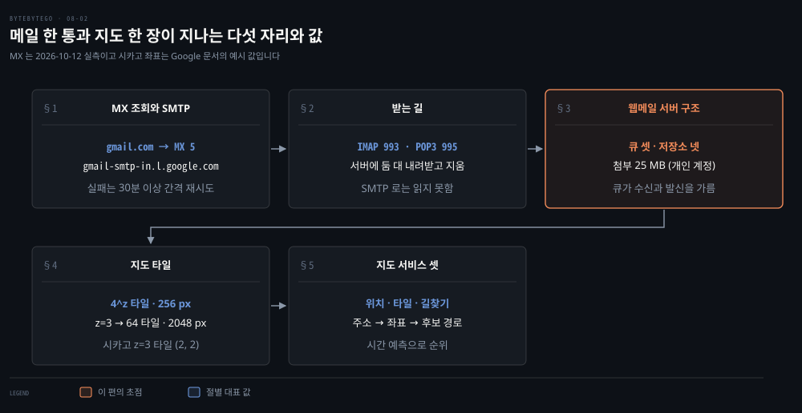
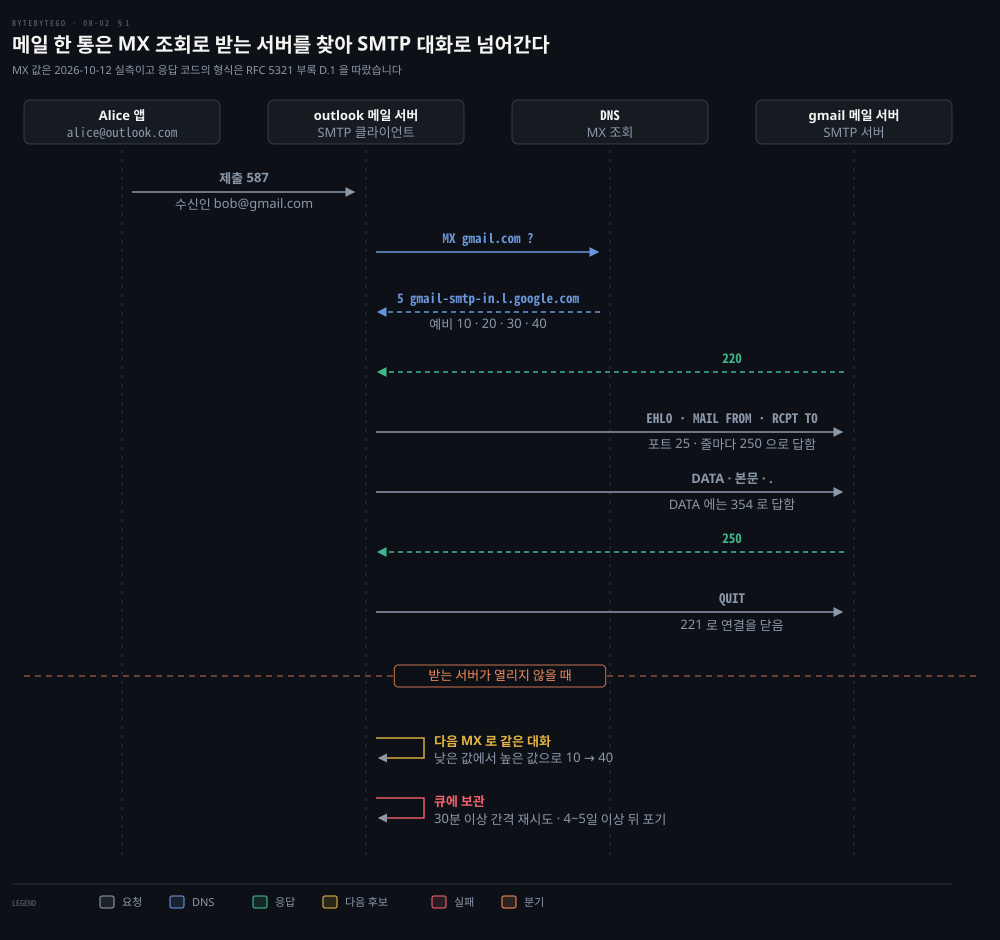
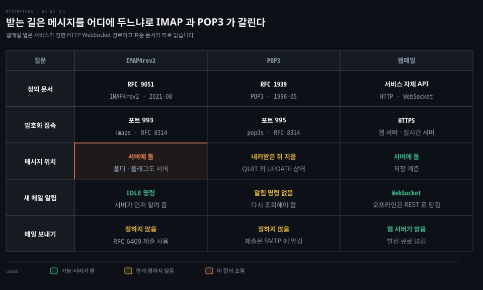
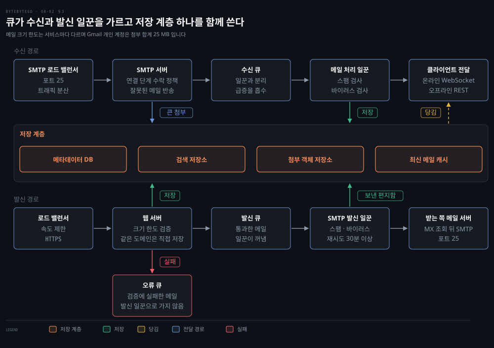
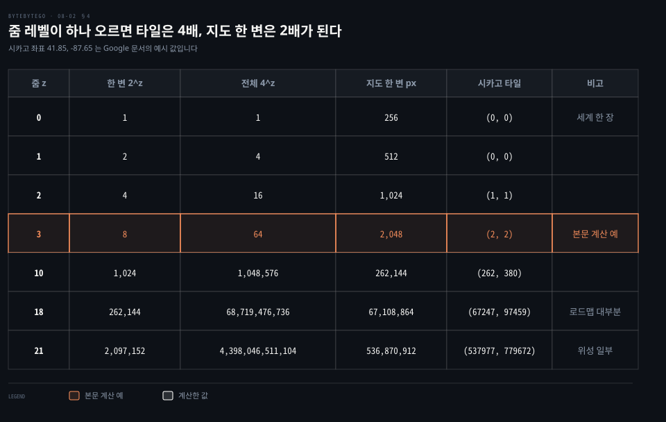
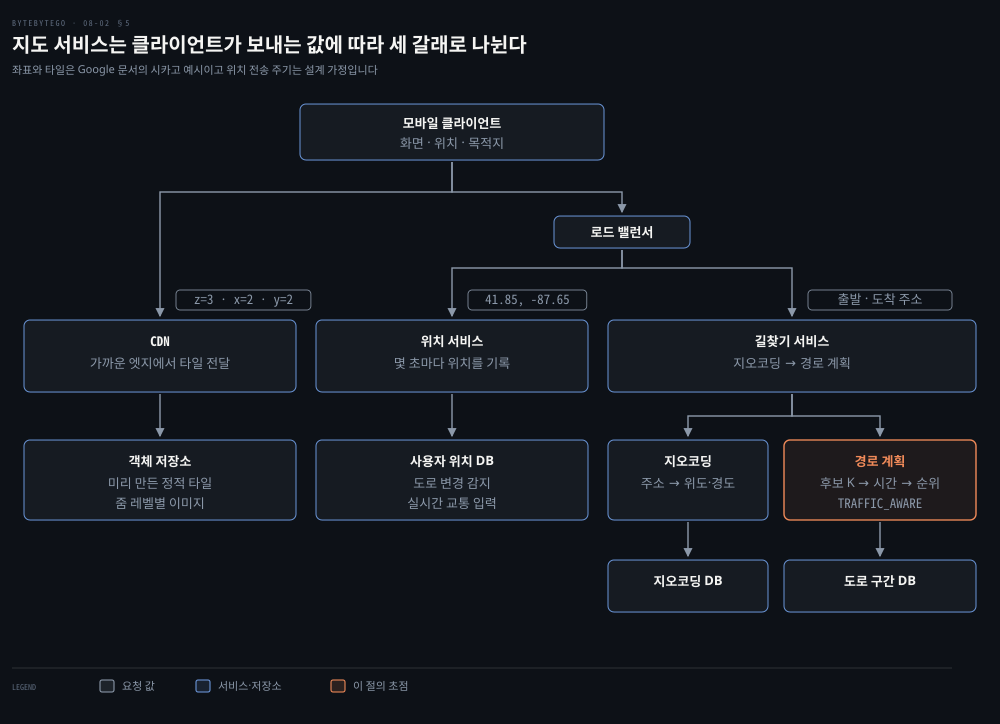

# Gmail 은 SMTP 로 보내고 IMAP·POP 으로 받으며 Google Maps 는 타일을 줌 레벨별로 미리 그려 내려준다

---

> 메일은 보내는 서버가 MX 레코드로 받는 서버를 찾아 SMTP 로 넘기고 받는 사람은 IMAP·POP3 나 웹메일로 가져갑니다. 지도는 세계를 줌 레벨마다 4배씩 늘어나는 256 픽셀 타일로 미리 쪼개 CDN 으로 내려줍니다.

## 핵심 요약

> 이 편의 중심 생각은 메일과 지도가 모두 한 덩어리 일을 단계로 갈라 단계마다 따로 키운다는 것입니다.

메일은 세 단계입니다. 보내는 서버가 MX 레코드로 받는 서버를 찾아 SMTP 로 넘깁니다. 받는 서버에서는 수신 큐 뒤의 일꾼이 검사해 저장합니다. 받는 사람은 IMAP·POP3 나 웹메일로 가져갑니다.

지도는 타일과 길찾기로 갈립니다. 타일은 줌 레벨 z 마다 2^z × 2^z 장이고 한 장이 256 × 256 픽셀입니다. 타일은 미리 만들어 두는 정적 파일이라 CDN 이 그대로 내려줍니다. 길찾기는 도로 구간 그래프에서 후보 경로를 찾아 걸리는 시간으로 순위를 매깁니다.

## 학습 목표

> 이 편을 읽고 나면 다음을 설명할 수 있습니다.

1. 메일 한 통이 제출·MX 조회·SMTP 대화를 거쳐 받는 서버에 닿는 경로와 실패했을 때의 재시도 규칙을 설명할 수 있습니다.
2. SMTP 로 편지함을 읽지 못하는 까닭과 IMAP·POP3·웹메일이 메시지를 두는 자리의 차이를 구분할 수 있습니다.
3. 웹메일 서버가 큐로 수신 경로와 발신 경로를 가르고 저장 계층 넷이 각각 무엇을 담는지 설명할 수 있습니다.
4. 줌 레벨에서 타일 수와 지도 크기를 계산하고 위도·경도에서 타일 번호를 구할 수 있습니다.
5. 지도 서비스가 위치·타일·길찾기로 나뉘는 까닭과 길찾기가 주소에서 순위 매긴 경로까지 가는 순서를 설명할 수 있습니다.

## 1. 보내는 서버는 받는 도메인의 MX 레코드를 조회해 SMTP 로 넘기고 실패하면 큐에서 다시 시도한다

> Alice 의 메일은 앱이 아니라 outlook 메일 서버가 gmail.com 의 MX 레코드를 조회해 받는 서버로 넘깁니다. 서버가 닫혀 있으면 다음 MX 로 가고 모두 닫혀 있으면 큐에 두고 다시 시도합니다.

bob@gmail.com 이라는 주소만으로 어떻게 Gmail 의 서버를 찾을까요? `@` 뒤의 도메인을 DNS 에 묻습니다. 답으로 오는 **MX 레코드**가 받을 서버의 이름과 우선순위입니다. 숫자가 작을수록 먼저 쓰고 MX 가 없으면 그 도메인의 주소 레코드를 우선순위 0 인 MX 처럼 씁니다.[^rfc5321-mx] 이름 조회 자체는 [DNS 를 다룬 편](./03-01.URL%20을%20치면%20DNS·TCP·TLS·HTTP%20를%20거쳐%20브라우저가%20화면을%20그리고%20CDN%20이%20그%20길을%20줄인다.md)에서 봤습니다.

앱은 자기 메일 서버에만 말합니다. 앱이 서버에 올리는 제출은 RFC 6409 가 정한 587 번 포트가 기본이고 서버끼리 건네는 중계는 25 번 포트를 그대로 씁니다.[^rfc6409] 연결하자마자 TLS 를 여는 465 번 포트는 RFC 8314 가 제출용으로 따로 정했습니다.[^rfc8314] 대화 한 줄의 뜻과 봉투·헤더의 구분은 [메일과 이름은 어떻게 찾아가는가](../../../02_os/book/cntd_computer-networking-top-down/02-03.메일과%20이름은%20어떻게%20찾아가는가.md)에서 다뤘습니다.

2026-10-12 에 gmail.com 의 MX 를 조회하자 5 번 gmail-smtp-in.l.google.com 과 10·20·30·40 번 alt1~alt4.gmail-smtp-in.l.google.com 다섯 줄이 돌아왔습니다.[^mx-live] 보내는 쪽은 이 목록을 우선순위 순서로 시도하고 적어도 두 주소를 시도하도록 권고받습니다. 대화는 서버의 220 으로 열립니다. `EHLO`·`MAIL FROM`·`RCPT TO` 에 250 이 오고 `DATA` 에 354 가 옵니다. 본문 뒤에 250 이 오고 `QUIT` 에 221 이 옵니다.[^rfc5321-d1]

후보가 모두 닫혀 있으면 메일은 보내는 서버의 큐에 남습니다. 재시도 간격은 적어도 30분이고 포기까지는 보통 적어도 4~5일을 둡니다. 처음 한 시간에 두 번 시도한 뒤 두세 시간에 한 번으로 늘리는 방식이 경험상 낫다고 합니다.[^rfc5321-retry] 이 큐가 서버 안 어디에 놓이는지는 웹메일 서버 구조를 다루는 절에서 봅니다.

## 2. 받는 사람은 SMTP 로 읽지 못해서 IMAP 이나 POP3 로 가져오고 웹메일은 서비스가 정한 경로로 가져온다

> SMTP 는 서버가 서버에게 메일을 밀어 넣는 프로토콜이라 편지함을 열 수 없습니다. 읽는 길은 서버에 메시지를 두는 IMAP, 내려받고 지우는 POP3, 서비스가 정한 HTTP 경로로 갈립니다.

받는 서버에 메일이 닿으면 Bob 은 어떻게 읽을까요? SMTP 에는 편지함을 여는 명령이 없어서 읽는 프로토콜이 따로 있습니다. 갈림은 메시지를 어디에 두느냐입니다.

**IMAP** 은 메시지를 서버에 두고 서버의 폴더를 로컬 폴더처럼 다루게 합니다. 현재 판은 RFC 3501 을 대체한 IMAP4rev2(RFC 9051, 2021-08)입니다. 메일을 게시하는 방법은 정하지 않고 RFC 6409 제출에 맡깁니다.[^rfc9051] **POP3** 는 RFC 1939(1996-05)가 정했고 보통 메일을 내려받은 뒤 지웁니다. 클라이언트가 `QUIT` 을 보내면 세션이 UPDATE 상태로 들어가 삭제 표시된 메시지를 서버가 지웁니다. 보내기는 POP3 도 정하지 않아 클라이언트가 SMTP 로 제출합니다.[^rfc1939]

Gmail 은 둘 다 열어 둡니다. IMAP 은 imap.gmail.com 의 993 번, POP 은 pop.gmail.com 의 995 번이고 둘 다 SSL 이 필요합니다. 보내기는 smtp.gmail.com 의 465 번(SSL)이나 587 번(TLS)입니다.[^gmail-imap] 993 과 995 는 RFC 8314 가 암호화 접속의 기본 포트로 정한 imaps 와 pop3s 입니다.[^rfc8314]

마지막 열이 웹메일입니다. 표준 프로토콜 대신 서비스가 정한 경로를 쓰며 아래 설계에서는 HTTPS 로 웹 서버와 실시간 서버에 붙습니다. 접속해 있으면 실시간 서버가 WebSocket 으로 밀어 줍니다. 오프라인이었다면 접속한 뒤 웹 서버가 REST 로 저장 계층에서 당겨 줍니다. 그래서 메일 앱은 IMAP·POP3 로, 브라우저의 웹메일은 이 경로로 같은 편지함을 봅니다.

IMAP 에도 서버가 먼저 알리는 길이 있습니다. `IDLE` 로 클라이언트가 준비됐다고 알리면 서버가 새 메일(`EXISTS`)이나 삭제(`EXPUNGE`)를 먼저 보냅니다.[^rfc9051] POP3 에는 알림 명령이 없어 다시 조회해야 합니다. 연결을 붙들어 두고 서버가 먼저 보내는 방식은 [채팅 시스템 편](../system-design/12-01.채팅%20시스템은%20웹소켓%20연결을%20상태%20유지%20서버에%20두고%20키-값%20저장소와%20메시지%20ID%20로%20대화와%20접속%20상태를%20다룬다.md)에서 다뤘습니다.

## 3. 웹메일 서버는 큐로 수신과 발신 일꾼을 가르고 메일을 저장소 넷에 나눠 담는다

> 큐는 SMTP 서버와 처리 일꾼 사이, 웹 서버와 발신 일꾼 사이에 놓여 둘을 따로 늘리게 하고 급증을 흡수합니다. 큐는 수신 큐·발신 큐·오류 큐 셋이고 저장 계층은 메타데이터 DB·검색 저장소·첨부 객체 저장소·최신 메일 캐시 넷입니다.

받는 쪽부터 따라갑니다. SMTP 로드 밸런서가 연결을 받아 SMTP 서버들에 나눕니다. SMTP 서버는 연결 단계에서 수락 정책을 적용해 잘못된 메일을 처리하기 전에 반송합니다. 첨부가 커서 큐에 넣기 어려우면 첨부만 객체 저장소에 둡니다. 저장 계층 넷은 담는 것이 다릅니다. 메타데이터 DB 는 메일의 메타데이터를, 검색 저장소는 검색할 내용을, 첨부 객체 저장소는 첨부를, 최신 메일 캐시는 최근 메일을 담습니다.

수신 큐는 SMTP 서버와 메일 처리 일꾼을 갈라 둘을 따로 늘리게 합니다. 메일이 몰릴 때는 완충도 맡습니다. 일꾼은 스팸과 바이러스를 걸러 낸 메일을 저장 계층에 씁니다. 받는 사람이 접속해 있으면 실시간 서버가 WebSocket 으로 밀어 줍니다. 접속해 있지 않으면 저장만 해 두었다가 다시 접속할 때 웹 서버가 REST 로 당겨 줍니다.

수락 정책이 보는 것 하나가 발신 인증입니다. Gmail 은 2024-02-01 부터 모든 발신자에게 SPF 나 DKIM 인증과 TLS 연결을 요구합니다. 하루 5,000통을 넘으면 SPF·DKIM·DMARC 를 모두 요구합니다.[^gmail-sender] SPF 는 도메인이 허가한 발신 호스트를 DNS 에 적고 DKIM 은 DNS 의 공개 키로 서명을 검증하며 DMARC 는 실패했을 때의 방침을 도메인이 정합니다. DMARC 의 현재 규격은 2026-05 에 RFC 7489 를 대체한 RFC 9989 입니다.[^rfc-auth]

보내는 쪽은 로드 밸런서가 속도 제한을 확인한 뒤 웹 서버로 넘깁니다. 웹 서버는 크기 한도 같은 기본 검증을 합니다. 받는 사람의 도메인이 보낸 사람과 같으면 SMTP 를 거치지 않고 저장 계층에 바로 씁니다. 다른 도메인이면 통과한 메일은 발신 큐로 실패한 메일은 오류 큐로 갑니다. 크기 한도의 처리는 서비스마다 다릅니다. Gmail 개인 계정은 첨부 합계가 25 MB 를 넘으면 메일을 거절하지 않고 첨부를 Drive 링크로 바꿉니다.[^gmail-25mb] SMTP 발신 일꾼은 큐에서 꺼낸 메일을 스팸·바이러스 검사한 뒤 보낸 편지함에 저장하고 받는 서버로 전달합니다.

발신 큐의 길이는 계속 지켜봅니다. 쌓이는 원인이 둘이기 때문입니다. 받는 서버가 닫혀 있으면 앞 절의 재시도 규칙대로 기다립니다. 실패할 때마다 간격을 늘려 가는 지수 백오프가 그 한 방법입니다. 소비자가 모자라면 일꾼을 늘립니다. 큐와 재시도와 중복은 [알림 시스템 편](../system-design/10-01.알림%20시스템은%20제3자%20푸시·SMS·이메일%20서비스%20앞에%20메시지%20큐와%20작업%20서버를%20두어%20재시도와%20중복을%20다룬다.md)에서, 첨부를 담는 객체 저장소는 [저장소 편](./04-01.블록·파일·객체%20저장소는%20접근%20단위가%20다르고%20이레이저%20코딩과%20분할%20업로드가%20큰%20데이터를%20싸고%20안전하게%20담는다.md)에서 다뤘습니다.

## 4. 지도는 세계를 줌 레벨마다 4배씩 늘어나는 256 픽셀 타일로 쪼개 두고 화면이 덮는 타일만 내려받는다

> 타일 한 장은 256 × 256 픽셀이고 줌이 하나 오르면 한 변의 타일 수가 2배, 전체 타일 수가 4배가 됩니다. 클라이언트는 화면이 덮는 타일의 번호만 계산해 가져옵니다.

지도를 큰 이미지 한 장으로 만들면 확대하거나 옮길 때마다 그 이미지를 다시 받아야 합니다. 그래서 세계를 작은 정사각형 **타일**로 쪼개 두고 화면이 덮는 타일만 받아 이어 붙입니다. 쪼개는 깊이가 **줌 레벨**입니다. Google 의 규칙은 셋입니다.[^gmaps-coords]

- 줌 0 은 세계 전체가 타일 한 장이고 한 장은 256 × 256 픽셀입니다.
- 줌 1 은 한 변의 타일이 2배가 되어 4장이고 지도 전체는 512 × 512 픽셀입니다.
- 픽셀 좌표는 세계 좌표 × 2^줌 이고 타일 번호는 픽셀 좌표를 256 으로 나눈 몫입니다.

Google 문서의 예시 좌표 시카고(41.85, -87.65)로 줌 3 의 타일을 구합니다. 세계 좌표는 메르카토르 투영식에서 나옵니다.[^gmaps-coords]

- x = 256 × (0.5 + (−87.65) ÷ 360) = 65.67
- y = 256 × (0.5 − ln((1 + sin 41.85°) ÷ (1 − sin 41.85°)) ÷ 4π) = 95.17
- 줌 3 의 픽셀 좌표는 (65.67 × 8, 95.17 × 8) = (525.4, 761.4) 입니다.
- 타일 번호는 (⌊525.4 ÷ 256⌋, ⌊761.4 ÷ 256⌋) = (2, 2) 입니다.

| 줌 z | 한 변 2^z | 전체 4^z | 지도 한 변 | 시카고 타일 |
|---:|---:|---:|---:|---:|
| 0 | 1 | 1 | 256 px | (0, 0) |
| 1 | 2 | 4 | 512 px | (0, 0) |
| 2 | 4 | 16 | 1,024 px | (1, 1) |
| 3 | 8 | 64 | 2,048 px | (2, 2) |
| 10 | 1,024 | 1,048,576 | 262,144 px | (262, 380) |
| 18 | 262,144 | 68,719,476,736 | 67,108,864 px | (67247, 97459) |
| 21 | 2,097,152 | 4,398,046,511,104 | 536,870,912 px | (537977, 779672) |

줌 0 부터 21 까지 전부 더하면 (4^22 − 1) ÷ 3 = 5,864,062,014,805 장입니다. 가장 깊은 줄의 4/3 배라서 저장 용량은 거의 가장 깊은 줌이 정합니다. Google 은 대부분의 로드맵 이미지가 줌 0~18 에 있고 위성 이미지의 최대 줌은 위치마다 달라 도쿄 일대가 18~21 이라고 적습니다.[^gmaps-maxzoom] 외딴 곳이나 바다에는 높은 줌의 이미지가 없을 수 있어 Google 은 위치별 최대 줌을 미리 물을 수 있게 합니다. 모든 곳을 같은 깊이로 만들 필요가 없다는 것은 여기서 짐작한 추론입니다. Google 이 타일을 어떻게 만드는지는 문서에 없습니다.

타일은 거의 바뀌지 않는 정적 파일이라 CDN 뒤의 객체 저장소에 두고 가까운 엣지에서 내려줍니다. 줌과 이동에 따라 필요한 타일이 달라지므로 줌 레벨별로 미리 만들어 두고 필요할 때 가져옵니다. CDN 이 응답을 보관하는 방식은 [CDN 을 다룬 편](./03-01.URL%20을%20치면%20DNS·TCP·TLS·HTTP%20를%20거쳐%20브라우저가%20화면을%20그리고%20CDN%20이%20그%20길을%20줄인다.md)에서 봤습니다.

지금은 타일의 내용이 둘입니다. Maps JavaScript API 의 래스터 지도는 서버가 만든 이미지 타일을 받습니다. 벡터 지도는 벡터 타일을 클라이언트에서 WebGL 로 그려 선명하고 가까운 줌에서 3D 건물이 들어갑니다.[^gmaps-vector] 어느 쪽이든 줌 레벨별 타일 격자라는 구조는 같습니다.

## 5. 지도 서비스는 위치·타일·길찾기 셋으로 나뉘고 길찾기는 주소를 좌표로 바꾼 뒤 도로 그래프에서 후보 경로를 시간으로 순위 매긴다

> 클라이언트는 좌표를 위치 서비스로, 타일 번호를 CDN 으로, 출발·도착 주소를 길찾기 서비스로 보냅니다. 길찾기는 지오코딩, 후보 경로 계산, 시간 예측, 순위의 순서를 밟습니다.

한 앱의 세 일은 요청의 모양도 저장소도 다릅니다. 위치는 쓰기가 잦고 타일은 읽기뿐이며 길찾기는 계산입니다. 그래서 서비스를 셋으로 나눕니다. 위치와 길찾기 요청은 로드 밸런서를 거쳐 각 서비스로 가고 타일은 CDN 으로 곧장 갑니다.

위치 서비스는 클라이언트가 몇 초마다 보내는 위치를 기록합니다. 새로 생기거나 닫힌 도로를 찾고 지도의 정확도를 높이며 실시간 교통의 입력이 됩니다. 전송 주기와 용도는 설계 설명의 가정이며 Google 이 공개한 값이 아닙니다.

타일은 앞 절의 구조 그대로 CDN 과 객체 저장소가 맡습니다. 길찾기 서비스는 두 단계로 나뉩니다. 첫째는 **지오코딩**으로 주소를 위도·경도 좌표로 바꾸는 일이며 Geocoding API 가 같은 일을 합니다.[^geocoding] 둘째는 경로 계획입니다.

1. 출발지와 도착지 사이의 최단 경로 후보 K 개를 계산합니다.
2. 현재 교통과 과거 자료로 후보마다 걸리는 시간을 예측합니다.
3. 예측 시간과 사용자 조건으로 순위를 매깁니다. 통행료 도로를 피하고 싶다는 설정이 사용자 조건의 예입니다.

공개 API 에서는 Routes API 의 `computeRoutes` 요청이 이 모양입니다. `computeAlternativeRoutes` 로 대안 경로를 받고 `routingPreference` 가 교통을 얼마나 반영할지 정합니다. `TRAFFIC_UNAWARE` 는 평균 교통으로 가장 빨리 답합니다. `TRAFFIC_AWARE` 는 실시간 교통을 반영하되 속도와 정확도를 맞춥니다. `TRAFFIC_AWARE_OPTIMAL` 은 가장 정확하지만 지연이 큽니다.[^routes]

후보 경로를 찾으려면 도로를 계산할 수 있는 모양으로 바꿔야 합니다. 세계의 도로를 작은 구간으로 나누고 구간마다 도로와 교차로를 담습니다. 가까운 구간을 묶어 상위 구간을 만들고 필요한 범위가 될 때까지 되풀이합니다.

그다음 구간을 노드로, 서로 갈 수 있는 이웃 구간을 간선으로 이어 그래프를 만듭니다. 길찾기가 최단 경로 문제가 되어 Dijkstra 나 A* 를 쓸 수 있습니다. 최단 경로 알고리즘은 [길은 어떻게 계산되는가](../../../02_os/book/cntd_computer-networking-top-down/05-01.길은%20어떻게%20계산되는가.md)에서 다뤘습니다. 간선의 비용이 교통에 따라 바뀌므로 같은 그래프에서도 시각마다 순위가 달라집니다. Google 은 2020년 글에서 교통 예측에 인접한 도로 구간을 묶은 Supersegment 단위와 그래프 신경망을 쓴다고 밝혔습니다.[^deepmind]

## 면접 대비

> 메일 전달 경로, 받는 프로토콜의 차이, 웹메일 서버의 큐, 타일 계산, 길찾기 순서를 묻는 질문입니다.

1. alice@outlook.com 이 bob@gmail.com 에게 보낸 메일이 받는 서버에 닿는 과정과 서버가 닫혀 있을 때의 동작을 설명해 보십시오.
2. SMTP 로 편지함을 읽지 못하는 이유와 IMAP 과 POP3 가 메시지를 두는 자리에서 갈리는 모양을 말해 보십시오.
3. 웹메일 서버에 수신 큐와 발신 큐를 두는 이유와 발신 큐에 메일이 쌓이는 원인 둘을 설명해 보십시오.
4. 줌 레벨 z 의 전체 타일 수와 지도 한 변의 픽셀을 구하고 위도·경도에서 타일 번호를 구하는 순서를 말해 보십시오.
5. 길찾기 요청이 주소에서 순위 매긴 경로가 되기까지의 단계와 교통 상황이 반영되는 자리를 설명해 보십시오.

## 정답 (자답 후 펼치기)

> 면접 질문에 대한 키워드 중심의 모범 답안입니다.

### 정답 1 — MX 조회, 낮은 값부터, 큐에서 30분 이상 간격 재시도

보내는 메일 서버가 `@` 뒤의 도메인에 MX 를 묻고 숫자가 작은 서버부터 SMTP(포트 25)로 접속합니다. 닫혀 있으면 다음 MX 를 시도합니다. 모두 안 되면 큐에 두고 적어도 30분 간격으로 다시 시도하며 적어도 4~5일은 지나야 포기합니다.

### 정답 2 — SMTP 는 밀기 전용, IMAP 은 서버 보관, POP3 는 내려받고 삭제

SMTP 에는 편지함을 읽는 명령이 없습니다. IMAP 은 폴더·플래그까지 서버에 두고 `IDLE` 로 새 메일을 먼저 받습니다. POP3 는 내려받은 뒤 `QUIT` 의 UPDATE 상태에서 지우고 알림 명령이 없습니다.

### 정답 3 — 큐가 앞뒤 일꾼을 가르고 원인은 받는 서버 불능과 소비자 부족

큐는 SMTP 서버와 일꾼, 웹 서버와 발신 일꾼을 갈라 따로 늘리고 급증을 흡수합니다. 쌓이는 원인은 받는 서버가 닫혀 재시도로 기다리는 경우와 소비자가 모자라 일꾼을 늘려야 하는 경우입니다.

### 정답 4 — 4^z 장, 256 × 2^z 픽셀, 세계 좌표 × 2^z 를 256 으로 나눈 몫

전체 타일은 2^z × 2^z = 4^z 장이고 지도 한 변은 256 × 2^z 픽셀입니다. 위도·경도를 메르카토르로 세계 좌표(0~256)로 바꾸고 2^z 를 곱해 픽셀을 구합니다. 256 으로 나눈 몫이 타일 번호입니다.

### 정답 5 — 지오코딩, 후보 K 개, 시간 예측에서 교통 반영, 순위

주소를 지오코딩으로 좌표로 바꾸고 도로 구간 그래프에서 최단 경로 후보 K 개를 계산합니다. 현재 교통과 과거 자료로 후보마다 시간을 예측하는 단계에서 교통이 반영됩니다. 그 시간과 사용자 조건으로 순위를 매깁니다.

## 참고 자료

- ByteByteGo, System Design 그림 해설 모음: 수신 흐름·발신 흐름·Gmail 설계·지도 렌더링·Google Maps 설계 글.
- ByteByteGo system-design-101, Design Gmail: https://github.com/ByteByteGoHq/system-design-101/blob/b28380a/data/guides/design-gmail.md
- ByteByteGo system-design-101, Design Google Maps: https://github.com/ByteByteGoHq/system-design-101/blob/b28380a/data/guides/design-google-maps.md
- RFC 5321 SMTP, RFC 6409 제출, RFC 8314 TLS 사용, RFC 9051 IMAP4rev2, RFC 1939 POP3: https://www.rfc-editor.org/
- Google, Map and tile coordinates: https://developers.google.com/maps/documentation/javascript/coordinates

## 관련 문서

- [알림 시스템은 제3자 푸시·SMS·이메일 서비스 앞에 메시지 큐와 작업 서버를 두어 재시도와 중복을 다룬다](../system-design/10-01.알림%20시스템은%20제3자%20푸시·SMS·이메일%20서비스%20앞에%20메시지%20큐와%20작업%20서버를%20두어%20재시도와%20중복을%20다룬다.md)
- [채팅 시스템은 웹소켓 연결을 상태 유지 서버에 두고 키-값 저장소와 메시지 ID 로 대화와 접속 상태를 다룬다](../system-design/12-01.채팅%20시스템은%20웹소켓%20연결을%20상태%20유지%20서버에%20두고%20키-값%20저장소와%20메시지%20ID%20로%20대화와%20접속%20상태를%20다룬다.md)
- [메일과 이름은 어떻게 찾아가는가](../../../02_os/book/cntd_computer-networking-top-down/02-03.메일과%20이름은%20어떻게%20찾아가는가.md)

[^rfc5321-mx]: RFC 5321 §5.1, MX 조회와 낮은 값 우선, MX 가 없을 때의 암묵적 MX, 목록 순서 시도와 최소 두 주소 <https://www.rfc-editor.org/rfc/rfc5321#section-5.1>
[^rfc6409]: RFC 6409, 제출은 보통 587 번 포트이고 중계는 포트 25 유지 <https://www.rfc-editor.org/rfc/rfc6409>
[^rfc8314]: RFC 8314 §3, imaps 993·pop3s 995·submissions 465 는 연결 직후 TLS 핸드셰이크 <https://www.rfc-editor.org/rfc/rfc8314#section-3>
[^mx-live]: `dig +short MX gmail.com` 을 2026-10-12T17:28Z 에 실행한 결과이며 서비스 설정이라 바뀔 수 있음
[^rfc5321-d1]: RFC 5321 부록 D.1, 220·250·354·221 의 대화 형식 <https://www.rfc-editor.org/rfc/rfc5321#appendix-D.1>
[^rfc5321-retry]: RFC 5321 §4.5.4.1, 재시도 간격 30분 이상·포기 4~5일·처음 한 시간 두 번 <https://www.rfc-editor.org/rfc/rfc5321#section-4.5.4.1>
[^rfc9051]: RFC 9051 초록의 폴더 모델과 제출 위임, RFC 3501 대체, §6.3.13 `IDLE` 의 서버 선행 응답 <https://www.rfc-editor.org/rfc/rfc9051>
[^rfc1939]: RFC 1939 §1 내려받은 뒤 지움, §2 보내기는 SMTP 연결, §6 UPDATE 상태, §9 명령 목록에 알림 명령 없음 <https://www.rfc-editor.org/rfc/rfc1939>
[^gmail-imap]: Google for Developers, IMAP, POP, and SMTP, imap.gmail.com:993·pop.gmail.com:995 SSL 필요, smtp.gmail.com 465·587 <https://developers.google.com/workspace/gmail/imap/imap-smtp>
[^gmail-sender]: Gmail Help, Email sender guidelines, 2024-02-01 시행, 모든 발신자 SPF 또는 DKIM 과 TLS, 5,000통 이상은 SPF·DKIM·DMARC <https://support.google.com/a/answer/81126>
[^rfc-auth]: RFC 7208 SPF <https://www.rfc-editor.org/rfc/rfc7208>, RFC 6376 DKIM <https://www.rfc-editor.org/rfc/rfc6376>, RFC 9989 DMARC(2026-05, RFC 7489 대체) <https://www.rfc-editor.org/rfc/rfc9989>
[^gmail-25mb]: Gmail Help, Send attachments with your Gmail message, 개인 계정 25 MB 와 Drive 링크 전환 <https://support.google.com/mail/answer/6584>
[^gmaps-coords]: Google for Developers, Map and tile coordinates, 타일 256 × 256·줌별 타일 수·픽셀과 타일 번호 식 <https://developers.google.com/maps/documentation/javascript/coordinates>, 시카고 예시와 `project()` 식 <https://developers.google.com/maps/documentation/javascript/examples/map-coordinates>
[^gmaps-maxzoom]: Google for Developers, Maximum Zoom Imagery Service, 로드맵 줌 0~18·위성은 위치마다 달라 도쿄 일대 18~21 <https://developers.google.com/maps/documentation/javascript/maxzoom>
[^gmaps-vector]: Google for Developers, Vector Map Features, 래스터 이미지 타일과 WebGL 벡터 타일 <https://developers.google.com/maps/documentation/javascript/vector-map>
[^geocoding]: Google for Developers, Geocoding API v4 overview, 주소와 좌표의 변환 <https://developers.google.com/maps/documentation/geocoding/geocoding-v4-overview>
[^routes]: Google for Developers, Routes API computeRoutes <https://developers.google.com/maps/documentation/routes/reference/rest/v2/TopLevel/computeRoutes>, Set the level of traffic data <https://developers.google.com/maps/documentation/routes/config_trade_offs>
[^deepmind]: Google DeepMind, Traffic prediction with advanced Graph Neural Networks, 2020-09-03, Supersegment 와 그래프 신경망 <https://deepmind.google/discover/blog/traffic-prediction-with-advanced-graph-neural-networks/>
