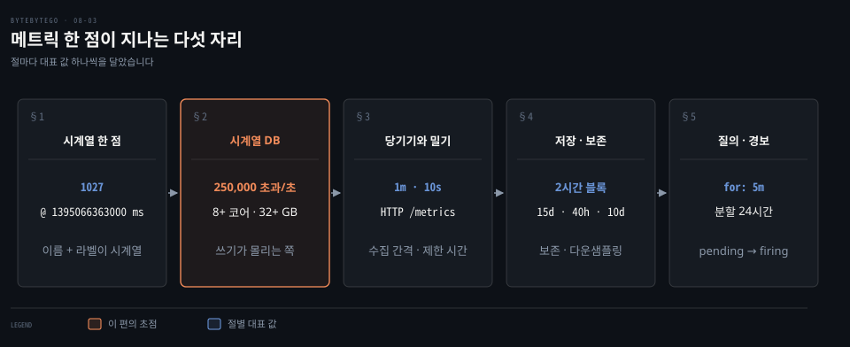
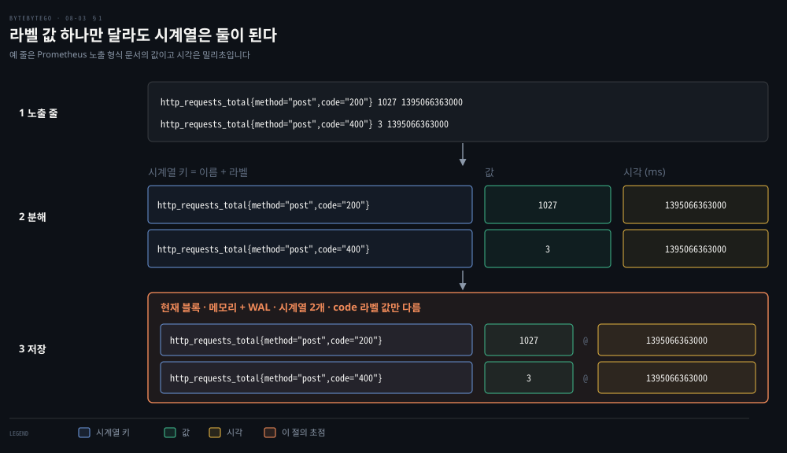
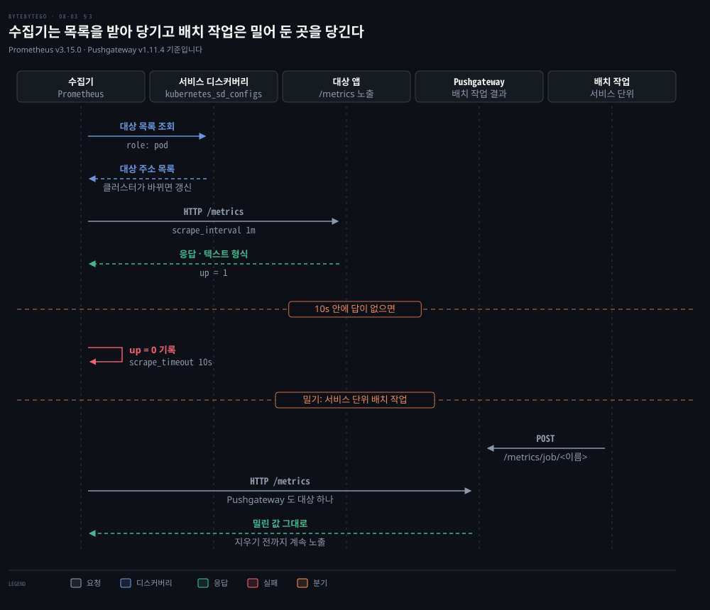
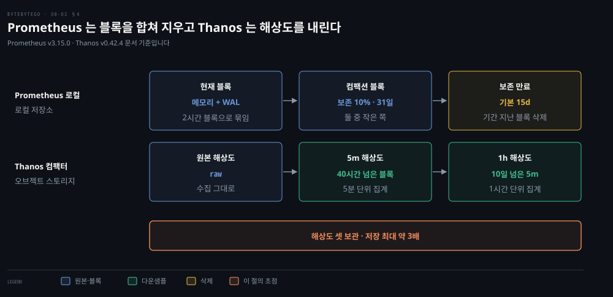
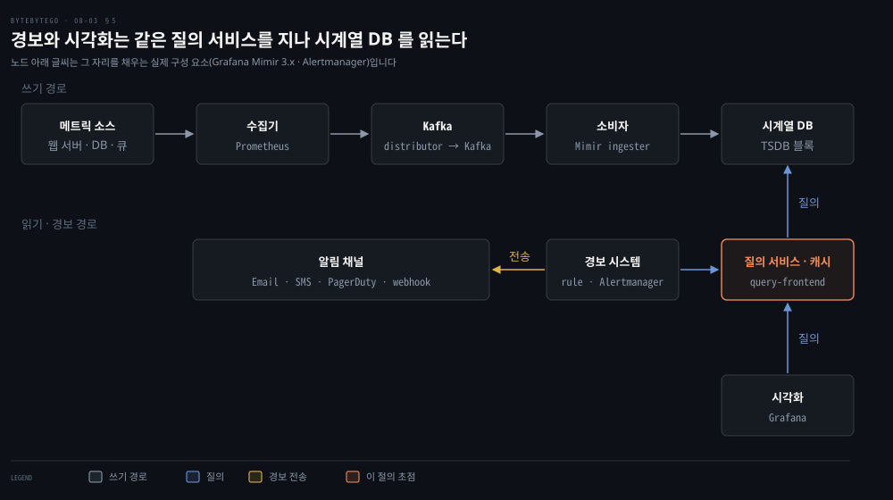

# 메트릭 모니터링은 시계열 데이터베이스에 쓰기를 몰아 담고 수집·질의·경보·시각화로 나뉜다

---

> 메트릭은 쉬지 않고 쌓이는 쓰기 중심 데이터라서, 쓰기를 받아 주는 시계열 데이터베이스를 가운데 두고 수집기는 한쪽에, 질의 서비스와 경보와 시각화는 다른 쪽에 갈라 놓습니다.


## 핵심 요약

> 이 편의 중심 생각은 메트릭이 읽는 쪽 사정이 아니라 쓰는 쪽 사정으로 설계된 데이터라서, 쓰기를 상시로 받는 저장소를 가운데 두고 나머지 기능을 양옆으로 나눈다는 것입니다.

메트릭 한 점은 이름과 라벨이 가리키는 시계열에 값과 시각이 붙은 것입니다. 점은 수집 대상 수와 시계열 수와 수집 빈도의 곱만큼 누가 읽든 말든 계속 쌓입니다. 읽기는 대시보드를 열거나 경보 규칙이 도는 순간에만 몰립니다. 이 비대칭 때문에 범용 데이터베이스보다 쓰기와 시간 범위 집계에 맞춘 시계열 데이터베이스가 가운데에 놓입니다.

수집은 수집기가 대상의 `/metrics` 를 당겨 오는 쪽이 기본이고 대상 목록은 서비스 디스커버리가 알려 줍니다. 서비스 단위 배치 작업만 Pushgateway 로 밀고 머신에 묶인 배치 작업은 Node Exporter 의 textfile collector 로 남깁니다. 저장은 블록 단위로 합치고 보존 기간이 지나면 지웁니다. 다운샘플링은 저장 공간이 아니라 긴 범위 질의를 빠르게 하려고 합니다. 읽기 쪽에서는 질의 서비스 한 곳이 시각화와 경보의 질의를 받습니다. 경보는 조건이 일정 시간 이어져야 발화한 뒤 묶고 누르고 끈 다음 채널로 갑니다.




## 학습 목표

> 이 편을 읽고 나면 다음을 설명할 수 있습니다.

1. 메트릭 한 점이 이름·라벨·값·시각으로 갈라지고 라벨 값이 달라지면 시계열이 새로 생기는 까닭을 노출된 줄로 설명할 수 있습니다.
2. 상시 쓰기와 튀는 읽기라는 접근 패턴이 범용 관계형 데이터베이스나 NoSQL 대신 시계열 데이터베이스를 고르게 하는 까닭을 설명할 수 있습니다.
3. 당기기와 밀기를 수집 간격·제한 시간·`up` 값으로 구분하고 Pushgateway 를 써도 되는 경우를 말할 수 있습니다.
4. 블록·컴팩션·보존·다운샘플링이 각각 무엇을 바꾸고 무엇을 바꾸지 않는지 설명할 수 있습니다.
5. 질의 서비스·경보 규칙·알림 채널·시각화가 시계열 데이터베이스를 어떻게 나눠 읽는지 설명할 수 있습니다.


## 1. 메트릭 한 점은 이름·라벨·값·시각이고 쓰기가 쉬지 않고 이어진다

> 메트릭 한 점은 시계열을 가리키는 이름과 라벨에 값과 시각이 붙은 것이고, 수집 간격마다 대상 수와 시계열 수의 곱만큼 쓰기가 이어집니다.

웹 서버 하나가 응답 코드마다 요청 수를 따로 센다면, 그 숫자들은 어떤 단위로 이어 붙어야 같은 값의 변화로 읽힐까요? 답은 이름과 라벨입니다.

Prometheus 문서가 노출 형식의 예로 보여 주는 두 줄입니다.[^prom-expo] 줄마다 이름, 중괄호 안의 라벨, 값, 밀리초 시각이 차례로 놓입니다.

```bash
# 이름{라벨} 값 시각(밀리초). 두 줄은 code 라벨 값만 다릅니다.
http_requests_total{method="post",code="200"} 1027 1395066363000
http_requests_total{method="post",code="400"}    3 1395066363000
```

**시계열**은 이름과 라벨 쌍으로 식별되는 값의 흐름입니다. 라벨 값이 하나라도 달라지거나 라벨이 더해지거나 빠지면 새 시계열이 생깁니다.[^prom-model] 위 두 줄은 이름과 `method` 가 같고 `code` 만 달라서 시계열이 둘입니다. 수집이 한 번 끝날 때마다 시계열마다 점 하나가 붙습니다. 붙은 점은 먼저 메모리의 현재 블록에 쌓이고 WAL 이 장애에 대비합니다.[^prom-storage]

점의 값은 float64 이거나 네이티브 히스토그램이고 시각은 밀리초 정밀도입니다.[^prom-model] 1395066363000 을 1000 으로 나누면 초 단위 1395066363 입니다. 이 시각은 2014-03-17T14:26:03Z 입니다.



같은 점을 다른 제품은 다른 모양으로 적습니다. InfluxDB 3 Core 의 line protocol 은 테이블 이름 다음에 태그 집합과 필드 집합과 타임스탬프를 놓습니다. 타임스탬프의 기본 단위는 나노초입니다.[^influx-lp] Prometheus 의 라벨은 태그에 해당하고 값은 필드에 해당합니다. 다만 한 점에 필드를 여럿 담을 수 있다는 점이 다릅니다.[^influx-lp]

```bash
# InfluxDB 문서의 예 줄입니다. 마지막 1556813561098000000 은 나노초 단위 시각입니다.
myTable,tag1=value1,tag2=value2 fieldKey="fieldValue" 1556813561098000000
```

이제 규모를 봅니다. 운영 메트릭은 하루에 수백만 개가 넘게 쓰이고 많은 메트릭이 높은 빈도로 수집되는 쓰기 중심 데이터입니다. 아래 값은 계산 과정을 보이려고 이 편이 임의로 둔 예시이며 어느 자료의 수치도 아닙니다. 수집 대상은 1,000대이고 대상마다 시계열이 500개이며, 수집 간격은 Prometheus 의 기본값인 1분입니다.[^prom-config]

| 항목 | 값 | 계산 |
|---|---|---|
| 시계열 수 | 500,000개 | 1,000 × 500 |
| 초당 샘플 | 약 8,333개 | 500,000 ÷ 60 |
| 하루 샘플 | 약 7.2억 개 | 500,000 × 1,440 |

이 쓰기는 누가 읽는지와 무관하게 하루 24시간 이어집니다. 읽기는 다릅니다. 대시보드를 여는 사람이 많은 시각과 경보 규칙이 도는 주기에 따라 몰렸다가 비었다가 합니다. 쓰기는 평평하고 읽기는 튀는 이 비대칭이 저장소를 고르는 출발점입니다.

시계열의 이름 규칙과 샘플 모델은 [데이터 모델 편](../../../06_observability/book/mastering_prometheus/03-01.데이터%20모델.md)에서 다뤘습니다.


## 2. 시계열 데이터베이스는 상시 쓰기와 시간 범위 집계에 맞춰 범용 저장소의 비용을 걷어 낸다

> 범용 관계형 데이터베이스로도 시계열을 담을 수는 있지만 상시 쓰기와 라벨 색인과 이동 평균에서 튜닝 비용이 커지고, NoSQL 은 스키마를 직접 설계해야 합니다.

MySQL 에 이름·라벨·시각·값 열을 가진 테이블 하나를 만들면 되지 않을까요? 이론상으로는 됩니다. 문제는 그 테이블이 규모에서 버티느냐입니다.

범용 관계형 데이터베이스는 시계열에서 흔한 연산에 맞춰 있지 않습니다. 세 곳에서 비용이 납니다.

- 상시 쓰기: 끊기지 않는 쓰기 부하 아래에서 잘 버티지 못해, 규모가 커지면 튜닝에 큰 노력이 듭니다.
- 라벨 색인: 라벨로 거르고 묶으려면 라벨마다 색인을 달아야 합니다.
- 이동 평균: 구르는 시간 창의 평균 같은 계산이 읽기 어려운 복잡한 SQL 이 됩니다.

Cassandra 나 Bigtable 같은 NoSQL 도 시계열을 담을 수 있습니다. 다만 각 제품의 내부 동작을 깊이 알아야 확장되는 스키마를 짤 수 있습니다. 이미 산업 규모로 쓰이는 시계열 데이터베이스가 있다면 범용 NoSQL 을 고를 이유가 줄어듭니다.

| 선택 | 쓰기 | 라벨·시간 질의 | 비용이 느는 곳 |
|---|---|---|---|
| 범용 관계형 DB | 상시 쓰기에 튜닝이 필요 | 라벨마다 색인과 복잡한 SQL | 규모가 커질 때의 튜닝 |
| 범용 NoSQL | 처리 가능 | 스키마와 질의를 직접 설계 | 내부 동작 지식 |
| 시계열 DB | 쓰기와 압축에 맞춘 저장 | 라벨 색인과 시간 범위 집계 제공 | 제품 선택과 운영 |

시계열 데이터베이스는 같은 데이터량을 더 적은 서버로 받고, 시계열 분석에 맞춘 질의 인터페이스와 보존·집계 기능을 함께 줍니다. 질의 언어에 시간 범위 함수가 들어 있다는 뜻입니다. PromQL 의 `rate()` 와 `avg_over_time()` 이 그 예입니다.[^prom-functions]

Prometheus 는 메모리와 디스크를 함께 씁니다. 현재 블록을 메모리에 두고 WAL 로 장애를 견디며 2시간 단위로 디스크 블록을 만듭니다.[^prom-storage] 내부 구조는 [TSDB 쓰기 경로 편](../../../06_observability/book/mastering_prometheus/03-02.TSDB%20쓰기%20경로.md)에서 다뤘습니다.

초당 쓰기 수는 설계 가정으로 씁니다. InfluxDB v1 오픈소스 하드웨어 산정 표의 마지막 행은 쓰기가 초당 250,000 을 넘으면 8코어 이상, 32GB 이상, IOPS 1,000 이상을 권합니다.[^influx-hw] 이는 한 버전의 벤더 가이드라인이라 현재 제품과 하드웨어에서는 달라질 수 있습니다. 샘플 하나를 필드 쓰기 하나로 본다면 앞 절의 8,333개/초와 시계열 50만 개는 같은 표에서 쓰기 250,000 미만, 시리즈 1,000,000 미만인 4~6코어, 8~32GB 행에 듭니다.[^influx-hw]

라벨 값의 종류 수를 **카디널리티**라고 합니다. Prometheus 문서는 라벨 값의 조합마다 새 시계열이 생기므로 사용자 ID 나 이메일처럼 값의 종류가 끝없는 차원을 라벨에 넣지 말라고 합니다.[^prom-naming] 제품에 따라 이 제약의 강도가 다릅니다. InfluxDB 3 의 스토리지 엔진은 태그 값과 시리즈 카디널리티에 상한이 없고, 태그 값 카디널리티가 데이터베이스 전체 성능에 영향을 주지 않는다고 문서에 적혀 있습니다.[^influx-schema] 라벨 설계를 고를 때는 쓰는 제품의 문서를 먼저 확인합니다.

데이터 모양이 데이터베이스 종류를 고르는 일반 원리는 [데이터 모양과 데이터베이스 종류 편](./01-01.격리%20수준과%20낙관적%20잠금이%20동시%20쓰기의%20이상%20현상을%20막고%20데이터%20모양이%20데이터베이스%20종류를%20고른다.md)에서 다뤘습니다.


## 3. 수집은 수집기가 당겨 오는 쪽이 기본이고 밀기는 서비스 단위 배치 작업에 남긴다

> 수집기가 서비스 디스커버리가 알려 준 대상의 `/metrics` 를 정해진 간격으로 당겨 오고, 스스로 밀어야 하는 서비스 단위 배치 작업만 중간 저장소를 둡니다.

대상 서버가 수시로 늘고 줄 때, 수집기는 값을 받아 올 주소를 어떻게 알까요?

가장 단순한 방법은 수집기 서버의 파일에 대상의 DNS 이름이나 IP 를 적어 두는 것입니다. 대상이 자주 바뀌면 이 파일을 따라가기 어렵습니다. 새 서버를 놓치면 그 서버의 메트릭이 비어 버립니다. 그래서 대상이 스스로 등록하는 **서비스 디스커버리**를 둡니다. Kubernetes 나 ZooKeeper 같은 곳이 대상 목록을 쥐고 있다가 목록이 바뀌면 수집기에 알립니다.

Prometheus 는 이 자리에 `kubernetes_sd_configs` 를 둡니다. Kubernetes REST API 에서 대상을 가져와 클러스터 상태와 계속 맞추며, `node`·`service`·`pod`·`endpointslice` 같은 역할로 무엇을 대상으로 볼지 고릅니다. `endpoints` 역할도 있지만 Endpoints API 가 Kubernetes v1.33 이후 폐기 예정이라 문서는 `endpointslice` 로 바꾸라고 권합니다.[^prom-k8s-sd] 디스커버리를 다루는 방법과 라벨 재작성은 [서비스 디스커버리 편](../../../06_observability/book/mastering_prometheus/04-01.서비스%20디스커버리와%20relabeling.md)에서 다뤘습니다.

한 번의 당기기는 세 동작으로 이뤄집니다.

1. 수집기가 디스커버리에서 대상의 주소와 수집 간격과 제한 시간과 재시도 같은 설정을 받습니다.
2. 수집기가 대상이 노출한 HTTP 경로를 호출합니다. 기본 경로는 `/metrics` 이고, 대상 쪽에는 보통 클라이언트 라이브러리를 넣어야 합니다.[^prom-config] 대상은 앞 절의 두 줄 같은 텍스트 형식으로 응답합니다.[^prom-expo]
3. 선택적으로 대상 목록이 바뀔 때 알림을 받도록 등록하거나, 주기적으로 목록을 다시 조회합니다.

`scrape_interval` 의 기본값은 1분이고 `scrape_timeout` 의 기본값은 10초입니다.[^prom-config] 수집이 성공하면 `up` 시계열에 1 이, 실패하면 0 이 남습니다.[^prom-up] 당기기에서는 대상이 죽었는지를 별도의 하트비트 없이 수집 결과가 알려 줍니다.



그렇다면 수집 간격보다 짧게 사는 작업의 값은 어떻게 남길까요? 5초 만에 끝나는 배치 작업은 1분마다 도는 수집기와 만나지 못합니다.

Prometheus 문서는 이런 작업을 둘로 가릅니다.[^prom-pushing] 특정 머신이나 인스턴스와 의미상 묶이지 않는 서비스 단위 배치 작업의 결과는 Pushgateway 에 남깁니다. 보안 업데이트 cron 작업이나 설정 관리 클라이언트 실행처럼 머신에 묶인 배치 작업은 Pushgateway 대신 Node Exporter 의 textfile collector 로 노출하라고 합니다.[^prom-pushing]

단명 프로세스를 textfile collector 로 거두는 방법과 두 쪽의 선택 기준은 [Prometheus 배포 편 §4](../../../06_observability/book/mastering_prometheus/02-01.Prometheus%20배포%20—%20스택%20구성요소와%20Operator.md)에서 다뤘습니다. Pushgateway 를 제한된 경우에만 권하는 이유는 세 가지 함정에 있습니다.[^prom-pushing]

- 여러 인스턴스를 하나의 Pushgateway 로 받으면 단일 장애점이자 병목이 됩니다.
- 수집마다 만들어지던 `up` 으로 인스턴스 상태를 볼 수 없게 됩니다.
- 밀어 넣은 시리즈는 직접 지우기 전까지 계속 노출됩니다.

밀 때의 경로는 `/metrics/job/<이름>` 형식이고, README 의 `<JOB_NAME>` 에 해당하는 `<이름>` 이 `job` 라벨 값이 됩니다.[^pg-url]

쓰는 HTTP 메서드는 둘입니다. PUT 은 URL 의 그룹 키로 묶인 메트릭 전체를 바꿉니다. POST 는 이름이 같은 메트릭만 바꿉니다.[^pg-readme] 밀린 값은 Pushgateway 에 남아 있다가, 수집기가 Pushgateway 를 수집 대상 하나로 설정해 다른 대상처럼 당겨 갑니다.[^pg-scrape] 수집기가 대상에 닿지 못하는 이유가 방화벽이나 NAT 라면 Pushgateway 대신 수집기를 장벽 안쪽에 두거나 PushProx 를 쓰라고 문서는 권합니다.[^prom-pushing]

밀기가 필요한 구간이 대상이 아니라 중앙 저장소로 보내는 쪽일 수도 있습니다. Agent 모드의 Prometheus 는 같은 방식으로 당겨 온 값을 remote write 로 밀어 보냅니다. 이때 로컬 질의와 경보와 로컬 저장은 하지 않습니다.[^prom-agent] 받는 쪽 Prometheus 는 `--web.enable-remote-write-receiver` 플래그로 `/api/v1/write` 를 엽니다.[^prom-storage] OTLP 로 밀려 오는 값은 `--web.enable-otlp-receiver` 로 받습니다.[^prom-cli]

OTLP 수신구와 Collector 는 [OpenTelemetry 통합 편](../../../06_observability/book/mastering_prometheus/14-01.Prometheus%20와%20OpenTelemetry%20통합%20—%20규격·Collector·OTLP%20수신구.md)에서 다뤘습니다. 프로토콜과 튜닝은 [remote write 편](../../../06_observability/book/mastering_prometheus/09-01.remote%20write%20와%20remote%20read%20—%20프로토콜·에이전트·튜닝.md)에서 다뤘습니다.

어느 쪽이 낫느냐에 대한 공식 입장은 당기기가 조금 낫지만 선택에서 큰 비중은 아니라는 것입니다.[^prom-faq] 당기기는 수집기를 노트북에서도 따로 띄울 수 있습니다. 대상이 내려갔는지 더 믿을 만하게 알 수 있고 브라우저로 대상 상태를 직접 열어 볼 수도 있습니다.[^prom-faq] 당기기가 만드는 차이는 [관측 가능성과 Prometheus 의 자리 편](../../../06_observability/book/mastering_prometheus/01-01.관측%20가능성·모니터링·Prometheus의%20자리.md)에서 다뤘습니다.


## 4. 저장은 블록으로 합치고 보존 기간에 지우며 다운샘플링은 긴 범위 질의를 빠르게 한다

> 로컬 저장소는 2시간 블록을 만들어 합치고 기본 15일이 지나면 지우며, 오래된 데이터를 거친 해상도로 내리는 다운샘플링은 저장 공간을 줄이지 않고 긴 범위 질의를 빠르게 합니다.

하루 7.2억 개의 점을 보존 기간 내내 담으려면 디스크가 얼마나 필요할까요?

Prometheus 문서는 샘플 하나가 평균 1~2바이트를 차지한다고 하고 용량 산정식을 줍니다.[^prom-storage]

```bash
# 보존 기간(초) × 초당 수집 샘플 수 × 샘플당 바이트로 필요한 디스크를 어림합니다.
needed_disk_space = retention_time_seconds * ingested_samples_per_second * bytes_per_sample
```

앞 절의 가정을 넣습니다. 기본 보존 15일은 15 × 86,400 = 1,296,000초입니다. 여기에 초당 샘플을 곱하면 1,296,000 × 8,333 ≈ 108억 개입니다. 샘플당 1~2바이트면 약 10.8~21.6GB 입니다. 같은 문서는 용량을 줄이려면 수집 간격을 늘리기보다 시계열 수를 줄이는 쪽이 효과가 크다고 하는데, 샘플이 시계열 안에서 압축되기 때문입니다.[^prom-storage]

저장 구조는 이렇습니다. 들어오는 샘플은 2시간 단위 블록으로 묶입니다. 현재 블록은 메모리에 있다가 WAL 로 장애를 견딥니다. 2시간 블록은 백그라운드에서 합쳐져 더 긴 블록이 됩니다. 합친 블록이 담는 구간은 보존 기간의 10% 와 31일 중 작은 쪽을 넘지 않습니다.[^prom-storage] 보존 기간은 `--storage.tsdb.retention.time` 이고 기본값은 15일입니다. `--storage.tsdb.retention.size` 로 크기 상한도 둡니다.[^prom-storage] 블록의 안쪽은 [TSDB 저장 구조 편](../../../06_observability/book/mastering_prometheus/03-03.TSDB%20저장%20구조.md)에서 다뤘습니다.

로컬 저장소는 한 노드의 확장성과 내구성에 묶입니다. 그 너머는 remote write 로 샘플을 보내는 외부 저장소가 맡습니다.[^prom-storage] Grafana Mimir 와 Thanos 가 그 예이며 [VictoriaMetrics 와 Mimir 편](../../../06_observability/book/mastering_prometheus/09-02.VictoriaMetrics%20와%20Grafana%20Mimir.md)과 [Thanos 저장 경로 편](../../../06_observability/book/mastering_prometheus/10-01.Thanos%20저장%20경로%20—%20Sidecar·Compactor·Store.md)에서 다뤘습니다.

보존 기간을 1년으로 늘리면 한 달짜리 그래프 하나를 그리려고 수집 간격 그대로의 점을 전부 읽어야 할까요? **다운샘플링**은 오래된 데이터를 더 거친 해상도로 다시 쓰는 일입니다. Thanos 컴팩터는 오브젝트 스토리지에 쌓인 블록에 컴팩션과 다운샘플링을 적용하는 구성 요소입니다. 컴팩터는 원본 블록이 40시간을 넘으면 5분 해상도로, 5분 해상도 블록이 10일을 넘으면 1시간 해상도로 내립니다.[^thanos] 해상도마다 집계 값을 함께 저장해 긴 범위 질의에서도 정밀도를 지킵니다.[^thanos]



흔한 오해를 바로잡습니다. 다운샘플링은 저장 공간을 줄이지 않습니다. 원본 블록마다 크기가 비슷한 블록이 둘 더 생깁니다. 해상도를 모두 두면 저장이 약 3배까지 늘 수 있습니다.[^thanos] 목적은 몇 달이나 몇 년 범위의 질의를 빠르게 하는 것입니다.[^thanos]

보존은 해상도마다 따로 정합니다. 플래그는 `--retention.resolution-raw` 와 `--retention.resolution-5m` 과 `--retention.resolution-1h` 입니다. 기본값 0 은 영구 보존입니다.[^thanos] 해상도별 보존이 다음 다운샘플링의 최소 나이보다 짧으면 다운샘플링이 끝나기 전에 데이터가 지워집니다.[^thanos] Prometheus 의 로컬 저장소 문서는 컴팩션과 보존만 다루고 다운샘플링은 언급하지 않습니다.[^prom-storage]


## 5. 질의 서비스 한 곳이 시각화와 경보의 질의를 받고 경보는 묶고 누르고 끈 뒤 보낸다

> 시각화와 경보 규칙은 모두 질의 서비스를 지나 시계열 데이터베이스를 읽고, 경보는 조건이 일정 시간 이어져야 발화한 뒤 그룹과 억제와 침묵을 거쳐 채널로 갑니다.

대시보드 수십 개가 같은 시간 범위를 동시에 열면 시계열 데이터베이스는 그 읽기를 어떻게 견딜까요?



구성 요소를 위에서 아래로 짚습니다.

- 메트릭 소스: 웹 서버, 데이터베이스, 메시지 큐 같은 수집 대상입니다.
- 수집기: 대상에서 메트릭을 모아 시계열 데이터베이스 쪽으로 보냅니다.
- Kafka: 수집과 처리를 서로 떼어 놓는 분산 메시징 계층입니다.
- 소비자: Kafka 에서 읽어 시계열 데이터베이스에 쓰는 서비스입니다.
- 질의 서비스: 시계열 데이터베이스 앞의 얇은 래퍼이거나 그 데이터베이스의 질의 인터페이스 자체입니다.
- 경보 시스템: 질의 결과가 조건에 맞으면 알림을 채널로 보냅니다.
- 시각화: 질의 결과를 그래프와 차트로 보여 줍니다.

Kafka 층을 현재 제품에서 보면 Grafana Mimir 3.0 이 이 구조를 권장 구조로 올렸습니다.[^mimir-arch] distributor 는 쓰기 요청을 Kafka 토픽의 파티션으로 나눠 씁니다. Kafka 가 복제와 영속화를 확인한 뒤에야 클라이언트에 성공을 돌려줍니다. ingester 는 파티션을 계속 읽어 메모리와 디스크에 반영합니다.[^mimir-ingest] 그 결과 무거운 질의가 실시간 쓰기를 방해하지 않도록 읽기와 쓰기 경로가 갈립니다.[^mimir-ingest]

메트릭 한두 점은 빠져도 감수할 수 있어서 전달 보장을 최대 한 번으로 둘 수도 있습니다. 전달 보장의 종류는 [Kafka 편](./05-01.Kafka%20는%20순차%20IO%20와%20제로%20카피로%20빠르고%20전달%20보장은%20최대%20한%20번·최소%20한%20번·정확히%20한%20번으로%20갈린다.md)에서 다뤘습니다.

질의 서비스는 읽기 부하를 한 곳에서 줄입니다. Mimir 의 query-frontend 는 Prometheus 호환 API 를 내놓고, 긴 범위 질의를 기본 24시간 간격으로 쪼개 병렬로 실행하며 결과를 Memcached 에 캐시합니다.[^mimir-qf] 시각화가 같은 질의를 반복해도 캐시가 먼저 받습니다. Thanos 쪽의 같은 구성은 [Thanos 쿼리 경로 편](../../../06_observability/book/mastering_prometheus/10-02.Thanos%20쿼리%20경로%20—%20Query·Query%20Frontend·Ruler·Receiver.md)에서 다뤘습니다. 캐시 자리를 고르는 일반 원리는 [캐시 전략 편](./02-01.캐시%20전략은%20읽기·쓰기%20경로에서%20캐시%20자리를%20정하고%20Redis%20는%20메모리와%20단일%20스레드%20이벤트%20루프로%20빠르다.md)에서 다뤘습니다.

시각화는 이 질의 서비스를 데이터 소스로 붙입니다. Grafana 는 Prometheus 를 데이터 소스로 직접 질의하는 시각화 도구입니다.[^grafana]

경보는 규칙이 시계열 데이터베이스에 정해진 주기로 질의하는 일입니다. Prometheus 의 규칙 평가 주기 기본값은 1분입니다.[^prom-config]

규칙에 `for` 절이 있으면 표현식 결과가 처음 나온 뒤 그 기간 동안 매 평가에서 계속 활성이어야 경보가 발화(firing)하고, 그 전의 상태는 pending 입니다.[^alert-rules] 순간적으로 튀었다가 사라지는 값이 알림을 울리지 않게 하는 장치입니다. 문서의 예시 규칙 `InstanceDown` 은 `up == 0` 이 5분 이어지면 발화합니다.[^alert-rules-example] `for` 기간을 얼마로 잡을지는 [견고한 알림 편](../../../06_observability/book/mastering_prometheus/05-02.견고한%20알림과%20룰%20단위%20테스트.md)에서 다뤘습니다.

발화한 경보는 Alertmanager 로 갑니다.[^am-overview] Alertmanager 는 세 가지로 알림을 줄입니다.[^am]

- 그룹: 성격이 비슷한 경보를 한 통의 알림으로 묶습니다. 네트워크 분리로 수백 개 인스턴스의 경보가 한꺼번에 울려도 한 통만 받습니다.
- 억제: 어떤 경보가 이미 발화 중이면 그에 딸린 다른 경보의 알림을 막습니다. 클러스터 전체가 닿지 않는다는 경보가 있으면 그 클러스터의 나머지 경보를 누릅니다.
- 침묵: 정해진 시간 동안 조건에 맞는 경보를 끕니다.

받는 곳은 이메일이나 PagerDuty 같은 수신자와 임의의 HTTP 엔드포인트인 webhook 이며, SMS 는 AWS SNS 설정의 `phone_number` 로 보냅니다.[^am-config] 알림을 외부 푸시·SMS·이메일 서비스로 안정적으로 내보내는 일은 [알림 시스템 편](../system-design/10-01.알림%20시스템은%20제3자%20푸시·SMS·이메일%20서비스%20앞에%20메시지%20큐와%20작업%20서버를%20두어%20재시도와%20중복을%20다룬다.md)에서 다뤘습니다. 그룹과 라우팅의 세부는 [Alertmanager 편](../../../06_observability/book/mastering_prometheus/05-01.Alertmanager%20—%20라우팅·그룹핑·억제·HA.md)에서 다뤘습니다.

알림이 울린 뒤의 진단과 사후 검토는 [배포 전략과 장애 대응 편](./06-02.배포%20전략은%20새%20버전을%20얼마나%20조금씩%20내보낼지%20정하고%20장애%20대응은%20진단%20도구와%20사후%20검토로%20이어진다.md)으로 이어집니다.


## 면접 대비

> 메트릭 저장소의 선택 근거, 시계열이 갈리는 기준, 수집 방식, 다운샘플링, 경보 억제에 관한 면접 질문입니다.

1. 메트릭 저장소로 MySQL 대신 시계열 데이터베이스를 고르는 이유를 접근 패턴으로 설명해 보십시오.
2. `http_requests_total{method="post",code="200"}` 과 `code="400"` 줄은 같은 시계열입니까, 그리고 라벨에 사용자 ID 를 넣으면 무엇이 문제입니까?
3. 당기기에서 수집기는 대상 목록을 어떻게 얻고 대상이 응답하지 않는 것을 무엇으로 알며, Pushgateway 는 언제 써도 됩니까?
4. 다운샘플링은 저장 공간을 줄입니까, 그리고 해상도별 보존을 잘못 맞추면 무슨 일이 생깁니까?
5. 경보 규칙의 `for` 절은 무엇을 막고, 한 번의 장애로 알림이 수백 건 나는 일은 어떻게 줄입니까?


## 정답 (자답 후 펼치기)

> 면접 질문에 대한 키워드 중심의 모범 답안입니다.

### 정답 1 — 상시 쓰기와 튀는 읽기

메트릭은 수집 간격마다 대상 수와 시계열 수의 곱만큼 쉬지 않고 쓰이고, 읽기는 대시보드와 경보가 부를 때만 몰립니다. 범용 관계형 데이터베이스는 이 상시 쓰기와 라벨 색인과 이동 평균에서 튜닝 비용이 큽니다. 시계열 데이터베이스는 같은 데이터량을 더 적은 서버로 받고 시간 범위 질의와 보존·집계를 제공합니다.

### 정답 2 — 라벨 조합이 곧 시계열

라벨 값이 하나라도 다르면 다른 시계열이므로 두 줄은 시계열이 둘입니다. 사용자 ID 처럼 값의 종류가 끝없는 라벨은 시계열 수를 폭발시켜 저장과 메모리를 키우기 때문에 Prometheus 문서는 쓰지 말라고 합니다. InfluxDB 3 는 태그 값 카디널리티가 성능에 영향을 주지 않는다고 하므로, 쓰는 제품의 문서로 확인합니다.

### 정답 3 — 서비스 디스커버리와 up, 서비스 단위 배치 작업

대상 목록은 Kubernetes 같은 서비스 디스커버리가 알려 주고 수집기는 `/metrics` 를 정해진 간격으로 당깁니다. 응답이 없으면 `up` 이 0 으로 남아 대상이 내려갔음을 압니다. Pushgateway 는 특정 인스턴스와 묶이지 않는 서비스 단위 배치 작업의 결과를 남길 때만 씁니다.

### 정답 4 — 공간은 그대로, 길어진 범위 질의가 빨라짐

다운샘플링은 해상도를 내린 블록을 더 만들어서 저장 공간을 줄이지 않고 오히려 약 3배까지 늡니다. 목적은 긴 범위 질의를 빠르게 하는 것입니다. 해상도별 보존이 다음 다운샘플링의 최소 나이보다 짧으면 다운샘플링이 끝나기 전에 지워집니다.

### 정답 5 — for 로 일시적 값 걸러내기, 그룹·억제·침묵

`for` 절은 조건이 정해진 시간 이어져야 발화시켜 순간적으로 튀는 값이 알림을 울리지 못하게 합니다. 알림 폭주는 Alertmanager 의 세 장치로 줄입니다. 그룹은 비슷한 경보를 한 통으로 묶습니다. 억제는 이미 발화한 큰 경보에 딸린 경보를 막습니다. 침묵은 정해진 시간 동안 알림을 끕니다.


## 참고 자료

- ByteByteGo(Alex Xu 외), System Design 그림 해설 모음: 메트릭 수집 방식, 메트릭 수집용 데이터베이스, 메트릭 모니터링과 경보 시스템을 다룬 글들.
- ByteByteGo system-design-101: <https://github.com/ByteByteGoHq/system-design-101/blob/b28380a/data/guides/push-vs-pull-in-metrics-collecting-systems.md>, <https://github.com/ByteByteGoHq/system-design-101/blob/b28380a/data/guides/choose-the-right-database-for-metric-collecting-system.md>
- Prometheus 서버 v3.15.0 문서: <https://github.com/prometheus/prometheus/tree/v3.15.0/docs>
- Alertmanager v0.34.1 문서: <https://github.com/prometheus/alertmanager/tree/v0.34.1/docs>
- Grafana Mimir 3.2.2 문서: <https://github.com/grafana/mimir/tree/mimir-3.2.2/docs/sources/mimir>
- Thanos v0.42.4 컴팩터 문서: <https://github.com/thanos-io/thanos/blob/v0.42.4/docs/components/compact.md>
- InfluxDB 3 Core line protocol: <https://docs.influxdata.com/influxdb3/core/reference/line-protocol/>
- InfluxDB 3 Core 스키마 설계: <https://docs.influxdata.com/influxdb3/core/write-data/best-practices/schema-design/>
- InfluxDB v1 하드웨어 산정 가이드라인: <https://docs.influxdata.com/influxdb/v1/guides/hardware_sizing/>
- Prometheus 공식 문서(prometheus/docs) 605cf81: <https://github.com/prometheus/docs/tree/605cf81/docs>
- Pushgateway v1.11.4 README: <https://github.com/prometheus/pushgateway/blob/v1.11.4/README.md>


## 관련 문서

- [Kafka 는 순차 IO 와 제로 카피로 빠르고 전달 보장은 최대 한 번·최소 한 번·정확히 한 번으로 갈린다](./05-01.Kafka%20는%20순차%20IO%20와%20제로%20카피로%20빠르고%20전달%20보장은%20최대%20한%20번·최소%20한%20번·정확히%20한%20번으로%20갈린다.md)
- [캐시 전략은 읽기·쓰기 경로에서 캐시 자리를 정하고 Redis 는 메모리와 단일 스레드 이벤트 루프로 빠르다](./02-01.캐시%20전략은%20읽기·쓰기%20경로에서%20캐시%20자리를%20정하고%20Redis%20는%20메모리와%20단일%20스레드%20이벤트%20루프로%20빠르다.md)
- [알림 시스템은 제3자 푸시·SMS·이메일 서비스 앞에 메시지 큐와 작업 서버를 두어 재시도와 중복을 다룬다](../system-design/10-01.알림%20시스템은%20제3자%20푸시·SMS·이메일%20서비스%20앞에%20메시지%20큐와%20작업%20서버를%20두어%20재시도와%20중복을%20다룬다.md)

[^prom-expo]: Prometheus 노출 형식 문서의 텍스트 형식 예: <https://github.com/prometheus/docs/blob/605cf81/docs/instrumenting/exposition_formats.md#L130-L131>
[^prom-model]: Prometheus 데이터 모델의 이름·라벨 식별(L14)과 라벨 변경에 따른 새 시계열(L26)과 샘플 구성(L40-L43): <https://github.com/prometheus/docs/blob/605cf81/docs/concepts/data_model.md#L14-L43>
[^influx-lp]: InfluxDB 3 Core line protocol 레퍼런스: <https://docs.influxdata.com/influxdb3/core/reference/line-protocol/>
[^prom-config]: Prometheus v3.15.0 설정 문서의 `scrape_interval`(기본 1m, L57)·`scrape_timeout`(기본 10s, L61)·`evaluation_interval`(기본 1m, L76)·`metrics_path`(기본 /metrics, L347): <https://github.com/prometheus/prometheus/blob/v3.15.0/docs/configuration/configuration.md#L57-L347>
[^prom-functions]: Prometheus v3.15.0 쿼리 함수 문서의 `rate()` 와 `avg_over_time()`: <https://github.com/prometheus/prometheus/blob/v3.15.0/docs/querying/functions.md#L793>, <https://github.com/prometheus/prometheus/blob/v3.15.0/docs/querying/functions.md#L959>
[^prom-storage]: Prometheus v3.15.0 저장소 문서의 2시간 블록과 WAL(L14-L26), 컴팩션 범위와 보존 기본값(L82-L97), 샘플당 바이트와 용량 산정식(L110-L122), 원격 저장소 연동과 수신기(L158-L195): <https://github.com/prometheus/prometheus/blob/v3.15.0/docs/storage.md#L14-L195>
[^influx-hw]: InfluxDB v1 하드웨어 산정 가이드라인: <https://docs.influxdata.com/influxdb/v1/guides/hardware_sizing/>
[^prom-naming]: Prometheus 메트릭·라벨 이름 지침의 높은 카디널리티 경고: <https://github.com/prometheus/docs/blob/605cf81/docs/practices/naming.md#L93-L97>
[^influx-schema]: InfluxDB 3 Core 스키마 설계 문서: <https://docs.influxdata.com/influxdb3/core/write-data/best-practices/schema-design/>
[^prom-k8s-sd]: Prometheus v3.15.0 `kubernetes_sd_config`: <https://github.com/prometheus/prometheus/blob/v3.15.0/docs/configuration/configuration.md#L2435-L2438>, 역할 `pod`: <https://github.com/prometheus/prometheus/blob/v3.15.0/docs/configuration/configuration.md#L2488>, `endpoints` 폐기 안내: <https://github.com/prometheus/prometheus/blob/v3.15.0/docs/configuration/configuration.md#L2529-L2530>, 역할 `endpointslice`: <https://github.com/prometheus/prometheus/blob/v3.15.0/docs/configuration/configuration.md#L2552>
[^prom-up]: Prometheus 작업과 인스턴스 문서의 `up`: <https://github.com/prometheus/docs/blob/605cf81/docs/concepts/jobs_instances.md#L33-L34>
[^prom-pushing]: Pushgateway 를 쓸 때의 지침과 머신에 묶인 배치 작업의 대안(L36-L43, L53-L56): <https://github.com/prometheus/docs/blob/605cf81/docs/practices/pushing.md#L11-L56>
[^pg-readme]: Pushgateway v1.11.4 README 의 PUT·POST 메서드: <https://github.com/prometheus/pushgateway/blob/v1.11.4/README.md#L366-L416>
[^pg-url]: Pushgateway v1.11.4 README 의 URL 경로 형식: <https://github.com/prometheus/pushgateway/blob/v1.11.4/README.md#L262-L270>
[^pg-scrape]: Pushgateway v1.11.4 README 의 수집 대상 설정: <https://github.com/prometheus/pushgateway/blob/v1.11.4/README.md#L76-L80>
[^prom-agent]: Prometheus v3.15.0 Agent 모드 문서: <https://github.com/prometheus/prometheus/blob/v3.15.0/docs/prometheus_agent.md#L7-L30>
[^prom-cli]: Prometheus v3.15.0 명령줄 플래그 문서의 `--web.enable-otlp-receiver`: <https://github.com/prometheus/prometheus/blob/v3.15.0/docs/command-line/prometheus.md#L33>
[^prom-faq]: Prometheus FAQ 의 당기기를 쓰는 이유: <https://github.com/prometheus/docs/blob/605cf81/docs/introduction/faq.md#L71-L82>
[^thanos]: Thanos v0.42.4 컴팩터 문서의 오브젝트 스토리지 블록 대상(L3)과 다운샘플링·보존: <https://github.com/thanos-io/thanos/blob/v0.42.4/docs/components/compact.md#L3>, <https://github.com/thanos-io/thanos/blob/v0.42.4/docs/components/compact.md#L121-L183>
[^mimir-arch]: Grafana Mimir 3.2.2 아키텍처 문서의 ingest storage 가 preferred 라는 표: <https://github.com/grafana/mimir/blob/mimir-3.2.2/docs/sources/mimir/get-started/about-grafana-mimir-architecture/_index.md#L18-L24>
[^mimir-ingest]: Grafana Mimir 3.2.2 ingest storage 아키텍처 문서: <https://github.com/grafana/mimir/blob/mimir-3.2.2/docs/sources/mimir/get-started/about-grafana-mimir-architecture/about-ingest-storage-architecture/index.md#L8-L45>
[^mimir-qf]: Grafana Mimir 3.2.2 query-frontend 문서의 분할과 캐시: <https://github.com/grafana/mimir/blob/mimir-3.2.2/docs/sources/mimir/references/architecture/components/query-frontend/index.md#L33-L46>
[^grafana]: Prometheus 문서의 Grafana 지원: <https://github.com/prometheus/docs/blob/605cf81/docs/visualization/grafana.md#L7-L12>
[^alert-rules]: Prometheus v3.15.0 알림 규칙 문서의 `for` 절: <https://github.com/prometheus/prometheus/blob/v3.15.0/docs/configuration/alerting_rules.md#L35-L40>
[^alert-rules-example]: Prometheus v3.15.0 알림 규칙 문서의 `InstanceDown` 예: <https://github.com/prometheus/prometheus/blob/v3.15.0/docs/configuration/alerting_rules.md#L76-L78>
[^am-overview]: Alertmanager v0.34.1 개요 문서: <https://github.com/prometheus/alertmanager/blob/v0.34.1/docs/overview.md#L7-L10>
[^am]: Alertmanager v0.34.1 핵심 개념 문서의 그룹·억제·침묵: <https://github.com/prometheus/alertmanager/blob/v0.34.1/docs/alertmanager.md#L17-L60>
[^am-config]: Alertmanager v0.34.1 설정 문서의 수신자 `email_config`(L1055), `pagerduty_config`(L1468), `sns_config` 의 `phone_number`(L1810), `webhook_config`(L1939): <https://github.com/prometheus/alertmanager/blob/v0.34.1/docs/configuration.md#L1055-L1939>
