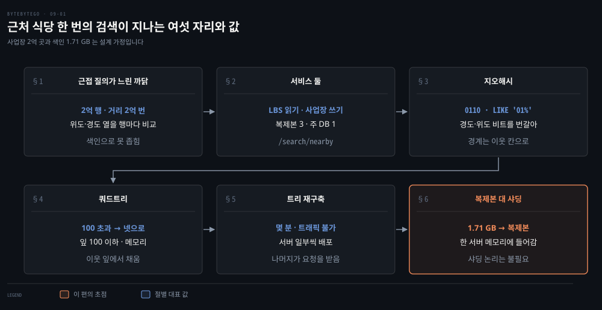
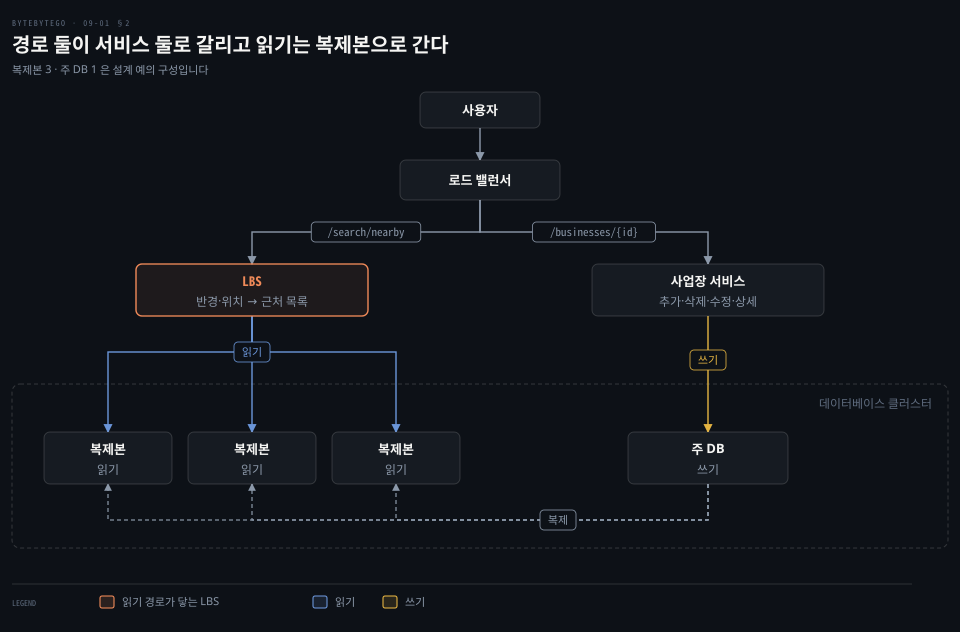
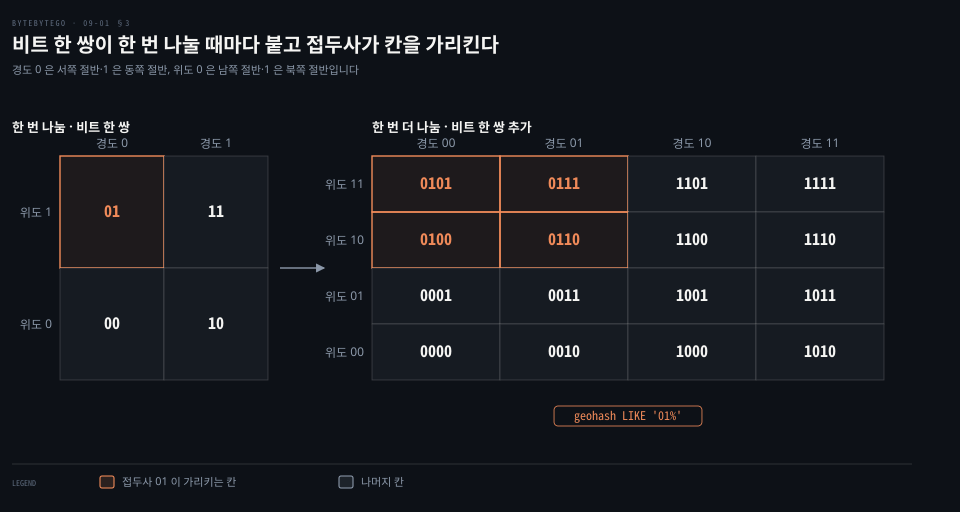
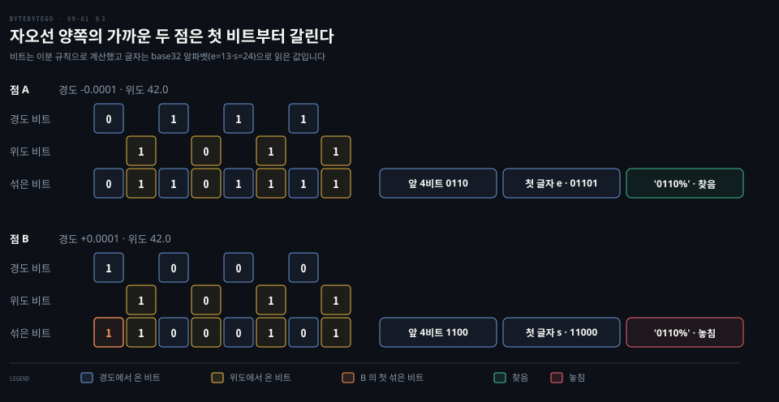
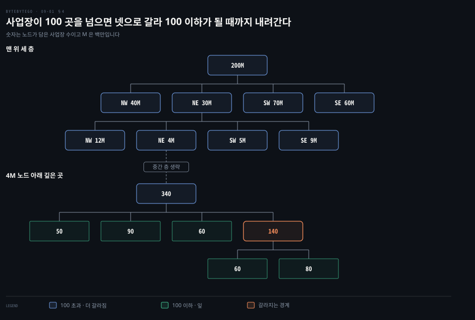
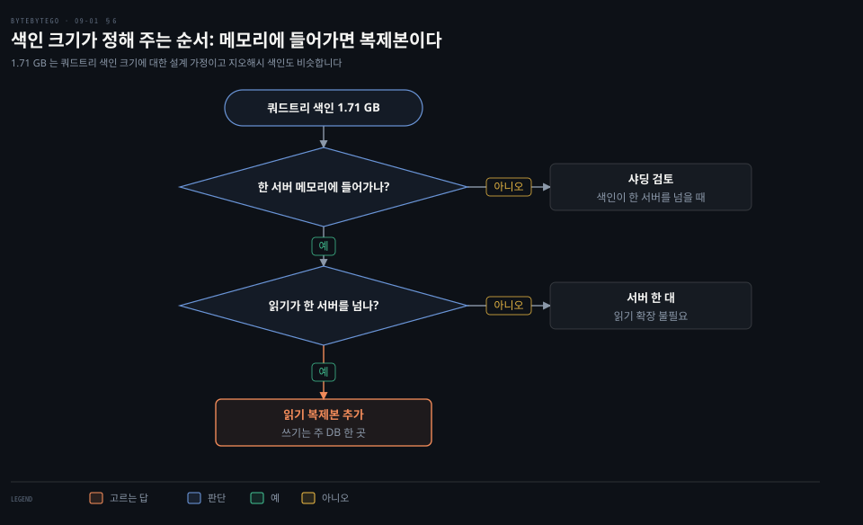

# 근접 검색은 지오해시와 쿼드트리로 지도를 격자로 나누고 색인이 작으면 샤딩 대신 읽기 복제본으로 넓힌다

---

> 근처 식당 검색은 위도·경도 행을 전부 비교하는 대신 지도를 격자로 나눠 칸 번호로 찾습니다. 칸 번호를 DB 키로 두면 지오해시이고 서버 메모리에 트리로 지으면 쿼드트리이며, 색인이 한 서버에 들어갈 만큼 작으면 샤딩 대신 읽기 복제본으로 읽기를 넓힙니다.


## 핵심 요약

> 이 편의 중심 생각은 2차원 위치를 칸 번호 하나로 바꾸면 근처 검색이 접두사 질의나 트리 탐색으로 줄고, 색인 크기를 어림해 보면 샤딩이 필요한지가 먼저 정해진다는 것입니다.

위도와 경도를 열로만 저장하면 한 번의 검색이 모든 행과의 거리 계산이 됩니다. 지오해시는 경도 비트와 위도 비트를 번갈아 붙인 코드로 칸을 나타내서 `LIKE '01%'` 같은 접두사 질의 한 번으로 근처 칸을 읽습니다. 가까운 두 점이 격자 경계 양쪽에 있으면 접두사가 일찍 갈릴 수 있고 본초 자오선 양쪽에서는 첫 비트부터 달라지므로 이웃 칸도 함께 읽어야 합니다.

쿼드트리는 한 칸에 든 사업장이 100 곳을 넘으면 넷으로 나누는 일을 되풀이해 서버 메모리에 짓는 트리입니다. 검색은 루트에서 출발점이 든 잎까지 내려가 모자라면 이웃 잎에서 채웁니다. 트리를 짓는 몇 분 동안 서버가 요청을 받지 못하므로 배포는 서버 일부씩 합니다.

색인은 1.71 GB 라서 한 서버에 들어갑니다. 모자랄 수 있는 것은 읽기 처리량뿐이므로 샤딩 대신 읽기 복제본을 늘립니다.




## 학습 목표

> 이 편을 읽고 나면 다음을 설명할 수 있습니다.

1. 위도·경도 열만으로는 근처 검색이 모든 행의 거리 계산으로 번지는 까닭을 설명할 수 있습니다.
2. 사업장 서비스와 LBS 가 나뉘는 경로와 각각이 읽고 쓰는 데이터베이스 자리를 구분할 수 있습니다.
3. 경도 비트와 위도 비트를 번갈아 끼워 지오해시 코드를 만들고 접두사 질의와 이웃 칸 조회의 필요를 설명할 수 있습니다.
4. 쿼드트리의 분할 기준과 탐색 순서와 이웃 잎으로 모자란 곳을 채우는 방식을 설명할 수 있습니다.
5. 색인 크기 추정이 샤딩 대신 읽기 복제본을 고르게 하는 과정을 설명할 수 있습니다.


## 1. 근처 식당 질의는 위도·경도 열을 행마다 비교해야 해서 느리다

> 사업장 위치를 위도·경도 열로만 저장하면 검색 한 번이 모든 행과의 거리 계산이 됩니다. 열 하나를 기준으로 정렬한 색인은 2차원의 가까움을 담지 못해서 후보를 충분히 줄이지 못합니다.

사용자가 위치와 반경을 보내면 서버는 그 안에 있는 식당 목록을 돌려줘야 합니다. 식당마다 위도와 경도가 열로 저장돼 있다면 질의는 어떻게 실행될까요?

저장된 모든 식당과 내 위치 사이의 거리를 계산해 반경과 비교하는 수밖에 없습니다. 이 노트가 가정하는 사업장 수는 2억 곳이므로 검색 한 번이 거리 계산 2억 번입니다.[^assume] 검색 요청마다 이 일을 하면 느리다는 점은 따로 재 보지 않아도 분명합니다.

열마다 색인을 만들면 되지 않을까요? 위도 열의 색인은 위도가 비슷한 행을 한 줄로 세웁니다. 그런데 위도가 같은 행은 지구를 가로지르는 띠 전체에 걸쳐 있어서 그 띠 안의 식당이 모두 후보로 남습니다. 경도 열의 색인도 세로 띠로 같은 문제를 겪습니다. 열 하나를 기준으로 한 정렬은 위도와 경도를 한꺼번에 따지는 가까움을 담을 수 없습니다. 복합 색인이 한 축만 좁히는 한계와 공간 인덱스 일반은 [다차원·전문·벡터 인덱스 편](../../../05_data/book/designing-data-intensive-applications/04-06.다차원·전문·벡터%20인덱스.md)의 §1 에서 다뤘습니다.

그래서 2차원 위치를 한 줄의 키로 바꿔 가까운 점이 가까운 키를 갖게 만드는 길과, 사업장이 몰린 곳을 잘게 쪼갠 트리를 메모리에 두는 길이 나옵니다. 앞의 것이 3절의 지오해시이고 뒤의 것이 4절의 쿼드트리입니다.


## 2. 근접 서비스는 사업장 서비스와 LBS 로 나뉘고 LBS 의 읽기는 복제본으로 간다

> 로드 밸런서가 경로를 보고 요청을 사업장 서비스와 LBS 로 가르며, 쓰기는 주 DB 로 읽기는 복제본으로 갑니다. 검색이 잦은 서비스에서는 읽기 경로를 복제본으로 넓혀 주 DB 를 쓰기에만 쓸 수 있습니다.

사업장 정보를 고치는 일과 근처 사업장을 찾는 일을 한 서비스가 함께 맡으면 어느 쪽 부하 때문에 서버를 늘려야 하는지 가르기 어렵지 않을까요? 그래서 근접 서비스는 이 둘을 서비스 둘로 나눕니다. 로드 밸런서가 경로를 보고 어느 쪽으로 보낼지 정합니다.

- 사업장 서비스: `/businesses/{id}` 경로를 받아 사업장을 추가·삭제·수정하고 상세 정보를 보여 줍니다. 쓰기는 주 DB 로 갑니다.
- **LBS**(Location-Based Service): `/search/nearby` 경로를 받아 반경과 위치를 입력으로 근처 사업장 목록을 돌려줍니다. 읽기만 하며 복제본에서 읽습니다.



데이터베이스 클러스터는 주 DB 하나와 복제본 셋입니다. 주 DB 가 복제본으로 변경을 복제하고 LBS 의 읽기는 복제본 셋으로 나뉘어 갑니다. 검색 요청이 사업장 변경보다 훨씬 잦다는 가정이라면 읽기를 받는 DB 만 늘려 가며 주 DB 의 일을 쓰기로 줄일 수 있습니다.

복제에는 값이 따릅니다. 사업장을 방금 등록했는데 복제가 늦으면 복제본을 읽는 검색에 한동안 나타나지 않을 수 있습니다. 복제 지연이 읽기에 미치는 영향과 대응은 [파티셔닝과 읽기 복제본 편](./01-02.파티셔닝과%20읽기%20복제본은%20데이터베이스를%20넓히고%20전역%20유일%20ID%20는%20나뉜%20데이터에%20순서를%20준다.md)의 §3·§4 에서 다뤘습니다.

그러면 LBS 가 복제본에서 읽는 색인은 어떤 모양이어야 위도·경도 전체 비교를 피할 수 있을까요?


## 3. 지오해시는 경도·위도 비트를 번갈아 끼운 코드를 접두사로 찾고 격자 경계에서는 이웃 칸을 함께 본다

> 지구를 경도와 위도로 두 번씩 절반으로 나눠 칸마다 비트 코드를 붙이면 같은 접두사를 가진 칸이 한 큰 칸 안에 모입니다. 접두사 질의는 한 번에 읽히지만 격자 경계 양쪽의 가까운 점은 접두사를 공유하지 못해서 이웃 칸도 함께 읽어야 합니다.

위도와 경도를 따로 비교하지 않고 가까운 칸을 한 번에 읽으려면 위치를 어떤 키로 바꿔야 할까요?

### 비트 한 쌍이 한 번의 분할이다

**지오해시**는 먼저 적도와 본초 자오선으로 행성을 네 칸으로 나눕니다. 위도 [-90, 0] 은 0, [0, 90] 은 1 이고 경도 [-180, 0] 은 0, [0, 180] 은 1 입니다. 각 칸을 다시 네 칸으로 나누면 칸 코드는 경도 비트와 위도 비트를 번갈아 붙여서 만듭니다. 비트 한 쌍이 분할 한 번에 해당합니다.



4×4 칸 중 북서쪽 위 네 칸 0100·0101·0110·0111 은 앞 두 비트가 모두 01 입니다. 한 번 나눈 칸 01 을 다시 나눈 칸들이기 때문입니다. 접두사가 길수록 칸이 작고 접두사가 같은 칸은 하나의 큰 칸 안에 들어 있습니다. 접두사가 비슷하면 가깝지만 그 역은 참이 아닙니다.[^redis-prefix]

### 접두사 질의 한 줄로 근처 칸을 읽는다

칸 코드를 문자열 열로 저장해 두면 큰 칸 안의 사업장은 접두사 질의로 읽습니다.

```sql
-- 코드가 01 로 시작하는 칸, 곧 북서 한 칸 안의 사업장을 읽습니다.
SELECT * FROM geohash_index WHERE geohash LIKE '01%'
```

문자열 순서로 정렬한 색인에서는 접두사가 같은 키가 서로 이웃해 있으므로 범위 한 번으로 읽을 수 있습니다. 위도·경도를 따로 비교하던 2차원 문제가 1차원 키의 범위 읽기로 바뀝니다.

실제 구현은 비트 두 개 대신 비트 다섯 개를 글자 하나로 씁니다. 글자는 숫자 0~9 와 알파벳 소문자에서 a·i·l·o 를 뺀 32 개입니다. 비트 01101 은 십진수 13 이고 글자 e 에 해당합니다.[^redis-alpha] Redis 의 GEOSEARCH 는 WITHHASH 옵션으로 항목마다 52비트 지오해시로 인코딩한 점수를 돌려줍니다.[^redis-geo]

### 코드 길이가 칸 크기를 정한다

글자 하나가 비트 다섯 개라서 길이 6 은 30비트이고 경도 15비트와 위도 15비트가 섞여 있습니다. 경도 360° 를 2의 15제곱으로 나눈 약 0.011° 가 칸의 너비이고 위도 180° 를 같은 수로 나눈 약 0.0055° 가 높이여서 너비가 높이의 두 배입니다. 길이가 홀수이면 경도 비트가 하나 더 많아서 5 는 경도 13비트와 위도 12비트가 되어 칸이 정사각형에 가깝습니다. Elasticsearch 문서가 적도 기준으로 적은 칸 크기와 일치합니다.[^es-geohash] 집계에서 쓰는 방법은 [고급 쿼리 편](../../../06_observability/book/dgos_opensearch/06-01.고급%20쿼리%20—%20복합·지리·faceted·percolation.md)의 §5 에서 다뤘습니다.

| 코드 길이 | 비트 수 | 칸 크기(적도 기준, 너비 × 높이) |
|-----------|---------|--------------------------------|
| 4 | 20 | 39.1 km × 19.5 km |
| 5 | 25 | 4.9 km × 4.9 km |
| 6 | 30 | 1.2 km × 609.4 m |
| 7 | 35 | 152.9 m × 152.4 m |
| 8 | 40 | 38.2 m × 19 m |

반경 500 m 의 근처 검색이라면 칸의 짧은 변이 500 m 이상인 길이 6 을 고릅니다. 짧은 변이 반경 이상이면 반경 원이 내 칸과 이웃 8칸을 합친 3×3 칸 안에 모두 들어오기 때문입니다. 문서의 표는 적도 기준이고 경도 쪽 너비는 위도가 높을수록 줄어듭니다. 42° 에서 길이 6 의 너비는 1.2 km 에 cos 42° 를 곱한 약 0.9 km 입니다.

### 격자 경계에서는 가까운 두 점이 접두사를 공유하지 못한다

가까운 점이 항상 같은 접두사를 갖지는 않습니다. 본초 자오선 양쪽의 두 점 A(경도 −0.0001, 위도 42.0)와 B(경도 +0.0001, 위도 42.0)로 비트를 계산해 보면 이 점이 드러납니다.



두 점의 위도 비트는 1011 로 같습니다. 경도가 0 을 사이에 두고 갈려서 경도 비트는 A 가 0111, B 가 1000 이고 섞으면 A 는 01101111, B 는 11000101 이 됩니다. 두 점 사이 거리는 0.0002° 에 1° 의 길이를 곱해 구합니다. 지구 둘레 약 4만 km 를 360 으로 나눈 1° 가 약 111 km 이므로 0.0002 × 111 km × cos 42° 는 약 0.0165 km, 곧 17 m 안팎입니다.

17 m 떨어진 두 점이 첫 비트부터 다릅니다. A 의 칸 접두사 `0110%` 로 질의하면 B 를 놓칩니다. 앞 비트 다섯 개를 글자로 읽으면 A 의 01101 은 e 이고 B 의 11000 은 s 입니다. 위 격자 도식에서 0110 칸과 1100 칸은 바로 옆 칸입니다.

적도 양쪽이나 본초 자오선 양쪽처럼 격자의 큰 경계에서는 가까운 위치가 긴 접두사를 공유하지 못합니다.[^wiki-edge] 그래서 내 칸의 접두사만 질의하지 않고 이웃 8칸의 접두사까지 함께 질의합니다. Redis 의 GEOSEARCH 는 내 칸과 이웃 칸을 최대 여덟까지 훑되 검색 범위가 닿지 않는 쪽 이웃은 뺍니다.[^redis-search] 이웃 칸의 코드는 경도 비트끼리와 위도 비트끼리 따로 1 을 더하거나 빼는 비트 연산으로 구합니다.[^redis-neigh]

### 몰린 칸과 빈 칸이 한 코드 길이로 섞인다

지오해시는 칸 크기가 코드 길이로 고정됩니다. 뉴욕 도심의 한 칸에는 사업장이 아주 많고 바다 위의 한 칸에는 하나도 없을 수 있습니다. 그래서 사업장이 몰린 곳을 더 잘게 나누는 방식을 쓰기도 하며 쿼드트리가 그중 하나입니다.


## 4. 쿼드트리는 100 곳을 넘는 칸을 넷으로 나눠 메모리에 짓고 이웃 잎에서 모자란 곳을 채운다

> 쿼드트리는 한 칸의 사업장이 100 곳 이하가 될 때까지 칸을 넷으로 나누는 일을 되풀이한 트리입니다. DB 에 있는 것이 아니라 LBS 서버 메모리에 있어서 서버가 뜰 때 짓고 검색은 루트에서 잎까지 내려가 이웃 잎에서 모자란 곳을 채웁니다.

사업장이 몰린 곳과 빈 곳이 섞인 지도를 칸 크기 하나로 고정하지 않고 나누려면 어떻게 해야 할까요?

### 칸이 100 곳을 넘으면 넷으로 가른다

**쿼드트리**는 2차원 공간을 네 사분면으로 나누는 일을 칸 안의 내용이 기준을 만족할 때까지 되풀이해 얻는 자료구조입니다. 근접 검색에서 기준은 한 노드에 든 사업장이 100 곳 이하여야 한다는 것입니다. 루트는 세계 전체이고 100 곳을 넘는 노드는 계속 네 사분면으로 갈라지며 100 곳 이하가 된 노드는 더 가르지 않는 잎이 됩니다.



루트 2억 곳은 북서·북동·남서·남동 사분면 4천만·3천만·7천만·6천만 곳으로 갈라집니다. 합은 2억입니다.

북동 사분면 3천만 곳은 다시 1천 2백만·4백만·5백만·9백만 곳으로 갈라지고 합은 3천만입니다. 4백만 곳 노드 아래로는 여러 층이 이어지며 그 깊은 곳에 340 곳 노드가 있습니다.

이 가지를 따라가 보면 340 곳짜리 노드가 50·90·60·140 곳으로 갈라지고 50·90·60 은 100 이하라 잎입니다. 140 곳은 100 을 막 넘어서 한 번 더 넷으로 갈라지고 거기서 멈춥니다. 사업장이 든 두 사분면이 60 곳과 80 곳이라 합이 140 이고 나머지 두 사분면은 빈 잎이며 도식에는 사업장이 든 두 잎만 그렸습니다. 갈라진 노드들의 합은 부모와 같습니다(50 + 90 + 60 + 140 = 340).

각 잎이 100 곳 이하이므로 사업장 2억 곳이면 잎은 적어도 200,000,000 ÷ 100 = 2,000,000 개입니다. 사업장이 몰린 곳일수록 가지가 깊고 빈 곳은 얕은 데서 끝납니다.

### 서버가 뜰 때 메모리에 짓는다

쿼드트리는 데이터베이스 솔루션이 아니라 메모리 자료구조입니다. LBS 서버마다 하나씩 있고 서버가 시작할 때 지어집니다. 

### 검색은 루트에서 잎까지 내려가 이웃 잎으로 채운다

탐색 순서는 셋입니다.

1. 메모리에 트리를 짓습니다.
2. 루트에서 출발해 사분면을 따라 내려가 검색 출발점이 든 잎을 찾습니다.
3. 그 잎에 100 곳이 있으면 그 잎을 돌려줍니다. 모자라면 이웃 잎에서 사업장을 더해 필요한 수를 채웁니다.

위 트리에서 출발점이 든 잎이 50 곳짜리이고 같은 부모 아래 이웃 잎이 90 곳짜리라면 이웃에서 50 곳을 더 가져와 100 곳을 채웁니다. 한 잎의 사업장 수는 100 곳 이하라서 모자란 만큼을 이웃에서 채우는 일이 흔합니다.

### 같은 분할이 다른 자리에서 쓰인다

지오해시의 비트 한 쌍은 쿼드트리의 한 단계와 같습니다. 경도 비트와 위도 비트가 네 칸 중 어느 칸으로 내려가는지 정하기 때문입니다. 같은 4분할이 서로 다른 곳에서 일합니다.

| 비교 | 지오해시 | 쿼드트리 |
|------|---------|----------|
| 있는 곳 | 데이터베이스의 색인 열 | LBS 서버 메모리 |
| 칸 크기 | 코드 길이로 고정 | 사업장 밀도를 따라 달라짐 |
| 찾는 방법 | 접두사 질의 | 루트에서 잎까지 탐색 |
| 경계 처리 | 이웃 8칸의 접두사를 질의 | 이웃 잎에서 채움 |

지도 타일도 같은 4분할입니다. 줌 레벨이 하나 오를 때마다 타일 하나가 넷으로 나뉘어 타일 수가 4배가 되며, 계산은 [지도 타일 편](./08-02.Gmail%20은%20SMTP%20로%20보내고%20IMAP·POP%20으로%20받으며%20Google%20Maps%20는%20타일을%20줌%20레벨별로%20미리%20그려%20내려준다.md)의 §4 에서 다뤘습니다. 쿼드트리를 통째로 다시 만들어 메모리에 올려 두는 점은 [검색어 자동완성 편](../system-design/13-01.검색어%20자동완성은%20트라이%20노드에%20상위%20k%20개를%20캐시하고%20수집%20경로가%20주기적으로%20트라이를%20다시%20만든다.md) §5 의 트라이와 닮았습니다.


## 5. 쿼드트리를 짓는 동안 서버가 요청을 받지 못하므로 배포는 서버 일부씩 한다

> 사업장 2억 곳으로 쿼드트리를 메모리에 지으려면 몇 분이 걸리고 그동안 그 서버는 트래픽을 받지 못합니다. 새 버전은 서버 전체가 아니라 일부씩 올려 나머지 서버가 요청을 받게 합니다.

LBS 서버를 새 버전으로 올릴 때마다 트리를 다시 지어야 합니다. 사업장 2억 곳이라는 가정에서 서버가 시작할 때 트리를 짓는 데 몇 분이 걸립니다. 그동안 서버는 트래픽을 받을 수 없습니다.[^assume]

서버 전체를 한꺼번에 올리면 모든 서버가 동시에 몇 분 동안 요청을 받지 못하는 장애가 됩니다. 서버의 큰 부분을 한꺼번에 내리면 남은 서버에 요청이 몰려 서비스가 느려지는 브라운아웃이 됩니다. 그래서 서버 일부에만 새 버전을 올리고 트리를 다 지은 뒤에 다음 일부로 넘어갑니다.

한 번에 올리는 서버 수는 남은 서버가 받는 부하와 전체 배포 시간 사이에서 정합니다. 새 버전을 조금씩 내보내는 방식과 두 버전이 섞이는 구간은 [배포 전략 편](./06-02.배포%20전략은%20새%20버전을%20얼마나%20조금씩%20내보낼지%20정하고%20장애%20대응은%20진단%20도구와%20사후%20검토로%20이어진다.md)의 §1 에서 다뤘습니다.


## 6. 색인이 1.71 GB 로 작으면 샤딩보다 읽기 복제본으로 넓히는 편이 낫다

> 쿼드트리 색인은 1.71 GB 이고 지오해시 색인도 비슷하다는 가정이면 색인 전체가 한 DB 서버의 작업 집합에 들어갑니다. 모자랄 수 있는 것은 읽기를 받는 CPU 와 네트워크뿐이므로 샤딩 로직을 짜는 대신 읽기 복제본을 늘립니다.

지리 색인을 넓혀야 할 때 곧장 샤딩부터 떠올려도 될까요? 규모 추정은 분산 해법이 정말 필요한지와 캐시 계층이 필요한지와 복제와 샤딩 중 무엇을 고를지에 답을 줍니다. 근접 서비스의 지리 색인이 그 예입니다.

흔한 실수는 색인 크기를 따져 보지 않고 곧장 샤딩으로 가는 것입니다. 이 가정에서 지리 색인 테이블 전체는 크지 않습니다. 쿼드트리 색인은 메모리에서 1.71 GB 만 차지하고 지오해시 색인의 저장 요구도 비슷합니다.[^assume] 최신 DB 서버의 작업 집합에 쉽게 들어가는 크기입니다. 다만 읽기량에 따라 서버 한 대의 CPU 나 네트워크 대역폭이 모든 읽기 요청을 감당하지 못할 수 있습니다. 그렇다면 읽기 부하를 여러 DB 서버로 퍼뜨려야 합니다.



관계형 DB 의 부하를 퍼뜨리는 일반적인 방법은 둘입니다. **읽기 복제본**은 주 DB 의 복사본을 늘려 읽기를 나눠 받는 방식이고 **샤딩**은 데이터를 여러 서버에 나눠 담는 방식입니다. 면접에서 샤딩을 먼저 말하는 지원자가 많지만 지오해시 테이블에는 맞지 않을 수 있습니다. 샤딩은 복잡하고 샤딩 로직을 애플리케이션 계층에 넣어야 합니다. 샤딩이 유일한 선택일 때도 있지만 이 경우에는 전체가 DB 서버 한 대의 작업 집합에 들어가므로 데이터를 여러 서버에 나눌 강한 기술적 이유가 없습니다.

색인이 한 서버의 작업 집합을 넘을 때는 샤딩을 검토합니다. 색인이 들어가고 읽기 부하도 서버 한 대로 감당되면 읽기를 넓힐 이유가 없습니다. 장애에 대비한 복제는 이 판단과 별개입니다. 이 가정에서는 읽기가 한 대를 넘을 수 있으니 읽기 복제본을 여러 대 두는 편이 낫습니다. 개발하고 유지하기가 훨씬 간단합니다. 2절의 클러스터가 주 DB 하나에 복제본 셋인 것도 같은 모양입니다. 샤딩 키를 고르는 기준은 [파티셔닝과 읽기 복제본 편](./01-02.파티셔닝과%20읽기%20복제본은%20데이터베이스를%20넓히고%20전역%20유일%20ID%20는%20나뉜%20데이터에%20순서를%20준다.md)의 §2 에서, 규모를 어림하는 방법은 [개략적 규모 추정 편](../system-design/02-01.개략적%20규모%20추정은%202의%20거듭제곱·지연%20시간·가용성%20수치로%20QPS%20와%20저장%20용량을%20어림한다.md)에서 다뤘습니다.

복제본에는 2절에서 본 지연 문제가 따라옵니다. 새 사업장이 검색에 늦게 나타나도 되는지는 서비스가 정할 일입니다.


## 면접 대비

> 지오해시와 쿼드트리의 동작, 격자 경계 문제, 샤딩 대신 읽기 복제본을 고르는 근거에 관한 면접 질문입니다.

1. 위도·경도 열만 있는 사업장 테이블에서 근처 식당 검색이 느린 까닭과 열마다 색인을 만들어도 부족한 까닭은 무엇입니까?
2. 지오해시 코드를 경도 비트와 위도 비트로 어떻게 만들며 `LIKE '01%'` 가 무엇을 읽습니까?
3. 17 m 떨어진 두 점의 지오해시가 첫 글자부터 다를 수 있는 까닭과 근처 검색에서의 대응은 무엇입니까?
4. 쿼드트리는 어떤 기준으로 칸을 나누며 검색은 어떤 순서로 하고 서버를 올릴 때 왜 일부씩 합니까?
5. 색인이 1.71 GB 일 때 샤딩 대신 읽기 복제본을 고르는 근거는 무엇입니까?


## 정답 (자답 후 펼치기)

> 면접 질문에 대한 키워드 중심의 모범 답안입니다.

### 정답 1 — 모든 행의 거리 계산과 한 축 정렬의 한계

사업장 2억 곳이면 검색 한 번이 거리 계산 2억 번입니다. 위도 색인은 가로 띠 전체를, 경도 색인은 세로 띠 전체를 후보로 남겨 2차원 가까움을 줄이지 못합니다. 위치를 한 줄의 키로 바꿔야 합니다.

### 정답 2 — 비트 번갈아 끼우기와 접두사 질의

위도 [-90, 0] 은 0, [0, 90] 은 1 이고 경도 [-180, 0] 은 0, [0, 180] 은 1 입니다. 칸을 나눌 때마다 경도 비트와 위도 비트를 번갈아 붙입니다. `LIKE '01%'` 는 코드가 01 로 시작하는 칸, 곧 북서쪽 큰 칸 안의 모든 작은 칸을 읽습니다.

### 정답 3 — 경계 양쪽은 접두사가 다르다

본초 자오선 양쪽에서는 경도 비트가 첫 비트부터 갈려 17 m 떨어진 두 점이 0110… 과 1100…, 곧 e 와 s 로 시작합니다. 내 칸과 이웃 8칸의 접두사를 함께 질의하고 코드 길이는 칸의 짧은 변이 반경 이상이 되게 고릅니다.

### 정답 4 — 100 곳 기준, 루트에서 잎으로, 이웃 잎, 일부씩 배포

노드의 사업장이 100 곳을 넘으면 네 사분면으로 나눕니다. 검색은 루트에서 출발점이 든 잎까지 내려가 모자라면 이웃 잎에서 채웁니다. 트리를 짓는 몇 분 동안 서버가 트래픽을 받지 못해 서버 일부씩 올립니다.

### 정답 5 — 작업 집합에 들어가므로 복제본

1.71 GB 는 한 DB 서버의 작업 집합에 들어가 데이터를 나눌 기술적 이유가 없습니다. 모자랄 수 있는 읽기 처리량은 읽기 복제본이 퍼뜨립니다. 샤딩은 로직을 애플리케이션 계층에 넣어야 해서 복잡합니다.


## 참고 자료

- ByteByteGo, System Design 그림 해설 모음: 쿼드트리·Yelp 의 근처 식당 찾기·개략적 규모 추정 글.
- ByteByteGo system-design-101, Quadtree: https://github.com/ByteByteGoHq/system-design-101/blob/b28380a/data/guides/quadtree.md
- ByteByteGo system-design-101, Proximity Service: https://github.com/ByteByteGoHq/system-design-101/blob/b28380a/data/guides/proximity-service.md
- Elasticsearch, Geohash grid aggregation: https://www.elastic.co/docs/reference/aggregations/search-aggregations-bucket-geohashgrid-aggregation
- Wikipedia, Geohash: https://en.wikipedia.org/wiki/Geohash
- Redis, GEOSEARCH: https://redis.io/docs/latest/commands/geosearch/
- Redis, GEOHASH: https://redis.io/docs/latest/commands/geohash/
- Redis 8.10.2 소스 `src/geo.c`·`src/geohash.c`·`src/geohash_helper.c`: https://github.com/redis/redis/tree/8.10.2/src


## 관련 문서

- [Gmail 은 SMTP 로 보내고 IMAP·POP 으로 받으며 Google Maps 는 타일을 줌 레벨별로 미리 그려 내려준다](./08-02.Gmail%20은%20SMTP%20로%20보내고%20IMAP·POP%20으로%20받으며%20Google%20Maps%20는%20타일을%20줌%20레벨별로%20미리%20그려%20내려준다.md)
- [파티셔닝과 읽기 복제본은 데이터베이스를 넓히고 전역 유일 ID 는 나뉜 데이터에 순서를 준다](./01-02.파티셔닝과%20읽기%20복제본은%20데이터베이스를%20넓히고%20전역%20유일%20ID%20는%20나뉜%20데이터에%20순서를%20준다.md)
- [배포 전략은 새 버전을 얼마나 조금씩 내보낼지 정하고 장애 대응은 진단 도구와 사후 검토로 이어진다](./06-02.배포%20전략은%20새%20버전을%20얼마나%20조금씩%20내보낼지%20정하고%20장애%20대응은%20진단%20도구와%20사후%20검토로%20이어진다.md)
- [개략적 규모 추정은 2의 거듭제곱·지연 시간·가용성 수치로 QPS 와 저장 용량을 어림한다](../system-design/02-01.개략적%20규모%20추정은%202의%20거듭제곱·지연%20시간·가용성%20수치로%20QPS%20와%20저장%20용량을%20어림한다.md)
- [다차원·전문·벡터 인덱스](../../../05_data/book/designing-data-intensive-applications/04-06.다차원·전문·벡터%20인덱스.md)
- [고급 쿼리 — 복합·지리·faceted·percolation](../../../06_observability/book/dgos_opensearch/06-01.고급%20쿼리%20—%20복합·지리·faceted·percolation.md)
- [검색어 자동완성은 트라이 노드에 상위 k 개를 캐시하고 수집 경로가 주기적으로 트라이를 다시 만든다](../system-design/13-01.검색어%20자동완성은%20트라이%20노드에%20상위%20k%20개를%20캐시하고%20수집%20경로가%20주기적으로%20트라이를%20다시%20만든다.md)

[^assume]: 사업장 2억 곳·노드당 100 곳 이하·트리 구축 몇 분은 ByteByteGo system-design-101 의 Quadtree 글(2024-03 게시)에 있습니다 <https://github.com/ByteByteGoHq/system-design-101/blob/b28380a/data/guides/quadtree.md>. 쿼드트리 색인 1.71 GB 와 지오해시 색인이 비슷하다는 값은 같은 모음의 개략적 규모 추정 글에 있으나 공개 저장소에서 찾지 못해 링크하지 않습니다. 모두 서비스 통계가 아니라 설계 예의 가정입니다.
[^redis-prefix]: Redis, GEOHASH, 오른쪽 글자를 지워도 같은 영역을 가리키고 접두사가 비슷하면 가깝지만 그 역은 참이 아님 <https://redis.io/docs/latest/commands/geohash/>
[^redis-alpha]: Redis 8.10.2 `geo.c` L880 `geoalphabet = "0123456789bcdefghjkmnpqrstuvwxyz"`: <https://github.com/redis/redis/blob/8.10.2/src/geo.c#L880>. 글자 순번은 이 문자열의 위치이며 e=13·s=24 이고 Wikipedia 의 ezs42 예시(e=01101)와 같습니다 <https://en.wikipedia.org/wiki/Geohash>
[^redis-search]: Redis 8.10.2 `geo.c` L365 "Search all eight neighbors + self geohash box"와 0 인 이웃을 건너뛰는 L383-L410: <https://github.com/redis/redis/blob/8.10.2/src/geo.c#L383-L410>, 닿지 않는 이웃을 0 으로 지우는 `geohash_helper.c` L184-L206: <https://github.com/redis/redis/blob/8.10.2/src/geohash_helper.c#L184-L206>
[^redis-neigh]: Redis 8.10.2 `geohash.c` L228-L299 의 `geohash_move_x`·`geohash_move_y` 와 `geohashNeighbors`, 반경에서 칸 수준을 정하고 이웃을 구하는 `geohash_helper.c` L121-L211: <https://github.com/redis/redis/blob/8.10.2/src/geohash.c#L228-L299>, <https://github.com/redis/redis/blob/8.10.2/src/geohash_helper.c#L121-L211>
[^redis-geo]: Redis, GEOSEARCH, WITHHASH 는 항목마다 52비트 지오해시 인코딩 점수를 돌려줌 <https://redis.io/docs/latest/commands/geosearch/>
[^es-geohash]: Elasticsearch, Geohash grid aggregation, 코드 길이 1~12 와 길이별 칸 크기 표(적도 기준 최악값) <https://www.elastic.co/docs/reference/aggregations/search-aggregations-bucket-geohashgrid-aggregation>
[^wiki-edge]: Wikipedia, Geohash, Limitations 의 Edge cases, 본초 자오선·적도·180도 자오선 양쪽의 가까운 위치는 긴 공통 접두사를 갖지 못함 <https://en.wikipedia.org/wiki/Geohash>
