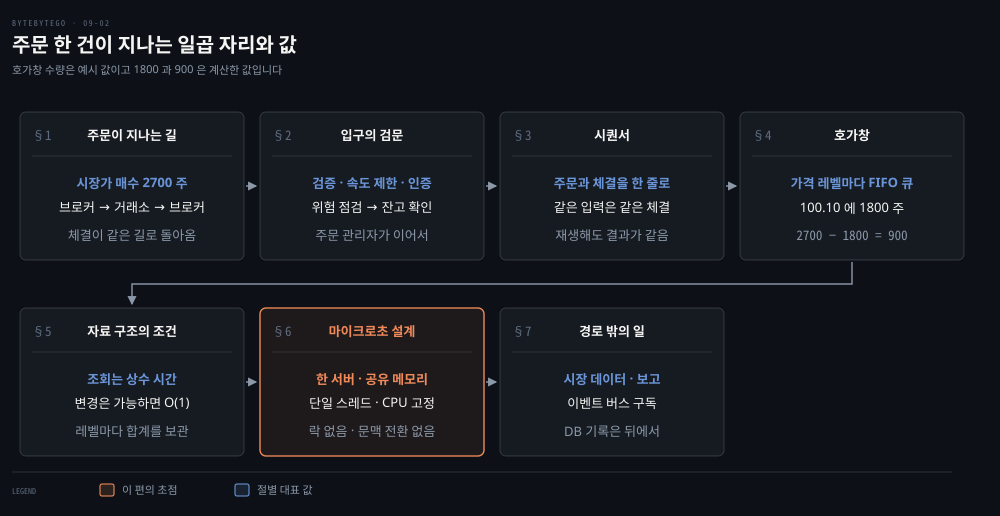
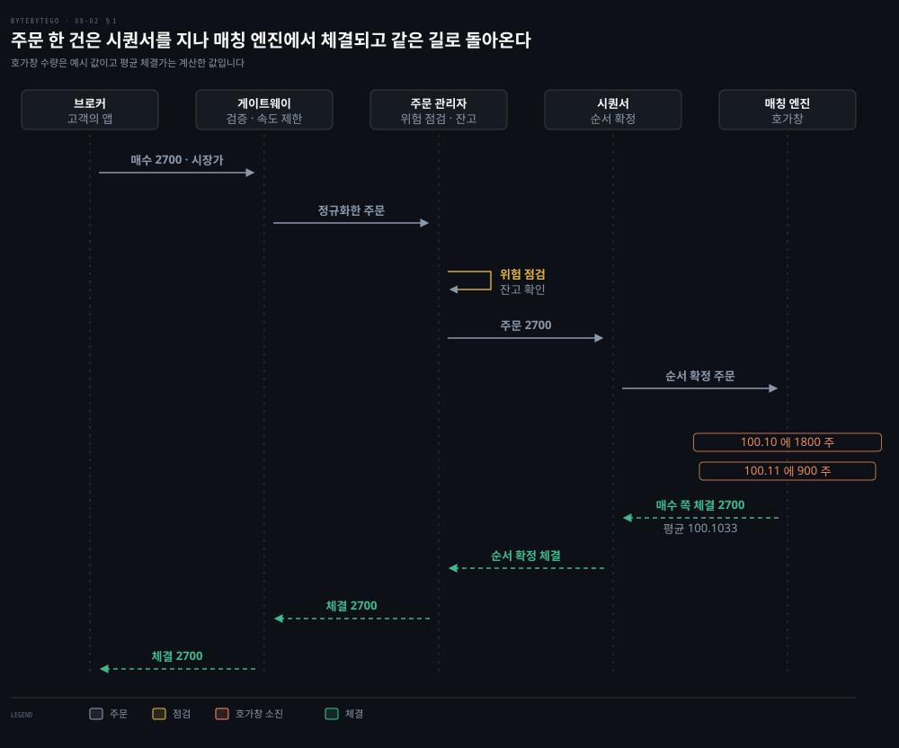
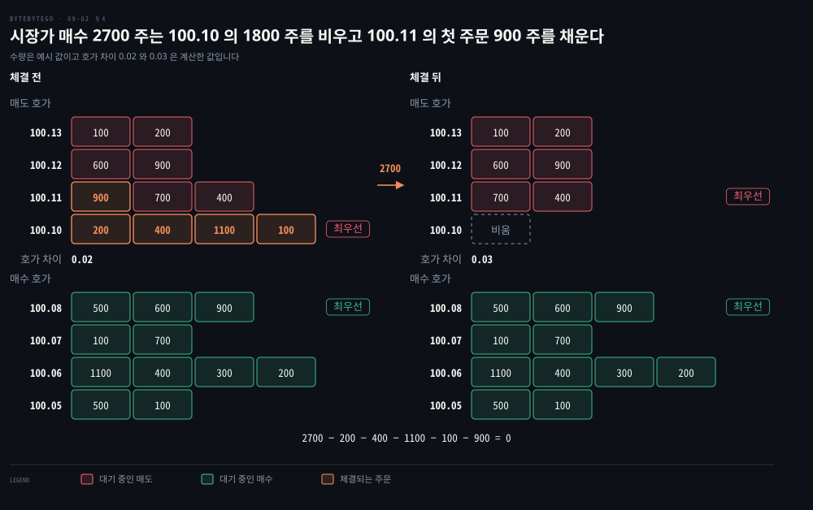
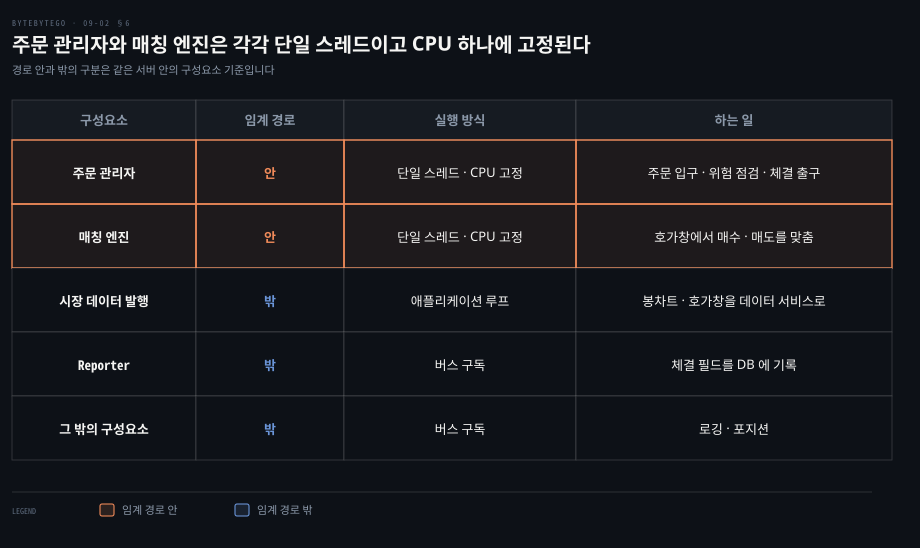

# 증권 거래소는 호가창으로 매수·매도를 맞추고 시퀀서로 순서를 고정하며 임계 경로를 한 서버의 단일 스레드로 줄인다

---

> 거래소는 가격 레벨별 FIFO 큐인 호가창에서 주문을 맞추고 시퀀서로 주문과 체결의 순서를 고정합니다. 임계 경로의 일을 줄이고 핵심 구성요소마다 단일 스레드를 두어 각각 CPU 하나에 고정하는 것이 마이크로초 지연의 바탕입니다.

## 핵심 요약

> 이 편의 중심 생각은 거래소가 일을 빠르게 하기보다 임계 경로에 남는 일을 줄이고 남은 일을 구성요소마다 락 없이 단일 스레드가 순서대로 처리하게 만든다는 것입니다.

주문 한 건은 브로커에서 거래소 게이트웨이를 지나 주문 관리자의 위험 점검과 잔고 확인을 거칩니다. 시퀀서를 통과해 매칭 엔진에서 체결됩니다. 체결은 같은 길로 돌아옵니다. 시장 데이터와 보고는 이 왕복 밖에서 따로 처리합니다.

매칭은 호가창이 맡습니다. 가격 레벨마다 주문이 도착한 순서대로 줄을 서 있습니다. 시장가 매수는 가장 싼 매도 레벨부터 줄의 앞을 소진합니다. 같은 가격에서는 먼저 온 주문이 먼저 체결되므로 도착 순서가 곧 결과를 정합니다. 그래서 시퀀서가 순서를 한 곳에서 확정합니다.

지연은 네 가지 선택으로 줄입니다. 구성요소를 한 서버에 모읍니다. 공유 메모리를 이벤트 버스로 씁니다. 핵심 구성요소마다 단일 스레드를 두고 각각 CPU 하나에 고정합니다.

## 학습 목표

> 이 편을 읽고 나면 다음을 설명할 수 있습니다.

1. 주문 한 건이 브로커에서 매칭 엔진까지 가고 체결이 돌아오는 순서와 구간마다 하는 일을 말할 수 있습니다.
2. 시퀀서가 주문과 체결을 한 줄로 세우는 이유를 FIFO 와 재생으로 설명할 수 있습니다.
3. 시장가 매수가 호가창의 레벨을 소진하고 최우선 매도 호가를 올리는 과정을 수량으로 계산할 수 있습니다.
4. 호가창이 지켜야 할 연산 조건과 주문 취소를 상수 시간에 하는 구성을 설명할 수 있습니다.
5. 임계 경로를 줄이는 네 원칙과 한 서버·공유 메모리·단일 스레드·CPU 고정이 각각 무엇을 없애는지 구분할 수 있습니다.

## 1. 주문 한 건은 브로커에서 거래소 안을 지나 매칭 엔진까지 갔다 돌아온다

> 고객의 앱에서 출발한 주문은 브로커를 거쳐 거래소의 게이트웨이와 주문 관리자와 시퀀서를 지나 매칭 엔진에 닿습니다. 체결은 같은 길로 돌아가고 시장 데이터와 보고는 그 길 밖으로 갈라집니다.

앱에서 매수 버튼을 한 번 누르면 거래소 안에서는 어떤 구성요소를 몇 개 지나갈까요? 고객은 거래소에 직접 붙지 않고 브로커의 웹이나 모바일 앱으로 주문합니다. 브로커가 그 주문을 거래소로 보냅니다.[^bbg-design]

예로 시장가 매수 2700 주를 따라갑니다. **시장가 주문**은 가격을 지정하지 않고 지금 시장에 나와 있는 bid·ask 근처에서 곧바로 체결되는 주문입니다. 체결을 가장 확실하게 얻는 대신 처음 본 가격이 아니라 다른 가격에 체결될 수 있습니다.[^finra-orders]

| 구간 | 하는 일 | 주문과 함께 움직이는 값 |
|------|---------|-----------------------|
| 접수 | 앱 → 브로커 → 거래소 게이트웨이 | 시장가 매수 2700 주 |
| 점검 | 게이트웨이의 검증·속도 제한·인증·정규화, 주문 관리자의 위험 점검과 잔고 확인 | 정규화한 주문 |
| 매칭 | 시퀀서가 주문을 줄 세우고 매칭 엔진이 호가창에서 맞춤 | 100.10 에 1800 주, 100.11 에 900 주 |
| 회신 | 체결이 시퀀서와 주문 관리자와 게이트웨이와 브로커를 거쳐 앱으로 | 체결 2700 주 |
| 경로 밖 | 시장 데이터 발행과 보고 | 봉차트·호가창, 체결 필드 |

매칭 엔진은 주문이 호가창의 주문과 짝이 맞을 때마다 체결을 하나만 내지 않고 매수 쪽과 매도 쪽에 하나씩, 둘을 냅니다.[^bbg-design] 이 예의 주문은 매도 주문 다섯 건과 맞습니다. 다이어그램의 체결 2700 은 매수 쪽 체결을 합친 값입니다. 2700 주가 두 가격에 나뉘어 체결되므로 평균 체결가는 계산이 필요합니다. 1800 주가 100.10 에, 900 주가 100.11 에 체결되므로 (1800 × 100.10 + 900 × 100.11) ÷ 2700 = 100.1033… 입니다.

이 구간에서 주목할 점은 체결이 돌아오는 길에도 시퀀서가 있다는 것입니다. 주문만이 아니라 체결도 같은 시퀀서를 지납니다. 그 이유는 §3 에서 다룹니다.

## 2. 게이트웨이는 입구를 지키고 주문 관리자는 위험과 잔고를 확인한 뒤 주문을 내보낸다

> 게이트웨이가 형식과 신원과 빈도를 걸러 내고 주문 관리자가 위험 규칙과 지갑 잔고를 확인합니다. 이 점검을 통과한 주문만 시퀀서와 매칭 엔진으로 갑니다.

매칭 엔진이 입력 검증과 잔고 확인까지 맡으면 어떻게 될까요? 호가창을 맞추는 일이 점검 때문에 느려지고 잘못된 주문이 호가창까지 들어옵니다. 그래서 점검은 앞 구성요소로 나눕니다.

**클라이언트 게이트웨이**는 거래소의 입구입니다. 입력 검증, 속도 제한, 인증, 정규화를 하고 주문을 주문 관리자로 보냅니다.[^bbg-design] 속도 제한의 알고리즘은 [처리율 제한기](../system-design/04-01.처리율%20제한기는%20토큰%20버킷·누출%20버킷·고정%20윈도·이동%20윈도%20로그·이동%20윈도%20카운터로%20요청을%20센다.md) 노트에서 다뤘습니다.

**주문 관리자**는 두 가지를 이어서 확인합니다. 먼저 위험 관리자가 정한 규칙으로 위험 점검을 합니다. 통과하면 지갑에 주문을 받쳐 줄 잔고가 있는지 확인합니다.[^bbg-design] 그다음에야 주문이 매칭 엔진 쪽으로 나갑니다.

주문 관리자는 임계 경로의 양 끝에 서 있습니다. 주문이 들어오는 곳이 출발점이고 체결이 나가는 곳이 도착점입니다. 그 사이에 필수 위험 점검과 매칭이 있습니다.[^bbg-low] 위험 점검이 경로에 남는 이유는 필수이기 때문입니다. 경로 밖으로 뺄 수 있는 일은 §7 에서 정리합니다.

## 3. 시퀀서는 주문과 체결을 한 줄로 세워 같은 입력이 같은 체결을 낳게 한다

> 주문과 체결은 모두 시퀀서에서 먼저 순서가 정해진 뒤 다음 구성요소로 갑니다. 같은 가격에서는 먼저 온 주문이 먼저 체결되므로 순서를 한 곳에서 고정해야 재생해도 같은 결과가 나옵니다.

매칭 엔진을 같은 입력으로 두 번 돌리면 항상 같은 체결이 나와야 한다고 합시다. 그 조건을 지키려면 입력의 무엇을 고정해야 할까요? 주문의 내용만이 아니라 도착한 순서입니다.

호가창의 한 가격 레벨은 FIFO 입니다. 100.10 에 매도 주문 A 와 B 가 이 차례로 도착한 뒤 시장가 매수가 들어오면 A 가 먼저 체결됩니다. 두 주문이 다른 경로로 들어와 실행마다 B 가 먼저 도착한다면 같은 입력인데도 체결되는 주문이 바뀝니다. 거래소 설계에서는 주문과 체결을 모두 시퀀서에 먼저 통과시켜 재생해도 매칭 결과가 결정적이게 합니다.[^bbg-design]

시퀀서는 주문 관리자와 매칭 엔진 사이에 놓입니다. 시퀀서가 순서를 어떤 필드에 어떻게 적는지는 구현마다 다르므로 여기서는 입력을 하나의 순서 열로 만든다는 역할까지만 다룹니다. 분산 환경에서 ID 로 순서를 주는 방식은 [전역 유일 ID 노트](./01-02.파티셔닝과%20읽기%20복제본은%20데이터베이스를%20넓히고%20전역%20유일%20ID%20는%20나뉜%20데이터에%20순서를%20준다.md)에서 다뤘습니다.

순서가 고정된 입력 열은 재생의 근거가 됩니다. LMAX 라는 거래 플랫폼은 입력 이벤트를 내구성 있는 저장소에 남기고 비즈니스 로직의 상태를 그 이벤트의 재생으로 되살립니다.[^lmax] 같은 이벤트를 같은 순서로 다시 처리해 상태를 되살리는 원리는 [이벤트 소싱·CQRS](../../../05_data/book/designing-data-intensive-applications/03-06.이벤트%20소싱·CQRS·DataFrame.md) 노트의 두 번째 절에서 다뤘습니다.

## 4. 호가창은 가격 레벨마다 FIFO 큐를 두고 시장가 주문은 가장 싼 매도부터 소진한다

> 호가창은 매수 쪽과 매도 쪽으로 나뉘고 각 쪽이 가격 레벨을 갖고 각 레벨이 주문의 FIFO 큐를 가집니다. 시장가 매수는 가장 낮은 매도 레벨의 큐 앞에서부터 소진하며 위 레벨로 올라갑니다.

사려는 사람과 팔려는 사람의 주문을 가격과 도착 순서로 맞추려면 주문을 어떻게 놓아야 할까요? **호가창**은 가격 레벨별로 정리한 매수·매도 주문의 전자 목록입니다. 한 레벨 안에서는 먼저 들어온 주문이 앞에 섭니다.

아래 호가창에서 매도 쪽의 가장 낮은 가격 100.10 이 **최우선 매도 호가**입니다. 매수 쪽의 가장 높은 가격 100.08 이 **최우선 매수 호가**입니다. 칸은 레벨의 주문이고 왼쪽이 큐의 앞입니다.

| 쪽 | 가격 | 큐 안의 수량(앞에서부터) | 레벨 합계(계산) |
|----|------|--------------------------|-----------------|
| 매도 | 100.13 | 100, 200 | 300 |
| 매도 | 100.12 | 600, 900 | 1500 |
| 매도 | 100.11 | 900, 700, 400 | 2000 |
| 매도 | 100.10 | 200, 400, 1100, 100 | 1800 |
| 매수 | 100.08 | 500, 600, 900 | 2000 |
| 매수 | 100.07 | 100, 700 | 800 |
| 매수 | 100.06 | 1100, 400, 300, 200 | 2000 |
| 매수 | 100.05 | 500, 100 | 600 |

여기에 시장가 매수 2700 주가 들어옵니다. 시장가 매수는 매도 쪽만 소진하므로 매수 쪽 수량은 변하지 않습니다.

1. 가장 낮은 매도 레벨 100.10 의 네 주문 200, 400, 1100, 100 을 앞에서부터 모두 소진합니다. 합은 1800 이고 남은 수량은 2700 − 1800 = 900 입니다.
2. 100.10 레벨이 비었으므로 다음 레벨 100.11 로 넘어갑니다. 이 레벨의 맨 앞 주문이 900 이어서 남은 수량과 정확히 같습니다. 그 주문 하나가 전량 체결되며 주문이 끝납니다.
3. 식으로 쓰면 2700 − 200 − 400 − 1100 − 100 − 900 = 0 입니다.

체결 뒤에는 100.10 레벨이 비고 100.11 레벨에 700 과 400 이 남습니다. 최우선 매도 호가가 100.10 에서 100.11 로 올라가고 최우선 매수 호가 100.08 과의 호가 차이는 0.02 에서 0.03 으로 벌어집니다. 매수세가 이어져 낮은 매도 레벨이 계속 소진되면 최우선 매도 호가가 계속 올라갑니다. 이 모양이 가격이 오르는 시장입니다.

## 5. 호가창 자료 구조는 조회를 상수 시간에, 추가·취소·체결을 가능하면 O(1) 에 하게 짠다

> 호가창에서 가장 자주 일어나는 연산은 레벨 조회와 주문의 추가·취소·체결입니다. 이 연산들이 주문 수에 비례해 느려지지 않게 큐와 해시를 겹쳐 쓰고 레벨마다 합계를 들고 있는 구성을 따져 봅니다.

호가창을 자료 구조로 만든다면 어떤 연산을 몇 단계에 끝내야 할까요? 요구는 두 줄입니다.

- 조회는 상수 시간이어야 합니다. 한 가격 레벨의 수량, 두 가격 사이의 수량, 최우선 매수·매도 호가를 읽는 연산이 여기에 듭니다.
- 새 주문, 주문 취소, 주문 체결 같은 변경은 가능하면 O(1) 이어야 합니다.

아래 표는 이 요구에서 도출한 구성 한 가지이며 특정 거래소의 구현이 아닙니다.

| 연산 | 필요한 것 | 맞는 구성 | 비용 |
|------|-----------|-----------|------|
| 레벨 안에서 추가·체결 | 뒤에 붙이고 앞에서 뺌 | 레벨마다 연결 리스트 큐 | O(1) |
| 주문 취소 | 큐 중간의 주문을 지움 | 이중 연결 리스트와 주문 ID → 노드 해시 | O(1) |
| 한 레벨의 수량 | 큐를 세지 않고 읽음 | 주문이 들고 날 때 레벨 합계를 갱신 | O(1) |
| 가격 → 레벨 | 가격으로 바로 찾음 | 해시 맵 | O(1) |

취소가 이 표의 핵심입니다. 큐를 배열이나 단일 연결 리스트로 만들면 중간 주문을 지우려고 큐를 훑어야 하므로 큐 길이에 비례해 느려집니다. 주문 ID 로 노드를 바로 찾고 이중 연결 리스트에서 이웃과 연결을 끊으면 상수 시간에 끝납니다. 최우선 호가와 두 가격 사이의 수량은 이 구성 위에 더 얹어야 하는 연산이며 그 방법은 여기서 다루지 않습니다.

## 6. 마이크로초 지연은 임계 경로의 일을 줄이고 한 서버의 단일 스레드와 공유 메모리로 만든다

> 거래소는 일반 웹 서비스가 허용하는 수백 밀리초 대신 마이크로초 단위를 목표로 합니다. 임계 경로의 일을 덜어 내고 남은 일을 한 서버 안에서 구성요소마다 단일 스레드가 락과 문맥 전환 없이 순서대로 처리하게 해 그 목표에 다가갑니다.

일반 웹 서비스는 수백 밀리초의 지연을 견디지만 거래소는 마이크로초 단위를 요구합니다. 밀리초와 마이크로초는 단위만으로 천 배 차이입니다. 이 값은 설계의 목표이고 특정 거래소의 측정값이 아닙니다. 어디서 지연을 줄여야 할까요?

원칙은 하나입니다. 임계 경로에서 덜 합니다. 줄일 대상은 넷입니다.[^bbg-low]

- 임계 경로의 일 수
- 일마다 걸리는 시간
- 네트워크 홉
- 디스크 사용

거래소의 임계 경로는 주문이 주문 관리자에 들어오는 곳에서 시작해 필수 위험 점검과 매칭을 거쳐 체결이 주문 관리자를 나가는 곳에서 끝납니다.[^bbg-low] 나머지는 이 경로에서 빼냅니다. 지연 요구가 엄격한 거래 흐름은 브로커와 게이트웨이까지 이어집니다.[^bbg-design] 그 가운데 한 서버 안에서 줄이는 구간이 주문 관리자의 입구에서 출구까지입니다.[^bbg-low]

이 원칙을 구현하는 선택은 넷입니다.[^bbg-low]

- **한 서버**: 구성요소를 컨테이너 없이 한 대의 큰 서버에 모읍니다. 구성요소 사이의 호출이 네트워크 홉이 아니라 같은 서버 안의 메모리 접근이 됩니다.
- **공유 메모리 이벤트 버스**: 구성요소가 공유 메모리로 이벤트를 주고받고 디스크를 쓰지 않습니다. 리눅스에서는 `mmap` 의 `MAP_SHARED` 매핑이 같은 영역을 여러 프로세스가 함께 보게 하고 한 쪽의 갱신이 다른 쪽에 보입니다.[^man-mmap]
- **단일 스레드**: 주문 관리자와 매칭 엔진 같은 핵심 구성요소는 애플리케이션 루프 하나가 작업을 하나씩 차례로 처리합니다. 상태를 고치는 스레드가 하나라서 락이 필요 없습니다.
- **CPU 고정**: 이 스레드들을 각각 CPU 하나에 붙이고 다른 스레드는 그 CPU 에서 빼 두면 CPU 를 나눠 쓰지 않으므로 문맥 전환이 없습니다.[^bbg-low][^man-affinity] 전용 CPU 를 주면 그 스레드가 최대 속도로 돌 수 있고 다른 CPU 로 옮겨 갈 때 생기는 캐시 무효화 비용도 피합니다.[^man-affinity]

한 스레드가 정말 충분히 빠를까요? LMAX 는 모든 거래의 비즈니스 로직을 한 스레드에서 돌리고 초당 600만 주문을 처리했다고 밝혔습니다. 이 수치는 3GHz 듀얼 소켓 쿼드코어 Nehalem 서버의 벤치마크이고 해당 글은 2011년에 나왔습니다.[^lmax] 한 스레드를 한 코어에 두어 캐시를 데우고 메모리 접근을 되도록 많이 캐시에서 끝내는 것이 한 스레드 방식의 핵심입니다.[^lmax]

스레드와 프로세스의 차이는 [IaaS·PaaS·SaaS 노트](./06-01.IaaS·PaaS·SaaS%20와%20가상%20머신·컨테이너·서버리스는%20운영%20책임을%20어디까지%20넘기는지로%20갈린다.md)의 첫 절에서, Redis 의 단일 스레드 이벤트 루프는 [캐시 전략](./02-01.캐시%20전략은%20읽기·쓰기%20경로에서%20캐시%20자리를%20정하고%20Redis%20는%20메모리와%20단일%20스레드%20이벤트%20루프로%20빠르다.md) 노트에서 다뤘습니다. 문맥 전환과 모드 전환의 비용은 [운영체제 노트](../../../02_os/book/systems-performance/03-01.운영체제%20—%20커널·시스템%20콜·인터럽트·프로세스.md)의 3번 절에서, 같은 CPU 에서 돌 때 캐시에 데이터가 남는 효과는 [CPU 노트](../../../02_os/book/systems-performance/06-01.CPU%20—%20용어·모델·핵심%20개념.md)의 2번 절에서 다뤘습니다. CPU affinity 를 거는 법은 [CPU 스케줄러 노트](../../../02_os/book/linux-kernel-programming/11-01.CPU%20스케줄러%20%284%29%20—%20CPU%20affinity와%20정책·우선순위%20설정.md)에서 다뤘습니다.

디스크를 경로에서 뺐다면 장애 때 상태는 어떻게 복구할까요? LMAX 는 입력 이벤트를 저널로 남기고 재생해 복구하며 프로세서를 여럿 돌려 하나만 출력을 내보냅니다. 살아 있는 프로세서가 죽으면 다른 프로세서로 전환합니다.[^lmax] 한 서버에 몰았다는 사실은 단일 장애점의 위험도 함께 가져옵니다.

## 7. 시장 데이터와 보고는 임계 경로 밖에서 이벤트 버스를 듣고 따로 처리한다

> 체결이 나온 뒤에 알려야 할 곳은 매칭 엔진이 기다리지 않도록 이벤트 버스를 듣는 별도 구성요소가 맡습니다. 지연 요구가 다른 흐름이므로 임계 경로 밖으로 갈라집니다.

체결 하나가 나면 호가창이 바뀌었다고 알려야 하고 기록도 남겨야 합니다. 매칭 엔진이 이 일을 모두 하면 마이크로초 목표는 어떻게 될까요? 그래서 두 흐름을 경로 밖으로 뺍니다.[^bbg-design]

**시장 데이터 발행**은 봉차트(candlestick chart)와 호가창을 데이터 서비스로 보냅니다. 데이터 서비스가 이를 통합하고 브로커가 데이터 서비스에서 시장 데이터를 가져갑니다. 체결을 받은 주문 관리자는 별도로 **Reporter** 에 일을 넘깁니다. Reporter 는 client_id, price, quantity, order_type, filled_quantity, remaining_quantity 같은 필드를 구성해 데이터베이스에 저장합니다.

두 흐름은 지연 요구가 거래 흐름과 다릅니다.[^bbg-design] 그래서 같은 서버 안에서도 이 구성요소들은 이벤트 버스를 구독해 이벤트가 오면 반응하며 임계 경로가 그 응답을 기다리지 않습니다.[^bbg-low] 로깅과 포지션 관리도 같은 버스에 붙습니다. 시장 데이터 발행은 자기 애플리케이션 루프를 갖습니다. 위험 점검 단계에서 주문 관리자는 집계 위험 점검 구성요소와도 주고받으며 필수 위험 점검은 §2 에서 본 대로 임계 경로 안에 남습니다. 디스크 쓰기가 필요한 일이 대부분 이쪽에 모여 있어서 경로 위에서 디스크를 뺀다는 §6 의 선택과도 맞물립니다.

## 면접 대비

> 주문의 경로, 시퀀서의 존재 이유, 호가창의 체결 계산, 자료 구조의 조건, 마이크로초 설계를 묻는 질문입니다.

1. 시장가 매수 주문 한 건이 브로커에서 매칭 엔진까지 가고 체결이 돌아오는 경로와 경로 밖으로 빠지는 일을 설명해 보십시오.
2. 거래소가 주문과 체결을 시퀀서에 먼저 통과시키는 이유를 FIFO 와 재생의 관점에서 설명해 보십시오.
3. 매도 100.10 에 200·400·1100·100, 100.11 에 900·700·400 이 쌓여 있을 때 시장가 매수 2700 주가 체결되는 과정과 호가의 변화를 계산해 보십시오.
4. 호가창이 지켜야 할 연산 조건을 말하고 주문 취소를 O(1) 로 만드는 구성을 설명해 보십시오.
5. 마이크로초 지연을 위한 설계 선택 넷과 단일 스레드가 락을 없애는 이유, 한 서버 구성의 위험을 말해 보십시오.

## 정답 (자답 후 펼치기)

> 면접 질문에 대한 키워드 중심의 모범 답안입니다.

### 정답 1 — 게이트웨이 → 주문 관리자 → 시퀀서 → 매칭 엔진, 체결은 같은 길로 회신

브로커가 주문을 거래소 게이트웨이로 보냅니다. 게이트웨이가 검증·속도 제한·인증·정규화를 하고 주문 관리자가 위험 점검과 잔고 확인을 합니다. 시퀀서를 지나 매칭 엔진에서 체결되고 체결은 시퀀서와 주문 관리자와 게이트웨이와 브로커를 거쳐 돌아옵니다. 시장 데이터 발행과 Reporter 의 기록은 이 왕복 밖입니다.

### 정답 2 — 같은 가격에서는 먼저 온 주문이 먼저 체결되므로 도착 순서가 결과를 정함

도착 순서가 실행마다 다르면 같은 입력에서도 다른 주문이 체결됩니다. 시퀀서가 주문과 체결을 한 줄로 세우면 같은 열을 재생해서 같은 체결을 얻습니다. 순서가 고정된 입력 열은 장애 복구의 재생 근거도 됩니다.

### 정답 3 — 100.10 의 1800 주 소진, 남은 900 은 100.11 의 맨 앞 주문, 최우선 매도 호가 100.11

100.10 의 네 주문 200+400+1100+100 = 1800 이 소진되고 2700 − 1800 = 900 이 남습니다. 100.11 의 맨 앞 주문 900 이 전량 체결되어 큐에 700 과 400 이 남습니다. 최우선 매도 호가는 100.10 에서 100.11 로 오릅니다. 평균 체결가는 (1800 × 100.10 + 900 × 100.11) ÷ 2700 = 100.1033 입니다.

### 정답 4 — 조회 상수 시간과 변경 O(1), 취소는 이중 연결 리스트와 주문 ID 해시

조회는 레벨 수량과 두 가격 사이 수량과 최우선 호가가 상수 시간이어야 합니다. 추가·취소·체결은 가능하면 상수 시간이어야 합니다. 주문 ID 로 노드를 찾고 이중 연결 리스트에서 이웃과의 연결을 끊으면 취소가 상수 시간입니다. 레벨마다 합계를 갱신해 두면 레벨 수량도 상수 시간입니다.

### 정답 5 — 한 서버·공유 메모리·단일 스레드·CPU 고정, 쓰는 스레드가 하나라 락이 없음

한 서버가 네트워크 홉을, 공유 메모리가 디스크를, 단일 스레드가 락을, CPU 고정이 문맥 전환과 캐시 무효화를 줄입니다. 한 서버는 단일 장애점이 되므로 LMAX 는 같은 입력을 여러 프로세서가 처리하게 하고 하나만 출력을 내보내 전환에 대비합니다.

## 참고 자료

- ByteByteGo, System Design 그림 해설 모음: 마이크로초 지연을 내는 법, 매수·매도 주문 맞추기, 증권 거래소 설계 글.
- ByteByteGo system-design-101, Design Stock Exchange: https://github.com/ByteByteGoHq/system-design-101/blob/b28380a/data/guides/design-stock-exchange.md
- ByteByteGo system-design-101, Low Latency Stock Exchange: https://github.com/ByteByteGoHq/system-design-101/blob/b28380a/data/guides/low-latency-stock-exchange.md
- Martin Fowler, The LMAX Architecture: https://martinfowler.com/articles/lmax.html
- Linux man-pages, sched_setaffinity(2): https://man7.org/linux/man-pages/man2/sched_setaffinity.2.html
- Linux man-pages, mmap(2): https://man7.org/linux/man-pages/man2/mmap.2.html
- FINRA, Understanding Order Types: https://www.finra.org/investors/investing/investment-products/stocks/order-types

## 관련 문서

- [캐시 전략은 읽기·쓰기 경로에서 캐시 자리를 정하고 Redis 는 메모리와 단일 스레드 이벤트 루프로 빠르다](./02-01.캐시%20전략은%20읽기·쓰기%20경로에서%20캐시%20자리를%20정하고%20Redis%20는%20메모리와%20단일%20스레드%20이벤트%20루프로%20빠르다.md)
- [IaaS·PaaS·SaaS 와 가상 머신·컨테이너·서버리스는 운영 책임을 어디까지 넘기는지로 갈린다](./06-01.IaaS·PaaS·SaaS%20와%20가상%20머신·컨테이너·서버리스는%20운영%20책임을%20어디까지%20넘기는지로%20갈린다.md)
- [처리율 제한기는 토큰 버킷·누출 버킷·고정 윈도·이동 윈도 로그·이동 윈도 카운터로 요청을 센다](../system-design/04-01.처리율%20제한기는%20토큰%20버킷·누출%20버킷·고정%20윈도·이동%20윈도%20로그·이동%20윈도%20카운터로%20요청을%20센다.md)
- [운영체제 — 커널·시스템 콜·인터럽트·프로세스](../../../02_os/book/systems-performance/03-01.운영체제%20—%20커널·시스템%20콜·인터럽트·프로세스.md)
- [CPU — 용어·모델·핵심 개념](../../../02_os/book/systems-performance/06-01.CPU%20—%20용어·모델·핵심%20개념.md)
- [CPU 스케줄러 (4) — CPU affinity와 정책·우선순위 설정](../../../02_os/book/linux-kernel-programming/11-01.CPU%20스케줄러%20%284%29%20—%20CPU%20affinity와%20정책·우선순위%20설정.md)
- [이벤트 소싱·CQRS·DataFrame](../../../05_data/book/designing-data-intensive-applications/03-06.이벤트%20소싱·CQRS·DataFrame.md)

[^bbg-low]: ByteByteGo system-design-101, Low Latency Stock Exchange, 임계 경로의 정의와 네 원칙, 한 서버·공유 메모리 이벤트 버스·단일 스레드·CPU 고정, 나머지 구성요소의 이벤트 버스 구독 <https://github.com/ByteByteGoHq/system-design-101/blob/b28380a/data/guides/low-latency-stock-exchange.md>
[^bbg-design]: ByteByteGo system-design-101, Design Stock Exchange, 게이트웨이의 일, 위험 점검과 잔고 확인, 주문과 체결의 시퀀싱, 매수·매도 체결 둘, 시장 데이터와 보고는 임계 경로 밖 <https://github.com/ByteByteGoHq/system-design-101/blob/b28380a/data/guides/design-stock-exchange.md>
[^finra-orders]: FINRA, Understanding Order Types, 시장가 주문은 현재 bid 나 ask 근처에서 체결되며 처음 본 가격과 다를 수 있음 <https://www.finra.org/investors/investing/investment-products/stocks/order-types>
[^man-mmap]: Linux man-pages, mmap(2), MAP_SHARED 는 같은 영역을 매핑한 다른 프로세스에 갱신이 보임 <https://man7.org/linux/man-pages/man2/mmap.2.html>
[^man-affinity]: Linux man-pages, sched_setaffinity(2), CPU 하나를 스레드 하나에 전용으로 주면 최대 실행 속도를 보장하고 CPU 를 옮길 때의 캐시 무효화 비용을 피함 <https://man7.org/linux/man-pages/man2/sched_setaffinity.2.html>
[^lmax]: Martin Fowler, The LMAX Architecture, 2011-07-12, 한 스레드의 비즈니스 로직 프로세서·초당 600만 주문 벤치마크 조건·입력 이벤트 저널과 재생·프로세서 여럿 중 하나만 출력 <https://martinfowler.com/articles/lmax.html>
