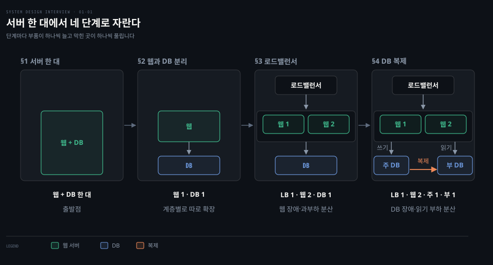
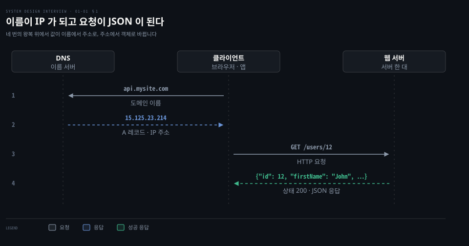
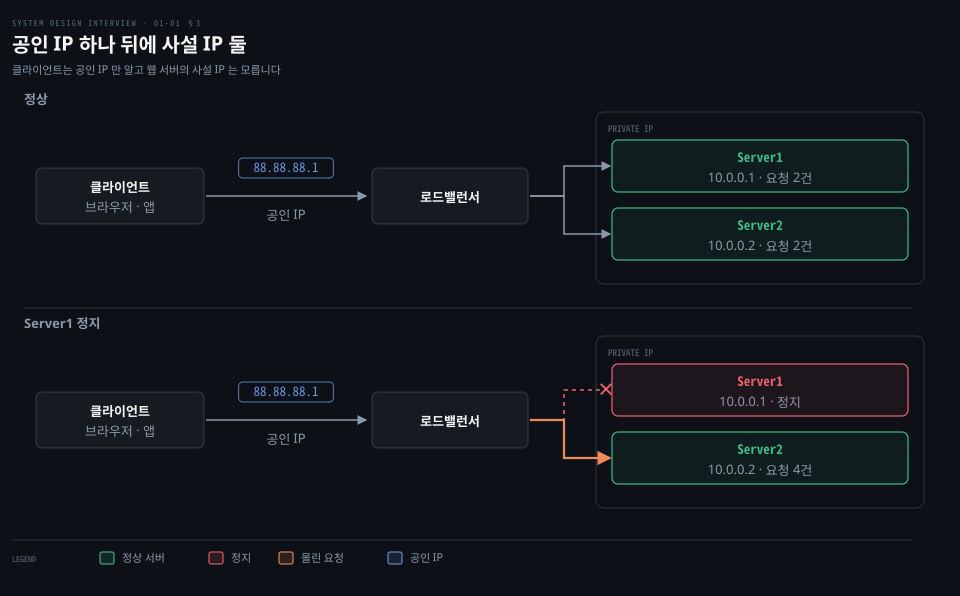
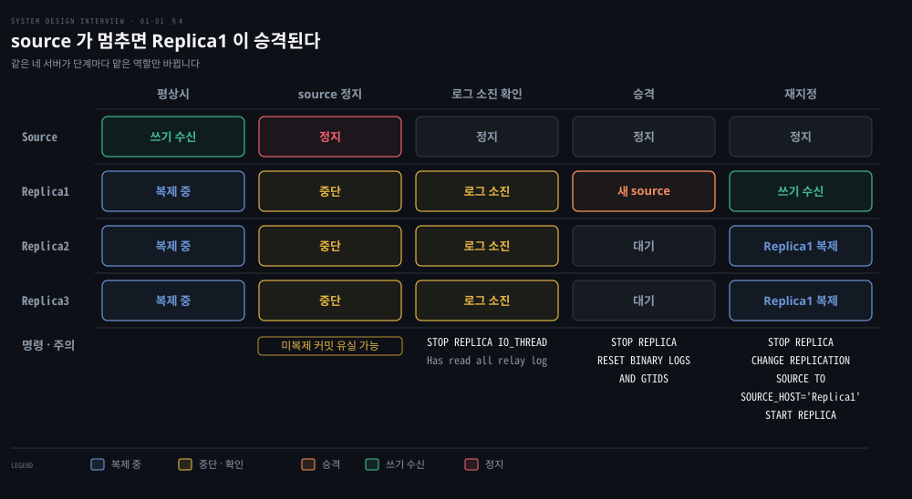

# 단일 서버에서 출발한 시스템은 DB 분리·로드밸런서·DB 복제로 첫 병목을 넘는다

---

> 서버 한 대에서 시작한 시스템은 웹과 DB 를 나누고 웹 앞에 로드밸런서를 둔 뒤 DB 를 주(source·primary)와 부(replica·standby)로 복제하며 단일 장애점을 하나씩 걷어 냅니다.


## 핵심 요약

> 이 편의 중심 생각은 서버 한 대에서 출발한 시스템이 부품을 나누고 복제하며 장애 한 번에 전부 멈추는 구조를 벗어난다는 것입니다.

요청 하나는 DNS 가 이름을 주소로 바꾸고 HTTP 가 그 주소의 서버에서 응답을 받아 오는 순서로 지납니다. 서버 한 대에 웹과 DB 가 함께 있으면 그 한 대가 멈추는 순간 서비스 전체가 멈춥니다.

해법은 세 가지 분리입니다. 웹 계층과 데이터 계층을 서버로 나눕니다. 웹 서버 앞에는 공인 IP 하나를 가진 로드밸런서(LB)를 세워 웹 서버를 사설 IP 뒤에 둡니다. DB 는 쓰기를 받는 주 서버와 읽기를 나눠 받는 부 서버로 복제합니다. 주 서버는 MySQL 의 source 이자 PostgreSQL 의 primary 이고 부 서버는 replica 이자 standby 입니다.[^mysql-repl][^pg-ha]

복제는 기본이 비동기여서 주 서버가 멈추는 순간 부 서버가 최신이라는 보장이 없습니다. 승격이 유실 없이 끝나지 않는다는 점이 이 편의 가장 중요한 단서입니다.




## 학습 목표

> 이 편을 읽고 나면 다음을 설명할 수 있습니다.

1. 도메인 이름이 IP 주소로 바뀌고 HTTP 요청이 JSON 응답을 받기까지의 네 단계를 값과 함께 설명할 수 있습니다.
2. 웹 계층과 데이터 계층을 따로 두는 이유와 관계형·비관계형 DB 를 고르는 기준을 말할 수 있습니다.
3. 수직 확장의 두 한계와 로드밸런서가 공인 IP 하나와 사설 IP 로 가용성을 올리는 방식을 설명할 수 있습니다.
4. 주-부 복제가 읽기를 나누는 방식과 부 서버 장애, 주 서버 장애 때 읽기·쓰기가 옮겨 가는 곳을 구분할 수 있습니다.
5. 비동기 복제에서 승격이 왜 유실 없이 끝나지 않는지, 안전하게 승격하려면 어떤 절차가 필요한지 설명할 수 있습니다.


## 1. 단일 서버에서 요청은 DNS 로 주소를 얻고 HTTP 로 응답을 받는다

> 서버 한 대에 웹 앱·DB·캐시가 함께 도는 구성에서도 요청은 이름 질의, IP 주소, HTTP 요청, 응답의 네 단계를 지납니다. 트래픽은 웹 앱과 모바일 앱 두 곳에서 오고 응답 형식이 서로 다릅니다.

사용자는 `api.mysite.com` 이라는 이름을 입력했지만 서버는 IP 주소로만 찾아갈 수 있습니다. 이름은 어디서 주소가 되며 그 뒤로 무엇이 오갈까요?

네 단계는 다음과 같습니다.

1. 사용자가 도메인 이름 `api.mysite.com` 으로 접속합니다. 이름을 주소로 바꾸는 **DNS**(Domain Name System)는 보통 제3자가 운영하는 서비스이고 우리 서버 바깥에 있습니다.
2. DNS 가 IP 주소 `15.125.23.214` 를 돌려줍니다. 호스트 주소는 A 레코드에 담깁니다. 응답은 TTL 이 허락하는 시간 동안 캐시에 남을 수 있습니다.[^rfc1035]
3. 클라이언트가 그 주소의 웹 서버로 HTTP 요청을 직접 보냅니다.
4. 웹 서버가 렌더링할 HTML 페이지나 JSON 응답을 돌려줍니다. 성공하면 상태 코드는 200 입니다.[^rfc9110]



DNS 질의가 실제로 어떻게 풀리는지는 [DNS 가 하는 네 가지 일](../../../02_os/book/cntd_computer-networking-top-down/02-03.메일과%20이름은%20어떻게%20찾아가는가.md)에서, HTTP 메시지의 모양은 [웹의 요청과 응답](../../../02_os/book/cntd_computer-networking-top-down/02-02.웹은%20어떻게%20주고받는가.md)에서 다룹니다.

트래픽은 두 곳에서 옵니다. 웹 애플리케이션은 비즈니스 로직과 저장을 서버 측 언어(Java, Python 등)가 맡고 화면은 클라이언트 측 HTML 과 JavaScript 가 그립니다. 모바일 애플리케이션은 HTTP 로 서버와 통신하며 응답 형식으로 JSON 을 흔히 씁니다. JSON 은 가볍고 텍스트 기반의 데이터 교환 형식입니다.[^rfc8259]

`GET /users/12` 는 id 가 12 인 사용자 객체를 요청하는 메서드와 경로입니다.

```http
GET /users/12
```

```json
{
  "id": 12,
  "firstName": "John",
  "lastName": "Smith",
  "address": {
    "streetAddress": "21 2nd Street",
    "city": "New York",
    "state": "NY",
    "postalCode": 10021
  },
  "phoneNumbers": [
    "212 555-1234",
    "646 555-4567"
  ]
}
```

이 구성은 단순하지만 웹 트래픽과 데이터 저장이 같은 CPU 와 메모리를 나눠 쓰며 서버가 멈추면 둘이 함께 멈춥니다. 그래서 둘을 나누는 일이 첫 번째 확장입니다.


## 2. 사용자가 늘면 웹과 DB 를 서버로 나누고 데이터의 모양과 요구가 DB 종류를 고른다

> 웹·모바일 트래픽을 받는 웹 계층과 데이터를 담는 데이터 계층을 서버 둘로 나누면 각각 따로 키울 수 있습니다. 관계형 DB 가 기본값이며 지연 시간·데이터 모양·직렬화·규모의 요구가 있을 때 비관계형을 검토합니다.

사용자가 늘어 서버 한 대로 감당하지 못하면 무엇부터 나눠야 할까요? 부하의 성격이 다른 두 계층부터입니다. 웹 계층은 요청을 받아 로직을 돌리며 데이터 계층은 상태를 저장합니다. 서버를 따로 두면 한쪽만 늘리거나 바꿀 수 있습니다.

나눈 뒤에는 데이터 계층에 어떤 DB 를 둘지 고릅니다.

| 구분 | 관계형 | 비관계형(NoSQL) |
|---|---|---|
| 데이터 모양 | 테이블과 행 | 키-값 · 그래프 · 컬럼 · 문서 |
| 여러 데이터 잇기 | SQL 로 테이블을 조인 | 대체로 조인 미지원 |
| 대표 제품 | MySQL · Oracle Database · PostgreSQL | CouchDB · Neo4j · Cassandra · HBase · Amazon DynamoDB |

조인 미지원은 일반 경향입니다. 예를 들어 MongoDB 의 `$lookup` 단계는 같은 데이터베이스의 다른 컬렉션과 left outer join 을 합니다.[^mongo-lookup]

대부분의 개발자에게는 관계형이 기본값입니다. 오래 쓰여 오면서 검증된 도구와 지식이 쌓여 있기 때문입니다. 그 가정이 맞지 않을 때 비관계형을 검토합니다.

- 지연 시간이 극도로 짧아야 합니다.
- 데이터가 구조화되지 않았거나 관계형 데이터가 아닙니다.
- 데이터를 직렬화·역직렬화(JSON, XML, YAML 등)만 하면 됩니다.
- 저장할 데이터의 양이 방대합니다.

제품마다 일관성과 확장의 트레이드오프가 달라 구체적인 선택은 [NoSQL 비교](../../../05_data/01_foundation/01-06.NoSQL%20비교.md)에서, 데이터 모양이 DB 종류를 고르는 과정은 [데이터 모양과 DB 종류](../bytebytego-system-design/01-01.격리%20수준과%20낙관적%20잠금이%20동시%20쓰기의%20이상%20현상을%20막고%20데이터%20모양이%20데이터베이스%20종류를%20고른다.md)에서 이어 봅니다.


## 3. 수직 확장은 한계가 있어 수평으로 늘리고 로드밸런서가 공인 IP 하나로 서버 여럿을 받는다

> 서버 하나를 키우는 수직 확장은 상한이 있고 장애를 막지 못합니다. 서버를 늘리는 수평 확장은 로드밸런서가 공인 IP 하나로 요청을 받아 사설 IP 의 웹 서버들에 나눕니다.

웹 서버가 사용자에게 직접 열려 있으면 서버가 꺼지는 순간 사이트에 닿을 수 없습니다. 같은 시각에 사용자가 몰려 서버의 처리 한계에 닿으면 응답이 느려지거나 연결이 실패합니다. 그렇다면 서버를 더 큰 것으로 바꾸면 되지 않을까요?

**수직 확장**(scale up)은 서버에 CPU 와 RAM 을 더하는 방법입니다. 트래픽이 적을 때는 단순하다는 장점이 큽니다. 한계는 둘입니다.

- 서버 하나에 CPU 와 메모리를 무한히 더할 수 없습니다.
- 장애 전환과 중복이 없어서 서버가 멈추면 웹사이트나 앱이 통째로 멈춥니다.

**수평 확장**(scale out)은 서버를 더 늘려 자원 풀을 키우는 방법이며 대규모 서비스에 적합합니다. 서버가 여럿이면 요청을 나눠 줄 앞단이 필요한데 그 역할이 로드밸런서입니다. 로드밸런서는 부하 분산 집합에 든 웹 서버들에 들어오는 트래픽을 고르게 나눕니다.

사용자는 로드밸런서의 공인 IP 로 접속하므로 웹 서버는 클라이언트가 직접 닿을 수 없는 곳이 됩니다. 서버 사이 통신은 사설 IP 를 씁니다. 사설 IP 는 같은 네트워크 안의 서버끼리만 닿는 주소이고 인터넷에서는 닿지 않습니다.

RFC 1918 은 `10.0.0.0/8`, `172.16.0.0/12`, `192.168.0.0/16` 세 대역을 사설 주소로 예약합니다.[^rfc1918] 사설 주소와 NAT 는 [하나의 주소를 여럿이 나눠 씁니다](../../../02_os/book/cntd_computer-networking-top-down/04-03.IP%20—%20데이터그램과%20주소.md)에서 다룹니다.

사용자가 접속할 주소를 물으면 DNS 는 웹 서버가 아니라 로드밸런서의 공인 IP 를 돌려줍니다. 예시에서는 `mywebsite.com` 이 `88.88.88.1` 로 풀리고 웹 서버는 `10.0.0.1` 과 `10.0.0.2` 를 씁니다.



로드밸런서와 서버 하나를 더하면 웹 계층의 장애 전환 문제가 풀리고 가용성이 올라갑니다. 동작은 두 가지입니다.

- Server1 이 멈추면 트래픽은 모두 Server2 로 갑니다. 예를 들어 요청 4건이 들어오면 정상일 때는 2건씩 나뉘고 Server1 이 멈추면 4건 모두 Server2 가 받습니다. 새 건강한 서버를 풀에 더해 부하를 다시 나눌 수 있습니다.
- 트래픽이 가파르게 늘어 서버 둘로 모자라면 풀에 서버를 더하기만 하면 됩니다. 로드밸런서가 새 서버로도 요청을 보내기 시작합니다.

로드밸런서 한 대가 모든 요청의 입구가 되면 입구가 새 단일 장애점이 됩니다. 이중화는 [primer 의 진입 경로](../sdp_system-design-primer/README.md) 절에서 다룹니다. 웹 서버가 여럿이면 서버마다 다른 요청을 받아도 로그인 상태 같은 정보가 유지되어야 하는데, 그 방법은 [무상태 웹 계층](./01-02.캐시·CDN·무상태%20웹%20계층·데이터%20센터·메시지%20큐·샤딩이%20수백만%20사용자까지%20규모를%20늘린다.md)에서 다룹니다.


## 4. DB 복제는 쓰기를 주 서버에 모으고 읽기를 부 서버로 나누며 장애 때는 승격과 유실을 따져야 한다

> 데이터를 바꾸는 명령은 주 서버로, 읽기는 부 서버로 보내면 읽기 처리량과 가용성이 늘어납니다. 주 서버가 멈추면 부 서버를 승격하지만 복제가 비동기라 커밋된 일부를 잃을 수 있어 승격 절차가 따로 필요합니다.

웹 계층은 서버 하나가 멈춰도 버티는데 데이터 계층에는 DB 가 한 대뿐입니다. 그 DB 가 멈추면 무엇이 남을까요?

복제(replication)는 한 DB 서버의 데이터를 다른 서버에 사본으로 두는 기능입니다. 원본을 가진 서버를 MySQL 은 source[^mysql-repl], PostgreSQL 은 primary 라 부르고[^pg-ha], 사본을 가진 서버를 각각 replica 와 standby 라 부릅니다. 여기서는 두 이름을 묶어 **주 서버**와 **부 서버**로 씁니다.

데이터를 바꾸는 insert·update·delete 는 주 서버로 보냅니다. 부 서버는 주 서버의 사본을 받아 읽기를 처리합니다. PostgreSQL 의 hot standby 는 연결을 받더라도 읽기 전용입니다.[^pg-hot] 많은 애플리케이션이 쓰기보다 읽기가 훨씬 많아서 부 서버가 주 서버보다 많은 것이 보통입니다.

- 성능: 쓰기는 주 서버에, 읽기는 부 서버 여럿에 나뉘어 더 많은 질의를 병렬로 처리합니다.
- 신뢰성: 재해로 서버 하나가 부서져도 다른 위치에 복제된 데이터가 남습니다.
- 가용성: DB 서버 하나가 내려가도 다른 서버의 데이터로 서비스를 이어 갑니다.

주 서버 하나와 부 서버 하나를 둔 구성에서 요청은 이렇게 흐릅니다. 사용자는 DNS 에서 로드밸런서의 IP 를 받습니다. 로드밸런서가 요청을 Server1 이나 Server2 로 보내면 웹 서버는 읽기를 부 서버에서 하고 쓰기·수정·삭제를 주 서버로 보냅니다.

DB 가 내려갔을 때의 길은 둘로 갈립니다.

- 부 서버가 하나뿐인데 내려가면 읽기를 잠시 주 서버가 받습니다. 주 서버도 읽기를 받을 수 있다는 뜻입니다. 문제를 찾으면 새 부 서버가 옛 서버를 대신합니다. 부 서버가 여럿이면 읽기는 다른 건강한 부 서버로 갑니다.
- 주 서버가 내려가면 부 서버 하나가 새 주 서버로 승격하며 쓰기와 읽기가 임시로 그 서버에서 처리됩니다. 새 부 서버가 복제를 이어 받습니다.

승격은 복제가 비동기라는 사실을 놓고 따져야 합니다. MySQL 의 복제는 기본이 비동기입니다.[^mysql-repl] PostgreSQL 의 스트리밍 복제도 기본이 비동기여서, 주 서버가 죽으면 커밋된 일부 트랜잭션이 부 서버에 닿지 못해 유실될 수 있고 유실량은 장애 시점의 복제 지연에 비례합니다.[^pg-async] 동기 복제는 모든 서버가 커밋할 때까지 기다려 유실을 막지만 너무 느릴 수 있어 비동기를 씁니다.[^pg-ha] 데이터가 여러 곳에 복제되어 있다는 말은 유실 걱정이 없다는 뜻이 아닙니다.

그래서 승격은 절차입니다. PostgreSQL 은 주 서버의 장애를 감지해 부 서버에 알리는 소프트웨어를 제공하지 않아 외부 도구가 맡습니다. 장애 전환은 `pg_ctl promote` 를 실행하거나 `pg_promote()` 를 호출해 일으킵니다. 옛 주 서버가 되살아나 둘 다 자신이 주라고 믿는 상황은 옛 서버를 확실히 끄는 장치(STONITH)로 막습니다. 승격 뒤에는 서버가 하나만 도는 상태가 되므로 부 서버를 다시 세워야 하며 `pg_rewind` 가 이를 빠르게 합니다.[^pg-failover]

MySQL 은 부 서버가 릴레이 로그를 다 읽은 것을 확인하고 승격합니다. 예시에서 주 서버는 Source, 부 서버는 Replica1, Replica2, Replica3 이고 Replica1 이 새 source 가 됩니다.[^mysql-failover]

1. 각 부 서버에서 `STOP REPLICA IO_THREAD` 를 실행하고 `SHOW PROCESSLIST` 에 `Has read all relay log` 가 보일 때까지 기다립니다.
2. 승격할 Replica1 에서 `STOP REPLICA` 와 `RESET BINARY LOGS AND GTIDS` 를 실행합니다.
3. 나머지 부 서버에서 `STOP REPLICA` 를 실행한 뒤 `CHANGE REPLICATION SOURCE TO SOURCE_HOST='Replica1'` 로 새 source 를 알려 주고 `START REPLICA` 를 실행합니다. 연결에 쓸 사용자·비밀번호·포트도 함께 지정합니다.
4. 클라이언트가 쓰기를 Replica1 로 보내게 바꿉니다.



그림의 가로축은 평상시, source 정지, 로그 소진 확인, 승격, 재지정 다섯 단계입니다. 평상시에는 Source 가 쓰기 수신을 맡고 부 서버는 복제 중입니다. source 가 멈추면 복제가 중단되어 미복제 커밋 유실 가능성이 생깁니다. 승격 단계에서 나머지 부 서버는 대기하고 재지정이 끝나면 Replica1 복제로 돌아갑니다. 이때 Replica1 이 쓰기 수신을 맡습니다.

여러 서버가 쓰기를 받는 다중 리더 복제는 충돌을 풀어야 해서 [다중 리더 복제](../../../05_data/book/designing-data-intensive-applications/06-04.다중%20리더%20복제.md)에서 따로 다룹니다. 복제 지연이 읽기에 남기는 일관성 문제는 [복제 지연 문제와 일관성 보장](../../../05_data/book/designing-data-intensive-applications/06-03.복제%20지연%20문제와%20일관성%20보장.md)에서, 노드 장애 처리는 [노드 장애 처리와 복제 로그](../../../05_data/book/designing-data-intensive-applications/06-02.노드%20장애%20처리와%20복제%20로그.md)에서 이어 봅니다.

이제 두 계층 모두 서버 하나의 장애를 견딥니다. 남은 병목은 같은 읽기를 DB 가 되풀이하는 일과 정적 콘텐츠를 멀리서 받는 일입니다. 그 해법은 [캐시와 CDN](./01-02.캐시·CDN·무상태%20웹%20계층·데이터%20센터·메시지%20큐·샤딩이%20수백만%20사용자까지%20규모를%20늘린다.md)입니다.


## 면접 대비

> 요청 경로, DB 선택, 로드밸런서, 복제와 승격에 관한 면접 질문입니다.

1. 사용자가 도메인 이름을 입력한 뒤 JSON 응답을 받기까지 네 단계를 값과 함께 설명해 보십시오.
2. 웹 계층과 데이터 계층을 따로 두는 이유는 무엇이며 관계형 대신 비관계형을 검토하는 조건은 무엇입니까?
3. 수직 확장의 한계 두 가지와, 로드밸런서가 공인 IP 하나와 사설 IP 로 가용성을 올리는 방식은 무엇입니까?
4. 주-부 복제가 읽기 처리량을 늘리는 방식과 부 서버·주 서버가 내려갔을 때 읽기와 쓰기가 옮겨 가는 곳은 어디입니까?
5. 비동기 복제에서 주 서버가 멈추면 승격이 유실 없이 끝나지 않는 이유와, 안전하게 승격하려면 필요한 절차는 무엇입니까?


## 정답 (자답 후 펼치기)

> 면접 질문에 대한 키워드 중심의 모범 답안입니다.

### 정답 1 — 이름 질의, IP, HTTP 요청, 응답

클라이언트가 `api.mysite.com` 을 DNS 에 묻고 `15.125.23.214` 를 받습니다. 그 주소로 `GET /users/12` 를 보내면 웹 서버가 HTML 이나 JSON 을 돌려주며 성공하면 상태 코드는 200 입니다.

### 정답 2 — 독립 확장, 관계형 기본값

두 계층은 부하의 성격이 달라 서버를 나누면 따로 키울 수 있습니다. 관계형이 기본값이며 초저지연·비구조 데이터·직렬화만 필요·대용량 중 하나에 해당하면 비관계형을 검토합니다.

### 정답 3 — 상한과 단일 장애, 공인·사설 IP

수직 확장은 서버 하나의 CPU·메모리에 상한이 있고 장애 전환이 없습니다. 로드밸런서는 공인 IP 로 요청을 받아 사설 IP 의 웹 서버들에 나눕니다. 한 서버가 멈추면 다른 서버로 보내고 서버를 더하면 자동으로 요청을 보냅니다.

### 정답 4 — 쓰기는 주, 읽기는 부

쓰기는 주 서버에만 가고 읽기는 부 서버 여럿에 나뉩니다. 부 서버가 하나뿐인데 내려가면 읽기를 주 서버가 받습니다. 주 서버가 내려가면 부 서버 하나가 새 주 서버로 승격합니다.

### 정답 5 — 비동기 복제 지연, 릴레이 로그 확인과 재지정

복제는 기본이 비동기여서 장애 순간의 복제 지연만큼 커밋이 유실될 수 있습니다. MySQL 은 릴레이 로그 소진을 확인해 승격하고 나머지를 재지정합니다. PostgreSQL 은 `pg_ctl promote` 로 승격하고 옛 주 서버는 STONITH 로 막으며 `pg_rewind` 로 부 서버를 다시 세웁니다.


## 참고 자료

- Alex Xu, 《System Design Interview – An Insider's Guide》, 2nd edition, 2020, Chapter 1 전반부.
- MySQL 9.7 Reference Manual, Replication: https://dev.mysql.com/doc/refman/9.7/en/replication.html
- PostgreSQL 18 Documentation, High Availability, Load Balancing, and Replication: https://www.postgresql.org/docs/18/high-availability.html


## 관련 문서

- [캐시·CDN·무상태 웹 계층·데이터 센터·메시지 큐·샤딩이 수백만 사용자까지 규모를 늘린다](./01-02.캐시·CDN·무상태%20웹%20계층·데이터%20센터·메시지%20큐·샤딩이%20수백만%20사용자까지%20규모를%20늘린다.md)
- [The System Design Primer 정독 인덱스](../sdp_system-design-primer/README.md)
- [복제 개요와 단일 리더](../../../05_data/book/designing-data-intensive-applications/06-01.복제%20개요와%20단일%20리더.md)
- [파티셔닝과 읽기 복제본은 데이터베이스를 넓히고 전역 유일 ID 는 나뉜 데이터에 순서를 준다](../bytebytego-system-design/01-02.파티셔닝과%20읽기%20복제본은%20데이터베이스를%20넓히고%20전역%20유일%20ID%20는%20나뉜%20데이터에%20순서를%20준다.md)

[^rfc1035]: RFC 1035 §3.2.2 TYPE A: <https://www.rfc-editor.org/rfc/rfc1035#section-3.2.2>, §3.2.1 TTL: <https://www.rfc-editor.org/rfc/rfc1035#section-3.2.1>
[^rfc9110]: RFC 9110 §15.3.1 200 OK: <https://www.rfc-editor.org/rfc/rfc9110#section-15.3.1>
[^rfc8259]: RFC 8259 JSON: <https://www.rfc-editor.org/rfc/rfc8259>
[^rfc1918]: RFC 1918 §3 Private Address Space: <https://www.rfc-editor.org/rfc/rfc1918#section-3>
[^mongo-lookup]: MongoDB 현행 매뉴얼(9.0) `$lookup`: <https://www.mongodb.com/docs/manual/reference/operator/aggregation/lookup/>
[^mysql-repl]: MySQL 9.7 Reference Manual, Replication: <https://dev.mysql.com/doc/refman/9.7/en/replication.html>
[^mysql-failover]: MySQL 9.7 Reference Manual 19.4.8 Switching Sources During Failover: <https://dev.mysql.com/doc/refman/9.7/en/replication-solutions-switch.html>
[^pg-ha]: PostgreSQL 18 Chapter 26 High Availability, Load Balancing, and Replication: <https://www.postgresql.org/docs/18/high-availability.html>
[^pg-hot]: PostgreSQL 18 26.4 Hot Standby: <https://www.postgresql.org/docs/18/hot-standby.html>
[^pg-async]: PostgreSQL 18 26.2.8 Synchronous Replication: <https://www.postgresql.org/docs/18/warm-standby.html#SYNCHRONOUS-REPLICATION>
[^pg-failover]: PostgreSQL 18 26.3 Failover: <https://www.postgresql.org/docs/18/warm-standby-failover.html>
