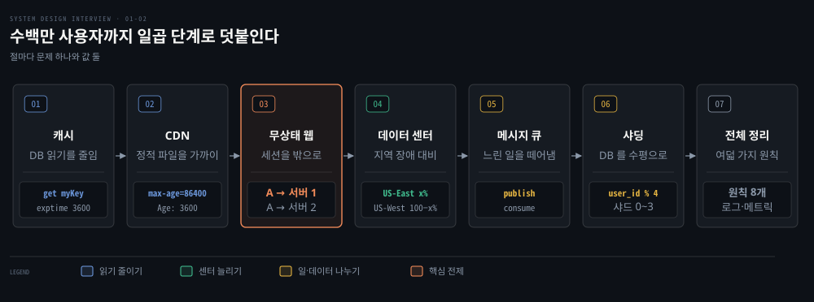
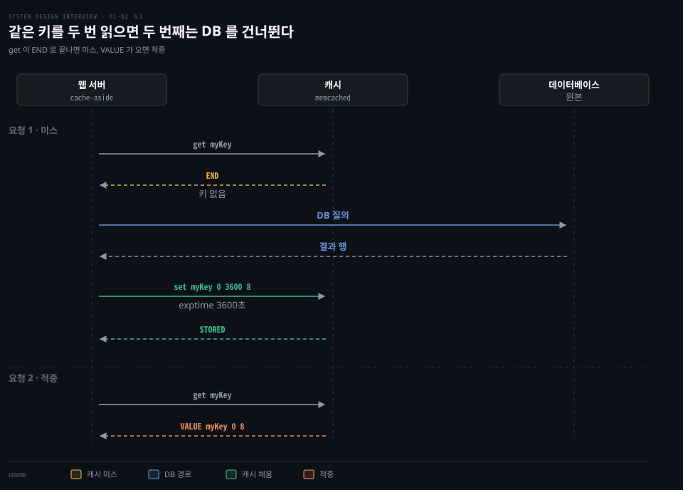
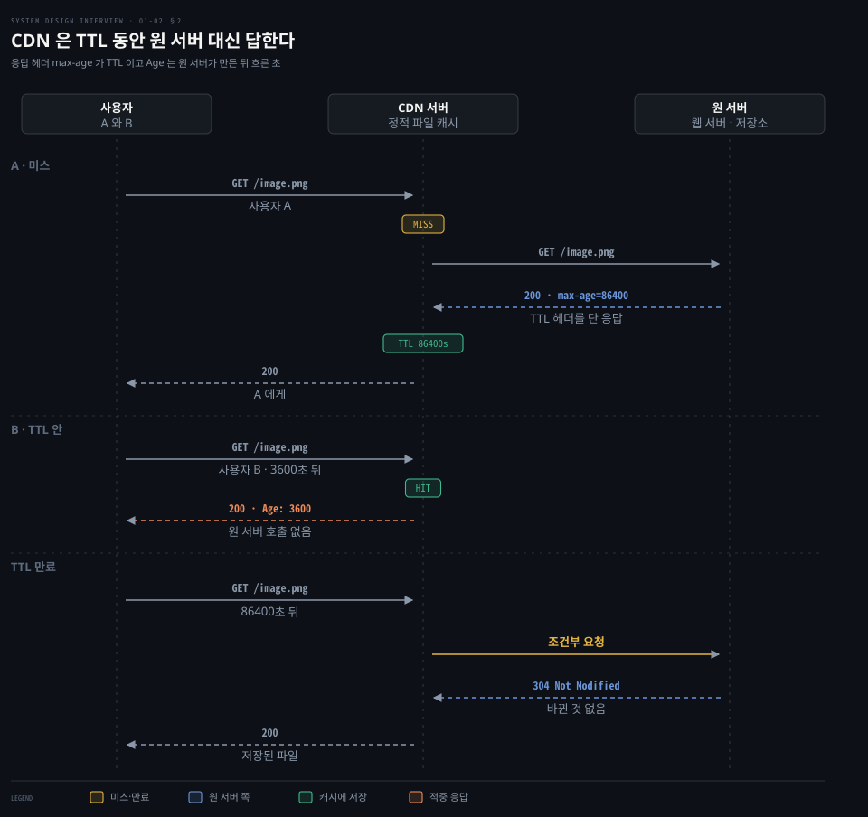
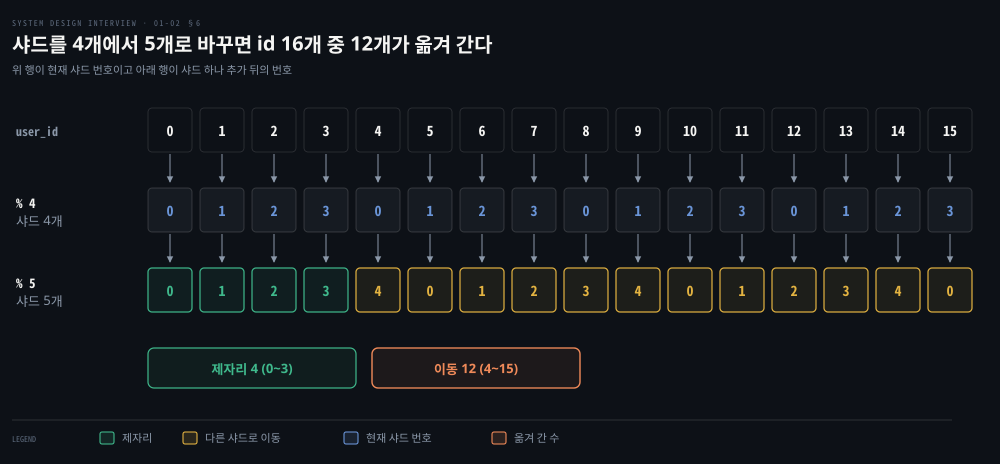
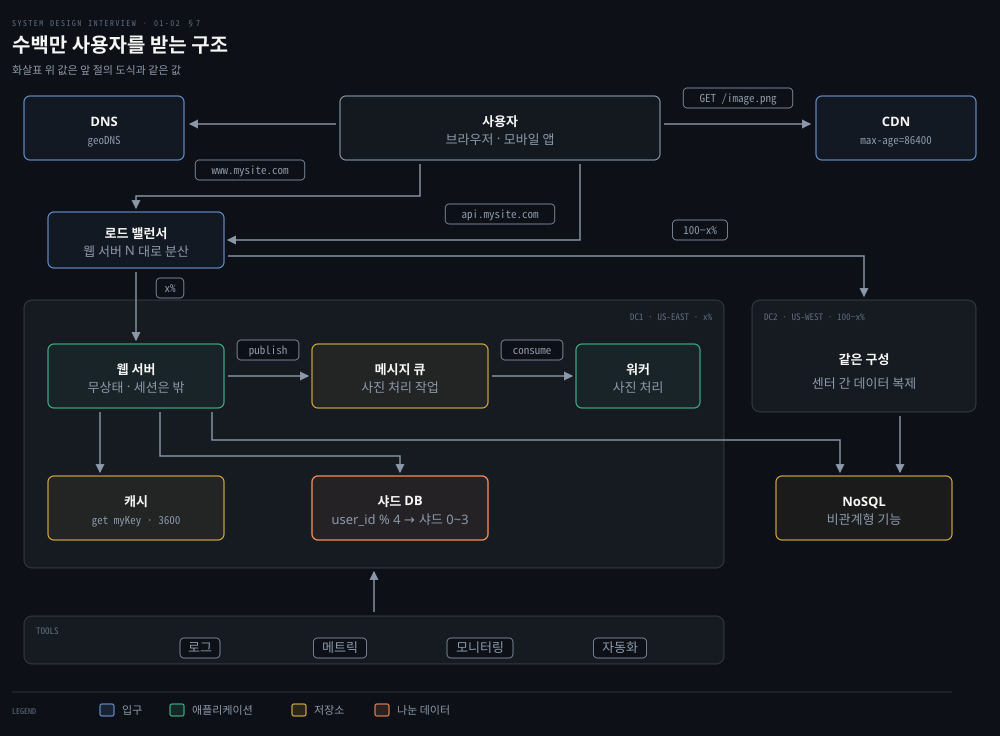

# 캐시·CDN·무상태 웹 계층·데이터 센터·메시지 큐·샤딩이 수백만 사용자까지 규모를 늘린다

---

> 읽기는 캐시와 CDN 이 줄이고 세션을 서버 밖으로 빼면 웹 서버와 데이터 센터가 늘며 느린 일은 큐로 떼고 마지막에 데이터베이스를 샤드로 나눕니다.


## 핵심 요약

> 이 편의 중심 생각은 앞의 다섯 부품이 데이터를 나누지 않고 규모를 늘리는 방법이고 샤딩은 그 뒤에 오는 단계라는 점입니다.

서버 대수만 늘리면 병목이 옮겨 갈 뿐입니다. 캐시는 같은 읽기를 메모리가 대신 답하게 합니다. CDN 은 정적 파일을 사용자와 가까운 서버가 TTL 동안 답하게 합니다. 세션을 웹 서버 밖 공유 저장소로 빼면 서버를 아무 때나 더하고 뺄 수 있습니다. 그 위에서 geoDNS 가 두 데이터 센터로 트래픽을 나눕니다.

사진 처리처럼 오래 걸리는 일은 메시지 큐에 맡겨 생산자와 소비자를 따로 늘립니다. 그 뒤에 오는 샤딩은 `user_id % 4` 같은 함수로 데이터를 나눕니다. 샤드 수가 바뀌면 키 대부분이 옮겨 가고 한 샤드에 접근이 쏠리며 조인이 어려워집니다.




## 학습 목표

> 이 편을 읽고 나면 다음을 설명할 수 있습니다.

1. 캐시 어사이드의 읽기 경로와 쓸 데이터·만료·일관성·단일 장애점·축출 다섯 결정을 설명할 수 있습니다.
2. CDN 이 미스에서 원 서버로 가고 TTL 동안 적중으로 답하는 순서와 무효화 두 방법을 구분할 수 있습니다.
3. 스티키 세션 대신 세션을 공유 저장소에 두는 이유와 geoDNS 두 데이터 센터의 장애 조치를 설명할 수 있습니다.
4. 메시지 큐가 생산자와 소비자를 떼어 놓고 워커 수를 큐 길이로 조절하는 방식을 설명할 수 있습니다.
5. `user_id % 4` 샤딩에서 키가 샤드로 갈리는 값을 계산하고 재샤딩·핫스팟·조인의 대가를 설명할 수 있습니다.


## 1. 반복되는 읽기는 캐시 층이 DB 대신 답한다

> 웹 서버가 캐시를 먼저 보고 없을 때만 DB 를 읽어 캐시를 채웁니다. 쓸 데이터·만료·일관성·단일 장애점·축출을 정해야 캐시가 DB 를 덜어 줍니다.

페이지를 열 때마다 DB 질의가 나가면 같은 값을 계속 다시 읽습니다. 그 부하를 어디서 덜어 낼 수 있을까요? **캐시**는 비싼 응답이나 자주 읽는 데이터를 메모리에 잠시 두는 저장소입니다. 캐시 층을 따로 두면 DB 보다 빠르고 DB 부하도 줄며 캐시만 따로 늘릴 수 있습니다.

웹 서버는 요청을 받으면 캐시를 먼저 봅니다. 값이 있으면 돌려주고 없으면 DB 질의로 결과 행을 읽어 캐시에 넣은 뒤 돌려줍니다. 앞의 경우가 적중이고 뒤의 경우가 미스입니다. 캐시 시스템이 리드 스루(read-through) 동작을 기본으로 주지 않으면 애플리케이션이 직접 읽어 채웁니다. 이 방식이 캐시 어사이드(cache-aside)입니다.[^azure-aside]



Memcached 클라이언트 코드는 이렇게 생겼습니다.

```python
# 키 myKey 에 'hi there' 를 3600초 동안 저장하고 읽습니다.
SECONDS = 1
cache.set('myKey', 'hi there', 3600 * SECONDS)
cache.get('myKey')
```

서버 프로토콜에서는 `set <key> <flags> <exptime> <bytes>` 한 줄과 값 한 줄이 오갑니다. 위 호출은 flags 를 0 으로 두면 `set myKey 0 3600 8` 다음 줄에 `hi there`(8바이트)가 오고 서버는 `STORED` 로 답합니다. 여기서 exptime 3600 은 한 시간입니다. `get` 은 항목 0개 이상 뒤에 `END` 를 보냅니다. 미스는 `END` 만 오고 적중은 앞에 `VALUE myKey 0 8` 이 붙습니다.[^memc]

캐시를 쓸 때 정할 것은 다섯입니다.

- 쓸 데이터: 읽기가 잦고 수정이 드문 데이터입니다. 메모리는 휘발성이라 서버가 재시작하면 값이 사라지므로 중요한 데이터는 영속 저장소에 둡니다.
- 만료: 정책이 없으면 값이 메모리에 영원히 남습니다. 너무 짧으면 DB 를 자주 다시 읽고, 너무 길면 오래된 값을 줍니다. exptime 은 0 이면 만료가 없습니다. 30일 이하의 수는 지금부터 그만큼 뒤에 만료되는 상대 초이고 그보다 크면 만료 시각을 뜻하는 Unix 시각입니다.[^memc]
- 일관성: DB 갱신과 캐시 갱신이 한 트랜잭션이 아니라서 어긋납니다. DB 는 고쳤는데 캐시 갱신이 실패하면 만료 전까지 옛 값이 나갑니다. 지역이 여럿이면 더 어렵습니다.[^fb]
- 장애: 캐시 서버 한 대는 단일 장애점입니다. 여러 데이터 센터에 여러 대를 두고 쓰는 양보다 메모리를 넉넉히 잡아 둡니다.
- 축출: 가득 차면 기존 항목이 밀려납니다. LRU 가 가장 흔하고 LFU·FIFO 도 씁니다. Redis 는 `maxmemory-policy` 로 정책을 고릅니다. 일부 키에 접근이 쏠리면 `allkeys-lru` 를 기본 후보로 권합니다.[^redis] 읽기·쓰기 전략은 [캐시 전략 편](../bytebytego-system-design/02-01.캐시%20전략은%20읽기·쓰기%20경로에서%20캐시%20자리를%20정하고%20Redis%20는%20메모리와%20단일%20스레드%20이벤트%20루프로%20빠르다.md)과 [캐싱 전략](../../../05_data/01_foundation/01-07.캐싱%20전략.md)이 TTL·스탬피드와 함께 다룹니다.


## 2. 정적 파일은 CDN 이 TTL 동안 원 서버 대신 내려 준다

> 사용자와 가까운 CDN 서버가 정적 파일을 TTL 동안 대신 내려 줍니다. 파일을 TTL 전에 바꾸려면 무효화하거나 버전을 이름에 넣습니다.

서버에서 먼 사용자일수록 이미지·CSS·JavaScript 를 받는 시간이 깁니다. 서버가 샌프란시스코에 있으면 로스앤젤레스 사용자가 유럽 사용자보다 빨리 받습니다. 파일을 사용자 가까이에 둘 수 있을까요?

**CDN**(콘텐츠 전송 네트워크)은 지리적으로 흩어진 서버가 정적 파일을 캐시하고 가장 가까운 서버가 응답하는 구조입니다. 아래는 이미지 한 장이 CDN 서버에 없을 때(미스, MISS)부터 TTL 이 지난 뒤까지의 순서입니다.



사용자 A 가 `/image.png` 를 요청했는데 CDN 서버에 없으면 CDN 이 원 서버(웹 서버나 객체 저장소)에 같은 경로를 요청합니다. 원 서버는 응답에 TTL 을 헤더로 답니다. `Cache-Control: max-age=86400` 은 응답이 만들어진 지 86400초가 지나면 낡은 것으로 본다는 뜻입니다. `s-maxage` 와 `Expires` 도 같은 목적으로 씁니다. CloudFront 는 캐시 정책을 쓰지 않을 때 기본 TTL 이 24시간입니다.[^cf-exp]

CDN 은 파일을 저장해 A 에게 돌려줍니다. 한 시간 뒤 B 가 같은 파일을 요청하면 TTL 안이라 적중(HIT)이어서 원 서버를 부르지 않고 응답에 원 서버가 만든 뒤 흐른 시간의 추정치를 초로 적어 `Age: 3600` 으로 답니다.[^rfc9111]

TTL 이 지난 뒤 요청이 오면 CDN 이 원 서버에 조건부 요청으로 확인합니다. 바뀌지 않았으면 304 Not Modified 를, 바뀌었으면 200 OK 와 새 파일을 받습니다.[^cf-exp] 304 를 받으면 CDN 은 저장해 둔 파일을 그대로 사용자에게 돌려줍니다. RFC 9111 은 이 확인을 재검증이라 부릅니다.[^rfc-valid]

TTL 을 짧게 잡아 동적 콘텐츠를 서빙하는 CDN 도 있어 캐시 대상이 정적 파일에만 묶이지는 않습니다.[^cf-exp]

CDN 이 DNS 로 사용자를 가까운 서버에 닿게 하는 방법은 [영상은 어떻게 끊기지 않는가](../../../02_os/book/cntd_computer-networking-top-down/02-04.영상은%20어떻게%20끊기지%20않는가.md)의 §4 에, 브라우저가 URL 을 치고 화면을 그리는 길에서 CDN 이 줄이는 구간은 [URL 을 치면 …](../bytebytego-system-design/03-01.URL%20을%20치면%20DNS·TCP·TLS·HTTP%20를%20거쳐%20브라우저가%20화면을%20그리고%20CDN%20이%20그%20길을%20줄인다.md)에 있습니다.

CDN 을 쓸 때 정할 것은 넷입니다.

- 비용: 제3자가 운영하며 전송량에 요금이 붙으므로 거의 읽히지 않는 파일은 CDN 에서 뺍니다.
- TTL 길이: 너무 길면 오래된 파일이 남고, 너무 짧으면 원 서버로 다시 몰립니다.
- 폴백: CDN 이 잠시 멈추면 클라이언트가 이를 알아채고 원 서버에서 받아야 합니다.
- 무효화: TTL 전에 파일을 빼는 길은 CDN 의 무효화 API 와 버전 이름 둘입니다. CloudFront 는 자주 바꾸는 파일에 버전 이름을 먼저 권합니다. 브라우저나 사내 프록시에 남은 옛 파일까지 피할 수 있기 때문이며,[^cf-inv] 버전은 파일 이름이나 폴더 이름에 넣고(`image_v2.png`) 만료도 그대로 설정하라고 안내합니다.[^cf-ver] `image.png?v=2` 처럼 쿼리 문자열로 버전을 가르려면 쿼리 문자열이 캐시 키에 들어가야 하는데 CloudFront 는 기본 설정에서 넣지 않습니다.[^cf-key]


## 3. 세션을 서버 밖으로 빼야 웹 서버를 아무 때나 늘리고 줄인다

> 세션이 한 서버 메모리에 있으면 그 사용자는 그 서버에 묶입니다. 세션을 공유 저장소로 빼면 요청이 어느 서버로 가도 되고 서버를 자동으로 더하고 뺄 수 있습니다.

서버를 늘리려는데 로그인 세션이 서버 1 의 메모리에 있다면 어떻게 될까요? 사용자 A 의 요청은 늘 서버 1 로 가야 합니다. 서버 2 로 가면 세션이 없어 인증이 실패합니다. B 는 서버 2 에, C 는 서버 3 에 묶입니다. 이렇게 요청 사이의 클라이언트 데이터를 서버가 기억하는 구조가 상태 유지(stateful)입니다.

로드 밸런서가 요청을 나누는 방식은 [01-01 편](./01-01.단일%20서버에서%20출발한%20시스템은%20DB%20분리·로드밸런서·DB%20복제로%20첫%20병목을%20넘는다.md)에서 다뤘습니다. 같은 서버로 보내는 방법이 로드 밸런서의 스티키 세션입니다. AWS Application Load Balancer(ALB)의 스티키 세션은 클라이언트가 쿠키를 지원해야 합니다. 기간 기반과 애플리케이션 기반 두 쿠키를 target group 단위로 켭니다.[^alb] 그러나 서버를 더하고 빼기가 어려워지고 서버 장애도 다루기 까다롭습니다.

**무상태**(stateless) 웹 계층은 세션을 웹 서버 밖 공유 저장소로 뺍니다. 저장소는 관계형 DB, Memcached·Redis, NoSQL 중에서 고릅니다. 이 설계에서는 쉽게 늘어나는 NoSQL 을 택합니다. 모든 서버가 같은 저장소를 읽으므로 A 의 첫 요청이 서버 1 로, 둘째 요청이 서버 2 로 가도 인증됩니다. 서버 1 에 있던 프로필 사진 같은 파일도 같은 이유로 서버 밖에 둡니다.

서버가 상태를 갖지 않으니 트래픽에 따라 서버를 자동으로 더하고 빼는 오토스케일링이 쉬워집니다. EC2 Auto Scaling 은 그룹의 최소·최대·희망 인스턴스 수를 정하고 정책에 따라 띄우고 끕니다.[^asg]


## 4. 데이터 센터 둘은 geoDNS 로 나누고 장애 때 한쪽으로 몬다

> geoDNS 가 사용자를 가까운 데이터 센터로 보내고, 한 센터가 멈추면 모든 트래픽을 정상 센터가 받습니다. 센터 사이의 데이터 동기화와 배포가 풀 과제입니다.

사용자가 세계로 퍼지면 한 곳의 서버로는 먼 사용자가 느리고 그곳이 멈추면 서비스가 통째로 멈춥니다. 센터를 둘로 늘리면 무엇이 달라질까요?

도메인 이름을 IP 로 푸는 DNS 의 동작은 [메일과 이름은 어떻게 찾아가는가](../../../02_os/book/cntd_computer-networking-top-down/02-03.메일과%20이름은%20어떻게%20찾아가는가.md)의 §4 에 있습니다.

정상일 때는 **geoDNS** 가 사용자 위치에 따라 도메인 이름을 서로 다른 IP 로 풀이해 가까운 센터로 보냅니다. 예를 들어 US-East 에 x%, US-West 에 100−x% 가 갑니다. Route 53 의 geolocation routing 은 DNS 질의가 온 위치를 대륙·국가·미국 주 단위로 가려 서로 다른 리소스로 답합니다.[^r53-geo] US-West 가 꺼지면 모든 트래픽(100%)이 US-East 로 갑니다. Route 53 의 failover routing 은 헬스 체크가 정상일 때 주 리소스로, 비정상이면 다른 리소스로 보냅니다.[^r53-fo]

풀어야 할 과제는 셋입니다.

- 트래픽 방향: geoDNS 가 가까운 센터로 보내고 장애 때 정상 센터로 돌립니다.
- 데이터 동기화: 지역마다 다른 DB·캐시를 쓰면 장애 조치 때 데이터가 없는 센터로 갈 수 있어서 센터 사이에 복제합니다. 다중 리더 복제는 [다중 리더 복제](../../../05_data/book/designing-data-intensive-applications/06-04.다중%20리더%20복제.md)에서 다룹니다.
- 테스트와 배포: 여러 위치에서 테스트하고 자동 배포 도구로 모든 센터를 같은 상태로 맞춥니다.


## 5. 메시지 큐는 생산자와 소비자를 떼어 따로 늘린다

> 큐가 생산자와 소비자 사이의 버퍼가 되어 둘이 서로를 기다리지 않습니다. 큐가 길면 워커를 더하고 비어 있으면 줄입니다.

사진을 자르고 선명하게 만드는 일은 오래 걸립니다. 웹 서버가 끝까지 기다리면 응답이 늦습니다. 일이 몰릴 때마다 웹 서버를 같이 늘려야 할까요?

**메시지 큐**는 비동기 통신을 받치는 버퍼입니다. 생산자가 메시지를 큐에 발행(publish)하면 소비자가 큐에서 가져가(consume) 메시지가 정한 일을 합니다. 발행자와 구독자라고도 부릅니다. 둘이 떨어져 있어서 소비자가 멈춘 동안에도 생산자는 발행합니다. 생산자가 멈춰도 소비자는 쌓인 메시지를 읽습니다.

사진 처리에서는 웹 서버가 작업을 발행하고 워커가 가져가 비동기로 처리합니다. 큐가 길어지면 워커를 더하고 대부분 비어 있으면 줄입니다. EC2 Auto Scaling 은 SQS 큐의 적체를 인스턴스당 메시지 수로 계산해 그룹 크기를 조절하는 방법을 안내합니다.[^sqs-as]

큐가 메시지를 보관하는 방식은 제품마다 다르며 [메시지 큐 아키텍처](../../../04_messaging/04_BrokerArchitecture/01-01.메시지%20큐%20아키텍처.md)가 로그 기반 보관을 다룹니다. SQS 표준 큐는 메시지 사본을 여러 서버에 저장합니다. 드물게 같은 메시지를 다시 받을 수 있으니 소비자를 멱등하게 만들라고 안내합니다.[^sqs-dur] 알림에서의 재시도와 중복은 [알림 시스템 편](./10-01.알림%20시스템은%20제3자%20푸시·SMS·이메일%20서비스%20앞에%20메시지%20큐와%20작업%20서버를%20두어%20재시도와%20중복을%20다룬다.md)과 [Exactly-once 의미론과 Consumer Idempotency](../../../04_messaging/05_ConsistencyPattern/03-04.Exactly-once%20의미론과%20Consumer%20Idempotency.md)에서 이어지고, 전달 보장의 세 수준은 [Kafka 편](../bytebytego-system-design/05-01.Kafka%20는%20순차%20IO%20와%20제로%20카피로%20빠르고%20전달%20보장은%20최대%20한%20번·최소%20한%20번·정확히%20한%20번으로%20갈린다.md)에 있습니다.


## 6. 샤딩은 키로 DB 를 나누고 재샤딩·핫스팟·조인으로 값을 치른다

> 샤딩은 같은 스키마의 DB 를 샤드로 나누고 샤딩 키가 데이터를 샤드에 배정합니다. 샤드 수가 바뀌면 키가 옮겨 가고 한 샤드에 접근이 쏠리며 샤드를 건너는 조인이 어렵습니다.

데이터가 매일 늘면 DB 가 먼저 한계에 닿습니다. 서버를 키울까요, 나눌까요? 수직 확장의 정의는 [01-01 편](./01-01.단일%20서버에서%20출발한%20시스템은%20DB%20분리·로드밸런서·DB%20복제로%20첫%20병목을%20넘는다.md)에서 다뤘고 DB 에도 같은 방식으로 CPU·RAM·디스크를 더합니다. 큰 서버가 많은 데이터를 감당하지만 단점이 셋입니다. 하드웨어에 상한이 있습니다. 한 대에 몰려 단일 장애점 위험이 커집니다. 비용도 큽니다. AWS EC2 U7i 는 인스턴스 하나에 최대 32 TiB 메모리를 주지만 한 대라는 점은 그대로입니다.[^u7i]

수평 확장인 **샤딩**은 서버를 더 둡니다. 큰 DB 를 샤드라는 작은 조각으로 나누며 스키마는 같고 데이터는 샤드마다 다릅니다. 사용자 데이터는 `user_id` 로 배정하며 접근할 때마다 해시 함수로 샤드를 찾습니다. 함수가 `user_id % 4` 이면 나머지가 0 일 때 샤드 0 을 쓰고 1 일 때 샤드 1 을 씁니다. `user_id` 0~15 는 샤드 0 에 0·4·8·12, 샤드 1 에 1·5·9·13, 샤드 2 에 2·6·10·14, 샤드 3 에 3·7·11·15 가 갑니다.



**샤딩 키**(파티션 키)는 데이터를 어떻게 나눌지 정하는 하나 이상의 열입니다. 질의를 알맞은 DB 로 보내게 합니다. 고를 때 가장 중요한 기준 가운데 하나는 데이터를 고르게 퍼뜨리는지입니다. 샤딩은 완벽한 해법이 아니며 세 가지 대가가 따릅니다.

- 재샤딩: 샤드 하나가 더 담지 못하거나 분포가 고르지 않아 일부가 먼저 차면 샤딩 함수를 바꾸고 데이터를 옮깁니다. 샤드를 4개에서 5개로 늘려 `% 4` 를 `% 5` 로 바꾸면 0~15 중 `i % 4` 와 `i % 5` 가 같은 값은 0·1·2·3 넷뿐이라 12개가 옮겨 갑니다. 옮길 키를 줄이는 기법이 [안정 해시](./05-01.안정%20해시는%20해시%20링과%20가상%20노드로%20서버가%20늘고%20줄%20때%20옮길%20키를%20줄인다.md)입니다.
- 핫스팟 키(유명인 문제): 특정 샤드로 접근이 쏠려 서버가 과부하됩니다. 유명인 몇 명의 데이터가 한 샤드에 모이면 그 샤드가 읽기에 눌립니다. 유명인마다 샤드를 따로 두고 그 샤드를 다시 쪼갤 수도 있습니다.
- 조인과 비정규화: 샤드를 건너는 조인은 어렵습니다. 흔한 우회는 비정규화해 한 테이블에서 질의가 끝나게 하는 것입니다.

비관계형 기능은 NoSQL 로 옮겨 DB 부하를 줄입니다. 샤딩의 일반 이론은 [샤딩 개요](../../../05_data/book/designing-data-intensive-applications/07-01.샤딩%20개요와%20키%20범위%20샤딩.md)와 [해시 샤딩](../../../05_data/book/designing-data-intensive-applications/07-02.해시%20샤딩과%20일관%20해싱.md)에 있습니다. [파티셔닝과 읽기 복제본 편](../bytebytego-system-design/01-02.파티셔닝과%20읽기%20복제본은%20데이터베이스를%20넓히고%20전역%20유일%20ID%20는%20나뉜%20데이터에%20순서를%20준다.md)도 같은 주제를 다룹니다.


## 7. 수백만 사용자까지의 구조는 여덟 가지 원칙으로 정리된다

> 앞 절의 부품을 한 장에 모으면 여덟 가지 원칙이 남습니다. 로그·메트릭·자동화가 그 전체를 받칩니다.

부품을 하나씩 덧붙이다 보면 전체 모양은 어떻게 될까요? 아래 도식은 앞 절의 값을 그대로 가져와 한 장에 모읍니다. 브라우저는 `www.mysite.com` 으로, 모바일 앱은 `api.mysite.com` 으로 들어옵니다.



1. 웹 계층은 무상태로 둡니다.
2. 모든 계층에 중복을 둡니다.
3. 데이터를 가능한 한 캐시합니다.
4. 여러 데이터 센터를 지원합니다.
5. 정적 파일은 CDN 에 둡니다.
6. 데이터 계층은 샤딩으로 늘립니다.
7. 계층을 개별 서비스로 쪼갭니다.
8. 시스템을 모니터링하고 자동화 도구를 씁니다.

서버 몇 대의 작은 사이트에서는 선택이던 도구가 큰 서비스에서는 필수입니다.

- 로그: 서버별 오류 로그를 보거나 한곳에 모아 검색합니다.
- 메트릭: 호스트의 CPU·메모리·디스크 I/O, DB 계층과 캐시 계층의 성능, 일간 사용자·유지율·매출을 모읍니다. 수집과 질의 구조는 [메트릭 모니터링 편](../bytebytego-system-design/08-03.메트릭%20모니터링은%20시계열%20데이터베이스에%20쓰기를%20몰아%20담고%20수집·질의·경보·시각화로%20나뉜다.md)이 다룹니다.
- 자동화: 코드를 올릴 때마다 검증하는 지속적 통합과 빌드·테스트·배포의 자동화입니다.


## 면접 대비

> 캐시, CDN, 무상태 웹 계층과 데이터 센터, 메시지 큐, 샤딩에 관한 면접 질문입니다.

1. 캐시에서 미스가 났을 때 읽기 경로를 설명하고, 캐시를 쓸 때 정해야 할 것은 무엇입니까?
2. CDN 의 TTL 은 어떻게 정해지고, 만료 전에 파일을 바꾸는 두 방법은 무엇입니까?
3. 스티키 세션 대신 세션을 공유 저장소에 두는 이유와, 두 데이터 센터의 장애 조치에서 풀 과제는 무엇입니까?
4. 메시지 큐는 생산자와 소비자를 어떻게 떼어 놓고 워커 수는 무엇을 보고 조절합니까?
5. `user_id % 4` 샤딩에서 샤드를 하나 더하면 어떤 일이 생기고, 샤딩이 부르는 문제 셋은 무엇입니까?


## 정답 (자답 후 펼치기)

> 면접 질문에 대한 키워드 중심의 모범 답안입니다.

### 정답 1 — 캐시 먼저, 미스면 DB 를 읽어 채움

웹 서버가 캐시를 먼저 보고 없으면 DB 를 읽어 캐시에 저장한 뒤 돌려줍니다. 쓸 데이터, 만료, DB 와의 일관성, 캐시 서버 한 대의 단일 장애점, 가득 찼을 때의 축출을 정합니다.

### 정답 2 — 원 서버의 max-age, 무효화 또는 버전 이름

원 서버가 `Cache-Control: max-age` 같은 헤더로 TTL 을 정하고 CDN 은 그 동안 원 서버 없이 답합니다. 무효화 API 로 지우거나 파일 이름에 버전을 넣습니다. CloudFront 는 자주 바꾸는 파일에 이름 버전을 권합니다.

### 정답 3 — 서버 간 세션 공유, 센터 간 복제

세션을 공유 저장소에 두면 어느 서버로 가도 인증되어 서버를 자유롭게 늘리고 줄입니다. 센터 장애에서는 geoDNS 가 정상 센터로 돌립니다. 센터 사이 데이터 복제와 자동 배포가 과제입니다.

### 정답 4 — 큐 버퍼, 큐 길이로 워커 조절

생산자는 큐에 발행하고 소비자는 가져가 처리하므로 서로 멈춰도 상대는 계속합니다. 큐가 길면 워커를 더하고 비어 있으면 줄입니다.

### 정답 5 — 키 대부분 이동, 핫스팟·조인

`% 4` 를 `% 5` 로 바꾸면 0~15 중 12개가 다른 샤드로 갑니다. 재샤딩, 한 샤드에 접근이 쏠리는 핫스팟 키, 샤드를 건너는 조인의 어려움이 대가입니다.


## 참고 자료

- Alex Xu, 《System Design Interview – An Insider's Guide》 2판(Volume 1), Chapter 1 "Scale From Zero To Millions Of Users".
- Nishtala 외, "Scaling Memcache at Facebook", NSDI '13: https://www.usenix.org/conference/nsdi13/technical-sessions/presentation/nishtala


## 관련 문서

- [단일 서버에서 출발한 시스템은 DB 분리·로드밸런서·DB 복제로 첫 병목을 넘는다](./01-01.단일%20서버에서%20출발한%20시스템은%20DB%20분리·로드밸런서·DB%20복제로%20첫%20병목을%20넘는다.md)
- [URL 을 치면 DNS·TCP·TLS·HTTP 를 거쳐 브라우저가 화면을 그리고 CDN 이 그 길을 줄인다](../bytebytego-system-design/03-01.URL%20을%20치면%20DNS·TCP·TLS·HTTP%20를%20거쳐%20브라우저가%20화면을%20그리고%20CDN%20이%20그%20길을%20줄인다.md)
- [파티셔닝과 읽기 복제본은 데이터베이스를 넓히고 전역 유일 ID 는 나뉜 데이터에 순서를 준다](../bytebytego-system-design/01-02.파티셔닝과%20읽기%20복제본은%20데이터베이스를%20넓히고%20전역%20유일%20ID%20는%20나뉜%20데이터에%20순서를%20준다.md)
- [메트릭 모니터링은 시계열 데이터베이스에 쓰기를 몰아 담고 수집·질의·경보·시각화로 나뉜다](../bytebytego-system-design/08-03.메트릭%20모니터링은%20시계열%20데이터베이스에%20쓰기를%20몰아%20담고%20수집·질의·경보·시각화로%20나뉜다.md)
- [샤딩](../../../05_data/01_foundation/02-04.샤딩.md)
- [복제](../../../05_data/01_foundation/02-03.복제.md)

[^azure-aside]: Azure Architecture Center, Cache-Aside pattern: <https://learn.microsoft.com/en-us/azure/architecture/patterns/cache-aside>
[^memc]: memcached 1.6.45 `doc/protocol.txt` L139-L150(만료 시간)·L209(저장 명령 문법)·L243-L249(exptime)·L275(STORED)·L286-L312(get·VALUE·END): <https://github.com/memcached/memcached/blob/1.6.45/doc/protocol.txt>
[^fb]: Nishtala 외, Scaling Memcache at Facebook, NSDI '13: <https://www.usenix.org/conference/nsdi13/technical-sessions/presentation/nishtala>
[^redis]: Redis, Key eviction: <https://redis.io/docs/latest/develop/reference/eviction/>
[^cf-exp]: CloudFront, Manage how long content stays in the cache (expiration): <https://docs.aws.amazon.com/AmazonCloudFront/latest/DeveloperGuide/Expiration.html>
[^rfc-valid]: RFC 9111 §4.3 Validation: <https://www.rfc-editor.org/rfc/rfc9111#section-4.3>
[^rfc9111]: RFC 9111 §5.1 Age, §5.2.2.1 max-age: <https://www.rfc-editor.org/rfc/rfc9111#section-5.1>
[^cf-inv]: CloudFront, Invalidate files to remove content: <https://docs.aws.amazon.com/AmazonCloudFront/latest/DeveloperGuide/Invalidation.html>
[^cf-ver]: CloudFront, Update existing files using versioned file names: <https://docs.aws.amazon.com/AmazonCloudFront/latest/DeveloperGuide/UpdatingExistingObjects.html>
[^cf-key]: CloudFront, Understand the cache key: <https://docs.aws.amazon.com/AmazonCloudFront/latest/DeveloperGuide/understanding-the-cache-key.html>
[^alb]: Elastic Load Balancing, Edit target group attributes(Sticky sessions): <https://docs.aws.amazon.com/elasticloadbalancing/latest/application/edit-target-group-attributes.html>
[^asg]: Amazon EC2 Auto Scaling, What is Amazon EC2 Auto Scaling: <https://docs.aws.amazon.com/autoscaling/ec2/userguide/what-is-amazon-ec2-auto-scaling.html>
[^r53-geo]: Amazon Route 53, Geolocation routing: <https://docs.aws.amazon.com/Route53/latest/DeveloperGuide/routing-policy-geo.html>
[^r53-fo]: Amazon Route 53, Failover routing: <https://docs.aws.amazon.com/Route53/latest/DeveloperGuide/routing-policy-failover.html>
[^sqs-as]: Amazon EC2 Auto Scaling, Scaling policy based on Amazon SQS: <https://docs.aws.amazon.com/autoscaling/ec2/userguide/as-using-sqs-queue.html>
[^sqs-dur]: Amazon SQS, At-least-once delivery: <https://docs.aws.amazon.com/AWSSimpleQueueService/latest/SQSDeveloperGuide/standard-queues-at-least-once-delivery.html>
[^u7i]: Amazon EC2 U7i instances: <https://aws.amazon.com/ec2/instance-types/u7i/>
