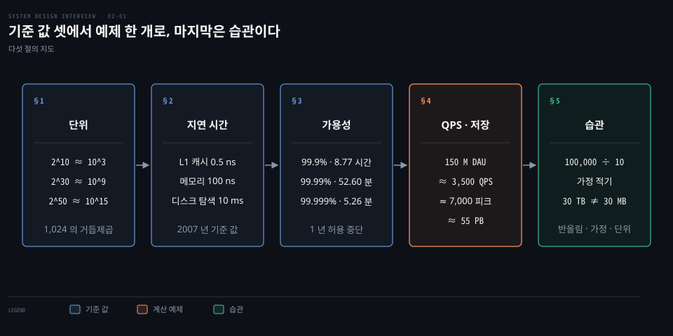
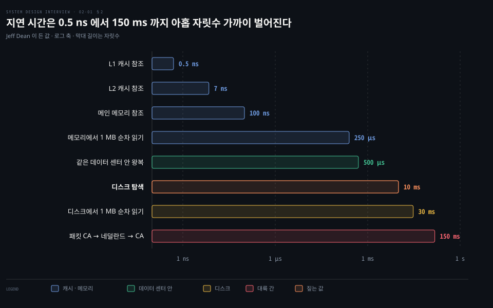
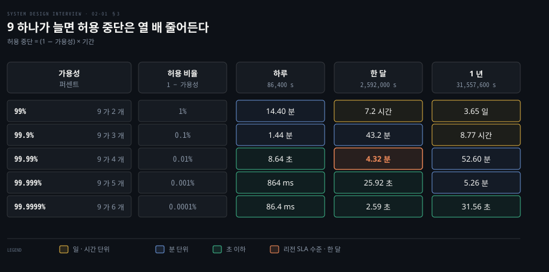
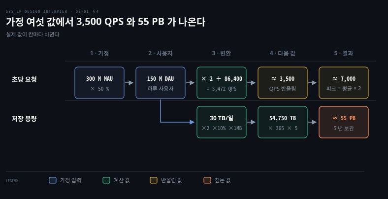

# 개략적 규모 추정은 2의 거듭제곱·지연 시간·가용성 수치로 QPS 와 저장 용량을 어림한다

---

> 개략적 규모 추정은 정확한 답을 내는 일이 아니라, 기준 값 셋과 반올림으로 설계 후보가 요구를 감당하는지 자릿수 단위로 가려내는 일입니다.

## 핵심 요약

> 이 편의 중심 생각은 추정의 가치가 계산 결과가 아니라 계산 과정에 있다는 것입니다. 그 과정은 단위·지연 시간·가용성 기준 값 셋이 받쳐 줍니다.

기준 값은 셋입니다. 2의 거듭제곱은 데이터 단위를 10의 거듭제곱으로 어림하게 해 줍니다. 지연 시간 표는 메모리·디스크·네트워크 사이의 자릿수 차이를 보여 줍니다. 가용성의 9 의 개수는 허용 중단 시간을 읽게 해 줍니다.

예제는 월간 활성 사용자 3 억에서 출발해 일간 활성 사용자 1.5 억, 평균 약 3,500 QPS, 피크 약 7,000 QPS, 하루 미디어 30 TB, 5 년 약 55 PB 를 얻습니다. 값마다 어떤 가정을 곱했는지가 보이도록 단계별로 풉니다.

마지막으로 반올림, 가정 적기, 단위 붙이기 세 습관을 다룹니다. 이 셋이 있으면 숫자가 틀려도 어느 가정을 고쳐야 하는지 바로 보입니다.

## 학습 목표

> 이 편을 읽고 나면 다음을 설명할 수 있습니다.

1. 2의 거듭제곱을 10의 거듭제곱으로 어림하고 그 오차가 지수와 함께 커지는 정도를 계산할 수 있습니다.
2. 지연 시간 표에서 메모리·디스크·네트워크 사이의 자릿수 차이를 읽고 설계 선택으로 연결할 수 있습니다.
3. 가용성 퍼센트를 허용 중단 시간으로 바꾸는 식을 써서 하루·한 달·1 년 값을 계산할 수 있습니다.
4. 가정에서 출발해 평균 QPS, 피크 QPS, 저장 용량을 단계별로 구하고 반올림해 제시할 수 있습니다.
5. 가정과 단위를 적어 두면 추정이 틀렸을 때 어느 값을 고칠지 짚을 수 있는 이유를 설명할 수 있습니다.

## 1. 단위는 1,024 배씩 오르지만 계산에서는 1,000 배로 어림한다

> 데이터 단위는 2의 10 제곱 간격으로 오릅니다. 추정에서는 이 간격을 1,000 으로 어림해도 오차가 13% 안쪽이어서 자릿수가 바뀌지 않습니다.

하루 30 TB 가 쌓인다는 숫자를 받았을 때, 5 년 뒤가 PB 단위인지 EB 단위인지 어떻게 바로 알까요? 단위 사다리를 외워 두면 곱셈이 지수 덧셈으로 바뀝니다.

바이트는 8 비트이고 ASCII 문자 하나는 1 바이트입니다. 단위는 지수가 10 오를 때마다 약 1,000 배가 됩니다.

| 지수 | 정확한 값 | 어림 | 이진 접두어 이름 |
|------|-----------|------|------------------|
| 2^10 | 1,024 | 약 10^3, 천 | KiB (kibibyte) |
| 2^20 | 1,048,576 | 약 10^6, 백만 | MiB (mebibyte) |
| 2^30 | 1,073,741,824 | 약 10^9, 십억 | GiB (gibibyte) |
| 2^40 | 1,099,511,627,776 | 약 10^12, 조 | TiB (tebibyte) |
| 2^50 | 1,125,899,906,842,624 | 약 10^15, 천조 | PiB (pebibyte) |

KB·MB·GB·TB·PB 는 일상에서 이 표의 단위와 섞여 쓰입니다. IEC 가 1998 년 12 월에 승인한 표준은 둘을 가릅니다. KiB·MiB 는 2의 거듭제곱이어서 1 MiB 가 1,048,576 B 이고, KB·MB 는 10의 거듭제곱이어서 1 MB 가 1,000,000 B 입니다.[^nist-binary] 추정에서는 둘을 같다고 놓습니다.

오차는 식 하나로 나옵니다. 2^(10n) 을 10^(3n) 으로 나누면 1.024^n 입니다. 이 값이 지수마다 커집니다.

| 지수 | 1.024^n | 실제가 어림보다 큰 정도(1.024^n − 1) |
|------|---------|----------------------------------|
| 2^10 | 1.024 | 약 2.4% |
| 2^20 | 1.049 | 약 4.9% |
| 2^30 | 1.074 | 약 7.4% |
| 2^40 | 1.100 | 약 10.0% |
| 2^50 | 1.126 | 약 12.6% |

PB 에서도 13% 안쪽이어서 자릿수를 가리는 목적에는 충분합니다. 위 5 년 값은 이 사다리로 읽습니다. 30 TB 에 365 와 5 를 곱하면 약 55,000 TB 입니다. 1,000 TB 가 1 PB 이므로 PB 단위입니다.

## 2. 지연 시간 표는 메모리·디스크·네트워크 사이의 자릿수 차이를 보여 준다

> 같은 데이터를 읽어도 메모리와 디스크, 같은 데이터 센터와 대륙 건너편 사이에는 100 배 남짓(두 자릿수)에서 10^5 배(다섯 자릿수)까지 차이가 납니다. 이 차이가 설계에서 무엇을 피하고 무엇을 앞에 둘지 정합니다.

디스크에서 읽는 것과 메모리에서 읽는 것은 정확히 몇 배 느릴까요? 아래 표는 그 질문에 자릿수로 답하는 기준 값입니다.

| 작업 | 시간 |
|------|------|
| L1 캐시 참조 | 0.5 ns |
| 분기 예측 실패 | 5 ns |
| L2 캐시 참조 | 7 ns |
| 뮤텍스 잠금·해제 | 100 ns |
| 메인 메모리 참조 | 100 ns |
| Snappy(옛 이름 Zippy)로 1 KB 압축 | 10,000 ns = 10 µs |
| 1 Gbps 네트워크로 2 KB 전송 | 20,000 ns = 20 µs |
| 메모리에서 1 MB 순차 읽기 | 250,000 ns = 250 µs |
| 같은 데이터 센터 안 왕복 | 500,000 ns = 500 µs |
| 디스크 탐색 | 10,000,000 ns = 10 ms |
| 네트워크에서 1 MB 순차 읽기 | 10,000,000 ns = 10 ms |
| 디스크에서 1 MB 순차 읽기 | 30,000,000 ns = 30 ms |
| 패킷 CA → 네덜란드 → CA | 150,000,000 ns = 150 ms |

ns 는 10^-9 초, µs 는 10^-6 초(1,000 ns), ms 는 10^-3 초(1,000,000 ns)입니다.

이 값은 Jeff Dean 이 2007 년 봄 Stanford CS295 강의 슬라이드에서 든 목록입니다.[^dean-slides] 같은 값을 2011 년 1 월 High Scalability 글이 다시 소개해 널리 퍼졌습니다.[^hs-dean] 2010 년 강연 슬라이드는 일부 행이 다릅니다. 뮤텍스가 25 ns 이고 디스크 1 MB 순차 읽기가 20 ms 입니다.[^dean-2010] 오늘 장비의 측정값이 아니라 자릿수를 익히려는 설계 가정으로 읽습니다. 슬라이드는 압축 라이브러리를 Zippy 라는 이름으로 적었고, 지금 공개된 이름은 Snappy 입니다.[^snappy]

로그 축이라 막대 길이는 값이 아니라 자릿수입니다. 가장 작은 0.5 ns 와 가장 큰 150 ms 의 비는 150,000,000 ÷ 0.5 = 3 × 10^8 이어서 아홉 자릿수 가까이 벌어집니다. 읽을 때는 비율 셋만 잡으면 됩니다.

1. 디스크 탐색 10 ms 는 메인 메모리 참조 100 ns 의 10^5 배입니다(10,000,000 ÷ 100).
2. 1 MB 를 디스크에서 순차로 읽는 30 ms 는 메모리에서 읽는 250 µs 의 120 배입니다(30,000,000 ÷ 250,000).
3. 대륙 간 왕복 150 ms 는 같은 데이터 센터 안 왕복 500 µs 의 300 배입니다(150,000,000 ÷ 500,000).

1 ns 를 1 초로 늘려 보면 감각이 더 분명합니다. 메인 메모리 참조는 100 초이고 디스크 탐색은 10,000,000 초로 약 116 일, 대륙 간 왕복은 150,000,000 초로 약 4.8 년입니다. CPU 사이클 0.3 ns 를 1 초로 늘려 같은 방식으로 환산한 표는 [시스템 성능 방법론 편의 시간 스케일 절](../../../02_os/book/systems-performance/02-01.방법론%20—%20용어·모델·핵심%20개념.md)에 있습니다.

표에서 설계 결론 넷이 나옵니다.

- 메모리는 빠르고 디스크는 느리므로 자주 읽는 데이터는 메모리에 둡니다. 이 결론이 [캐시 계층](./01-02.캐시·CDN·무상태%20웹%20계층·데이터%20센터·메시지%20큐·샤딩이%20수백만%20사용자까지%20규모를%20늘린다.md)의 근거입니다.
- 디스크 탐색은 가능하면 피합니다. 임의 읽기가 많은 경로가 순차 읽기보다 먼저 병목이 됩니다.
- 압축은 쌉니다. 압축은 KB 당 약 10 µs 이고 1 Gbps 전송도 KB 당 약 10 µs(20 µs ÷ 2 KB)여서, 데이터 센터 안에서는 압축이 전송 시간을 줄이지 못합니다. 대신 압축률이 2 배라면 대역폭을 절반으로 아낍니다.[^hs-dean] 압축 속도(KB 당 약 10 µs)보다 느린 링크, 예를 들어 인터넷 구간에서는 전송 시간도 줄어듭니다.
- 데이터 센터 사이는 멀어서 느립니다. 리전을 넘는 호출은 호출 횟수를 세어 설계합니다.

표에는 SSD 행이 없습니다. 연도를 넣으면 증가율 가정으로 값을 외삽하는 페이지가 있고, 2020 년으로 두면 SSD 임의 읽기 16 µs, SSD 1 MB 순차 읽기 약 49 µs 가 나옵니다.[^colin-scott] 측정이 아니라 가정이므로, SSD 가 메모리와 디스크 사이에 놓인다는 위치만 가져다 씁니다. 프라이머 쪽의 어림셈과 지연 시간 요약은 [The System Design Primer 정독 인덱스](../sdp_system-design-primer/README.md)의 접근법 절에 있습니다.

## 3. 가용성은 9 의 개수를 허용 중단 시간으로 바꿔 읽는다

> 가용성 퍼센트에서 9 가 하나 늘 때마다 허용 중단 시간은 열 배 줄어듭니다. 계약 수치는 월 단위이므로 한 달 값으로 읽어야 합니다.

99.99% 라는 숫자는 하루에 몇 초, 1 년에 몇 분의 중단을 허락하는 값일까요? 숫자만으로는 감이 오지 않아서 시간으로 바꿔 읽습니다.

**가용성**은 서비스가 정해진 기간 동안 동작한 시간의 비율입니다. 서비스 제공자와 고객이 이 수준을 문서로 약속한 것이 **SLA**(service level agreement)입니다. 수준은 관례로 9 의 개수로 부릅니다. 변환식은 하나입니다.

허용 중단 = (1 − 가용성) × 기간

기간은 하루 86,400 초, 30 일 달 2,592,000 초, 1 년 31,557,600 초(365.25 일)로 놓았습니다. 1 년을 365 일로 잡으면 99.9% 가 8.76 시간, 99.99% 가 52.56 분으로 조금 달라집니다. 99.99% 의 1 년 값은 0.0001 × 31,557,600 = 3,155.76 초, 곧 52.60 분입니다.

| 가용성 | 9 의 개수 | 허용 비율 | 하루 | 한 달(30 일) | 1 년 |
|--------|-----------|-----------|------|--------------|------|
| 99% | 9 가 2 개 | 1% | 14.40 분 | 7.2 시간 | 3.65 일 |
| 99.9% | 9 가 3 개 | 0.1% | 1.44 분 | 43.2 분 | 8.77 시간 |
| 99.99% | 9 가 4 개 | 0.01% | 8.64 초 | 4.32 분 | 52.60 분 |
| 99.999% | 9 가 5 개 | 0.001% | 864 ms | 25.92 초 | 5.26 분 |
| 99.9999% | 9 가 6 개 | 0.0001% | 86.4 ms | 2.59 초 | 31.56 초 |

실제 SLA 는 배치에 따라 값이 갈립니다. 아래는 2026 년 10 월에 확인한 공급자 문서의 컴퓨팅 서비스 값입니다.

- AWS EC2 는 리전 단위 99.99%, 인스턴스 하나 99.5% 입니다. 문서 갱신일은 2022 년 5 월 25 일입니다.[^aws-sla]
- Google Compute Engine 은 여러 존에 걸친 인스턴스 99.99%, 단일 인스턴스는 계열에 따라 99.9% 또는 99.95%(메모리 최적화) 입니다. 일반 리전·프리미엄 네트워크 티어 기준이고 수정일은 2025 년 3 월 4 일입니다.[^gcp-sla]
- Azure 는 가용성 집합에 VM 둘 이상을 두면 99.95% 입니다.[^azure-avset]

AWS 와 Google 은 인스턴스 하나만 쓰면 99.9% 안팎이거나 그 아래입니다. 여러 존에 걸치면 99.99% 까지 오릅니다. 월 허용 중단으로 환산하면 99.5% 는 12,960 초로 3.6 시간, 99.9% 는 43.2 분, 99.95% 는 21.6 분, 99.99% 는 4.32 분입니다. 같은 클라우드 위에서도 인스턴스 하나에 올린 서비스가 99.99% 를 약속하기는 어렵습니다.

SLA 수치는 가동 보증이 아니라 미달 때의 보상 기준입니다. AWS 리전 수준에서 월 가동률이 99.99% 미만 99.0% 이상이면 서비스 크레딧 10% 를 받습니다.[^aws-sla] 구성 요소를 직렬로 잇는지 병렬로 잇는지에 따라 가용성이 합성되는 계산은 [The System Design Primer 정독 인덱스](../sdp_system-design-primer/README.md)의 트레이드오프 절에 있습니다. 응답 시간 같은 목표를 백분위로 두는 방법은 [DDIA 성능 편의 SLO·SLA 절](../../../05_data/book/designing-data-intensive-applications/02-02.성능%20—%20응답%20시간과%20처리량.md)에, 허용 중단 시간을 팀이 쓰는 예산으로 다루는 방법은 [SLO 편의 오류 예산 절](../../../06_observability/01_Foundations/01-04.SLO와%20알림%20—%20Error%20Budget,%20Burn%20Rate.md)에 있습니다.

## 4. 짧은 글 서비스의 QPS 와 저장 용량은 가정을 곱해 단계별로 어림한다

> 사용자 수 하나에서 출발해 가정을 한 번에 하나씩 곱하면, 초당 요청 수와 5 년 저장 용량이 갈라져 나옵니다. 값마다 어떤 가정이 곱해졌는지가 남도록 한 줄에 한 단계씩 씁니다.

사용자 수 하나만 받았을 때 초당 요청 수와 5 년 저장 용량은 어떤 순서로 구할까요? 가정부터 적고 단계마다 값 하나만 만듭니다. 아래 수치는 연습을 위한 가상 값이고 실제 서비스의 통계가 아닙니다.

| 가정 | 값 |
|------|----|
| 월간 활성 사용자(MAU) | 300 M (3 억) |
| 일간 사용 비율 | 50% |
| 하루 글 수(사용자당) | 2 |
| 미디어 포함 글 비율 | 10% |
| 미디어 크기 | 1 MB |
| 보관 기간 | 5 년 |

**DAU**(daily active users)는 하루에 한 번이라도 쓰는 사용자 수입니다. **QPS**(queries per second)는 초당 요청 수입니다. 단계는 다음과 같습니다.

| 단계 | 식 | 값 |
|------|----|----|
| 1. DAU | 300,000,000 × 50% | 150,000,000 |
| 2. 하루 글 수 | 150,000,000 × 2 | 300,000,000 |
| 3. 평균 QPS | 300,000,000 ÷ 86,400 | 3,472 → 약 3,500 |
| 4. 피크 QPS | 2 × 3,500 | 약 7,000 |
| 5. 하루 미디어 | 300,000,000 × 10% × 1 MB | 30,000,000 MB = 30 TB |
| 6. 5 년 미디어 | 30 TB × 365 × 5 | 54,750 TB, 약 55 PB |

5 번의 단위 변환은 1,000,000 MB 가 1 TB 라는 §1 의 사다리에서 나옵니다. 30,000,000 MB 를 1,000,000 으로 나누면 30 TB 입니다.

글의 본문 크기도 같은 식으로 셉니다. 글 ID 64 B 와 본문 140 B 를 더한 204 B 에 하루 글 수 300,000,000 을 곱하면 61.2 GB 입니다. 이는 하루 미디어 30 TB 의 0.2% 에 그칩니다. 그래서 저장 용량 추정에서는 미디어만 셉니다.

가정 중 피크 배수 2 는 서비스마다 달라집니다. [DDIA 의 소셜 타임라인 사례](../../../05_data/book/designing-data-intensive-applications/02-01.사례%20연구%20—%20소셜%20네트워크%20홈%20타임라인.md)는 하루 5 억 게시에서 평균 초당 5,800 건, 스파이크 초당 150,000 건을 들고 있는데, 150,000 ÷ 5,800 은 약 26 배입니다. 초당 글 수가 팬아웃 비용으로 번지는 방식은 [뉴스 피드 편](./11-01.뉴스%20피드는%20쓸%20때%20밀어%20넣는%20팬아웃과%20읽을%20때%20당기는%20팬아웃을%20섞고%20캐시를%20다섯%20층으로%20나눈다.md)과 [타임라인 팬아웃 편](../bytebytego-system-design/08-01.트위터%20타임라인·구글%20독스%20동시%20편집·슬랙%20알림%20판정·크롤러%20중복%20제거는%20팬아웃·OT·흐름도·블룸%20필터로%20푼다.md)이 이어서 다룹니다.

55 PB 는 한 벌의 크기입니다. 복제본을 몇 벌 두는지는 별도 가정이고 곱하면 됩니다. 서버 대수도 같은 방식입니다. 한 대가 1,000 QPS 를 받는다고 놓으면 7,000 ÷ 1,000 = 7 대입니다. 이 1,000 은 이 편이 임의로 둔 값입니다.

## 5. 추정은 반올림과 가정·단위를 적어 두면 틀려도 고칠 수 있다

> 면접의 추정에서는 정밀도가 기대되지 않습니다. 반올림은 계산을 줄여 주고, 가정과 단위를 적어 두면 값이 틀렸을 때 어디를 고칠지 바로 보입니다.

99,987 ÷ 9.1 을 암산하라면 어떻게 할까요? 100,000 ÷ 10 = 10,000 으로 바꿉니다. 정확한 값은 약 10,988 이어서 9% 낮지만 자릿수는 같습니다. 하루를 86,400 초 대신 10^5 초로 어림하면 300,000,000 ÷ 100,000 = 3,000 으로, 3,472 보다 13.6% 낮아도 3,500 QPS 규모라는 판단은 바뀌지 않습니다.

가정을 적어 두면 입력이 바뀔 때 다시 계산하기 쉽습니다. 일간 사용 비율을 50% 에서 30% 로 낮추면 DAU 가 90,000,000 이 되고 평균 QPS 는 90,000,000 × 2 ÷ 86,400 = 2,083 입니다. 모든 단계가 비례해서 줄어든다는 것을 식이 그대로 보여 줍니다.

단위는 숫자 옆에 붙입니다. 5 가 5 KB 인지 5 MB 인지에 따라 값이 1,000 배 갈립니다. 30 TB ≠ 30 MB 이고 두 값은 10^6 배 차이입니다. 자주 묻는 추정은 QPS, 피크 QPS, 저장 용량, 캐시 크기, 서버 수입니다. 이 추정을 설계 면접의 어느 단계에서 하는지는 [면접 진행 편](./03-01.시스템%20설계%20면접은%20범위%20확정·개략%20설계·상세%20설계·마무리%20네%20단계로%20진행한다.md)이 다룹니다.

## 면접 대비

> 단위 어림, 지연 시간 비율, 가용성 계산, 예제 단계, 가정 적기에 관한 면접 질문입니다.

1. 2^40 을 10^12 로 어림하면 오차는 얼마이고 왜 그 정도는 무시해도 됩니까?
2. 메인 메모리 참조 100 ns 와 디스크 탐색 10 ms 는 몇 배 차이이고 설계에 어떤 결론을 줍니까?
3. 99.99% 가용성은 한 달과 1 년에 각각 몇 분의 중단을 허용하며 계산식은 무엇입니까?
4. MAU 3 억, 일간 사용 50%, 하루 2 글일 때 평균 QPS 와 피크 QPS 를 세 단계로 구해 보십시오.
5. 추정 값에 가정과 단위를 적어 두면 어떤 점이 좋은지 일간 사용 비율 변화로 설명해 보십시오.

## 정답 (자답 후 펼치기)

> 면접 질문에 대한 키워드 중심의 모범 답안입니다.

### 정답 1 — 1.024^4 은 약 1.10

2^40 은 1,099,511,627,776 이고 10^12 보다 약 10.0% 큽니다. 어림은 1.024^n 으로 지수와 함께 커지지만 PB(n = 5)에서도 12.6% 여서, 자릿수를 가리는 추정에서는 무시합니다.

### 정답 2 — 10^5 배, 디스크는 앞에 두지 않는다

10,000,000 ns 를 100 ns 로 나누면 10^5 배입니다. 그래서 자주 읽는 데이터를 메모리 캐시에 두고 디스크의 임의 탐색을 피하며 순차 읽기로 바꿉니다. 이 값은 2007 년 무렵의 기준 값이어서 자릿수만 가져옵니다.

### 정답 3 — (1 − 가용성) × 기간

한 달(2,592,000 초)은 0.0001 × 2,592,000 = 259.2 초, 곧 4.32 분입니다. 1 년(31,557,600 초)은 3,155.76 초, 곧 52.60 분입니다. SLA 는 월 단위로 정하므로 한 달 값으로 읽습니다.

### 정답 4 — DAU, 하루 글 수, 초당 환산

DAU 는 300,000,000 × 50% = 150,000,000 입니다. 하루 글 수는 150,000,000 × 2 = 300,000,000 이고 86,400 으로 나눈 3,472 를 약 3,500 QPS 로 어림합니다. 피크는 가정한 배수 2 를 곱해 약 7,000 QPS 입니다.

### 정답 5 — 비례 관계와 오류 원인

비율을 30% 로 바꾸면 DAU 가 90,000,000, QPS 가 2,083 으로 비례해 줄어듭니다. 가정과 단위가 적혀 있으면 값이 틀렸을 때 어느 입력이 틀렸는지, 단위가 섞였는지를 거꾸로 짚을 수 있습니다.

## 참고 자료

- Alex Xu, 《System Design Interview – An Insider's Guide》, 2판, 2020, Chapter 2 "Back-of-the-envelope estimation".
- Jeff Dean, "Software Engineering Advice from Building Large-Scale Distributed Systems": https://research.google.com/people/jeff/stanford-295-talk.pdf
- NIST, Prefixes for binary multiples: https://physics.nist.gov/cuu/Units/binary.html

## 관련 문서

- [단일 서버에서 출발한 시스템은 DB 분리·로드밸런서·DB 복제로 첫 병목을 넘는다](./01-01.단일%20서버에서%20출발한%20시스템은%20DB%20분리·로드밸런서·DB%20복제로%20첫%20병목을%20넘는다.md)
- [캐시·CDN·무상태 웹 계층·데이터 센터·메시지 큐·샤딩이 수백만 사용자까지 규모를 늘린다](./01-02.캐시·CDN·무상태%20웹%20계층·데이터%20센터·메시지%20큐·샤딩이%20수백만%20사용자까지%20규모를%20늘린다.md)
- [시스템 설계 면접은 범위 확정·개략 설계·상세 설계·마무리 네 단계로 진행한다](./03-01.시스템%20설계%20면접은%20범위%20확정·개략%20설계·상세%20설계·마무리%20네%20단계로%20진행한다.md)

[^nist-binary]: NIST, Prefixes for binary multiples: <https://physics.nist.gov/cuu/Units/binary.html>
[^dean-slides]: Jeff Dean 슬라이드 PDF 「Numbers Everyone Should Know」 표: <https://research.google.com/people/jeff/stanford-295-talk.pdf>. 강의 일자는 Dean 의 페이지 보관본이 "Stanford CS295 class lecture, Spring, 2007" 로 적습니다: <https://web.archive.org/web/20101002165746/http://research.google.com/people/jeff/index.html>
[^dean-2010]: Jeff Dean, 2010 년 11 월 강연 슬라이드 「Numbers Everyone Should Know」: <https://research.google.com/people/jeff/Stanford-DL-Nov-2010.pdf>
[^hs-dean]: High Scalability, 2011-01-26, "Google Pro Tip: Use Back-Of-The-Envelope-Calculations To Choose The Best Design": <http://highscalability.com/blog/2011/1/26/google-pro-tip-use-back-of-the-envelope-calculations-to-choo.html>
[^snappy]: google/snappy README, "Snappy has previously been called 'Zippy' in some Google presentations": <https://github.com/google/snappy/blob/1.2.2/README.md>
[^colin-scott]: Colin Scott, Latency Numbers Every Programmer Should Know, 연도를 2020 으로 둔 외삽 모델 값: <https://colin-scott.github.io/personal_website/research/interactive_latency.html>
[^aws-sla]: Amazon Compute Service Level Agreement(Last Updated May 25, 2022), Region-Level 99.99%·Instance-Level 99.5%·서비스 크레딧 표: <https://aws.amazon.com/compute/sla/>
[^gcp-sla]: Compute Engine Service Level Agreement(Last modified March 4, 2025), Premium Tier 의 다중 존 99.99%·단일 인스턴스 99.9%·99.95%: <https://cloud.google.com/compute/sla>
[^azure-avset]: Microsoft Learn, Availability sets overview, 둘 이상의 VM 으로 99.95% Azure SLA 충족: <https://learn.microsoft.com/en-us/azure/virtual-machines/availability-set-overview>
