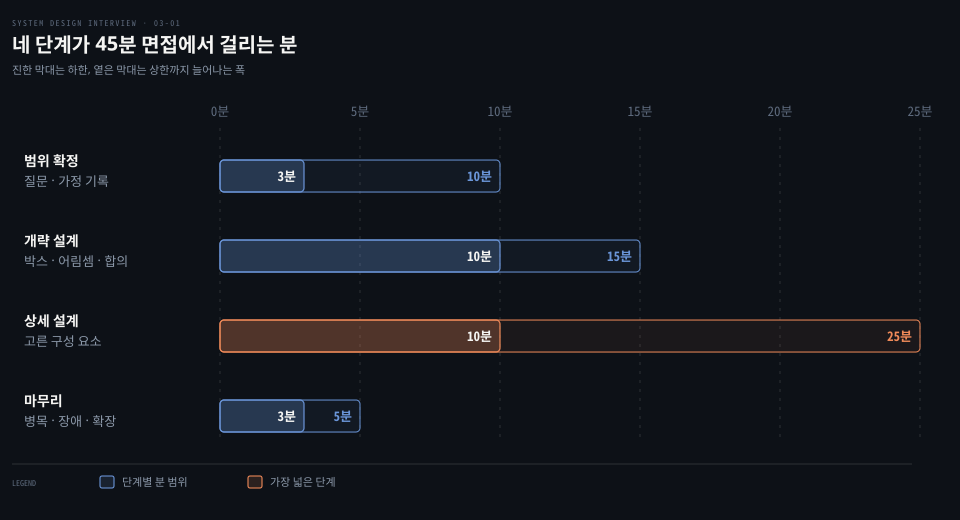
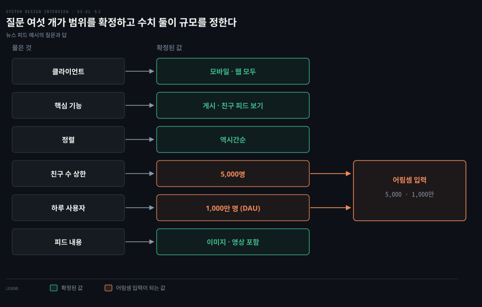
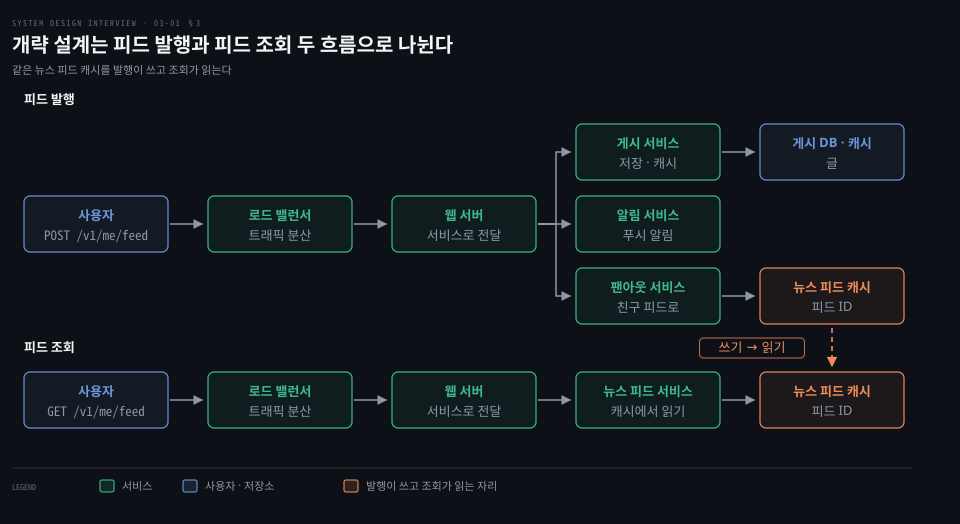
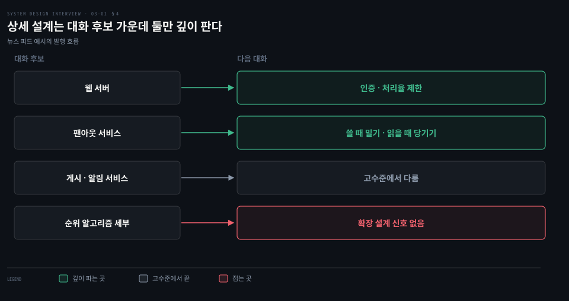

# 시스템 설계 면접은 범위 확정·개략 설계·상세 설계·마무리 네 단계로 진행한다

---

> 시스템 설계 면접은 정답을 겨루는 시험이 아니라 모호한 문제를 면접관과 함께 좁혀 가는 과정이며, 범위 확정·개략 설계·상세 설계·마무리 네 단계로 나눠 45분을 씁니다.


## 핵심 요약

> 이 편의 중심 생각은 면접관이 최종 설계가 아니라 설계를 만들어 가는 과정을 평가하므로, 서두르지 않고 질문과 합의를 거쳐 네 단계를 밟아야 한다는 것입니다.

면접관은 설계 실력만 보지 않습니다. 협업하는 모습, 압박 속에서 일하는 모습, 모호함을 풀어 가는 모습, 그리고 좋은 질문을 던지는 솜씨가 함께 평가 대상입니다. 가장 큰 위험 신호는 트레이드오프를 무시하고 설계의 순수함에 빠지는 과설계입니다.

네 단계는 순서대로 하나씩 일을 끝냅니다. 범위 확정에서는 질문으로 요구사항과 가정을 정합니다. 개략 설계에서는 박스 다이어그램과 어림셈으로 청사진을 그리고 면접관의 동의를 얻습니다. 상세 설계에서는 합의한 구성 요소 가운데 우선순위가 높은 것을 골라 깊이 팝니다. 마무리에서는 병목과 장애와 다음 규모를 이야기합니다.

45분 면접 기준으로 단계마다 대략의 분 범위가 있고 상세 설계의 폭이 가장 넓습니다.




## 학습 목표

> 이 편을 읽고 나면 다음을 설명할 수 있습니다.

1. 면접관이 평가하는 신호와 과설계·좁은 시야·고집이 위험 신호인 까닭을 설명할 수 있습니다.
2. 범위 확정 단계에서 물어야 할 질문 네 갈래와 가정을 적어 두는 이유를 말할 수 있습니다.
3. 개략 설계에서 박스 다이어그램·어림셈·사례 점검으로 합의에 이르는 순서를 그릴 수 있습니다.
4. 상세 설계에서 깊이 팔 구성 요소를 고르는 기준과 사소한 세부에 시간을 쓰는 위험을 설명할 수 있습니다.
5. 마무리 단계에서 꺼낼 이야기와 단계별 시간 배분, 해야 할 것과 하지 말 것을 상황별로 묶어 말할 수 있습니다.


## 1. 면접관은 정답이 아니라 과정을 보고 과설계를 위험 신호로 읽는다

> 시스템 설계 면접은 몇백 명이 만든 제품을 한 시간에 설계하라는 시험이 아니라, 두 동료가 모호한 문제를 푸는 모습을 보는 모의 협업입니다. 그래서 최종 설계보다 설계를 만들어 가는 과정이 점수를 가릅니다.

구글 검색은 화면만 보면 단순해 보입니다. 그러나 그 단순함을 받치는 기술은 방대합니다. 인기 있는 제품 하나에도 수백, 수천 명의 엔지니어가 들어가므로 한 시간 안에 설계하라는 요구는 애초에 지킬 수 없습니다. 그런데 왜 많은 회사가 이 면접을 볼까요?

면접이 흉내 내는 것은 실제 문제 해결입니다. 두 동료가 답이 열려 있는 문제를 놓고 목표에 맞는 해법을 함께 찾습니다. 완벽한 답은 없습니다. 그래서 지원자는 설계 실력을 보여 주고 자기 선택을 방어하며 피드백에 건설적으로 반응하는 모습으로 평가받습니다.

면접관 쪽에서 보면 목표는 지원자의 능력을 정확히 판단하는 것입니다. 면접이 잘못 흘러 신호가 모자라면 결론을 내리지 못합니다. 면접관은 그 상황을 가장 피하고 싶어 합니다. 그래서 좋은 면접관은 기술 설계 말고도 협업 능력과 압박 속 대응과 모호함을 푸는 힘을 봅니다. 좋은 질문을 던지는 능력도 일부러 살핍니다.

반대로 위험 신호도 분명합니다. **과설계(over-engineering)** 는 설계의 순수함을 즐기느라 트레이드오프를 무시하고 시스템을 필요 이상으로 복잡하게 만드는 경향입니다. 과설계된 시스템의 비용은 시간이 갈수록 겹쳐서 쌓입니다. 이 비용을 모르고 지나쳐서 큰 대가를 치르는 회사가 많습니다. 면접에서 보여서는 안 되는 성향입니다. 좁은 시야와 고집도 같은 위험 신호에 듭니다.


## 2. 범위 확정은 질문으로 요구사항과 가정을 정하는 단계다

> 범위 확정은 설계를 시작하기 전에 질문으로 기능·규모·성장 속도·기술 환경을 정하는 단계입니다. 3~10분을 쓰며, 답이 나오지 않으면 가정을 세워 화이트보드에 적어 둡니다.

"뉴스 피드를 설계하세요"라는 한 줄만 받았습니다. 바로 화이트보드에 서버를 그려도 될까요? 그렇지 않습니다. 교실에서 질문이 나오면 답을 아는지와 상관없이 제일 먼저 손을 드는 아이를 떠올려 보면 됩니다. 빨리 답하는 것은 면접에서 가산점이 아닙니다. 요구사항을 충분히 이해하지 않은 채 내놓은 답은 오히려 큰 위험 신호입니다. 면접은 상식 퀴즈가 아니고 정답도 없기 때문입니다.

어려운 문제를 만나면 바로 최종 설계로 뛰어들고 싶어집니다. 하지만 그 습관이 엉뚱한 시스템을 설계하게 만듭니다. 올바른 질문을 하고 알맞은 가정을 세우고 필요한 정보를 모으는 일이 엔지니어의 핵심 기술입니다.

물을 질문은 요구사항을 정확히 파악하는 것들입니다. 네 갈래로 시작하면 됩니다.

1. 어떤 기능을 만들어야 하는가
2. 사용자가 몇 명인가
3. 회사가 얼마나 빨리 커질 것으로 보는가: 3개월·6개월·1년 뒤 규모
4. 회사의 기술 스택은 무엇이고 설계를 단순하게 해 줄 기존 서비스가 있는가

면접관은 질문에 직접 답하거나 "가정을 세워 보라"고 돌려줍니다. 돌려줄 때는 세운 가정을 화이트보드나 종이에 적어 둡니다. 뒤 단계에서 그 가정이 다시 필요해집니다.

뉴스 피드를 설계하는 면접이라면 대화는 다음과 같이 흘러갑니다. 모바일 앱인지 웹 앱인지 물으면 둘 다라는 답이 옵니다. 가장 중요한 기능을 물으면 글을 올리는 것과 친구들의 피드를 보는 것이라고 합니다. 피드를 역시간순으로 정렬하는지, 점수 같은 특정 순서로 정렬하는지도 묻습니다. 점수 순서라면 친한 친구의 글이 모임의 글보다 가중치가 높은 식으로 글마다 가중치를 계산해야 합니다. 그래서 설계가 달라지는 지점입니다. 면접관은 단순하게 가자며 역시간순으로 정합니다. 친구 수 상한은 5,000명이고 트래픽은 일간 사용자 1,000만 명입니다. 피드에는 이미지와 영상을 포함한 미디어 파일이 들어갑니다.

여기 나온 숫자는 면접관이 준 설계 가정이지 어느 실제 서비스의 통계가 아닙니다. 그래서 다음 단계의 입력으로만 씁니다.




## 3. 개략 설계는 청사진을 그려 합의하고 어림셈으로 규모를 잰다

> 개략 설계는 박스 다이어그램으로 청사진을 그려 면접관의 동의를 얻고 어림셈으로 규모에 맞는지 재는 단계입니다. 10~15분을 쓰며, 면접관을 팀원으로 대하는 것이 핵심입니다.

청사진 없이 바로 세부로 들어가면 지원자와 면접관이 서로 다른 시스템을 보고 있을 수 있습니다. 그 어긋남을 줄이려고 개략 설계에서는 두 사람이 같은 그림을 보고 동의하는 데까지 갑니다. 이 단계에서 할 일은 세 가지입니다.

1. 초기 청사진을 그리고 피드백을 구합니다. 면접관은 팀원이고, 좋은 면접관은 대화에 직접 끼어들기를 좋아합니다.
2. 화이트보드에 핵심 구성 요소를 박스로 그립니다. 클라이언트(모바일·웹), API, 웹 서버, 데이터 저장소, 캐시, CDN, 메시지 큐 같은 것들이 후보입니다.
3. 어림셈으로 청사진이 규모 제약에 맞는지 평가합니다. 생각을 소리 내어 말하고, 어림셈에 들어가기 전에 필요한지 면접관에게 먼저 묻습니다.

가능하면 구체적인 사용 사례를 몇 개 따라가 봅니다. 사례를 따라가다 보면 미처 생각하지 못한 예외 상황이 드러나기도 하고, 청사진의 얼개가 잡히기도 합니다.

API 엔드포인트와 데이터베이스 스키마를 이 단계에 넣을지는 문제에 따라 다릅니다. "구글 검색 엔진을 설계하라"처럼 큰 문제에서는 너무 낮은 수준입니다. 멀티플레이어 포커 게임의 백엔드를 설계하는 문제라면 충분히 다룰 만한 수준입니다. 어느 쪽인지는 면접관과 소통해서 정합니다.

뉴스 피드 예시에서는 설계를 두 흐름으로 나눕니다. 피드 발행은 사용자가 글을 올리면 해당 데이터를 캐시와 데이터베이스에 쓰고 친구들의 뉴스 피드에 채워 넣는 흐름입니다. 피드 조회는 친구들의 글을 역시간순으로 모아 보여 주는 흐름입니다. 이 단계에서는 시스템이 실제로 어떻게 동작하는지 다 알 필요가 없습니다. 세부는 [뉴스 피드 편](./11-01.뉴스%20피드는%20쓸%20때%20밀어%20넣는%20팬아웃과%20읽을%20때%20당기는%20팬아웃을%20섞고%20캐시를%20다섯%20층으로%20나눈다.md)에서 다룹니다.

두 흐름이 쓰는 API 는 둘입니다.

```bash
# 피드 발행 API 입니다. content 는 글의 텍스트이고 auth_token 은 요청을 인증하는 값입니다.
POST /v1/me/feed
# 피드 조회 API 입니다. auth_token 으로 인증합니다.
GET /v1/me/feed
```

발행 흐름의 구성 요소는 다음과 같이 역할이 나뉩니다. 로드 밸런서는 트래픽을 웹 서버로 나눠 보냅니다. 웹 서버는 트래픽을 내부 서비스로 전달합니다. 게시 서비스는 글을 데이터베이스와 캐시에 저장합니다. 팬아웃 서비스는 새 글을 친구들의 뉴스 피드로 밀어 넣으며 피드 데이터는 빠른 조회를 위해 캐시에 둡니다. 알림 서비스는 친구들에게 새 글이 올라왔음을 알리고 푸시 알림을 보냅니다. 조회 흐름은 더 짧습니다. 뉴스 피드 서비스가 뉴스 피드 캐시에서 피드를 가져옵니다. 캐시에는 피드를 그리는 데 필요한 피드 ID 가 저장됩니다.

어림셈은 입력이 있어야 하고 앞 단계에서 정한 값이 그 입력입니다. 아래는 이 노트가 붙인 예시 계산입니다. 하루 사용자 1,000만 명이 하루에 피드를 한 번씩 연다고 가정하면 10,000,000 ÷ 86,400 ≈ 116 QPS 입니다. 실제 사용자는 하루에 여러 번 열 것이므로 이 값은 자릿수를 잡는 출발점으로만 씁니다. 글 한 건은 친구 상한만큼 최대 5,000개의 피드 항목으로 퍼집니다. 어림셈의 도구(2의 거듭제곱·지연 시간·가용성 수치)는 [개략적 규모 추정 편](./02-01.개략적%20규모%20추정은%202의%20거듭제곱·지연%20시간·가용성%20수치로%20QPS%20와%20저장%20용량을%20어림한다.md)에서 다룹니다.



발행 흐름이 뉴스 피드 캐시에 쓰고 조회 흐름이 그 캐시를 읽는다는 점이 두 흐름을 묶는 고리입니다.


## 4. 상세 설계는 합의한 구성 요소 가운데 우선순위가 높은 것을 깊이 판다

> 상세 설계는 개략 설계의 구성 요소 중 우선순위가 높은 것을 면접관과 함께 골라 깊이 파는 단계입니다. 가장 폭이 넓은 10~25분을 쓰며, 능력을 보여 주지 못하는 세부에 매몰되지 않는 것이 중요합니다.

개략 설계에 박스가 여럿 그려졌는데 남은 시간 안에 모두 팔 수 있을까요? 없습니다. 그래서 이 단계의 첫 일은 무엇을 팔지 고르는 것입니다. 이 단계에 오면 이미 네 가지가 끝나 있어야 합니다.

1. 전체 목표와 기능 범위에 합의했습니다.
2. 전체 설계의 고수준 청사진을 그렸습니다.
3. 청사진에 대한 면접관의 피드백을 받았습니다.
4. 피드백으로 어느 영역을 깊게 팔지 초기 생각을 얻었습니다.

이제 면접관과 함께 아키텍처의 구성 요소에 우선순위를 매깁니다. 면접마다 초점이 다릅니다. 어떤 면접관은 고수준 설계를 계속 다루기를 좋아한다는 신호를 줍니다. 시니어 지원자라면 시스템의 성능 특성, 병목, 자원 추정으로 대화가 흐르기도 합니다. 대부분은 일부 구성 요소의 세부로 들어가 보기를 원합니다. URL 단축기라면 긴 URL 을 짧은 URL 로 바꾸는 해시 함수의 설계가 흥미로운 주제입니다. 채팅 시스템이라면 지연 시간을 줄이는 방법과 온라인·오프라인 상태를 지원하는 방법이 좋은 주제입니다.

시간 관리가 특히 중요합니다. 능력을 보여 주지 못하는 사소한 세부에 휩쓸리기 쉽기 때문입니다. 지원자가 면접관에게 보여 줘야 하는 것은 확장 가능한 시스템을 설계하는 능력이라는 신호입니다. 예를 들어 피드 순위 알고리즘의 가중치 계산 같은 세부를 자세히 설명하면 귀한 시간을 쓰는 데 비해 그 신호는 얻지 못합니다.

뉴스 피드 예시에서는 개략 설계가 끝난 뒤 면접관이 제안에 만족했다고 가정합니다. 가장 중요한 두 사용 사례인 피드 발행과 피드 조회를 더 깊이 살펴봅니다. 발행 흐름에서 이미 다룬 구성 요소는 대부분 개략 설계 수준으로 충분하므로 두 곳만 파고듭니다. 조회 흐름의 상세는 뉴스 피드 편에서 다룹니다.

웹 서버는 클라이언트와 통신하는 일 말고도 인증과 처리율 제한을 맡습니다. 유효한 auth_token 을 가진 로그인 사용자만 글을 올릴 수 있습니다. 일정 기간에 한 사용자가 올릴 수 있는 글 수를 제한해 스팸과 악성 콘텐츠를 막습니다. 처리율 제한의 알고리즘은 [처리율 제한기 편](./04-01.처리율%20제한기는%20토큰%20버킷·누출%20버킷·고정%20윈도·이동%20윈도%20로그·이동%20윈도%20카운터로%20요청을%20센다.md)에서 다룹니다.

팬아웃 서비스는 글을 모든 친구에게 배달하는 과정을 맡습니다. 배달 모델은 둘입니다. 쓸 때 밀어 넣는 방식(fanout on write, 푸시 모델)은 글이 올라오는 즉시 친구들의 캐시로 전달해 피드를 쓰는 시점에 미리 계산합니다. 읽을 때 당기는 방식(fanout on read, 풀 모델)은 사용자가 홈 화면을 열 때 최근 글을 그때그때 가져옵니다. 두 모델은 장단점이 갈리고, 어느 쪽이 이 시스템에 맞는지 고르는 일이 이 단계의 논점입니다. 두 모델의 장단점과 선택은 뉴스 피드 편으로 이어집니다.



고르는 기준은 면접관의 반응에서 읽은 관심 영역과, 확장 가능한 설계 능력을 보여 줄 수 있는지 두 가지입니다. 두 기준에 걸리지 않는 세부에는 오래 머물지 않습니다.


## 5. 마무리는 병목과 장애와 다음 규모를 이야기하는 시간이다

> 마무리는 면접관이 후속 질문을 던지거나 추가 논의의 자유를 주는 3~5분입니다. 병목, 요약, 장애, 운영, 다음 규모, 남은 개선의 여섯 방향에서 고릅니다.

설계가 끝났는데 시간이 몇 분 남았습니다. 무슨 말을 해야 좋은 마지막 인상을 남길까요? 꺼낼 이야기는 여섯 갈래입니다.

1. 시스템 병목을 짚고 개선안을 논의합니다. 내 설계는 완벽하고 고칠 곳이 없다고 말하지 않습니다. 개선할 곳은 항상 있고, 그것을 짚는 일이 비판적 사고를 보여 줄 기회이자 마지막 인상을 좋게 만드는 길입니다.
2. 설계를 요약합니다. 여러 해법을 제안했다면 특히 중요합니다. 긴 면접 끝에 면접관의 기억을 새로 고쳐 줍니다.
3. 오류 상황을 이야기합니다. 서버 장애나 네트워크 손실 같은 상황이 흥미로운 주제입니다.
4. 운영 문제를 언급합니다. 메트릭과 오류 로그를 어떻게 모니터링하고 시스템을 어떻게 출시할지가 거기에 듭니다.
5. 다음 확장 단계를 다룹니다. 지금 설계가 사용자 100만 명을 받는다면 1,000만 명을 받으려고 무엇을 바꿔야 하는지가 한 예입니다.
6. 시간이 더 있었다면 더할 개선을 제안합니다.


## 6. 시간 배분은 폭이 있고 해야 할 것과 하지 말 것은 상황별로 묶인다

> 45분 면접의 단계별 시간은 범위 확정 3~10분, 개략 설계 10~15분, 상세 설계 10~25분, 마무리 3~5분입니다. 실제 배분은 문제의 범위와 면접관의 요구에 따라 달라집니다.

시스템 설계 면접의 질문은 대개 광범위해서 45분이나 한 시간으로는 설계 전체를 다룰 수 없습니다. 그래서 시간 관리가 필수입니다. 위 숫자는 어디까지나 대략의 안내입니다. 네 단계를 모두 하한으로 끝내면 3 + 10 + 10 + 3 = 26분이고, 모두 상한까지 쓰면 10 + 15 + 25 + 5 = 55분입니다. 45분은 그 사이에 있으므로 어느 단계를 길게 쓸지가 실제 시간 관리의 문제가 됩니다. 폭이 15분으로 가장 넓은 상세 설계가 면접관의 관심과 문제의 크기에 맞춰 늘고 줄어드는 단계입니다. 범위 확정은 폭이 7분, 개략 설계는 5분, 마무리는 2분입니다.

해야 할 것과 하지 말 것을 상황별로 묶으면 다음 표와 같습니다. 빈 칸은 맞은편 항목이나 까닭이 따로 없다는 뜻입니다.

| 상황 | 하는 것 | 하지 않는 것 | 까닭 |
|---|---|---|---|
| 요구사항 | 항상 명확화 질문을 하고, 내 가정이 맞다고 단정하지 않는다 | 요구사항과 가정을 확인하지 않고 해법으로 바로 뛴다 | 정답이 없는 문제라 요구사항이 설계의 기준이다 |
| 소통 | 생각을 면접관에게 알린다 | 침묵 속에서 혼자 생각한다 | 면접관은 말한 만큼의 신호를 얻는다 |
| 깊이 | 합의 뒤 가장 핵심적인 구성 요소부터 깊이 들어간다 | 처음부터 한 구성 요소의 세부에 깊이 들어간다 | 고수준 설계를 먼저 주고 내려간다 |
| 막힘 | 면접관과 아이디어를 주고받고 포기하지 않는다 | 막혔는데도 힌트 요청을 망설인다 | 좋은 면접관은 팀원처럼 함께 일한다 |
| 끝맺음 | 피드백을 일찍, 자주 구한다 | 설계를 내놓았다고 면접이 끝났다고 여긴다 | 면접관이 끝났다고 할 때까지 끝이 아니다 |
| 접근 | 가능하면 여러 접근을 제안한다 | | 어린 스타트업과 사용자 수백만의 기업은 풀 문제가 달라 가장 좋은 답이 하나가 아니다 |
| 준비 | | 전형적인 면접 질문에 준비 없이 들어간다 | |


## 면접 대비

> 면접관이 보는 것, 네 단계의 목표, 시간 배분에 관한 면접 질문입니다.

1. 시스템 설계 면접에서 면접관은 설계 실력 말고 어떤 신호를 보며, 가장 큰 위험 신호는 무엇입니까?
2. 문제를 받자마자 설계를 시작하면 안 되는 이유는 무엇이고, 범위 확정 단계에서 어떤 질문을 합니까?
3. 개략 설계 단계에서 하는 일 세 가지는 무엇이며, API 와 스키마를 이 단계에 넣을지는 어떻게 정합니까?
4. 상세 설계에서 깊이 팔 구성 요소는 어떻게 고르며, 사소한 세부에 시간을 쓰는 것을 어떻게 막습니까?
5. 45분 면접의 단계별 시간 배분은 어떻고, 마무리 단계에서 꺼낼 만한 이야기는 무엇입니까?


## 정답 (자답 후 펼치기)

> 면접 질문에 대한 키워드 중심의 모범 답안입니다.

### 정답 1 — 협업·압박·모호함·질문, 위험 신호는 과설계

협업하는 능력, 압박 속에서 일하는 능력, 모호함을 건설적으로 푸는 능력, 좋은 질문을 던지는 능력을 봅니다. 가장 큰 위험 신호는 트레이드오프를 무시하고 설계의 순수함에 빠지는 과설계이며, 좁은 시야와 고집도 위험 신호입니다. 최종 설계보다 설계 과정과 피드백에 반응하는 모습이 중요합니다.

### 정답 2 — 정답이 없는 문제라 요구사항이 먼저, 기능·사용자 수·성장·기술 스택을 질문

면접은 상식 퀴즈가 아니고 정답이 없으므로 요구사항을 이해하지 않고 낸 답은 위험 신호입니다. 어떤 기능을 만드는지, 사용자가 몇 명인지, 3개월·6개월·1년 뒤 규모가 어떠한지, 기술 스택과 활용할 기존 서비스가 무엇인지를 묻습니다. 면접관이 가정을 세우라고 하면 화이트보드에 적어 둡니다.

### 정답 3 — 청사진·박스 다이어그램·어림셈, API·스키마는 문제 크기에 따라

초기 청사진을 그려 피드백을 받습니다. 핵심 구성 요소를 박스로 그립니다. 어림셈으로 규모 제약에 맞는지 평가합니다. 구체적인 사용 사례를 따라가면 예외 상황이 드러납니다. API 와 스키마는 구글 검색 엔진 같은 큰 문제에서는 너무 낮은 수준이고 멀티플레이어 포커 게임 백엔드 같은 문제에서는 적절하므로 면접관과 소통해 정합니다.

### 정답 4 — 면접관과 우선순위 합의, 신호를 못 주는 세부는 접는다

개략 설계의 구성 요소에 면접관과 함께 우선순위를 매겨 핵심 구성 요소부터 팝니다. 면접관의 관심은 고수준 설계, 성능과 병목, 일부 구성 요소의 세부 중 하나로 갈립니다. 확장 가능한 설계 능력을 보여 주지 못하는 세부(예: 피드 순위 알고리즘의 가중치 계산)는 시간만 쓰므로 접습니다.

### 정답 5 — 3~10·10~15·10~25·3~5분, 병목·요약·장애·운영·다음 규모

범위 확정 3~10분, 개략 설계 10~15분, 상세 설계 10~25분, 마무리 3~5분이며 실제로는 문제 범위와 면접관의 요구에 따라 달라집니다. 마무리에서는 병목과 개선, 설계 요약, 오류 상황, 운영(모니터링·출시), 다음 규모(100만에서 1,000만으로), 남은 개선을 이야기합니다. 설계가 완벽하다는 말은 하지 않습니다.


## 참고 자료

- Alex Xu, 《System Design Interview – An Insider's Guide》, 2판, 2020, ISBN 979-8664653403.
- Open Library, 판 정보: https://openlibrary.org/isbn/9798664653403


## 관련 문서

- [개략적 규모 추정은 2의 거듭제곱·지연 시간·가용성 수치로 QPS 와 저장 용량을 어림한다](./02-01.개략적%20규모%20추정은%202의%20거듭제곱·지연%20시간·가용성%20수치로%20QPS%20와%20저장%20용량을%20어림한다.md)
- [뉴스 피드는 쓸 때 밀어 넣는 팬아웃과 읽을 때 당기는 팬아웃을 섞고 캐시를 다섯 층으로 나눈다](./11-01.뉴스%20피드는%20쓸%20때%20밀어%20넣는%20팬아웃과%20읽을%20때%20당기는%20팬아웃을%20섞고%20캐시를%20다섯%20층으로%20나눈다.md)
- [처리율 제한기는 토큰 버킷·누출 버킷·고정 윈도·이동 윈도 로그·이동 윈도 카운터로 요청을 센다](./04-01.처리율%20제한기는%20토큰%20버킷·누출%20버킷·고정%20윈도·이동%20윈도%20로그·이동%20윈도%20카운터로%20요청을%20센다.md)
- [System Design Primer 정독 인덱스](../sdp_system-design-primer/README.md)
