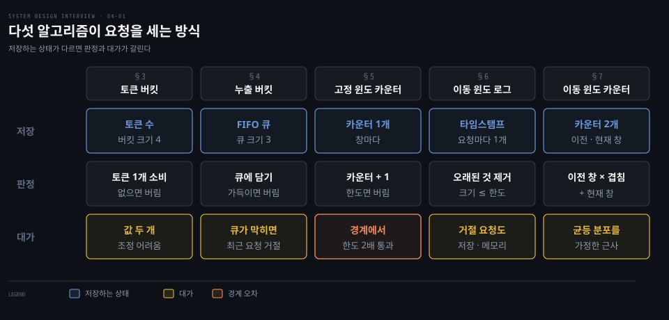
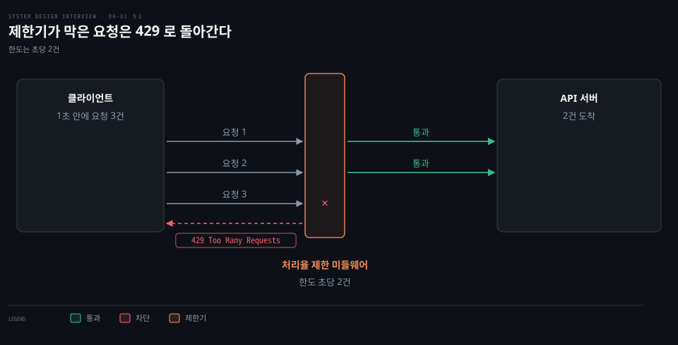
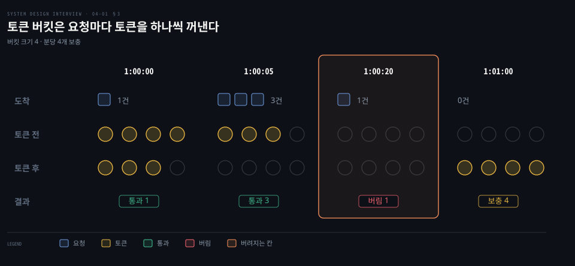
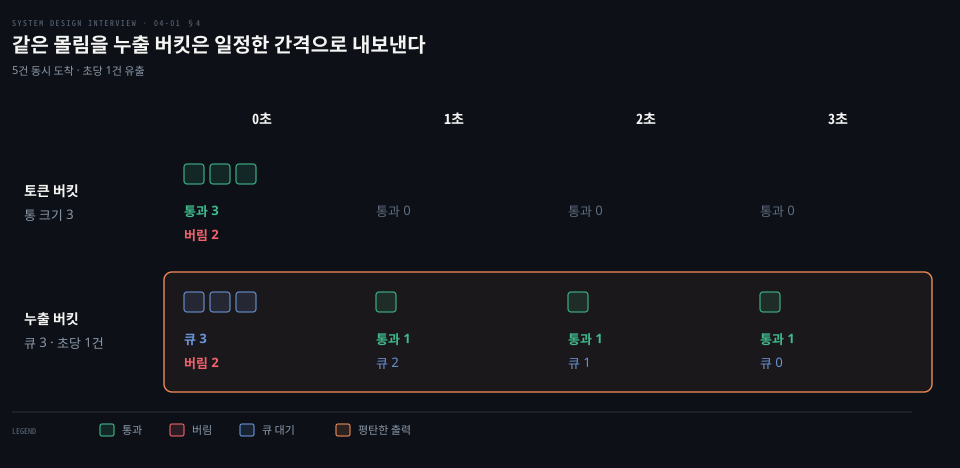
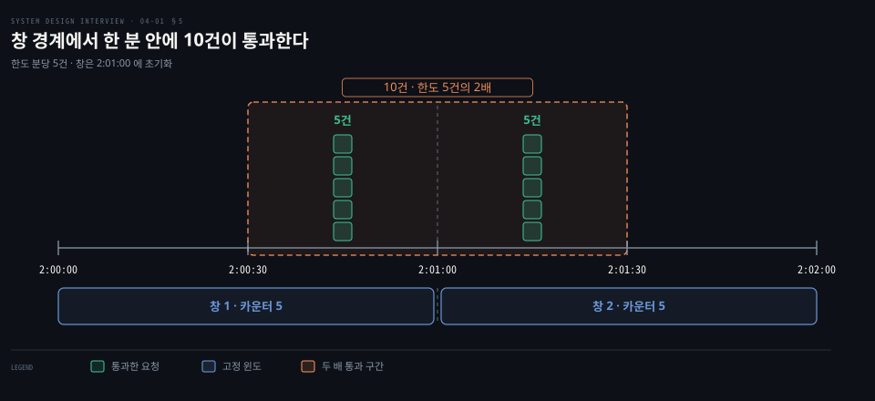
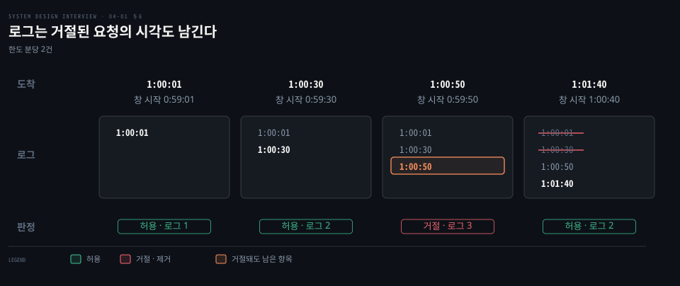
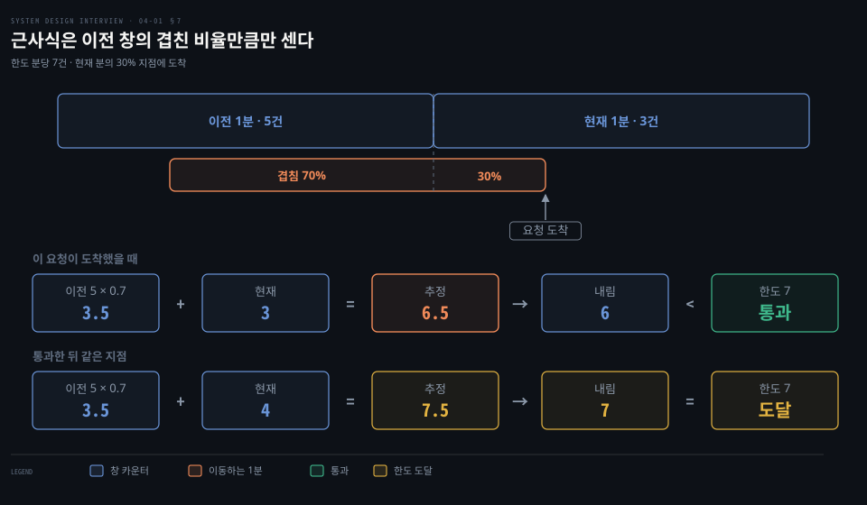
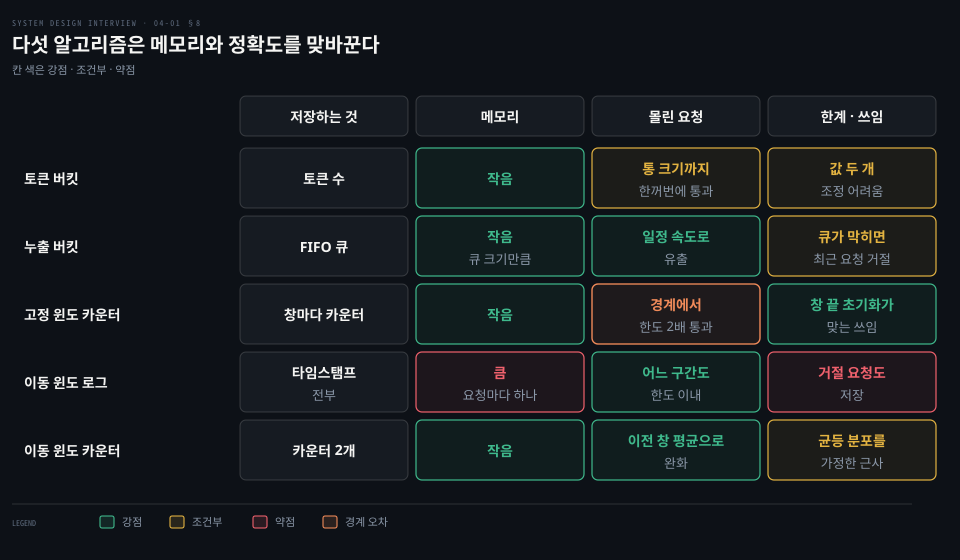

# 처리율 제한기는 토큰 버킷·누출 버킷·고정 윈도·이동 윈도 로그·이동 윈도 카운터로 요청을 센다

---

> 처리율 제한기가 요청을 세는 방식은 다섯 갈래이고 몰림 허용과 정확도와 메모리를 맞바꿉니다.

## 핵심 요약

> 이 편의 중심 생각은 처리율 제한이 곧 "무엇을 세어 저장할 것인가"의 선택이고 어느 방식도 몰림 허용·정확도·메모리를 한꺼번에 만족시키지 못한다는 것입니다.

처리율 제한기는 정해진 기간에 보낼 수 있는 요청 수를 제한하고 한도를 넘는 호출을 막습니다. 클라이언트는 위조될 수 있어 믿을 수 없으므로 서버 쪽에 둡니다. API 앞단의 미들웨어나 게이트웨이로 만들면 막은 요청에 429 를 돌려줄 수 있습니다.

다섯 방식은 저장하는 상태가 다릅니다. 토큰 수, 큐, 창마다의 카운터, 요청마다의 타임스탬프, 카운터 둘입니다. 그 차이가 순간 몰림을 받아 주는지, 창 경계에서 한도를 넘기는지, 메모리를 얼마나 쓰는지를 가릅니다.

## 학습 목표

> 이 편을 읽고 나면 다음을 설명할 수 있습니다.

1. 처리율 제한기가 필요한 이유 셋과 설계가 만족해야 할 요구사항 여섯을 말할 수 있습니다.
2. 제한기를 클라이언트·서버·게이트웨이 중 어디에 둘지 기준을 들어 고를 수 있습니다.
3. 토큰 버킷과 누출 버킷의 동작과 두 매개변수를 숫자 예로 따라갈 수 있습니다.
4. 고정 윈도 경계에서 한도의 두 배가 통과하는 까닭과 이동 윈도 로그가 이를 막는 방식을 설명할 수 있습니다.
5. 이동 윈도 카운터의 근사식을 직접 계산하고 다섯 알고리즘의 트레이드오프를 비교할 수 있습니다.

## 1. 한도를 넘는 호출은 자원 고갈과 비용과 과부하로 이어지므로 제한기는 정확하고 빠르며 죽지 않아야 한다

> 처리율 제한기를 두는 이유는 자원 고갈·비용·과부하입니다. 설계는 정확도·지연·메모리·분산 공유·예외 처리·내결함성을 만족해야 합니다.

봇의 폭주나 사용자의 실수로 쏟아지는 호출을 API 가 모두 받아 내면 어떻게 될까요?

**처리율 제한기**는 클라이언트나 서비스가 보내는 트래픽의 속도를 제어하는 장치입니다. HTTP 에서는 지정한 기간에 보낼 수 있는 요청 수를 제한합니다. 한도를 넘는 호출은 모두 차단합니다. 규칙은 "사용자 하나가 초당 게시글 2개", "같은 IP 에서 하루에 계정 10개", "같은 기기에서 주당 보상 5번" 같은 모양입니다.

제한하는 이유는 셋입니다.

1. 자원 고갈 방지: 의도했든 아니든 DoS 로 서버 자원이 바닥나지 않도록 초과 호출을 막습니다.
2. 비용 절감: 초과 요청이 줄면 서버가 줄고 우선순위 높은 API 에 자원을 더 줄 수 있습니다. 신용 조회·결제·진료 기록 조회처럼 호출당 과금되는 외부 API 를 쓰면 호출 수 제한이 곧 비용 제한입니다.
3. 과부하 방지: 봇이나 사용자의 오용이 만든 초과 요청을 걸러 서버 부하를 줄입니다.

범위는 이렇게 정합니다. 대상은 서버 쪽 API 제한기입니다. 규칙은 IP 주소나 사용자 ID 같은 여러 속성으로 유연하게 정할 수 있어야 합니다. 많은 요청을 감당하고 분산 환경에서 돌아야 하며, 별도 서비스로 둘지 애플리케이션 코드에 넣을지는 설계자가 고릅니다. 제한된 사용자에게는 그 사실을 알려 줍니다.

설계가 만족해야 할 요구사항은 여섯입니다.

| 요구사항 | 뜻 |
|---|---|
| 정확한 제한 | 한도를 넘는 요청을 정확히 막는다 |
| 낮은 지연 | 제한기가 HTTP 응답을 느리게 하지 않는다 |
| 적은 메모리 | 상태를 되도록 적게 저장한다 |
| 분산 공유 | 여러 서버나 프로세스가 한 제한기를 공유한다 |
| 예외 처리 | 제한된 사용자에게 분명한 오류를 보여 준다 |
| 높은 내결함성 | 캐시 서버가 꺼져도 시스템 전체가 멈추지 않는다 |

여러 서버가 카운터를 공유하는 방법과 그때 생기는 경쟁 조건은 [처리율 제한 미들웨어 편](./04-02.처리율%20제한%20미들웨어는%20규칙과%20Redis%20카운터로%20429%20를%20돌려주고%20분산%20환경의%20경쟁%20조건과%20동기화를%20푼다.md)에서 다룹니다.

## 2. 제한기는 위조할 수 있는 클라이언트가 아니라 API 서버 앞단의 미들웨어에 두면 429 로 일찍 돌려보낸다

> 클라이언트는 믿을 수 없는 자리라 제한기는 서버 쪽에 둡니다. 서버 코드 안에 둘지 앞단 미들웨어나 게이트웨이로 둘지는 기술 스택·알고리즘 자유도·기존 게이트웨이·인력으로 정합니다.

클라이언트 코드에 제한을 넣으면 가장 가깝고 싸 보이는데 왜 안 될까요?

클라이언트 요청은 악의적인 쪽이 쉽게 위조할 수 있습니다. 클라이언트 구현을 우리가 통제하지 못할 수도 있습니다. 한도를 강제하기에는 믿을 수 없는 자리라서 서버 쪽에 두며 방법은 둘입니다. API 서버 코드 안에 넣거나, API 서버 앞에서 요청을 걸러 내는 미들웨어로 만듭니다.

초당 2건을 허용하는데 클라이언트가 1초 안에 3건을 보내면 처음 두 건만 API 서버에 닿고 셋째는 429 로 돌아갑니다. 429 는 정해진 시간에 너무 많은 요청을 보냈다는 뜻입니다. 응답에 상황 설명을 담도록 권고합니다. `Retry-After` 헤더로 기다릴 시간을 알릴 수도 있습니다.[^rfc6585]

클라우드 마이크로서비스에서는 이 미들웨어를 보통 API 게이트웨이가 맡습니다. 게이트웨이는 속도 제한 말고도 TLS 종단·인증·IP 허용 목록·정적 콘텐츠 제공을 맡습니다. Amazon API Gateway 같은 관리형 서비스도 있고, 직접 운영하는 프록시를 게이트웨이로 쓰기도 합니다. Amazon API Gateway 는 토큰 버킷으로 요청을 스로틀링하고[^aws-throttle], Envoy 의 로컬 속도 제한 필터도 토큰 버킷을 씁니다.[^envoy-local] NGINX 의 `limit_req` 는 누출 버킷이며 거절한 요청에 기본으로 503 을 돌려줍니다.[^nginx-limit]

서버 구현과 게이트웨이 중에는 정답이 없고 회사의 기술 스택과 인력과 우선순위가 정합니다. 기준은 넷입니다.

| 기준 | 서버에 직접 구현 | 게이트웨이에 위임 |
|---|---|---|
| 기술 스택 | 언어와 캐시 서비스가 효율적인 구현을 받쳐 줄 때 | — |
| 기존 게이트웨이 | 인증·IP 허용 목록용 게이트웨이가 아직 없을 때 | 이미 마이크로서비스와 그 게이트웨이가 있으면 거기에 제한기를 더한다 |
| 알고리즘 | 전체를 직접 통제한다 | 서드파티 게이트웨이는 고를 수 있는 알고리즘이 제한된다 |
| 인력 | 제한 서비스를 만들 시간이 든다 | 인력이 모자라면 상용 게이트웨이가 낫다 |

## 3. 토큰 버킷은 정해진 속도로 채운 토큰을 요청마다 하나씩 꺼내 짧은 몰림을 허용한다

> 토큰 버킷은 용량이 정해진 통에 토큰을 일정한 속도로 채우고 요청 하나가 토큰 하나를 씁니다. 토큰이 남아 있는 동안은 몰린 요청도 통과시킵니다.

평소에는 한산하다가 가끔 한꺼번에 몰리는 트래픽을 평균 속도는 지키면서 막지 않고 받아 주려면 어떻게 해야 할까요?

**토큰 버킷**은 통에 정해진 속도로 토큰을 채우고 요청이 올 때마다 하나를 꺼내 쓰는 방식입니다. 통이 가득 차면 넘치는 토큰은 버려집니다. 요청이 오면 토큰이 있는 만큼 통과시킵니다. 토큰이 없으면 요청을 버립니다. Amazon API Gateway 가 이 방식으로 스로틀링하며[^aws-throttle] Stripe 는 2017 년 글에서 토큰 버킷을 쓴다고 밝혔습니다.[^stripe-rate]

매개변수는 둘입니다. 버킷 크기는 통에 담을 수 있는 최대 토큰 수입니다. 보충 속도는 단위 시간마다 채우는 토큰 수입니다. Envoy 에서는 `max_tokens`·`tokens_per_fill`·`fill_interval` 세 값으로 같은 두 가지를 정합니다.[^envoy-local]

버킷 크기 4에 분당 4개를 채우는 통을 따라가 봅니다. 1:00:00 에 토큰이 4개 있고 요청 1건이 하나를 써서 3개가 남습니다. 1:00:05 에 요청 3건이 오면 모두 통과하며 토큰이 0개가 됩니다. 1:00:20 의 요청은 토큰이 없어 버려집니다. 1:01:00 에 4개가 다시 채워집니다.

통이 몇 개 필요한지는 규칙이 정합니다. 사용자마다 게시글은 초당 1건, 친구 추가는 하루 150건, 좋아요는 초당 5건을 허용하면 API 별로 사용자당 통이 셋입니다. IP 주소별로 제한하면 주소마다 통이 하나입니다. 시스템 전체를 초당 10,000건으로 막으려면 모든 요청이 공유하는 전역 통 하나를 둡니다.

구현이 쉽고 메모리를 아끼며 토큰이 남아 있는 동안 짧은 몰림을 받아 준다는 장점이 있습니다. 버킷 크기와 보충 속도 두 값을 알맞게 조정하기 어렵다는 단점이 있습니다.

## 4. 누출 버킷은 요청을 FIFO 큐에 담아 일정한 속도로 꺼내므로 몰림이 와도 출력이 고르다

> 누출 버킷은 큐가 차지 않았을 때만 요청을 담고 정해진 간격으로 하나씩 꺼내 처리해서, 입력이 몰려도 처리 속도를 고정합니다.

토큰 버킷은 토큰이 남은 만큼 한꺼번에 통과시킵니다. 뒤쪽 서버가 일정한 속도 이상을 받지 못한다면 어떻게 해야 할까요?

**누출 버킷**은 요청을 고정된 속도로 처리하는 방식이며 보통 FIFO 큐로 구현합니다. 요청이 오면 큐가 찼는지 확인해 차지 않았으면 큐에 담습니다. 찼으면 버립니다. 큐에서는 정해진 간격으로 요청을 꺼내 처리합니다.

매개변수도 둘입니다. 버킷 크기는 큐 크기와 같습니다. 유출 속도는 정해진 속도로 처리하는 요청 수이며 보통 초 단위입니다.

5건이 한꺼번에 도착하고 이후 3초 동안 새 요청과 토큰 보충이 없다고 하여 두 버킷의 크기를 3으로 맞춰 비교합니다. 토큰 버킷은 토큰 3개로 3건을 즉시 통과시키고 5 − 3 = 2건을 버립니다. 큐 크기 3에 초당 1건을 꺼내는 누출 버킷은 3건을 큐에 담고 2건을 버린 뒤 1초에서 3초까지 1초에 1건씩 내보냅니다.

NGINX 의 `limit_req` 도 같은 모양입니다. 요청률이 설정한 `rate` 를 넘으면 정해진 속도로 처리되도록 지연시킵니다. 지연된 요청이 `burst` 를 넘으면 오류로 끝냅니다.[^nginx-limit] Shopify 는 속도 제한 대부분을 누출 버킷으로 시행합니다. 호출마다 통에 구슬 몇 개를 던져 넣고, 통은 API 별 복원 속도로 계속 샙니다.[^shopify-leaky]

큐 크기가 정해져 있어 메모리를 아끼고 처리 속도가 고정이라 안정된 유출이 필요한 곳에 맞습니다. 몰림이 오면 큐가 오래된 요청으로 가득 차서 제때 처리되지 못하는 동안 최근 요청이 거절됩니다. 두 값을 알맞게 조정하기 어렵다는 점은 토큰 버킷과 같습니다.

## 5. 고정 윈도 카운터는 시간을 같은 크기의 창으로 나눠 세므로 창 경계에서 한도의 두 배가 통과한다

> 고정 윈도 카운터는 창마다 카운터 하나를 두고 요청마다 1씩 올려 가장 단순합니다. 다만 창이 바뀌는 경계에 몰린 요청은 한도의 두 배까지 통과합니다.

가장 단순하게 1분마다 카운터를 0 으로 되돌리면 어떨까요?

**고정 윈도 카운터**는 타임라인을 같은 크기의 창으로 나누고 창마다 카운터를 하나 둡니다. 요청이 오면 카운터를 1 올립니다. 한도에 이르면 새 창이 시작될 때까지 새 요청을 버립니다. 초당 3건이 한도일 때 1:00:01 에 요청 6건이 오면 3건만 통과하고 3건이 버려집니다.

문제는 창의 가장자리입니다. 한도는 창 안에서만 지켜지므로 두 창에 걸친 한 분은 아무도 세지 않습니다.

분당 5건이 한도이고 쿼터가 정각 분에 초기화된다고 합니다. 2:00:30 부터 2:01:00 사이에 5건, 2:01:00 부터 2:01:30 사이에 5건이 오면 두 창의 카운터가 각각 5 로 한도 안이라 모두 통과합니다. 그러나 2:00:30 부터 2:01:30 까지 한 분에는 10건이 통과해 허용량의 두 배가 됩니다.

메모리를 아끼고 이해하기 쉽다는 점과 창이 끝나면 쿼터가 초기화되는 모양이 맞는 쓰임이 있다는 장점이 있습니다. 단점은 창 가장자리의 급증이 허용량을 넘겨 통과한다는 것입니다.

## 6. 이동 윈도 로그는 요청 시각을 모두 남겨 어느 한 분을 잘라도 한도를 지킨다

> 이동 윈도 로그는 요청마다 타임스탬프를 남기고 요청이 올 때 창 밖의 것을 지워 창을 계속 옮기므로 어느 구간에서도 한도를 넘지 않습니다. 대신 메모리를 가장 많이 씁니다.

경계가 문제라면 창을 요청이 올 때마다 옮기면 되는데, 그러려면 무엇을 기억해야 할까요?

**이동 윈도 로그**는 요청의 타임스탬프를 로그로 기록하는 방식입니다. 새 요청이 오면 현재 창의 시작보다 오래된 타임스탬프를 모두 지우고 새 요청의 타임스탬프를 로그에 추가합니다. 로그 크기가 한도 이하이면 허용합니다. 넘으면 거절합니다. 로그는 보통 Redis 의 정렬 집합 같은 캐시에 둡니다.[^redis-zset] Redis 의 자세한 동작은 [Redis 편](../bytebytego-system-design/02-01.캐시%20전략은%20읽기·쓰기%20경로에서%20캐시%20자리를%20정하고%20Redis%20는%20메모리와%20단일%20스레드%20이벤트%20루프로%20빠르다.md)에서 다룹니다.

한도가 분당 2건이라고 합니다. 창의 시작은 도착 시각에서 1분을 뺀 값이라 1:00:01 에는 0:59:01, 1:00:30 에는 0:59:30, 1:00:50 에는 0:59:50 입니다. 로그가 빈 1:00:01 의 요청은 허용됩니다. 1:00:30 의 타임스탬프를 넣으면 로그 크기가 2 라 한도를 넘지 않아 허용됩니다. 1:00:50 의 타임스탬프를 넣으면 크기가 3 이 되어 한도 2 를 넘으므로 거절하는데, 이 타임스탬프는 로그에 남습니다. 1:01:40 에는 창이 1:00:40 부터 지금(1:01:40)까지라 1:00:01 과 1:00:30 이 오래된 것으로 지워집니다. 크기가 2 가 되어 허용됩니다.

거절된 요청의 시각도 남기 때문에 한 창 안에서 한도 이상으로 재시도를 이어 가는 클라이언트는 계속 거절됩니다. 어느 롤링 구간에서도 한도를 넘지 않는다는 점에서 가장 정확합니다. 대가는 거절된 요청의 타임스탬프까지 메모리에 두어야 한다는 것입니다.

## 7. 이동 윈도 카운터는 이전 창 카운터에 겹친 비율을 곱해 이동 윈도를 근사해 메모리를 아낀다

> 이동 윈도 카운터는 고정 윈도 카운터 둘만 두고 이전 창을 겹친 비율만큼 반영해 이동하는 한 분의 요청 수를 어림합니다. 로그보다 가볍지만 근삿값입니다.

로그는 정확하지만 무겁고 고정 윈도는 가볍지만 경계에서 틀립니다. 카운터 둘로 그 사이를 잡을 수 있을까요?

**이동 윈도 카운터**는 고정 윈도 카운터와 이동 윈도 로그를 섞은 방식입니다. 이동하는 한 분 안의 요청 수를 `현재 창의 요청 수 + 이전 창의 요청 수 × 이동하는 창과 이전 창이 겹친 비율` 로 어림합니다.

한도가 분당 7건이고 이전 분에 5건, 현재 분에 3건이 있다고 합니다. 요청이 현재 분의 30% 지점에 도착하면 이동하는 한 분은 이전 분의 마지막 70% 와 현재 분의 앞 30% 를 덮습니다. 추정치는 `3 + 5 × 0.7 = 6.5` 입니다.

추정치가 한도보다 작을 때 통과시키는 규칙이라면 6.5 를 내림해 6 으로 보아 한도 7 보다 작으므로 통과합니다. 올림하면 7 이 되어 한도에 닿으므로 같은 요청이 거절됩니다. 내림할지 올림할지는 쓰임에 맞춰 정하는 정책입니다.

통과한 요청까지 세면 현재 분이 4건이므로 같은 지점의 추정치는 `4 + 5 × 0.7 = 7.5` 입니다. 내림하면 7 로 한도에 닿습니다. 같은 지점에 오는 다음 요청은 거절됩니다.

이전 분의 요청이 고르게 퍼져 있었다고 가정한 근삿값이므로 엄격한 구간 한도에는 맞지 않습니다. 다만 Cloudflare 가 2017 년 글에서 27만 개 출처의 요청 4억 건을 분석했더니 0.003% 만 잘못 허용되거나 제한되었다고 밝혔습니다.[^cf-count] 급증을 이전 창의 평균으로 누그러뜨리고 메모리를 아낀다는 장점이 있습니다.

## 8. 다섯 알고리즘은 몰림 허용·정확도·메모리를 맞바꾸므로 요구에 맞는 것을 고르거나 섞는다

> 어느 알고리즘도 모든 칸에서 이기지 못하므로, 몰림을 받을지·정확도가 우선인지·메모리가 빠듯한지를 먼저 정하고 규칙마다 다른 알고리즘을 쓸 수 있습니다.

다섯 가지를 모두 알았는데 내 서비스에는 무엇을 써야 할까요?

요구에서 거꾸로 고르면 다음과 같습니다.

1. 짧은 몰림을 받아 주면서 평균 속도를 지키려면 토큰 버킷입니다. Amazon API Gateway 와 Envoy 가 이 방식입니다.
2. 뒤쪽 서버에 일정한 속도로만 넘겨야 하면 누출 버킷입니다. NGINX `limit_req` 가 이 방식입니다.
3. 창이 끝날 때 쿼터가 초기화되는 모양이 요구와 맞으면 고정 윈도 카운터입니다. 경계의 몰림은 감수해야 합니다.
4. 어느 구간에서도 한도를 넘기면 안 되고 메모리를 감당할 수 있으면 이동 윈도 로그입니다.
5. 근삿값을 받아들이고 메모리를 아끼려면 이동 윈도 카운터입니다.

규칙마다 알고리즘을 달리 고를 수도 있습니다. 같은 서비스에서 게시글은 토큰 버킷으로, 로그인 시도는 이동 윈도 로그로 제한해도 됩니다.

카운터를 어디에 두고 여러 서버가 어떻게 공유하는지는 [처리율 제한 미들웨어 편](./04-02.처리율%20제한%20미들웨어는%20규칙과%20Redis%20카운터로%20429%20를%20돌려주고%20분산%20환경의%20경쟁%20조건과%20동기화를%20푼다.md)으로 이어집니다. 호출하는 쪽이 같은 한도를 스스로 지키는 구현은 [Resilience4j Rate Limiter](../../../09_spring/03_network/resilience/01-05.Rate%20Limiter%20&%20Time%20Limiter%20—%20트래픽%20제어와%20타임아웃.md)에서, 브로커가 클라이언트별 전송 속도를 제한하는 예는 [Kafka quota](../../../04_messaging/04_BrokerArchitecture/05-04.Quota와%20Throttling.md)에서 볼 수 있습니다.

## 면접 대비

> 제한기의 위치, 두 버킷의 차이, 고정 윈도 경계 문제, 근사식 계산, 알고리즘 비교에 관한 면접 질문입니다.

1. 처리율 제한기를 클라이언트가 아니라 서버나 게이트웨이에 두는 이유와 둘 사이의 선택 기준은 무엇입니까?
2. 같은 한도에서 5건이 한꺼번에 도착하면 토큰 버킷과 누출 버킷은 각각 어떻게 처리합니까?
3. 분당 5건 한도의 고정 윈도 카운터에서 한 분에 10건이 통과하는 장면을 설명해 보십시오. 이동 윈도 로그는 이를 어떻게 막습니까?
4. 한도 분당 7건, 이전 분 5건, 현재 분 3건이고 요청이 현재 분의 30% 지점에 도착하면 이동 윈도 카운터의 추정치는 얼마이며 통과합니까?
5. 메모리와 정확도를 기준으로 다섯 알고리즘을 비교해 보십시오.

## 정답 (자답 후 펼치기)

> 면접 질문에 대한 키워드 중심의 모범 답안입니다.

### 정답 1 — 클라이언트는 위조 가능, 앞단 미들웨어

클라이언트 요청은 위조하기 쉽고 구현을 통제할 수 없어 한도를 강제할 수 없습니다. 서버 코드에 넣으면 알고리즘을 통제하지만 만드는 시간이 듭니다. 이미 인증과 IP 허용 목록용 게이트웨이가 있으면 거기에 제한을 더하는 편이 쌉니다. 한도를 넘은 요청은 429 로 돌려줍니다.

### 정답 2 — 즉시 통과와 일정 속도 유출

크기 3인 토큰 버킷은 3건을 즉시 통과시키고 2건을 버립니다. 큐 크기 3인 누출 버킷은 3건을 큐에 담고 2건을 버리며 정해진 속도로 하나씩 내보냅니다. 토큰 버킷은 몰림을 받아 주고 누출 버킷은 출력을 평탄하게 합니다.

### 정답 3 — 경계 두 배, 로그는 롤링 구간 기준

2:00:30 부터 2:01:00 에 5건과 2:01:00 부터 2:01:30 에 5건이 오면 두 창이 각각 한도 안이라 한 분에 10건이 통과합니다. 이동 윈도 로그는 요청마다 창 밖의 타임스탬프를 지우고 로그 크기를 한도와 비교하므로 어느 한 분을 잘라도 한도를 넘지 않습니다.

### 정답 4 — 3 + 5 × 0.7 = 6.5

이동하는 한 분이 이전 분의 70% 를 덮으므로 추정치는 6.5 이고 내림하면 6 입니다. 한도 7 보다 작아 통과합니다. 통과한 뒤에는 4 + 3.5 = 7.5 이고 내림한 7 이 한도에 닿아 다음 요청은 거절됩니다.

### 정답 5 — 로그만 메모리가 크고 나머지는 작음

토큰 버킷·누출 버킷·고정 윈도·이동 윈도 카운터는 메모리가 작습니다. 이동 윈도 로그는 요청마다 타임스탬프를 저장해 큽니다. 정확도는 로그가 가장 높고 고정 윈도는 경계에서 틀리며 이동 윈도 카운터는 근삿값입니다. 토큰 버킷은 몰림을 받아 주고 누출 버킷은 출력을 고르게 합니다.

## 참고 자료

- 《System Design Interview – An Insider's Guide》, Alex Xu, 2판, 2020, Independently Published, ISBN 979-8664653403, Chapter 4 「Design a Rate Limiter」.
- Open Library 목록 기록: <https://openlibrary.org/isbn/9798664653403>
- RFC 6585 §4: <https://www.rfc-editor.org/rfc/rfc6585#section-4>
- Amazon API Gateway 스로틀링: <https://docs.aws.amazon.com/apigateway/latest/developerguide/api-gateway-request-throttling.html>
- Envoy v1.39.3 Local rate limit: <https://www.envoyproxy.io/docs/envoy/v1.39.3/configuration/http/http_filters/local_rate_limit_filter>
- NGINX ngx_http_limit_req_module: <https://nginx.org/en/docs/http/ngx_http_limit_req_module.html>
- Shopify API rate limits: <https://shopify.dev/docs/api/usage/rate-limits>
- Stripe, Scaling your API with rate limiters (2017): <https://stripe.com/blog/rate-limiters>
- Cloudflare, How we built rate limiting capable of scaling to millions of domains (2017): <https://blog.cloudflare.com/counting-things-a-lot-of-different-things/>
- Redis 정렬 집합: <https://redis.io/docs/latest/develop/data-types/sorted-sets/>

## 관련 문서

- [처리율 제한 미들웨어는 규칙과 Redis 카운터로 429 를 돌려주고 분산 환경의 경쟁 조건과 동기화를 푼다](./04-02.처리율%20제한%20미들웨어는%20규칙과%20Redis%20카운터로%20429%20를%20돌려주고%20분산%20환경의%20경쟁%20조건과%20동기화를%20푼다.md)
- [캐시 전략은 읽기·쓰기 경로에서 캐시 자리를 정하고 Redis 는 메모리와 단일 스레드 이벤트 루프로 빠르다](../bytebytego-system-design/02-01.캐시%20전략은%20읽기·쓰기%20경로에서%20캐시%20자리를%20정하고%20Redis%20는%20메모리와%20단일%20스레드%20이벤트%20루프로%20빠르다.md)

[^rfc6585]: RFC 6585 §4 — 429 Too Many Requests: <https://www.rfc-editor.org/rfc/rfc6585#section-4>
[^aws-throttle]: Amazon API Gateway — API 요청 스로틀링: <https://docs.aws.amazon.com/apigateway/latest/developerguide/api-gateway-request-throttling.html>
[^envoy-local]: Envoy v1.39.3 — Local rate limit 필터: <https://www.envoyproxy.io/docs/envoy/v1.39.3/configuration/http/http_filters/local_rate_limit_filter>
[^nginx-limit]: NGINX ngx_http_limit_req_module: <https://nginx.org/en/docs/http/ngx_http_limit_req_module.html>
[^stripe-rate]: Stripe, "Scaling your API with rate limiters" (2017-03-30): <https://stripe.com/blog/rate-limiters>
[^shopify-leaky]: Shopify API rate limits, The leaky bucket algorithm: <https://shopify.dev/docs/api/usage/rate-limits>
[^redis-zset]: Redis 정렬 집합(sorted sets): <https://redis.io/docs/latest/develop/data-types/sorted-sets/>
[^cf-count]: Cloudflare, "How we built rate limiting capable of scaling to millions of domains" (2017-06-07): <https://blog.cloudflare.com/counting-things-a-lot-of-different-things/>
