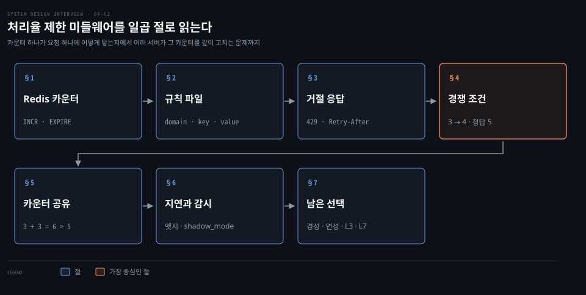
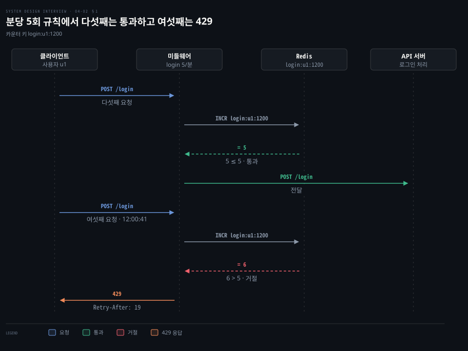
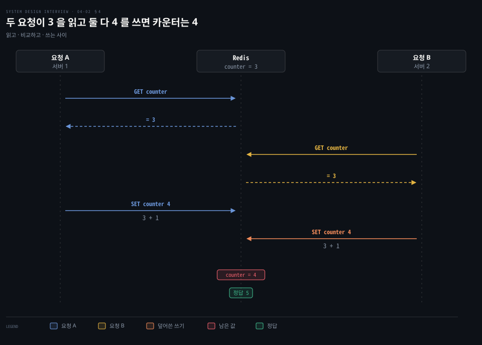
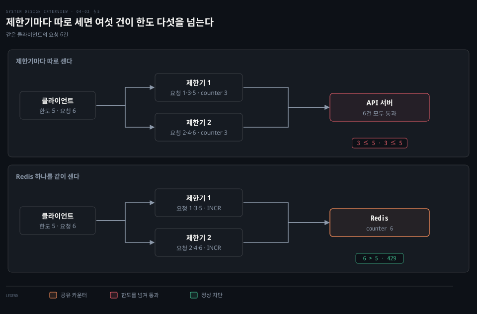

# 처리율 제한 미들웨어는 규칙과 Redis 카운터로 429 를 돌려주고 분산 환경의 경쟁 조건과 동기화를 푼다

---

> 미들웨어는 요청마다 Redis 카운터를 올려 규칙의 한도와 견주고 넘으면 429 를 돌려주며 서버가 여럿일 때는 경쟁 조건과 카운터 분산을 풀어야 합니다.


## 핵심 요약

> 이 편의 중심 생각은 처리율 제한이 카운터를 하나 세는 일로 끝나지 않고 그 카운터를 어디에 두고 누가 동시에 고치는지가 설계의 절반이라는 점입니다.

요청이 오면 미들웨어가 Redis 카운터를 올려 한도와 견주고 넘으면 429 와 기다릴 시간을 돌려줍니다. 한도는 코드가 아니라 규칙 파일에 있어서 서버를 다시 배포하지 않고 바꿉니다.

서버가 여럿이 되면 두 가지가 깨집니다. 읽고 확인하고 쓰는 세 걸음 사이로 다른 요청이 끼면 카운터가 덜 올라갑니다. 제한기마다 카운터를 따로 두면 한도가 새어 나갑니다. 앞의 문제는 Redis 가 한 번에 처리하는 명령이나 Lua 스크립트로, 뒤의 문제는 카운터를 한곳에 모아 풉니다.

거리 때문에 한곳에 못 모을 때는 최종 일관성으로 느슨하게 맞춥니다. 그 대가로 한도를 잠깐 넘기는 연성 제한을 받아들입니다.




## 학습 목표

> 이 편을 읽고 나면 다음을 설명할 수 있습니다.

1. 요청 한 건이 미들웨어와 Redis 를 지나 통과 또는 429 로 갈리는 순서를 카운터 값과 함께 설명할 수 있습니다.
2. 규칙 파일의 domain·key·value·rate_limit 이 하나의 한도로 이어지는 과정을 말할 수 있습니다.
3. 429 응답에 붙는 헤더를 표준과 관행으로 구분하고 Retry-After 값을 계산할 수 있습니다.
4. 읽고 쓰는 사이의 경쟁 조건이 카운터를 덜 올리는 과정을 값으로 보이고 INCR 과 Lua 스크립트가 이를 막는 이유를 설명할 수 있습니다.
5. 제한기가 여럿일 때 카운터를 공유해야 하는 이유와 엣지 배치의 일관성 대가를 설명할 수 있습니다.


## 1. 카운터는 디스크가 아니라 Redis 에 두고 INCR 과 EXPIRE 로 센다

> 요청마다 일어나는 카운터 조회는 메모리 저장소가 감당합니다. Redis 의 INCR 이 올리고 새 값을 돌려주며 EXPIRE 가 낡은 키를 지웁니다.

사용자가 요청할 때마다 이번 분에 몇 번째인지를 물어야 한다면 그 카운터는 어디에 두어야 요청 수만큼의 조회를 견딜까요?

디스크 데이터베이스는 매 요청의 읽기와 쓰기가 느려서 맞지 않습니다. 메모리 저장소는 빠르고 시간이 지나면 키를 지우는 만료를 지원해서 맞습니다. Redis 의 INCR 은 키가 없으면 0 으로 시작해 1 을 올린 새 값을 돌려줍니다. EXPIRE 는 키에 수명을 겁니다.[^incr]



로그인 요청은 `POST /login` 이고 규칙은 분당 5회입니다. 키는 `login:u1:1200`(규칙 이름, 사용자, 창 시작 분을 이은 설계 예시)이라고 하겠습니다. 다섯째 요청의 INCR 은 5 를 돌려주고 5 ≤ 5 라서 API 서버로 전달됩니다. 여섯째 요청의 INCR 은 6 이고 6 > 5 라서 429 로 거절됩니다.

올리는 일과 수명을 거는 일은 한 트랜잭션으로 묶습니다. Redis 문서의 속도 제한 패턴이 이 모양입니다. 응답의 첫 값이 INCR 의 새 값입니다.[^pattern]

```bash
# 한 트랜잭션으로 카운터를 올리고 수명을 겁니다.
MULTI
INCR login:u1:1200
# 키에 창 시작 시각이 들어 있어 다음 분에는 다른 키를 씁니다. 수명 120초는 창 길이의 두 배로 잡은 청소용 설계 값입니다.
EXPIRE login:u1:1200 120
EXEC
```

이 방식은 거절된 요청도 INCR 로 셉니다. 이미 한도를 넘은 키라 판정은 같습니다. 여러 규칙을 한 요청에 묶어 판정할 때 넘은 규칙 때문에 다른 규칙의 카운터까지 오르는 일은 Envoy 용 제한 서비스의 설정으로 막습니다.[^envoy-incr]

카운터 하나로 끝나는 것은 고정 윈도 계열입니다. 토큰 버킷은 남은 토큰 수와 마지막 보충 시각이라는 두 값을 읽고 고쳐야 해서 §4 의 Lua 스크립트가 필요해집니다. 알고리즘별 차이는 [처리율 제한기 편](./04-01.처리율%20제한기는%20토큰%20버킷·누출%20버킷·고정%20윈도·이동%20윈도%20로그·이동%20윈도%20카운터로%20요청을%20센다.md)에서 다뤘고, Redis 가 명령 하나를 끝까지 처리한 뒤 다음 명령으로 넘어가는 까닭은 [캐시 전략과 Redis 편](../bytebytego-system-design/02-01.캐시%20전략은%20읽기·쓰기%20경로에서%20캐시%20자리를%20정하고%20Redis%20는%20메모리와%20단일%20스레드%20이벤트%20루프로%20빠르다.md)에 있습니다.


## 2. 규칙은 파일에 두고 제한기가 메모리로 읽어 한도로 바꾼다

> 한도는 도메인과 디스크립터로 이름 붙은 YAML 규칙입니다. 제한기는 이 파일을 메모리로 읽어 두었다가 요청이 오면 맞는 규칙을 찾습니다.

로그인은 분당 5회, 마케팅 메시지는 하루 5건이라는 숫자는 어디에 두어야 서버를 다시 띄우지 않고 고칠 수 있을까요?

Lyft 가 공개한 제한 컴포넌트가 이 형식의 출처입니다. 저장소는 지금 envoyproxy/ratelimit 으로 옮겨졌습니다.[^envoy-moved] 규칙 하나는 이렇게 씁니다.[^envoy-format]

```yaml
# auth 도메인에서 auth_type 이 login 인 요청에 분당 5회를 허용합니다.
domain: auth
descriptors:
  - key: auth_type
    value: login
    rate_limit:
      unit: minute
      requests_per_unit: 5
```

```yaml
# messaging 도메인에서 message_type 이 marketing 인 요청에 하루 5건을 허용합니다.
domain: messaging
descriptors:
  - key: message_type
    value: marketing
    rate_limit:
      unit: day
      requests_per_unit: 5
```

**디스크립터**(descriptor)는 키와 값의 쌍이고 도메인 안에서 규칙을 고르는 열쇠입니다. 요청이 도메인과 디스크립터를 보내면 제한기는 맞는 규칙의 `unit` 과 `requests_per_unit` 으로 한도를 정합니다. `unit` 은 초·분·시·일이 기본입니다.[^envoy-format] 값 없이 키만 쓰면 어떤 값이든 맞고 값마다 한도가 따로 생깁니다. 전화번호마다 하루 5건씩 제한하는 식입니다.[^envoy-format]

전체 설계는 이렇게 이어집니다. 규칙은 디스크에 두고 작업자가 자주 읽어 캐시에 채웁니다. 미들웨어는 캐시에서 규칙을 읽고 Redis 에서 카운터와 마지막 요청 시각을 가져와 판정합니다. 통과하면 API 서버로 보내고 거절하면 429 를 돌려주며 그 요청은 버리거나 큐로 넘깁니다.

규칙을 가져오는 단계를 Envoy 용 제한 서비스는 시작할 때 메모리로 읽고 지정한 경로의 심볼릭 링크가 바뀌면(설정에 따라서는 파일이 바뀌면) 다시 읽는 방식으로 합니다.[^envoy-reload] 요청마다 디스크를 읽지 않으므로 규칙을 바꿔도 재배포가 필요 없습니다. §1 의 Redis 키는 이 규칙 이름과 사용자와 창 시작 시각을 이은 예시입니다.


## 3. 한도를 넘으면 429 와 기다릴 시간을 돌려준다

> 거절은 429 상태 코드이고 기다릴 시간은 표준 Retry-After 로 알립니다. 남은 횟수를 알리는 헤더는 아직 관행과 초안에 머물러 있습니다.

거절당한 클라이언트는 자기가 제한당했다는 것과 얼마나 기다려야 하는지를 무엇으로 알까요?

429 는 사용자가 주어진 시간에 요청을 너무 많이 보냈다는 상태 코드입니다. 응답에는 상황의 세부를 담는 것이 권장되고 Retry-After 는 붙일 수도 있으며 캐시에 저장해서는 안 됩니다. 사용자를 어떻게 알아보고 요청을 어떻게 세는지는 이 규격이 정하지 않습니다.[^rfc6585]

Retry-After 의 값은 HTTP 날짜이거나 기다릴 초입니다.[^rfc9110] 여섯째 요청이 12:00:41 에 거절되면 창이 12:01:00 에 끝나므로 기다릴 시간은 60 − 41 = 19 초이고 헤더는 `Retry-After: 19` 입니다.

| 헤더 | 담는 값 | 지위 |
|------|---------|------|
| `Retry-After` | 기다릴 초 또는 시각 | 표준(RFC 9110) |
| `X-Ratelimit-Limit`·`X-Ratelimit-Remaining` | 창당 허용 횟수와 남은 횟수 | 표준이 아닌 관행 |
| `RateLimit-Policy` | 정책 한도 `"burst";q=100;w=60` | IETF 초안 |
| `RateLimit` | 남은 양 `"default";r=50;t=30` | IETF 초안 |

`RateLimit-Policy` 와 `RateLimit` 을 정의한 draft-ietf-httpapi-ratelimit-headers 는 2026-10 현재 11판(2026-05-23)이고 RFC 로 확정되지 않은 작업 그룹 초안입니다.[^draft] 구현마다 이름이 갈리는 것이 이 상태의 증거입니다. Envoy 용 제한 서비스는 `LIMIT_RESPONSE_HEADERS_ENABLED` 를 켜면 `RateLimit-Limit`·`RateLimit-Remaining`·`RateLimit-Reset` 을 기본 이름으로 보내고 환경 변수로 이름을 바꿉니다.[^envoy-headers]

거절한 요청은 버리는 것이 기본이지만 잃으면 안 되는 일은 큐에 넣어 나중에 처리합니다. 과부하로 거절된 주문을 보관했다가 처리하는 경우가 그렇습니다.


## 4. 읽고 확인하고 쓰는 세 걸음 사이로 다른 요청이 끼면 카운터가 덜 올라간다

> 읽고 한도와 견주고 쓰는 세 걸음을 따로 부르면 그 사이로 다른 요청이 끼어 같은 값을 읽습니다. 올리고 새 값을 받는 INCR 한 번이나 Lua 스크립트가 그 틈을 없앱니다.

카운터를 가장 단순하게 다루면 세 걸음입니다. `GET counter` 로 값을 읽습니다. counter + 1 이 한도를 넘는지 견줍니다. 넘지 않으면 `SET counter` 로 1 올린 값을 씁니다. 서버가 여럿이고 요청이 동시에 오면 한 요청이 읽고 쓰는 사이에 다른 요청이 같은 값을 읽을 수 있습니다. 그러면 카운터는 어떻게 될까요?

**경쟁 조건**(race condition)은 실행 순서에 따라 결과가 달라지는 상태입니다. 카운터가 3 일 때 서버 1 의 요청 A 와 서버 2 의 요청 B 가 쓰기 전에 둘 다 `GET counter` 로 3 을 읽으면 둘 다 3 + 1 = 4 를 `SET counter 4` 로 씁니다. 두 건이 들어왔으니 정답은 5 인데 카운터는 4 에 머뭅니다.



한도가 4 이면 피해가 보입니다. 둘 다 3 + 1 = 4 가 한도를 넘지 않아 통과합니다. 실제로는 5건이 들어가 한도를 넘습니다. 락으로 줄을 세우면 막히지만 요청마다 기다림이 생겨 처리량이 떨어집니다. 락 없이 푸는 길은 여럿입니다.

하나는 비교를 쓴 뒤로 미루는 것입니다. INCR 은 올린 뒤의 새 값을 돌려주는 명령 하나라서 A 가 4, B 가 5 를 받고 한도 4 에서 B 만 거절됩니다. Redis 문서의 속도 제한 패턴 첫 번째 구현이 이 방식입니다.[^pattern]

다른 하나는 읽은 값으로 분기하는 로직을 Redis 안에서 한 번에 실행하는 것입니다. Lua 스크립트는 Redis 가 원자적 실행을 보장하고 실행 동안 서버의 다른 활동을 막습니다.[^eval] 

MULTI 와 EXEC 는 이 용도로 맞지 않습니다. 사이의 명령은 다른 클라이언트의 명령이 끼어들지 않는 하나의 격리된 작업으로 실행되지만, 명령이 EXEC 때까지 큐에 쌓여 그 안에서 읽은 값으로 분기할 수 없어서 INCR 과 EXPIRE 를 함께 실행하는 데 씁니다.[^tx] 읽고 쓰는 로직을 트랜잭션으로 지키려면 WATCH 로 키를 지켜보다가 바뀌면 실패시켜 다시 시도하는 낙관적 잠금이 필요합니다.[^tx-watch]

클라이언트가 INCR 한 뒤 EXPIRE 를 보내기 전에 죽으면 수명 없는 키가 남는 문제도 Redis 문서는 스크립트로 묶어 풉니다.[^pattern]

```lua
-- INCR 와 첫 EXPIRE 를 한 스크립트로 묶어 중간에 끊기지 않게 합니다.
-- 창 1초는 Redis 문서 예제(IP 마다 초당 10회)의 값이고 분당 규칙이면 60 을 씁니다.
local current
current = redis.call("incr",KEYS[1])
if current == 1 then
    redis.call("expire",KEYS[1],1)
end
-- 문서 스크립트에 없는 줄입니다. 호출한 쪽이 새 값을 받도록 돌려줍니다.
return current
```

또 하나의 흔한 길은 요청 시각을 정렬 집합(sorted set)에 쌓는 방식이고 이동 윈도 로그가 여기에 해당합니다([처리율 제한기 편](./04-01.처리율%20제한기는%20토큰%20버킷·누출%20버킷·고정%20윈도·이동%20윈도%20로그·이동%20윈도%20카운터로%20요청을%20센다.md)). 토큰 버킷처럼 두 값을 읽고 조건에 따라 고치는 알고리즘은 INCR 하나로 끝나지 않으므로 스크립트 방식을 씁니다.


## 5. 제한기가 여럿이면 카운터를 한곳에 모아야 한다

> 제한기가 카운터를 따로 가지면 한 사용자의 요청이 제한기 수만큼 쪼개져 한도가 샙니다. 스티키 세션은 확장성이 나빠서 Redis 같은 중앙 저장소에 모읍니다.

사용자가 수백만이면 제한기 서버 하나로는 모자라 여럿을 둡니다. 그때 한 사용자의 카운터는 어디에 있어야 할까요?

한도 5 에 요청 6건을 두 제한기에 번갈아 보냅니다. 요청 1·3·5 는 제한기 1 로, 요청 2·4·6 은 제한기 2 로 가므로 각자 3 건씩만 셉니다. 3 ≤ 5 가 두 번이라 여섯 건이 모두 통과합니다. 합치면 6 > 5 입니다.



웹 계층이 무상태이면 클라이언트가 다음에 어느 제한기를 만날지 정해져 있지 않습니다. [무상태 웹 계층](./01-02.캐시·CDN·무상태%20웹%20계층·데이터%20센터·메시지%20큐·샤딩이%20수백만%20사용자까지%20규모를%20늘린다.md)이 바로 그 구조입니다. **스티키 세션**은 같은 클라이언트를 같은 제한기로 보내 이 문제를 피합니다. 다만 제한기가 늘거나 죽을 때마다 대응이 깨져 확장성과 유연성이 떨어집니다. 그래서 카운터를 Redis 에 모아 모든 제한기가 같은 값을 올리게 합니다.

중앙 저장소는 새 병목이 될 수 있습니다. Envoy 용 제한 서비스는 단일 서버·센티넬·클러스터 배포를 지원하고[^envoy-redis] 초당 한도 전용 Redis 를 따로 둘 수도 있습니다.[^envoy-redis2] Envoy 가 복제본이 몇이든 한도를 하나로 지키는 방식은 [Envoy 확장 편](../../../08_cloud/book/istio-in-action/14-01.Envoy를%20새로%20빌드하지%20않으려고%20낸%20네%20개의%20문.md)에 있습니다.


## 6. 엣지로 지연을 줄이고 최종 일관성으로 맞추며 모니터링으로 규칙을 고친다

> 멀리 있는 사용자의 지연은 가까운 엣지에서 판정해 줄이고 지역 사이의 카운터는 최종 일관성으로 맞춥니다. 지표를 보고 알고리즘과 규칙을 고칩니다.

사용자가 Redis 에서 멀리 있을수록 요청마다 카운터를 다녀오는 시간이 길어집니다. 이 지연은 어떻게 줄일까요?

여러 데이터 센터나 엣지 서버를 두고 트래픽을 가장 가까운 곳으로 보냅니다. 지역마다 카운터가 있으면 서로 맞춰야 하는데 즉시 맞추면 지연이 되살아나므로 [복제의 최종 일관성](./06-01.키-값%20저장소는%20CAP%20선택%20아래%20안정%20해시로%20나누고%20N·W·R%20정족수로%20복제%20일관성을%20고른다.md)으로 맞춥니다. 전파가 끝나기 전에는 지역별 합이 한도를 잠깐 넘을 수 있습니다.

제한기 쪽에서도 줄입니다. 이미 한도를 넘은 키는 제한기 메모리에 기억해 Redis 를 다시 읽지 않고,[^envoy-cache] 한 요청의 Redis 명령은 한 번에 쓰고 한 번에 읽어 왕복을 줄입니다.[^envoy-pipeline]

도입한 뒤에는 두 가지를 지표로 확인합니다. 알고리즘이 효과적인지와 규칙이 효과적인지입니다. 규칙이 너무 엄격해 정상 요청이 버려지면 규칙을 완화합니다. 플래시 세일처럼 갑자기 몰려 알고리즘이 못 버티면 버스트를 받아 주는 토큰 버킷으로 바꿉니다. 새 규칙은 `shadow_mode` 로 먼저 켭니다. 판정과 통계는 그대로 돌고 결과만 항상 통과로 나갑니다. 그래서 켜기 전에 얼마나 막힐지 지표로 볼 수 있습니다.[^envoy-shadow]


## 7. 경성과 연성, 어느 계층에서 막는가, 클라이언트는 어떻게 덜 막히는가

> 한도를 절대 넘기지 않는 경성과 잠깐 넘기는 연성, 막는 계층, 클라이언트 쪽 예절이 설계 뒤에 남는 선택입니다.

지금까지의 설계가 정하지 않은 선택이 셋 남았습니다.

**경성**(hard) 제한은 요청 수가 한도를 절대 넘지 못합니다. **연성**(soft) 제한은 짧은 시간 동안 넘을 수 있습니다. §4 의 INCR 한 번의 판정은 경성에 가깝고, §6 의 지역 카운터를 최종 일관성으로 맞추는 방식은 연성입니다. 어느 쪽이 맞는지는 넘겼을 때의 피해가 정합니다.

막는 계층도 고릅니다. 지금까지는 HTTP 요청을 세는 응용 계층(L7)이었습니다. IP 주소로 막는다면 네트워크 계층(L3)에서 iptables 의 hashlimit 모듈이 원본·대상 주소와 포트 같은 그룹마다 단위 시간당 패킷 수를 제한합니다.[^iptables]

클라이언트가 덜 막히는 방법도 있습니다. 응답을 캐시해 호출을 줄이고 한도를 알아 짧은 시간에 몰아 보내지 않습니다. 오류는 잡아서 복구합니다. 재시도에는 충분한 대기를 둡니다. Retry-After 가 있으면 그 값을 먼저 따릅니다. 호출하는 쪽에서 한도를 먼저 지키는 방법은 [Rate Limiter](../../../09_spring/03_network/resilience/01-05.Rate%20Limiter%20&%20Time%20Limiter%20—%20트래픽%20제어와%20타임아웃.md)에, 재시도 간격은 [Retry](../../../09_spring/03_network/resilience/01-03.Retry%20—%20exponential%20backoff·jitter·재시도%20폭주%20방지.md)에 있습니다. 서비스 메시에서 Envoy 가 이 계산을 전역 제한 서비스에 맡기는 구조는 [Envoy 확장 편](../../../08_cloud/book/istio-in-action/14-01.Envoy를%20새로%20빌드하지%20않으려고%20낸%20네%20개의%20문.md)이 다룹니다.


## 면접 대비

> 카운터 저장소, 한도 판정, 경쟁 조건, 분산 동기화에 관한 면접 질문입니다.

1. 처리율 제한 카운터를 디스크 데이터베이스가 아니라 Redis 에 두는 이유와 INCR·EXPIRE 가 하는 일은 무엇입니까?
2. 분당 5회 규칙에 요청 6건이 오면 카운터 값과 응답은 어떻게 변하고 Retry-After 는 어떻게 정합니까?
3. 읽고 확인하고 쓰는 방식이 동시 요청에서 틀리는 과정과 이를 막는 방법을 설명해 보십시오.
4. 제한기가 둘일 때 카운터를 따로 두면 안 되는 이유와 스티키 세션 대신 Redis 를 쓰는 이유는 무엇입니까?
5. 멀리 있는 사용자의 지연을 줄이려 엣지에 두면 어떤 일관성 대가가 생기고 이를 어떻게 점검합니까?


## 정답 (자답 후 펼치기)

> 면접 질문에 대한 키워드 중심의 모범 답안입니다.

### 정답 1 — 메모리 속도와 만료, INCR 은 올리고 새 값 반환

요청마다 일어나는 조회를 디스크는 감당하지 못하고 Redis 는 메모리라 빠릅니다. INCR 은 키가 없으면 0 에서 시작해 1 을 올린 새 값을 돌려줍니다. EXPIRE 는 수명을 걸어 낡은 창의 키를 지웁니다. 둘은 MULTI·EXEC 로 묶습니다.

### 정답 2 — 5 는 통과, 6 은 429, 남은 창 시간이 Retry-After

다섯째 INCR 이 5 를 돌려주면 5 ≤ 5 라 통과하고, 여섯째는 6 > 5 라 429 입니다. 12:00:41 에 거절되면 창 끝 12:01:00 까지 60 − 41 = 19 초이므로 `Retry-After: 19` 를 보냅니다.

### 정답 3 — 읽기와 쓰기 사이의 틈, INCR 한 번이나 Lua 스크립트

카운터 3 을 두 요청이 모두 읽고 둘 다 4 를 쓰면 정답 5 가 4 로 줄어 한도를 넘는 통과가 생깁니다. 올리고 새 값을 받는 INCR 한 번으로 바꾸면 A 가 4, B 가 5 를 받아 B 가 거절됩니다. 명령 여럿이 필요하면 Lua 스크립트로 묶어 원자적으로 실행합니다.

### 정답 4 — 쪼개지는 카운터, 스티키 세션의 확장성 한계, 중앙 Redis

번갈아 보낸 6건이 3 과 3 으로 쪼개져 한도 5 를 넘어서도 통과합니다. 스티키 세션은 제한기가 늘거나 죽을 때 대응이 깨져 확장성과 유연성이 떨어집니다. 카운터를 Redis 한곳에 모으면 모든 제한기가 같은 값을 올립니다.

### 정답 5 — 최종 일관성의 연성 제한, 지표와 shadow_mode

가까운 엣지에서 판정하면 지연이 줄어듭니다. 지역 카운터는 최종 일관성으로 맞추므로 전파 전에는 합이 한도를 잠깐 넘는 연성 제한이 됩니다. 알고리즘과 규칙이 효과적인지 지표로 확인하고 새 규칙은 `shadow_mode` 로 먼저 켭니다.


## 참고 자료

- Alex Xu, 《System Design Interview – An Insider's Guide》, 처리율 제한기 설계 후반.
- Redis INCR(속도 제한 패턴 포함): https://redis.io/docs/latest/commands/incr/
- Redis 트랜잭션: https://redis.io/docs/latest/develop/using-commands/transactions/
- Redis Lua 스크립트: https://redis.io/docs/latest/develop/programmability/eval-intro/
- envoyproxy/ratelimit(고정 커밋): https://github.com/envoyproxy/ratelimit/tree/f4e76690d9ce6590707ffd7d28c33a24b99302da
- RFC 6585 §4 429 Too Many Requests: https://www.rfc-editor.org/rfc/rfc6585#section-4
- RFC 9110 §10.2.3 Retry-After: https://www.rfc-editor.org/rfc/rfc9110#section-10.2.3
- RateLimit header fields for HTTP(IETF 초안): https://datatracker.ietf.org/doc/draft-ietf-httpapi-ratelimit-headers/
- iptables-extensions(8): https://man7.org/linux/man-pages/man8/iptables-extensions.8.html


## 관련 문서

- [처리율 제한기는 토큰 버킷·누출 버킷·고정 윈도·이동 윈도 로그·이동 윈도 카운터로 요청을 센다](./04-01.처리율%20제한기는%20토큰%20버킷·누출%20버킷·고정%20윈도·이동%20윈도%20로그·이동%20윈도%20카운터로%20요청을%20센다.md)
- [캐시·CDN·무상태 웹 계층·데이터 센터·메시지 큐·샤딩이 수백만 사용자까지 규모를 늘린다](./01-02.캐시·CDN·무상태%20웹%20계층·데이터%20센터·메시지%20큐·샤딩이%20수백만%20사용자까지%20규모를%20늘린다.md)
- [키-값 저장소는 CAP 선택 아래 안정 해시로 나누고 N·W·R 정족수로 복제 일관성을 고른다](./06-01.키-값%20저장소는%20CAP%20선택%20아래%20안정%20해시로%20나누고%20N·W·R%20정족수로%20복제%20일관성을%20고른다.md)

[^incr]: Redis INCR: <https://redis.io/docs/latest/commands/incr/>
[^pattern]: Redis INCR 문서의 속도 제한 패턴: <https://redis.io/docs/latest/commands/incr/#pattern-rate-limiter>
[^envoy-incr]: envoyproxy/ratelimit README Redis 절 `STOP_CACHE_KEY_INCREMENT_WHEN_OVERLIMIT`: <https://github.com/envoyproxy/ratelimit/blob/f4e76690d9ce6590707ffd7d28c33a24b99302da/README.md#redis>
[^envoy-moved]: github.com/lyft/ratelimit 은 301 로 envoyproxy/ratelimit 으로 이동합니다(2026-10-12 확인): <https://github.com/envoyproxy/ratelimit>
[^envoy-format]: 규칙 형식과 단위: <https://github.com/envoyproxy/ratelimit/blob/f4e76690d9ce6590707ffd7d28c33a24b99302da/README.md#the-configuration-format>
[^envoy-reload]: 설정 감시와 다시 읽기: <https://github.com/envoyproxy/ratelimit/blob/f4e76690d9ce6590707ffd7d28c33a24b99302da/README.md#file-based-configuration-loading>
[^rfc6585]: RFC 6585 §4: <https://www.rfc-editor.org/rfc/rfc6585#section-4>
[^rfc9110]: RFC 9110 §10.2.3: <https://www.rfc-editor.org/rfc/rfc9110#section-10.2.3>
[^draft]: IETF datatracker, draft-ietf-httpapi-ratelimit-headers-11(2026-05-23, 만료 2026-11-24): <https://datatracker.ietf.org/doc/draft-ietf-httpapi-ratelimit-headers/>
[^envoy-headers]: 사용자 지정 헤더: <https://github.com/envoyproxy/ratelimit/blob/f4e76690d9ce6590707ffd7d28c33a24b99302da/README.md#custom-headers>
[^tx]: Redis 트랜잭션: <https://redis.io/docs/latest/develop/using-commands/transactions/>
[^tx-watch]: Redis 트랜잭션의 낙관적 잠금(WATCH): <https://redis.io/docs/latest/develop/using-commands/transactions/#optimistic-locking-using-check-and-set>
[^eval]: Redis Lua 스크립트의 원자적 실행: <https://redis.io/docs/latest/develop/programmability/eval-intro/>
[^envoy-redis2]: 초당 한도 전용 Redis: <https://github.com/envoyproxy/ratelimit/blob/f4e76690d9ce6590707ffd7d28c33a24b99302da/README.md#two-redis-instances>
[^envoy-redis]: Redis 배포 방식: <https://github.com/envoyproxy/ratelimit/blob/f4e76690d9ce6590707ffd7d28c33a24b99302da/README.md#redis-type>
[^envoy-cache]: 지역 캐시: <https://github.com/envoyproxy/ratelimit/blob/f4e76690d9ce6590707ffd7d28c33a24b99302da/README.md#local-cache>
[^envoy-pipeline]: 파이프라이닝: <https://github.com/envoyproxy/ratelimit/blob/f4e76690d9ce6590707ffd7d28c33a24b99302da/README.md#pipelining>
[^envoy-shadow]: ShadowMode: <https://github.com/envoyproxy/ratelimit/blob/f4e76690d9ce6590707ffd7d28c33a24b99302da/README.md#shadowmode>
[^iptables]: iptables-extensions(8) hashlimit: <https://man7.org/linux/man-pages/man8/iptables-extensions.8.html>
