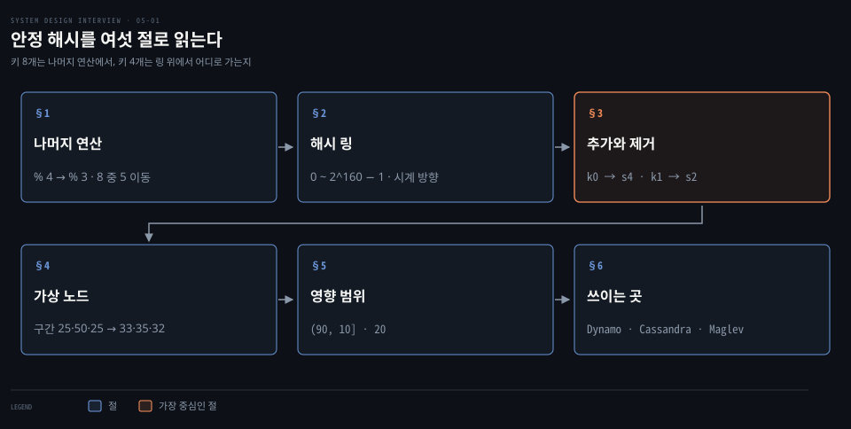
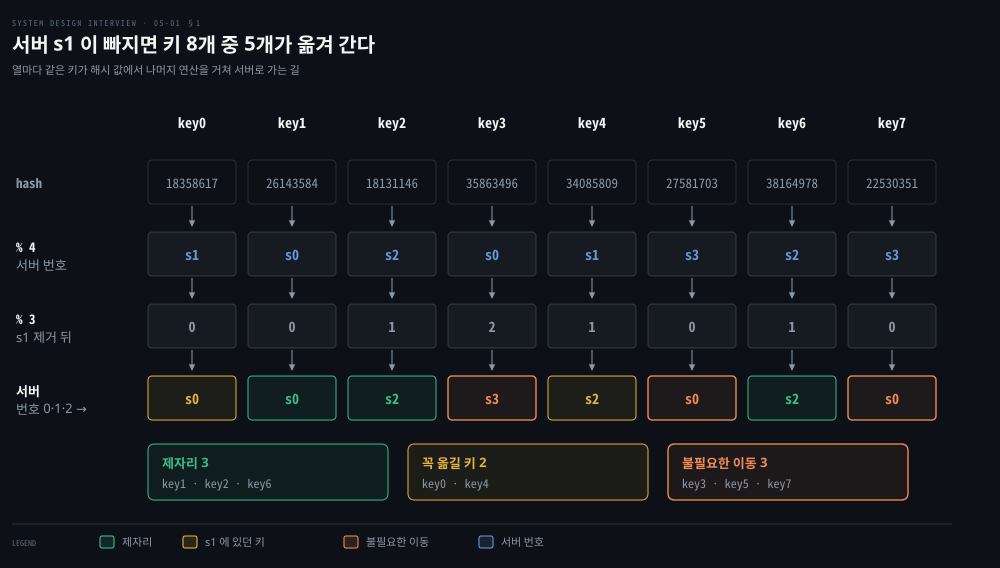
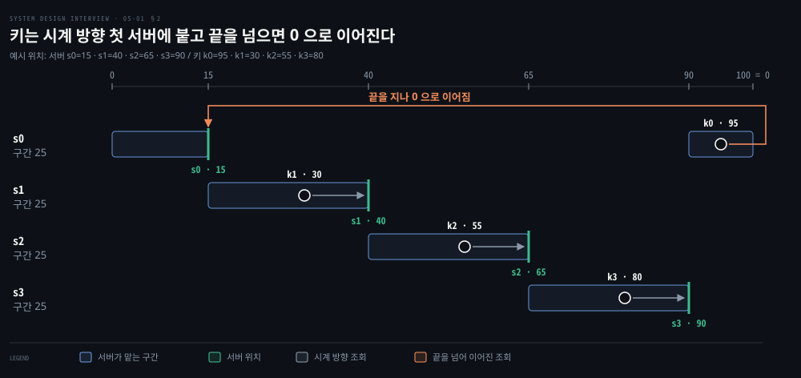
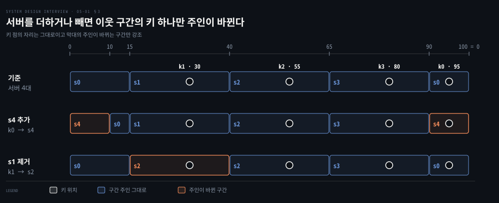
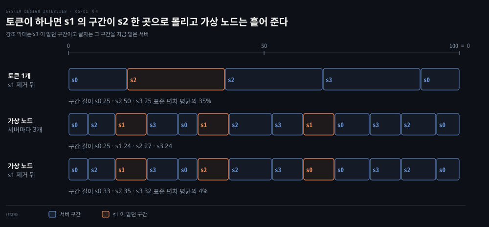
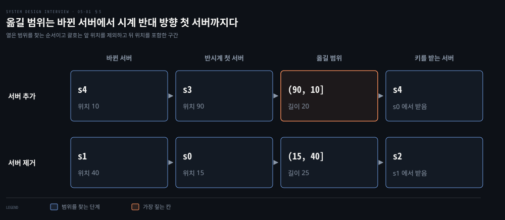

# 안정 해시는 해시 링과 가상 노드로 서버가 늘고 줄 때 옮길 키를 줄인다

---

> 서버 번호를 나머지 연산으로 고르면 서버 한 대의 변화에 키 대부분이 옮겨 가지만, 서버와 키를 같은 해시 링에 놓고 시계 방향 첫 서버를 고르면 이웃 구간의 키만 옮겨 갑니다.

## 핵심 요약

> 이 편의 중심 생각은 키가 갈 서버를 번호가 아니라 해시 공간의 위치로 정하면 서버가 바뀌어도 이웃 구간의 키만 주인이 바뀐다는 것입니다.

`hash(key) % N` 은 N 이 바뀌는 순간 거의 모든 키의 번호를 바꿉니다. 서버 넷에서 하나가 빠지면 키 여덟 개 중 다섯이 다른 서버로 갑니다. 그중 셋은 옮길 이유가 없던 키입니다. 안정 해시는 서버와 키를 같은 해시 공간의 점으로 놓고 키에서 시계 방향으로 처음 만나는 서버를 주인으로 삼습니다.

서버를 더하면 새 서버 바로 앞 구간의 키만, 빼면 그 서버가 맡던 구간의 키만 이웃으로 갑니다. 서버를 한 점씩만 올리면 구간 길이가 들쭉날쭉하므로 서버 하나를 링의 여러 곳에 가상 노드로 올려 구간을 잘게 쪼갭니다. 대가는 위치 수만큼 늘어나는 메타데이터와 이웃 관계입니다.

## 학습 목표

> 이 편을 읽고 나면 다음을 설명할 수 있습니다.

1. `hash(key) % N` 에서 서버 하나가 빠질 때 키 대부분이 옮겨 가는 까닭과 그 비율을 계산으로 보일 수 있습니다.
2. 해시 링에서 키가 담길 서버를 시계 방향으로 찾고 링의 끝에서 0 으로 이어지는 규칙을 설명할 수 있습니다.
3. 서버 추가와 제거에서 주인이 바뀌는 키의 범위를 시계 반대 방향 탐색으로 정할 수 있습니다.
4. 기본 링의 두 문제와 가상 노드가 이를 줄이는 방식, 그리고 그 대가를 설명할 수 있습니다.
5. Dynamo·Cassandra 가 링을 쓰는 모양과 Maglev 해싱이 링과 다른 점을 구분할 수 있습니다.

## 1. 나머지 연산은 서버 하나가 빠져도 키 대부분의 번호를 바꾼다

> `hash(key) % N` 은 N 이 바뀌면 같은 해시 값을 다른 번호로 나눕니다. 그래서 빠진 서버의 키뿐 아니라 멀쩡한 서버의 키도 옮겨 갑니다.

캐시 서버 넷에 키 여덟 개를 `serverIndex = hash(key) % N` 으로 나눠 두었습니다. N 은 서버 수입니다. 서버 s1 이 내려가면 s1 에 없던 키도 옮겨 가야 할까요?

해시 값은 서버 수와 상관없이 그대로이고 바뀌는 것은 나누는 수뿐입니다. s1 이 빠져 N 이 3 이 되면 남은 서버 s0·s2·s3 가 번호 0·1·2 를 차례로 받습니다. `hash % 3` 의 결과 0 은 s0, 1 은 s2, 2 는 s3 를 뜻합니다.

| 키 | 해시 값 | % 4 (서버) | % 3 (새 번호) | 새 번호의 서버 | 판정 |
|----|---------|------------|---------------|----------------|------|
| key0 | 18358617 | s1 | 0 | s0 | 꼭 옮김 |
| key1 | 26143584 | s0 | 0 | s0 | 제자리 |
| key2 | 18131146 | s2 | 1 | s2 | 제자리 |
| key3 | 35863496 | s0 | 2 | s3 | 불필요한 이동 |
| key4 | 34085809 | s1 | 1 | s2 | 꼭 옮김 |
| key5 | 27581703 | s3 | 0 | s0 | 불필요한 이동 |
| key6 | 38164978 | s2 | 1 | s2 | 제자리 |
| key7 | 22530351 | s3 | 0 | s0 | 불필요한 이동 |

제자리에 남는 키는 key1·key2·key6 셋이고 다섯이 옮겨 갑니다. s1 에 있던 key0·key4 는 어차피 옮겨야 합니다. key3·key5·key7 은 멀쩡한 서버에 있었는데도 번호가 바뀌어 다른 서버로 갑니다. 클라이언트는 같은 해시 값으로 새 서버를 찾아가지만 그 서버에는 캐시가 없어서 미스가 납니다. 요청이 한꺼번에 원본 저장소로 몰립니다.

여덟 개 중 다섯은 표본이 작아서 나온 값이고 평균은 따로 계산됩니다. N 개에서 하나가 빠질 때 `hash % N` 과 `hash % (N−1)` 의 쌍은 N(N−1) 개 주기마다 모든 조합이 한 번씩 나옵니다. N 과 N−1 은 서로소이기 때문입니다. 제자리에 남는 조합은 새 번호마다 하나씩 N−1 개뿐이므로 남는 비율은 1/N 입니다. N=4 이면 12 개 중 3 개가 남아 3/4 이 옮겨 갑니다. 어느 서버가 빠져도 같은 값이고 N=3·4·5·8 에서 열거해 확인했습니다. 서버를 하나 더할 때도 N/(N+1) 이 옮겨 가서 4 대에서 5 대가 되면 4/5 입니다.

같은 계산을 샤드 수에 적용한 값은 [캐시·CDN·샤딩 편](./01-02.캐시·CDN·무상태%20웹%20계층·데이터%20센터·메시지%20큐·샤딩이%20수백만%20사용자까지%20규모를%20늘린다.md)의 §6 에 있습니다. 샤드 4개를 5개로 바꾸면 id 16개 중 12개가 옮겨 갑니다.

## 2. 해시 링은 서버와 키를 같은 공간에 놓고 시계 방향 첫 서버를 고른다

> 번호 대신 서버와 키를 같은 해시 공간의 위치로 놓고, 키에서 시계 방향으로 처음 만나는 서버가 주인입니다. 나눌 수가 없으니 서버 수가 바뀌어도 키의 위치는 움직이지 않습니다.

번호가 문제라면 번호 없이 서버를 고를 수는 없을까요? 서버가 번호를 받는 순간 그 번호는 서버 수에 묶입니다. 번호를 버리고 위치를 쓰면 서버 수와 키의 자리가 따로 놀게 됩니다. 이 방식은 웹 캐시의 핫스팟을 줄이려고 Karger 등이 1997 년에 낸 [논문](https://doi.org/10.1145/258533.258660)에서 나왔습니다.

해시 함수의 출력이 0 에서 2^160−1 까지라고 합시다. SHA-1 이 160 비트 [메시지 다이제스트](https://www.rfc-editor.org/rfc/rfc3174)를 내기 때문에 생기는 범위입니다. 2^160−1 은 십진수로 1461501637330902918203684832716283019655932542975 이고 약 1.46×10^48 입니다. 이 선분의 양 끝을 이으면 **해시 링**이 됩니다. 링 위에서는 어느 점에서든 시계 방향으로 가다 끝을 지나면 0 으로 이어집니다.

서버는 IP 나 이름을, 키는 키 자체를 같은 해시 함수에 넣어 링 위의 위치를 얻습니다. §1 과 달리 나머지 연산이 없고 해시 값이 곧 위치입니다. SHA-1 은 설명을 위한 가정입니다. Dynamo 는 키에 MD5 를 적용해 [128 비트 식별자](https://www.allthingsdistributed.com/files/amazon-dynamo-sosp2007.pdf)를 만들고, Cassandra 5.0 의 기본 파티셔너는 [Murmur3Partitioner](https://cassandra.apache.org/doc/5.0/cassandra/managing/configuration/cass_yaml_file.html) 입니다.

조회는 키의 위치에서 시계 방향으로 처음 만나는 서버를 고르는 것이 전부입니다. 아래는 설명을 위해 해시 공간을 0~99 로 줄이고 위치를 정한 예시입니다. 서버는 s0=15·s1=40·s2=65·s3=90 에 있습니다.

| 키 | 위치 | 시계 방향 첫 서버 |
|----|------|-------------------|
| k0 | 95 | s0 (끝을 지나 0 으로 이어져 15 에서 만남) |
| k1 | 30 | s1 (40 에서 만남) |
| k2 | 55 | s2 (65 에서 만남) |
| k3 | 80 | s3 (90 에서 만남) |

구현에서는 서버 위치를 정렬해 두고 키 위치 이상인 첫 위치를 찾습니다. 없으면 맨 앞 서버로 돌아갑니다. [Tom White 의 자바 구현](https://tom-e-white.com/2007/11/consistent-hashing.html)은 정렬 맵에서 `tailMap` 의 첫 키를 쓰고 비어 있으면 `firstKey` 를 씁니다. 같은 글은 서버 이름과 키를 고르게 섞는 해시가 필요하고 `hashCode` 는 그러지 못하므로 MD5 를 권한다고 적습니다.

## 3. 서버를 더하거나 빼면 이웃 구간의 키만 주인이 바뀐다

> s4 를 더하면 그 앞 구간의 키 하나가, s1 을 빼면 s1 이 맡던 키 하나가 이웃 서버로 갑니다. 나머지 키는 자리도 주인도 그대로입니다.

키의 위치는 해시 함수가 정하므로 서버가 바뀌어도 움직이지 않습니다. 바뀌는 것은 시계 방향으로 처음 만나는 서버가 누구인가뿐입니다.

s4 를 위치 10 에 더하면 k0(95)는 시계 방향으로 가다 10 에서 s4 를 먼저 만납니다. 주인이 s0 에서 s4 로 바뀝니다. k1·k2·k3 은 가는 길에 새 서버가 끼지 않아 그대로입니다. s1 을 빼면 k1(30)은 40 에서 서버를 만나지 못하고 65 의 s2 까지 가서 주인이 s2 가 됩니다. 다른 키의 주인은 그대로입니다.

키가 K 개이고 구간이 고르다고 가정합니다. 서버를 하나 더하면 평균 `K/(N+1)` 개가, 하나 빼면 평균 `K/N` 개가 옮겨집니다. §1 의 방식은 더할 때 `K·N/(N+1)` 개, 뺄 때 `K·(N−1)/N` 개입니다. N=4, K=100만이면 더할 때 80만 개 대 20만 개, 뺄 때 75만 개 대 25만 개입니다. 안정 해시가 옮기는 양은 서버 하나가 맡을 몫과 같아서 더 줄일 여지가 없는 값입니다.

## 4. 서버를 링에 한 번만 올리면 구간이 고르지 않아 가상 노드로 쪼갠다

> 서버를 한 점씩만 올리면 구간 길이가 제각각이고 빠진 서버의 구간이 한 이웃으로 몰립니다. 서버마다 여러 점을 올리면 구간이 잘게 쪼개져 편차가 줄고 빠진 몫이 여러 서버로 흩어집니다.

서버 점 사이의 해시 공간을 구간이라 부르겠습니다. 점이 서버마다 하나뿐이면 문제가 둘 생깁니다.

1. 구간 길이를 같게 유지할 수 없습니다. §2 예시에서는 네 구간이 25 씩 고르지만 s1 이 빠지면 s2 의 구간이 50 이 되어 s0·s3 의 두 배가 됩니다.
2. 서버 점이 고르게 퍼지지 않으면 어떤 서버 앞에 긴 빈 구간이 생깁니다. 그 서버가 키 대부분을 맡고 구간이 짧은 서버는 거의 비게 됩니다.

해법은 서버 하나를 링의 여러 위치에 놓는 일입니다. 이 위치가 **가상 노드**(virtual node)입니다. s0 을 s0_0·s0_1·s0_2 처럼 이름을 달리해 해시하면 서버 하나가 여러 구간을 맡습니다. 조회는 그대로이고, 시계 방향으로 처음 만나는 가상 노드가 가리키는 서버가 주인입니다.

링 위에 놓인 이 위치를 Dynamo 와 Cassandra 는 **토큰**이라 부릅니다. 서버마다 토큰을 몇 개 받는지가 곧 가상 노드 수입니다([Dynamo 논문](https://www.allthingsdistributed.com/files/amazon-dynamo-sosp2007.pdf) §4.2).

아래는 같은 공간 0~99 에서 서버 넷이 가상 노드를 세 개씩 열두 곳에 놓은 예시입니다. 위치는 5 s0, 12 s2, 20 s1, 28 s3, 33 s0, 41 s1, 52 s2, 60 s3, 68 s1, 77 s0, 85 s3, 94 s2 입니다. 한 위치의 서버는 그 앞 위치부터 자기 위치까지의 구간을 맡고, 서버별 합은 s0 25·s1 24·s2 27·s3 24 입니다.

토큰이 하나일 때 s1 이 빠진 뒤의 구간 길이는 25·50·25 이고 평균 33.3 에 모표준편차 11.8, 평균의 약 35% 입니다. 가상 노드를 세 개씩 두면 s1 의 구간 세 조각이 s3·s2·s0 에 하나씩 넘어가 s0 33·s2 35·s3 32 가 됩니다. 모표준편차는 1.25 이고 평균의 약 4% 입니다.

가상 노드가 늘수록 균형이 좋아지는 것은 Tom White 가 2007 년에 [모의 실험](https://tom-e-white.com/2007/11/consistent-hashing.html)으로 보였습니다. 캐시 10 대에 객체 10,000 개를 넣고 복제본 수를 바꿔 표준 편차를 평균 대비 비율로 쟀더니 복제본이 100~200 개일 때 약 5~10% 였습니다. Dynamo 는 여기에 [용량에 맞춰 가상 노드 수를 정한다](https://www.allthingsdistributed.com/files/amazon-dynamo-sosp2007.pdf)는 이점을 더했습니다. 성능이 높은 서버에 점을 더 올리면 맡는 구간이 그만큼 넓어집니다.

대가는 위치 수만큼 관리할 정보가 늘어난다는 점입니다. Cassandra 5.0 문서는 토큰이 하나 늘 때마다 링 위의 이웃이 최대 `2×(RF−1)` 개 늘어난다고 [적습니다](https://cassandra.apache.org/doc/5.0/cassandra/architecture/dynamo.html). 그러면 서버 장애가 겹칠 때 토큰 범위 일부를 쓸 수 없게 되는 조합이 많아집니다. 이는 가용성을 잃는다는 뜻입니다. repair 같은 클러스터 전체 작업도 느려집니다.

기본값은 버전마다 달랐습니다. [Cassandra 5.0 문서](https://cassandra.apache.org/doc/5.0/cassandra/architecture/dynamo.html)는 2.x 에는 무작위 토큰뿐이어서 기본값이 256 이었고, 3.x 이후 결정적 할당기가 더해져 더 적은 수로 균형을 맞출 수 있게 되었다고 적습니다. 5.0 의 [cassandra.yaml](https://cassandra.apache.org/doc/5.0/cassandra/managing/configuration/cass_yaml_file.html) 은 `num_tokens` 기본값을 16 으로 적습니다. 이 항목을 비워 두면 호환을 위해 토큰 1 개를 쓴다고 설명합니다.

인기 있는 키들이 한 서버에 겹치는 문제도 줄어듭니다. 줄어드는 것은 서로 다른 인기 키가 같은 서버에 겹칠 확률입니다. 키 하나는 항상 한 서버의 한 구간에만 놓이므로, 그 키 하나에 쏠린 읽기는 안정 해시로 풀리지 않습니다. 이 경우의 우회는 [해시 샤딩과 일관 해싱 편](../../../05_data/book/designing-data-intensive-applications/07-02.해시%20샤딩과%20일관%20해싱.md)의 §6 에서 다룹니다.

## 5. 옮길 범위는 바뀐 서버에서 시계 반대 방향 첫 서버까지다

> 서버를 더하면 새 서버 위치에서, 서버를 빼면 빠진 서버 위치에서 시계 반대 방향으로 처음 만나는 서버까지가 옮길 키의 범위입니다.

서버가 바뀔 때 옮길 키를 어떻게 알 수 있을까요? 키 전체를 다시 계산하지 않고 범위만 찾으면 됩니다.

s4 를 위치 10 에 더하면 시계 반대 방향 첫 서버는 위치 90 의 s3 입니다. 범위는 `(90, 10]` 이고 길이는 20 입니다. 이 범위의 키는 s4 의 시계 방향 다음 서버 s0 이 맡던 키여서 s0 에서 s4 로 옮깁니다. s1 을 빼면 시계 반대 방향 첫 서버는 위치 15 의 s0 입니다. 범위는 `(15, 40]` 이고 길이는 25 입니다. 이 범위의 키는 s1 에서 시계 방향 다음 서버 s2 로 갑니다.

괄호는 앞 위치를 제외하고 뒤 위치를 포함합니다. Cassandra 문서도 토큰 범위를 `(t1, t2]` 로 [표기해](https://cassandra.apache.org/doc/5.0/cassandra/architecture/dynamo.html) 앞 토큰은 제외하고 뒤 토큰은 포함합니다. 이 표기에서 범위의 키는 뒤 위치의 서버가 맡으며, §2 의 시계 방향 첫 서버 규칙과 같습니다.

해시가 고르다면 옮겨질 키의 비율은 범위 길이의 비율과 같습니다. 예시 위치는 §3 의 비율 `1/(N+1)`=1/5 과 `1/N`=1/4 에 맞춰 골랐으므로 20/100 과 25/100 이 그 값과 같습니다. 가상 노드를 쓰면 서버 하나에 범위가 여러 개 생깁니다. 범위마다 같은 방식으로 찾아 옮깁니다.

## 6. Dynamo 와 Cassandra 는 링을 쓰고 Maglev 는 룩업 테이블로 같은 목표를 이룬다

> 분산 저장소는 링과 가상 노드를 그대로 쓰고, 부하 분산기 Maglev 는 링 대신 순열로 채운 테이블을 써서 이동량보다 균형을 우선합니다.

안정 해시는 실제 시스템에서 모두 링으로 구현될까요? 표는 각 시스템이 쓰는 모양과 그 근거입니다.

| 시스템 | 쓰는 모양 | 근거 |
|--------|-----------|------|
| Dynamo | 키의 MD5 128 비트 값을 링 위치로 쓰고 노드마다 여러 토큰을 받으며 수를 노드 용량에 맞춥니다 | [Dynamo 논문](https://www.allthingsdistributed.com/files/amazon-dynamo-sosp2007.pdf) §4.1~4.2 |
| Cassandra | 노드가 토큰을 하나 이상 받고, 키를 해시한 토큰에서 링을 걸어 복제본을 찾습니다 | [5.0 문서](https://cassandra.apache.org/doc/5.0/cassandra/architecture/dynamo.html) |
| Discord | 엔터티가 놓인 노드를 찾으려 링 자료구조를 쓴다고 2017 년 글이 적었습니다 | [Discord 블로그](https://discord.com/blog/how-discord-scaled-elixir-to-5-000-000-concurrent-users) |
| Akamai | 안정 해시가 Akamai 를 낳았다고 적고 캐시를 계속 늘리던 초기 Akamai 를 서버 수가 늘 변하는 예로 듭니다 | [Stanford CS168](http://theory.stanford.edu/~tim/s16/l/l1.pdf) |
| Maglev | 링이 아니라 룩업 테이블에 백엔드를 채우는 Maglev 해싱으로 연결을 백엔드에 고정합니다 | [Maglev 논문](https://static.googleusercontent.com/media/research.google.com/en//pubs/archive/44824.pdf) §3.4 |

Maglev 는 같은 목표를 쓰되 우선순위가 반대입니다. 논문은 Karger 방식과 rendezvous 방식이 소수 서버의 웹 캐시를 위해 최소 이동을 우선했다고 봅니다. 백엔드 사이 부하를 고르게 맞추는 일이 더 중요해서 새 알고리즘을 만들었다고 적습니다. 백엔드 1000 대와 테이블 65537 칸 실험에서 Karger 방식은 불균형을 받아 내려면 백엔드를 29.7% 더 두어야 했습니다(§5.3). 쿠버네티스에서 Maglev 를 켜는 설정과 검증은 [DSR·Maglev·netkit 편](../../../08_cloud/book/cilium-up-and-running/08-02.DSR·Maglev·netkit%20은%20응답%20경로와%20백엔드%20선택과%20Pod%20연결의%20비용을%20줄인다.md)의 §2 에서 다뤘습니다.

링 위에서 복제본을 어디에 둘지, 노드가 죽었을 때 누가 대신 받을지는 [키-값 저장소 편](./06-01.키-값%20저장소는%20CAP%20선택%20아래%20안정%20해시로%20나누고%20N·W·R%20정족수로%20복제%20일관성을%20고른다.md)에서 이어집니다.

## 면접 대비

> 나머지 연산의 한계, 해시 링 조회, 이동 범위, 가상 노드, 쓰이는 곳에 관한 면접 질문입니다.

1. `hash(key) % N` 으로 키를 나눈 캐시 서버가 한 대 빠지면 키 대부분이 옮겨 가는 까닭과 그 비율은 무엇입니까?
2. 해시 링에서 키가 담길 서버는 어떻게 찾으며, 키가 링의 끝 너머에 있으면 어떻게 됩니까?
3. 서버를 추가하거나 제거할 때 옮겨지는 키의 범위는 어떻게 정하며 이동량은 얼마입니까?
4. 서버를 링에 한 점씩만 올리면 생기는 두 문제와 가상 노드가 이를 줄이는 방식, 그 대가는 무엇입니까?
5. 안정 해시를 쓰는 시스템 둘과, Maglev 해싱이 링 기반 방식과 다른 점은 무엇입니까?

## 정답 (자답 후 펼치기)

> 면접 질문에 대한 키워드 중심의 모범 답안입니다.

### 정답 1 — 번호 재배정, 남는 비율 1/N

나누는 수 N 이 바뀌면 같은 해시 값이 다른 번호로 나뉘고 서버 번호도 다시 매겨집니다. N 개에서 하나가 빠지면 제자리에 남는 키는 평균 1/N 이어서 (N−1)/N 이 옮겨 갑니다. 서버 넷에서 하나가 빠지면 3/4 입니다. 그 결과 캐시 미스가 한꺼번에 원본 저장소로 몰립니다.

### 정답 2 — 시계 방향 첫 서버, 끝에서 0 으로

서버와 키를 같은 해시 함수로 링 위의 위치에 놓고, 키 위치에서 시계 방향으로 처음 만나는 서버를 고릅니다. 구현은 서버 위치를 정렬해 두고 키 위치 이상인 첫 위치를 찾습니다. 끝을 넘으면 0 으로 이어져 맨 앞 서버가 주인이 됩니다.

### 정답 3 — 반시계 첫 서버까지, 서버 하나의 몫

서버를 더하면 새 위치에서, 빼면 빠진 위치에서 시계 반대 방향으로 처음 만나는 서버까지가 범위입니다. 그 범위의 키만 시계 방향 다음 서버와 사이에서 옮겨집니다. 양은 평균 K/(N+1) 또는 K/N 으로 서버 하나가 맡을 몫입니다.

### 정답 4 — 구간 불균등, 가상 노드, 메타데이터 비용

서버가 하나의 점이면 구간 길이를 같게 유지할 수 없고 점이 몰리면 키가 한 서버에 쏠립니다. 서버마다 여러 가상 노드를 놓으면 구간이 잘게 쪼개져 편차가 줄고 빠진 몫이 여러 서버로 흩어집니다. 대가는 위치 정보와 이웃 관계의 증가입니다.

### 정답 5 — Dynamo·Cassandra 링, Maglev 는 룩업 테이블

Dynamo 와 Cassandra 는 링에 노드마다 여러 토큰을 둡니다. Maglev 는 백엔드마다 선호 순열을 두고 번갈아 테이블 칸을 채우는 룩업 테이블이며, 최소 이동보다 부하 균형을 우선합니다.

## 참고 자료

- Alex Xu, 《System Design Interview – An Insider's Guide》, 2판(Volume 1), Chapter 5 "Design Consistent Hashing".
- D. Karger 외, "Consistent Hashing and Random Trees: Distributed Caching Protocols for Relieving Hot Spots on the World Wide Web", STOC 1997: https://doi.org/10.1145/258533.258660
- G. DeCandia 외, "Dynamo: Amazon's Highly Available Key-value Store", SOSP 2007: https://www.allthingsdistributed.com/files/amazon-dynamo-sosp2007.pdf
- D. Eisenbud 외, "Maglev: A Fast and Reliable Software Network Load Balancer", NSDI 2016: https://static.googleusercontent.com/media/research.google.com/en//pubs/archive/44824.pdf
- Apache Cassandra 5.0 문서, Dynamo: https://cassandra.apache.org/doc/5.0/cassandra/architecture/dynamo.html
- Apache Cassandra 5.0 문서, cassandra.yaml: https://cassandra.apache.org/doc/5.0/cassandra/managing/configuration/cass_yaml_file.html
- RFC 3174, US Secure Hash Algorithm 1 (SHA1): https://www.rfc-editor.org/rfc/rfc3174
- Tom White, "Consistent Hashing", 2007: https://tom-e-white.com/2007/11/consistent-hashing.html
- Discord, "How Discord Scaled Elixir to 5,000,000 Concurrent Users": https://discord.com/blog/how-discord-scaled-elixir-to-5-000-000-concurrent-users
- T. Roughgarden, G. Valiant, "CS168: The Modern Algorithmic Toolbox, Lecture #1: Introduction and Consistent Hashing", Stanford, 2016: http://theory.stanford.edu/~tim/s16/l/l1.pdf

## 관련 문서

- [캐시·CDN·무상태 웹 계층·데이터 센터·메시지 큐·샤딩이 수백만 사용자까지 규모를 늘린다](./01-02.캐시·CDN·무상태%20웹%20계층·데이터%20센터·메시지%20큐·샤딩이%20수백만%20사용자까지%20규모를%20늘린다.md)
- [키-값 저장소는 CAP 선택 아래 안정 해시로 나누고 N·W·R 정족수로 복제 일관성을 고른다](./06-01.키-값%20저장소는%20CAP%20선택%20아래%20안정%20해시로%20나누고%20N·W·R%20정족수로%20복제%20일관성을%20고른다.md)
- [해시 샤딩과 일관 해싱](../../../05_data/book/designing-data-intensive-applications/07-02.해시%20샤딩과%20일관%20해싱.md)
- [샤딩](../../../05_data/01_foundation/02-04.샤딩.md)
- [DSR·Maglev·netkit 은 응답 경로와 백엔드 선택과 Pod 연결의 비용을 줄인다](../../../08_cloud/book/cilium-up-and-running/08-02.DSR·Maglev·netkit%20은%20응답%20경로와%20백엔드%20선택과%20Pod%20연결의%20비용을%20줄인다.md)
