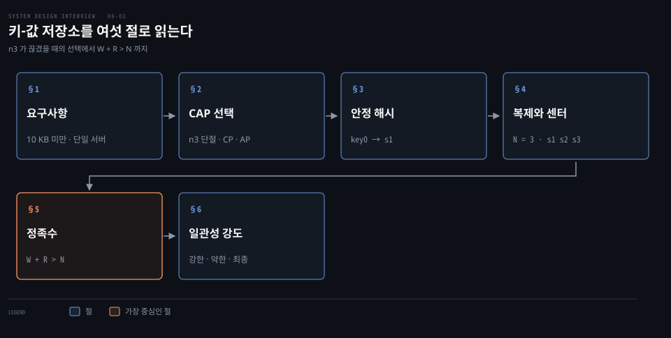
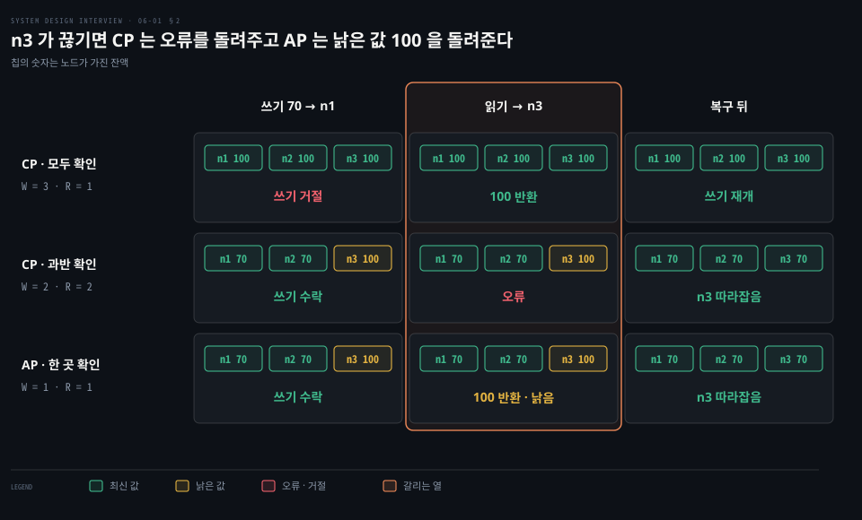
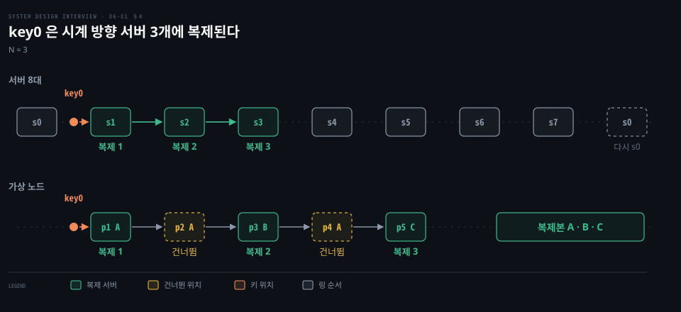
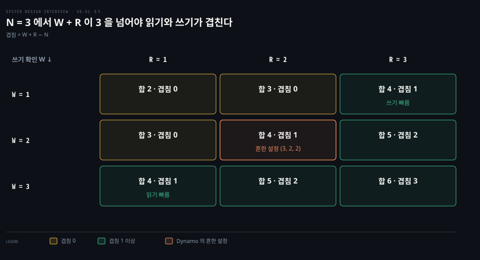

# 키-값 저장소는 CAP 선택 아래 안정 해시로 나누고 N·W·R 정족수로 복제 일관성을 고른다

---

> 분산 키-값 저장소는 분할이 났을 때 일관성과 가용성 중 무엇을 지킬지 먼저 정하고, 안정 해시로 키를 나눈 뒤 N 개 복제본과 W·R 정족수로 일관성의 강도를 고릅니다.

## 핵심 요약

> 이 편의 중심 생각은 분산 키-값 저장소의 설계가 "서버 사이가 끊겼을 때 무엇을 지킬까"라는 하나의 선택에서 출발하고 나머지 장치는 그 선택을 구현하는 도구라는 점입니다.

한 서버로는 큰 데이터를 담을 수 없어 키-값 쌍을 여러 서버에 나눕니다. 서버 사이가 끊기는 분할은 피할 수 없으므로 그때 일관성과 가용성 중 하나를 고르는 것이 CAP 정리입니다.

키는 안정 해시 링에서 시계 방향 첫 서버가 맡고, 같은 키를 그 서버부터 시계 방향 N 개 서버에 복제합니다. 쓰기는 W 곳, 읽기는 R 곳의 확인을 기다리며 W + R > N 이면 읽는 서버와 쓰는 서버가 겹쳐 확인된 쓰기가 읽기에 보입니다.

일관성의 강도는 강한·약한·최종으로 갈립니다. 지금의 Cassandra 는 연산마다, DynamoDB 는 읽기마다 그 강도를 고릅니다.

## 학습 목표

> 이 편을 읽고 나면 다음을 설명할 수 있습니다.

1. 키-값 저장소가 만족해야 할 요구사항과 단일 서버가 한계에 닿는 까닭을 설명할 수 있습니다.
2. n3 가 끊겼을 때 CP 와 AP 가 각각 무엇을 하는지 값으로 보이고 PACELC 가 덧붙이는 것을 말할 수 있습니다.
3. 해시 링에서 키 하나가 시계 방향 서버 3 개에 복제되는 경로와 같은 서버를 건너뛰는 규칙을 설명할 수 있습니다.
4. N = 3 에서 W·R 아홉 쌍의 겹침 서버 수를 W + R − N 으로 계산할 수 있습니다.
5. 강한·약한·최종 일관성을 구분하고 Cassandra 와 DynamoDB 가 일관성을 고르는 방식을 말할 수 있습니다.

## 1. 키-값 저장소는 키마다 값 하나를 두고 큰 데이터는 여러 서버로 나눈다

> 키-값 저장소는 유일한 키에 값을 묶어 두고 키로만 꺼냅니다. 단일 서버의 해시 테이블은 빠르지만 용량이 곧 차서 분산 해시 테이블이 필요해집니다.

사용자와 데이터가 늘 때 키-값 쌍을 한 서버의 해시 테이블에 넣는 가장 단순한 설계는 어디서 막힐까요?

키는 `last_logged_in_at` 같은 평문이거나 `253DDEC4` 같은 해시 값이고 짧을수록 성능에 유리합니다. 값은 문자열·리스트·객체이며 Dynamo 는 값을 바이트 배열로만 다룹니다.[^dynamo-opaque] 연산은 `put(key, value)` 와 `get(key)` 둘뿐입니다. 완벽한 설계는 없고 읽기·쓰기·메모리 사이에서 균형을 잡으며, 가장 큰 균형은 일관성과 가용성 사이입니다. 설계가 가정하는 범위는 다음과 같습니다.

| 요구 | 가정하는 값 | 푸는 절 |
|------|-------------|---------|
| 작은 쌍 | 키-값 쌍 하나가 10 KB 미만 | §1 |
| 큰 데이터 | 한 서버에 다 못 담음 | §3 |
| 높은 가용성 | 장애 중에도 빠르게 응답 | §2·§4 |
| 높은 확장성·자동 확장 | 트래픽에 따라 서버를 자동으로 더하고 뺌 | §3 |
| 조절 가능한 일관성 | 일관성의 강도를 고름 | §5·§6 |
| 낮은 지연 | 응답이 빠름 | §5 |

단일 서버에서는 키-값 쌍을 메모리의 해시 테이블에 두면 빠르지만 전부 올리면 공간이 모자랍니다. 데이터를 압축하거나 자주 쓰는 것만 메모리에 두고 나머지는 디스크에 두면 더 담을 수 있습니다. 그래도 금방 한계에 닿아 여러 서버에 쌍을 나누는 분산 해시 테이블이 필요합니다. DB 복제의 첫 단계는 [DB 복제 편](./01-01.단일%20서버에서%20출발한%20시스템은%20DB%20분리·로드밸런서·DB%20복제로%20첫%20병목을%20넘는다.md)에서 다뤘습니다.

## 2. 분할이 나면 일관성과 가용성 중 하나를 고른다

> CAP 정리는 분할이 났을 때 일관성과 가용성을 함께 얻을 수 없다고 말합니다. 최신 값을 확인하지 못하는 쪽이 응답을 거부하면 CP, 낡은 값을 감수하고 응답하면 AP 입니다.

복제본 n1·n2·n3 중 n3 가 나머지와 통신이 끊긴 채 잔액 100 을 70 으로 바꾸는 요청(설계 예시)이 오면 저장소는 무엇을 해야 할까요?

**CAP 정리**는 세 속성을 다룹니다.

- 일관성: 어느 노드에 접속해도 같은 최신 데이터를 봅니다.
- 가용성: 일부 노드가 죽어도 요청이 응답을 받습니다.
- 분할 내성: 두 노드 사이의 통신이 끊겨도(분할) 시스템이 동작합니다.

CAP 의 일관성은 복제본이 하나인 것처럼 보이는 단일 복사본 일관성이고 ACID 의 일관성(데이터베이스 규칙의 보존)보다 좁은 그 부분집합입니다.[^brewer]

분할이 없으면 n1 에 쓴 값이 n2·n3 로 복제되어 일관성과 가용성을 함께 얻습니다. 분할이 나면 n1·n2 에 쓴 값은 n3 에 닿지 못하고, n3 에 쓴 값은 n1·n2 에 닿지 못합니다. 이때 한쪽을 골라야 합니다.

잔액을 100 에서 70 으로 바꾸는 요청이 n1 에 옵니다. 모든 복제본의 확인을 요구하고(W = 3) 조율자가 n3 에 닿지 못하는 것을 알아 쓰기를 시작하지 않으면 쓰기가 거절되고, 값은 셋 다 100 이라 n3 에서 R = 1 로 읽어도 최신입니다. 분할이 풀리면 쓰기를 다시 받습니다.

과반의 확인만 요구하면(W = 2, R = 2) n1·n2 가 70 을 받고, 고립된 n3 는 읽기에 필요한 둘에 닿지 못해 오류를 돌려줍니다. 분할이 풀리면 n3 가 70 으로 따라잡습니다. 둘 다 최신을 확인하지 못하는 쪽이 응답을 거부하는 CP 입니다. 최신 잔액이 중요한 은행은 불일치가 풀리기 전에 오류를 돌려주는 CP 를 씁니다.

한 곳의 확인만으로 쓰기를 받으면(W = 1, R = 1) AP 입니다. n1·n2 는 70 을 받고 n3 는 낡은 100 을 들고 있습니다. n3 에서 읽으면 100 이 돌아가고, 분할이 풀리면 n3 가 70 으로 따라잡습니다. 분할 중 한쪽을 막지 않는 대가가 낡은 읽기입니다.[^brewer]

CA 를 골라도 분할이 나면 C 나 A 로 돌아가야 해서, 네트워크로 묶인 여러 서버의 저장소는 분할 때의 선택을 피할 수 없습니다. CA 를 고른다는 말은 분할 확률이 다른 장애보다 훨씬 낮다고 본다는 뜻으로 읽습니다.[^brewer]

분할은 드물어서 평소에는 둘을 함께 얻습니다. 복제본이 있는 한 분할이 없을 때도 응답 지연과 일관성 사이의 선택은 남습니다. Abadi 는 분할이 있으면 가용성과 일관성, 그렇지 않으면 지연과 일관성을 가르는 PACELC 로 이를 묶었습니다.[^abadi] CAP 과 PACELC 를 선형성으로 풀어 쓴 설명은 [선형성의 비용과 CAP](../../../05_data/book/designing-data-intensive-applications/10-02.선형성의%20비용과%20CAP.md)에 있습니다. 이 편이 설계하는 저장소는 가용성을 지키는 쪽이고, 일관성의 강도는 §5·§6 에서 연산마다 올립니다.

## 3. 안정 해시는 서버가 늘고 줄어도 옮길 키를 줄인다

> 키를 서버에 나눌 때 목표는 고르게 퍼뜨리는 것과 서버가 늘고 줄 때 옮기는 키를 줄이는 것입니다. 해시 링의 안정 해시가 둘을 함께 풉니다.

서버 8대에 나눈 키가 서버를 한 대 더하거나 한 대 잃을 때 얼마나 옮겨 갈까요?

서버 수로 나눈 나머지로 고르면 서버가 바뀔 때 대부분의 키가 옮겨 갑니다. 샤드 4개를 5개로 바꾸면 id 16개 중 12개가 옮겨 가는 계산이 [샤딩 절](./01-02.캐시·CDN·무상태%20웹%20계층·데이터%20센터·메시지%20큐·샤딩이%20수백만%20사용자까지%20규모를%20늘린다.md)에 있습니다.

안정 해시는 서버 s0~s7 을 해시 링에 올리고 키도 같은 링에 해시한 뒤, 키에서 시계 방향으로 만나는 첫 서버에 저장합니다. 키 `key0` 은 s0 과 s1 사이에 놓이고 시계 방향 첫 서버인 s1 에 저장됩니다. 링과 가상 노드의 자세한 동작은 [안정 해시 편](./05-01.안정%20해시는%20해시%20링과%20가상%20노드로%20서버가%20늘고%20줄%20때%20옮길%20키를%20줄인다.md)이 다룹니다.

이 방식은 두 가지를 줍니다. 서버를 부하에 따라 자동으로 더하고 뺄 수 있고, 서버 용량에 비례해 가상 노드 수를 정하면 용량이 큰 서버가 더 많은 키를 맡습니다. Cassandra 도 키를 해시한 토큰에서 링을 시계 방향으로 걷는 같은 구조이고 노드마다 토큰을 여러 개 둘 수 있습니다.[^cass-ring] 해시 샤딩 전반은 [해시 샤딩과 일관 해싱](../../../05_data/book/designing-data-intensive-applications/07-02.해시%20샤딩과%20일관%20해싱.md)에서 다룹니다.

## 4. 같은 키를 시계 방향 서버 N 개에 복제하고 센터를 나눈다

> 키는 해시 링에서 시계 방향으로 걸어 서로 다른 서버 N 개에 복제합니다. 같은 센터의 서버는 함께 죽기 쉬워서 복제본을 다른 데이터 센터에 둡니다.

key0 을 s1 에만 두면 s1 이 죽는 순간 그 키는 사라집니다. 복제본은 어느 서버에 둘까요?

데이터는 N 개 서버에 복제하고 N 은 설정할 수 있는 값입니다. 키가 링의 한 위치에 놓이면 그 위치에서 시계 방향으로 걸어 처음 만나는 N 개 서버를 고릅니다. N = 3 이면 key0 은 s1·s2·s3 에 복제됩니다. 복제는 비동기로 전파되고, 갱신이 모든 복제본에 닿는 시점은 §6 의 최종 일관성이 다룹니다.[^dynamo-async]

가상 노드를 쓰면 링의 처음 N 개 위치가 N 개보다 적은 물리 서버에 속할 수 있습니다. 설계 예시로 위치 p1~p5 의 주인이 A, A, B, A, C 라고 하겠습니다. key0 이 p1 앞에 놓이면 p1 의 A 가 첫째이고 p2 도 A 라서 건너뜁니다. p3 의 B 가 둘째이고 p4 는 다시 A 라서 건너뛰며 p5 의 C 가 셋째여서 복제본은 A·B·C 입니다. Dynamo 는 서로 다른 물리 서버만 남겨 이 목록을 만들고[^dynamo-pref], Cassandra 는 복제 수 3 에 서로 다른 복제본 3 개를 쓰며 필요하면 가상 노드를 건너뜁니다.[^cass-distinct]

같은 데이터 센터의 서버는 정전·네트워크 문제·재해로 동시에 죽기 쉽습니다. 그래서 복제본을 서로 다른 데이터 센터에 두고 센터 사이를 빠른 망으로 잇습니다. Dynamo 가 키의 복제 목록을 여러 센터에 걸쳐 만든 방식입니다.[^dynamo-dc] 현재 Cassandra 는 NetworkTopologyStrategy 로 센터마다 복제 수를 정하고, 센터 안에서도 랙이 다른 서버를 고르려 하고 랙 수가 복제 수 이상이면 복제본마다 랙이 다릅니다.[^cass-rep] 센터를 넘나드는 일관성 수준은 [06-02 편](./06-02.벡터%20시계·가십·임시%20위탁·머클%20트리가%20충돌과%20장애를%20다루고%20쓰기와%20읽기는%20SSTable%20을%20지난다.md)의 센터 장애 절이 다룹니다.

## 5. 쓰기 W 곳과 읽기 R 곳이 겹치면 확인된 쓰기가 읽기에 보인다

> N 개 복제본에서 쓰기는 W 곳, 읽기는 R 곳의 응답을 기다립니다. W + R > N 이면 두 집합이 반드시 겹쳐서 읽기가 확인된 쓰기를 만납니다.

복제본 N 개 중 몇 곳이 확인해야 쓰기가 성공이고, 몇 곳의 답을 기다려야 읽기가 성공일까요?

**정족수**(quorum) 값은 셋입니다. N 은 복제본 수, W 는 쓰기가 성공이려면 확인해야 하는 복제본 수, R 은 읽기가 성공이려면 응답을 기다려야 하는 복제본 수입니다. 클라이언트와 노드 사이의 중개자인 조율자(coordinator)가 이 확인을 셉니다.

W = 1 은 데이터가 서버 하나에만 쓰인다는 뜻이 아닙니다. 쓰기는 N 개 복제본 모두에 보내고, 조율자가 W 개의 확인만 받으면 클라이언트에 성공을 돌려줍니다. 예를 들어 s2 의 확인이 먼저 오면 s1·s3 의 확인은 기다리지 않습니다. Cassandra 도 쓰기는 일관성 수준과 상관없이 모든 복제본에 보내고 수준은 기다릴 응답 수만 정한다고 밝힙니다.[^cass-cl]

W 와 R 은 지연과 일관성을 맞바꾸는 손잡이입니다. 호출의 지연은 필요한 W(또는 R) 곳 가운데 가장 느린 복제본이 정해서 W 와 R 은 보통 N 보다 작게 둡니다.[^dynamo-quorum] W = 1 이나 R = 1 이면 가장 빠른 응답 하나만 기다려 빠릅니다.

겹침은 계산으로 구합니다. 쓰기 집합 W 곳과 읽기 집합 R 곳이 N 곳 안에 있으면 적어도 W + R − N 곳이 겹치고, 음수면 겹침이 0 입니다. N = 3 에서 (W, R) 아홉 쌍의 합과 겹침은 다음과 같습니다.

| W \ R | R = 1 | R = 2 | R = 3 |
|-------|-------|-------|-------|
| W = 1 | 합 2 · 겹침 0 | 합 3 · 겹침 0 | 합 4 · 겹침 1 |
| W = 2 | 합 3 · 겹침 0 | 합 4 · 겹침 1 | 합 5 · 겹침 2 |
| W = 3 | 합 4 · 겹침 1 | 합 5 · 겹침 2 | 합 6 · 겹침 3 |

합이 N 을 넘으면 겹치는 서버가 있어서 읽기가 확인된 쓰기를 만납니다. 예로 s1·s2 가 쓰기를 확인했고 읽기가 s2·s3 에 묻는다면 s2 가 겹칩니다(2 + 2 − 3 = 1). 이 보장을 Cassandra 문서는 W + R > RF 에서 두 정족수가 겹쳐 쓰기가 읽기에 보이는 것으로 설명합니다.[^cass-cl] 합이 N 이하면 겹침이 0 이라 낡은 값을 읽을 수 있습니다.

세 쌍은 쓰임이 정해져 있습니다. R = 1 에 W = N 인 (3,1)은 읽기에, W = 1 에 R = N 인 (1,3)은 쓰기에 최적화됩니다.

(2,2)는 Dynamo 가 여러 서비스에서 쓰는 흔한 설정이고 N, R, W 순으로 쓰면 3, 2, 2 입니다. 읽기가 많은 서비스는 R 을 1 로, W 를 N 으로 두기도 했습니다.[^dynamo-322]

W 를 올리면 내구성은 좋아지지만 쓰기에 필요한 서버가 늘어 거절할 가능성도 커집니다.[^dynamo-322]

Cassandra 는 W·R 을 숫자 대신 일관성 수준으로 고르고 QUORUM 은 과반(n/2 + 1)이라 RF = 3 이면 2 곳입니다.[^cass-cl]

| (W, R) | Cassandra 일관성 수준 | 겹침 |
|--------|----------------------|------|
| (3, 1) | 쓰기 ALL · 읽기 ONE | 1 |
| (1, 3) | 쓰기 ONE · 읽기 ALL | 1 |
| (2, 2) | 쓰기 QUORUM · 읽기 QUORUM | 1 |

센터가 여럿이면 LOCAL_QUORUM 은 같은 센터 안의 과반만 확인해 보장이 같은 센터에서 쓴 값으로 약해집니다.[^cass-cl] 돌려받은 값을 가리는 규칙은 Dynamo 가 벡터 시계로 앞선 버전을 버리고 동시 버전은 읽는 쪽이 합치는 방식이고, Cassandra 는 타임스탬프가 큰 쓰기가 이기는 방식입니다.[^cass-lww]

이 겹침이 절대 보장은 아닙니다. Dynamo 는 장애 중 건강한 처음 N 개 서버에서 읽고 쓰는 느슨한 정족수를 쓰므로 묻는 서버가 원래 N 개 복제본과 다를 수 있고, W = 1 이면 한 서버가 저장하기만 해도 쓰기를 받습니다.[^dynamo-hint] 벡터 시계와 임시 위탁은 [06-02 편](./06-02.벡터%20시계·가십·임시%20위탁·머클%20트리가%20충돌과%20장애를%20다루고%20쓰기와%20읽기는%20SSTable%20을%20지난다.md)이, 겹침이 깨지는 경우는 [리더리스 복제](../../../05_data/book/designing-data-intensive-applications/06-06.리더리스%20복제와%206장%20종합.md)의 정족수 절이 다룹니다.

## 6. 강한·약한·최종 일관성은 얼마나 기다리고 얼마나 낡은 값을 허용하는가로 갈린다

> 일관성 모델은 읽기가 최신 쓰기를 얼마나 보장하는지의 정도입니다. 강한 일관성은 가용성을 깎고, 최종 일관성은 시간이 지나야 복제본이 같아집니다.

쓰기를 확인받은 직후에 읽으면 항상 그 값을 볼 수 있어야 할까요?

일관성 모델은 세 단계로 나뉩니다.

- 강한 일관성: 읽기가 가장 최근에 완료된 쓰기의 결과를 돌려주며 클라이언트는 낡은 데이터를 보지 않습니다.
- 약한 일관성: 뒤이은 읽기가 최신 값을 못 볼 수 있습니다.
- 최종 일관성: 약한 일관성의 한 형태로, 시간이 충분히 지나면 모든 갱신이 퍼져 복제본이 같아집니다.

강한 일관성은 모든 복제본이 현재 쓰기에 합의할 때까지 새 읽기·쓰기를 받지 않아서 이루고, 새 연산이 막히므로 가용성이 중요한 시스템에 맞지 않습니다. 가용성을 지키는 이 설계는 최종 일관성을 기본으로 삼습니다. 최종 일관성에서는 동시 쓰기가 서로 다른 값을 남길 수 있어 읽는 쪽이 그 값을 합칩니다. 합치는 방법은 [06-02 편](./06-02.벡터%20시계·가십·임시%20위탁·머클%20트리가%20충돌과%20장애를%20다루고%20쓰기와%20읽기는%20SSTable%20을%20지난다.md)의 버전 관리가 다룹니다.

원래 Dynamo 는 갱신을 비동기로 전파하는 최종 일관성을 제공했고[^dynamo-async], 지금의 제품은 일관성을 다음 단위로 고르게 합니다.

| 저장소 | 고르는 단위 | 선택지 |
|--------|-------------|--------|
| Dynamo 논문 | 서비스마다 (N,R,W) | 흔한 값은 (3,2,2) |
| Cassandra 5.0 | 연산마다 | ONE·TWO·THREE·QUORUM·ALL·LOCAL_QUORUM 등[^cass-cl] |
| DynamoDB | 읽기마다 | 기본은 최종 일관성, `ConsistentRead` 를 켜면 강한 일관성[^ddb] |

DynamoDB 의 강한 일관성 읽기는 표와 로컬 보조 인덱스에서만 되고 글로벌 보조 인덱스와 스트림의 읽기는 모두 최종 일관성입니다. 최종 일관성 읽기는 강한 일관성 읽기의 절반 비용입니다. 글로벌 테이블은 지역 사이를 기본적으로 최종 일관성(MREC)으로 복제하고, 쓰기가 반환되기 전에 다른 지역에도 동기 복제하는 강한 일관성(MRSC)을 고를 수 있습니다.[^ddb]

## 면접 대비

> 분할 중의 선택, 키 분배와 복제, 정족수 계산, 일관성 모델에 관한 면접 질문입니다.

1. n3 가 끊겼을 때 CP 와 AP 는 각각 무엇을 하며 CA 를 골라도 분할 때의 선택을 피할 수 없는 까닭은 무엇입니까?
2. 서버 수로 나눈 나머지 대신 안정 해시를 쓰는 이유와 key0 을 N = 3 서버에 복제하는 경로를 설명해 보십시오.
3. N = 3 에서 W = 1 이면 데이터가 서버 하나에만 쓰입니까?
4. N = 3 에서 어떤 (W, R) 쌍이 겹침을 보장하며 겹침 서버 수는 어떻게 구합니까?
5. 강한 일관성과 최종 일관성의 차이와 Cassandra·DynamoDB 가 이를 고르는 방식은 무엇입니까?

## 정답 (자답 후 펼치기)

> 면접 질문에 대한 키워드 중심의 모범 답안입니다.

### 정답 1 — 최신을 확인 못 하는 쪽이 거절, CA 도 분할 때는 C 나 A

CP 는 최신 값을 확인하지 못하는 쪽이 오류나 거절로 답하고, AP 는 n3 가 낡은 100 을 돌려준 뒤 분할이 풀리면 따라잡습니다. CA 를 골라도 분할이 나면 C 나 A 로 돌아가야 해서 여러 서버 저장소는 분할 때의 선택을 피할 수 없습니다.

### 정답 2 — 이동 최소화, 시계 방향 서로 다른 서버 3 개

나머지 연산은 서버 수가 바뀌면 키 대부분이 옮겨 가지만 안정 해시는 이웃 구간만 옮깁니다.

key0 은 s0 과 s1 사이에서 시계 방향으로 s1·s2·s3 에 복제되고, 같은 물리 서버가 나오면 건너뜁니다.

### 정답 3 — 쓰기는 N 개에 보내고 W 개 확인만 기다림

쓰기는 모든 복제본에 보내고 조율자가 W 개의 확인을 받으면 성공을 돌려줍니다. W = 1 이면 확인 하나만 오면 되고 나머지는 기다리지 않습니다.

### 정답 4 — W + R > N, 겹침 = W + R − N

N = 3 에서 합이 4 이상이면 겹침이 1 이상이고 합이 3 이하이면 0 이라 낡은 값을 읽을 수 있습니다. (2,2)는 겹침 1, (3,3)은 겹침 3 입니다.

### 정답 5 — 낡은 값 허용 여부, 연산·읽기 단위 선택

강한 일관성은 최신 쓰기를 항상 보이려고 연산을 막고, 최종 일관성은 시간이 지나야 복제본이 같아집니다. Cassandra 는 연산마다 일관성 수준을, DynamoDB 는 읽기마다 `ConsistentRead` 를 고릅니다.

## 참고 자료

- Alex Xu, 《System Design Interview – An Insider's Guide》, 키-값 저장소 설계 전반.
- Dynamo: Amazon's Highly Available Key-value Store(SOSP 2007): https://www.allthingsdistributed.com/files/amazon-dynamo-sosp2007.pdf
- Apache Cassandra 5.0 Dynamo 문서: https://cassandra.apache.org/doc/5.0/cassandra/architecture/dynamo.html
- Amazon DynamoDB 읽기 일관성: https://docs.aws.amazon.com/amazondynamodb/latest/developerguide/HowItWorks.ReadConsistency.html
- Eric Brewer, CAP Twelve Years Later(IEEE Computer 2012, InfoQ 재게재): https://www.infoq.com/articles/cap-twelve-years-later-how-the-rules-have-changed/
- Daniel Abadi, Consistency Tradeoffs in Modern Distributed Database System Design(IEEE Computer 2012): https://www.cs.umd.edu/~abadi/papers/abadi-pacelc.pdf

## 관련 문서

- [안정 해시는 해시 링과 가상 노드로 서버가 늘고 줄 때 옮길 키를 줄인다](./05-01.안정%20해시는%20해시%20링과%20가상%20노드로%20서버가%20늘고%20줄%20때%20옮길%20키를%20줄인다.md)
- [벡터 시계·가십·임시 위탁·머클 트리가 충돌과 장애를 다루고 쓰기와 읽기는 SSTable 을 지난다](./06-02.벡터%20시계·가십·임시%20위탁·머클%20트리가%20충돌과%20장애를%20다루고%20쓰기와%20읽기는%20SSTable%20을%20지난다.md)
- [단일 서버에서 출발한 시스템은 DB 분리·로드밸런서·DB 복제로 첫 병목을 넘는다](./01-01.단일%20서버에서%20출발한%20시스템은%20DB%20분리·로드밸런서·DB%20복제로%20첫%20병목을%20넘는다.md)

[^dynamo-opaque]: Dynamo 논문 §4.1(키와 값을 바이트 배열로 다룸): <https://www.allthingsdistributed.com/files/amazon-dynamo-sosp2007.pdf>
[^brewer]: Eric Brewer, "CAP Twelve Years Later: How the Rules Have Changed", IEEE Computer, 2012, 「Why 2 of 3 is misleading」·「ACID, BASE, and CAP」·「CAP Confusion」: <https://www.infoq.com/articles/cap-twelve-years-later-how-the-rules-have-changed/>
[^abadi]: Daniel Abadi, "Consistency Tradeoffs in Modern Distributed Database System Design", IEEE Computer, 2012, PACELC 절: <https://www.cs.umd.edu/~abadi/papers/abadi-pacelc.pdf>
[^cass-ring]: Cassandra 5.0 문서, 토큰 링: <https://cassandra.apache.org/doc/5.0/cassandra/architecture/dynamo.html#consistent-hashing-using-a-token-ring>
[^cass-distinct]: Cassandra 5.0 문서, 복제 수와 서로 다른 물리 노드: <https://cassandra.apache.org/doc/5.0/cassandra/architecture/dynamo.html#multi-master-replication-versioned-data-and-tunable-consistency>
[^cass-lww]: Cassandra 5.0 문서의 충돌 해소 <https://cassandra.apache.org/doc/5.0/cassandra/architecture/dynamo.html#data-versioning> 와 Dynamo 논문 §4.4(벡터 시계) <https://www.allthingsdistributed.com/files/amazon-dynamo-sosp2007.pdf>
[^cass-rep]: Cassandra 5.0 문서, 복제 전략과 랙 선택: <https://cassandra.apache.org/doc/5.0/cassandra/architecture/dynamo.html#network-topology-strategy>
[^cass-cl]: Cassandra 5.0 문서, 일관성 수준: <https://cassandra.apache.org/doc/5.0/cassandra/architecture/dynamo.html#tunable-consistency>
[^dynamo-async]: Dynamo 논문 §4.4(갱신을 모든 복제본에 비동기로 전파): <https://www.allthingsdistributed.com/files/amazon-dynamo-sosp2007.pdf>
[^dynamo-pref]: Dynamo 논문 §4.3(서로 다른 물리 노드만 담은 선호 목록): <https://www.allthingsdistributed.com/files/amazon-dynamo-sosp2007.pdf>
[^dynamo-dc]: Dynamo 논문 §4.6(복제본을 여러 데이터 센터에 걸쳐 둠): <https://www.allthingsdistributed.com/files/amazon-dynamo-sosp2007.pdf>
[^dynamo-quorum]: Dynamo 논문 §4.5(R·W 와 가장 느린 복제본이 정하는 지연): <https://www.allthingsdistributed.com/files/amazon-dynamo-sosp2007.pdf>
[^dynamo-322]: Dynamo 논문 §6(흔한 (N,R,W) = (3,2,2), R = 1·W = N 읽기 엔진, W 와 가용성): <https://www.allthingsdistributed.com/files/amazon-dynamo-sosp2007.pdf>
[^dynamo-hint]: Dynamo 논문 §4.6(느슨한 정족수와 임시 위탁): <https://www.allthingsdistributed.com/files/amazon-dynamo-sosp2007.pdf>
[^ddb]: Amazon DynamoDB 개발자 안내서, 읽기 일관성: <https://docs.aws.amazon.com/amazondynamodb/latest/developerguide/HowItWorks.ReadConsistency.html>
