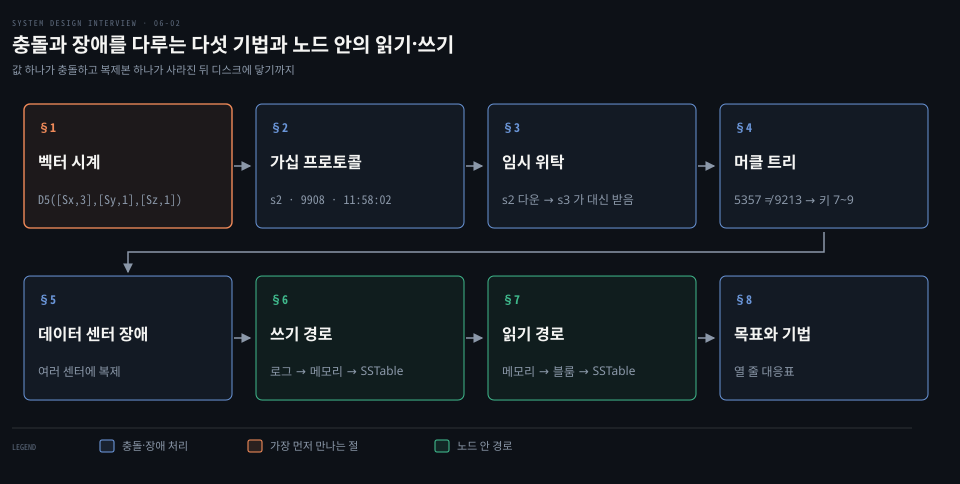
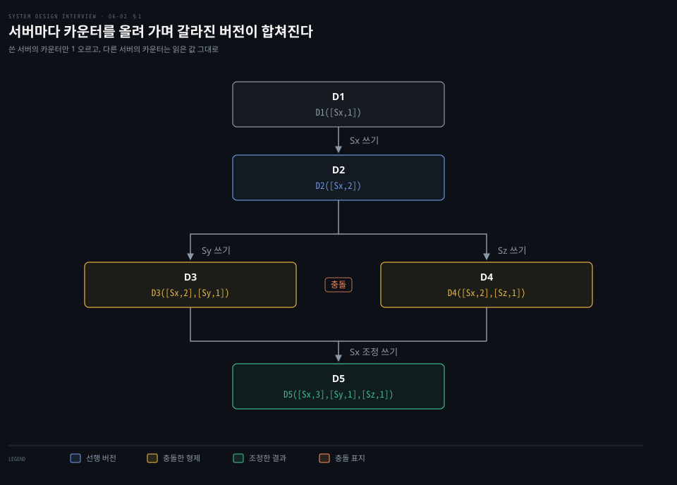
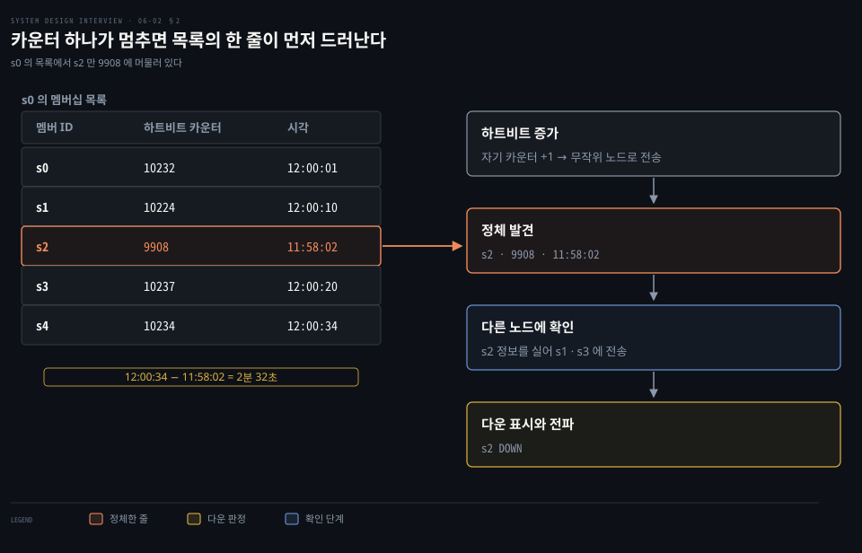
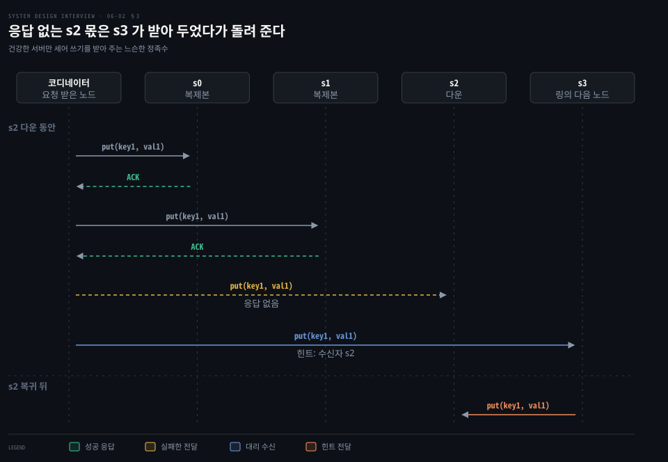
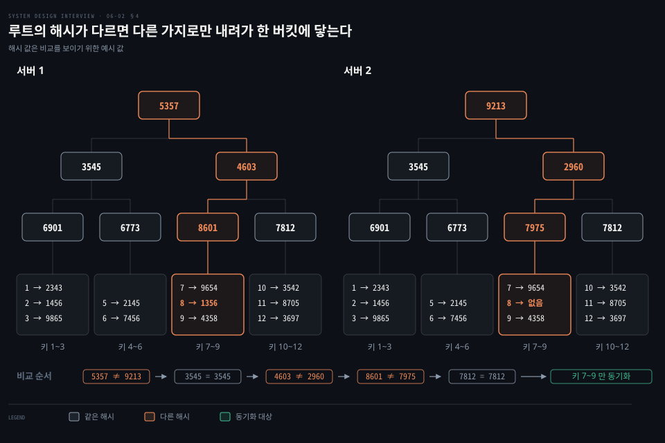
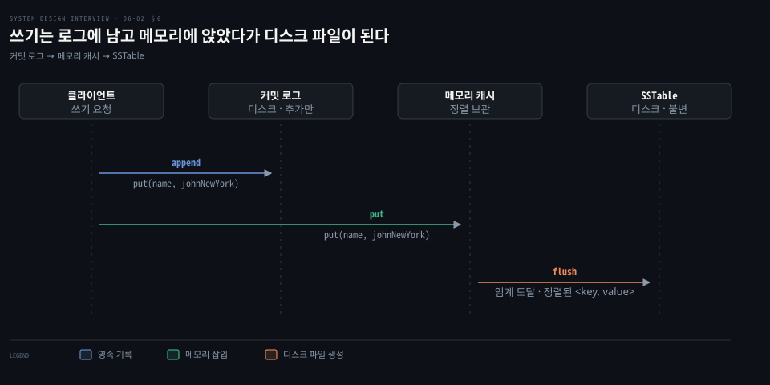
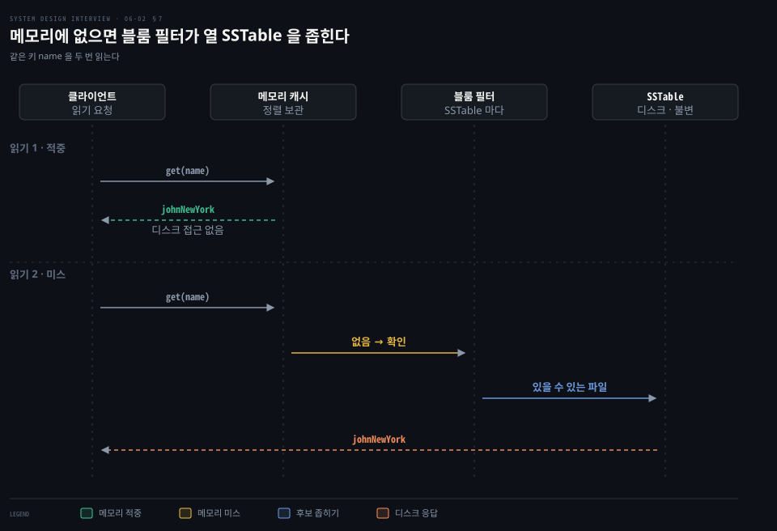

# 벡터 시계·가십·임시 위탁·머클 트리가 충돌과 장애를 다루고 쓰기와 읽기는 SSTable 을 지난다

---

> 복제본이 여럿이라 생기는 충돌과 장애를 벡터 시계·가십·임시 위탁·머클 트리가 한 가지씩 맡고, 한 노드 안에서는 쓰기가 로그와 메모리를 거쳐 SSTable 이 되고 읽기가 블룸 필터로 그 파일을 좁힙니다.

## 핵심 요약

> 이 편의 중심 생각은 복제가 주는 가용성의 대가로 충돌과 장애가 생기고, 기법마다 그중 하나씩을 맡는다는 것입니다.

같은 키를 두 복제본에서 동시에 고치면 어느 쪽이 나중인지 시계로는 알 수 없습니다. 벡터 시계는 서버별 카운터를 견주어 후손인지 형제인지를 가립니다. 서버가 내려가면 가십이 멈춘 하트비트 카운터로 알아냅니다. 짧은 장애는 다른 노드가 힌트를 달아 맡았다 돌려 주고 긴 장애는 머클 트리로 어긋난 버킷만 맞춥니다.

한 노드 안에서 쓰기는 커밋 로그, 메모리 캐시, SSTable 순이고 읽기는 메모리 캐시, 블룸 필터, SSTable 순입니다.

## 학습 목표

> 이 편을 읽고 나면 다음을 설명할 수 있습니다.

1. 벡터 시계 값으로 한 버전이 다른 버전의 선행인지 충돌인지 판정하고 D5 의 카운터가 정해지는 까닭을 설명할 수 있습니다.
2. 가십이 하트비트 카운터 표로 장애를 찾는 과정과 전체 멀티캐스트와의 메시지 수 차이를 계산할 수 있습니다.
3. 느슨한 정족수와 임시 위탁이 일시 장애에서 쓰기를 살리는 방식과 Cassandra 힌트의 저장 위치를 구분할 수 있습니다.
4. 머클 트리 비교가 루트에서 어긋난 버킷까지 내려가는 과정과 전송량이 차이에 비례하는 까닭을 말할 수 있습니다.
5. 쓰기 경로와 읽기 경로의 순서, 블룸 필터가 낼 수 있는 두 가지 답을 말할 수 있습니다.

## 1. 동시 쓰기 충돌은 서버별 카운터인 벡터 시계로 찾는다

> 두 복제본이 같은 값을 동시에 고치면 시간만으로는 어느 쪽이 맞는지 가릴 수 없습니다. 벡터 시계는 [서버, 카운터] 쌍으로 한 버전이 다른 버전의 후손인지 독립된 형제인지를 판정합니다.

복제본 n1 과 n2 가 같은 `name` 값을 갖고 있습니다. 서버 1 이 `johnSanFrancisco` 로, 서버 2 가 `johnNewYork` 로 동시에 바꾸면 어느 값을 남겨야 할까요? 원래 값은 두 수정의 출발점이라 버려도 되지만 남은 두 버전 사이에는 우열이 없습니다. 그래서 쓰기마다 불변의 새 버전을 만들고 버전끼리 충돌을 찾아 조정하는 장치가 필요합니다.

**벡터 시계**는 데이터 항목 D 에 붙은 [서버, 카운터] 쌍의 목록 D([S1,v1], …, [Sn,vn]) 입니다. 서버 Si 가 D 를 쓰면 [Si,vi] 가 있을 때 vi 를 올리고 없으면 [Si,1] 을 새로 만듭니다.

그림의 다섯 쓰기는 다음 순서입니다.

1. 서버 Sx 가 처음 써서 D1([Sx,1]) 이 생깁니다.
2. D1 을 읽어 고친 값을 Sx 가 받아 D2([Sx,2]) 가 됩니다. D2 는 D1 의 후손이라 D1 을 덮어씁니다.
3. D2 를 읽은 클라이언트가 Sy 에 쓰면 D3([Sx,2],[Sy,1]) 입니다.
4. 같은 D2 를 읽은 다른 클라이언트가 Sz 에 쓰면 D4([Sx,2],[Sz,1]) 입니다.
5. D3 와 D4 를 함께 읽은 클라이언트가 충돌을 해소해 Sx 에 쓰면 D5([Sx,3],[Sy,1],[Sz,1]) 입니다.

판정은 카운터를 서버별로 견주는 일이고 벡터에 없는 서버는 0 으로 칩니다. X 의 모든 카운터가 Y 의 같은 서버 카운터 이하이면 X 는 Y 의 선행이라 충돌이 아닙니다. 반대로 Y 의 모든 카운터가 X 이하여도 Y 가 선행입니다. X 가 더 큰 칸과 Y 가 더 큰 칸이 함께 있어 어느 쪽도 다른 쪽 이하가 아니면 둘은 형제입니다.

- D([s0,1],[s1,1]) 과 D([s0,1],[s1,2]) 는 s0 가 같고 s1 이 1 ≤ 2 라서 앞의 것이 선행입니다.
- D([s0,1],[s1,2]) 와 D([s0,2],[s1,1]) 는 s0 에서는 앞이, s1 에서는 뒤가 작아 충돌입니다.
- D3 과 D4 는 서로 없는 서버(Sy, Sz)가 있어 각각 0 < 1 이라 충돌입니다.

D5 의 [Sx,3] 은 조정한 쓰기를 Sx 가 받아 2 에서 3 으로 올린 값입니다. [Sy,1] 과 [Sz,1] 은 두 형제에서 읽은 카운터 그대로라 D5 는 둘의 후손입니다.

한계는 둘입니다. 충돌을 해소하는 논리를 클라이언트가 가져야 하고, 쓰는 서버가 늘수록 쌍이 불어납니다. 길이에 한도를 두고 넘으면 가장 오래된 쌍을 지우는데 그러면 후손 관계를 정확히 못 가려 조정이 비효율적입니다. Dynamo 논문은 쌍마다 마지막 갱신 시각을 저장하고 쌍이 예컨대 10 개에 닿으면 가장 오래된 것을 지운다고 쓰며 운영에서 이 문제가 드러나지 않았다고 적었습니다.[^dynamo]

벡터 시계는 Dynamo 의 방식이고 지금의 Cassandra 는 모든 변경에 타임스탬프를 달아 가장 늦은 쓰기가 이깁니다. 그래서 타임스탬프를 주는 클라이언트나 코디네이터의 시계를 NTP 같은 수단으로 맞춰 두어야 정확합니다.[^cass-ver] vector clock 과 version vector 의 차이는 [리더리스 복제 편](../../../05_data/book/designing-data-intensive-applications/06-06.리더리스%20복제와%206장%20종합.md)의 §3 에서 다뤘습니다.

## 2. 가십 프로토콜은 하트비트 카운터 표를 퍼뜨려 장애를 감지한다

> 한 서버가 죽었다고 말한다는 이유만으로 그 서버를 죽은 것으로 볼 수 없습니다. 가십은 모든 노드가 멤버 ID 와 하트비트 카운터 목록을 들고 무작위 이웃에게 퍼뜨려, 카운터가 멈춘 노드를 중앙 없이 찾아냅니다.

서버가 수천 대일 때 누가 누구를 감시해야 할까요? 노드 N 대가 서로를 직접 알리는 전체 멀티캐스트는 한 주기에 N×(N−1) 개의 메시지가 듭니다. 네 대면 4×3 = 12 개이지만 1,000 대면 1,000×999 = 999,000 개입니다. **가십 프로토콜**은 노드마다 무작위 k 대에게만 보내 N×k 개로 끝납니다. Cassandra 는 매초 무작위 노드 한 대와 상태를 교환하므로[^cass-gossip] 이를 k = 1 로 어림하면 1,000 대에서 1,000×1 = 1,000 개입니다.

각 노드는 멤버 ID 와 하트비트 카운터를 담은 멤버십 목록을 두고 주기적으로 자기 카운터를 올립니다. 그리고 무작위 노드 집합에 목록을 보내고, 받은 노드는 목록을 최신으로 고친 뒤 다시 다른 집합에 전파합니다. 카운터가 정해진 기간보다 오래 오르지 않은 멤버는 오프라인으로 봅니다.

s0 의 멤버십 목록은 다음과 같습니다.

| 멤버 ID | 하트비트 카운터 | 시각 |
|---------|-----------------|------|
| s0 | 10232 | 12:00:01 |
| s1 | 10224 | 12:00:10 |
| s2 | 9908 | 11:58:02 |
| s3 | 10237 | 12:00:20 |
| s4 | 10234 | 12:00:34 |

s2 만 카운터가 9908 이고 시각이 11:58:02 입니다. 가장 최근 시각 12:00:34 와의 차이는 2분 32초입니다. s0 가 s2 의 정보를 실어 s1 과 s3 에 보내고 그들도 s2 카운터가 오르지 않았음을 확인하면 s2 는 다운으로 표시되어 소식이 퍼집니다. 독립된 둘 이상의 출처로 확인한다는 원칙이 이 과정에 들어 있습니다.

Cassandra 는 이 구조를 조금 다르게 씁니다. 노드마다 매초 한 번 무작위 노드와 상태를 교환하고 도달할 수 없는 노드와 시드 노드에도 조건에 따라 추가로 교환하며, 살았는지의 판정은 phi accrual 탐지기의 변형이 노드마다 따로 내립니다. UP 과 DOWN 판정은 전파되지 않고 하트비트만 가십으로 퍼집니다.[^cass-gossip]

## 3. 일시 장애는 느슨한 정족수와 임시 위탁으로 넘긴다

> 엄격한 정족수는 응답할 복제본이 모자라면 쓰기를 막습니다. 느슨한 정족수는 링에서 건강한 서버만 세어 쓰기를 받고, 내려간 서버 몫은 다른 서버가 힌트를 달아 맡았다가 돌려 줍니다.

복제본 하나가 잠깐 내려갔다고 쓰기를 거절해야 할까요? 엄격한 정족수에서는 정해진 복제본의 응답 수 W 를 채우지 못하면 쓰기가 막힙니다. 임시 위탁과 안티 엔트로피를 리더리스 복제 일반으로 본 설명은 [리더리스 복제 편 §1](../../../05_data/book/designing-data-intensive-applications/06-06.리더리스%20복제와%206장%20종합.md)에 있습니다. 정족수의 정의는 [키-값 저장소 앞 편](./06-01.키-값%20저장소는%20CAP%20선택%20아래%20안정%20해시로%20나누고%20N·W·R%20정족수로%20복제%20일관성을%20고른다.md)에서 다뤘습니다.

**느슨한 정족수**(sloppy quorum)는 읽기와 쓰기를 선호 목록에서 내려간 서버를 건너뛴 건강한 처음 N 대에 보내고, 쓰기는 W 개(읽기는 R 개)의 응답을 기다립니다. 링을 걸으며 처음 만난 N 대와 같지 않을 수 있습니다.[^dynamo] 선호 목록은 키를 맡을 서버를 링 순서로 늘어놓은 것으로, 앞 편의 복제 목록과 같습니다.

그림에서 코디네이터는 `put(key1, val1)` 을 s0 와 s1 에 보내 ACK 를 받습니다. 응답이 없는 s2 몫은 링의 다음 노드 s3 가 임시로 받았다가 s2 가 돌아오면 넘깁니다. 이 과정이 **임시 위탁**(hinted handoff)입니다. Dynamo 는 대신 받은 복제본의 메타데이터에 의도한 수신자를 힌트로 적어 별도 로컬 저장소에 두고 주기적으로 훑습니다. 수신자가 돌아온 것을 알면 전달하고 성공하면 지웁니다.[^dynamo]

지금의 Cassandra 는 모양이 다릅니다. 쓰기를 늘 모든 복제본에 보내며 응답하지 못한 복제본 몫은 코디네이터가 자기 디스크에 힌트로 저장합니다. 새 힌트는 장애가 `max_hint_window`(기본 3시간) 이내일 때만 쌓입니다. 힌트에는 원래 변경의 타임스탬프가 들어 있어 다시 적용해도 더 늦은 쓰기를 덮지 않습니다. 힌트는 최선을 다하는 장치라 일관성은 repair 가 맡습니다. 힌트 저장을 응답으로 인정하는 일관성 수준은 `ANY` 뿐입니다.[^cass-hints][^cass-cl]

## 4. 영구 장애는 머클 트리로 다른 버킷만 동기화한다

> 힌트가 닿지 못한 복제본은 오래 어긋난 채로 남습니다. 키마다 비교하면 데이터 전부를 주고받아야 하므로, 키를 버킷으로 묶어 해시 트리를 만들고 루트부터 비교해 다른 버킷만 맞춥니다.

복제본이 영영 돌아오지 않거나 힌트 보관 기간을 넘기면 놓친 쓰기를 따라잡을 방법이 힌트에는 없습니다. 복제본끼리 데이터를 비교해 최신 버전으로 맞추는 일을 안티 엔트로피라 하고, 어긋남을 찾아 전송량을 줄이는 데 **머클 트리**를 씁니다. 머클 트리는 잎이 값의 해시이고 안쪽 노드가 자식 해시의 해시인 트리입니다.

키 공간이 1~12 라면 네 단계로 짓습니다.

1. 키 공간을 버킷 네 개로 나눕니다. 버킷이 맨 아랫단이라 트리 깊이가 제한됩니다.
2. 버킷 안의 키를 균일한 해시로 각각 해시합니다.
3. 버킷마다 해시 노드 하나를 만듭니다.
4. 자식 해시로 부모 해시를 계산하며 루트까지 올라갑니다.

그림의 해시 값은 비교를 보이기 위한 예시입니다. 키 해시는 1→2343, 2→1456, 3→9865, 5→2145, 6→7456, 7→9654, 8→1356, 9→4358, 10→3542, 11→8705, 12→3697 이고, 서버 1 의 버킷 해시는 6901, 6773, 8601, 7812 입니다. 두 서버가 키 8 만 다릅니다. 서버 2 에는 8 의 값이 없어서 키 7~9 버킷 해시가 8601 대 7975 로 달라지고 그 위의 4603 대 2960 과 루트의 5357 대 9213 까지 어긋납니다.

비교는 루트부터 내려갑니다. 루트가 다르므로 왼쪽 자식 3545 를 견주면 같아서 그 가지는 건너뜁니다. 오른쪽 4603 과 2960 은 달라 다시 내려가면 8601 과 7975 가 다르고 7812 는 같습니다. 해시 비교 다섯 번이면 어긋난 곳이 키 7~9 뿐임을 알고, 열두 키 중 세 키만 동기화합니다.

규모가 커져도 원리는 같습니다. 키 10억 개를 버킷 100만 개로 나누면 버킷당 10^9 ÷ 10^6 = 1,000 개입니다. 이진 트리라면 2^20 = 1,048,576 ≥ 10^6 이라 루트에서 버킷까지 약 20 단계입니다. 한 버킷만 다를 때 자식 둘씩 20 단계를 견주어 해시 비교 약 40 번에 1,000 개 키만 전송합니다. 동기화할 양은 복제본이 가진 데이터가 아니라 둘의 차이에 비례합니다.

Cassandra 의 repair 가 복제본마다 머클 트리를 만들어 서로 비교합니다. 전체 repair 는 범위 안 모든 데이터를 해시하고, 기본인 증분 repair 는 직전 증분 repair 뒤에 쓰인 데이터만 다룹니다.[^cass-repair] 트리 해상도를 파티션 단위까지 높이는 하위 범위 repair 도 있습니다.[^cass-sync] Dynamo 방식은 노드가 합류하거나 떠나 키 범위가 바뀌면 트리를 다시 계산해야 하는 단점이 있었습니다.[^dynamo]

## 5. 데이터 센터 장애는 복제본을 센터마다 두어 넘긴다

> 전원·네트워크·재해로 센터 하나가 통째로 내려가도 읽고 쓰려면 복제본이 서로 다른 센터에 있어야 합니다.

센터 하나가 사라지면 복제본은 어디에 남아 있어야 할까요? 복제본이 모두 한 센터에 있으면 센터 장애가 곧 데이터 장애이므로 복제본을 여러 센터에 나누어 둡니다. Dynamo 가 키의 복제 목록(선호 목록)을 여러 센터에 걸쳐 만든 방식[^dynamo]과 `NetworkTopologyStrategy` 의 센터별 복제 수·랙 분산은 [키-값 저장소 앞 편 §4](./06-01.키-값%20저장소는%20CAP%20선택%20아래%20안정%20해시로%20나누고%20N·W·R%20정족수로%20복제%20일관성을%20고른다.md)에서 다뤘습니다.[^cass-nts]

같은 센터 안의 다수만 세는 `LOCAL_QUORUM` 은 [앞 편 §5](./06-01.키-값%20저장소는%20CAP%20선택%20아래%20안정%20해시로%20나누고%20N·W·R%20정족수로%20복제%20일관성을%20고른다.md)에서 다뤘습니다. 앞 편에 없는 `EACH_QUORUM` 은 센터마다 각각 다수의 응답을 기다리므로 센터 하나가 내려가 있으면 쓰기를 받지 못합니다.[^cass-cl]

## 6. 쓰기 경로는 커밋 로그에 남기고 메모리에 두었다가 SSTable 로 흘려 보낸다

> 디스크에 정렬된 파일을 매번 새로 쓰기는 비싸고 메모리에만 두면 죽을 때 사라집니다. 쓰기는 추가만 하는 커밋 로그에 남기고 메모리 캐시에 넣은 뒤, 캐시가 차면 정렬된 파일 SSTable 로 한꺼번에 내려보냅니다.

한 노드 안에서 쓰기는 어디를 거쳐 디스크에 닿을까요? 클라이언트는 `get(key)` 와 `put(key, value)` 만 부릅니다. 코디네이터가 프록시로 요청을 링의 복제본에 전달합니다. 모든 노드가 같은 책임을 져서 단일 장애점이 없습니다. 노드마다 충돌 해소·복제·장애 감지·장애 복구·저장 엔진을 갖춥니다.

쓰기 요청 하나는 세 단계를 거칩니다. 먼저 요청을 커밋 로그 파일에 남깁니다. 다음에 데이터를 메모리 캐시에 저장합니다. 메모리 캐시가 차거나 정해진 임계에 닿으면 디스크의 SSTable 로 flush 합니다.

예를 들어 `put(name, johnNewYork)` 은 같은 순서로 커밋 로그에 append 되고 메모리 캐시에 들어갔다가 flush 때 SSTable 에 담깁니다. SSTable(sorted string table)은 키로 정렬한 `<key, value>` 쌍의 불변 파일입니다.[^bt] 메모리 캐시는 Cassandra 에서 memtable 이라 부르고, 이 구조가 LSM 트리입니다. LSM 의 압축과 B-tree 비교는 [LSM 저장 엔진 편](../../../05_data/book/designing-data-intensive-applications/04-02.LSM%20저장%20엔진.md)에서 다뤘습니다.

Cassandra 의 커밋 로그는 추가만 하는 파일이고 비정상 종료 뒤에는 이 로그를 재생해 memtable 을 복원합니다. 기본 `commitlog_sync` 는 `periodic` 으로, 쓰기를 즉시 응답하고 10000ms 마다 fsync 하므로 그 사이의 쓰기는 정전에 잃을 수 있습니다. `batch` 로 두면 fsync 뒤에 응답합니다. memtable 은 쓰기를 정렬된 순서로 담다가 크기 임계나 커밋 로그 한도에 닿으면 flush 되어 불변의 SSTable 이 되고, 한 파티션이 여러 SSTable 에 걸치면 compaction 이 합칩니다.[^cass-storage]

## 7. 읽기 경로는 메모리 캐시를 먼저 보고 블룸 필터로 읽을 SSTable 을 좁힌다

> 메모리에 없는 키는 디스크의 여러 SSTable 중 어디엔가 있습니다. 파일마다 열어 보면 접근이 파일 수만큼 늘어나므로, 블룸 필터가 "여기에는 없다"를 먼저 걸러 읽을 파일을 줄입니다.

읽기 요청을 받은 노드는 먼저 메모리 캐시를 봅니다. `get(name)` 을 읽을 때 메모리 캐시에 있으면 디스크를 건드리지 않고 `johnNewYork` 을 돌려줍니다. 캐시에서 밀려난 뒤라면 SSTable 중 키를 담았을 파일을 찾아야 합니다.

블룸 필터는 SSTable 마다 하나 있는 확률적 자료구조이고 답이 둘뿐입니다. 키가 이 파일에 확실히 없다거나 있을 수 있다는 답입니다. 없다고 답한 파일은 건너뛰고 있을 수 있다고 한 파일만 열어 결과를 클라이언트에 돌려줍니다. Bigtable 논문은 존재하지 않는 행이나 열을 찾는 대부분의 조회가 이 방법으로 디스크를 건드리지 않는다고 설명합니다.[^bt] 블룸 필터가 거르는 원리는 [LSM 저장 엔진 편 §3](../../../05_data/book/designing-data-intensive-applications/04-02.LSM%20저장%20엔진.md)에서 다뤘습니다.

Cassandra 는 거짓 양성 확률을 테이블마다 `bloom_filter_fp_chance` 로 정하며 기본값이 0.01(leveled compaction 은 0.1)입니다. 필터는 힙 밖 RAM 에 둡니다.[^cass-bloom] 또 위의 흐름은 값 하나를 통째로 덮어쓰는 키-값 모델입니다. Cassandra 는 열마다 타임스탬프를 두어 읽을 때 메모리와 SSTable 의 데이터를 합쳐 최신을 고릅니다.[^cass-bloom][^cass-ver]

## 8. 목표와 기법은 한 표로 맞춰진다

> 이 편과 앞 편이 다룬 기법을 목표별로 한 줄씩 대응시키면 다음과 같습니다.

| 목표·문제 | 기법 | 다룬 곳 |
|-----------|------|---------|
| 큰 데이터 저장, 분할, 점진적 확장, 서버 성능 차이 | 안정 해시와 가상 노드 | 안정 해시 편 |
| 조절 가능한 일관성 | N·W·R 정족수 | 키-값 저장소 앞 편 |
| 읽기 고가용성 | 데이터 복제, 다중 데이터 센터 | §5 |
| 쓰기 고가용성 | 버저닝과 벡터 시계 충돌 해소 | §1 |
| 장애 감지 | 가십 프로토콜 | §2 |
| 일시 장애 | 느슨한 정족수와 임시 위탁 | §3 |
| 영구 장애 | 머클 트리 | §4 |
| 데이터 센터 장애 | 센터 간 복제 | §5 |
| 쓰기 처리 | 커밋 로그, 메모리 캐시, SSTable | §6 |
| 읽기 처리 | 메모리 캐시, 블룸 필터, SSTable | §7 |

## 면접 대비

> 충돌 판정, 장애 감지와 복구, 쓰기·읽기 경로에 관한 면접 질문입니다.

1. 벡터 시계 D3([Sx,2],[Sy,1]) 과 D4([Sx,2],[Sz,1]) 이 충돌인 까닭과 D5 의 카운터가 정해지는 방식을 설명해 보십시오.
2. 벡터 시계의 두 가지 한계와 Cassandra 가 벡터 시계 대신 쓰는 방식은 무엇입니까?
3. 1,000 대 클러스터에서 가십이 전체 멀티캐스트보다 메시지를 얼마나 줄입니까?
4. 일시 장애와 영구 장애를 각각 무엇으로 처리하며 Cassandra 의 힌트는 어디에 저장됩니까?
5. 머클 트리 비교가 어긋난 키를 찾는 과정과 블룸 필터가 읽기 경로에서 하는 일은 무엇입니까?

## 정답 (자답 후 펼치기)

> 면접 질문에 대한 키워드 중심의 모범 답안입니다.

### 정답 1 — 서로의 카운터를 넘지 못해 충돌, D5 는 조정 쓰기로 합침

D3 에만 Sy 가 있고 D4 에만 Sz 가 있어 어느 쪽도 선행이 아닙니다. D5 는 두 버전을 읽은 클라이언트가 Sx 에 쓰므로 [Sx,2] 가 3 으로 오르고 [Sy,1], [Sz,1] 은 읽은 값 그대로여서 둘의 후손이 됩니다.

### 정답 2 — 클라이언트 복잡도와 쌍 증가, Cassandra 는 타임스탬프로 최신 쓰기가 이김

해소 논리를 클라이언트가 가져야 하고 쌍이 불면 오래된 쌍을 지워 후손 관계를 잃습니다. Cassandra 는 변경마다 타임스탬프를 달아 가장 늦은 쓰기가 이기게 하므로 시계 동기화가 필요합니다.

### 정답 3 — N×(N−1) 대 N×k

전체 멀티캐스트는 주기당 1,000×999 = 999,000 개이고 k = 1 인 가십은 1,000×1 = 1,000 개입니다.

### 정답 4 — 일시는 임시 위탁, 영구는 머클 트리, 힌트는 코디네이터 디스크

일시 장애는 느슨한 정족수가 건강한 노드로 쓰기를 받고 힌트로 돌려 줍니다. 영구 장애는 머클 트리로 다른 버킷만 동기화합니다. Cassandra 는 힌트를 코디네이터의 로컬 디스크에 3시간 한도로 쌓고 일관성은 repair 가 맡습니다.

### 정답 5 — 루트부터 다른 가지만 내려감, 블룸 필터는 읽을 SSTable 을 거름

루트가 다르면 자식을 견주어 같은 가지는 건너뛰고 다른 가지만 내려가 버킷에 닿습니다. 블룸 필터는 키가 확실히 없는 SSTable 을 건너뛰게 합니다.

## 참고 자료

- Alex Xu, 《System Design Interview – An Insider's Guide》, 2판, 2020, ISBN 979-8664653403, Chapter 6 후반.
- Dynamo: Amazon's Highly Available Key-value Store: https://www.allthingsdistributed.com/files/amazon-dynamo-sosp2007.pdf
- Apache Cassandra 5.0 문서: https://cassandra.apache.org/doc/5.0/cassandra/
- Bigtable: A Distributed Storage System for Structured Data: https://static.googleusercontent.com/media/research.google.com/en//archive/bigtable-osdi06.pdf

## 관련 문서

- [키-값 저장소는 CAP 선택 아래 안정 해시로 나누고 N·W·R 정족수로 복제 일관성을 고른다](./06-01.키-값%20저장소는%20CAP%20선택%20아래%20안정%20해시로%20나누고%20N·W·R%20정족수로%20복제%20일관성을%20고른다.md)
- [안정 해시는 해시 링과 가상 노드로 서버가 늘고 줄 때 옮길 키를 줄인다](./05-01.안정%20해시는%20해시%20링과%20가상%20노드로%20서버가%20늘고%20줄%20때%20옮길%20키를%20줄인다.md)
- [리더리스 복제와 6장 종합](../../../05_data/book/designing-data-intensive-applications/06-06.리더리스%20복제와%206장%20종합.md)
- [LSM 저장 엔진](../../../05_data/book/designing-data-intensive-applications/04-02.LSM%20저장%20엔진.md)

[^dynamo]: Dynamo 논문 §4.4 버저닝(벡터 시계 예·쌍 삭제), §4.6 느슨한 정족수·임시 위탁과 센터 장애, §4.7 머클 트리: <https://www.allthingsdistributed.com/files/amazon-dynamo-sosp2007.pdf>
[^cass-ver]: Cassandra 5.0 Dynamo 문서, 타임스탬프 버저닝: <https://cassandra.apache.org/doc/5.0/cassandra/architecture/dynamo.html#data-versioning>
[^cass-gossip]: Cassandra 5.0 Dynamo 문서, 가십 주기(#gossip)와 phi accrual 탐지기(#ring-membership-and-failure-detection): <https://cassandra.apache.org/doc/5.0/cassandra/architecture/dynamo.html#gossip>, <https://cassandra.apache.org/doc/5.0/cassandra/architecture/dynamo.html#ring-membership-and-failure-detection>
[^cass-cl]: Cassandra 5.0 Dynamo 문서, 일관성 수준: <https://cassandra.apache.org/doc/5.0/cassandra/architecture/dynamo.html#tunable-consistency>
[^cass-sync]: Cassandra 5.0 Dynamo 문서, 복제본 동기화: <https://cassandra.apache.org/doc/5.0/cassandra/architecture/dynamo.html#replica-synchronization>
[^cass-nts]: Cassandra 5.0 Dynamo 문서, 센터별 복제: <https://cassandra.apache.org/doc/5.0/cassandra/architecture/dynamo.html#network-topology-strategy>
[^cass-hints]: Cassandra 5.0 Hints 문서 #hinted-handoff: <https://cassandra.apache.org/doc/5.0/cassandra/managing/operating/hints.html#hinted-handoff>
[^cass-repair]: Cassandra 5.0 Repair 문서: <https://cassandra.apache.org/doc/5.0/cassandra/managing/operating/repair.html>
[^cass-storage]: Cassandra 5.0 Storage Engine 문서, 커밋 로그·memtable·SSTable: <https://cassandra.apache.org/doc/5.0/cassandra/architecture/storage-engine.html#commit-log>, <https://cassandra.apache.org/doc/5.0/cassandra/architecture/storage-engine.html#memtables>, <https://cassandra.apache.org/doc/5.0/cassandra/architecture/storage-engine.html#sstables>
[^cass-bloom]: Cassandra 5.0 Bloom Filters 문서: <https://cassandra.apache.org/doc/5.0/cassandra/managing/operating/bloom_filters.html>
[^bt]: Bigtable 논문 §4 SSTable, §6 Bloom filters: <https://static.googleusercontent.com/media/research.google.com/en//archive/bigtable-osdi06.pdf>
