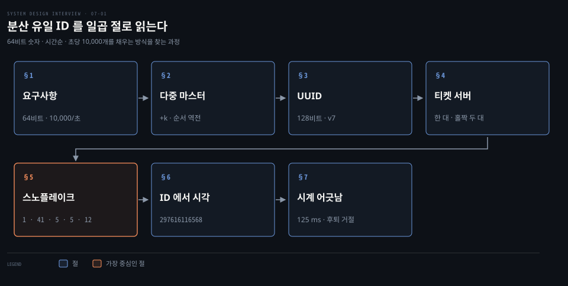
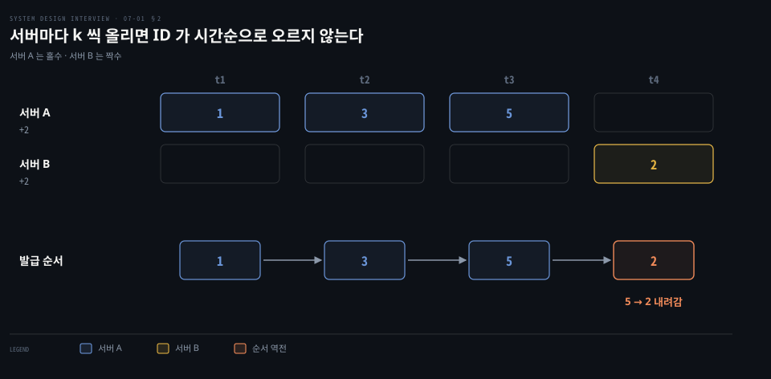
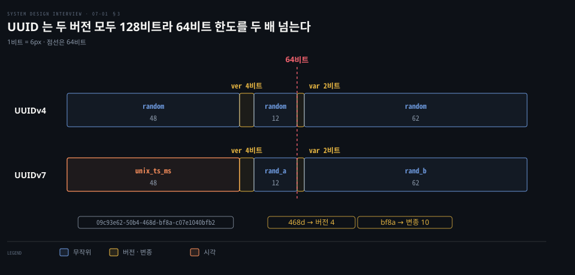
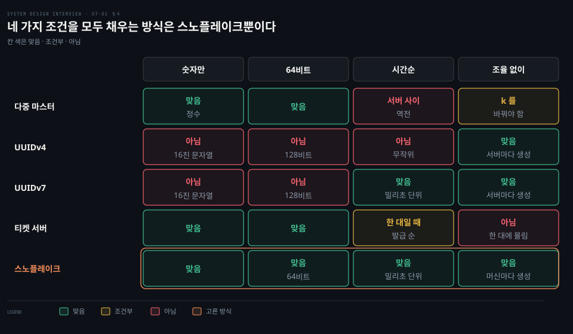
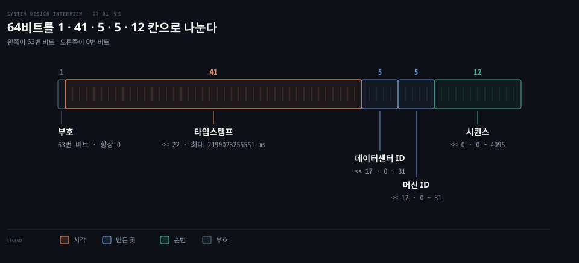
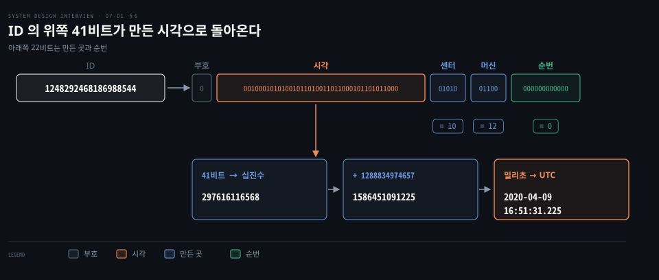
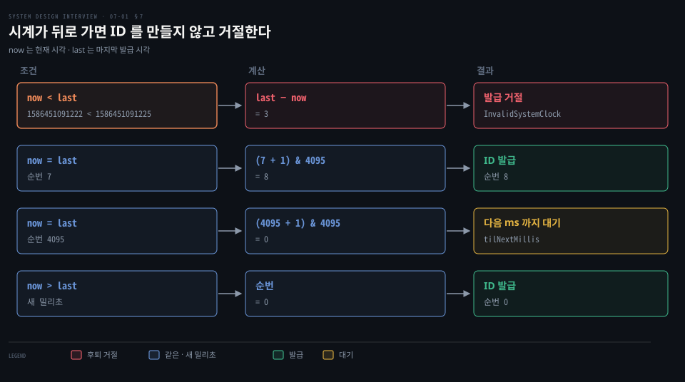

# 분산 유일 ID 는 UUID·티켓 서버 대신 타임스탬프와 일련번호를 묶은 64비트 스노플레이크로 만든다

---

> 서버가 여럿이어도 겹치지 않고 시간순으로 커지는 64비트 숫자는, 밀리초 시각 41비트에 만든 곳 10비트와 같은 밀리초 안의 순번 12비트를 이어 붙여 서버마다 따로 만듭니다.

## 핵심 요약

> 이 편의 중심 생각은 ID 를 한 번에 만들지 않고 시각·만든 곳·순번으로 나눠 이어 붙이면 서로 묻지 않고도 유일하고 시간순인 64비트 숫자가 나온다는 것입니다.

`auto_increment` 를 서버 수만큼 건너뛰게 하면 서버 사이의 시간순이 깨집니다. UUID 는 128비트라 폭이 두 배입니다. 티켓 서버는 한 대가 모든 발급을 맡아 단일 장애점이 됩니다. 스노플레이크는 부호 1비트, 밀리초 시각 41비트, 데이터센터 5비트, 머신 5비트, 순번 12비트로 64비트를 가릅니다. 이 배치가 앞의 셋이 놓친 조건을 한꺼번에 채웁니다.

시각이 가장 높은 자리에 있으므로 ID 를 정수로 비교하면 시각순이 됩니다. 위쪽 41비트에 epoch 를 더하면 만든 시각이 돌아옵니다. 대가는 시계입니다. 시계가 뒤로 가면 같은 ID 를 다시 만들 수 있어 생성기는 발급을 거절합니다. 시각 비트와 순번 비트의 배분은 쓰임에 맞춰 조정합니다.

## 학습 목표

> 이 편을 읽고 나면 다음을 설명할 수 있습니다.

1. 분산 유일 ID 의 요구사항(숫자만·64비트·시간순·초당 10,000개)이 각 방식을 어떻게 걸러 내는지 설명할 수 있습니다.
2. `auto_increment` +k 와 티켓 서버의 한계를 서버 사이 순서와 단일 장애점으로 말할 수 있습니다.
3. UUIDv4 와 UUIDv7 의 필드 구성과 UUIDv7 이 고친 것·고치지 못한 것을 구분할 수 있습니다.
4. 스노플레이크의 1·41·5·5·12 배치와 필드별 최댓값으로 초당 생성 한도를 계산할 수 있습니다.
5. 예시 ID 에서 시각을 되돌리고 시계 후퇴와 순번 가득 참을 생성기가 어떻게 다루는지 설명할 수 있습니다.

## 1. 분산 환경의 ID 는 64비트 숫자이면서 시간순이어야 하고 초당 10,000개를 만들어야 한다

> 데이터베이스 한 대의 `auto_increment` 는 그 한 대 안에서만 유일합니다. 서버가 여럿이면 어떤 조건을 더 걸어야 쓸 만한 ID 가 되는지부터 정합니다.

주문이나 게시글 같은 레코드마다 기본 키가 필요한데, 데이터베이스 한 대가 모든 쓰기를 감당하지 못해 여러 대로 나뉘면 번호를 어디서 매길지가 문제입니다. 서버마다 자기 번호를 세면 같은 값이 둘 생기고, 한 곳에서만 세면 그곳이 병목이 됩니다. 데이터를 나누는 쪽의 이야기는 [샤딩 편](./01-02.캐시·CDN·무상태%20웹%20계층·데이터%20센터·메시지%20큐·샤딩이%20수백만%20사용자까지%20규모를%20늘린다.md)과 [전역 유일 ID 와 파티셔닝 편](../bytebytego-system-design/01-02.파티셔닝과%20읽기%20복제본은%20데이터베이스를%20넓히고%20전역%20유일%20ID%20는%20나뉜%20데이터에%20순서를%20준다.md)에서 다룹니다.

다섯 조건을 요구사항으로 세웁니다. 이 값들은 면접에서 가정한 설계 조건이고, 같은 문제를 푼 트위터의 스노플레이크도 프로세스당 초당 1만 개 이상을 최소 요구로 적었습니다.[^readme]

- ID 는 유일해야 합니다.
- 숫자로만 이루어져야 합니다.
- 64비트에 들어가야 합니다.
- 날짜순이어야 합니다. 저녁에 만든 ID 가 같은 날 아침에 만든 ID 보다 크면 되고, 1씩 늘 필요는 없습니다.
- 초당 10,000개 넘게 만들어야 합니다.

64비트를 고집하는 까닭은 8바이트 정수 한 칸에 들어가기 때문입니다. 부호 있는 64비트 정수의 최댓값은 2^63 − 1 = 9,223,372,036,854,775,807 입니다. Flickr 는 GUID 가 크고 MySQL 인덱스에 잘 맞지 않는다는 이유로 정수를 골랐습니다.[^flickr] 시간순이 필요한 까닭은 "이 ID 이후" 로 조회하는 API 가 ID 순서를 시간순으로 가정하기 때문이고, 객체를 읽지 않고 ID 만으로 정렬할 수 있어야 한다는 것도 트위터의 요구였습니다.[^readme]

고려하는 방식은 넷입니다. 다중 마스터 복제, UUID, 티켓 서버, 스노플레이크를 차례로 봅니다.

## 2. auto_increment 를 서버 수 k 만큼 올리면 서버 사이의 시간순이 깨진다

> 데이터베이스를 둘로 늘린 뒤 번호가 겹치지 않게 하려면 서로 다른 칸만 쓰게 하면 됩니다. 이 방식은 유일성은 지키지만 발급 순서가 서버를 건너면 어긋납니다.

다음 ID 를 이전 ID + 1 이 아니라 이전 ID + k 로 올립니다. k 는 데이터베이스 서버 수입니다. 서버가 둘이면 서버 A 는 1, 3, 5, … 를, 서버 B 는 2, 4, 6, … 을 내줍니다. 서버마다 칸이 달라 겹치지 않고, 서버를 늘리면 발급 처리량도 따라 늘어납니다.

MySQL 은 이 동작을 `auto_increment_increment` 와 `auto_increment_offset` 두 변수로 지원하며 값은 1 이상 65,535 이하입니다. 이 변수들은 서버끼리 서로 복제하는 순환 복제에서 `AUTO_INCREMENT` 열을 다루려고 만든 것입니다.[^mysql]

위 장면은 요청이 A 에 몰린 뒤 B 가 처음 받은 경우입니다. A 가 1, 3, 5 를 차례로 내줬고 그다음에 B 가 첫 ID 로 2 를 냅니다. 나중에 만든 2 가 먼저 만든 5 보다 작으므로 ID 크기로 시각을 비교할 수 없습니다. 세 가지 한계가 따릅니다.

- 서버 사이의 시간순이 깨집니다. 서버마다 얼마나 일했는지에 따라 앞선 번호가 뒤에 나옵니다.
- 서버를 더하거나 빼면 k 가 바뀌므로 모든 서버의 증분과 시작 칸을 다시 정해야 합니다.
- 데이터센터가 여럿이면 모든 센터의 서버가 같은 k 를 공유하고 서로 다른 시작 칸을 가져야 해서 설정 조율이 센터 사이로 번집니다.

## 3. UUID 는 조율 없이 만들지만 128비트 폭과 16진 표기가 64비트 숫자 요구를 넘는다

> 서버끼리 묻지 않고 ID 를 만들 수 있다면 조율 문제가 사라집니다. UUID 는 그 요구를 채우지만 폭과 모양에서 다른 요구를 놓칩니다.

UUID 는 128비트 수이고 `09c93e62-50b4-468d-bf8a-c07e1040bfb2` 처럼 16진수 32자를 하이픈으로 나눠 36자로 적습니다. 웹 서버마다 생성기를 두고 독립적으로 만들 수 있어서 서버 사이의 동기화가 필요 없고, 서버를 늘려도 생성기가 함께 늘어납니다.

UUID 의 현재 표준은 2024년 5월의 RFC 9562 이며 RFC 4122 를 대체합니다.[^rfc9562] 무작위 UUIDv4 는 128비트 중 버전 4비트와 변종 2비트를 뺀 122비트를 무작위로 채웁니다(§5.4).
예시 UUID 의 세 번째 묶음 `468d` 는 첫 글자가 4 라서 버전 4 입니다. 네 번째 묶음 `bf8a` 의 첫 글자 b 는 이진수 1011 이라 앞 두 비트가 10 인 변종입니다(§4.1).

무작위 값이 겹칠 확률은 생일 문제로 어림합니다. 122비트에서 50% 확률로 한 쌍이 겹치려면 √(2 · ln 2 · 2^122) ≈ 1.1774 × 2^61 ≈ 2.7 × 10^18 개가 필요합니다. 초당 10억 개를 만들면 2.7 × 10^9 초, 약 86년입니다. 겹칠 걱정은 사실상 없지만 요구사항의 세 칸을 놓칩니다.

- 128비트라서 64비트 요구의 두 배입니다.
- UUIDv4 는 무작위라서 시각과 무관합니다.
- 16진 문자열이라 숫자만이라는 조건에 맞지 않습니다.

시간순 UUID 는 이제 표준에 있습니다. UUIDv7 은 앞 48비트에 Unix epoch 기준 밀리초 시각을 놓고 나머지 74비트(rand_a 12비트와 rand_b 62비트)를 무작위나 순번으로 채웁니다.[^rfc9562] RFC 9562 §5.7 은 가능하면 UUIDv1·UUIDv6 대신 UUIDv7 을 쓰라고 권고합니다. 그래서 시간순 문제는 고쳐졌지만 폭은 UUIDv4 와 같은 128비트라서 64비트 요구는 여전히 못 채웁니다.

## 4. 티켓 서버는 숫자 ID 를 주지만 한 대가 단일 장애점이다

> 번호를 한 곳에서만 뽑으면 겹칠 일이 없습니다. 대신 모든 발급이 그 한 곳을 지나갑니다.

티켓 서버는 `auto_increment` 를 쓰는 전용 데이터베이스 한 대를 모든 웹 서버가 함께 쓰는 방식입니다. Flickr 가 분산된 기본 키를 만들려고 만들었습니다.[^flickr] Flickr 의 `Tickets64` 표는 `auto_increment` 열 하나와 유일한 `stub` 열 하나로 이뤄진 한 행짜리입니다. 새 ID 가 필요하면 `stub` 값으로 `REPLACE` 를 실행해 행을 갈아 끼우고, 그때 하나 늘어난 자동 증가 값을 읽어 갑니다.

숫자 ID 이고 구현이 쉬워 중소 규모에서 잘 맞습니다. 걸림돌은 서버 한 대가 죽으면 그 서버에 기대는 모든 시스템이 멈추는 단일 장애점이고, ID 를 쓸 때마다 그 서버까지 한 번 더 왕복해야 한다는 점입니다.

Flickr 는 티켓 서버를 두 대로 늘려 장애점을 줄였습니다. 두 대를 동기화하지 않고 ID 공간을 홀수와 짝수로 나눴으며(`auto-increment-increment = 2`, `auto-increment-offset` 은 각각 1 과 2), 웹 서버가 두 대를 번갈아 부릅니다. 이는 앞 절의 k = 2 와 같은 장치입니다. 그래서 두 서버가 조금씩 어긋나 홀수 쪽 ID 가 수십만 개 더 많이 나왔지만 Flickr 는 문제가 없다고 적었습니다.[^flickr] 이 구성은 순서가 발급 순서와 완전히 같지 않아서, 시간순 요구에는 한 대일 때만 가깝습니다.

앞의 세 방식과 다음 절의 스노플레이크를 숫자만·64비트·시간순·조율 없이 네 조건으로 견주면 아래와 같습니다. 조율 없이는 트위터가 스노플레이크의 요구로 세운 조건이고, UUID 는 v4 와 v7 로 나눠 적었습니다. 스노플레이크를 뺀 모든 방식이 한 칸 이상 놓칩니다.

## 5. 스노플레이크는 64비트를 1·41·5·5·12비트로 나눠 시각·위치·순번을 한 숫자에 담는다

> 앞의 셋은 각각 시간순, 64비트 숫자, 조율 없는 생성 중 하나를 놓칩니다. 스노플레이크는 ID 를 통째로 만들지 않고 필드로 나눠 세 조건을 한 숫자에 담습니다.

트위터는 MySQL 에서 Cassandra 로 옮기면서 순차 ID 를 발급하는 기능이 Cassandra 에 없다는 이유로 스노플레이크를 만들었습니다. 요구는 서버끼리 조율하지 않을 것, 대략 시간순일 것, 객체를 읽지 않고 정렬할 수 있을 것, 64비트 안에 들 것이었습니다. 순서는 정확하지 않고 일정 범위 안에서 정렬되며(k-정렬) 1초를 약속하고 수십 밀리초를 목표로 했습니다.[^readme]

- 부호 1비트는 항상 0 입니다. 나머지 네 필드가 63비트(41 + 5 + 5 + 12)라 맨 위 비트는 늘 0 이고, 부호 있는 64비트 정수로 읽어도 양수입니다.
- 타임스탬프 41비트는 custom epoch 이후 흐른 밀리초입니다. 트위터 기본 epoch 는 1288834974657 ms 로 2010-11-04 01:42:54.657 UTC 입니다.[^src]
- 데이터센터 ID 5비트는 2^5 = 32 곳을, 머신 ID 5비트는 센터당 32 대를 가립니다. 둘을 합친 10비트가 생성기 번호이고 1,024 대를 구분합니다.
- 시퀀스 12비트는 같은 머신이 같은 밀리초에 만든 ID 마다 1씩 올라가고, 밀리초가 바뀌면 0 으로 돌아갑니다. 2^12 = 4,096 가지입니다.

필드는 시프트로 이어 붙입니다. 소스에서 시퀀스는 0, 머신은 12, 데이터센터는 17, 타임스탬프는 22 만큼 왼쪽으로 밀립니다.[^src] 따라서 ID = (현재 시각 − epoch) · 2^22 + 데이터센터 · 2^17 + 머신 · 2^12 + 시퀀스입니다.

시각이 가장 높은 자리라서 ID 를 정수로 비교하면 먼저 시각순으로 가려집니다. 같은 밀리초 안에서는 데이터센터, 머신, 순번 순서로 갈리므로 머신이 다른 두 ID 의 실제 발급 순서는 이 비교로 알 수 없습니다. 트위터 문서는 비동기 작업이 많아 순서대로 전달을 이미 보장하지 않는다고 적고, 그 위에서 일정 범위 안의 k-정렬만 약속했습니다.[^readme]

용량은 곱셈으로 확인합니다. 머신 하나가 한 밀리초에 4,096 개를 만들 수 있으므로 초당 4,096 × 1,000 = 4,096,000 개이고, 생성기 1,024 대를 모두 쓰면 4,096,000 × 1,024 = 4,194,304,000 개입니다. 요구한 초당 10,000 개는 밀리초당 10 개이므로 머신 한 대로도 충분합니다.

데이터센터 ID 와 머신 ID 는 시작할 때 정하고 가동 중에는 고정합니다. 값이 실수로 바뀌면 서로 다른 머신이 같은 ID 를 만들 수 있어서 변경은 검토를 거쳐야 합니다. 소스도 시작 시 두 값이 0 이상 31 이하인지 검사합니다.[^src] 타임스탬프와 시퀀스는 생성기가 돌면서 만듭니다. 채팅 메시지 ID 처럼 크기로 순서를 정하는 쓰임은 [채팅 시스템 편](./12-01.채팅%20시스템은%20웹소켓%20연결을%20상태%20유지%20서버에%20두고%20키-값%20저장소와%20메시지%20ID%20로%20대화와%20접속%20상태를%20다룬다.md)에, ID 를 짧은 키로 바꾸는 쓰임은 [URL 단축기 편](./08-01.URL%20단축기는%20301·302%20리디렉션과%20해시%20충돌%20해소%20또는%20base62%20변환으로%20짧은%20키를%20만든다.md)에서 다룹니다.

## 6. ID 의 위쪽 41비트를 옮기고 epoch 를 더하면 만든 시각이 나온다

> ID 가 숫자 하나인데 어떻게 만든 시각을 알 수 있을까요? 위쪽 41비트가 시각이므로 아래 22비트를 버리고 epoch 를 더하면 됩니다.

예시 ID 의 이진수는 부호 `0`, 시각 `00100010101001011010011011000101101011000`(41비트), 데이터센터 `01010`, 머신 `01100`, 순번 `000000000000` 입니다. 십진수로 쓰면 297,616,116,568 × 2^22 + 10 × 2^17 + 12 × 2^12 + 0 = 1,248,292,468,186,988,544 입니다.

되돌리는 길은 세 단계입니다.

1. 41비트를 십진수로 바꾸면 297,616,116,568 ms 입니다. 같은 값은 ID 를 오른쪽으로 22칸 민 결과이기도 합니다.
2. 트위터 epoch 1,288,834,974,657 을 더하면 1,586,451,091,225 ms 이고 1,586,451,091,225 − 1,288,834,974,657 = 297,616,116,568 이 됩니다.
3. 밀리초를 UTC 로 바꾸면 2020-04-09 16:51:31.225 입니다. 297,616,116,568 ms 는 약 3,444.63 일, 365일 기준 9.44 년이므로 2010-11-04 에서 2020-04 까지 가는 것과 맞습니다.

아래 22비트는 센터 10, 머신 12, 순번 0 이라서 이 ID 는 10 번 센터의 12 번 머신이 그 밀리초에 처음 만든 것입니다. 반대로 시각에서 ID 로 가는 계산은 (시각 − epoch) << 22 이고, 이 값은 그 시각 이후의 ID 중 가장 작은 값이므로 "이 시점 이후" 조회의 경계로 쓸 수 있습니다. Discord 가 같은 방식으로 시각에서 ID 를 만들어 페이지 경계로 씁니다.[^discord]

시각 41비트가 표현하는 최댓값은 2^41 − 1 = 2,199,023,255,551 ms 입니다. 1000, 365, 24, 3600 으로 차례로 나누면(1년 = 365일) 약 69.7 년이고 트위터 epoch 에서는 2080-07-10 17:30:30 UTC 까지입니다. epoch 를 오늘에 가깝게 잡으면 한계가 그만큼 늦어지고, 한계에 닿으면 새 epoch 를 쓰거나 ID 를 옮겨야 합니다.

## 7. 시계가 어긋나면 ID 가 겹치거나 거절되므로 시계를 맞추고 비트를 조정한다

> 스노플레이크는 모든 생성기가 믿을 만한 시계를 가졌다고 가정합니다. 시계가 어긋나거나 뒤로 가면 무슨 일이 생기는지가 이 방식의 약점입니다.

생성기는 시스템의 벽시계(`System.currentTimeMillis`)를 읽습니다.[^src] 벽시계는 NTP 가 고쳐서 불연속으로 움직일 수 있고, 경과 시간을 재는 단조 시계와 다릅니다. 두 시계의 차이는 [불신뢰 시계 편](../../../05_data/book/designing-data-intensive-applications/09-02.불신뢰%20시계.md)에서, ID 생성과 논리 시계의 관계는 [ID 생성기와 논리 시계 편](../../../05_data/book/designing-data-intensive-applications/10-03.ID%20생성기와%20논리%20시계.md)에서 다룹니다.

NTPv4 는 오차가 단계 임계값 125 ms 보다 작으면 조금씩 맞추고, 125 ms 를 넘는 상태가 스텝아웃 임계값 900 초 넘게 이어지면 시계를 한 번에 옮깁니다.[^ntp] 앞서 달리던 시계를 고치면 시각이 뒤로 갈 수 있습니다. 시각이 뒤로 가면 순번이 0 부터 다시 시작해 이미 쓴 ID 와 같은 값이 나올 수 있으므로, 소스는 마지막 발급 시각보다 현재 시각이 작으면 예외(`InvalidSystemClock`)를 던지고 그 차이를 밀리초로 알려 줍니다.[^src] 트위터 문서도 NTP 로 시계를 맞추되 시계를 뒤로 옮기지 않는 방식으로 돌리는 편이 낫다고 적었습니다.[^readme]

같은 밀리초에는 순번을 올리며 `(순번 + 1) & 4095` 로 12비트에 가둡니다. 순번이 7 이면 8 이 되어 그대로 발급합니다. 4095 이면 0 으로 돌아오는데, 4,096 개를 다 쓴 것이므로 다음 밀리초가 될 때까지(`tilNextMillis`) 기다립니다.[^src] 도식의 시각 값은 앞 절의 값에서 3 을 뺀 예시입니다.

필드 길이도 쓰임에 맞춰 조정합니다. 동시 요청이 적고 오래 써야 하면 순번을 줄이고 시각을 늘립니다. 예를 들어 순번을 10비트로 줄이고 시각을 43비트로 늘리면 밀리초당 1,024 개로 줄지만 2^43 − 1 = 8,796,093,022,207 ms, 같은 365일 기준으로 약 278.9 년을 표현합니다. Discord 는 시각을 42비트로 잡고 2015-01-01 을 epoch 로 삼으며 작업자와 프로세스에 각각 5비트, 증분에 12비트를 줍니다.[^discord] 63번 비트까지 시각에 쓰므로 부호 없는 64비트 정수가 되고, 그래서 Discord API 는 ID 를 문자열로 돌려줍니다.

고가용성도 설계해야 합니다. ID 생성기는 장애가 나면 모든 쓰기가 멈추는 핵심 시스템이라서, 스노플레이크는 생성기끼리 상태를 나누지 않게 해 한 대가 죽어도 나머지가 계속 만들게 했습니다.[^readme]

## 면접 대비

> 방식별 한계, UUID 의 현재 모습, 비트 배치 계산, 시각 복원, 시계 문제에 관한 면접 질문입니다.

1. `auto_increment` 를 서버 수만큼 올리는 방식이 시간순을 깨는 장면과 서버를 늘릴 때의 문제를 설명해 보십시오.
2. UUIDv4 가 요구사항의 어느 조건을 놓치며, UUIDv7 은 무엇을 고치고 무엇은 못 고칩니까?
3. 스노플레이크의 비트 배치와 필드별 최댓값으로 머신 하나와 전체의 초당 생성 한도를 계산해 보십시오.
4. 예시 ID 에서 생성 시각을 되돌리는 순서를 말해 보십시오.
5. 시계가 뒤로 가면 생성기는 무엇을 하며 그 까닭은 무엇입니까? 비트 배분은 어떻게 조정합니까?

## 정답 (자답 후 펼치기)

> 면접 질문에 대한 키워드 중심의 모범 답안입니다.

### 정답 1 — 서버 간 순서 역전, k 재설정

서버 A 가 1·3·5 를 내준 뒤 B 가 처음 받으면 나중 ID 2 가 먼저 낸 5 보다 작습니다. 서버를 더하거나 빼면 k 와 시작 칸을 모든 서버에서 다시 정해야 합니다.

### 정답 2 — 128비트와 문자열, 시각은 v7 이 해결

UUIDv4 는 128비트 수이고 16진 문자열로 적으며 무작위라서 64비트·숫자·시간순을 모두 놓칩니다. UUIDv7 은 앞 48비트가 밀리초 시각이라 시간순을 채웁니다. 폭은 128비트 그대로입니다.

### 정답 3 — 4,096 · 1,000 · 1,024 = 4,194,304,000

시퀀스 12비트는 밀리초당 4,096 개이므로 머신 하나가 초당 4,096,000 개입니다. 센터 5비트와 머신 5비트로 1,024 대를 구분하므로 전체는 초당 4,194,304,000 개입니다.

### 정답 4 — 22칸 밀고 epoch 를 더해 UTC 로

ID 를 오른쪽으로 22칸 밀어 41비트 시각을 얻고 epoch 1,288,834,974,657 을 더한 뒤 밀리초를 UTC 로 바꿉니다. 예시는 297,616,116,568 에서 1,586,451,091,225 를 거쳐 2020-04-09 16:51:31.225 가 됩니다.

### 정답 5 — 발급 거절, 시각·순번 재배분

현재 시각이 마지막 발급 시각보다 작으면 순번이 0 부터 다시 시작해 ID 가 겹칠 수 있으므로 예외로 거절합니다. 오래 쓰고 동시성이 낮으면 순번을 줄이고 시각을 늘립니다.

## 참고 자료

- Alex Xu, 《System Design Interview – An Insider's Guide》, 2판, 2020, Chapter 7 "Design A Unique ID Generator in Distributed Systems".
- twitter-archive/snowflake, 태그 `snowflake-2010`: https://github.com/twitter-archive/snowflake/tree/snowflake-2010
- RFC 9562 UUID: https://www.rfc-editor.org/rfc/rfc9562
- Flickr, Ticket Servers: https://code.flickr.net/2010/02/08/ticket-servers-distributed-unique-primary-keys-on-the-cheap/

## 관련 문서

- [전역 유일 ID 와 파티셔닝](../bytebytego-system-design/01-02.파티셔닝과%20읽기%20복제본은%20데이터베이스를%20넓히고%20전역%20유일%20ID%20는%20나뉜%20데이터에%20순서를%20준다.md)
- [ID 생성기와 논리 시계](../../../05_data/book/designing-data-intensive-applications/10-03.ID%20생성기와%20논리%20시계.md)

[^readme]: 스노플레이크 README(요구사항·해법·시스템 시계 의존): <https://github.com/twitter-archive/snowflake/blob/snowflake-2010/README.mkd>
[^src]: 스노플레이크 `IdWorker.scala` 태그 `snowflake-2010` L25(epoch)·L27-L36(비트·시프트)·L74-L88(후퇴·순번)·L105(시계): <https://github.com/twitter-archive/snowflake/blob/snowflake-2010/src/main/scala/com/twitter/service/snowflake/IdWorker.scala#L25-L105>
[^rfc9562]: RFC 9562 §4.1·§5.4·§5.7: <https://www.rfc-editor.org/rfc/rfc9562>
[^flickr]: Flickr, Ticket Servers: Distributed Unique Primary Keys on the Cheap(2010-02-08): <https://code.flickr.net/2010/02/08/ticket-servers-distributed-unique-primary-keys-on-the-cheap/>
[^mysql]: MySQL 8.4 `auto_increment_increment`·`auto_increment_offset`: <https://dev.mysql.com/doc/refman/8.4/en/replication-options-source.html>
[^ntp]: RFC 5905 NTPv4 §11.3 단계 임계값 STEPT 125 ms·스텝아웃 WATCH 900 s: <https://www.rfc-editor.org/rfc/rfc5905>
[^discord]: Discord 개발자 문서 Snowflakes: <https://discord.com/developers/docs/reference#snowflakes>
