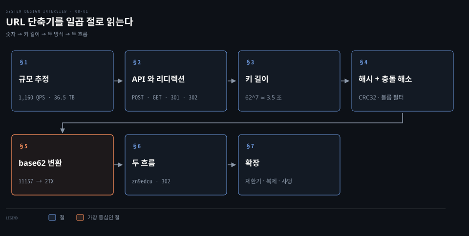
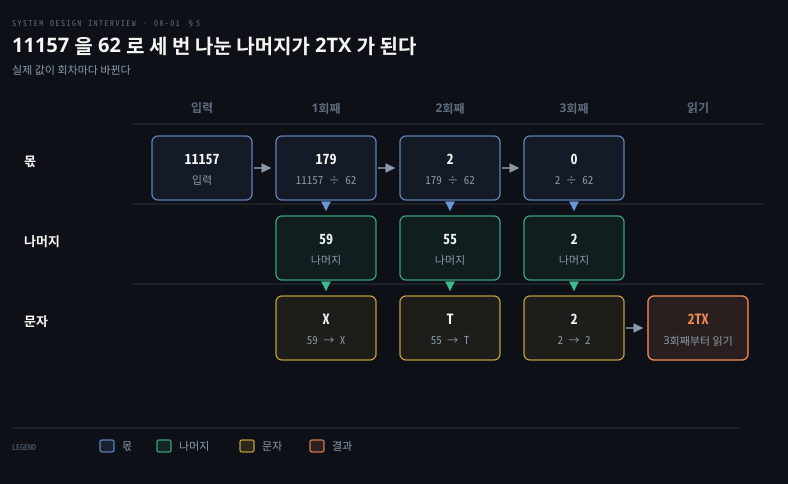
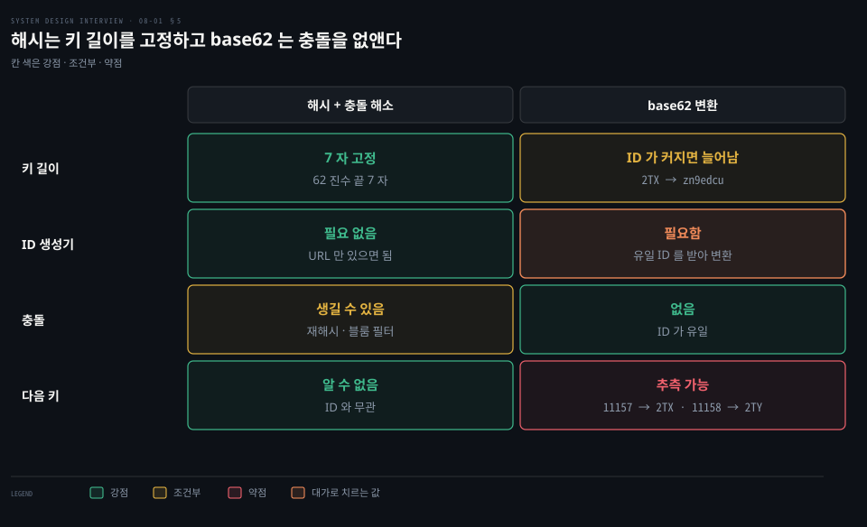
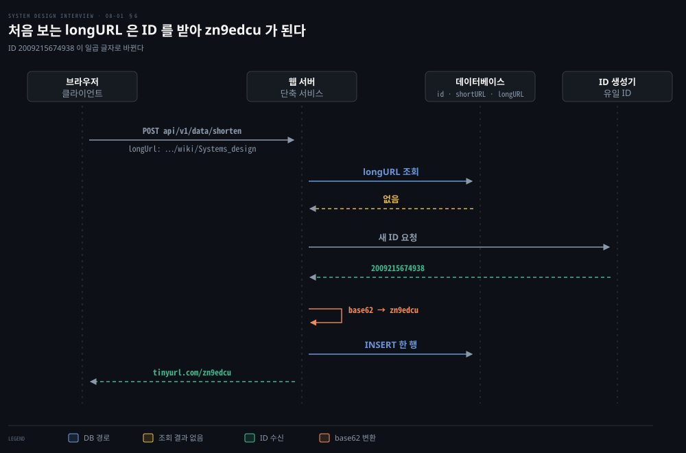
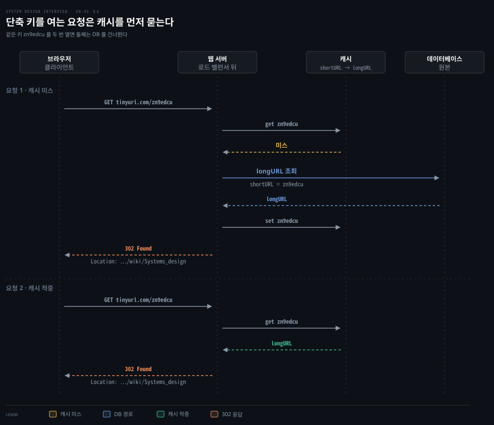

# URL 단축기는 301·302 리디렉션과 해시 충돌 해소 또는 base62 변환으로 짧은 키를 만든다

---

> URL 단축기는 긴 주소를 7 자 키 하나로 바꿔 저장하고 그 키를 열면 301 이나 302 로 원래 주소에 돌려보냅니다. 키는 해시를 자르고 충돌을 풀거나 유일 ID 를 62 진수로 바꿔 만듭니다.


## 핵심 요약

> 이 편의 중심 생각은 짧은 키를 만드는 방법이 둘이고, 하나는 충돌을 풀어야 하며 다른 하나는 유일 ID 에 기댄다는 것입니다.

키 길이는 추정에서 나옵니다. 하루 1 억 건을 10 년 쌓으면 3,650 억 개입니다. 62 가지 문자 7 자가 약 3.5 조 가지를 만들므로 7 자가 가장 짧은 답입니다. 되돌릴 때의 301 은 브라우저가 저장할 수 있어 서버 부하를 줄입니다. 302 는 매번 서버를 거쳐 클릭을 셀 수 있게 합니다.

해시 방식은 길이가 고정되고 ID 생성기가 필요 없지만 충돌을 풀어야 합니다. 62 진수 변환은 충돌이 없지만 ID 생성기가 새 부품이 되고 다음 키가 추측됩니다. 이 설계는 후자를 고르고 리디렉션은 캐시를 먼저 묻습니다.




## 학습 목표

> 이 편을 읽고 나면 다음을 설명할 수 있습니다.

1. 일일 생성량과 읽기 비율, 보관 기간에서 쓰기 QPS, 읽기 QPS, 레코드 수와 저장 용량을 계산식과 함께 구할 수 있습니다.
2. 301 과 302 가 캐시와 클릭 집계에 미치는 차이를 RFC 9110 의 근거로 설명할 수 있습니다.
3. 62^n 이 요구 개수 이상이 되는 가장 작은 n 을 구해 키 길이 7 을 도출할 수 있습니다.
4. 해시를 앞 7 자로 자르면 충돌이 생기는 이유와 블룸 필터가 충돌 해소 루프에서 하는 일을 설명할 수 있습니다.
5. 유일 ID 를 62 진수로 손으로 바꾸고, 해시 방식과 길이·ID 의존·충돌·예측 가능성을 견줄 수 있습니다.


## 1. 하루 1 억 건을 만드는 서비스는 초당 약 1,160 건을 쓰고 10 년 뒤 3,650 억 레코드와 36.5 TB 를 쌓는다

> 단축 서비스의 요구는 다섯 줄이고, 설계를 가르는 숫자는 쓰기 속도, 읽기 속도, 10 년 레코드 수, 저장 용량 넷입니다.

서버 대수와 디스크 크기를 고르려면 URL 이 얼마나 빨리 얼마나 많이 들어오는지부터 알아야 합니다. 요구를 확정하고 숫자를 뽑습니다.

- 단축: 긴 URL 을 주면 훨씬 짧은 URL 을 돌려줍니다.
- 리디렉션: 짧은 URL 을 열면 원래 URL 로 보냅니다.
- 규모: 하루 1 억 개를 만들고, 키는 0-9 와 a-z, A-Z 로 가능한 한 짧게 만듭니다.
- 단순화: 만든 단축 URL 은 지우거나 고치지 않습니다.
- 비기능: 고가용성, 확장성, 장애 감내를 고려합니다.

아래 값은 면접에서 합의하는 설계 가정이며 실제 서비스 통계가 아닙니다. 하루 1 억 건, 읽기와 쓰기 비율 10 대 1, 운영 10 년, URL 평균 100 바이트를 가정합니다.

| 구하는 값 | 식 | 결과 |
|---|---|---|
| 쓰기 QPS | 100,000,000 ÷ 86,400 초 | 약 1,157, 올려 잡아 1,160 |
| 읽기 QPS | 1,160 × 10 | 11,600 |
| 10 년 레코드 수 | 100,000,000 × 365 × 10 | 365,000,000,000(3,650 억) |
| 10 년 저장 용량 | 365,000,000,000 × 100 바이트 | 36,500,000,000,000 바이트, 약 36.5 TB |

레코드 수에는 이미 10 년이 곱해져 있으므로 용량 식에 10 년을 또 곱하지 않습니다. 곱하면 365 TB 가 되어 열 배 부풀기 때문입니다. 기준 값은 [개략적 규모 추정 편](./02-01.개략적%20규모%20추정은%202의%20거듭제곱·지연%20시간·가용성%20수치로%20QPS%20와%20저장%20용량을%20어림한다.md)에서 다룹니다.

결론은 둘입니다. 읽기가 열 배 많으니 최적화는 리디렉션 경로에 쏠립니다. 36.5 TB 는 메모리엔 커서 디스크 기반 저장소에 둡니다.


## 2. 두 API 는 POST 로 만들고 GET 으로 돌리며 돌릴 때 301 은 브라우저가 저장할 수 있고 302 는 매번 서비스를 거친다

> API 는 둘이고, 되돌리는 응답을 301 로 할지 302 로 할지는 서버 부하와 클릭 집계 사이의 선택입니다.

단축 URL 을 열었을 때 서버는 어떻게 원래 주소로 보낼까요? 브라우저가 그 응답을 기억하면 서비스는 무엇을 잃을까요? 호출 모양부터 정합니다.

```bash
# 단축: longUrl 하나를 받아 shortURL 을 돌려줍니다.
POST api/v1/data/shorten
{longUrl: longURLString}

# 리디렉션: shortUrl 을 받아 longURL 로 HTTP 리디렉션합니다.
GET api/v1/shortUrl
```

리디렉션 응답에는 상태 코드와 새 주소를 담은 `Location` 헤더가 들어갑니다. 301 은 영구 이동, 302 는 임시 이동이고 둘의 차이는 캐시에서 갈립니다. 상태 코드와 `Location` 헤더의 실제 응답은 [웹 편](../../../02_os/book/cntd_computer-networking-top-down/02-02.웹은%20어떻게%20주고받는가.md) 3 절에, 브라우저 캐시가 신선도를 판정하는 방식은 같은 편 5 절에 있습니다.

301 은 대상에 새 영구 URI 가 할당되었다는 뜻이며 응답은 휴리스틱 캐시가 허용됩니다.[^rfc301] 브라우저가 저장하면 같은 단축 URL 의 다음 요청은 서버에 오지 않고 곧장 원래 주소로 갑니다. 부하는 줄지만 그 뒤의 클릭은 집계할 수 없고 목적지를 바꾸기도 어렵습니다.

302 는 대상이 임시로 다른 URI 에 있으니 이후에도 원래 URI 로 요청하라는 뜻입니다.[^rfc302] 이 코드는 휴리스틱 캐시 허용 목록에 없어서,[^rfc9110-15-1] 저장하려면 `max-age` 나 `Expires` 같은 명시적 신선도, 또는 `public`·`private` 같은 명시적 캐시 허가가 있어야 합니다.[^rfc9111] 헤더를 따로 달지 않은 302 는 클릭마다 서버에 도착해 집계를 남길 수 있습니다.

| 상태 코드 | 캐시 | 서비스가 얻는 것 | 서비스가 포기하는 것 |
|---|---|---|---|
| 301 | 휴리스틱 캐시 허용 | 첫 요청 이후 서버 부하 감소 | 클릭 집계, 목적지 변경 |
| 302 | 명시적 신선도나 캐시 허가가 있을 때만 저장 | 클릭마다 집계 | 매 클릭이 서버에 닿는 부하 |

301 도 응답 헤더로 유효 기간을 줄 수 있습니다. 휴리스틱 캐시는 명시적 캐시 제어가 달리 지시하지 않는 경우에 적용된다고 규격이 적습니다.[^rfc9110-15-1] `no-cache` 를 단 301 은 다시 쓰기 전에 서버에 검증을 받아야 하므로 매 클릭이 서버에 닿습니다.[^rfc9111-no-cache]

두 코드는 사용자 에이전트가 POST 를 GET 으로 바꿔 보내도 된다고 규격이 적는 오래된 모호함을 안고 있습니다.[^rfc301][^rfc302] 메서드를 바꾸지 말아야 할 때를 위해 임시 이동에는 307, 영구 이동에는 308 이 따로 있습니다.[^rfc307] 단축 URL 은 GET 으로 열리므로 쟁점이 아니며, 308 은 2014 년 6 월에 나온 새 코드라 모든 곳에서 인식되지 않을 수 있다고 규격이 적습니다.[^rfc308]

서버 부하가 먼저면 301, 클릭 수와 유입 경로 분석이 먼저면 302 입니다.

### 키와 URL 의 대응은 메모리 해시 테이블이 아니라 관계형 테이블에 둔다

가장 직관적인 구현은 `<shortURL, longURL>` 을 해시 테이블에 담고 `hashTable.get(shortURL)` 로 찾는 것입니다. 하지만 1 절의 36.5 TB 를 메모리에 두기는 어려워 대응을 관계형 데이터베이스의 표 하나로 옮기고 열을 `id`, `shortURL`, `longURL` 셋으로 줄입니다. `id` 는 단축 키의 재료가 되는 유일한 정수입니다.


## 3. 키 길이는 62 의 n 제곱이 3,650 억 이상이 되는 가장 작은 n 인 7 자다

> 허용 문자가 62 가지이므로 n 자 키는 62^n 가지를 만들 수 있고, 3,650 억 개를 담는 가장 작은 n 은 7 입니다.

키를 몇 글자로 만들어야 3,650 억 개를 담을까요? 허용 문자는 숫자 10 가지, 소문자 26 가지, 대문자 26 가지로 62 가지이고, 길이 n 이면 서로 다른 키가 62^n 개입니다. 62^n ≥ 3,650 억 을 만족하는 가장 작은 n 을 찾습니다.

| n | 62^n | 3,650 억을 담는가 |
|---|---|---|
| 1 | 62 | 아니오 |
| 2 | 3,844 | 아니오 |
| 3 | 238,328 | 아니오 |
| 4 | 14,776,336 | 아니오 |
| 5 | 916,132,832 | 아니오 |
| 6 | 56,800,235,584(약 568 억) | 아니오 |
| 7 | 3,521,614,606,208(약 3.5 조) | 예 |

6 자는 약 568 억 개라 못 미치고 7 자부터 약 3.5 조 개로 충분합니다. 3,650 억 개는 7 자 공간의 약 10.4% 입니다(365,000,000,000 ÷ 3,521,614,606,208). 요구가 가능한 한 짧게이므로 7 자로 정합니다.


## 4. 해시를 앞 7 자로 자르면 충돌이 생겨 되풀이로 풀어야 하고, 그 DB 질의를 블룸 필터가 줄인다

> 해시 출력은 7 자보다 길어 잘라 써야 하고 자른 값은 겹치므로 충돌을 푸는 되풀이가 필요하며, 그 비용을 블룸 필터가 줄입니다.

CRC32, MD5, SHA-1 같은 해시 함수를 쓰면 키를 7 자로 고정할 수 있을까요? URL `https://en.wikipedia.org/wiki/Systems_design` 에 세 함수를 적용한 출력을 봅니다.

| 해시 함수 | 출력(16진) | 글자 수 |
|---|---|---|
| CRC32 | 5cb54054 | 8 |
| MD5 | 5a62509a84df9ee03fe1230b9df8b84e | 32 |
| SHA-1 | 0eeae7916c06853901d9ccbefbfcaf4de57ed85b | 40 |

가장 짧은 CRC32 도 8 자라 7 자를 넘어서 앞 7 자만 취하면 `5cb5405` 입니다. 그런데 16 진 문자는 16 가지뿐이라 7 자가 만드는 서로 다른 값은 16^7 = 268,435,456, 약 2.7 억 가지입니다.

3 절의 계산은 62 가지 문자를 전제하므로, 16 진으로 자른 값은 3,650 억 개를 담을 칸이 모자랍니다. 같은 7 자라도 문자 수가 칸 수를 정하므로 62 가지 문자 7 자(약 3.5 조 칸)여야 합니다. CRC32 는 출력이 32 비트라 62 진수로 적어도 약 43 억 가지뿐이므로, MD5·SHA-1 처럼 긴 출력을 62^7 로 나눈 나머지, 곧 62 진수의 끝 7 자를 씁니다. 62 진수로 적은 맨 앞 자리는 값이 고르지 않아 앞 7 자는 칸이 크게 줄기 때문입니다.

키가 균등하게 뽑힌다면 3,650 억 개가 찼을 때 새 키가 이미 쓰인 값일 확률이 약 10.4% 입니다.

충돌하면 다른 키를 만들어야 합니다. 미리 정한 문자열을 longURL 뒤에 붙여 다시 해시합니다.

1. longURL 을 해시해 7 자 shortURL 후보를 만듭니다.
2. 후보가 데이터베이스에 이미 있는지 조회합니다.
3. 있으면 longURL 뒤에 미리 정한 문자열을 붙여 1 로 돌아갑니다.
4. 없으면 후보를 shortURL 로 삼아 행으로 저장합니다.

같은 longURL 은 후보가 처음과 똑같이 나오므로, 2 번에서 행이 있으면 그 행의 longURL 이 같은지 비교해 충돌과 중복을 가릅니다.

이 방식은 충돌을 없애지만 요청마다 데이터베이스를 한 번 이상 조회합니다. 후보가 이미 쓰인 키인지 싸게 거르는 도구가 **블룸 필터**이며, 원소가 집합에 속하는지를 공간 효율적으로 확률적으로 판정하는 자료 구조입니다.[^bloom] 판정은 비대칭입니다. 없다는 답은 확실하고 있다는 답은 틀릴 수 있습니다(거짓 양성). 같은 비대칭이 쓰이는 다른 자리는 [LSM 저장 엔진](../../../05_data/book/designing-data-intensive-applications/04-02.LSM%20저장%20엔진.md) 의 Bloom 필터 절에 있습니다.

단축 흐름에서는 후보를 먼저 필터에 묻습니다. 없다고 답하면 조회 없이 저장 단계로 가고, 있을 수도 있다고 답할 때만 데이터베이스로 확인합니다. 거짓 양성은 조회 한 번을 더할 뿐 결과를 틀리게 하지 않습니다.


## 5. base62 변환은 유일한 ID 를 62 로 나눈 나머지로 읽어 충돌을 없애는 대신 ID 생성기에 기댄다

> 유일한 ID 를 62 진수로 바꾸면 서로 다른 ID 는 서로 다른 키가 되어 충돌이 사라지지만, 그 유일한 ID 를 만드는 부품이 새로 필요합니다.

해시는 값을 줄이며 겹침을 낳습니다. 처음부터 겹치지 않는 값에서 출발하면 어떨까요? 서로 다른 행이 서로 다른 정수 ID 를 갖는다면 그 정수를 짧은 문자열로 바꿔 쓰기만 하면 되고, 허용 문자가 62 가지이므로 62 진수로 씁니다.

대응은 `0-9` 가 0 에서 9, `a-z` 가 10 에서 35, `A-Z` 가 36 에서 61 입니다. `a` 는 10, `T` 는 55, `X` 는 59, `Z` 는 61 입니다. 10 진수 11157 은 몫이 0 이 될 때까지 62 로 나누며 나머지를 모읍니다.

1. 11157 ÷ 62 = 179 나머지 59, 59 는 `X` 입니다.
2. 179 ÷ 62 = 2 나머지 55, 55 는 `T` 입니다.
3. 2 ÷ 62 = 0 나머지 2, 2 는 `2` 입니다.

마지막 나머지부터 거꾸로 읽으면 `2TX` 입니다. 검산은 2 × 3,844 + 55 × 62 + 59 = 7,688 + 3,410 + 59 = 11,157 입니다.



키의 길이는 ID 가 정합니다. 62^6 = 56,800,235,584 이상인 ID 는 7 자가 되고 62^7 미만이면 7 자를 넘지 않습니다. 11157 처럼 작은 ID 는 3 자입니다.

ID 2,009,215,674,938 은 몫이 0 이 될 때까지 62 로 일곱 번 나눕니다. 나머지는 차례로 30, 12, 13, 14, 9, 23, 35 이고 문자로는 `u`, `c`, `d`, `e`, `9`, `n`, `z` 입니다. 거꾸로 읽은 `zn9edcu` 가 7 자 키입니다.

### 두 방식을 견주면 길이·ID 의존·충돌·예측 가능성이 갈린다



- 키 길이: 해시는 항상 7 자로 고정됩니다. base62 는 ID 가 커질수록 늘어납니다.
- ID 생성기: 해시는 URL 만 있으면 됩니다. base62 는 유일 ID 를 만드는 부품에 의존하며, 분산 환경에서 만드는 방법은 [분산 유일 ID 편](./07-01.분산%20유일%20ID%20는%20UUID·티켓%20서버%20대신%20타임스탬프와%20일련번호를%20묶은%2064비트%20스노플레이크로%20만든다.md)에서 다룹니다.
- 충돌: 해시는 충돌이 생기므로 풀어야 합니다. base62 는 ID 가 유일해서 충돌이 없습니다.
- 다음 키: 해시 결과는 ID 와 무관해 다음 키를 알 수 없습니다. ID 가 1 씩 늘면 11157 은 `2TX`, 11158 은 `2TY` 라서 다음 단축 URL 을 추측할 수 있고, 보안상 문제가 될 수 있습니다.

이 설계는 base62 를 고릅니다. 충돌 해소 루프와 블룸 필터가 사라지고 ID 생성기가 새 부품이 됩니다.


## 6. 단축 흐름은 ID 를 받아 base62 로 바꿔 저장하고 리디렉션 흐름은 캐시를 먼저 묻고 DB 로 내려간다

> 단축은 쓰기 경로라 ID 생성과 저장을 거치고, 리디렉션은 읽기 경로라 캐시가 먼저 답합니다.

단축은 새 행을 만드는 쓰기이고 리디렉션은 있는 행을 읽는 일이라 구조가 다릅니다. 두 흐름은 어디서 갈릴까요?

### 단축 흐름은 중복을 먼저 거르고 새 ID 를 base62 로 바꿔 한 행으로 저장한다

단축 흐름은 여섯 단계입니다.

1. longURL 을 입력으로 받습니다.
2. longURL 이 데이터베이스에 이미 있는지 확인합니다.
3. 있으면 저장된 shortURL 을 꺼내 돌려줍니다.
4. 없으면 유일 ID 생성기에서 새 ID(기본 키)를 받습니다.
5. 그 ID 를 base62 로 바꿔 shortURL 을 얻습니다.
6. ID, shortURL, longURL 을 한 행으로 저장합니다.

입력이 `https://en.wikipedia.org/wiki/Systems_design` 이고 ID 생성기가 2009215674938 을 돌려주면, 5 절의 계산대로 shortURL 은 `zn9edcu` 입니다. 저장되는 행은 다음과 같습니다.

| id | shortURL | longURL |
|---|---|---|
| 2009215674938 | zn9edcu | https://en.wikipedia.org/wiki/Systems_design |



2 번에서 longURL 로 행을 찾으려면 `longURL` 열에 색인이 있어야 하며, 긴 문자열이라 색인도 큽니다.

### 리디렉션 흐름은 캐시가 먼저 답하고 없을 때만 DB 를 읽는다

읽기가 열 배 많으므로 `<shortURL, longURL>` 대응을 캐시에 둡니다. 단축 URL 을 열었을 때의 순서는 다음과 같습니다.

1. 사용자가 `https://tinyurl.com/zn9edcu` 를 엽니다.
2. 로드 밸런서가 요청을 웹 서버에 나눠 줍니다.
3. shortURL 이 캐시에 있으면 longURL 을 바로 돌려줍니다.
4. 없으면 shortURL 로 데이터베이스를 조회하고, 읽은 대응을 캐시에 넣습니다. 데이터베이스에도 없으면 잘못 입력한 단축 URL 일 가능성이 높습니다.
5. longURL 을 `Location` 에 담아 응답합니다.

클릭 분석을 남기려고 이 설계는 302 로 응답합니다. 응답은 상태 코드 302 와 `Location: https://en.wikipedia.org/wiki/Systems_design` 헤더 하나면 됩니다.[^rfc302]



도식의 두 번째 요청이 서버에 도착하는 것은 302 이기 때문입니다. 301 이고 브라우저가 저장했다면 같은 브라우저의 두 번째 클릭은 서버에 오지 않고, 다른 사용자의 첫 요청만 지납니다.

없는 키가 계속 들어오면 매번 데이터베이스까지 내려갑니다. 이 문제는 [캐싱 전략](../../../05_data/01_foundation/01-07.캐싱%20전략.md)의 Cache Penetration 절에서, 캐시 자리는 [수백만 사용자 편](./01-02.캐시·CDN·무상태%20웹%20계층·데이터%20센터·메시지%20큐·샤딩이%20수백만%20사용자까지%20규모를%20늘린다.md)의 cache-aside 절에서 다룹니다.


## 7. 규모가 더 커지면 처리율 제한과 웹 계층 확장, DB 복제와 샤딩, 분석이 붙는다

> 기본 설계 뒤에 남는 이야기는 악용 방지, 계층별 확장, 클릭 분석, 가용성이며 각각 다른 편의 도구에 대응합니다.

시간이 남으면 무엇을 더 말할 수 있을까요? 다섯 갈래입니다.

- 처리율 제한: 악의적인 사용자가 단축 요청을 쏟아 붓는 것을 IP 주소 같은 규칙으로 걸러 내며, [처리율 제한기 편](./04-01.처리율%20제한기는%20토큰%20버킷·누출%20버킷·고정%20윈도·이동%20윈도%20로그·이동%20윈도%20카운터로%20요청을%20센다.md)에서 다룹니다.
- 웹 서버 확장: 웹 계층이 무상태이므로 서버를 더하고 빼면 됩니다.
- 데이터베이스 확장: 복제와 샤딩이 흔한 방법이며 [수백만 사용자 편](./01-02.캐시·CDN·무상태%20웹%20계층·데이터%20센터·메시지%20큐·샤딩이%20수백만%20사용자까지%20규모를%20늘린다.md)에서 다룹니다.
- 분석: 링크를 몇 명이 언제 눌렀는지 답하려면 분석 도구를 붙이며, 6 절에서 302 를 쓴 이유가 여기 있습니다.
- 가용성·일관성·신뢰성: 큰 시스템 공통의 속성이며 위의 수백만 사용자 편이 다룹니다.

같은 문제를 다른 풀이로 본 요점(해시와 Base 62, 읽기 위주 캐시)은 [시스템 디자인 프라이머](../sdp_system-design-primer/README.md)의 Pastebin·Bit.ly 줄에 있습니다.


## 면접 대비

> 상태 코드 선택, 키 길이 계산, 충돌 해소, base62 변환, 읽기 경로에 관한 면접 질문입니다.

1. 단축 URL 을 301 로 되돌릴 때와 302 로 되돌릴 때 브라우저 캐시와 서비스 쪽 관측이 어떻게 달라지며, 어떤 요구가 있으면 어느 쪽을 고르는지 설명해 보십시오.
2. 3,650 억 개를 담는 키가 왜 7 자인지 식으로 보이십시오.
3. 해시의 앞 7 자를 키로 쓰면 왜 충돌이 불가피하고, 충돌을 어떻게 풀며, 블룸 필터는 어디에서 도움이 됩니까?
4. 11157 을 base62 로 바꿔 보이고, 이 방식에서 충돌이 없는 이유와 치르는 대가를 말해 보십시오.
5. 리디렉션 경로에 캐시를 두는 이유는 무엇이고, 등록된 적 없는 키 요청은 어떻게 처리합니까?


## 정답 (자답 후 펼치기)

> 면접 질문에 대한 키워드 중심 모범 답안입니다.

### 정답 1 — 301 은 저장될 수 있어 부하가 줄고, 302 는 매번 서버에 닿아 집계가 된다

301 은 휴리스틱 캐시가 허용되어 브라우저가 저장하면 이후 요청이 서버에 오지 않아 부하는 줄지만 클릭을 셀 수 없습니다. 302 는 명시적 캐시 지시 없이는 저장되지 않아 매 클릭이 서버에 닿고 집계가 쌓입니다. 부하 절감이 먼저면 301, 분석이 먼저면 302 입니다.

### 정답 2 — 62^6 은 약 568 억으로 모자라고 62^7 은 약 3.5 조로 충분하다

n 자 키는 62^n 가지입니다. 62^6 = 56,800,235,584 는 3,650 억(1 억 × 365 일 × 10 년)에 못 미치고 62^7 = 3,521,614,606,208 은 넘으므로 가장 작은 n 은 7 입니다.

### 정답 3 — 16 진 7 자는 2.7 억 가지뿐이라 겹치고 후보를 DB 로 확인해 재해시한다

16 진 출력을 앞 7 자로 자르면 16^7 = 268,435,456 가지뿐이라 3,650 억 개를 담지 못하므로 62 가지 문자 7 자를 써야 합니다. 그래도 충돌은 남습니다. 충돌하면 미리 정한 문자열을 longURL 뒤에 붙여 다시 해시합니다. 이 확인이 DB 질의를 요청마다 부릅니다. 블룸 필터가 없다고 답하면 조회를 건너뛰고, 있다는 답은 틀릴 수 있어 그때만 DB 로 확인합니다.

### 정답 4 — 62 로 나눈 나머지를 거꾸로 읽고, 유일 ID 라 충돌이 없지만 ID 생성기가 필요하다

11157 ÷ 62 = 179 나머지 59(X)입니다. 179 ÷ 62 = 2 나머지 55(T)이고 2 ÷ 62 = 0 나머지 2 이므로 `2TX` 입니다. 서로 다른 ID 는 서로 다른 키가 되어 충돌이 없습니다. 대가는 유일 ID 생성기에 기대야 하고 키 길이가 ID 를 따라 늘며 다음 키를 추측할 수 있다는 점입니다.

### 정답 5 — 읽기가 10 배 많아 캐시가 먼저 답하고, 없는 키는 DB 에서도 비어 있다

읽기가 쓰기의 열 배라서 대응을 캐시에 두면 대부분 DB 를 건너뜁니다. 캐시에 없으면 DB 에서 읽고, DB 에도 없으면 잘못된 단축 URL 로 보고 오류로 응답합니다. 이런 요청이 반복되면 매번 DB 까지 내려가므로 Cache Penetration 대책을 따로 둡니다.


## 참고 자료

- Alex Xu, 《System Design Interview – An Insider's Guide》, 2판, 2020, Chapter 8 "Design A URL Shortener".
- RFC 9110, HTTP Semantics, 2022 년 6 월: https://www.rfc-editor.org/rfc/rfc9110
- RFC 9111, HTTP Caching, 2022 년 6 월: https://www.rfc-editor.org/rfc/rfc9111
- Burton H. Bloom, "Space/time trade-offs in hash coding with allowable errors", Communications of the ACM 13(7), 1970: https://doi.org/10.1145/362686.362692


## 관련 문서

- [캐시·CDN·무상태 웹 계층·데이터 센터·메시지 큐·샤딩이 수백만 사용자까지 규모를 늘린다](./01-02.캐시·CDN·무상태%20웹%20계층·데이터%20센터·메시지%20큐·샤딩이%20수백만%20사용자까지%20규모를%20늘린다.md)
- [처리율 제한기는 토큰 버킷·누출 버킷·고정 윈도·이동 윈도 로그·이동 윈도 카운터로 요청을 센다](./04-01.처리율%20제한기는%20토큰%20버킷·누출%20버킷·고정%20윈도·이동%20윈도%20로그·이동%20윈도%20카운터로%20요청을%20센다.md)
- [분산 유일 ID 는 UUID·티켓 서버 대신 타임스탬프와 일련번호를 묶은 64비트 스노플레이크로 만든다](./07-01.분산%20유일%20ID%20는%20UUID·티켓%20서버%20대신%20타임스탬프와%20일련번호를%20묶은%2064비트%20스노플레이크로%20만든다.md)

[^rfc301]: RFC 9110 §15.4.2 "301 Moved Permanently": <https://www.rfc-editor.org/rfc/rfc9110#section-15.4.2>
[^rfc302]: RFC 9110 §15.4.3 "302 Found": <https://www.rfc-editor.org/rfc/rfc9110#section-15.4.3>
[^rfc307]: RFC 9110 §15.4.8 "307 Temporary Redirect"와 §15.4.9 "308 Permanent Redirect": <https://www.rfc-editor.org/rfc/rfc9110#section-15.4.8>
[^rfc308]: RFC 9110 §15.4.9 의 주석("much younger (June 2014)"): <https://www.rfc-editor.org/rfc/rfc9110#section-15.4.9>
[^rfc9110-15-1]: RFC 9110 §15.1 "Overview of Status Codes": <https://www.rfc-editor.org/rfc/rfc9110#section-15.1>
[^rfc9111-no-cache]: RFC 9111 §5.2.2.4 "no-cache": <https://www.rfc-editor.org/rfc/rfc9111#section-5.2.2.4>
[^rfc9111]: RFC 9111 §3 "Storing Responses in Caches": <https://www.rfc-editor.org/rfc/rfc9111#section-3>
[^bloom]: Burton H. Bloom, "Space/time trade-offs in hash coding with allowable errors", Communications of the ACM 13(7), 1970: <https://doi.org/10.1145/362686.362692>
