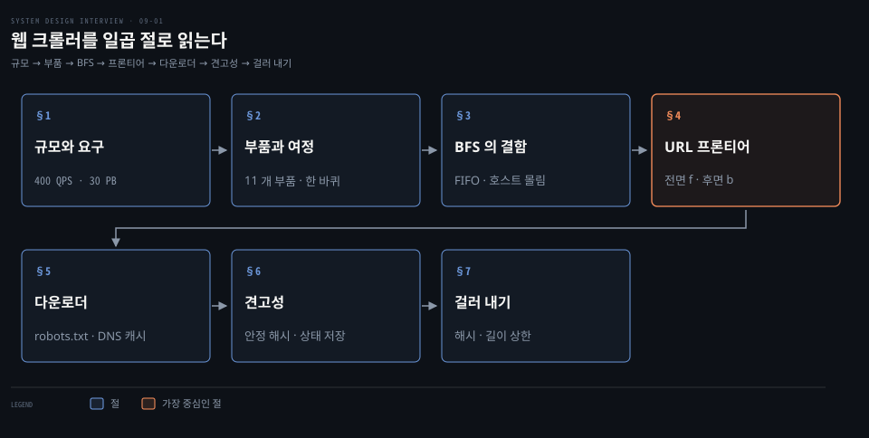
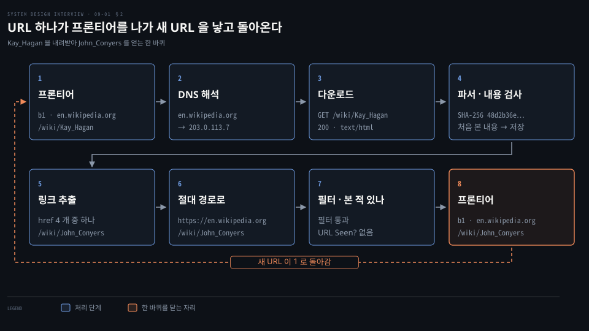
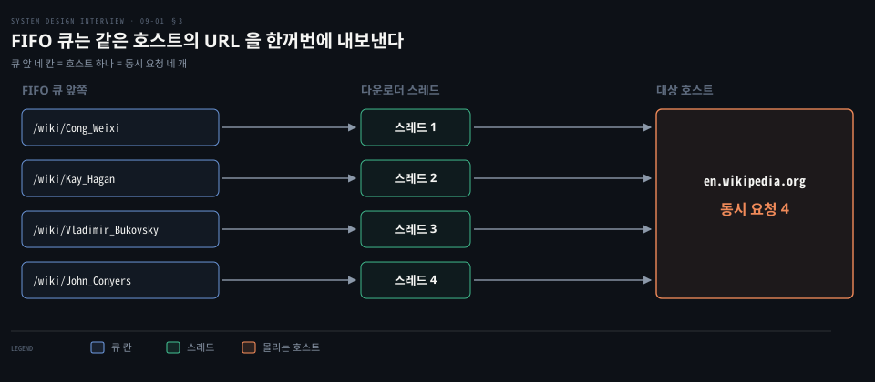
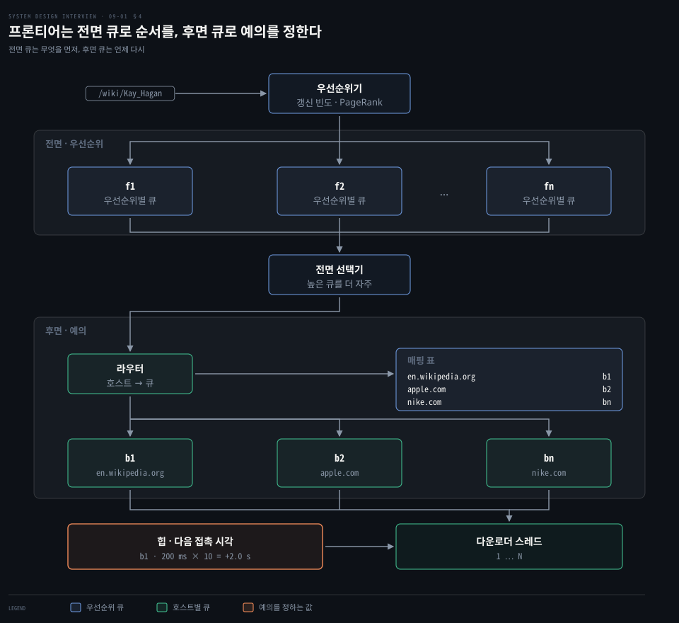
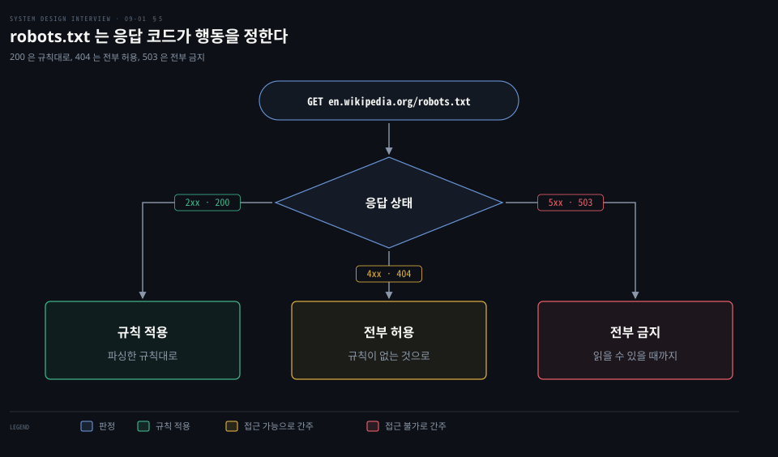
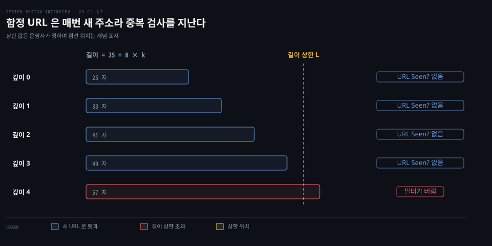

# 웹 크롤러는 URL 프론티어가 우선순위와 예의를 지키며 BFS 로 내려받고 중복과 함정을 걸러 낸다

---

> 웹 크롤러는 프론티어에서 URL 을 꺼내 내려받고 링크를 뽑아 다시 프론티어에 넣는 되풀이이며, 프론티어가 순서와 예의를 정하고 해시와 길이 상한이 중복과 함정을 거릅니다.


## 핵심 요약

> 이 편의 중심 생각은 크롤러가 "내려받고, 링크를 뽑고, 다시 넣는" 단순한 되풀이이지만 그 사이의 큐 하나가 순서와 예의를 모두 맡는다는 것입니다.

월 10 억 페이지는 초당 약 400 장이고 5 년이면 30 PB 입니다. 이 규모에서 FIFO 큐로 BFS 를 하면 같은 호스트로 요청이 몰리고 중요한 페이지를 가리지 못해서, 프론티어를 우선순위의 전면 큐와 호스트별 예의의 후면 큐 두 단으로 나눕니다.

다운로더는 robots.txt 를 먼저 읽고 DNS 결과를 캐시하며 서버를 나눠 돕니다. 같은 내용은 해시로, 끝없이 깊은 함정 URL 은 길이 상한으로 거릅니다.




## 학습 목표

> 이 편을 읽고 나면 다음을 설명할 수 있습니다.

1. 월 10 억 페이지에서 내려받기 QPS 와 5 년 저장 용량을 계산식과 함께 구할 수 있습니다.
2. URL 하나가 프론티어를 나가 새 URL 을 낳고 돌아오기까지 거치는 부품을 순서대로 말할 수 있습니다.
3. FIFO 큐 BFS 의 두 결함과 전면 큐·후면 큐가 각각 무엇을 푸는지 설명할 수 있습니다.
4. robots.txt 응답 코드별 행동과 DNS 캐시·타임아웃이 다운로더를 빠르게 하는 까닭을 설명할 수 있습니다.
5. 중복 내용과 함정 URL 을 거르는 방법과 그 한계를 말할 수 있습니다.


## 1. 월 10 억 페이지는 초당 약 400 장이고 평균 500 KB 면 5 년에 30 PB 를 쌓는다

> 요구는 여섯 줄이고 설계를 가르는 숫자는 초당 내려받기 수와 5 년 저장 용량입니다.

크롤러는 얼마나 빨리 얼마나 많이 모으느냐에 따라 전혀 다른 시스템이 됩니다. 몇 시간짜리 과제부터 전담 팀이 계속 고치는 검색 엔진용까지 같은 이름이므로 요구부터 못 박습니다.

- 목적: 검색 엔진 색인
- 규모: 한 달에 10 억 페이지
- 내용: HTML 만
- 갱신: 새로 생기거나 고쳐진 페이지도 반영
- 보관: 내려받은 HTML 을 5 년
- 중복: 내용이 같은 페이지는 버림

좋은 크롤러의 성질은 넷입니다.

- 규모 확장성: 수십억 페이지를 병렬로 받습니다.
- 견고성: 깨진 HTML 과 응답 없는 서버와 악의적 링크를 견딥니다.
- 예의: 짧은 시간에 한 사이트로 요청을 몰지 않습니다.
- 기능 확장성: 새 콘텐츠 유형을 설계를 다시 짜지 않고 붙입니다.

아래 값은 면접에서 합의하는 설계 가정이며 실제 통계가 아닙니다. 페이지 평균 500 KB 와 피크 2 배도 가정입니다.

| 구하는 값 | 식 | 결과 |
|---|---|---|
| 내려받기 QPS | 1,000,000,000 ÷ (30 일 × 86,400 초) | 약 386, 올려 잡아 400 |
| 피크 QPS | 400 × 2 | 800 |
| 한 달 저장 용량 | 1,000,000,000 × 500 KB | 500 TB |
| 5 년 저장 용량 | 500 TB × 12 개월 × 5 년 | 30,000 TB, 곧 30 PB |

800 QPS 가 한 호스트로 간다면 사이트가 버티지 못하므로 예의가 설계 제약이 됩니다. 30 PB 는 메모리에 못 담아 디스크 기반 저장소가 됩니다. 기준 값을 어림하는 법은 [개략적 규모 추정 편](./02-01.개략적%20규모%20추정은%202의%20거듭제곱·지연%20시간·가용성%20수치로%20QPS%20와%20저장%20용량을%20어림한다.md)에서 다룹니다.


## 2. 한 URL 은 프론티어를 나가 DNS·다운로더·파서·중복 검사를 지나 새 URL 을 낳고 돌아온다

> 부품은 열한 개이지만 상태는 둘뿐이어서, 받을 URL 은 프론티어에 있고 받은 것은 URL 저장소와 콘텐츠 저장소에 있습니다.

`https://en.wikipedia.org/wiki/Kay_Hagan` 하나는 크롤러 안에서 어떤 길을 지날까요? 부품이 왜 그렇게 나뉘는지는 URL 하나를 따라가면 보입니다.



도식의 SHA-256 값은 본문이 `<html><body><h1>Kay Hagan</h1></body></html>` 인 가상의 페이지를 해시한 앞 8 자리 `48d2b36e` 입니다. 203.0.113.7 은 문서용 예시 주소입니다.[^rfc5737]

프론티어를 나간 URL 은 DNS 로 IP 를 얻은 뒤 내려받고, 응답은 200 과 `text/html` 입니다. 파서가 형식을 검사한 뒤 내용 해시가 저장소에 이미 있으면 페이지를 버립니다. 새 내용이면 페이지의 href 네 개에서 링크를 뽑습니다. 그중 `/wiki/John_Conyers` 는 절대 경로로 바뀌어 필터와 URL Seen? 을 통과해 프론티어로 들어갑니다.

| 부품 | 하는 일 |
|---|---|
| 시드 URL | 크롤의 출발점. 한 대학이면 그 도메인이고, 전 웹이면 지역이나 주제로 URL 공간을 나눠 고름 |
| **URL 프론티어** | 아직 받지 않은 URL 을 담는 큐 |
| HTML 다운로더 | 프론티어가 준 URL 의 페이지를 HTTP 로 내려받음 |
| DNS 해석기 | 호스트 이름을 IP 로 바꿈 |
| 콘텐츠 파서 | 깨진 페이지를 걸러 저장 공간 낭비를 막음. 느려서 다운로더 안에 두지 않음 |
| Content Seen? | 같은 내용을 이미 저장했는지 해시로 비교 |
| 콘텐츠 저장소 | 대부분 디스크, 자주 쓰는 것만 메모리 |
| URL 추출기 | 링크를 뽑아 상대 경로를 절대 URL 로 바꿈 |
| URL 필터 | 제외할 콘텐츠 유형·확장자·오류 링크·차단 사이트를 거름 |
| URL Seen? | 이미 방문했거나 프론티어에 있는 URL 을 걸러 중복 투입과 무한 루프를 막음 |
| URL 저장소 | 방문한 URL 을 보관 |

### 자바스크립트가 만든 링크는 렌더한 뒤에야 보인다

내려받은 HTML 을 그대로 파싱하면 스크립트가 나중에 만드는 링크를 놓칩니다. 그래서 크롤러가 페이지를 브라우저처럼 렌더한 뒤 링크를 뽑습니다. Google 의 검색 크롤러는 페이지를 크롤한 뒤 렌더 대기열에서 헤드리스 Chromium 으로 스크립트를 실행하고, 렌더된 HTML 에서 링크를 다시 뽑아 크롤 대기열에 넣습니다.[^google-js]

사이트가 봇에게만 미리 렌더한 HTML 을 주는 동적 렌더링을 두고 Google 은 장기 해법이 아니라 우회책이었다고 밝히며 서버 측 렌더링·정적 렌더링·하이드레이션을 권합니다.[^google-dyn] 사이트에는 그 방식이 권장되지만 크롤러는 모든 사이트가 그러리라 기대할 수 없어 스스로 렌더합니다.


## 3. FIFO 큐로 BFS 를 하면 같은 호스트의 URL 이 연달아 나가고 중요도도 가리지 못한다

> 웹은 페이지가 노드이고 링크가 간선인 방향 그래프이며, DFS 는 너무 깊어져 BFS 를 쓰지만 FIFO 큐 BFS 에는 결함이 둘 있습니다.

URL 을 어떤 순서로 꺼낼까요? 크롤은 한 페이지에서 다른 페이지로 방향 그래프를 훑는 일이고 훑는 방법은 DFS 와 BFS 입니다. DFS 는 링크 하나를 따라 끝없이 내려가 깊이를 짐작할 수 없어서 보통 고르지 않습니다. BFS 는 FIFO 큐로 구현해 넣은 순서대로 꺼냅니다.



결함은 둘입니다.

- 호스트 몰림: 한 페이지의 링크 대부분은 같은 호스트를 가리킵니다. 도식의 네 링크 `/wiki/Cong_Weixi`·`/wiki/Kay_Hagan`·`/wiki/Vladimir_Bukovsky`·`/wiki/John_Conyers` 는 모두 en.wikipedia.org 입니다. 큐 앞 네 칸을 스레드 넷이 동시에 가져가면 한 서버에 요청 네 개가 한꺼번에 갑니다. 병렬로 받을수록 서버를 몰아치므로 예의 없는 행동입니다.
- 중요도 무시: 큐는 도착 순서만 봅니다. 같은 단어가 있어도 제품 토론 게시판의 글보다 그 회사의 홈페이지를 먼저 받아야 하는데 FIFO 는 이 차이를 모릅니다.

둘 다 큐 하나로는 풀 수 없어서 큐를 두 단으로 쌓습니다. 그 구조가 다음 절의 프론티어입니다.


## 4. URL 프론티어는 전면 큐가 우선순위를, 후면 큐가 호스트별 예의를 맡고 갱신 이력이 신선도를 정한다

> 프론티어는 우선순위기와 전면 큐 f1 에서 fn 이 순서를, 라우터와 후면 큐 b1 에서 bn 이 호스트별 간격을 맡는 두 단입니다.

중요한 것을 먼저 받으면서 호스트를 몰아치지도 않으려면 큐가 몇 개나 있어야 할까요? 순서와 간격을 서로 다른 단에서 정합니다.



위쪽 **전면 큐**가 무엇을 먼저 받을지 정합니다. 우선순위기가 URL 마다 쓸모를 재어 f1 에서 fn 중 한 큐에 넣고, 쓸모는 PageRank·사이트 트래픽·갱신 빈도로 잽니다. 선택기는 무작위로 고르되 우선순위가 높은 큐 쪽으로 치우쳐 뽑습니다.

아래쪽 **후면 큐**가 언제 받을지 정합니다. 라우터가 매핑 표로 호스트를 큐에 대응시켜(en.wikipedia.org 는 b1, apple.com 은 b2, nike.com 은 bn) 후면 큐 하나에는 한 호스트의 URL 만 담깁니다.

힙에는 후면 큐마다 그 호스트를 다시 건드려도 되는 가장 이른 시각이 하나씩 들어 있습니다. 다운로더 스레드는 이 힙에서 시각이 가장 이른 후면 큐를 꺼내 그 시각이 될 때까지 기다린 뒤 그 큐 머리의 URL 하나를 받습니다. 그 큐의 다음 시각은 힙에 다시 넣습니다.[^irbook] 큐 하나에는 한 호스트만 있으므로 한 호스트에 열리는 연결은 하나입니다. 시각이 될 때까지 기다리므로 두 요청 사이에 간격이 생깁니다. 스레드에 큐를 고정으로 짝지어도 같은 효과이지만, 큐가 스레드보다 많으려면 힙으로 고릅니다.

그 지연은 얼마가 적당할까요? 한 구현은 그 시각을 직전 내려받기에 걸린 시간의 열 배만큼 뒤로 잡습니다.[^irbook] 직전에 200 ms 가 걸렸다면 200 ms × 10 = 2.0 s 뒤에야 같은 호스트를 다시 받습니다. 서버가 느릴수록 간격이 늘어 스스로 부하를 줄입니다. 기다리는 큐가 있어도 스레드가 쉬지 않도록 후면 큐 수는 스레드 수의 세 배쯤이 경험칙입니다.[^irbook]

### 갱신은 이력으로 정하고 조건부 요청으로 싸게 확인한다

받아 둔 페이지는 계속 바뀌지만 전부 다시 받기는 시간도 자원도 큽니다. 갱신 이력을 보고 자주 바뀌는 페이지를 더 자주 받고, 우선순위가 높은 페이지를 먼저 더 자주 받습니다. 다시 받는 비용은 조건부 요청으로 줄입니다. `If-None-Match` 나 `If-Modified-Since` 를 붙이면 바뀌지 않은 페이지는 본문 없이 304 로 돌아옵니다.[^rfc9110] 규격은 `If-Modified-Since` 의 용도 하나로 웹 탐색의 범위를 최근 바뀐 자원으로 좁히는 일을 꼽습니다. 조건부 GET 자체는 [웹 메시지 편의 5 절](../../../02_os/book/cntd_computer-networking-top-down/02-02.웹은%20어떻게%20주고받는가.md)에서 다룹니다.

### 프론티어의 URL 은 디스크에 두고 메모리에 버퍼를 둔다

검색 엔진용 크롤에서 프론티어의 URL 은 수억 개에 이릅니다. 전부 메모리에 두면 지속성도 확장성도 없습니다. 전부 디스크에 두면 느려서 병목이 됩니다. 그래서 대부분을 디스크에 두고 넣고 빼는 앞뒤 끝만 메모리 버퍼에 둡니다. 버퍼는 주기적으로 디스크에 씁니다.


## 5. 다운로더는 robots.txt 를 먼저 읽고 서버를 나눠 돌며 DNS 결과를 캐시하고 타임아웃으로 느린 호스트를 끊는다

> 다운로더는 규칙 파일을 먼저 확인하고, 분산·DNS 캐시·지역성·타임아웃 넷으로 속도를 냅니다.

받지 말아 달라고 사이트가 이미 써 둔 페이지는 어디서 알 수 있을까요? 사이트가 크롤러에게 접근 범위를 알리는 파일이 **robots.txt** 입니다. 2022 년 9 월 RFC 9309 가 이 Robots Exclusion Protocol 을 표준(Standards Track)으로 정했습니다.[^rfc9309] 이 규칙은 접근 권한을 주는 장치가 아니라 크롤러에게 협조를 요청하는 것입니다. 규칙이 여럿 맞으면 가장 긴 일치가 이깁니다.

```bash
# RFC 9309 의 예시입니다. /example/page/disallowed.gif 는 더 긴 Disallow 규칙이 이겨 막힙니다.
User-Agent: foobot
Allow: /example/page/
Disallow: /example/page/disallowed.gif
```



robots.txt 를 요청했을 때의 행동은 응답 코드가 정합니다. 200 으로 받으면 그 규칙을 따릅니다. 404 같은 4xx 는 쓸 수 없다는 응답이라 어떤 자원이든 접근해도 됩니다. 503 같은 5xx 나 네트워크 오류로 읽을 수 없으면 규칙이 정의되지 않은 것이므로 전부 금지로 간주해야 합니다.[^rfc9309]

결과는 캐시하되 접근 불가가 아닌 한 24 시간을 넘겨 쓰지 않도록 권고합니다. 읽을 수 없는 상태가 아주 오래(예: 30 일) 이어지면 접근 가능으로 봐도 됩니다. 리디렉션은 최소 다섯 번까지 따라가고 파싱 한도는 500 KiB 이상으로 둡니다.[^rfc9309] `Crawl-delay` 는 RFC 9309 에 없고 Google 도 지원하지 않는다고 밝히므로 요청 사이의 간격은 4 절처럼 크롤러가 스스로 정합니다.[^google-robots]

### 속도는 분산·DNS 캐시·지역성·타임아웃에서 나온다

- 분산 크롤: 크롤 작업을 여러 서버에 나누고 서버마다 스레드를 여럿 돌립니다. URL 공간을 쪼개 다운로더마다 일부만 맡습니다.
- DNS 캐시: DNS 응답 시간을 10~200 ms 로 가정합니다. 동기식 인터페이스에서는 한 스레드가 조회를 기다리는 동안 다른 스레드도 멈춥니다. 최악 200 ms 짜리 조회를 스레드 셋이 차례로 하면 셋째는 자기 조회를 시작하기까지 200 ms × 2 = 400 ms 를 기다립니다. 이름과 IP 의 대응을 크롤러 안에 캐시해 이 대기를 줄입니다. 캐시는 주기적으로 다시 채우되 레코드의 TTL 을 넘겨 쓰지 않습니다. RFC 1035 는 TTL 을 레코드를 캐시해도 되는 시간 간격으로 정의합니다.[^rfc1035] 캐시가 레코드의 TTL 을 상한으로 잘라 담는 예는 [CoreDNS 편의 5 절](../../../08_cloud/book/learning-coredns/03-02.플러그인%20일곱이면%20서버%20하나가%20선다.md)에 있습니다.
- 지역성: 크롤 서버를 호스트와 가까운 지역에 두면 내려받기가 빨라집니다. 서버·캐시·큐·저장소도 같은 원리로 지역을 나눕니다.
- 짧은 타임아웃: 응답이 느리거나 없는 서버는 정한 시간까지만 기다리고 작업을 접어 다른 페이지로 넘어갑니다.


## 6. 견고성은 안정 해시와 저장된 크롤 상태와 예외 처리로, 확장성은 꽂아 넣는 모듈로 얻는다

> 서버가 늘고 죽어도 크롤이 이어지게 하고, 새 콘텐츠 유형은 모듈을 꽂아 붙입니다.

다운로더 서버 한 대가 죽으면 그 서버가 맡던 호스트는 어디로 갈까요? 대규모 크롤은 수백에서 수천 대가 필요해서 서버가 죽고 늘어나는 일이 일상입니다.

- 안정 해시: 호스트를 다운로더에 나눌 때 서버가 늘고 줄어도 옮겨야 할 키가 적습니다. 호스트를 나눌 키로 잡으면 호스트의 후면 큐와 예의 간격이 한 서버 안에 있습니다.[^irhost] 원리는 [안정 해시 편](./05-01.안정%20해시는%20해시%20링과%20가상%20노드로%20서버가%20늘고%20줄%20때%20옮길%20키를%20줄인다.md)에서 다룹니다.
- 상태 저장: 크롤 상태와 데이터를 저장소에 써 두면 중단된 크롤을 저장된 상태에서 다시 시작합니다.
- 예외 처리: 대규모 시스템에서 오류는 흔하므로 시스템을 죽이지 않고 다룹니다.
- 데이터 검증: 파서의 형식 검사처럼 시스템 오류를 앞에서 막습니다.
- 무상태 서버: 크롤 서버가 상태를 갖지 않으면 서버를 더하고 빼며 수평 확장하기 쉽습니다.

### 새 콘텐츠 유형은 모듈로 꽂는다

이미지를 받고 싶어지면 설계를 다시 짜야 할까요? 내려받기 뒤에 모듈을 끼우는 구조라 PNG 다운로더를 꽂으면 PNG 를 받고, 웹 모니터를 꽂으면 저작권과 상표 침해를 감시합니다.


## 7. 중복 내용은 해시로, 함정 URL 은 길이 상한과 사람의 눈으로, 잡음은 스팸 필터로 거른다

> 거를 것은 같은 내용, 끝없이 깊은 URL, 값어치 없는 내용 셋입니다.

받은 페이지가 모두 쓸모 있을까요? 같은 글이 주소만 달리 여러 곳에 있을 수 있습니다. 링크를 따라가면 끝나지 않는 주소도 있습니다. 값어치 없는 내용도 섞여 있습니다.

### 같은 내용은 해시로 거른다

내용을 글자 하나씩 비교하면 수십억 페이지에서 너무 느려서 해시를 비교합니다. Content Seen? 은 저장된 해시 집합에 새 해시가 있는지만 봅니다. 해시가 바이트 단위로 같은 쪽만 잡으므로 광고 문구나 갱신 시각만 다른 근사 중복은 놓칩니다. 그런 페이지를 찾는 별도 연구가 있습니다.[^manku] 2015 년 한 SEO 도구 업체의 조사에서 나온 29% 는 중복 콘텐츠 문제를 겪는 사이트의 비율이라 페이지 중복률로 쓰지 않습니다.[^sel]

URL 쪽 중복은 URL Seen? 이 맡고 해시 테이블이나 블룸 필터로 구현합니다. 블룸 필터는 없다는 답이 확실하고 있다는 답은 틀릴 수 있습니다. 그래서 크롤러에서는 새 URL 을 본 적 있다고 착각해 버리는 대가가 따릅니다. 5 년간 받는 600 억 페이지(10 억 × 12 × 5)만 세어도 키당 10 비트면 600 억 × 10 비트 = 6,000 억 비트, 약 75 GB 입니다. 작동 원리는 [URL 단축기 편](./08-01.URL%20단축기는%20301·302%20리디렉션과%20해시%20충돌%20해소%20또는%20base62%20변환으로%20짧은%20키를%20만든다.md)의 4 절과 [LSM 저장 엔진](../../../05_data/book/designing-data-intensive-applications/04-02.LSM%20저장%20엔진.md)의 3 절에서 다룹니다. 크롤러 쪽 중복 제거는 [ByteByteGo 편](../bytebytego-system-design/08-01.트위터%20타임라인·구글%20독스%20동시%20편집·슬랙%20알림%20판정·크롤러%20중복%20제거는%20팬아웃·OT·흐름도·블룸%20필터로%20푼다.md)이 같은 도구를 다른 각도로 봅니다.

### 함정 URL 은 길이 상한이 끊는다

**스파이더 트랩**은 크롤러를 무한 루프에 빠뜨리는 페이지입니다. `www.spidertrapexample.com/foo/bar/foo/bar/foo/bar/…` 처럼 디렉터리가 끝없이 깊어지는 주소가 한 예입니다. `/foo/bar` 한 마디마다 주소가 8 자 늘어 깊이 k 의 길이는 호스트 25 자에 8k 를 더한 25 + 8k 자입니다. 깊이 4 면 25 + 8 × 4 = 57 자입니다.



마디가 하나만 달라도 문자열이 달라져 URL Seen? 이 새 주소로 통과시키므로, 자동으로 끊는 장치는 URL 길이 상한을 두는 필터입니다. 다만 모든 함정에 맞는 한 가지 해법은 없습니다. 함정이 있는 사이트는 발견되는 페이지 수가 비정상적으로 많아 알아볼 수 있고, 사람이 확인해 크롤에서 빼거나 맞춤 URL 필터를 겁니다.

### 값어치 없는 내용은 걸러 낸다

광고나 코드 조각, 스팸 URL 처럼 쓸모 없는 내용은 가능하면 제외합니다. 자원이 유한하므로 낮은 품질과 스팸을 걸러 내는 구성 요소가 도움이 됩니다.


## 면접 대비

> 규모 계산, 큐 구조, robots.txt 판정, 함정 URL 에 관한 면접 질문입니다.

1. 월 10 억 페이지를 받는 크롤러의 내려받기 QPS 와 5 년 저장 용량을 식으로 보이십시오.
2. FIFO 큐 BFS 가 크롤러에 부적합한 두 이유와 프론티어가 각각을 푸는 방식은 무엇입니까?
3. 후면 큐가 한 호스트에 한 번에 요청 하나만 보내게 하는 방법과 요청 사이의 간격을 정하는 방법을 설명해 보십시오.
4. robots.txt 응답이 404 일 때와 503 일 때 크롤러는 각각 어떻게 행동해야 하며 캐시는 얼마나 둡니까?
5. 함정 URL 이 URL Seen? 을 어떻게 통과하고 무엇으로 끊습니까?


## 정답 (자답 후 펼치기)

> 면접 질문에 대한 키워드 중심 모범 답안입니다.

### 정답 1 — 약 400 QPS 와 30 PB

10 억 ÷ (30 × 86,400) = 385.8 이라 올려 400 QPS 이고 피크는 두 배인 800 입니다. 저장은 10 억 × 500 KB = 500 TB 가 한 달치이고, × 12 × 5 = 30 PB 입니다. 500 KB 는 가정입니다.

### 정답 2 — 호스트 몰림과 중요도 무시

FIFO 큐는 같은 호스트의 링크를 연달아 내보내 예의를 깨고, 도착 순서만 봐서 중요도를 가리지 못합니다. 전면 큐가 우선순위를, 후면 큐가 호스트별 예의를 맡습니다.

### 정답 3 — 호스트마다 후면 큐, 직전 소요 시간의 열 배

라우터가 매핑 표로 호스트를 후면 큐 하나에 담고, 스레드는 힙에서 다음 접촉 시각이 가장 이른 큐의 URL 하나만 받습니다. 그 시각은 직전 소요의 열 배를 쓰는 경험칙에서 정해 200 ms 는 2.0 s 입니다.

### 정답 4 — 404 는 전부 허용, 503 은 전부 금지, 캐시 24 시간

4xx 는 규칙이 없다고 보고 접근하고, 5xx 와 네트워크 오류는 전부 금지로 봅니다. 캐시는 접근 불가가 아닌 한 24 시간을 넘기지 않습니다.

### 정답 5 — 매번 새 문자열, 길이 상한과 수동 제외

마디가 붙을 때마다 문자열이 달라져 URL Seen? 에 없는 새 주소로 통과합니다. 길이 상한으로 끊고, 페이지 수가 비정상인 사이트는 사람이 확인해 제외하거나 맞춤 필터를 둡니다.


## 참고 자료

- Alex Xu, 《System Design Interview – An Insider's Guide》, Chapter 9 "Design A Web Crawler".
- RFC 9309, Robots Exclusion Protocol, 2022 년 9 월: https://www.rfc-editor.org/rfc/rfc9309
- Manning·Raghavan·Schütze, 《Introduction to Information Retrieval》, Cambridge University Press, 2008, §20.2.3: https://nlp.stanford.edu/IR-book/html/htmledition/the-url-frontier-1.html


## 관련 문서

- [안정 해시는 해시 링과 가상 노드로 서버가 늘고 줄 때 옮길 키를 줄인다](./05-01.안정%20해시는%20해시%20링과%20가상%20노드로%20서버가%20늘고%20줄%20때%20옮길%20키를%20줄인다.md)
- [URL 단축기는 301·302 리디렉션과 해시 충돌 해소 또는 base62 변환으로 짧은 키를 만든다](./08-01.URL%20단축기는%20301·302%20리디렉션과%20해시%20충돌%20해소%20또는%20base62%20변환으로%20짧은%20키를%20만든다.md)

[^google-js]: Google Search Central, JavaScript SEO basics: <https://developers.google.com/search/docs/crawling-indexing/javascript/javascript-seo-basics>
[^google-dyn]: Google Search Central, Dynamic rendering as a workaround: <https://developers.google.com/search/docs/crawling-indexing/javascript/dynamic-rendering>
[^irbook]: Manning·Raghavan·Schütze, Introduction to Information Retrieval §20.2.3 "The URL frontier": <https://nlp.stanford.edu/IR-book/html/htmledition/the-url-frontier-1.html>
[^rfc9110]: RFC 9110 §13.1.3 "If-Modified-Since" 와 §15.4.5 "304 Not Modified": <https://www.rfc-editor.org/rfc/rfc9110#section-13.1.3>
[^rfc9309]: RFC 9309 §1·§2.2.2·§2.3.1.1~§2.3.1.4·§2.4·§2.5·§5.2: <https://www.rfc-editor.org/rfc/rfc9309>
[^google-robots]: Google Search Central, robots.txt 명세: <https://developers.google.com/search/docs/crawling-indexing/robots/robots_txt>
[^rfc1035]: RFC 1035 §4.1.3 "Resource record format": <https://www.rfc-editor.org/rfc/rfc1035#section-4.1.3>
[^manku]: Manku·Jain·Das Sarma, "Detecting near-duplicates for web crawling", WWW 2007: <https://doi.org/10.1145/1242572.1242592>
[^sel]: Search Engine Land, Greg Finn, 2015-10-08, Raven Tools 조사("29 percent of websites are dealing with duplicate content"): <https://searchengineland.com/study-29-of-sites-face-duplicate-content-issues-80-arent-using-schema-org-microdata-232870>, 아카이브 사본: <https://web.archive.org/web/20191215024544/https://searchengineland.com/study-29-of-sites-face-duplicate-content-issues-80-arent-using-schema-org-microdata-232870>
[^irhost]: Manning·Raghavan·Schütze, Introduction to Information Retrieval, "Distributing the crawler": <https://nlp.stanford.edu/IR-book/html/htmledition/distributing-the-crawler-1.html>
[^rfc5737]: RFC 5737 §3: <https://www.rfc-editor.org/rfc/rfc5737#section-3>
