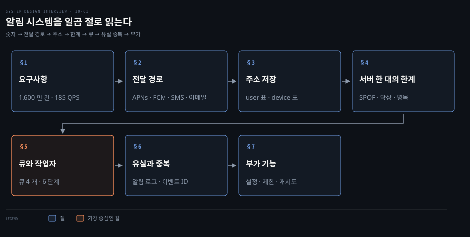
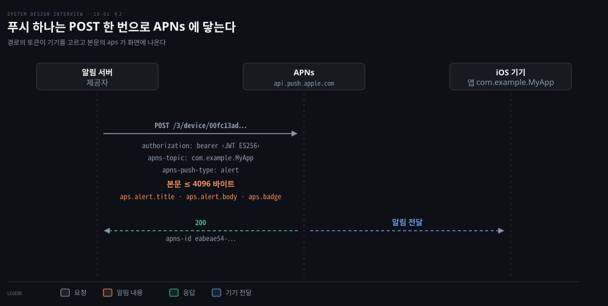
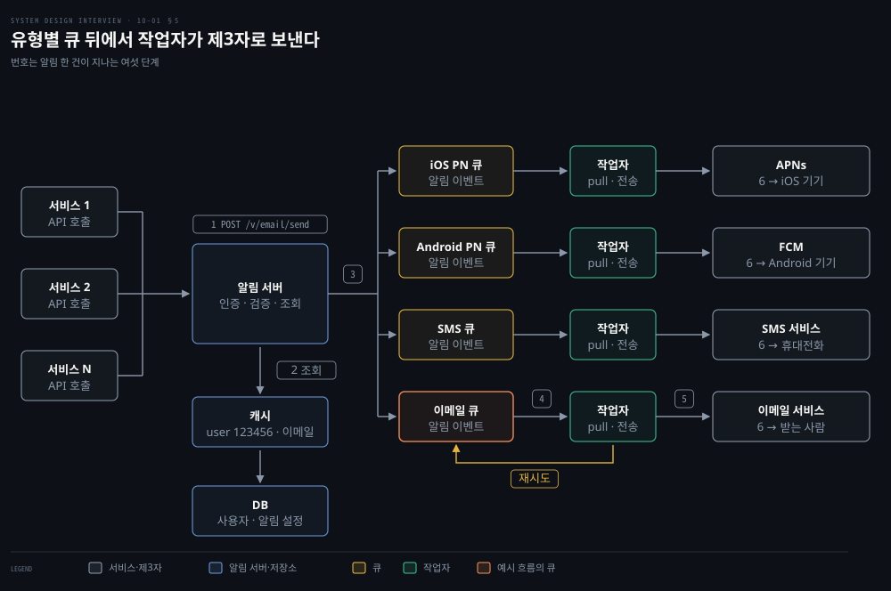
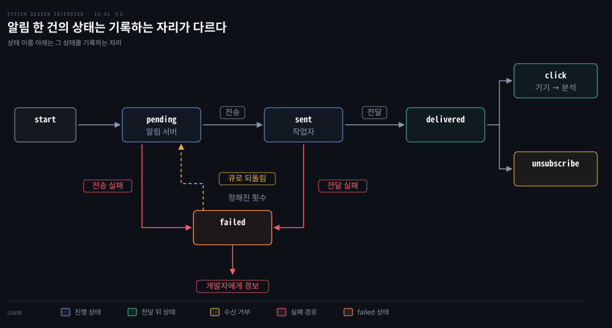

# 알림 시스템은 제3자 푸시·SMS·이메일 서비스 앞에 메시지 큐와 작업 서버를 두어 재시도와 중복을 다룬다

---

> 알림 시스템은 푸시·SMS·이메일을 제3자 서비스가 기기까지 나르게 하고, 그 앞에 알림 서버와 유형별 메시지 큐와 작업 서버를 둡니다. 유실은 알림 로그와 재시도로 막고 중복은 이벤트 ID 로 거릅니다.


## 핵심 요약

> 이 편의 중심 생각은 알림을 기기에 닿게 하는 쪽이 우리 서버가 아니라 제3자 서비스라서, 설계의 일이 요청 형식 맞추기와 장애·중복 다루기로 모인다는 것입니다.

알림은 모바일 푸시, SMS, 이메일 세 형식이고 각각 APNs·FCM, SMS 서비스, 이메일 서비스를 거쳐 기기에 닿습니다. 알림 서버는 DB 에서 받는 사람의 기기 토큰·전화번호·이메일을 찾아 서비스마다 다른 요청으로 바꿔 보냅니다.

서버 한 대가 이 일을 다 하면 단일 장애점이자 병목입니다. 그래서 DB 와 캐시를 밖으로 빼고, 유형마다 큐를 두어 작업자가 꺼내 제3자에게 보냅니다. 한 제공자가 멎어도 다른 큐는 흐릅니다.

유실은 알림 로그 DB 와 재시도로 막습니다. 정확히 한 번 전달은 분산 환경에서 불가능해 중복이 남으므로, 이벤트 ID 를 확인해 걸러 줄입니다.




## 학습 목표

> 이 편을 읽고 나면 다음을 설명할 수 있습니다.

1. 유형별 하루 건수에서 평균 QPS 를 계산하고, 알림에서 허용되는 것(지연·순서 변경)과 허용되지 않는 것(유실)을 구분할 수 있습니다.
2. APNs 와 FCM 요청이 각각 어떤 주소·인증·본문으로 이뤄지는지 말할 수 있습니다.
3. 기기 토큰과 연락처가 어느 표에 어떻게 저장되고 쓸모없어진 토큰이 어떻게 정리되는지 설명할 수 있습니다.
4. 서버 한 대 설계의 문제 셋과 큐·작업자 분리가 각각을 푸는 방식을 설명할 수 있습니다.
5. 상태 전이에 맞춰 유실 방지와 중복 제거를 설명하고 재시도할 실패와 아닌 실패를 구분할 수 있습니다.


## 1. 하루 1,600 만 건의 알림은 평균 초당 약 185 건이고 유실은 막되 약간의 지연은 받아들이는 약한 실시간 시스템이다

> 설계를 가르는 값은 유형별 하루 건수, 얼마나 빨리 보내야 하는지, 잃어도 되는지 셋입니다.

알림 시스템을 설계하라는 말만으로는 무엇을 누구에게 얼마나 보낼지 알 수 없습니다. 무엇부터 정해야 할까요? 이 편은 다음 요구를 설계 가정으로 둡니다.

- 유형: 모바일 푸시, SMS, 이메일
- 기기: iOS, 안드로이드, 노트북·데스크톱
- 트리거: 클라이언트 앱이 일으키거나 서버가 예약
- 수신 거부: 사용자가 거부하면 더는 보내지 않음
- 실시간성: 가능한 한 빨리 보내되 부하가 높으면 약간의 지연을 허용하는 약한 실시간
- 규모: 하루 푸시 1,000 만 건, SMS 100 만 건, 이메일 500 만 건

하루 건수를 86,400 초로 나누면 평균 속도가 나옵니다.

| 유형 | 하루 건수 | 평균 초당 건수 |
|---|---|---|
| 푸시 | 10,000,000 | 10,000,000 ÷ 86,400 ≈ 115.7 |
| SMS | 1,000,000 | 1,000,000 ÷ 86,400 ≈ 11.6 |
| 이메일 | 5,000,000 | 5,000,000 ÷ 86,400 ≈ 57.9 |
| 합계 | 16,000,000 | 16,000,000 ÷ 86,400 ≈ 185.2 |

평균이어서 몰리는 시간대는 이보다 높습니다. 몰림을 몇 배로 볼지는 주어진 값이 없어 가정하지 않고, 순간 부하를 큐가 받아 내도록 설계합니다(§5).

알림은 늦어지거나 순서가 바뀔 수는 있어도 잃어서는 안 됩니다.


## 2. 푸시·SMS·이메일은 제3자 서비스가 기기까지 나르고 알림 서버는 서비스마다 다른 요청 형식과 인증에 맞춰 보낸다

> 알림 서버는 기기에 직접 닿지 않고 APNs, FCM, SMS 서비스, 이메일 서비스에 요청합니다. 형식과 인증이 넷 다 달라 서버가 형식마다 요청을 만듭니다.

서버가 기기의 주소만 알면 바로 보내면 되지 않을까요? iOS 의 원격 알림은 Apple 의 APNs 가 기기에 전달하므로 APNs 를 거쳐야 합니다. APNs 에 요청하는 쪽을 **제공자**라 부릅니다. 요청 하나는 경로에 기기 토큰을, 헤더에 인증 토큰을, 본문에 페이로드를 담습니다.[^apns-send]

제공자는 HTTP/2 와 TLS 1.2 이상으로 APNs 서버에 POST 합니다. 운영 서버는 `https://api.push.apple.com:443` 이고 시험용 서버는 `api.sandbox.push.apple.com` 입니다.[^apns-send]

인증 토큰은 ES256 으로 서명한 JWT 이고 키 ID, 팀 ID, 발급 시각을 `kid`, `iss`, `iat` 에 담습니다. 발급 후 한 시간이 지나면 거부되므로 20 분 이상 60 분 이하 간격으로 갱신합니다.[^apns-token]



페이로드는 `aps` 키 밑에 `alert`, `badge`, `sound` 를 둡니다. `alert` 에는 `title` 과 `body` 가 들어갑니다. 4 KB(4096 바이트)를 넘으면 거부됩니다.[^apns-payload] 성공하면 APNs 는 상태 200 과 `apns-id` 로 답합니다. 값은 `eabeae54-14a8-11e5-b60b-1697f925ec7b` 같은 UUID 입니다.[^apns-resp]

```bash
# 경로의 토큰이 기기를 고르고, 헤더가 앱과 알림 종류를 정하고, 본문이 화면에 뜹니다.
POST /3/device/00fc13adff785122b4ad28809a3420982341241421348097878e577c991de8f0
authorization: bearer <JWT>
apns-topic: com.example.MyApp
apns-push-type: alert
{"aps": {"alert": {"title": "Game Request", "body": "Bob wants to play chess"}, "badge": 5}}
```

APNs 는 최선 노력(best effort) 서비스입니다. 같은 기기 토큰으로 보낸 알림의 순서를 바꿀 수 있습니다.[^apns-send]

바로 전달하지 못하면 `apns-expiration` 시각까지, 길어야 30 일 저장해 둘 수 있고 기기가 다시 온라인이 되면 전달을 시도합니다. 이 값이 0 이면 한 번만 시도하고 저장하지 않습니다. 저장은 앱(번들 ID) 하나에 알림 하나이고, 대개 최신 것이 남지만 보장되지는 않습니다.[^apns-send]

안드로이드의 FCM 은 HTTP v1 API 를 씁니다. 주소는 `https://fcm.googleapis.com/v1/projects/<프로젝트 ID>/messages:send` 입니다. `Authorization: Bearer` 헤더에는 서비스 계정에서 얻은 단기 OAuth 2.0 접근 토큰을 담습니다. 본문은 `message` 아래 `token` 과 `notification` 입니다.[^fcm-v1]

서버 키를 쓰던 레거시 HTTP·XMPP API 는 2023 년 6 월 20 일에 폐기가 예고되었고 2024 년 7 월 22 일부터 종료가 시작되었습니다. 새 서버는 v1 만 씁니다.[^fcm-legacy]

Twilio 의 SMS 는 `POST /2010-04-01/Accounts/{AccountSid}/Messages.json` 에 `To`, `From`, `Body` 를 줍니다. Messaging Service 없이 보내면 응답의 상태는 `queued` 에서 시작해 `sent`, `delivered`, `failed` 등으로 바뀝니다.[^twilio] SendGrid 의 이메일은 `POST /v3/mail/send` 에 API 키를 Bearer 로 담아 보냅니다.[^sendgrid]

제공자는 시장에 따라 못 쓰게 되거나 나중에 바뀔 수 있습니다. 그래서 제공자마다 요청을 만드는 부분을 따로 두어, 하나를 바꿔도 나머지가 그대로이게 합니다.


## 3. 기기 토큰과 연락처는 설치·가입 때 API 서버가 모아 사용자 표와 기기 표에 두고 한 사용자가 여러 기기를 가진다

> 보낼 주소는 설치나 가입 때 처음 모으고 기기 토큰은 앱이 시작할 때마다 다시 받아 갱신합니다. 이메일과 전화번호는 사용자 표에, 기기 토큰은 기기 표에 두어 한 사용자의 모든 기기에 보냅니다.

알림을 보내려면 주소가 있어야 하는데 서버는 그 주소를 언제 얻을까요? 사용자가 앱을 설치하거나 처음 가입할 때 로드 밸런서를 지난 API 서버가 연락처를 받아 DB 에 저장합니다. iOS 앱은 시작할 때 APNs 에서 **기기 토큰**을 받아 제공자 서버로 보냅니다.[^apns-register]

| user 표 | 형식 | device 표 | 형식 |
|---|---|---|---|
| `user_id` | bigint | `id` | bigint |
| `email` | varchar | `device_token` | varchar |
| `country_code` | integer | `user_id` | bigint |
| `phone_number` | integer | `last_logged_in_at` | timestamp |
| `created_at` | timestamp | | |

`device.user_id` 가 `user.user_id` 를 가리켜 사용자 한 명에 기기가 여럿입니다. 그래서 푸시는 그 사용자의 모든 기기에 보낼 수 있습니다.

기기 토큰은 오래 믿을 값이 아닙니다. 기기를 백업에서 복원하거나 새 기기에 앱을 설치하거나 OS 를 다시 설치하면 새 토큰이 발급됩니다.[^apns-register] 쓸 수 없게 된 토큰으로 보내면 APNs 가 410 `Unregistered` 로 응답하며 그 토큰으로 더 보낼 필요가 없다고 알립니다.[^apns-resp] 그 행은 기기 표에서 지웁니다.


## 4. 알림 서버 한 대가 API 부터 전송까지 모두 맡으면 단일 장애점·확장 곤란·성능 병목이 겹친다

> 첫 설계는 서비스 N 개가 알림 서버 한 대를 부르고 그 서버가 제3자에 보냅니다. 구조가 단순한 대신 문제 셋이 한 곳에 몰립니다.

몰리는 시간에 서버 한 대는 무엇부터 막힐까요? 이 서버는 API 를 열고 제3자마다 요청 본문을 만들고 답을 기다립니다. 그래서 문제가 셋입니다.

- 단일 장애점(SPOF): 서버가 멎으면 모든 알림이 멈춥니다.
- 확장 곤란: API 처리, DB 와 캐시, 알림 가공이 한 서버에 묶여 일부만 키울 수 없습니다.
- 성능 병목: HTML 을 만들고 제3자의 응답을 기다리는 일이 자원을 오래 잡아 피크 시간에 서버가 과부하됩니다.

고치는 방향도 셋입니다.

- DB 와 캐시를 서버 밖으로 뺍니다.
- 서버를 늘려 자동으로 수평 확장합니다.
- 메시지 큐로 부품 사이를 떼어 냅니다.

큐와 무상태 서버의 일반 원리는 [규모 확장 편](./01-02.캐시·CDN·무상태%20웹%20계층·데이터%20센터·메시지%20큐·샤딩이%20수백만%20사용자까지%20규모를%20늘린다.md)에서 다뤘습니다.


## 5. DB 와 캐시를 서버 밖으로 빼고 유형별 큐 뒤에 작업자를 두면 한 제공자의 장애가 다른 알림으로 번지지 않는다

> 알림 서버는 알림을 큐에 넣고 돌아서며, 작업자가 큐에서 꺼내 제3자로 보냅니다. 큐가 유형마다 따로라 한 제공자의 장애가 다른 유형을 막지 않습니다.

큐를 끼우면 서버가 하던 전송을 누가 이어받고, 한 제공자가 멎으면 무엇이 달라질까요? 알림 서버의 일은 넷으로 줄어듭니다.

- 서비스용 API 를 엽니다. 스팸을 막으려고 내부 또는 검증된 클라이언트만 접근할 수 있습니다.
- 이메일 주소와 전화번호 같은 기본 검증을 합니다.
- 알림을 만들 데이터를 캐시나 DB 에서 조회합니다.
- 알림 데이터를 큐에 넣어 병렬 처리로 넘깁니다.

서비스가 알림 서버에 이메일 한 통을 보내라고 요청하는 예입니다.

```bash
# user_id 로 받는 사람의 주소를 찾아 이메일을 만듭니다.
POST https://api.example.com/v/email/send
{
  "to": [{"user_id": 123456}],
  "from": {"email": "from_address@example.com"},
  "subject": "Hello, World!",
  "content": [{"type": "text/plain", "value": "Hello, World!"}]
}
```

캐시에는 사용자 정보, 기기 정보, 알림 템플릿을 두고 DB 에는 사용자, 알림, 설정을 둡니다. 큐는 부품 사이의 의존을 끊고 알림이 몰릴 때 완충 역할을 합니다. **작업자**는 큐에서 알림 이벤트를 꺼내(pull) 제3자 서비스로 보내는 서버들입니다.



알림 한 건이 지나는 여섯 단계이고 번호는 도식과 같습니다.

1. 서비스가 알림 서버의 API 를 호출합니다.
2. 알림 서버가 캐시나 DB 에서 사용자 정보, 기기 토큰, 알림 설정을 가져옵니다.
3. 알림 이벤트를 해당 큐에 넣습니다. 이메일은 이메일 큐로, iOS 푸시는 iOS PN 큐로 갑니다.
4. 작업자가 큐에서 이벤트를 꺼냅니다.
5. 작업자가 제3자 서비스로 보냅니다.
6. 제3자 서비스가 사용자 기기로 보냅니다.

큐를 유형마다 따로 두는 이유는 장애의 범위입니다. SMS 서비스가 멎어 SMS 큐가 쌓여도 iOS PN·Android PN·이메일 큐는 각자의 속도로 흐릅니다.


## 6. 유실은 알림 로그와 재시도로 막고 중복은 정확히 한 번이 불가능하므로 이벤트 ID 로 걸러 줄인다

> 알림은 늦거나 순서가 바뀔 수는 있어도 잃어서는 안 됩니다. 중복은 없앨 수 없어서 줄입니다.

작업자가 제3자에 보내다 죽으면 그 알림은 어디에 남아 있을까요? 알림 데이터를 DB 의 알림 로그에 남겨 두면, 작업자가 죽거나 전송이 실패해도 무엇을 다시 보낼지 알 수 있습니다.



`pending` 은 알림 서버가 분석 서비스에 남기고 `sent` 는 작업자가 남깁니다. 작업자가 제3자에 전송하면 `sent` 가 되고, 제3자가 기기에 전달하면 `delivered` 입니다. 기기에서 `click` 이나 `unsubscribe` 로 갈리며 `click` 은 기기가 분석 서비스에 남깁니다.

`pending` 에서 전송이 실패하거나 `sent` 뒤 전달이 실패하면 `failed` 가 되고, 알림은 큐로 되돌아가 정해진 횟수만큼 다시 시도됩니다. 큐로 돌아간 알림이 다시 `pending` 에서 출발한다는 점은 이 편의 해석입니다. 그래도 실패가 이어지면 개발자에게 경보를 보냅니다.

다시 시도하면 같은 알림이 두 번 갈 수 있습니다. 수신 확인이 중간에 사라지면 보낸 쪽은 받았는지 알 수 없어 다시 보내기 때문입니다. 분산 환경에서 메시지를 정확히 한 번만 전달하는 것은 불가능하고, 실제 시스템은 받자마자 확인하는 최대 한 번과 처리한 뒤 확인하는 최소 한 번 중에서 대개 최소 한 번을 고릅니다.[^geek] 유실을 막아야 하는 알림도 최소 한 번을 고릅니다.

그래서 중복을 완전히 없애지 않고 줄입니다. 이벤트가 처음 도착하면 **이벤트 ID**를 확인해 이전에 본 ID 이면 버리고, 아니면 보냅니다. APNs 에서는 같은 `apns-collapse-id` 값으로 보낸 알림이 사용자 기기에서 하나로 합쳐집니다.[^apns-send] 최소 한 번으로 받고 멱등 처리로 중복을 걸러 정확히 한 번처럼 만드는 방식은 [스트림 처리의 Exactly-once 절](../../../05_data/book/designing-data-intensive-applications/12-04.시간%20추론과%20내결함성·12장%20종합.md)에서, 결제의 멱등 키는 [결제 정확성 편](../bytebytego-system-design/07-02.결제%20정확성은%20멱등%20키로%20이중%20청구를%20막고%20대사로%20장부%20불일치를%20찾고%20토큰화로%20카드%20정보를%20지킨다.md)에서, 컨슈머 쪽 구현은 [Exactly-once 편](../../../04_messaging/05_ConsistencyPattern/03-04.Exactly-once%20의미론과%20Consumer%20Idempotency.md)에서 이어집니다. 브로커의 전달 보장 세 가지는 [Kafka 편](../bytebytego-system-design/05-01.Kafka%20는%20순차%20IO%20와%20제로%20카피로%20빠르고%20전달%20보장은%20최대%20한%20번·최소%20한%20번·정확히%20한%20번으로%20갈린다.md)이 정리합니다.


## 7. 설정·처리율 제한·템플릿·재시도·인증·모니터링·추적은 알림 서버와 작업자 사이에서 자리를 나눠 갖는다

> 기본 흐름에 일곱 가지가 붙고, 각각은 알림 서버·작업자·큐 가운데 한 곳이 맡습니다.

큐와 작업자만으로 서비스를 열면 어떤 일이 생길까요? 수신 거부한 사용자에게 알림이 가고 한 사용자에게 알림이 쏟아집니다. 장애로 실패가 쌓여도 아무도 모릅니다.

| 요소 | 하는 일 | 맡는 곳 |
|---|---|---|
| 알림 설정 | 보내기 전에 채널별 수신 여부(`user_id`, `channel`, `opt_in`)를 확인합니다 | 알림 서버 |
| 처리율 제한 | 사용자 한 명이 받는 알림 수에 상한을 둡니다 | 알림 서버 |
| 템플릿 | 형식을 미리 정해 두고 매개변수·스타일·추적 링크를 채웁니다 | 작업자 |
| 재시도 | 전송 실패를 큐에 되돌리고 계속되면 개발자에게 경보를 보냅니다 | 작업자와 큐 |
| 인증 | 앱 키와 앱 시크릿 쌍으로 검증된 클라이언트만 API 를 부르게 합니다 | 알림 서버 |
| 큐 모니터링 | 쌓인 알림 수를 봅니다. 크면 작업자가 느린 것이므로 작업자를 늘립니다 | 큐 |
| 이벤트 추적 | 열람률·클릭률·참여도를 분석 서비스로 보냅니다 | 서버·작업자·기기 |

알림 설정은 사용자가 알림에 압도되지 않게 채널별 수신 여부를 표로 둡니다. `opt_in` 이 거짓이면 그 채널로 보내지 않습니다. 처리율 제한은 너무 자주 보내면 사용자가 알림을 아예 꺼 버리기 때문에 둡니다. 요청을 세는 알고리즘은 [처리율 제한기 편](./04-01.처리율%20제한기는%20토큰%20버킷·누출%20버킷·고정%20윈도·이동%20윈도%20로그·이동%20윈도%20카운터로%20요청을%20센다.md)을 따르고, 여기서는 요청을 보내는 쪽이 아니라 받는 사용자 한 명에게 가는 알림 수를 센다는 점이 다릅니다. 알림을 보낼지 판정하는 흐름은 [Slack 알림 판정 사례](../bytebytego-system-design/08-01.트위터%20타임라인·구글%20독스%20동시%20편집·슬랙%20알림%20판정·크롤러%20중복%20제거는%20팬아웃·OT·흐름도·블룸%20필터로%20푼다.md)에서 다룹니다.

템플릿은 알림을 처음부터 만들지 않게 합니다. 빈칸만 채우면 되므로 형식이 일정하고 실수가 줄며 시간이 절약됩니다.

```bash
# 대괄호 자리를 알림마다 다른 값으로 채웁니다.
BODY: You dreamed of it. We dared it. [ITEM NAME] is back — only until [DATE].
CTA: Order Now. Or, Save My [ITEM NAME]
```

모든 실패를 큐에 되돌리면 안 됩니다. APNs 는 5XX 응답을 15 분 뒤에 재시도할 수 있고 백오프를 써도 된다고 안내합니다. 반대로 `BadDeviceToken`, `Unregistered`, `ExpiredToken`, `PayloadTooLarge` 는 재시도하지 않습니다. 같은 요청을 다시 보내도 같은 결과입니다. `TooManyRequests` 는 지연을 두고 재시도할 수 있습니다.[^apns-resp]

재시도할 실패와 고쳐야 할 실패를 가르는 일이 작업자의 몫입니다. 백오프는 [Backoff 전략 비교와 선택](../../../04_messaging/05_ConsistencyPattern/05-05.Backoff%20전략%20비교와%20선택.md)에서, 재시도해도 같은 실패가 나는 메시지의 격리는 [Poison Message 처리](../../../04_messaging/05_ConsistencyPattern/06-01.Poison%20Message%20처리%20—%20DLT%20흡수의%20한계와%20격리%20큐.md)에서 이어집니다.

제3자에 대한 자격 증명도 서버에만 둡니다. FCM 문서는 앱 서버 같은 신뢰할 수 있는 서버 환경이 FCM 백엔드에 메시지 요청을 보낸다고 설명합니다.[^fcm-server]


## 면접 대비

> 전달 경로, 서버 한 대 설계의 한계, 큐 분리, 유실과 중복, 부가 기능에 관한 면접 질문입니다.

1. 알림 서버가 기기에 직접 보내지 않고 APNs 같은 제3자 서비스를 거치는 이유와 APNs 요청에 담기는 것은 무엇입니까?
2. 알림 서버 한 대로 모든 것을 처리하는 설계의 문제 셋과 각각을 푸는 방법은 무엇입니까?
3. 알림 유형마다 큐를 따로 두면 무엇이 달라집니까?
4. 알림을 잃지 않게 하는 방법은 무엇이며 중복은 왜 완전히 없앨 수 없습니까?
5. 알림 실패를 모두 큐에 되돌려 재시도하면 안 되는 이유는 무엇입니까?


## 정답 (자답 후 펼치기)

> 면접 질문에 대한 키워드 중심의 모범 답안입니다.

### 정답 1 — 제공자는 APNs 에 기기 토큰·인증 토큰·페이로드를 POST

iOS 원격 알림은 APNs 가 기기에 전달하므로 제공자가 APNs 에 요청합니다. 경로에 기기 토큰, 헤더에 JWT 인증 토큰, 본문에 4 KB 이하 JSON 페이로드를 담습니다. FCM·SMS·이메일 서비스는 형식이 각각 달라 서버가 형식마다 요청을 만듭니다.

### 정답 2 — 단일 장애점·확장 곤란·성능 병목, DB·캐시 분리와 수평 확장과 큐

서버가 멎으면 전체가 멈춥니다. 부품을 따로 키울 수 없고 제3자 응답을 기다리느라 피크에 과부하됩니다. DB·캐시 분리, 서버 확장, 큐로 부품 분리가 해결입니다.

### 정답 3 — 한 제공자의 장애가 다른 유형으로 번지지 않음

큐가 유형마다 따로라 SMS 서비스가 멎어 SMS 큐가 쌓여도 푸시와 이메일 큐는 각자 흐릅니다. 큐는 몰리는 부하의 완충도 맡습니다.

### 정답 4 — 알림 로그와 재시도, 정확히 한 번은 불가능하니 이벤트 ID 로 거름

알림 데이터를 DB 에 남기고 실패하면 큐로 되돌려 다시 보냅니다. 수신 확인이 사라지면 보낸 쪽은 다시 보내므로 최소 한 번 전달이 되어 중복이 생깁니다. 이벤트 ID 를 확인해 본 적 있는 ID 는 버립니다.

### 정답 5 — 재시도해도 같은 결과인 실패가 있다

5XX 는 시간이 지나면 나을 수 있어 백오프와 함께 재시도합니다. 쓸 수 없는 기기 토큰이나 너무 큰 페이로드는 다시 보내도 같은 응답이라 큐만 채웁니다. 이런 실패는 토큰 정리나 페이로드 수정으로 처리하고 재시도하지 않습니다.


## 참고 자료

- Alex Xu, 《System Design Interview – An Insider's Guide》, 2판, 2020, Chapter 10.
- Apple, Sending notification requests to APNs: https://developer.apple.com/documentation/usernotifications/sending-notification-requests-to-apns
- Firebase, Send a message using FCM HTTP v1 API: https://firebase.google.com/docs/cloud-messaging/send/v1-api
- Twilio, Message resource: https://www.twilio.com/docs/messaging/api/message-resource
- Brave New Geek, You Cannot Have Exactly-Once Delivery: https://bravenewgeek.com/you-cannot-have-exactly-once-delivery/


## 관련 문서

- [캐시·CDN·무상태 웹 계층·데이터 센터·메시지 큐·샤딩이 수백만 사용자까지 규모를 늘린다](./01-02.캐시·CDN·무상태%20웹%20계층·데이터%20센터·메시지%20큐·샤딩이%20수백만%20사용자까지%20규모를%20늘린다.md)
- [처리율 제한기는 토큰 버킷·누출 버킷·고정 윈도·이동 윈도 로그·이동 윈도 카운터로 요청을 센다](./04-01.처리율%20제한기는%20토큰%20버킷·누출%20버킷·고정%20윈도·이동%20윈도%20로그·이동%20윈도%20카운터로%20요청을%20센다.md)
- [Kafka 는 순차 IO 와 제로 카피로 빠르고 전달 보장은 최대 한 번·최소 한 번·정확히 한 번으로 갈린다](../bytebytego-system-design/05-01.Kafka%20는%20순차%20IO%20와%20제로%20카피로%20빠르고%20전달%20보장은%20최대%20한%20번·최소%20한%20번·정확히%20한%20번으로%20갈린다.md)
- [시간 추론과 내결함성·12장 종합](../../../05_data/book/designing-data-intensive-applications/12-04.시간%20추론과%20내결함성·12장%20종합.md)
- [결제 정확성은 멱등 키로 이중 청구를 막고 대사로 장부 불일치를 찾고 토큰화로 카드 정보를 지킨다](../bytebytego-system-design/07-02.결제%20정확성은%20멱등%20키로%20이중%20청구를%20막고%20대사로%20장부%20불일치를%20찾고%20토큰화로%20카드%20정보를%20지킨다.md)
- [트위터 타임라인·구글 독스 동시 편집·슬랙 알림 판정·크롤러 중복 제거는 팬아웃·OT·흐름도·블룸 필터로 푼다](../bytebytego-system-design/08-01.트위터%20타임라인·구글%20독스%20동시%20편집·슬랙%20알림%20판정·크롤러%20중복%20제거는%20팬아웃·OT·흐름도·블룸%20필터로%20푼다.md)
- [Exactly-once 의미론과 Consumer Idempotency](../../../04_messaging/05_ConsistencyPattern/03-04.Exactly-once%20의미론과%20Consumer%20Idempotency.md)
- [Backoff 전략 비교와 선택](../../../04_messaging/05_ConsistencyPattern/05-05.Backoff%20전략%20비교와%20선택.md)
- [Poison Message 처리 — DLT 흡수의 한계와 격리 큐](../../../04_messaging/05_ConsistencyPattern/06-01.Poison%20Message%20처리%20—%20DLT%20흡수의%20한계와%20격리%20큐.md)

[^apns-send]: Apple, Sending notification requests to APNs: <https://developer.apple.com/documentation/usernotifications/sending-notification-requests-to-apns>
[^apns-payload]: Apple, Generating a remote notification: <https://developer.apple.com/documentation/usernotifications/generating-a-remote-notification>
[^apns-token]: Apple, Establishing a token-based connection to APNs: <https://developer.apple.com/documentation/usernotifications/establishing-a-token-based-connection-to-apns>
[^apns-register]: Apple, Registering your app with APNs: <https://developer.apple.com/documentation/usernotifications/registering-your-app-with-apns>
[^apns-resp]: Apple, Handling notification responses from APNs: <https://developer.apple.com/documentation/usernotifications/handling-notification-responses-from-apns>
[^fcm-v1]: Firebase, Send a message using FCM HTTP v1 API: <https://firebase.google.com/docs/cloud-messaging/send/v1-api>
[^fcm-server]: Firebase, Your server environment and FCM: <https://firebase.google.com/docs/cloud-messaging/server-environment>
[^fcm-legacy]: Firebase, Migrate from legacy FCM APIs to HTTP v1 (2024-12-19 보관본): <https://web.archive.org/web/20241219012402/https://firebase.google.com/docs/cloud-messaging/migrate-v1>
[^twilio]: Twilio, Message resource: <https://www.twilio.com/docs/messaging/api/message-resource>
[^sendgrid]: Twilio SendGrid, Mail Send API: <https://www.twilio.com/docs/sendgrid/api-reference/mail-send/mail-send>
[^geek]: Brave New Geek, You Cannot Have Exactly-Once Delivery: <https://bravenewgeek.com/you-cannot-have-exactly-once-delivery/>
