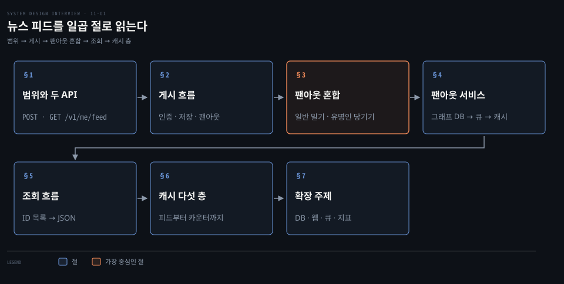
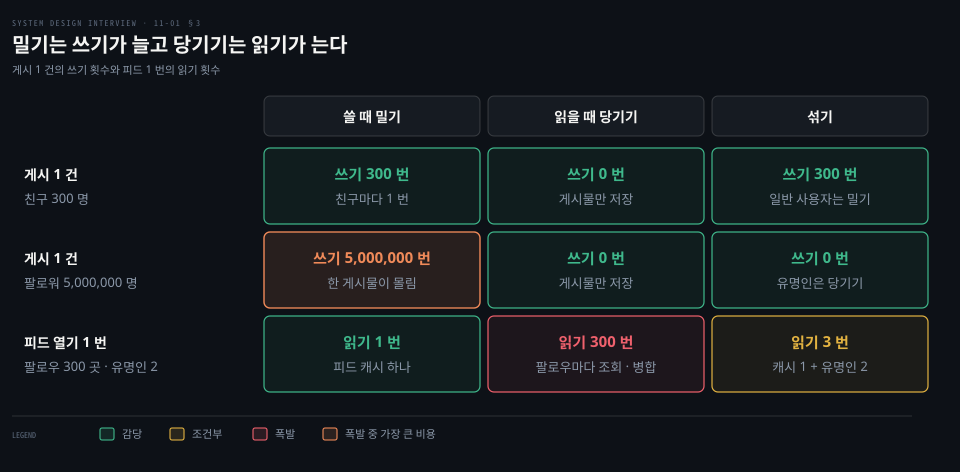
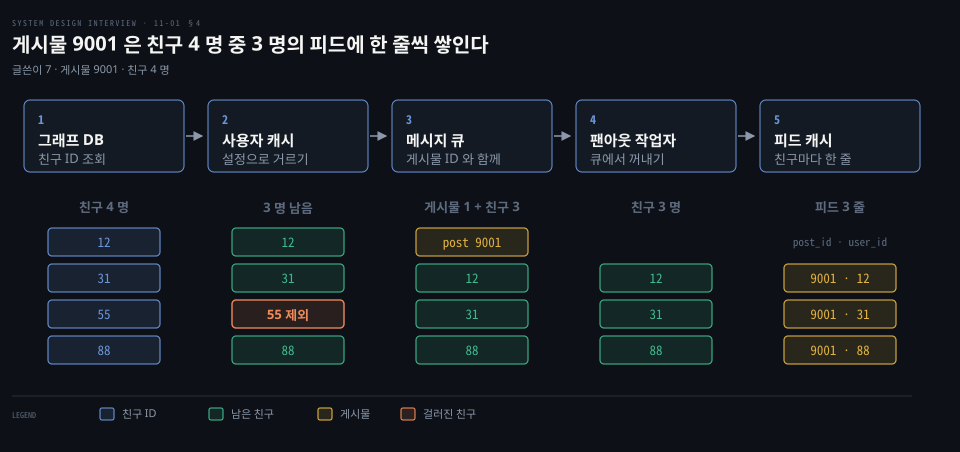
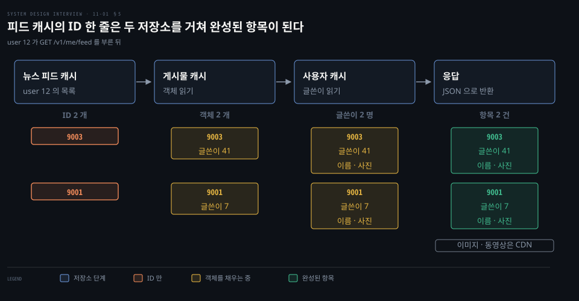
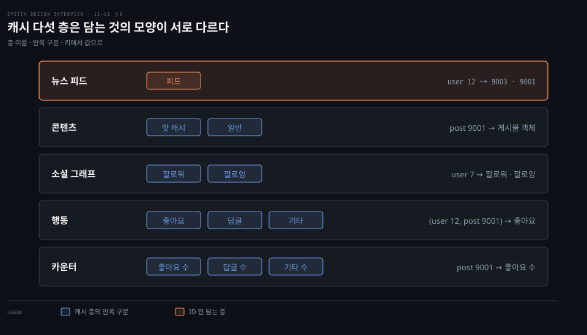

# 뉴스 피드는 쓸 때 밀어 넣는 팬아웃과 읽을 때 당기는 팬아웃을 섞고 캐시를 다섯 층으로 나눈다

---

> 뉴스 피드는 게시물을 쓸 때 친구 피드에 미리 밀어 넣을지 읽을 때 당겨 올지를 사용자 규모에 따라 섞습니다. 캐시는 피드·콘텐츠·소셜 그래프·행동·카운터 다섯 층으로 나눠 조회를 빠르게 합니다.


## 핵심 요약

> 이 편의 중심 생각은 게시 경로의 비용과 조회 경로의 비용이 서로 맞바뀐다는 것입니다. 그 교환 비율을 사용자마다 다르게 고르는 것이 혼합 팬아웃입니다.

게시 흐름은 게시물을 저장한 뒤 팬아웃 서비스가 친구 ID 를 구해 설정으로 거르고 큐에 싣습니다. 작업자는 친구마다 피드 캐시에 게시물 ID 한 줄을 쌓습니다. 조회 흐름은 이 ID 목록을 읽고 게시물 캐시와 사용자 캐시에서 객체를 채워 JSON 으로 돌려줍니다.

쓸 때 미리 만들면 조회는 빠르지만 친구가 많은 사용자의 게시물 하나가 수백만 번의 쓰기가 됩니다. 읽을 때 만들면 쓰기가 가볍지만 조회가 느립니다. 그래서 일반 사용자는 밀어 넣고 유명인은 당겨 옵니다. 캐시는 담는 것의 성격에 따라 다섯 층으로 나눕니다.




## 학습 목표

> 이 편을 읽고 나면 다음을 설명할 수 있습니다.

1. 게시 API 와 조회 API 의 모양을 말하고 토큰을 URL 이 아니라 Authorization 헤더로 보내는 까닭을 설명할 수 있습니다.
2. 게시 흐름에서 웹 서버·게시물 서비스·팬아웃 서비스·알림 서비스가 맡는 일을 구분할 수 있습니다.
3. 두 팬아웃 방식의 비용을 쓰기 횟수와 읽기 횟수로 계산해 비교하고 둘을 섞는 이유를 설명할 수 있습니다.
4. 팬아웃 서비스의 다섯 단계에서 친구 ID 와 게시물 ID 가 줄고 쌓이는 모습을 값으로 따라갈 수 있습니다.
5. 조회 때 ID 목록이 객체로 채워지는 과정과 캐시 다섯 층이 각각 담는 것을 설명할 수 있습니다.


## 1. 친구는 최대 5,000 명이고 일간 사용자는 1,000 만 명이며 API 는 게시 POST 와 조회 GET 둘이다

> 범위를 시간순 피드로 좁히면 만들 것은 게시와 조회 두 흐름입니다. 두 API 가 그 두 흐름의 입구입니다.

친구가 올린 글을 한 화면에 모아 보여 주는 기능에서 무엇을 만들고 무엇을 접어 둘까요? 구현 전에 범위부터 못 박습니다. 면접에서는 질문으로 확인하는 단계이며 질문하는 방식은 [면접 단계 편](./03-01.시스템%20설계%20면접은%20범위%20확정·개략%20설계·상세%20설계·마무리%20네%20단계로%20진행한다.md)에서 다뤘습니다.

- 단말: 모바일 앱과 웹 모두
- 기능: 게시물을 올리고 친구의 게시물을 피드 화면에서 봅니다
- 정렬: 단순화해서 최신 순입니다. 친밀도 점수 같은 순위 정렬은 다루지 않습니다
- 친구 수: 사용자 한 명당 최대 5,000 명
- 규모: 일간 사용자 1,000 만 명
- 콘텐츠: 텍스트에 이미지와 동영상을 포함합니다

이 값들은 면접에서 합의하는 설계 가정이며 실제 서비스의 통계가 아닙니다.

API 는 여러 개이고 그중 가장 중요한 둘만 다룹니다. 둘은 같은 경로를 메서드로 가릅니다.

```bash
# 게시: content 를 본문에 담아 보내고 토큰은 Authorization 헤더로 보냅니다. 본문 형식은 설명용 예시입니다.
POST /v1/me/feed
Authorization: Bearer {auth_token}
Content-Type: application/json

{"content": "Hello"}

# 조회: 토큰이 가리키는 사용자의 피드를 돌려받습니다.
GET /v1/me/feed
Authorization: Bearer {auth_token}
```

경로의 `me` 는 토큰이 가리키는 호출자입니다. Bearer 토큰을 보내는 방법 가운데 첫 번째가 `Authorization` 요청 헤더입니다.[^rfc6750-21] 쿼리 문자열에 싣는 방법도 규격에 있지만 URL 이 로그에 남을 가능성이 높습니다.[^rfc6750-23] 접근 토큰이 브라우저 기록에 남을 수도 있어서 현재 OAuth 보안 모범 규격은 접근 토큰을 URI 쿼리 파라미터로 넘기지 말라고 정합니다.[^rfc9700] 토큰은 헤더에 두고, 게시할 `content` 는 POST 본문에 담습니다.


## 2. 게시 흐름은 웹 서버가 인증과 처리율 제한을 걸고 게시물 서비스가 저장하며 팬아웃 서비스가 친구 피드로 밀어 넣는다

> 게시 요청 하나는 로드 밸런서와 웹 서버를 지난 뒤 세 서비스로 갈라집니다. 그중 팬아웃 서비스가 피드 캐시를 채웁니다.

사용자가 "Hello" 를 올리는 순간 시스템 안에서는 무슨 일이 벌어질까요? 부품은 다섯이고 각자 한 가지 일을 맡습니다.

- 로드 밸런서: 트래픽을 웹 서버에 나눕니다.
- 웹 서버: 요청을 내부 서비스로 넘기기 전에 인증과 처리율 제한을 합니다. 유효한 토큰으로 로그인한 사용자만 게시할 수 있습니다. 일정 기간에 올릴 수 있는 게시물 수도 제한해 스팸과 악성 콘텐츠를 막습니다. 제한 알고리즘은 [처리율 제한기 편](./04-01.처리율%20제한기는%20토큰%20버킷·누출%20버킷·고정%20윈도·이동%20윈도%20로그·이동%20윈도%20카운터로%20요청을%20센다.md)에서 다뤘습니다.
- 게시물 서비스: 게시물을 데이터베이스와 캐시에 저장합니다.
- 팬아웃 서비스: 새 게시물을 친구들의 피드로 밀어 넣어 피드 캐시에 쌓습니다. 빨리 읽기 위해서입니다.
- 알림 서비스: 친구에게 새 글이 올라왔음을 알리고 푸시 알림을 보냅니다. 알림 경로는 [알림 시스템 편](./10-01.알림%20시스템은%20제3자%20푸시·SMS·이메일%20서비스%20앞에%20메시지%20큐와%20작업%20서버를%20두어%20재시도와%20중복을%20다룬다.md)에서 다룹니다.

팬아웃 서비스가 일을 시작하려면 새 게시물의 ID 가 있어야 합니다. 이 ID 에 시간 순서가 담기게 만드는 방법은 [분산 유일 ID 편](./07-01.분산%20유일%20ID%20는%20UUID·티켓%20서버%20대신%20타임스탬프와%20일련번호를%20묶은%2064비트%20스노플레이크로%20만든다.md)에서 다룹니다. 이 편은 팬아웃 서비스의 안쪽(3 절과 4 절)과 그 결과를 읽는 조회 흐름(5 절)에 집중합니다.


## 3. 쓸 때 미리 만들면 조회가 빠르지만 친구가 많으면 쓰기가 폭발해서 일반 사용자는 밀고 유명인은 당겨 섞는다

> 팬아웃의 비용은 사라지지 않고 쓰기와 읽기 사이에서 자리를 옮깁니다. 사용자마다 어느 쪽에 낼지 다르게 고릅니다.

친구가 300 명인 사용자의 게시물과 팔로워가 500 만 명인 사용자의 게시물을 같은 방식으로 퍼뜨려도 될까요? 먼저 용어를 정합니다. **팬아웃**(fanout)은 게시물 하나를 친구 모두에게 전달하는 일입니다. 전달하는 시점이 둘입니다.

**쓸 때 밀어 넣는 팬아웃**(fanout on write, push 모델)은 게시하는 순간 친구들의 피드 캐시를 미리 채웁니다. 피드가 이미 만들어져 있어 읽기가 빠르고 새 글이 바로 보입니다. 대신 친구가 많으면 친구 목록을 가져와 모두의 피드를 만드는 일이 느리고 오래 걸립니다. 로그인이 드문 사용자의 피드까지 미리 만들기 때문에 계산도 낭비합니다.

**읽을 때 당겨 오는 팬아웃**(fanout on read, pull 모델)은 홈 화면을 열 때 최근 게시물을 끌어옵니다. 로그인이 드문 사용자에게 계산을 쓰지 않습니다. 밀어 넣지 않으니 쓰기가 한곳에 몰리지 않습니다. 대신 피드를 미리 만들어 두지 않아 읽기가 느립니다.



비용을 횟수로 세면 차이가 분명합니다. 쓰기는 게시 1 건이 피드 캐시에 남기는 줄 수입니다. 읽기는 피드를 한 번 열 때 게시물 ID 목록을 모으려고 조회하는 곳의 수입니다. 객체를 채우는 조회는 세 방식에 똑같이 붙으므로 셈에서 뺍니다. 아래 300, 5,000,000, 유명인 2 는 비교를 위한 설계 가정입니다.

- 밀기: 게시 1 건은 받는 피드 수만큼의 쓰기입니다. 친구 300 명이면 쓰기 300 번이고 팔로워 5,000,000 명이면 쓰기 5,000,000 번입니다. 친구가 최대 5,000 명인 범위에서는 5,000 번에 그치지만 팔로워가 수백만인 계정이 생기면 같은 게시물이 그 수만큼의 쓰기가 됩니다. 피드를 열 때는 피드 캐시 하나를 읽으니 읽기 1 번입니다
- 당기기: 게시 1 건은 게시물만 저장하므로 쓰기 0 번입니다. 팔로우가 300 곳이면 피드를 한 번 열 때 곳마다 최근 게시물을 가져와 시간순으로 병합하니 읽기 300 번입니다
- 섞기: 친구 300 명의 게시는 쓰기 300 번이고, 팔로워 5,000,000 명 유명인의 게시는 쓰기 0 번입니다. 팔로우 300 곳 중 유명인이 2 곳이면 피드 1 번이 피드 캐시 1 번 + 유명인 2 곳 = 읽기 3 번입니다

그래서 둘을 섞습니다. 피드를 빠르게 가져오는 일이 중요하므로 대다수 사용자에게는 밀어 넣습니다. 친구나 팔로워가 많은 유명인의 게시물은 팔로워가 읽을 때 당겨 오게 해 시스템 과부하를 피합니다. 몇 명부터 유명인으로 볼지는 설계가 정할 값입니다.

이 쏠림을 핫키 문제라고도 부르며, 안정 해시는 이를 줄이는 도구입니다. 밀어 넣는 쓰기 N 번은 서로 다른 N 개 피드 키에 대한 쓰기입니다. 안정 해시가 그 키들을 캐시 노드에 고르게 흩뜨립니다. 이 기법은 [안정 해시 편](./05-01.안정%20해시는%20해시%20링과%20가상%20노드로%20서버가%20늘고%20줄%20때%20옮길%20키를%20줄인다.md)에서 다뤘습니다. 다만 쓰기의 총량 N 은 그대로입니다. 한 사람의 글이 수백만 번의 쓰기가 되는 일은 유명인을 당기기로 돌려야 줄어듭니다. 반대로 핫 키의 다른 뜻인 한 키에 읽기가 몰리는 경우는 키 복제나 로컬 캐시로 다룹니다. 이는 [캐싱 전략 노트](../../../05_data/01_foundation/01-07.캐싱%20전략.md)의 핫 키 절에서 다룹니다.

같은 선택을 X(옛 트위터)의 홈 타임라인이 어떻게 했는지는 [타임라인·동시 편집·알림 판정·크롤러 중복 제거 편](../bytebytego-system-design/08-01.트위터%20타임라인·구글%20독스%20동시%20편집·슬랙%20알림%20판정·크롤러%20중복%20제거는%20팬아웃·OT·흐름도·블룸%20필터로%20푼다.md)에서 이어집니다.[^x-name] 홈 타임라인을 수치로 비교한 사례는 [DDIA 홈 타임라인 노트](../../../05_data/book/designing-data-intensive-applications/02-01.사례%20연구%20—%20소셜%20네트워크%20홈%20타임라인.md)에 있습니다. 유명인 게시물은 읽을 때 찾아 홈 타임라인과 병합하고 서빙 시점에 다시 정렬하는 방법이 있습니다.[^primer-twitter]


## 4. 팬아웃 서비스는 친구 ID 를 그래프 DB 에서 받아 설정으로 거르고 큐에 싣고 작업자가 친구마다 피드 캐시에 한 줄을 쌓는다

> 팬아웃 서비스의 다섯 단계에서 친구 ID 는 넷에서 셋으로 줄어듭니다. 게시물 ID 와 짝지어 친구마다 한 줄이 됩니다.

글쓴이 7 이 게시물 9001 을 올렸고 친구가 네 명이면 피드 캐시에는 정확히 무엇이 몇 줄 쌓일까요? 아래 값은 설명용 예시입니다.



1. 그래프 데이터베이스에서 친구 ID 를 가져옵니다. 친구 관계와 친구 추천을 다루기에 알맞은 저장소입니다. 그래프 모델은 [그래프 데이터 모델 노트](../../../05_data/book/designing-data-intensive-applications/03-05.그래프%20데이터%20모델.md)에서 다룹니다. 예시에서는 12, 31, 55, 88 이 나옵니다.
2. 사용자 캐시에서 친구 정보를 읽고 사용자 설정으로 거릅니다. 친구여도 음소거(mute)한 사람의 게시물은 피드에 나오지 않습니다. 게시물을 특정 친구에게만 공유하거나 일부에게 숨길 수도 있습니다. 예시에서는 55 가 7 을 음소거해 12, 31, 88 이 남습니다.
3. 친구 목록과 새 게시물 ID 를 메시지 큐에 보냅니다. 예시에서는 게시물 9001 과 친구 12, 31, 88 이 실립니다.
4. 팬아웃 작업자가 큐에서 데이터를 꺼냅니다. 친구 3 명 몫의 쓰기를 처리합니다.
5. 뉴스 피드 캐시에 `<post_id, user_id>` 쌍을 저장합니다. 이 캐시는 새 게시물이 생길 때마다 줄이 덧붙는 표로 생각할 수 있습니다. 여기서는 `user_id` 를 그 피드를 받는 사용자로 둡니다. 글쓴이로 두는 설계도 가능하며, 그때는 줄이 (게시물 ID, 글쓴이 ID) 가 됩니다. 어느 쪽이든 캐시의 키는 피드 주인입니다. 예시에서는 (9001, 12), (9001, 31), (9001, 88) 세 줄이 쌓입니다.

큐를 사이에 두면 게시 쪽과 캐시에 쓰는 쪽이 느슨하게 묶입니다. 쓰기가 몰려도 작업자 수로 처리 속도를 맞출 수 있습니다. 큐가 최소 한 번 전달을 보장하는 방식이면 같은 메시지가 다시 올 수 있으므로 같은 줄이 한 번만 반영되게 만드는 방법이 필요합니다. 전달 보장의 세 갈래는 [Kafka 편](../bytebytego-system-design/05-01.Kafka%20는%20순차%20IO%20와%20제로%20카피로%20빠르고%20전달%20보장은%20최대%20한%20번·최소%20한%20번·정확히%20한%20번으로%20갈린다.md)에서 다룹니다.

피드 캐시에는 객체가 아니라 ID 만 둡니다. 사용자와 게시물 객체를 통째로 넣으면 메모리가 크게 늘기 때문입니다. 저장하는 개수에도 설정 가능한 한도를 둡니다. 사용자가 수천 개 아래까지 스크롤할 가능성은 낮고 대부분 최신 글만 봅니다. 한도를 둬도 캐시 미스가 적습니다.


## 5. 조회는 피드 캐시에서 게시물 ID 목록만 받아 게시물·사용자 캐시로 채운 뒤 JSON 으로 돌려주고 미디어는 CDN 이 맡는다

> 피드 캐시는 ID 만 갖고 있어서 조회 때 서비스가 객체를 채우는 하이드레이션 한 단계가 더 있습니다.

캐시에는 ID 뿐인데 화면에는 이름, 프로필 사진, 본문, 이미지가 있어야 합니다. 어디서 채울까요? 조회 요청은 여섯 단계를 지납니다.

1. 사용자가 `GET /v1/me/feed` 를 보냅니다.
2. 로드 밸런서가 요청을 웹 서버에 나눕니다.
3. 웹 서버가 뉴스 피드 서비스를 호출합니다.
4. 서비스가 뉴스 피드 캐시에서 게시물 ID 목록을 받습니다.
5. 게시물 캐시와 사용자 캐시에서 완전한 게시물 객체와 사용자 객체를 가져와 피드를 완성합니다. 이렇게 객체를 채우는 일을 **하이드레이션**(hydration)이라 부릅니다.
6. 완성된 피드를 JSON 으로 클라이언트에 돌려주고 클라이언트가 화면에 그립니다.

예시로 따라가 봅니다. user 12 의 피드 캐시에는 게시물 ID 9003 과 9001 두 개가 있고, 9003 의 글쓴이는 41, 9001 의 글쓴이는 7 입니다. 게시물 캐시가 두 게시물 객체를 돌려주고 사용자 캐시가 글쓴이 41 과 7 의 이름과 사진을 돌려주면, 항목 2 건이 JSON 이 됩니다.



이미지와 동영상 같은 미디어는 CDN 에 저장해 빠르게 받습니다. CDN 이 요청 경로를 줄이는 방식은 [브라우저와 CDN 편](../bytebytego-system-design/03-01.URL%20을%20치면%20DNS·TCP·TLS·HTTP%20를%20거쳐%20브라우저가%20화면을%20그리고%20CDN%20이%20그%20길을%20줄인다.md)에서 다룹니다.

ID 만 두고 조회 때 채우는 구조는 조회마다 캐시를 한 번 더 읽는 비용을 냅니다. 대신 좋아요 수와 프로필처럼 빨리 바뀌는 정보를 피드에 복제하지 않아 읽을 때 최신 값을 봅니다. 이 구조는 [비정규화 노트](../../../05_data/book/designing-data-intensive-applications/03-02.정규화·비정규화·조인.md)의 ID 하이드레이션 절에서 다룹니다. 유명인을 당겨 오는 구조에서는 4 단계 뒤에 유명인의 최근 게시물을 조회하는 일이 끼어듭니다. 3 절의 읽기 3 번이 이 경우입니다.


## 6. 캐시는 뉴스 피드·콘텐츠·소셜 그래프·행동·카운터 다섯 층으로 나눈다

> 층마다 담는 것의 모양과 바뀌는 빈도가 달라서 한 캐시에 섞지 않고 층별로 키와 크기를 따로 잡습니다.

캐시 하나에 전부 넣으면 안 될까요? 피드 목록은 ID 줄입니다. 게시물은 객체입니다. 좋아요 수는 숫자 하나입니다. 모양도 갱신 빈도도 다릅니다. 읽기가 대부분인 뉴스 피드에서는 캐시가 성능을 좌우하므로 다섯 층으로 나눕니다.



| 층 | 담는 것 | 안쪽 구분 |
|---|---|---|
| 뉴스 피드 | 피드를 이루는 게시물 ID | 피드 |
| 콘텐츠 | 모든 게시물 데이터. 인기 콘텐츠는 핫 캐시에 둡니다 | 핫 캐시, 일반 |
| 소셜 그래프 | 사용자 사이의 관계 | 팔로워, 팔로잉 |
| 행동 | 사용자가 게시물에 좋아요를 눌렀는지, 답글을 달았는지 등 | 좋아요, 답글, 기타 |
| 카운터 | 좋아요·답글·팔로워·팔로잉 같은 수 | 좋아요 수, 답글 수, 기타 수 |

게시물 하나를 화면에 그리려면 콘텐츠 층의 본문과 카운터 층의 좋아요 수와 행동 층의 내 좋아요 여부가 함께 필요할 수 있습니다. 뉴스 피드 층은 ID 만 담고, 조회 때 그 ID 로 나머지 층을 찾아갑니다.

층을 나누면 각 층의 크기와 만료를 따로 정할 수 있습니다. 적재 전략을 어떻게 고르는지는 [캐시 전략 편](../bytebytego-system-design/02-01.캐시%20전략은%20읽기·쓰기%20경로에서%20캐시%20자리를%20정하고%20Redis%20는%20메모리와%20단일%20스레드%20이벤트%20루프로%20빠르다.md)에서, 만료와 무효화는 [캐싱 전략 노트](../../../05_data/01_foundation/01-07.캐싱%20전략.md)에서 다룹니다.

예시의 키와 값은 다음과 같습니다.

- 뉴스 피드 층: 키는 user 12, 값은 게시물 ID 9003 과 9001
- 콘텐츠 층: 키는 post 9001, 값은 게시물 객체
- 소셜 그래프 층: 키는 user 7, 값은 팔로워와 팔로잉
- 행동 층: 키는 (user 12, post 9001), 값은 좋아요 여부
- 카운터 층: 키는 post 9001, 값은 좋아요 수


## 7. 확장 이야기는 데이터베이스·웹 계층·캐시·데이터 센터·메시지 큐·지표 여섯 갈래로 짧게 이어진다

> 설계를 마치고 시간이 남으면 앞서 배운 부품을 이 시스템의 어디에 붙일지를 한 줄씩 말합니다.

시간이 남으면 무엇을 더 말할까요? 새 개념을 꺼내지 않고 이미 다룬 부품이 이 시스템의 어디에 붙는지만 짚습니다.

- 데이터베이스: 수직 확장과 수평 확장, SQL 과 NoSQL, 복제와 읽기 복제본, 일관성 모델, 샤딩을 짚습니다. [복제 개요와 단일 리더](../../../05_data/book/designing-data-intensive-applications/06-01.%EB%B3%B5%EC%A0%9C%20%EA%B0%9C%EC%9A%94%EC%99%80%20%EB%8B%A8%EC%9D%BC%20%EB%A6%AC%EB%8D%94.md)와 [샤딩 개요와 키 범위 샤딩](../../../05_data/book/designing-data-intensive-applications/07-01.%EC%83%A4%EB%94%A9%20%EA%B0%9C%EC%9A%94%EC%99%80%20%ED%82%A4%20%EB%B2%94%EC%9C%84%20%EC%83%A4%EB%94%A9.md)에서 다룹니다.
- 웹 계층: 상태를 두지 않게 유지합니다. [규모 확장 편](./01-02.캐시·CDN·무상태%20웹%20계층·데이터%20센터·메시지%20큐·샤딩이%20수백만%20사용자까지%20규모를%20늘린다.md)에서 다뤘습니다.
- 캐시: 가능한 한 많은 데이터를 캐시합니다. 6 절의 다섯 층이 그 구체적인 모양입니다.
- 데이터 센터: 여러 곳을 지원합니다.
- 메시지 큐: 구성 요소를 느슨하게 묶습니다. 이 설계에서는 팬아웃 서비스와 작업자 사이가 큐입니다.
- 지표: 피크 시간대의 QPS 와 사용자가 피드를 새로고침할 때의 지연 시간을 관측합니다.


## 면접 대비

> 두 팬아웃 방식의 비용, 팬아웃 서비스의 단계, 하이드레이션, 캐시 층에 관한 면접 질문입니다.

1. 쓸 때 밀어 넣는 팬아웃과 읽을 때 당겨 오는 팬아웃을 쓰기 횟수와 읽기 횟수로 비교한 뒤 둘을 섞는 이유를 설명해 보십시오.
2. 친구가 300 명인 사용자와 팔로워가 500 만 명인 사용자의 게시물은 각각 어떻게 퍼뜨리겠습니까?
3. 팬아웃 서비스가 친구 ID 를 구한 뒤 설정으로 거르는 이유와, 작업자가 피드 캐시에 쌓는 것은 무엇입니까?
4. 피드 캐시에 객체 대신 ID 만 두는 이유와, 조회 때 완성된 피드를 만드는 순서를 설명해 보십시오.
5. 캐시를 다섯 층으로 나누는 까닭과 층마다 담는 것은 무엇입니까?


## 정답 (자답 후 펼치기)

> 면접 질문에 대한 키워드 중심의 모범 답안입니다.

### 정답 1 — 비용이 자리를 옮기고 사용자별로 섞는다

밀기는 게시 1 건이 친구 수만큼의 쓰기이고 읽기는 피드 캐시 한 번이라 빠릅니다. 당기기는 쓰기가 0 번이지만 읽을 때 팔로우한 곳 수만큼 조회해 병합합니다. 비용이 사라지지 않고 쓰기와 읽기 사이를 옮겨 다니므로 대다수 사용자는 밀고 유명인은 당깁니다.

### 정답 2 — 일반은 밀기, 유명인은 당기기

친구 300 명의 게시물은 쓰기 300 번이라 미리 밀어 넣습니다. 팔로워 500 만 명이면 쓰기 500 만 번이 몰리므로 밀지 않고 팔로워가 읽을 때 당겨 오게 합니다. 안정 해시가 키를 흩어 주어도 총 쓰기량은 그대로입니다.

### 정답 3 — 설정 필터와 post_id·user_id 한 줄

친구여도 음소거한 사람의 글이나 일부에게만 공유한 글은 피드에 나오면 안 되므로 사용자 설정으로 거릅니다. 남은 친구 목록과 게시물 ID 를 큐에 보내면 작업자가 친구마다 `<post_id, user_id>` 한 줄을 피드 캐시에 쌓습니다.

### 정답 4 — ID 만 저장하고 조회 때 하이드레이션

객체를 피드마다 넣으면 메모리가 크게 늘고, 좋아요 수와 프로필처럼 빨리 바뀌는 정보를 복제하게 됩니다. 그래서 ID 만 저장하고 개수에 한도를 둡니다. 조회는 피드 캐시에서 ID 목록을 받고 게시물 캐시와 사용자 캐시에서 객체를 채워 JSON 으로 돌려줍니다. 미디어는 CDN 이 맡습니다.

### 정답 5 — 담는 것의 모양별 다섯 층

뉴스 피드는 게시물 ID, 콘텐츠는 게시물 데이터와 핫 캐시, 소셜 그래프는 팔로워와 팔로잉, 행동은 좋아요와 답글 여부, 카운터는 수를 담습니다. 층마다 크기와 만료를 따로 정할 수 있습니다.


## 참고 자료

- Alex Xu, 《System Design Interview – An Insider's Guide》, Chapter 11 "Design A News Feed System".
- RFC 6750, The OAuth 2.0 Authorization Framework: Bearer Token Usage: https://www.rfc-editor.org/rfc/rfc6750
- RFC 9700, Best Current Practice for OAuth 2.0 Security: https://www.rfc-editor.org/rfc/rfc9700


## 관련 문서

- [알림 시스템은 제3자 푸시·SMS·이메일 서비스 앞에 메시지 큐와 작업 서버를 두어 재시도와 중복을 다룬다](./10-01.알림%20시스템은%20제3자%20푸시·SMS·이메일%20서비스%20앞에%20메시지%20큐와%20작업%20서버를%20두어%20재시도와%20중복을%20다룬다.md)
- [트위터 타임라인·구글 독스 동시 편집·슬랙 알림 판정·크롤러 중복 제거는 팬아웃·OT·흐름도·블룸 필터로 푼다](../bytebytego-system-design/08-01.트위터%20타임라인·구글%20독스%20동시%20편집·슬랙%20알림%20판정·크롤러%20중복%20제거는%20팬아웃·OT·흐름도·블룸%20필터로%20푼다.md)

[^primer-twitter]: System Design Primer, Twitter 타임라인 풀이의 확장 절: <https://github.com/donnemartin/system-design-primer/blob/ae9bbd7b02d90b9866215de185217d33f39ab733/solutions/system_design/twitter/README.md>
[^rfc6750-21]: RFC 6750 §2.1 Authorization Request Header Field: <https://www.rfc-editor.org/rfc/rfc6750#section-2.1>
[^rfc6750-23]: RFC 6750 §2.3 URI Query Parameter: <https://www.rfc-editor.org/rfc/rfc6750#section-2.3>
[^rfc9700]: RFC 9700 §4.3.2 Access Token in Browser History: <https://www.rfc-editor.org/rfc/rfc9700#section-4.3.2>
[^x-name]: X Terms of Service: <https://x.com/en/tos>
