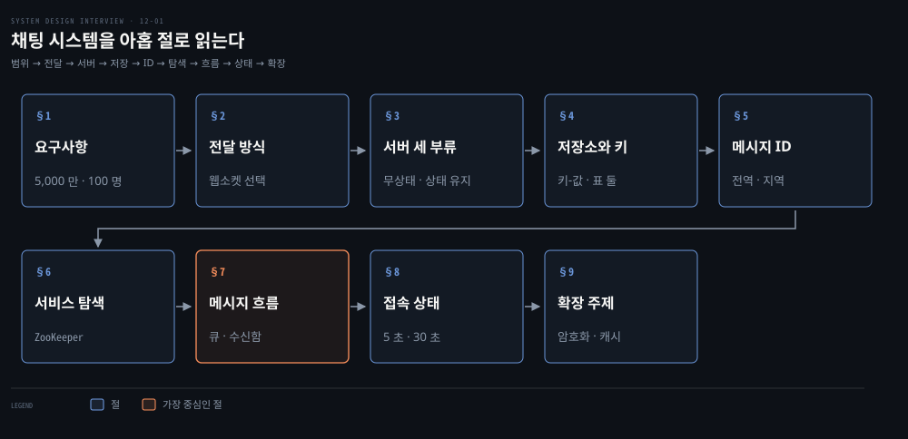
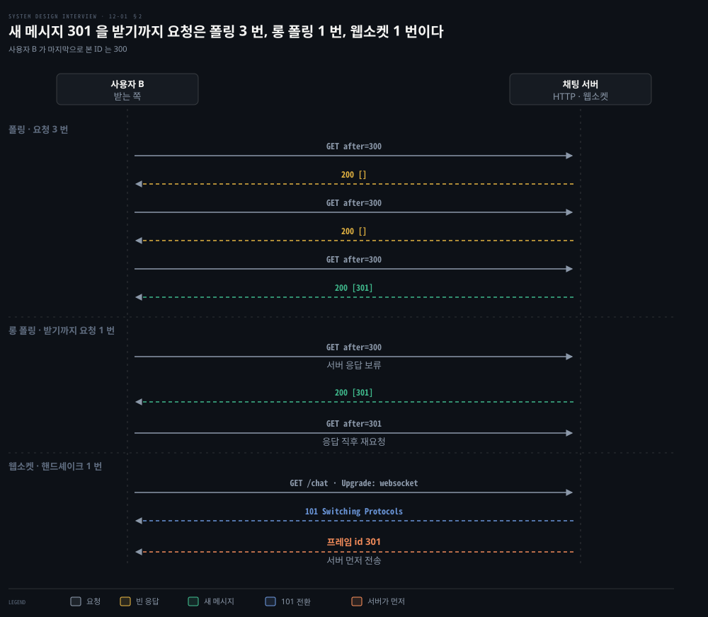
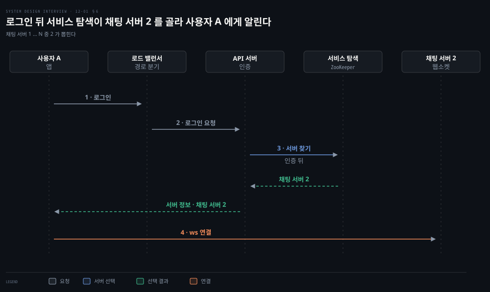
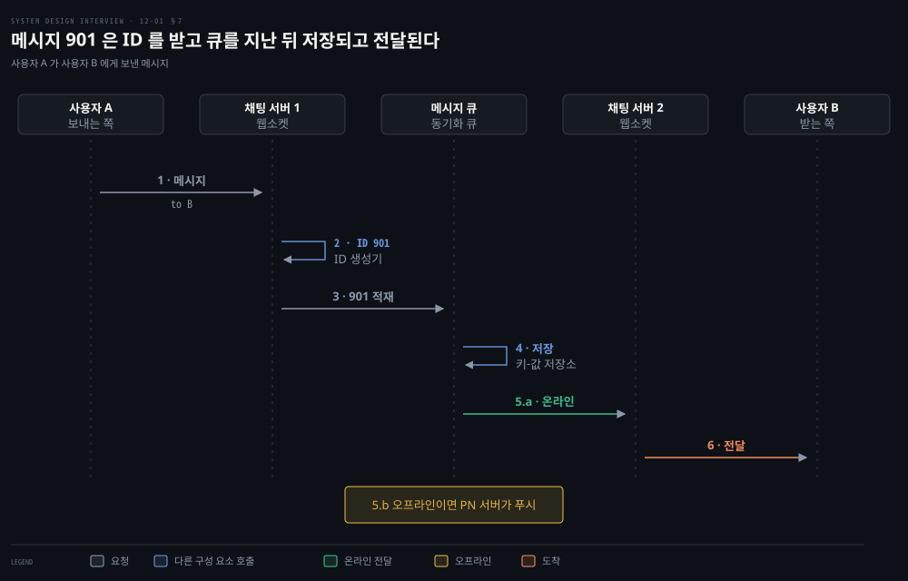
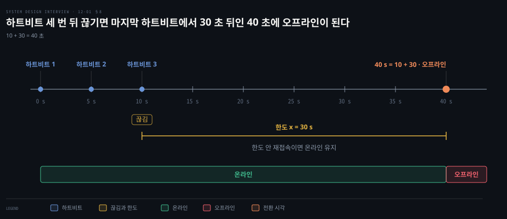

# 채팅 시스템은 웹소켓 연결을 상태 유지 서버에 두고 키-값 저장소와 메시지 ID 로 대화와 접속 상태를 다룬다

---

> 채팅 시스템은 서버가 먼저 보내야 하는 문제라서 웹소켓 연결을 쥔 상태 유지 서버를 둡니다. 기록은 키-값 저장소에 메시지 ID 순서로 쌓고 접속 상태는 하트비트로 판정합니다.

## 핵심 요약

> 이 편의 중심 생각은 서버가 먼저 말을 걸어야 해서 연결이 서버에 붙고 그 연결을 어느 서버에 붙이고 무엇을 어떤 키로 저장할지가 설계의 나머지를 정한다는 것입니다.

보내는 쪽은 HTTP 요청이면 되지만 받는 쪽은 폴링과 롱 폴링을 거쳐 웹소켓으로 갑니다. 연결이 서버에 붙어 있으므로 채팅 서버는 상태 유지 서버입니다. 로그인과 프로필은 무상태 서비스입니다.

기록은 키-값 저장소에 두고 순서는 메시지 ID 가 정합니다. 1:1 표는 message_id 하나로, 그룹 표는 (channel_id, message_id) 로 키를 잡습니다. 로그인 직후 서비스 탐색이 채팅 서버 하나를 골라 줍니다. 메시지는 ID 생성기와 큐와 저장소를 지나 받는 사람의 서버나 푸시로 갑니다.

접속 상태는 로그인과 로그아웃으로 바뀌고 끊김은 하트비트로 걸러 친구마다 발행·구독 채널로 퍼뜨립니다.

## 학습 목표

> 이 편을 읽고 나면 다음을 설명할 수 있습니다.

1. 폴링과 롱 폴링과 웹소켓이 받는 쪽에서 요청과 응답을 어떻게 주고받는지 비교하고 웹소켓을 고르는 까닭을 설명할 수 있습니다.
2. 서비스를 무상태·상태 유지·제3자 연동으로 나누는 기준과 채팅 서버가 상태 유지인 까닭을 말할 수 있습니다.
3. 채팅 기록에 키-값 저장소를 고르는 근거와 두 표의 키, 메시지 ID 의 두 조건을 설명할 수 있습니다.
4. 로그인부터 채팅 서버 배정, 1:1 전달, 여러 기기 동기화, 그룹 수신함 복사까지 값과 함께 따라갈 수 있습니다.
5. 하트비트와 한도 시간이 접속 상태를 정하는 과정과 발행·구독 팬아웃이 큰 그룹에서 깨지는 지점을 설명할 수 있습니다.

## 1. 일간 사용자 5,000 만 명이 1:1 과 최대 100 명의 그룹으로 텍스트만 주고받고 기록은 영구히 남긴다

> 채팅 앱은 1:1 중심인지 그룹 중심인지에 따라 설계가 달라져서 범위부터 정합니다. 이 편은 아래 값을 설계 가정으로 둡니다.

채팅 앱을 설계하라는 말만으로 무엇을 만들지 정해질까요? 1:1 중심 앱과 사무용 그룹 앱과 대규모 그룹 앱은 모두 채팅이지만 병목이 다릅니다. 그래서 면접관에게 먼저 범위를 묻습니다.

| 항목 | 설계 가정 |
|---|---|
| 대화 형태 | 1:1 과 그룹 |
| 클라이언트 | 모바일 앱과 웹 앱 |
| 규모 | 일간 사용자 5,000 만 명 |
| 그룹 크기 | 최대 100 명 |
| 기능 | 1:1·그룹 채팅, 접속 상태 표시, 여러 기기 로그인, 푸시 알림 |
| 메시지 | 텍스트만, 길이 100,000 자 미만 |
| 종단 간 암호화 | 요구하지 않음 |
| 기록 보관 | 영구 |
| 1:1 채팅 | 전달 지연이 낮아야 함 |

실제 서비스의 규모 감은 2016 년 4월 보도로 잡을 수 있습니다. 당시 Facebook 이 F8 에서 밝힌 Messenger 와 WhatsApp 의 합계는 하루 600 억 건이었습니다.[^verge] 초당으로 바꾸면 60,000,000,000 ÷ 86,400 ≈ 694,000 건입니다. 이 편은 이 값을 규모를 가늠하는 설계 가정으로만 쓰고, 설계 대상은 위 표의 5,000 만 명입니다.

## 2. HTTP 는 서버가 먼저 말을 걸지 못해 폴링과 롱 폴링으로 흉내 내다가 연결을 붙들어 두는 웹소켓이 보내기와 받기를 모두 맡는다

> 보내는 쪽은 HTTP 요청 하나로 되지만 받는 쪽은 서버가 먼저 보내야 합니다. 폴링과 롱 폴링과 웹소켓은 이 한 가지를 푸는 세 방식입니다.

클라이언트끼리는 직접 통신하지 않고 채팅 서비스를 거칩니다. 채팅 서비스는 다른 클라이언트의 메시지를 받습니다. 수신자를 찾아 중계합니다. 수신자가 오프라인이면 접속할 때까지 서버에 보관합니다.

사용자 A 가 보낸 메시지를 B 는 어떻게 받을까요? 보내는 쪽은 HTTP 요청에 메시지를 실으면 됩니다. HTTP/1.1 은 기본이 지속 연결이라 같은 연결로 요청을 이어 보낼 수 있습니다.[^rfc9112] 어려운 쪽은 받는 쪽입니다. HTTP 는 클라이언트가 먼저 요청해야 응답이 나가므로 서버가 B 에게 먼저 말을 걸 수 없습니다.

도식의 쿼리와 ID 는 설명용 예시입니다. B 가 마지막으로 본 메시지 ID 를 300 으로 두었습니다. 요청은 `GET` 에 쿼리 `after=<마지막으로 본 ID>` 를 붙여 그 뒤의 메시지를 묻습니다. 빈 응답은 `200 []` 입니다. 경로 `/chat` 만 RFC 6455 §1.3 예시에서 가져왔습니다. 새 메시지 301 을 받기까지 요청이 폴링은 3 번, 롱 폴링은 1 번, 웹소켓은 핸드셰이크 1 번입니다. 롱 폴링은 응답을 받은 직후 다음 요청을 하나 더 겁니다.

**폴링**은 클라이언트가 주기적으로 새 메시지가 있는지 묻는 방식입니다. 대부분의 응답이 없음이라 서버 자원을 헛되이 씁니다. 지연을 줄이려 주기를 짧게 할수록 서버와 네트워크 부담이 커집니다.[^rfc6202]

**롱 폴링**은 서버가 새 메시지가 생기거나 시간이 다 될 때까지 응답을 미루는 방식입니다. 응답을 받은 클라이언트는 곧바로 다시 요청합니다.[^rfc6202] 빈 응답은 줄지만 한계가 남습니다.

- 요청과 응답이 모두 완전한 HTTP 메시지라 헤더가 매번 붙습니다.
- 응답 직후에는 다음 요청이 올 때까지 서버가 보낼 수 없어 최대 지연이 전송 세 번(응답, 다음 요청, 응답) 이상입니다.[^rfc6202]
- HTTP 서버는 보통 무상태라 라운드 로빈으로 나누면 보내는 사람의 메시지를 받은 서버가 받는 사람의 대기 요청을 쥔 서버가 아닐 수 있습니다.

그 밖에 서버는 대기 중인 요청의 상대가 이미 끊겼는지 알기 어렵고, 말이 없는 사용자도 시간 초과마다 다시 요청합니다.

**웹소켓**은 클라이언트가 HTTP 요청으로 시작하고 서버가 101 Switching Protocols 로 받아들이면 같은 연결이 양방향으로 바뀝니다.

요청은 `Upgrade: websocket` 과 `Sec-WebSocket-Key` 를 싣습니다. 응답은 그 키로 계산한 `Sec-WebSocket-Accept` 를 돌려줍니다.[^rfc6455-hs] 이후 서버는 언제든 프레임을 밀어 보낼 수 있습니다.

기본 포트는 일반 연결이 80, TLS 위 연결이 443 이어서 HTTP 와 같은 포트를 쓰므로 방화벽이 있어도 대체로 통합니다. RFC 는 작성 당시 443 연결이 80 보다 성공률이 눈에 띄게 높았다고도 적습니다.[^rfc6455-port]

웹소켓은 양방향이라 보내기에도 쓸 수 있습니다. 한 연결로 합치면 클라이언트와 서버 구현이 단순해집니다. 연결이 오래 유지되므로 서버는 연결 관리를 효율적으로 해야 합니다. 로그인과 가입과 프로필은 일반 요청·응답 HTTP 로 두어도 됩니다. HTTP/2 연결의 스트림 하나 위에서 웹소켓을 돌리는 방법도 표준입니다.[^rfc8441] 핸드셰이크와 프레임은 [WebSocket 프로토콜과 핸드셰이크](../../../09_spring/03_network/realtime/03-01.WebSocket%20프로토콜과%20핸드셰이크.md)에서 다룹니다.

## 3. 로그인과 프로필은 무상태 서비스가, 채팅은 연결을 쥔 상태 유지 서버가 맡고 푸시 알림은 제3자 서비스에 연동한다

> 서비스를 연결을 붙들고 있는지로 가르면 셋입니다. 연결을 붙든 채팅 서버만 상태를 지닙니다.

연결을 서버에 붙들어 두면 서버 구조는 어떻게 달라질까요? 서비스가 세 부류로 갈립니다.

- 무상태 서비스: 로그인과 가입과 프로필처럼 요청 하나로 끝나는 서비스입니다. 로드 밸런서가 요청 경로를 보고 알맞은 서비스로 보냅니다. 시장에 있는 서비스를 붙여 써도 됩니다. 무상태 계층은 [캐시·CDN·무상태 웹 계층](./01-02.캐시·CDN·무상태%20웹%20계층·데이터%20센터·메시지%20큐·샤딩이%20수백만%20사용자까지%20규모를%20늘린다.md)에서 다뤘습니다.
- 상태 유지 서비스: 채팅 서비스입니다. 클라이언트마다 채팅 서버 하나에 연결을 유지하고, 그 서버가 살아 있는 동안 다른 서버로 옮겨 가지 않습니다.
- 제3자 연동: 푸시 알림입니다. 앱이 꺼져 있어도 새 메시지를 알리는 수단이라 연동이 중요합니다. 자세한 내용은 [알림 시스템](./10-01.알림%20시스템은%20제3자%20푸시·SMS·이메일%20서비스%20앞에%20메시지%20큐와%20작업%20서버를%20두어%20재시도와%20중복을%20다룬다.md)에서 다룹니다.

무상태 서비스 가운데 서비스 탐색은 채팅 서버와 맞물려 서버가 한쪽으로 몰리는 일을 막으며 §6 에서 풉니다.

동시 접속 100 만 명을 설계 값으로 두고 연결 하나가 서버 메모리 10 KB 를 쓴다고 가정하면 1,000,000 × 10 KB = 10,000,000 KB, 약 10 GB 입니다. 10 KB 는 언어에 따라 크게 달라지는 거친 값입니다. 계산으로는 한 대에 모든 연결이 들어가며, 한 서버가 감당하는 동시 연결 수가 한계 요인입니다. 그래도 한 대 설계는 서버가 죽으면 전부 끊기는 단일 장애점이라 면접에서 피합니다. 시작점으로만 두고 분산한다고 밝힙니다.

구성 요소는 다섯입니다.

- 채팅 서버: 메시지를 주고받습니다.
- 접속 상태 서버: 온라인과 오프라인을 관리합니다.
- API 서버: 로그인과 가입과 프로필 변경을 맡습니다.
- 알림 서버: 푸시를 보냅니다.
- 키-값 저장소: 채팅 기록을 담아 오프라인이던 사용자가 접속하면 지난 대화를 보게 합니다.

## 4. 채팅 기록은 양이 방대하고 최근 것만 자주 읽혀서 키-값 저장소에 두고 1:1 표와 그룹 표의 키를 달리한다

> 프로필과 설정과 친구 목록은 관계형 DB 에 두고, 채팅 기록은 읽기·쓰기 패턴을 보고 키-값 저장소를 고릅니다.

채팅 기록은 어떤 저장소에 둘까요? 데이터는 두 종류입니다. 프로필과 설정과 친구 목록 같은 일반 데이터는 관계형 DB 에 두고 복제와 샤딩으로 가용성과 확장성을 채웁니다. 채팅 기록은 읽기·쓰기 패턴이 다릅니다.

- 양이 방대합니다. §1 에서 규모 가정으로 둔 2016 년 보도 값은 하루 600 억 건입니다.
- 최근 대화만 자주 읽고 오래된 대화는 잘 찾지 않습니다.
- 검색과 멘션 보기와 특정 메시지로 이동하는 임의 접근도 데이터 계층이 받쳐야 합니다.
- 1:1 채팅의 읽기 대 쓰기 비율은 대략 1:1 입니다.

이 패턴에 키-값 저장소를 권하는 이유는 넷입니다. 수평 확장이 쉽습니다. 접근 지연이 낮습니다. 관계형 DB 는 데이터의 긴 꼬리(long tail)에서 인덱스가 커질수록 임의 접근이 비쌉니다. 검증된 채팅 서비스들이 써 왔습니다.

Facebook 은 2010 년 Messages 개편 때 MySQL·Cassandra·HBase 등을 시험하고 HBase 를 골랐습니다. MySQL 은 인덱스와 데이터가 커질수록 성능이 떨어져 긴 꼬리를 잘 다루지 못했다고 적었습니다.[^fb-messages]

그 뒤 2018 년 글에서는 Messenger 저장소를 HBase 에서 MyRocks(RocksDB 를 MySQL 저장 엔진으로 붙인 것)로 옮겼다고 밝혔습니다.[^fb-2018]

Discord 는 2017 년에 메시지를 Cassandra 에 둔다고 밝혔고[^discord-2017], 2023 년 3월 글에서 2022 년 5월에 메시지 데이터베이스를 ScyllaDB 로 바꿨다고 밝혔습니다.[^discord-2023] 그 글이 설명하는 메시지 스키마는 채널과 시간 구간(bucket)으로 파티션을 나누고 ID 는 스노플레이크입니다.

메시지 표는 1:1 과 그룹이 다릅니다. ID 와 번호 열은 모두 bigint 이고 내용은 text, 시각은 timestamp 입니다.

| 열 | message (1:1) | group_message (그룹) |
|---|---|---|
| 키 | message_id | (channel_id, message_id) |
| 보낸 쪽 | message_from | user_id |
| 받는 쪽 | message_to | 없음(채널 구성원 전체가 받음) |
| 내용과 시각 | content, created_at | content, created_at |

created_at 으로 순서를 정할 수 없는 까닭은 두 메시지가 같은 시각에 만들어질 수 있기 때문입니다. 그룹 표는 channel_id 를 파티션 키로 삼습니다. 그룹 채팅의 조회가 모두 한 채널 안에서 일어나기 때문입니다. 채널과 그룹은 같은 뜻입니다.

Discord 도 channel_id 를 파티션 키로 삼았습니다. 한 채널이 몇 년씩 커지므로 파티션 크기를 묶으려 시간 구간을 키에 더했습니다. 구간은 약 10 일치 메시지가 100 MB 아래에 머물도록 잡았다고 합니다.[^discord-2017]

## 5. 메시지 ID 는 유일하고 시간순으로 정렬돼야 해서 전역 64비트 ID 나 채널 안에서만 유일한 지역 시퀀스를 쓴다

> 메시지 ID 는 순서를 보장하는 책임을 집니다. 유일해야 하고, 새 행이 옛 행보다 큰 ID 를 받아야 합니다.

메시지의 순서는 무엇이 정할까요? created_at 은 같은 시각이 있어 못 쓰므로 message_id 가 정합니다. 그러려면 조건이 둘입니다. ID 가 유일하고, 시간순으로 정렬돼서 새 행이 옛 행보다 커야 합니다.

MySQL 의 auto_increment 가 먼저 떠오르지만 NoSQL 은 대개 그런 기능을 주지 않습니다. 남는 길은 둘입니다. 하나는 스노플레이크 같은 전역 64비트 ID 생성기입니다. 구조는 [분산 유일 ID](./07-01.분산%20유일%20ID%20는%20UUID·티켓%20서버%20대신%20타임스탬프와%20일련번호를%20묶은%2064비트%20스노플레이크로%20만든다.md)에서 풀었습니다. 나뉜 데이터에 전역 ID 가 순서를 주는 방식은 [파티셔닝과 전역 유일 ID](../bytebytego-system-design/01-02.파티셔닝과%20읽기%20복제본은%20데이터베이스를%20넓히고%20전역%20유일%20ID%20는%20나뉜%20데이터에%20순서를%20준다.md)에서도 다룹니다. Discord 는 모든 ID 가 스노플레이크라 메시지 ID 로 그대로 쓴다고 밝혔습니다.[^discord-2017] 다른 하나는 지역 시퀀스입니다. 순서가 의미를 갖는 범위가 한 대화 안이라 ID 가 그 안에서만 유일하면 되고, 전역 생성기보다 구현이 쉽습니다.

| 방식 | 유일한 범위 | 정렬 | 키 |
|---|---|---|---|
| 전역 64비트 ID | 시스템 전체 | 전체에서 시간순 | message_id 하나 |
| 지역 시퀀스 | 한 대화 안 | 그 대화 안에서만 | (channel_id, message_id) |

둘의 차이는 키에서 드러납니다. 지역 시퀀스는 다른 대화와 같은 ID 가 나올 수 있어 ID 만으로 메시지를 가리킬 수 없습니다. 그래서 그룹 표처럼 채널 ID 와 묶어 키로 잡습니다. 전역 ID 는 message_id 하나가 유일해서 1:1 표의 키로 충분합니다.

## 6. 서비스 탐색은 로그인 직후 위치와 여유 용량을 따져 채팅 서버 하나를 고르고 ZooKeeper 가 살아 있는 서버 목록을 쥔다

> 연결을 붙드는 서버가 여럿이면 클라이언트가 어느 서버에 붙을지 누군가 정해야 합니다. 서비스 탐색이 그 일을 합니다.

로그인한 사용자 A 는 채팅 서버 여러 대 중 어디에 연결해야 할까요? 서비스 탐색은 지리적 위치와 서버 여유 용량 같은 기준으로 알맞은 채팅 서버를 권하고, 클라이언트가 접속할 수 있는 채팅 서버의 DNS 호스트 이름 목록을 줍니다. 오픈 소스로는 Apache ZooKeeper 를 흔히 씁니다.

흐름은 넷입니다.

1. 사용자 A 가 로그인을 시도합니다.
2. 로드 밸런서가 로그인 요청을 API 서버로 보냅니다.
3. 백엔드가 사용자를 인증하면 서비스 탐색이 A 에게 맞는 채팅 서버를 찾고, 예에서는 채팅 서버 2 가 뽑혀 그 정보가 A 에게 돌아갑니다.
4. A 가 채팅 서버 2 에 웹소켓으로 연결합니다.

ZooKeeper 는 서버를 고르는 서비스가 아니라 동기화와 설정과 그룹과 이름 같은 상위 서비스를 만들 기본 요소를 주는 조정 서비스입니다.[^zk-over] 서버 목록은 서버마다 임시 znode 를 만드는 방식으로 만들 수 있습니다. 임시 znode 는 만든 세션이 살아 있는 동안만 있고 세션이 끝나면 지워져서 목록에 죽은 서버가 남지 않습니다.[^zk-eph]

서버를 고르는 기준인 위치와 용량은 이 목록 위에서 서비스 탐색 쪽이 계산합니다. 채팅 서버가 죽으면 연결이 끊기므로 클라이언트가 서비스 탐색에 다시 물어 다른 서버에 연결합니다. ZooKeeper 의 코디네이션 역할은 [합의와 코디네이션 서비스](../../../05_data/book/designing-data-intensive-applications/10-04.합의와%20코디네이션%20서비스.md)에서 다룹니다.

## 7. 1:1 메시지는 ID 를 받아 큐와 저장소를 지난 뒤 접속 중이면 상대 서버로 오프라인이면 푸시로 가고 그룹은 구성원마다 수신함에 한 부씩 복사된다

> 보내는 쪽 서버는 ID 부터 받고 큐에 넣습니다. 큐가 저장과 전달을 가르고, 그룹은 수신함 복사로 동기화를 단순하게 합니다.

사용자 A 가 사용자 B 에게 보낸 메시지는 어떤 길을 지날까요?

1. 사용자 A 가 채팅 서버 1 에 메시지를 보냅니다.
2. 채팅 서버 1 이 ID 생성기에서 메시지 ID 를 받습니다.
3. 채팅 서버 1 이 메시지를 메시지 동기화 큐에 보냅니다.
4. 메시지가 키-값 저장소에 저장됩니다.
5. 사용자 B 가 온라인이면 B 가 연결된 채팅 서버 2 로 전달하고, 오프라인이면 푸시 알림(PN) 서버가 푸시를 보냅니다.
6. 채팅 서버 2 가 B 와 이어진 웹소켓 연결로 메시지를 전달합니다.

도식의 메시지 ID 901 은 설명용 예시입니다.

사용자 한 명이 기기를 여러 개 쓰면 어떻게 동기화할까요? 사용자 A 의 폰과 노트북이 모두 채팅 서버 1 에 웹소켓으로 붙어 있습니다. 기기마다 변수 `cur_max_message_id` 에 그 기기가 가진 가장 큰 메시지 ID 를 기억합니다. 새 메시지는 두 조건을 모두 만족하는 메시지입니다. 받는 사람 ID 가 로그인한 사용자 ID 와 같습니다. 키-값 저장소의 메시지 ID 가 그 기기의 값보다 큽니다.

| 기기 | 가진 최대 ID | 저장소에서 가져올 메시지 |
|---|---|---|
| 폰 | 653 | 받는 사람이 A 이고 ID 가 653 보다 큼 |
| 노트북 | 842 | 받는 사람이 A 이고 ID 가 842 보다 큼 |

기기마다 값이 달라서 각자 저장소에서 자기 몫만 가져옵니다. 이 비교가 값 하나로 성립하려면 ID 가 메시지 전체에서 비교 가능해야 하므로 전역 ID 가 편합니다. 지역 시퀀스라면 기기가 대화마다 값을 하나씩 기억해야 합니다.

그룹 채팅은 1:1 보다 복잡합니다. 구성원이 A, B, C 셋인 그룹에서 A 가 보내면 메시지가 구성원마다 메시지 동기화 큐로 복사됩니다. 보낸 A 를 뺀 B 와 C 몫으로 2 부입니다. 큐는 받는 사람의 수신함으로 볼 수 있고, 한 수신함에는 여러 보낸 사람의 메시지가 함께 쌓입니다. 작은 그룹에 이 설계가 맞는 이유는 둘입니다. 각 클라이언트가 자기 수신함만 확인하면 새 메시지를 알 수 있어 동기화가 단순합니다. 그룹이 작으면 수신함마다 한 부씩 저장해도 비용이 크지 않습니다. 최대 100 명이면 메시지 하나가 100 − 1 = 99 부가 됩니다.

WeChat 이 비슷한 방식입니다. 2016 년 글은 그룹 메시지를 구성원마다 한 부씩 저장하는 쓰기 확산이라고 적습니다. 당시 그룹 상한은 500 명이었다고 밝혔습니다.[^infoq-wechat] 구성원이 아주 많은 그룹에서는 사본을 구성원 수만큼 두는 방식을 받아들이기 어렵습니다. 쓸 때 미리 퍼뜨리는 비용은 [뉴스 피드](./11-01.뉴스%20피드는%20쓸%20때%20밀어%20넣는%20팬아웃과%20읽을%20때%20당기는%20팬아웃을%20섞고%20캐시를%20다섯%20층으로%20나눈다.md)의 팬아웃과 같은 문제입니다.

## 8. 접속 상태는 로그인과 로그아웃으로 바뀌고 끊김은 5 초 하트비트와 30 초 한도로 걸러 내며 친구마다 발행·구독 채널로 퍼뜨린다

> 연결이 끊길 때마다 상태를 바꾸면 표시가 깜빡입니다. 하트비트가 한도 시간 안에 오는지로 상태를 정합니다.

사용자가 접속 중인지는 어떻게 알까요? 접속 상태 서버가 웹소켓으로 클라이언트와 통신하며 관리합니다. 로그인하면 웹소켓 연결이 만들어진 뒤 사용자 A 의 온라인 상태와 마지막 접속 시각 `last_active_at` 이 키-값 저장소에 저장됩니다. 로그아웃하면 저장소의 상태가 오프라인으로 바뀝니다.

연결이 끊기면 어떻게 할까요? 끊기는 즉시 오프라인으로 바꾸고 다시 붙으면 온라인으로 바꾸면, 터널을 지나는 사용자처럼 짧은 시간에 끊겼다 붙기를 반복할 때 표시가 너무 자주 바뀝니다. 그래서 **하트비트**를 씁니다. 온라인 클라이언트가 주기적으로 접속 상태 서버에 하트비트 이벤트를 보냅니다. 접속 상태 서버가 한도 x 초 안에 하나라도 받으면 온라인으로 봅니다.

예의 값은 간격 5 초와 한도 x = 30 초입니다. 30 초는 논리를 보이려 임의로 고른 값입니다. 하트비트를 세 번(0, 5, 10 초) 보낸 뒤 연결이 끊기고 30 초 안에 다시 붙지 못하면, 첫 하트비트를 0 초로 두면 마지막 하트비트 10 초에 한도 30 초를 더한 10 + 30 = 40 초에 오프라인으로 바뀝니다. 그 안에 다시 붙으면 상태는 온라인으로 남습니다.

웹소켓에도 연결 확인용으로 쓰는 Ping 프레임이 있습니다.[^rfc6455-ping] 여기서 하트비트는 접속 상태 서버가 사용자 상태를 판정하려고 클라이언트가 보내는 이벤트입니다. 유휴 연결을 하트비트와 데드라인으로 감지하는 구현은 [타임아웃과 유휴 감지](../../../02_os/book/npg_network-programming-with-go/03-03.타임아웃은%20Dialer·context%20로,%20유휴%20감지는%20데드라인과%20하트비트로%20건다.md)에서 다룹니다.

상태 변화는 친구들에게 어떻게 퍼질까요? 접속 상태 서버는 발행·구독 모델로 친구 쌍마다 채널 하나를 둡니다. 사용자 A 의 친구가 B, C, D 면 채널 A-B, A-C, A-D 셋이 있고 각각 B, C, D 가 구독합니다. A 의 상태가 바뀌면 세 채널에 이벤트 3 개를 발행합니다. 클라이언트와 서버 사이는 웹소켓입니다.

이 설계는 작은 그룹에 맞습니다. 구성원이 100,000 명인 그룹이면 상태가 한 번 바뀔 때마다 이벤트가 100,000 개 생겨 병목이 됩니다. 해결은 사용자가 그룹에 들어오거나 친구 목록을 직접 새로 고칠 때만 상태를 가져오는 것입니다.

## 9. 미디어 파일과 종단 간 암호화와 클라이언트 캐시와 오류 처리가 남은 확장 주제다

> 남은 시간에 이어 갈 주제 넷입니다. 넷 모두 이 편의 구조 위에 얹힙니다.

- 미디어 파일: 사진과 동영상은 텍스트보다 훨씬 커서 압축과 클라우드 저장소와 썸네일이 주제가 됩니다.
- 종단 간 암호화: 보낸 사람과 받는 사람만 메시지를 읽습니다. WhatsApp 은 Signal 프로토콜로 메시지를 암호화한다고 백서에 밝힙니다.[^whatsapp]
- 클라이언트 캐시와 로드 시간: 클라이언트에 메시지를 캐시하면 전송량이 줄어듭니다. Slack 은 엣지 지점에 사용자와 채널 데이터를 캐시하는 Flannel 을 두어 재접속이 몰릴 때 백엔드 부담을 줄였다고 2017 년에 밝혔습니다.[^flannel]
- 오류 처리: 채팅 서버가 죽으면 서비스 탐색이 새 서버를 줍니다. 메시지 재전송은 재시도와 큐로 합니다.

## 면접 대비

> 받는 쪽 전달 방식, 상태 유지 서버와 서비스 탐색, 저장소와 메시지 ID, 메시지 흐름, 접속 상태에 관한 면접 질문입니다.

1. 폴링과 롱 폴링과 웹소켓을 받는 쪽의 요청과 지연으로 비교하고, 채팅에 웹소켓을 고르는 까닭을 설명해 보십시오.
2. 채팅 서버는 왜 상태 유지 서버이고, 로그인과 프로필은 어떻게 다르며, 서비스 탐색은 무슨 일을 합니까?
3. 채팅 기록 저장소로 키-값 저장소를 고르는 이유와 1:1 표와 그룹 표의 키는 무엇이며 메시지 ID 는 어떤 조건을 만족해야 합니까?
4. 폰의 cur_max_message_id 가 653 이고 노트북이 842 일 때 새 메시지를 어떻게 가져오며, 그룹 메시지는 어떻게 수신함으로 갑니까?
5. 연결이 끊기는 사용자의 접속 상태를 어떻게 정하고, 상태 변화를 친구들에게 퍼뜨리는 방식은 어디서 한계에 닿습니까?

## 정답 (자답 후 펼치기)

> 면접 질문에 대한 키워드 중심의 모범 답안입니다.

### 정답 1 — 서버가 먼저 보내야 해서 연결을 붙드는 웹소켓

폴링은 대부분 빈 응답입니다. 롱 폴링은 응답마다 헤더가 붙고 응답과 다음 요청 사이에는 보낼 수 없습니다. 웹소켓은 HTTP 로 시작해 101 로 전환된 연결 하나로 서버가 즉시 밀어 보냅니다. 보내기까지 합치면 구현이 단순합니다.

### 정답 2 — 연결이 붙은 채팅 서버, 무상태 나머지, 서비스 탐색은 서버 배정

클라이언트가 채팅 서버 하나에 연결을 유지하고 서버가 살아 있는 동안 옮겨 가지 않으므로 상태 유지입니다. 로그인과 프로필은 요청 하나로 끝나 로드 밸런서 뒤의 무상태 서비스입니다. 서비스 탐색은 로그인 직후 위치와 여유 용량으로 채팅 서버를 골라 주고 ZooKeeper 의 임시 znode 가 살아 있는 서버 목록을 쥡니다.

### 정답 3 — 긴 꼬리와 수평 확장, message_id 와 (channel_id, message_id), 유일과 시간순

기록은 방대하고 최근 것만 자주 읽히며 임의 접근도 있습니다. 키-값 저장소는 수평 확장이 쉽고 지연이 낮으며 관계형 DB 는 인덱스가 커질수록 임의 접근이 비쌉니다. 1:1 표의 키는 message_id, 그룹 표의 키는 (channel_id, message_id) 이고 channel_id 가 파티션 키입니다. ID 는 유일하고 시간순이어야 하며 전역 64비트 ID 나 대화 안에서만 유일한 지역 시퀀스를 씁니다.

### 정답 4 — 기기별 최대 ID 보다 큰 것, 구성원마다 수신함 복사

폰은 받는 사람이 A 이고 ID 가 653 보다 큰 메시지를, 노트북은 842 보다 큰 메시지를 저장소에서 가져옵니다. 그룹 메시지는 구성원마다 메시지 동기화 큐(수신함)에 한 부씩 복사하고 각 클라이언트는 자기 수신함만 봅니다. 사본이 구성원 수만큼 늘어 작은 그룹에만 맞습니다.

### 정답 5 — 하트비트와 한도 시간, 친구 쌍 채널의 이벤트 폭증

클라이언트가 5 초마다 하트비트를 보내고 접속 상태 서버가 한도 30 초 안에 못 받으면 오프라인으로 바꿔서 짧은 끊김에 표시가 깜빡이지 않습니다. 친구 쌍마다 발행·구독 채널을 두고 상태를 발행하므로, 구성원이 100,000 명인 그룹이면 변화 한 번에 이벤트 100,000 개라 병목입니다. 그룹에 들어올 때와 새로 고칠 때만 상태를 가져옵니다.

## 참고 자료

- Alex Xu, 《System Design Interview – An Insider's Guide》, Chapter 12 "Design A Chat System".
- RFC 6455, The WebSocket Protocol: https://www.rfc-editor.org/rfc/rfc6455
- RFC 6202, Known Issues and Best Practices for the Use of Long Polling and Streaming in Bidirectional HTTP: https://www.rfc-editor.org/rfc/rfc6202
- How Discord Stores Trillions of Messages (2023): https://discord.com/blog/how-discord-stores-trillions-of-messages
- How Discord Stores Billions of Messages (2017): https://discord.com/blog/how-discord-stores-billions-of-messages
- Apache ZooKeeper 3.9.6 Programmer's Guide: https://zookeeper.apache.org/doc/r3.9.6/zookeeperProgrammers.html

## 관련 문서

- [캐시·CDN·무상태 웹 계층·데이터 센터·메시지 큐·샤딩이 수백만 사용자까지 규모를 늘린다](./01-02.캐시·CDN·무상태%20웹%20계층·데이터%20센터·메시지%20큐·샤딩이%20수백만%20사용자까지%20규모를%20늘린다.md)
- [알림 시스템은 제3자 푸시·SMS·이메일 서비스 앞에 메시지 큐와 작업 서버를 두어 재시도와 중복을 다룬다](./10-01.알림%20시스템은%20제3자%20푸시·SMS·이메일%20서비스%20앞에%20메시지%20큐와%20작업%20서버를%20두어%20재시도와%20중복을%20다룬다.md)
- [뉴스 피드는 쓸 때 밀어 넣는 팬아웃과 읽을 때 당기는 팬아웃을 섞고 캐시를 다섯 층으로 나눈다](./11-01.뉴스%20피드는%20쓸%20때%20밀어%20넣는%20팬아웃과%20읽을%20때%20당기는%20팬아웃을%20섞고%20캐시를%20다섯%20층으로%20나눈다.md)

[^verge]: The Verge, 2016-04-12, Facebook F8 보도(Messenger 와 WhatsApp 합계 하루 600 억 건): <https://www.theverge.com/2016/4/12/11415198/facebook-messenger-whatsapp-number-messages-vs-sms-f8-2016>
[^rfc9112]: RFC 9112 §9.3 Persistence: <https://www.rfc-editor.org/rfc/rfc9112#section-9.3>
[^rfc6202]: RFC 6202 §2.1 Definition, §2.2 HTTP Long Polling Issues: <https://www.rfc-editor.org/rfc/rfc6202#section-2>
[^rfc6455-hs]: RFC 6455 §1.3 Opening Handshake: <https://www.rfc-editor.org/rfc/rfc6455#section-1.3>
[^rfc6455-port]: RFC 6455 §1.7 Relationship to TCP and HTTP, §1.8 Establishing a Connection: <https://www.rfc-editor.org/rfc/rfc6455#section-1.7>
[^rfc8441]: RFC 8441 Bootstrapping WebSockets with HTTP/2: <https://www.rfc-editor.org/rfc/rfc8441>
[^rfc6455-ping]: RFC 6455 §5.5.2 Ping: <https://www.rfc-editor.org/rfc/rfc6455#section-5.5.2>
[^fb-messages]: Facebook Engineering, The Underlying Technology of Messages, 2010-11-15(보관본): <https://web.archive.org/web/2011/http://www.facebook.com/note.php?note_id=454991608919>
[^fb-2018]: Facebook Engineering, Migrating Messenger storage to optimize performance, 2018-06-26: <https://engineering.fb.com/2018/06/26/core-infra/migrating-messenger-storage-to-optimize-performance/>
[^discord-2017]: Discord, How Discord Stores Billions of Messages, 2017: <https://discord.com/blog/how-discord-stores-billions-of-messages>
[^discord-2023]: Discord, How Discord Stores Trillions of Messages, 2023-03-06: <https://discord.com/blog/how-discord-stores-trillions-of-messages>
[^zk-over]: Apache ZooKeeper 3.9.6 Overview: <https://zookeeper.apache.org/doc/r3.9.6/zookeeperOver.html>
[^zk-eph]: Apache ZooKeeper 3.9.6 Programmer's Guide, Ephemeral Nodes: <https://zookeeper.apache.org/doc/r3.9.6/zookeeperProgrammers.html>
[^infoq-wechat]: InfoQ 중국, 从无到有：微信后台系统的演进之路(2016-01-19): <https://www.infoq.cn/article/the-road-of-the-growth-weixin-background>
[^whatsapp]: WhatsApp Encryption Overview, Version 9, 2026-02-25: <https://www.whatsapp.com/security/WhatsApp-Security-Whitepaper.pdf>
[^flannel]: Slack Engineering, Flannel: An Application-Level Edge Cache to Make Slack Scale, 2017-05-31: <https://slack.engineering/flannel-an-application-level-edge-cache-to-make-slack-scale/>
